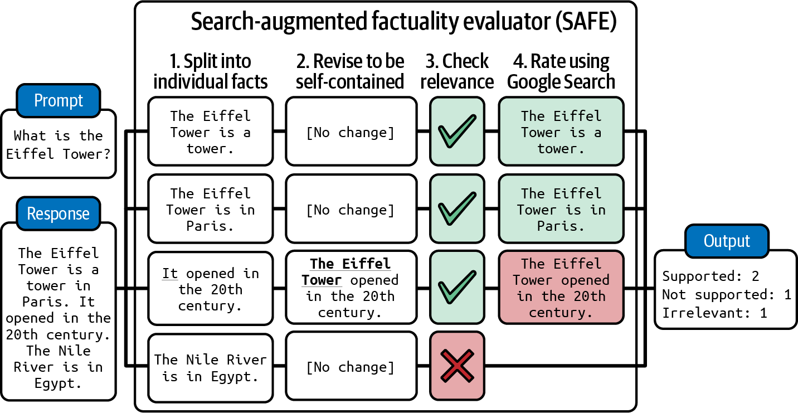

# 7 — Evaluating RAG and Grounding

> A RAG answer can fail in retrieval, in generation, or in the gap between them. Score each stage separately, score only the rows each stage could have got right, and check grounding claim by claim instead of asking a judge for a vibe.

*Context-side view (what to put in the window and how to measure that) is in [02/12](../../02-context-engineering/notes/12-evaluating-context.md). This chapter is the measurement machinery.*

---

## Split the pipeline

```mermaid
flowchart LR
  Q[query] --> W[rewrite<br/><i>rewrite hit</i>]
  W --> R[retrieve<br/><i>recall@k, hit rate</i>]
  R --> K[rerank<br/><i>MRR, nDCG@k</i>]
  K --> C[context<br/><i>context precision</i>]
  C --> G[generate<br/><i>faithful, complete</i>]
  G --> A[answer + citations<br/><i>citations valid</i>]
```

| Stage | Question | Metric | Needs |
|---|---|---|---|
| **Retrieval** | Did the right documents come back? | Recall@k, hit rate | Expected source IDs per row |
| **Ranking** | Were they near the top? | MRR, nDCG@k | Expected sources (graded relevance for nDCG) |
| **Context** | How much of the window is relevant? | Context precision | Relevance judgment per chunk |
| **Generation: faithfulness** | Is every claim supported by the context? | Supported claims / total claims | Context **text** |
| **Generation: completeness** | Did it answer every part? | Answered sub-questions / total | Decomposed question or reference |
| **Generation: relevance** | Does it address the question asked? | Judge | Query |
| **Citations** | Do citations point at sources that support the claim? | Citation precision / recall | Citation → passage mapping |

**Score generation only on rows where retrieval succeeded** (the `generation_eligible` pool, [03](03-eval-datasets.md#row-eligibility-is-this-row-fair-for-this-gate)). If the source wasn't retrieved, a bad answer is a retrieval failure. Counting it against generation sends you to fix the prompt when the index is the problem.

**Run a no-context baseline.** Ask the same questions with nothing retrieved. The gap between that score and the full system is what retrieval is really adding, and questions the model answers correctly without context aren't testing retrieval. OpenEQA, an embodied question-answering benchmark, found a "blind" GPT-4 that saw only the question scored 33.5, against 55.3 for GPT-4V given the video frames and 86.8 for humans. A third of the score came from priors about what's usually in a house, not from looking ([PDF](https://open-eqa.github.io/assets/pdfs/paper.pdf) (Majumdar et al., 2024-06); scored by a GPT-4 judge validated against human raters, [05](05-llm-as-judge.md#what-to-measure)).

---

## Retrieval metrics

| Metric | Definition | Use when |
|---|---|---|
| **Hit rate@k** | Fraction of queries with ≥ 1 relevant doc in top k | One good source is enough |
| **Recall@k** | Relevant docs in top k ÷ all relevant docs | The answer needs several sources |
| **Precision@k** | Relevant docs in top k ÷ k | Context window is tight; noise hurts |
| **MRR** | Mean of 1 / rank of first relevant doc | Users (or the model) read top-down |
| **nDCG@k** | Rank-discounted gain, normalized to the ideal ranking | Graded relevance (highly / partly / not) |

Pick *k* to match what actually goes into the prompt. Recall@50 is irrelevant if only the top 5 are passed to the model.

RAGAS's two retrieval metrics are not plain recall and precision (*LLM Engineer's Handbook*, ch. 7). **Context precision** is rank-aware: it rewards putting the relevant passages at the top, closer to nDCG than to precision@k. **Context recall** splits the *reference answer* into claims and checks how many can be attributed to the retrieved context, so it needs a ground-truth answer, not labeled sources. **Answer relevancy** is indirect too: an LLM writes several questions that the answer would fit, and the score is their mean cosine similarity to the real question. It catches off-topic or partial answers, and it inherits the embedding model's notion of similarity.

Getting **expected sources** is the expensive part. Options, cheapest first: the doc a support agent linked in the original ticket; the source a human-approved answer cited; an LLM judge labeling relevance of retrieved chunks (calibrate it, [05](05-llm-as-judge.md)); expert labeling.

---

## Faithfulness: claim by claim

"Is this answer faithful?" as one judge question is weak and lenient. Decompose:

1. **Extract claims.** A model splits the answer into atomic factual statements. "Go to Settings → Payouts and click Edit. Changes take 2 business days." → three claims.
2. **Verify each claim** against the retrieved passages: *supported*, *contradicted*, or *not found*.
3. **Score** = supported ÷ total. Report contradicted separately: a contradiction is worse than an omission.

This is the core of RAGAS faithfulness (Es et al. 2023) and of the case study's grounding grader ([case study](13-case-study-support-agent.md#grounding-claims-before-the-answer)). Benefits: partial credit, a pointer to the exact bad claim, and easier work for the judge than a holistic verdict.

RAGAS's own validation is thinner than its adoption suggests. On WikiEval (50 Wikipedia pages on post-2022 events, ChatGPT-written questions), its scores agreed with human preference **0.95 on faithfulness, 0.78 on answer relevance and 0.70 on context relevance** ([arXiv:2309.15217](https://arxiv.org/abs/2309.15217), Es et al., 2023-09). The task was pairwise: pick the better of two answers, where the worse one had been deliberately degraded (answered without context, left incomplete, or padded with off-topic sentences). That is easier than scoring a real answer on an absolute scale. Context relevance was weakest because the judge struggled to pick the key sentences out of long contexts. Treat the defaults as a starting point and calibrate them on your own labelled set before gating on them.

### Grounding tiers

Not every claim needs the same evidence. The case study grades on tiers:

| Tier | Claim type | Must be supported by |
|---|---|---|
| **Strict** | Specific facts: menu paths, numbers, prices, dates, policy | Verbatim or near-verbatim in a passage |
| **Paraphrase** | Explanations, procedures in other words | Semantically entailed by a passage |
| **General** | Greetings, hedges, common knowledge, "let me know if…" | Exempt |

Without tiers, a judge either fails harmless filler or waves through invented specifics.

The word "faithfulness" doesn't mean one thing across tools. MLflow, Ragas and LlamaIndex all ship a faithfulness judge, with different prompts and scales: 1–5, 0/1 and YES/NO (*AI Engineering*, ch. 3). A faithfulness number is only comparable to another from the same judge version ([05](05-llm-as-judge.md#three-judge-shapes)).

**A cheaper verifier for step 2.** Claim verification is textual entailment (NLI): given a premise (the passage) and a hypothesis (the claim), predict entailment, contradiction or neutral. A small trained classifier can do it instead of a general judge. Huyen's example is DeBERTa-v3-base-mnli-fever-anli, 184M parameters, trained on 764,000 annotated pairs (*AI Engineering*, ch. 4). It's cheap enough to run on every claim in production. Calibrate it like a judge: NLI models trained on general text can miss domain paraphrase.

**Check what the context added.** Iusztin & Labonne suggest comparing the answer with and without the retrieved context to measure integration (*LLM Engineer's Handbook*, ch. 7). If the two are the same, the generator ignored retrieval, and faithfulness can look fine because the model's prior happened to agree with the passage.

### Faithful is not correct

An answer can be perfectly faithful to a stale or wrong document. Faithfulness measures the generator. **Correctness** against a reference measures the system. Track both: faithful-but-wrong points at the corpus.

### Grounding without retrieval

For answers with no retrieved context (closed-book, or checking a model's own knowledge):

- **Self-consistency.** Sample several answers. Claims that vary between samples are likely hallucinated. SelfCheckGPT ([arXiv:2303.08896](https://arxiv.org/abs/2303.08896), Manakul et al., 2023-03) drew 20 samples per passage on 238 GPT-3 biographies from WikiBio. Asking an LLM whether each sentence is supported by each sample reached **AUC-PR 93.4 for flagging non-factual sentences** (random 73.0) and 0.78 Spearman with human passage rankings. That beat GPT-3's own token probabilities (87.5 at best). The cost is N extra generations plus one check per sentence per sample, and the test set was biographies only.
- **Search-backed checking.** SAFE (Wei et al., Google DeepMind, 2024) runs the claim-by-claim recipe against the web: split the response into facts, rewrite each to stand alone ("It opened in the 20th century" → name the subject), send fact-checking queries to Google Search, and have a model judge each fact against the results (*AI Engineering*, ch. 4). It's the same decomposition as RAGAS faithfulness, with search results as the context. It inherits search's blind spots, and it can't verify private facts.


*Image Source: Huyen, *AI Engineering* (O'Reilly, 2025), Fig. 4-1*

- **Adversarial factuality sets.** TruthfulQA ([arXiv:2109.07958](https://arxiv.org/abs/2109.07958), Lin et al., 2021-09) has 817 questions in 38 categories where the popular answer is false. At release, the best model (GPT-3-175B with a "helpful" prompt) was truthful on **58% against 94% for humans**. Within each model family the largest models were usually *least* truthful. The authors attribute this to larger models imitating human misconceptions more faithfully, and back it with control experiments. A GPT-3 judge fine-tuned on human labels predicted truthfulness with 90–96% accuracy on held-out models. That is an early case of a judge calibrated against humans ([05](05-llm-as-judge.md)). Good for measuring a model's tendency to repeat misconceptions. Its questions have been public since 2021, so check for contamination before trusting a high score.

**Point the closed-book suite at where hallucination concentrates.** Huyen found her model hallucinated most on two kinds of query: niche knowledge (the Vietnamese Mathematical Olympiad rather than the IMO) and questions about things that don't exist ("What did X say about Y?" when X never did) (*AI Engineering*, ch. 4). Read outputs to find your own two kinds, then weight the suite toward them ([02](02-defining-correct.md#find-failure-modes-by-reading-error-analysis)).

---

## Citation checks in code

Citations are one of the few places in RAG where code can grade semantics cheaply:

| Check | Code |
|---|---|
| **Citation exists** | Every cited ID / URL is in the retrieved set. Anything else is a `citation_hallucination` |
| **Quote is real** | Quoted text appears (fuzzy-matched) in the cited passage |
| **Coverage** | Every strict-tier claim has a citation |
| **Format** | Citation markers parse |

Then, with a judge: **citation precision** (does the cited passage support the sentence it's attached to?) and **citation recall** (is every claim that needs a citation cited?). ALCE (Gao et al. 2023) defines both and shows models citing irrelevant passages often.

---

## Pass the text, not the pointer

The most common grounding eval bug: the grader receives passage IDs or URLs instead of passage text, can't verify anything, and scores near zero, or worse, scores from its own knowledge. The case study's cross-check against RAGAS showed near-zero agreement for exactly this reason ([case study](13-case-study-support-agent.md#why-the-grounding-cross-check-showed-low-agreement)).

Guard against it in the grader interface (`requires = {"retrieved_context"}`, [04](04-graders.md#the-grader-interface)) and label it `context_missing` in the taxonomy. Assert in CI that grounding graders received non-empty text.

---

## Frameworks

| Framework | Gives you | Watch out for |
|---|---|---|
| **RAGAS** | Faithfulness, answer relevance, context precision / recall, reference-free | Generic definitions. Uncalibrated for your domain ([05](05-llm-as-judge.md#cross-checking-with-other-judges)) |
| **ARES** (Saad-Falcon et al. 2023) | Fine-tuned small judges + a small human set (~150 labels) with prediction-powered inference for confidence intervals. Beat RAGAS by 59 points on context-relevance and 14 on answer-relevance accuracy across KILT and SuperGLUE ([arXiv:2311.09476](https://arxiv.org/abs/2311.09476)) | Setup cost: synthetic training data plus judge fine-tuning per domain. Defaults: synthetic queries from google/flan-t5-xxl, classifier judges on microsoft/deberta-v3-large (*LLM Engineer's Handbook*, ch. 7). Worth it at volume |
| **DeepEval, TruLens, Phoenix evals** | Ready-made RAG judges, tracing integration | Same as RAGAS: calibrate before gating |

Iusztin & Labonne pair the two: RAGAS for quick iteration, ARES once trained for consistent and potentially faster evaluation at key stages (*LLM Engineer's Handbook*, ch. 7). Use frameworks to get started and for cross-checks. Gate on graders you've calibrated against your own labels.

---

## Checklist

- [ ] Retrieval, ranking, generation and citations scored separately
- [ ] Generation scored only on generation-eligible rows; ineligible rows reported as their own slice
- [ ] *k* matches what reaches the prompt
- [ ] Faithfulness by claim extraction + per-claim verification, with grounding tiers
- [ ] Citation existence and quotes checked in code
- [ ] Graders receive passage text; `context_missing` asserted in CI
- [ ] Correctness tracked alongside faithfulness

---

→ Next: [08-tracing-and-observability.md](08-tracing-and-observability.md) — the data every grader reads from.
