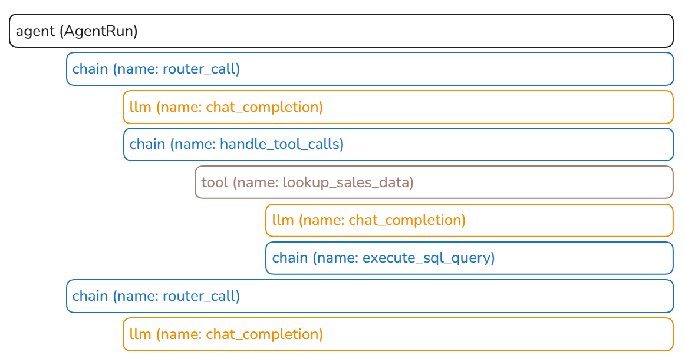
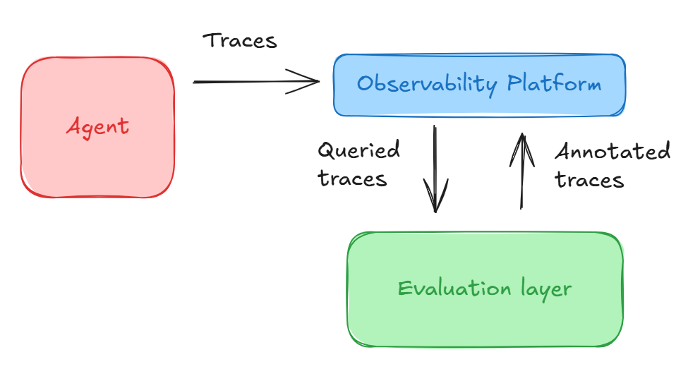

# 8 — Tracing and Observability

> You can't grade what you didn't record. A trace is the eval's raw material: every model call, tool call and retrieval as a span, with inputs, outputs, tokens and timing. Instrument once, and the same traces feed offline evals, production monitoring and debugging.

---

## Why traces come first

Final-output evals tell you *that* something failed. Traces tell you *where*. Without them:

- A trajectory grader ([06](06-evaluating-agents.md#scoring-tool-calls)) has nothing to read.
- A grounding grader can't see the retrieved text ([07](07-evaluating-rag-and-grounding.md#pass-the-text-not-the-pointer)).
- An efficiency regression (more steps, more tokens) is invisible.
- You can't tell an agent bug from an eval bug ([12](12-failure-modes.md#eval-bugs-look-like-agent-bugs)).

The DeepLearning.AI course makes tracing Lab 2, before any evaluator, for this reason.

---

## Anatomy of a trace

A **trace** is one end-to-end request. It's a tree of **spans**, each one unit of work:

```
invoke_agent  support-agent                       2.8s   $0.012
├── chat      claude-sonnet  (plan)               0.9s   1,840 in / 120 out
├── execute_tool  search_help_center              0.4s
│     └── retrieval: 5 chunks, top score 0.82
├── execute_tool  lookup_order (order_id=8812)    0.2s
└── chat      claude-sonnet  (answer)             1.3s   3,210 in / 260 out
```

Here is the course agent's trace in Phoenix. The agent span wraps two router turns. The first calls a tool, which makes its own LLM call and runs SQL. The second writes the answer:


*Image Source: DeepLearning.AI & Arize, Evaluating AI Agents (2025), Lab 2*

Auto-instrumentation gives you the LLM spans. Your own code adds the agent, chain and tool spans around them:

```python
tracer_provider = register(project_name=PROJECT)      # phoenix.otel: OTel exporter
OpenAIInstrumentor().instrument(tracer_provider=tracer_provider)  # every LLM call
tracer = tracer_provider.get_tracer(__name__)

@tracer.tool()                                         # tool span, args + result
def lookup_sales_data(prompt: str) -> str: ...

def run_agent(messages):
    with tracer.start_as_current_span("AgentRun", openinference_span_kind="agent") as span:
        span.set_input(value=messages)
        with tracer.start_as_current_span("router_call", openinference_span_kind="chain"):
            ...                                        # LLM spans nest in here
        span.set_output(value=answer)
        span.set_status(StatusCode.OK)
```

Name the spans after your agent's own steps (router, tool, skill), so a grader can select them by kind and name later ([06](06-evaluating-agents.md#evaluate-the-components-then-the-whole)).

### What each span should carry

| Span type | Record |
|---|---|
| **Agent / request** | User / session ID, prompt + config version, final output, outcome label, total cost |
| **Model call** | Model ID, full input messages, output, tokens in / out / cached, latency, finish reason |
| **Tool call** | Tool name, arguments, result (or error), latency |
| **Retrieval** | Query (after rewrite), returned IDs **and text**, scores, rank |
| **Guardrail / judge** | Verdict, reasoning, grader version |

Record **versions** on the root span: prompt, model, tool set, index, config. "Which change caused this?" is unanswerable without them.

### The questions a trace must answer

1. What did the user ask, and what did they get?
2. Which steps ran, in what order?
3. What did the model see at each step (the full context)?
4. Which tools were called with what, and what came back?
5. Where did the time and money go?
6. Which versions of everything were running?

If your traces can't answer one of these, that's the instrumentation gap to fix first.

---

## Use the standard: OpenTelemetry GenAI

OpenTelemetry's **GenAI semantic conventions** standardize span and attribute names, so traces work across tools:

| Convention | Example |
|---|---|
| Span operation names | `invoke_agent`, `chat`, `execute_tool`, `embeddings` |
| Model attributes | `gen_ai.request.model`, `gen_ai.response.model`, `gen_ai.response.finish_reasons` |
| Usage | `gen_ai.usage.input_tokens`, `gen_ai.usage.output_tokens` |
| Tools | `gen_ai.tool.name`, `gen_ai.tool.call.id` |

Instrument with OTel (or OpenInference, which Phoenix uses and maps to it), and you can switch backends without re-instrumenting. Most agent frameworks (LangGraph, ADK, OpenAI Agents SDK, Claude Agent SDK) emit these spans with a one-line setup.

---

## Tools

| Tool | Strength |
|---|---|
| **Arize Phoenix** | Open source, local-first. Traces + evals + experiments in one. The DLAI course uses it |
| **Langfuse** | Open source, self-hostable. Prompt management, datasets, scores on traces |
| **LangSmith** | Tight LangChain / LangGraph integration. Datasets, experiments, annotation queues |
| **Braintrust, W&B Weave** | Experiment-centric. Strong comparison views |
| **Your APM** (Datadog, Honeycomb, Grafana) | Already where ops looks. Accepts OTel GenAI spans |
| **Open-source ops stacks** (Grafana + Loki + Tempo, ELK, SigNoz) | Logs, traces and alerts beside service health, so SREs and AI engineers share one dashboard. No built-in evals: you push grader scores in as span attributes or metrics (*Building Applications with AI Agents*, ch. 10) |

Pick on: can it run evals over stored traces, attach scores back to spans, build datasets from traces, and compare two experiments side by side? Those four turn a trace viewer into an eval platform.

---

## Traces → evals → datasets

The loop that makes traces pay off:


*Image Source: DeepLearning.AI & Arize, Evaluating AI Agents (2025), Lab 3*

```
production traces ──sample──▶ graders (online) ──scores on spans──▶ dashboards / alerts
        │                                                                │
        └──── failures, 👎, escalations ──▶ triage ──▶ new eval rows ◀────┘
                                                          │
                                         offline experiments re-run on them
```

- **Scores live on spans.** Attach grader results to the trace they graded, so a bad score is one click from the full context.
- **Datasets come from traces.** Export a failing trace's input (and state) as a new row ([03](03-eval-datasets.md#harvest-from-failures)).
- **Offline and online share graders.** The same grader code runs in CI and on sampled production traffic. Two implementations drift apart.

---

## Cost and latency attribution

Traces are where cost lives. Roll up per span → per request → per user / feature / slice:

- **Cost per success**, not per call ([06](06-evaluating-agents.md#efficiency-metrics)).
- **Where tokens go.** System prompt, retrieved context, conversation history, tool results. Context bloat shows up as a rising input-token share of one category.
- **Cache hit rate** for prompt caching. A prompt change that breaks the cacheable prefix can double cost overnight.
- **Tail latency by step.** p95 is usually one slow tool or one long generation, not the whole pipeline.

---

## What to watch, and when to page someone

Huyen borrows three DevOps numbers to grade the monitoring itself (*AI Engineering*, ch. 10):

- **MTTD**, mean time to detection: how long until you notice something broke.
- **MTTR**, mean time to response: how long from detection to resolution.
- **CFR**, change failure rate: the share of deploys that need a fix or rollback. If you don't know it, the platform isn't observable enough. A high CFR is a signal for the offline eval pipeline ([10](10-evals-in-ci.md)), which should be catching bad changes before they ship.

Metrics detect, logs explain. Her example: metrics say something broke five minutes ago, and you go to the logs to see what. If the logs arrive 15 minutes late, MTTR can't beat 15 minutes. Since you can't know which log you'll need, **log everything**: model endpoint and name, sampling settings, prompt template, the final prompt, every intermediate output, every tool call and its output. Make every metric sliceable by user, release, prompt or chain version, and time. Start with the failures that are easiest to count and to fix, such as invalid JSON and other format errors.

Albada's alert examples for an agent (*Building Applications with AI Agents*, ch. 10):

| Alert | Example threshold |
|---|---|
| Hallucination rate | > 5% over the last 30 minutes |
| Retry loops | > 3 in one session |
| Critical-tool latency | average up > 50% |
| Task abandonment | > 15% |
| Retries across sessions | > 20% of sessions |
| Accuracy | drops > 5–10% over a rolling 24 hours |

These are illustrations, not measured thresholds. Set yours from your own baseline variance, or the pager will fire on noise. Distribution-drift statistics for inputs (KS, PSI, embedding distance) are covered in [11](11-production-and-the-maturity-ladder.md#drift).

**Failure or variation?** Albada's triage for a bad output: rerun it 3–5 times. If it fails more than 80% of the reruns, treat it as a systematic bug and send it to engineering. If it doesn't reproduce, compare it to the baseline distribution before acting. Expected variation gets logged for drift watch, not fixed. This is the per-task pass-rate distribution from [06](06-evaluating-agents.md#non-determinism-run-every-task-k-times) applied to one production trace.

---

## Privacy and retention

Traces contain user input, which means PII. Decide up front:

- What's redacted before storage (emails, card numbers, IDs).
- Who can see raw traces.
- How long they're kept, and whether eval rows derived from them inherit the same limit.
- Whether users consented to their conversations being used for evaluation.

Redact **at span export**, not in the dashboard. OTel exporters provide hooks for scrubbing data as spans leave the process, so raw PII never reaches the backend. Put raw traces behind role-based access control (*Building Applications with AI Agents*, ch. 10).

---

## Checklist

- [ ] Every model call, tool call and retrieval is a span with inputs, outputs, tokens, latency
- [ ] Retrieval spans carry passage text, not just IDs
- [ ] Root span records prompt / model / config / index versions
- [ ] OTel GenAI conventions (or OpenInference) used
- [ ] Grader scores attached back to spans
- [ ] One-click path from a failing trace to a new eval row
- [ ] Cost rolled up per request and per success
- [ ] PII redaction and retention policy in place

## Working reference

`~/.claude/refs/agent-observability.md` — span types, minimum attributes, cost attribution, the six questions.

---

→ Next: [09-reading-results.md](09-reading-results.md) — when a number changed, did anything change?
