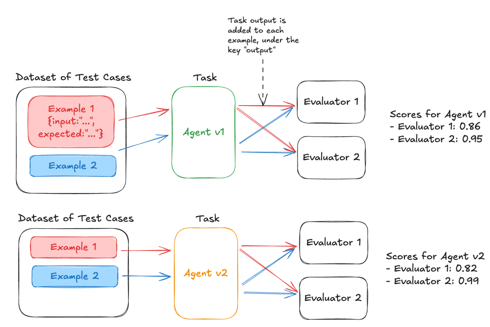
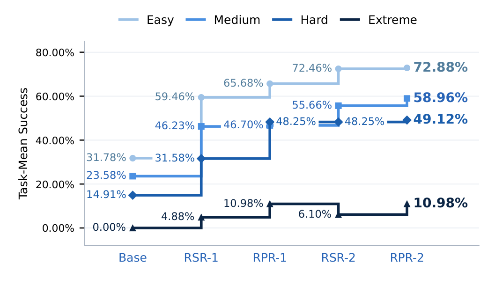

# 9 — Reading Results

> An eval score is an estimate from a sample, not a fact. Put an error bar on it, compare versions on the same tasks, and break it down by slice before deciding anything. Most "improvements" on small suites are noise.

---

## The error bar on a pass rate

A pass rate *p* measured on *n* independent tasks has a standard error of:

```
SE = √( p(1 − p) / n )          95% CI ≈ p ± 1.96 · SE
```

| n | p = 0.80 | 95% CI |
|---|---|---|
| 20 | SE 0.089 | 62% – 98% |
| 50 | SE 0.057 | 69% – 91% |
| 100 | SE 0.040 | 72% – 88% |
| 300 | SE 0.023 | 75% – 85% |
| 1,000 | SE 0.013 | 77% – 83% |

On 50 tasks, 80% and 72% are not distinguishable. That's the most important table in this chapter. Report the interval with every headline number.

For small *n* or *p* near 0 or 1, use the **Wilson interval** instead of the normal approximation. It doesn't produce bounds outside [0, 1].

---

## How many tasks

The question isn't "how big should the suite be?" It's "**what's the smallest change I need to detect?**"

Rough sizes for detecting a difference between two versions run on the *same* tasks (paired, 80% power, α = 0.05, pass rates around 70–85%):

| Smallest difference that matters | Tasks needed (roughly) |
|---|---|
| 15 points | 50–100 |
| 10 points | 100–200 |
| 5 points | 400–800 |
| 2 points | 2,500+ |

The paired range depends on how often the two versions disagree on the same task: fewer disagreements, fewer tasks needed. Unpaired comparisons need noticeably more.

OpenAI's rougher rule of thumb, as Huyen quotes it, assumes nothing about pairing: to be 95% confident that one system is better, a 30-point difference needs ~10 samples, 10 points ~100, 3 points ~1,000 and 1 point ~10,000. **Each 3× smaller difference needs 10× more samples** (*AI Engineering*, ch. 4). That matches the table above to within a factor of two at 10 points. Use whichever you have, and stop pretending a 2-point gap on 100 rows means something.

**A cheap stability check for the suite you already have:** bootstrap it. Draw 100 rows with replacement from your 100, score them, and repeat many times. If one resample gives 90% and another 70%, the suite is too small for the decisions you're making with it (*AI Engineering*, ch. 4).

Practical consequence: a 50-task golden set is a **smoke detector** for big regressions. It cannot tell you that a prompt tweak gained 3 points. Either grow the suite, or stop making decisions on 3-point differences.

---

## Compare on the same tasks: paired differences

When comparing version A and B, run both on the same tasks and analyze **per-task differences**, not two independent pass rates.

```
task   A    B    B − A
t1     1    1     0
t2     0    1    +1
t3     1    0    −1
t4     1    1     0
…
mean difference = Δ;  SE(Δ) = sd(differences) / √n
```

Most tasks pass or fail on both versions, so the differences are mostly zero, and the SE of the difference is much smaller than the SE of either rate. Miller (Anthropic, "Adding Error Bars to Evals", 2024) shows pairing can cut the variance of a comparison substantially for free. The paired variance is the unpaired one minus twice the covariance, so the saving grows with how often the two versions agree on a question. Two versions of the same agent usually agree on most questions, which is the best case ([arXiv:2411.00640](https://arxiv.org/abs/2411.00640)).

For binary outcomes, the same idea is **McNemar's test**: only the tasks where A and B disagree carry information. If B wins 14 and loses 6 of the 20 discordant tasks, that's evidence. If it wins 11 and loses 9, it isn't.

### A worked example that needs this

The DeepLearning.AI course's final lab runs exactly this setup. It uses one dataset and two agent versions, where v2 adds "Think before you respond." to the SQL-generation prompt. The same evaluators score both:


*Image Source: DeepLearning.AI & Arize, Evaluating AI Agents (2025), Lab 5*

```python
# Each evaluator sees the dataset row (input, expected) and the task output
def evaluate_sql_result(output, expected) -> bool:
    digits = lambda s: "".join(filter(str.isdigit, s))
    sql = next((r for r in output.get("tool_responses") or []
                if r["tool_name"] == "lookup_sales_data"), None)
    if sql is None:
        return True                     # course code: no SQL ran counts as a PASS
    return digits(sql["tool_response"]) == digits(expected["sql_result"])

for name in ("v1", "v2"):               # v2 = SQL prompt + "Think before you respond."
    run_experiment(dataset, run_agent_task, experiment_name=f"Overall {name}",
                   evaluators=[function_calling_eval, evaluate_sql_result,
                               evaluate_clarity, evaluate_entity_correctness,
                               code_is_runnable])
```

The lab ends with v1 and v2 side by side in the Phoenix UI. Read it with this note. The dataset is about **7 questions**, run once each. At n = 7 a single flipped task moves a rate by 14 points, so 0.82 vs 0.86 is noise. Pair by question, count the discordant tasks, and repeat each one k times before you conclude anything ([06](06-evaluating-agents.md#non-determinism-run-every-task-k-times)). Also check the graders before the agents. `evaluate_sql_result` passes silently when no SQL ran, and it compares only the digits in the result, so `1,200` and `12.00` match. A version that skips the SQL tool gets a perfect SQL score.

---

## Repeats and clustering

### Repeated trials

With *k* trials per task ([06](06-evaluating-agents.md#non-determinism-run-every-task-k-times)), first average the trials **within** each task, then compute the SE across tasks. Treating 100 tasks × 5 trials as 500 independent samples understates the error bar, because trials of the same task are correlated.

Repeats reduce the noise from sampling randomness within each task. They don't reduce noise from *which tasks you picked*. For that you need more tasks. Beyond a few repeats, more tasks beat more repeats.

### Clustered tasks

If tasks come in groups (10 questions about the same document, 5 turns of one conversation), they're not independent either. Use **clustered standard errors** (cluster by document or conversation). Miller reports clustered SEs over 3× larger than naive ones on DROP (1.34 vs. 0.44), about 1.9× on MGSM and barely different on RACE-H. How much clustering matters depends on how strongly questions within a cluster move together. Ignoring clustering makes results look more certain than they are.

---

## Slice before you conclude

A flat headline can hide a win and a loss that cancel out:

| Slice | n | A | B | Δ |
|---|---|---|---|---|
| Billing | 120 | 82% | 90% | +8 |
| How-to | 150 | 88% | 89% | +1 |
| Non-English | 40 | 75% | 58% | **−17** |
| **Overall** | 310 | 84% | 85% | +1 |

"+1 overall" would ship a change that breaks non-English users. Always break results down by the slices you labeled ([03](03-eval-datasets.md#coverage-and-balance)), and show *n* per slice so nobody over-reads a 12-task slice.

Slicing by difficulty does the same job for capability claims. Yang et al. (2026) fixed four difficulty strata over 322 terminal-agent tasks, then tracked each stratum across training stages. The headline mean rose steadily. The strata did not: Easy climbed from 32% to 73%, while Extreme went 0 → 4.9 → 11.0 → **6.1** → 11.0%. That dip at the fourth stage is invisible in the aggregate.


*Image Source: Yang et al. (2026), Figure 10*

Watch for **Simpson's paradox**: B can beat A in every slice and lose overall (or the reverse) if the slice mix differs between runs. Huyen's example, using numbers from a 1986 kidney-stone study (*AI Engineering*, ch. 4):

| | Group 1 | Group 2 | Overall |
|---|---|---|---|
| Model A | **93%** (81/87) | **73%** (192/263) | 78% (273/350) |
| Model B | 87% (234/270) | 69% (55/80) | **83%** (289/350) |

A wins both groups and loses overall, because most of A's rows are in the harder group. Compare on identical task sets.

### Too many slices

Slice 20 ways and one will show a "significant" change by chance at α = 0.05. Treat surprising slice results as hypotheses to confirm on fresh data, not conclusions. Pre-register the slices that gate releases.

The same arithmetic applies to testing several fixes at once. At 95% confidence each, the chance that at least one of 6 parallel hypotheses is a false positive is 1 − 0.95⁶ ≈ **26%**. Either tighten the per-test threshold (Bonferroni: α / number of tests) or re-run every positive result as an independent confirmation and believe it only if it replicates.

**When the difference is smaller than the noise, don't switch.** 100 tasks at 70% gives a standard error of about 4.6 points, so the 95% interval is ±9. "73% vs 70%" is inside the noise. Run the paired test first ([above](#compare-on-the-same-tasks-paired-differences)). Grow the sample only if that's still inconclusive.

---

## Read the transcripts

Numbers say how much. Transcripts say why. Before accepting any change in a score:

1. Pull 10–20 tasks that **flipped** (pass → fail and fail → pass).
2. Read them. Is the flip real, or a grader quirk, an infra error, a flaky task?
3. If fails are mostly one failure label, that's your story. If they're scattered, it may be noise.

Anthropic's guidance puts it plainly: you won't know whether your graders work unless you read transcripts and grades together.

---

## From a benchmark report to hypotheses

A report's value is the hypotheses it suggests, not the headline number. Li's AndroidWorld walkthrough (*AI Agents in Depth*, ch. 6; the data is illustrative) shows the method:

1. **Check the eval first.** Before blaming the agent on a 0% cluster, confirm the tasks, environment and grader work ([12](12-failure-modes.md#eval-bugs-look-like-agent-bugs)).
2. **Cross per-task results with capability tags** (settings navigation, transcription, complex UI, …). Failures concentrated in one tag point to one cause.
3. **Tier the hypotheses by cost:**

| Tier | Example | Run when |
|---|---|---|
| **Surface** (prompt hints, tool descriptions) | "Add a hint for finding Wi-Fi settings" | First. They're cheap and independent, so test them in parallel (and correct for multiple comparisons, above) |
| **Mid** (new tools, workflow changes) | "Add a transcription tool" | Surface fixes leave the tag below target |
| **Deep** (swap model, add UI-tree input, post-train) | "Use a stronger vision model" | Only if the tag is still below, say, 40% after the cheaper tiers |

4. **Weigh each fix's gain against its cost.** "+75 points on settings tasks for +8% input tokens" is a different decision from a gain at 3× cost. Don't deploy a fix whose gain is inside the noise.
5. **Re-run the full benchmark.** Fixing one cluster reveals the next failure pattern, so the loop starts again.

A **model swap** is one deep hypothesis among others. Run it the same way, on your own eval set, with paired comparison, and compare on success, tool-call accuracy, latency and cost. It is not a shortcut.

Lab: AndroidWorld report → improvement ([upstream `chapter7/android-world`](https://github.com/bojieli/ai-agent-book/tree/main/chapter7/android-world)).

---

## Metric pitfalls

From the KDD 2017 "Dirty Dozen" paper on online experiments, the ones that bite LLM evals most:

| Pitfall | In LLM evals |
|---|---|
| **Metric sample ratio mismatch** | Version B errored on 8% of tasks, which were dropped. B's pass rate is over its easier 92% |
| **Ratio metrics with changing denominators** | "Grounding rate" rose because B answers fewer questions (refuses more) |
| **Novelty effects** | Online, users engage more with any change for the first week |
| **Overall vs. segment confusion** | The slicing problem above |
| **Ignoring the error bar** | Shipping on +2 points over 50 tasks |

Rule: **count errors and refusals as failures**, or report them as their own rate. Never let them silently leave the denominator.

### A cautionary write-up

The fine-tuning evaluation in *LLM Engineer's Handbook* (ch. 7) shows how many of these pitfalls fit in one table. Two fine-tuned 8B models and Llama-3.1-8B-Instruct answered 334 test prompts. A GPT-4o-mini judge scored each answer once, at temperature 0.8, on 1–3 scales for accuracy and style:

| Model | Accuracy | Style |
|---|---|---|
| TwinLlama-3.1-8B (SFT) | 2.45 | 2.04 |
| TwinLlama-3.1-8B-DPO | 2.46 | 2.12 |
| Llama-3.1-8B-Instruct | 2.62 | 1.86 |

The text reads the 0.08 style gap between DPO and SFT as DPO "leading" and the 0.16 accuracy gap as Instruct having "a slight edge". There's no error bar, no repeat run of a sampled judge, no paired comparison and no human check of the style judge. Any of those gaps may be noise. The chapter's best advice is the qualitative step: read the answers, because reading catches mistakes like a wrong chat template or the wrong model being loaded, which no score will flag.

---

## Report template

```
Suite: support-golden v4 (n=310, 3 trials/task)     Judge: grounding-v2 (calibrated, TNR 0.88)
                    A (prod)        B (candidate)   Δ (paired)
Pass rate           84.2% ±3.9      85.1% ±3.8      +0.9  [−1.6, +3.4]
  Non-English (40)  75.0% ±13       57.5% ±15       −17.5 [−29, −6]    ⚠
Errors / refusals   1.3%            4.2%                                ⚠
Steps (median)      4               4
Cost per success    $0.014          $0.016          +14%
Flipped tasks read: 18 / 18 — 9 of 11 regressions are `refusal` on non-English
Decision: do not ship. Investigate refusal behavior for non-English.
```

---

## Checklist

- [ ] Every headline number has a 95% CI
- [ ] Suite size chosen from the smallest difference that matters
- [ ] Comparisons paired on identical tasks; SE of the difference reported
- [ ] Trials averaged within task; clustered SEs where tasks group
- [ ] Results broken down by labeled slices with n
- [ ] Errors and refusals counted, not dropped
- [ ] Flipped transcripts read before any decision

---

→ Next: [10-evals-in-ci.md](10-evals-in-ci.md) — turning a result into a gate.
