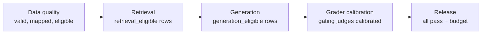

# 10 — Evals in CI

> An eval nobody runs protects nothing. Put the cheap suites on every change and the expensive ones on a schedule, separate *running* from *asserting*, and make each gate say what failed and what to do next.

---

## What runs when

Not every eval belongs on every commit. Tier by cost and speed:

| Trigger | Suite | Graders | Budget | Blocks? |
|---|---|---|---|---|
| **Every commit / PR** | Unit tests + smoke eval (10–30 tasks) | Code only | Seconds–minutes, ~$0 | Yes |
| **PR touching prompts, tools, retrieval** | Regression suite | Code + calibrated judges on a sample | Minutes, a few $ | Yes |
| **Nightly** | Full suite, k trials | All, including experimental (tracked) | Hours | Alerts, not blocks |
| **Pre-release** | Full suite + held-out test + adversarial | All calibrated | As needed | Yes: release gate |
| **Model / provider change** | Everything, paired against current prod ([09](09-reading-results.md#compare-on-the-same-tasks-paired-differences)) | All | As needed | Yes |

Use path filters so a README change doesn't trigger a $40 judge run.

---

## Two phases: run, then assert

Split the eval job into two steps with an artifact between them:

```
Phase 1: RUN                              Phase 2: ASSERT
  for each task × trial:                    load results.jsonl
    run SUT, capture trace                  compute metrics + CIs per slice
    run graders                             compare to baseline / thresholds
    write row → results.jsonl               emit pass/fail per gate + report
  (slow, costly, non-deterministic)         (fast, free, deterministic)
```

Why:

- **Re-assert without re-running.** Change a threshold or add a slice and recompute in seconds.
- **Debug the gate separately from the system.** If the assert step crashes, you haven't lost a $30 run.
- **Results are an artifact.** Upload them, diff them against the last run, attach them to the PR.
- **Flakiness is visible.** Retries and infra errors are recorded in phase 1, not swallowed.

The case study's harness splits each suite this way: an execution step writes rows, and pytest assertions read them ([case study](13-case-study-support-agent.md#harness-patterns)).

---

## The regression gate

A regression gate compares a candidate against a **baseline**, not just a fixed threshold:

| Rule type | Example | Catches |
|---|---|---|
| **Absolute floor** | Schema validity ≥ 99%. Citation hallucination = 0 | Never-events |
| **Relative to baseline** | Grounding not more than 3 points below prod (paired, CI excludes −3) | Regressions |
| **Per-slice floor** | No labeled slice drops > 10 points | Hidden slice regressions ([09](09-reading-results.md#slice-before-you-conclude)) |
| **Efficiency budget** | Cost per success ≤ 1.2 × baseline. p95 latency ≤ 8 s | Silent cost blow-ups |
| **Regression set** | Previously fixed failures: ≥ 95% pass | Re-breaking old bugs |

Gate on the **confidence interval**, not the point estimate. "Block if the upper bound of Δ is below −3" won't block on noise. "Block if Δ < 0" blocks on noise half the time.

Update the baseline deliberately: after a release, store its results as the new baseline with the dataset and grader versions.

---

## The gate ladder

Inside a mature suite, gates are **ordered by pipeline stage**. A later gate only runs on the rows an earlier one says are fair ([03](03-eval-datasets.md#row-eligibility-is-this-row-fair-for-this-gate)):



| Gate | Checks | Fails when |
|---|---|---|
| **Data quality** | Rows valid, mapped, deduplicated, eligibility labeled | Schema errors, unmapped sources above threshold |
| **Retrieval** | Recall / MRR on `retrieval_eligible` rows | Below floor or regressed |
| **Generation** | Grounding, completeness on `generation_eligible` rows | Below floor or regressed |
| **Grader calibration** | Gating judges are `calibrated`, calibration not stale | A gating judge is experimental or out of date |
| **Release** | All above pass. Efficiency within budget | Any upstream failure |

This is distinct from the **maturity ladder** ([11](11-production-and-the-maturity-ladder.md#the-ladder)), which orders the stages of *building* an eval practice. The gate ladder orders checks *within* one run.

### What a gate emits

Every gate produces the same shape, so failures are actionable:

```json
{
  "gate": "generation",
  "passed": false,
  "metrics": {"grounding": {"value": 0.81, "ci": [0.77, 0.85], "baseline": 0.86}},
  "rows_scored": 212, "rows_ineligible": 38,
  "top_failure_labels": {"unsupported_claim": 19, "incomplete_answer": 7},
  "worst_slices": [{"slice": "lang=de", "n": 31, "value": 0.64}],
  "next_action": "Inspect unsupported_claim rows in lang=de; likely prompt change in #412"
}
```

A gate that only says `FAILED` sends someone on a half-day hunt.

Write the gates down as a **contract**: a small config file (e.g. `evals/gates.yaml`) that the assert step reads, so thresholds change by reviewed diff and not by someone editing a script. Per gate it records:

| Field | Example |
|---|---|
| Runs on pool | `generation_eligible` |
| Graders (name · version · state) | `grounding · v3 · calibrated` |
| Fails when (absolute) | `schema_valid < 0.99` |
| Fails when (vs. baseline) | upper bound of paired Δ grounding < −0.03 |
| Fails when (per slice) | any slice with n ≥ 20 drops > 10 points |
| Efficiency budget | cost per success ≤ 1.2 × baseline; p95 latency ≤ budget |
| Blocks | merge / release / nothing (alert only) |

Changing a threshold is a reviewed change with a reason, like changing a test. A full eight-gate contract for a RAG system is worked through in [13](13-case-study-support-agent.md#the-gate-ladder).

---

## A CI workflow

Two jobs: a cheap **smoke** job (code graders only, one trial) on every relevant PR, and a **regression** job that runs only if smoke passes. A nightly cron runs the full suite and alerts instead of blocking. The core of the regression job:

```yaml
on:
  pull_request:
    paths: ["prompts/**", "src/agent/**", "src/retrieval/**", "evals/**"]
  schedule:
    - cron: "0 3 * * *"                    # nightly full suite
jobs:
  regression:
    needs: smoke                           # smoke = code graders only, --trials 1
    steps:
      # Phase 1: run. Costly, non-deterministic; records infra errors, never drops rows
      - run: python -m evals.run --suite regression --trials 3 --concurrency 8 --cache .eval-cache --out results.jsonl
        env: {ANTHROPIC_API_KEY: "${{ secrets.EVAL_API_KEY }}"}   # separate, spend-capped key
      - uses: actions/upload-artifact@v4
        if: always()
        with: {name: eval-results, path: results.jsonl}
      # Phase 2: assert. Free, deterministic; paired comparison against the stored baseline
      - run: python -m evals.assert results.jsonl --baseline baselines/prod.jsonl --contract evals/gates.yaml --report report.md
        continue-on-error: ${{ github.event_name == 'schedule' }}  # nightly alerts, doesn't block
      - if: always()
        run: cat report.md >> "$GITHUB_STEP_SUMMARY"            # PR summary
```

Practical details:

- **Secrets and cost caps.** Give the eval job its own API key with a spend limit.
- **Concurrency.** Run tasks in parallel with a rate limiter; respect provider limits or you'll grade 429s.
- **Infra failures ≠ eval failures.** Retry transient errors, then report them as their own count. Never as a task fail, never silently dropped ([09](09-reading-results.md#metric-pitfalls)).
- **Caching.** Cache SUT outputs by (input, config hash) and judge outputs by (output hash, judge version) for re-runs.
- **Pin everything.** Model IDs, judge versions, dataset version. Record them in `results.jsonl`.

---

## Ownership

Anthropic describes eval suites as living artifacts: a team owns the infrastructure, while domain experts contribute tasks and read results. Make that explicit:

- **Infra owner**: runner, CI, dashboards, cost.
- **Criteria owner** ([02](02-defining-correct.md#one-person-decides)): pass/fail definitions, the taxonomy, calibration sign-off.
- **Every engineer**: adds a row when they fix a bug.

---

## Checklist

- [ ] Smoke suite (code graders) on every PR; regression suite on relevant paths
- [ ] Run and assert are separate steps with `results.jsonl` between them
- [ ] Gates compare to a stored baseline using CIs, not point estimates
- [ ] Per-slice floors and efficiency budgets, not just the headline
- [ ] Gates run in pipeline order and respect eligibility
- [ ] Each gate emits metrics, failure labels, worst slices and a next action
- [ ] Infra errors counted separately; eval job has its own capped key
- [ ] Owners named for infra and criteria

---

→ Next: [11-production-and-the-maturity-ladder.md](11-production-and-the-maturity-ladder.md) — evals after launch.
