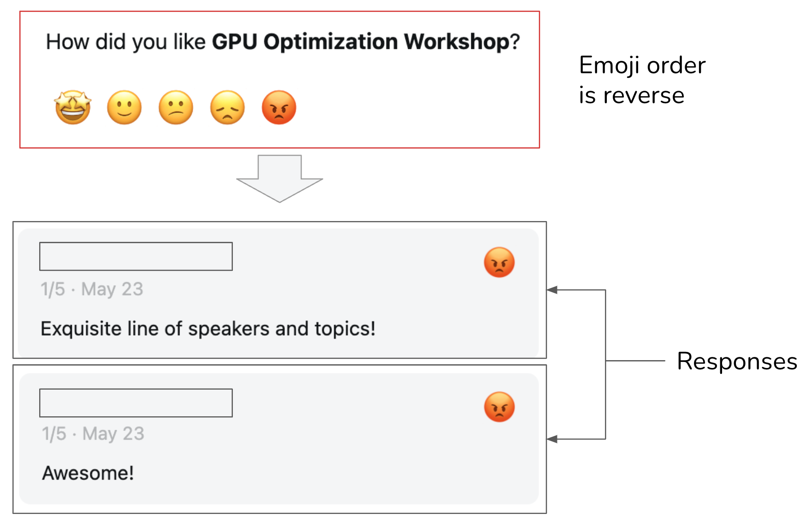

# 11 — Production and the Maturity Ladder

> Offline evals predict. Production tells you. Sample live traffic by rule, grade it with the same graders, keep humans calibrating the judge, and alert on drift from the baseline you set at launch. Then climb: every production failure becomes tomorrow's regression row.

---

## The ladder

Where to start when a system has no evals, and what each level buys:

| Level | What exists | Catches | Misses |
|---|---|---|---|
| **0** | Manual review ("vibes") | Whatever you happen to look at | Everything else |
| **1** | Deterministic gates: tests, schema checks, linters on hooks | Structural failures | Anything needing judgment |
| **2** | Separated evaluator: fresh context, operates the output | Behavioral failures | Failures not in your sample |
| **3** | Eval sets from real failures + tracing | Regressions, and *where* a run broke | Slow drift in production |
| **4** | Continuous production sampling with drift alerts | Divergence from baseline over time | — |

**Most systems sit at level 0. Production needs level 3 or above.** "We'll add evals later" usually means "we'll have no signal when this breaks".

What each step needs:

- **0 → 1:** highest return per effort. No LLM in the loop. Catches the structural failures that would otherwise eat judge budget ([04](04-graders.md#code-graders-more-than-you-think)).
- **1 → 2:** a reviewer that didn't write the output and has no stake in it, ideally one that *runs* it rather than reads it ([03/05](../../03-harness-engineering/notes/05-verification-loops.md#separating-generation-from-evaluation)).
- **2 → 3:** two things together, neither enough alone: rows harvested from observed failures ([03](03-eval-datasets.md#harvest-from-failures)), and traces of every step ([08](08-tracing-and-observability.md)).
- **3 → 4:** the same graders running on sampled live traffic, with a baseline and alerts. This chapter.

The ladder orders the *building* of an eval practice. The gate ladder ([10](10-evals-in-ci.md#the-gate-ladder)) orders checks *within* a run.

---

## Offline vs. online

| | Offline | Online |
|---|---|---|
| **Data** | Curated dataset | Live traffic |
| **Reference** | Usually available | Usually not. Reference-free graders only |
| **When** | Before shipping | After shipping, continuously |
| **Answers** | "Is B better than A on known tasks?" | "Is it working for real users now?" |
| **Blind spot** | Tasks you didn't think of | Can't test before exposure |

They share graders ([08](08-tracing-and-observability.md#traces--evals--datasets)). Online graders must be **reference-free**: grounding against retrieved context, policy checks, format, efficiency, judge criteria that don't need a gold answer.

---

## Sampling live traffic

Grade **10–20% of traces**, chosen by rule rather than purely at random:

| Rule | Why |
|---|---|
| **Negative feedback** (👎, complaint, "that's wrong") | Explicit failures. Grade 100% of these |
| **Escalations / handoffs to humans** | The system gave up or the user forced it to |
| **High cost** (tokens or steps above threshold) | Often an agent going in circles |
| **Long conversations** | Compounding errors, frustration |
| **Fixed-window random sample** | Daily random slice so normal traffic stays covered and rates stay unbiased |
| **After any model / prompt change** | Elevated or full review for the first 48 hours |

Keep the **random sample separate** when you report rates. The rule-based samples are deliberately skewed toward failures, so they're for finding problems, not for estimating the overall pass rate.

---

## Two-layer online review

Neither humans nor judges are enough on their own:

1. **Human layer.** People review a rule-based sample (errors, long dialogues, negative feedback), label pass/fail and the reason. This finds new failure patterns and produces calibration data.
2. **Judge layer.** Calibrated LLM judges score a much wider slice of traffic, using the human labels as their calibration basis ([05](05-llm-as-judge.md#keep-it-calibrated)).

Judges alone drift: nobody notices the criteria moving. Humans alone don't cover real traffic at scale. Run both, and track human–judge agreement on the overlap as its own metric.


*Image Source: course diagram (this repo)*

---

## Drift

Performance changes after launch even when you change nothing:

| Source | Example |
|---|---|
| **Model updates** | Provider ships a new snapshot behind the same alias |
| **Input shift** | New product launch, new user segment, seasonal questions |
| **Upstream changes** | A tool API changes its response shape. Docs get rewritten |
| **Corpus staleness** | The index lags the source of truth |

Detecting it:

1. **Capture a baseline at launch**: online grader scores, efficiency metrics, feedback rate, escalation rate, per slice.
2. **Run the same pipeline continuously** on the sample.
3. **Alert on divergence** beyond a margin that accounts for noise ([09](09-reading-results.md)). Daily rates on small samples are noisy; use rolling windows.
4. **Watch the inputs too.** Topic or intent mix shifting (cluster embeddings of queries, compare to the baseline mix) warns you before quality metrics move. Make it a test rather than an eyeball: keep a reference window (launch traffic) and a test window (recent traffic) and compare them with a two-sample test. Use Kolmogorov–Smirnov for a numeric feature such as query length or tool calls per turn, chi-squared for a categorical one such as intent label, and maximum mean discrepancy (MMD) over query embeddings for the text itself (*LLM Engineer's Handbook*, appendix). `alibi-detect` ships `KSDrift` and `MMDDrift`. The p-value is the alert threshold: too loose and the channel fills with false alarms people learn to ignore. The data side of this (data, concept and prediction drift, and Evidently reports) is in [data-engineering 05](../../../data-engineering/05-quality-and-observability/notes/01-monitor.md#three-kinds-of-drift).
5. **Rule out plumbing before reacting.** An alert is first a question: is the data valid, did a schema change, is it one outlier? Only a real shift justifies re-tuning the prompt, the index or the model (*LLM Engineer's Handbook*, appendix).

Pin model versions where the provider allows it, so "drift" is something you chose.

---

## Online experiments

When offline evals can't settle a question (tone, engagement, real resolution), A/B test:

- **Primary metric** tied to the outcome: resolution without escalation, task completion, retention.
- **Guardrail metrics** that must not regress: grounding, policy violations, latency, cost per success.
- **Pre-declare** the metric, sample size and duration ([09](09-reading-results.md#how-many-tasks)). Peeking and stopping on a good day inflates false positives.
- **Watch the novelty effect**: early engagement lifts often fade ([09](09-reading-results.md#metric-pitfalls)).
- **Ramp**: 1% → 10% → 50% with guardrail checks at each step.
- **Separate the mechanism from the target.** If the change is "shorter plan files", plan length is the *mechanism* (what you change), not the *target* (session cost). Shorter plans can cause more edit–check–edit loops and raise total cost. Optimize the target.
- **Test several doses, not just on/off.** A control plus three progressively stricter variants shows the dose–response curve and where the optimum sits.
- **Record baselines**: sample size, percentiles, correlations ("rejection rate rises with plan size"). Without them you can't tell signal from noise.

Two steps come before an A/B test, and one comes after it (*Building Applications with AI Agents*, ch. 10):

- **Shadow mode.** The new version runs on the same live inputs as production, but users never see its output. Give both versions' spans a shared request ID so you can diff them per request: tool selection, latency, tokens, hallucination rate. You learn what breaks on real traffic at zero user risk. You can't learn anything that depends on the user's reaction.
- **Canary.** Serve the new version to 1–5% of traffic. Tag every trace with the version, compare success rate, latency, tool use and errors against the baseline, and alert on a significant regression. Roll back at once if it fails.
- **Regression trace collection.** Export every production failure trace (hallucination, planning error, tool misuse) into the test suite automatically. Once the fix lands, that trace should pass. This is the improvement loop below, wired to the trace store.

---

## User feedback as signal

| Signal | Strength | Weakness |
|---|---|---|
| **Explicit** (👍/👎, ratings) | Direct | Sparse (often < 1–2% of turns) and biased toward extremes |
| **Implicit** (rephrasing, abandonment, escalation, copy) | Plentiful | Ambiguous: a short session may be success or giving up |
| **Downstream outcomes** (ticket reopened, refund reversed) | Closest to value | Delayed, hard to attribute |

Feedback is a sampling rule and a calibration label ([05](05-llm-as-judge.md#the-procedure)), not a metric to optimize directly. Optimizing 👍 rate rewards flattery.

Attach feedback to the trace, and to the span it is about where you can, so a 👎 lands next to the retrieval or tool call that caused it (LangSmith supports this; *Learning LangChain*, ch. 10).

### Implicit signals worth logging

Huyen's list of signals you can read from the conversation itself (*AI Engineering*, ch. 10):

- **Early termination.** The user stops generation, leaves the app, or leaves the agent waiting for an answer.
- **Error correction.** A follow-up starting "No, …" or "I meant …", a rephrase, or a correction ("Bill is the suspect, not the victim"). "Are you sure?" and "Show me the sources" may mean the answer lacked detail or the user distrusts it, not that it was wrong.
- **Edits.** A user editing the generated code or text is a strong negative signal. Each edit is also a free preference pair: the edited version wins, the original loses.
- **Refusals** ("As a language model, I can't…") usually mean an unhappy user.
- **Regeneration.** Often dissatisfaction, but in creative apps users also regenerate just to see options.
- **Conversation length.** Its meaning depends on the app: long is good for a companion and bad for customer support. Read it with dialogue diversity (distinct tokens or topics). A long conversation where the bot repeats itself means the user is stuck in a loop.

Signals that cost the user nothing are designed in, not bolted on. Midjourney shows four images and offers upscale (strong positive for that image), variations (weaker positive) or regenerate (none of them is good enough). Copilot shows a grey draft that the user accepts with Tab or ignores by typing on. Both read as normal use, not as a feedback form.

**Complaints cluster.** Clustering the natural-language feedback in the FITS dataset (Xu et al. 2022, clustering by Yuan et al. 2023) gives a shape worth knowing before you build your own taxonomy:

| Feedback type | Share |
|---|---|
| Restates or clarifies the request | 26.54% |
| Didn't answer, irrelevant, or told the user to find it themselves | 16.20% |
| Points to a search result that answers the question | 16.17% |
| Tells the bot to use the search results | 15.27% |
| Factually incorrect or not grounded in the search results | 11.27% |
| Not specific, accurate, complete or detailed enough | 9.39% |
| Hedges too much ("I am not sure") | 4.17% |
| Repetitive or rude | 0.99% |

FITS is a search-grounded chatbot, so the grounding-related rows are high by design. Treat the table as a starting point for axial coding ([02](02-defining-correct.md#find-failure-modes-by-reading-error-analysis)), not as your distribution.

### Feedback has biases

Explicit feedback is sparse, especially with few users, and skews negative because unhappy users are more likely to bother. Implicit feedback is plentiful but noisy: one person shares conversations to show off a glaring mistake, another to share a useful answer. Huyen's list of biases (*AI Engineering*, ch. 10):

- **Leniency.** People rate higher than they mean to, especially if a low rating triggers a "why?" form. In 2015 Uber's average driver rating was 4.8, and drivers below 4.6 risked deactivation. Look at the rating distribution. Labelled options ("Pretty good", "Could've been better", "Don't match me with this driver again") get more granular answers than bare numbers.
- **Randomness.** Shown two long answers side by side, users often click one without reading either.
- **Position.** The first suggestion gets more clicks whether or not it's better. Randomize the order, or model the success rate per position.
- **Preference.** Length is easier to notice than errors, so people pick the longer answer. Recency bias favours the last answer seen. These are the same biases LLM judges have ([05](05-llm-as-judge.md)).
- **Broken UI.** Huyen's workshop feedback form on Luma put the angry emoji (one star) where five stars should be, so happy attendees left 1/5 ratings alongside positive comments. Test the form before trusting the numbers.


*Image Source: Huyen, *AI Engineering* (O'Reilly, 2025), Fig. 10-21*

Visibility changes behaviour too. People are more candid when their feedback is private (Midjourney's upscale, variation and regenerate choices were public in its early days).

**Degenerate feedback loops.** You only get feedback on what you showed. If feedback trains the system, its own outputs shape the next round of feedback and the first bias grows. A few early users like cat photos, the system makes more cats, cat lovers arrive and rate cats highly, and the product becomes a cat app. The same loop can amplify racism, sexism or explicit content. Trained on user approval, models learn to say what users want to hear: Sharma et al. (2023) found models trained on human feedback tend toward sycophancy, agreeing with the user's stated view.

---

## The production layer around the agent

Evals sit inside a wider set of things a production agent needs. The ones that touch evaluation:

| Piece | Eval connection |
|---|---|
| **Fallback and escalation logic** | Escalation correctness is an eval dimension. Wrong escalations are a failure label |
| **Human-in-the-loop checkpoints** | Every human correction is a labeled example, *if* it's logged |
| **Audit logging** | The same traces serve debugging, compliance and evals ([08](08-tracing-and-observability.md)) |
| **Handoff protocol** (agent ↔ agent, agent ↔ human) | Handoffs are failure points. Evaluate what context transferred, and whether it was enough |

---

## Eval infrastructure inside the product

The best agent products also evaluate themselves from the inside. Li draws four practices from Claude Code–style agents (*AI Agents in Depth*, ch. 6):

| Practice | What it is | Why it matters for evals |
|---|---|---|
| **Ablation switches** | One master switch turns off the major features (thinking, compaction, memory, background tasks) to give a bare-model baseline. Every feature can also be turned off on its own | Answers "does this feature help, or does it just feel useful?" Running it before each release finds **feature debt**: features newer models no longer need. Wire it in early in startup, before config is captured |
| **Two-layer feature flags** | *Compile-time* flags remove the code from builds. *Runtime* flags are served by the server and cached on disk. The agent starts on stale config rather than block. Exposure is logged once per session | Clean ablations (the code is gone, not skipped), gradual rollout, kill switches, and uncontaminated A/B exposure data |
| **Prompt rendering snapshots** | Render the full system prompt at any commit, with all conditions expanded. Rendering must be deterministic | Answers "which commit changed the prompt, and what did it do to the eval set?" Every prompt change runs the regression suite, like code in CI ([10](10-evals-in-ci.md)) |
| **Privacy-typed analytics** | The analytics API only accepts values wrapped in types whose name certifies that the value has no user content | Lets you collect eval data from production without leaking content ([08](08-tracing-and-observability.md#privacy-and-retention)) |

---

## From eval environment to training environment

A good eval environment is close to a reinforcement-learning environment. A rubric or validator is a **verifiable reward** (RLVR): the grading script becomes the reward script. SWE-Gym, for example, builds training tasks from SWE-bench-style repos. Training adds demands evals don't have:

- **Reliable reset.** Millions of episodes, each from a deterministic clean state. Leftover state corrupts the gradient.
- **Throughput.** Environments must run much faster and more in parallel. Sandboxed MCP servers (AWorld: 26 servers, 126 tools for GAIA) avoid rate limits and side effects of live APIs.
- **Fidelity vs. randomization.** Higher fidelity transfers better but costs more. Moderate **domain randomization** (positions, names, appearance) improves generalization. Too much makes tasks unlearnable.

Post-training itself: [gen-AI 05-RL](../../../generative-ai/05-RL/README.md).

---

## Climbing: the improvement loop

```
production traffic → sample → grade (human + judge) → failures labeled with taxonomy
       ▲                                                          │
       │                                                          ▼
   ship B ◀── gates pass ◀── offline eval on new rows ◀── fix (prompt / tools / retrieval)
```

- Each confirmed failure becomes a discovery-set row, then a regression row once fixed ([03](03-eval-datasets.md#harvest-from-failures)).
- Capability evals that reach high pass rates graduate into the regression suite ([01](01-what-an-eval-is.md)).
- When the suite saturates, add harder tasks ([12](12-failure-modes.md#saturation)).

Automating this loop (an agent proposing fixes and an eval accepting or rejecting them) is self-improvement, covered in [04/08](../../04-loop-engineering/notes/08-self-improving-loops.md). The eval is what keeps that loop honest.

---

## Checklist

- [ ] Honest answer to "what level are we on?"
- [ ] Online graders are reference-free and share code with offline graders
- [ ] 10–20% sampled by rule, plus a separate random sample for rates
- [ ] Full review for 48 hours after any model or prompt change
- [ ] Human layer calibrating the judge layer; agreement tracked
- [ ] Launch baseline stored; drift alerts on rolling windows; input mix monitored
- [ ] A/B tests pre-declared with guardrail metrics
- [ ] Production failures flow back into the dataset

---

→ Next: [12-failure-modes.md](12-failure-modes.md) — how evals themselves go wrong.
