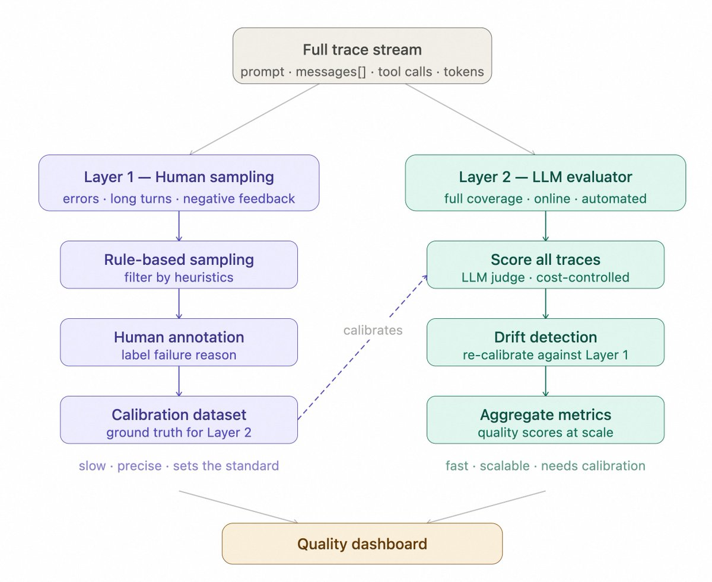

# 11 — Production and the Maturity Ladder

> Offline evals predict. Production tells you. Sample live traffic by rule, grade it with the same graders, keep humans calibrating the judge, and alert on drift from the baseline you set at launch. Then climb: every production failure becomes tomorrow's regression row.

---

## The ladder

Where to start when a system has no evals, and what each level buys:

| Level | What exists | Catches | Misses |
|---|---|---|---|
| **0** | Manual review ("vibes") | Whatever you happen to look at | Everything else |
| **1** | Deterministic gates: tests, schema checks, linters on hooks | Structural failures | Anything needing judgment |
| **2** | Separated evaluator: fresh context, operates the output | Behavioral failures | Failures not in your sample |
| **3** | Eval sets from real failures + tracing | Regressions, and *where* a run broke | Slow drift in production |
| **4** | Continuous production sampling with drift alerts | Divergence from baseline over time | — |

**Most systems sit at level 0. Production needs level 3 or above.** "We'll add evals later" usually means "we'll have no signal when this breaks".

What each step needs:

- **0 → 1:** highest return per effort. No LLM in the loop. Catches the structural failures that would otherwise eat judge budget ([04](04-graders.md#code-graders-more-than-you-think)).
- **1 → 2:** a reviewer that didn't write the output and has no stake in it, ideally one that *runs* it rather than reads it ([03/05](../../03-harness-engineering/notes/05-verification-loops.md#separating-generation-from-evaluation)).
- **2 → 3:** two things together, neither enough alone: rows harvested from observed failures ([03](03-eval-datasets.md#harvest-from-failures)), and traces of every step ([08](08-tracing-and-observability.md)).
- **3 → 4:** the same graders running on sampled live traffic, with a baseline and alerts. This chapter.

The ladder orders the *building* of an eval practice. The gate ladder ([10](10-evals-in-ci.md#the-gate-ladder)) orders checks *within* a run.

---

## Offline vs. online

| | Offline | Online |
|---|---|---|
| **Data** | Curated dataset | Live traffic |
| **Reference** | Usually available | Usually not. Reference-free graders only |
| **When** | Before shipping | After shipping, continuously |
| **Answers** | "Is B better than A on known tasks?" | "Is it working for real users now?" |
| **Blind spot** | Tasks you didn't think of | Can't test before exposure |

They share graders ([08](08-tracing-and-observability.md#traces--evals--datasets)). Online graders must be **reference-free**: grounding against retrieved context, policy checks, format, efficiency, judge criteria that don't need a gold answer.

---

## Sampling live traffic

Grade **10–20% of traces**, chosen by rule rather than purely at random:

| Rule | Why |
|---|---|
| **Negative feedback** (👎, complaint, "that's wrong") | Explicit failures. Grade 100% of these |
| **Escalations / handoffs to humans** | The system gave up or the user forced it to |
| **High cost** (tokens or steps above threshold) | Often an agent going in circles |
| **Long conversations** | Compounding errors, frustration |
| **Fixed-window random sample** | Daily random slice so normal traffic stays covered and rates stay unbiased |
| **After any model / prompt change** | Elevated or full review for the first 48 hours |

Keep the **random sample separate** when you report rates. The rule-based samples are deliberately skewed toward failures, so they're for finding problems, not for estimating the overall pass rate.

---

## Two-layer online review

Neither humans nor judges are enough on their own:

1. **Human layer.** People review a rule-based sample (errors, long dialogues, negative feedback), label pass/fail and the reason. This finds new failure patterns and produces calibration data.
2. **Judge layer.** Calibrated LLM judges score a much wider slice of traffic, using the human labels as their calibration basis ([05](05-llm-as-judge.md#keep-it-calibrated)).

Judges alone drift: nobody notices the criteria moving. Humans alone don't cover real traffic at scale. Run both, and track human–judge agreement on the overlap as its own metric.



---

## Drift

Performance changes after launch even when you change nothing:

| Source | Example |
|---|---|
| **Model updates** | Provider ships a new snapshot behind the same alias |
| **Input shift** | New product launch, new user segment, seasonal questions |
| **Upstream changes** | A tool API changes its response shape. Docs get rewritten |
| **Corpus staleness** | The index lags the source of truth |

Detecting it:

1. **Capture a baseline at launch**: online grader scores, efficiency metrics, feedback rate, escalation rate, per slice.
2. **Run the same pipeline continuously** on the sample.
3. **Alert on divergence** beyond a margin that accounts for noise ([09](09-reading-results.md)). Daily rates on small samples are noisy; use rolling windows.
4. **Watch the inputs too.** Topic or intent mix shifting (cluster embeddings of queries, compare to the baseline mix) warns you before quality metrics move.

Pin model versions where the provider allows it, so "drift" is something you chose.

---

## Online experiments

When offline evals can't settle a question (tone, engagement, real resolution), A/B test:

- **Primary metric** tied to the outcome: resolution without escalation, task completion, retention.
- **Guardrail metrics** that must not regress: grounding, policy violations, latency, cost per success.
- **Pre-declare** the metric, sample size and duration ([09](09-reading-results.md#how-many-tasks)). Peeking and stopping on a good day inflates false positives.
- **Watch the novelty effect**: early engagement lifts often fade ([09](09-reading-results.md#metric-pitfalls)).
- **Ramp**: 1% → 10% → 50% with guardrail checks at each step.

---

## User feedback as signal

| Signal | Strength | Weakness |
|---|---|---|
| **Explicit** (👍/👎, ratings) | Direct | Sparse (often < 1–2% of turns) and biased toward extremes |
| **Implicit** (rephrasing, abandonment, escalation, copy) | Plentiful | Ambiguous: a short session may be success or giving up |
| **Downstream outcomes** (ticket reopened, refund reversed) | Closest to value | Delayed, hard to attribute |

Feedback is a sampling rule and a calibration label ([05](05-llm-as-judge.md#the-procedure)), not a metric to optimize directly. Optimizing 👍 rate rewards flattery.

---

## The production layer around the agent

Evals sit inside a wider set of things a production agent needs. The ones that touch evaluation:

| Piece | Eval connection |
|---|---|
| **Fallback and escalation logic** | Escalation correctness is an eval dimension. Wrong escalations are a failure label |
| **Human-in-the-loop checkpoints** | Every human correction is a labeled example, *if* it's logged |
| **Audit logging** | The same traces serve debugging, compliance and evals ([08](08-tracing-and-observability.md)) |
| **Handoff protocol** (agent ↔ agent, agent ↔ human) | Handoffs are failure points. Evaluate what context transferred, and whether it was enough |

---

## Climbing: the improvement loop

```
production traffic → sample → grade (human + judge) → failures labeled with taxonomy
       ▲                                                          │
       │                                                          ▼
   ship B ◀── gates pass ◀── offline eval on new rows ◀── fix (prompt / tools / retrieval)
```

- Each confirmed failure becomes a discovery-set row, then a regression row once fixed ([03](03-eval-datasets.md#harvest-from-failures)).
- Capability evals that reach high pass rates graduate into the regression suite ([01](01-what-an-eval-is.md)).
- When the suite saturates, add harder tasks ([12](12-failure-modes.md#saturation)).

Automating this loop (an agent proposing fixes and an eval accepting or rejecting them) is self-improvement, covered in [04/08](../../04-loop-engineering/notes/08-self-improving-loops.md). The eval is what keeps that loop honest.

---

## Checklist

- [ ] Honest answer to "what level are we on?"
- [ ] Online graders are reference-free and share code with offline graders
- [ ] 10–20% sampled by rule, plus a separate random sample for rates
- [ ] Full review for 48 hours after any model or prompt change
- [ ] Human layer calibrating the judge layer; agreement tracked
- [ ] Launch baseline stored; drift alerts on rolling windows; input mix monitored
- [ ] A/B tests pre-declared with guardrail metrics
- [ ] Production failures flow back into the dataset

---

→ Next: [12-failure-modes.md](12-failure-modes.md) — how evals themselves go wrong.
