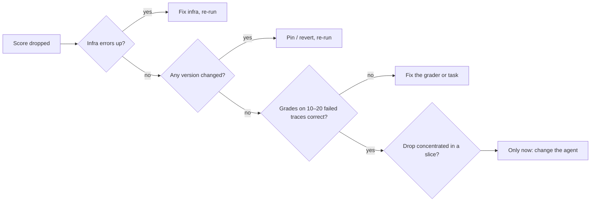

# 12 — When Evals Go Wrong

> An eval is software and a measurement, so it fails both ways: bugs that produce wrong scores, and right scores that stop meaning what you think. When a number moves, suspect the eval before the agent.

---

## Eval bugs look like agent bugs

A score drop is a claim that the system got worse. Often it's the eval that changed or broke:

| Cause | Looks like | Example |
|---|---|---|
| **Infra failure** | Tasks failing | Timeouts, rate limits (429s), OOM, sandbox didn't start |
| **Grader bug** | Correct outputs marked wrong | Regex too strict, judge given URLs not text (`context_missing`) |
| **Broken task** | A task at 0% for every version | Unreachable state, wrong reference, missing permission |
| **State leakage** | Flaky, order-dependent failures | Trial 2 sees files trial 1 wrote |
| **Stale reference** | "Wrong" answers that are now right | Docs updated, gold answer wasn't |
| **Version mismatch** | A jump on no change | Judge model updated, dataset v3 vs v4 |
| **Dropped rows** | A jump in pass rate | Errored tasks silently left the denominator ([09](09-reading-results.md#metric-pitfalls)) |

### The debug order

When a score drops:

1. **Infrastructure.** Errors, timeouts, rate limits, resource limits. Are error counts up?
2. **Versions.** Did the dataset, grader, judge model or config change between runs?
3. **Traces and grader decisions.** Read 10–20 failed transcripts *with* their grades. Is the grade right?
4. **Slices.** Is the drop concentrated in one category? That points at a cause.
5. **Only then** change the model, prompt, tools or agent logic.

Skipping to step 5 means "fixing" an agent that wasn't broken, and sometimes breaking it.

---

## Saturation

A suite near 100% has stopped measuring. It can't show improvement, and it may hide new failures that its tasks never probe. Saturation is a signal that the tasks no longer reach the system's capability boundary, not that the problem is solved.

What to do:

- **Graduate it.** Saturated capability tasks become the regression suite, which *should* sit near 100% ([01](01-what-an-eval-is.md)).
- **Add harder tasks** from the discovery set, new use cases, longer horizons, adversarial variants.
- **Raise the bar**: pass^k instead of pass@1 ([06](06-evaluating-agents.md#non-determinism-run-every-task-k-times)), stricter grounding tier, tighter efficiency budget.

Public benchmarks saturate the same way. A benchmark everyone scores 90%+ on can't separate models.

---

## Goodhart: the eval becomes the target

"When a measure becomes a target, it ceases to be a good measure." Optimize hard against any eval and you'll find its gaps:

| Gap exploited | Example |
|---|---|
| **Grader leniency** | Answers padded until the verbosity-biased judge passes them |
| **Narrow checks** | Code agent edits the tests instead of the code. Output matches the schema with empty content |
| **Proxy metric** | 👍 rate optimized → flattery. Escalation rate cut → refuses to escalate when it should |
| **Visible tests** | Agent overfits to tests it can see |

Partial credit is a common version of the proxy gap. Yang et al. (2026) trained terminal agents on a dense reward: the fraction of checker tests passed. Under that reward, **failed trajectories collected 50% of all reward mass**, and 48 failures passed every executed scenario check yet still failed the task's terminal gate. Their fix kept the partial credit, because it helps exploration, but kept it *subordinate* to verified completion. Strict success means the full protected verifier passes, not the agent declaring itself done or a subset of checks passing. Rescoring under that rule cut the failures' share of reward to 29%. The lesson for any eval: when you award partial credit, report strict success beside it, and never let the sum of the partial scores outrank completion.

Defenses:

- **Multiple dimensions** with guardrails, never a single score ([04](04-graders.md#combining-graders-scoring-design)).
- **Held-out tests** the optimizer (human or agent) can't see ([04/03](../../04-loop-engineering/notes/03-the-scorekeeper.md)).
- **Read the transcripts** of the biggest gains, not just the losses.
- **Rotate and refresh** the suite from production.

This bites hardest in automated loops, where an optimizer runs thousands of iterations against your grader. A loop finds a grader's blind spot faster than any human ([04/08](../../04-loop-engineering/notes/08-self-improving-loops.md)).

---

## Overfitting the dev set

Every prompt tweak you keep because it scored better on the eval set is fitting to that set. After enough iterations, dev-set gains stop transferring.

- Keep a **held-out test** set; look at it rarely (per release, not per change) ([03](03-eval-datasets.md#splits-versioning-contamination)).
- If dev and test diverge, you've overfit. Freshen dev from production.
- Small suites overfit faster: on 50 tasks, one lucky flip is 2 points.
- Same for judges: tune on the dev split of human labels, report on test ([05](05-llm-as-judge.md#the-procedure)).

---

## Contamination

The model may have seen your eval data:

- **Public benchmarks** leak into pre-training. High scores may be memory, not skill. Prefer private, recent, or regenerated tasks.
- **Your own leaks**: eval rows pasted into few-shot examples, fine-tuning data built from logs that include eval rows, eval rows in the retrieval index.
- **Detection**: performance far above similar unseen tasks; the model completes a task's text verbatim; scores drop on paraphrased versions.

---

## Judge drift and misuse

| Problem | Fix |
|---|---|
| Judge model silently updated | Pin the version; re-calibrate on change ([05](05-llm-as-judge.md#keep-it-calibrated)) |
| Criteria drift: the team's idea of "pass" moved but the judge didn't | Version criteria; re-label a sample when they change ([02](02-defining-correct.md#criteria-drift)) |
| Uncalibrated judge used as a release gate | Grader states: experimental never gates ([04](04-graders.md#grader-states-which-ones-can-block-a-release)) |
| Judge from the same family as the SUT | Different model family ([05](05-llm-as-judge.md#known-biases)) |
| Generic off-the-shelf metric trusted because it's popular | Calibrate against your labels; expect inversions ([case study](13-case-study-support-agent.md#calibration-results)) |

---

## Measuring the wrong thing

The quietest failure: everything works and the metric doesn't track what users care about.

- **Generic metrics** ("helpfulness", "coherence") instead of metrics from error analysis ([02](02-defining-correct.md#find-failure-modes-by-reading-error-analysis)).
- **Wrong unit**: per-turn scores look fine while conversations fail to resolve.
- **Wrong denominator**: grounding rate rises because the system answers less ([09](09-reading-results.md#metric-pitfalls)).
- **Offline–online gap**: eval set doesn't look like production traffic any more.

Check periodically that offline scores **predict** online outcomes. If the version that won offline doesn't win online, the eval is measuring something else.

---

## Eval debt

Sculley et al.'s "Hidden Technical Debt in ML Systems" applies directly. Evals accumulate debt:

- Graders nobody remembers the reason for.
- Thresholds set once and never revisited.
- Rows whose references went stale.
- Two copies of a grader (CI and production) that drifted apart.
- Dashboards nobody reads.

Schedule maintenance: review failure labels quarterly, prune dead rows, re-calibrate judges, retire metrics nobody acts on.

---

## Checklist

- [ ] Debug order followed before touching the agent: infra → versions → traces → slices
- [ ] Infra errors, dropped rows and version changes visible in every report
- [ ] Saturated tasks graduated; harder tasks added
- [ ] Multiple dimensions + guardrails; biggest gains read, not just losses
- [ ] Held-out test set, rarely viewed
- [ ] Eval rows kept out of prompts, fine-tuning data and indexes
- [ ] Judge versions pinned; criteria versioned
- [ ] Offline wins checked against online outcomes
- [ ] Eval maintenance on a schedule

---

## Working reference

`~/.claude/refs/verification.md` — the verification ladder and the generator/evaluator split, from the harness side.

---

→ Next: [13-case-study-support-agent.md](13-case-study-support-agent.md) — every chapter applied to one real system. Practice: [practice/exercises.md](../practice/exercises.md).
