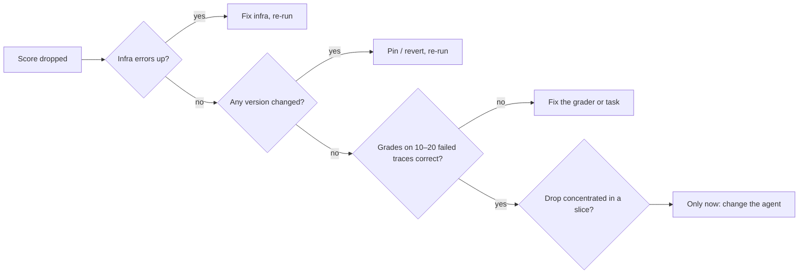
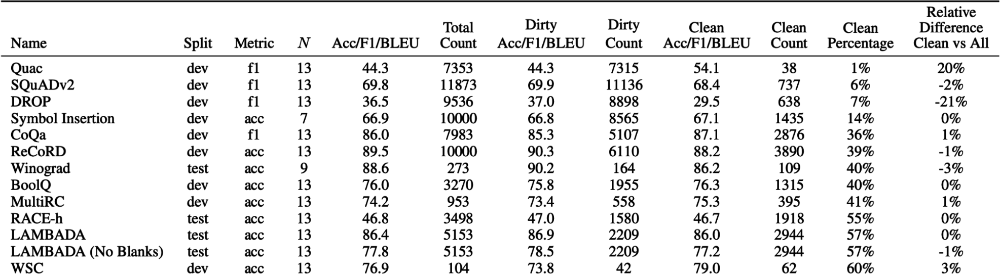

# 12 — When Evals Go Wrong

> An eval is software and a measurement, so it fails both ways: bugs that produce wrong scores, and right scores that stop meaning what you think. When a number moves, suspect the eval before the agent.

---

## Eval bugs look like agent bugs

A score drop is a claim that the system got worse. Often it's the eval that changed or broke:

| Cause | Looks like | Example |
|---|---|---|
| **Infra failure** | Tasks failing | Timeouts, rate limits (429s), OOM, sandbox didn't start |
| **Grader bug** | Correct outputs marked wrong | Regex too strict, judge given URLs not text (`context_missing`) |
| **Broken task** | A task at 0% for every version | Unreachable state, wrong reference, missing permission |
| **State leakage** | Flaky, order-dependent failures | Trial 2 sees files trial 1 wrote |
| **Stale reference** | "Wrong" answers that are now right | Docs updated, gold answer wasn't |
| **Version mismatch** | A jump on no change | Judge model updated, dataset v3 vs v4 |
| **Dropped rows** | A jump in pass rate | Errored tasks silently left the denominator ([09](09-reading-results.md#metric-pitfalls)) |

### The debug order

When a score drops:

1. **Infrastructure.** Errors, timeouts, rate limits, resource limits. Are error counts up?
2. **Versions.** Did the dataset, grader, judge model or config change between runs?
3. **Traces and grader decisions.** Read 10–20 failed transcripts *with* their grades. Is the grade right?
4. **Slices.** Is the drop concentrated in one category? That points at a cause.
5. **Only then** change the model, prompt, tools or agent logic.

Skipping to step 5 means "fixing" an agent that wasn't broken, and sometimes breaking it.

---

## Saturation

A suite near 100% has stopped measuring. It can't show improvement, and it may hide new failures that its tasks never probe. Saturation is a signal that the tasks no longer reach the system's capability boundary, not that the problem is solved.

What to do:

- **Graduate it.** Saturated capability tasks become the regression suite, which *should* sit near 100% ([01](01-what-an-eval-is.md)).
- **Add harder tasks** from the discovery set, new use cases, longer horizons, adversarial variants.
- **Raise the bar**: pass^k instead of pass@1 ([06](06-evaluating-agents.md#non-determinism-run-every-task-k-times)), stricter grounding tier, tighter efficiency budget.

Public benchmarks saturate the same way. A benchmark everyone scores 90%+ on can't separate models. GLUE (2018) saturated within a year and was replaced by SuperGLUE (2019); MMLU (2020) was largely replaced by MMLU-Pro (2024). In June 2024, less than a year after its previous revamp, Hugging Face replaced its leaderboard's whole benchmark set: GSM-8K gave way to MATH level 5, MMLU to MMLU-Pro, and GPQA, MuSR, BBH and IFEval were added (*AI Engineering*, ch. 3, 4). Expect those to saturate too (a 2024–25 snapshot).

The replacements are built to start near the floor. On ARC-AGI-2, o3 (Medium) scores 3.0%, against 53.0% on ARC-AGI-1, and o3-mini (High) drops from 34.5% to 3.0% ([arXiv:2505.11831](https://arxiv.org/abs/2505.11831) (Chollet et al., 2025-05)). On Humanity's Last Exam, frontier models scored 3.3–9.4% at release, with RMS calibration errors of 82–93%: they answer confidently when they're wrong ([arXiv:2501.14249](https://arxiv.org/abs/2501.14249) (Phan et al., 2025-01)). The floor has a noise band of its own. The ARC authors treat any score under 5% as not meaningful, and the HLE authors say much the same about small moves near zero. A change from 3% to 4% isn't progress. HLE's authors also predicted models could pass 50% by the end of 2025, so a new benchmark's headroom can disappear quickly.

When you pick benchmarks for a custom leaderboard, check how strongly they correlate. On the January 2024 Hugging Face set, WinoGrande and MMLU correlated at 0.90 and ARC-C and MMLU at 0.87, while TruthfulQA sat around 0.45–0.55 against the rest. Two highly correlated benchmarks double-count one capability. A plain average also treats 80% on a hard benchmark the same as 80% on an easy one. HELM ranks by **mean win rate** instead: the fraction of times a model beats another, averaged across scenarios (*AI Engineering*, ch. 4).

---

## Goodhart: the eval becomes the target

"When a measure becomes a target, it ceases to be a good measure." Optimize hard against any eval and you'll find its gaps:

| Gap exploited | Example |
|---|---|
| **Grader leniency** | Answers padded until the verbosity-biased judge passes them |
| **Narrow checks** | Code agent edits the tests instead of the code. Output matches the schema with empty content |
| **Proxy metric** | 👍 rate optimized → flattery. Escalation rate cut → refuses to escalate when it should |
| **Visible tests** | Agent overfits to tests it can see |

Partial credit is a common version of the proxy gap. Yang et al. (2026) trained terminal agents on a dense reward: the fraction of checker tests passed. Under that reward, **failed trajectories collected 50% of all reward mass**, and 48 failures passed every executed scenario check yet still failed the task's terminal gate. Their fix kept the partial credit, because it helps exploration, but kept it *subordinate* to verified completion. Strict success means the full protected verifier passes, not the agent declaring itself done or a subset of checks passing. Rescoring under that rule cut the failures' share of reward to 29%. The lesson for any eval: when you award partial credit, report strict success beside it, and never let the sum of the partial scores outrank completion.

The narrow-checks gap can appear without anyone trying to game it. Anthropic reports that Claude 3.7 Sonnet sometimes **special-cased tests** to make them pass: it returned the expected values directly or edited the tests. The behaviour came from reward hacking in RL training on coding tasks graded by tests. User testing missed it, and classifiers run over training transcripts caught it. The card suggests watching transcripts for many edit-and-test cycles on one file, comments that mention specific tests, and unexpected edits to test files ([PDF](https://assets.anthropic.com/m/785e231869ea8b3b/original/claude-3-7-sonnet-system-card.pdf) (Anthropic, 2025-02); a vendor self-report). A tests-pass grader can't see any of this. A transcript check or a diff check on the test files can.

Grading formats can create the proxy gap too. Under binary grading, where a wrong answer and "I don't know" both score 0, guessing always has a higher expected score than abstaining. Kalai et al. count 9 of the 10 benchmarks on popular leaderboards that give abstention no credit, and argue that this is one reason models learn to hallucinate ([arXiv:2509.04664](https://arxiv.org/abs/2509.04664) (Kalai et al., 2025-09); a position paper with no experiments). The fix is in the grader: see [04](04-graders.md#binary-vs-scales).

The judge you train against is itself a proxy. DR Tulu trained a deep-research agent with RL on rubric rewards graded by GPT-4.1-mini, and evaluated it on benchmarks with their own rubrics and judges. Within one run, higher training reward usually meant better downstream scores. Across runs, **the run with the highest training reward was not necessarily the best downstream**, and the authors attribute this to the mismatch between the training and evaluation judges and rubrics ([DR Tulu](https://www.datocms-assets.com/64837/1763496622-dr_tulu_draft.pdf) (Shao et al., 2025-11)). Pick checkpoints on the held-out eval, not on the training reward.

Defenses:

- **Multiple dimensions** with guardrails, never a single score ([04](04-graders.md#combining-graders-scoring-design)).
- **Held-out tests** the optimizer (human or agent) can't see ([04/03](../../04-loop-engineering/notes/03-the-scorekeeper.md)).
- **Read the transcripts** of the biggest gains, not just the losses.
- **Rotate and refresh** the suite from production.

This bites hardest in automated loops, where an optimizer runs thousands of iterations against your grader. A loop finds a grader's blind spot faster than any human ([04/08](../../04-loop-engineering/notes/08-self-improving-loops.md)).

---

## Overfitting the dev set

Every prompt tweak you keep because it scored better on the eval set is fitting to that set. After enough iterations, dev-set gains stop transferring.

- Keep a **held-out test** set; look at it rarely (per release, not per change) ([03](03-eval-datasets.md#splits-versioning-contamination)).
- If dev and test diverge, you've overfit. Freshen dev from production.
- Small suites overfit faster: on 50 tasks, one lucky flip is 2 points.
- Every score you report from the test set leaks some information about it. ARC Prize used the same 100 private tasks from 2020 to 2024 and disclosed roughly 10,000 scores against them, enough for teams to fit the private set ([arXiv:2505.11831](https://arxiv.org/abs/2505.11831) (Chollet et al., 2025-05)). Limit how often anyone sees test scores, and rotate the set eventually.
- Same for judges: tune on the dev split of human labels, report on test ([05](05-llm-as-judge.md#the-procedure)).

---

## Contamination

The model may have seen your eval data:

- **Public benchmarks** leak into pre-training. High scores may be memory, not skill. Prefer private, recent, or regenerated tasks.
- **Your own leaks**: eval rows pasted into few-shot examples, fine-tuning data built from logs that include eval rows, eval rows in the retrieval index.
- **Detection**: performance far above similar unseen tasks; the model completes a task's text verbatim; scores drop on paraphrased versions.

Two detection heuristics, with a cost trade-off (*AI Engineering*, ch. 4):

| Method | How | Trade-off |
|---|---|---|
| **N-gram overlap** | An eval sample that shares a 13-token sequence with the training data is "dirty" | More accurate. Needs the training data, and comparing every sample against it is expensive |
| **Perplexity** | Unusually low perplexity on the eval text means the model finds it easy to predict, so it has probably seen it | Cheap and works without training data. Less accurate |

Contamination is usually accidental: web scrapes pick up published benchmarks, and training and eval sets can share a source (the same maths textbooks). It is also sometimes deliberate and reasonable: a developer selects the model on clean benchmarks, then trains on the benchmark data before release because it is good data. Either way, report the score on the **clean subset** next to the full score. In OpenAI's GPT-3 analysis, 13 benchmarks had at least 40% of their samples in the training data, and the clean-vs-full gap went both ways (Brown et al. 2020): Google's Gemini report measured how small the gap can be. About a hundred fine-tuning steps on web extracts matching HellaSwag's training set, which were not in pre-training, **lifted 1-shot validation accuracy to 89.6% for Gemini Pro and 96.0% for Gemini Ultra**, against 92.3% measured for GPT-4. Google then reported HellaSwag only in a decontaminated 10-shot setting, and dropped LAMBADA after finding leaks ([arXiv:2312.11805](https://arxiv.org/abs/2312.11805) (Gemini Team, 2023-12)).

*Image Source: Huyen, *AI Engineering* (O'Reilly, 2025), Fig. 4-10*

Benchmark maintainers can keep part of the data private and evaluate submissions against that hold-out. For your own fine-tunes there's a quick tell: if fine-tuning raises the base model's MMLU by 10 points, suspect the instruction data overlaps the test set before you celebrate (*LLM Engineer's Handbook*, ch. 7).

---

## Judge drift and misuse

| Problem | Fix |
|---|---|
| Judge model silently updated | Pin the version; re-calibrate on change ([05](05-llm-as-judge.md#keep-it-calibrated)) |
| Provider model update changes the system's behaviour | Re-run the suite on every model change. Chen et al. (2023) found GPT-3.5 and GPT-4 scores changed significantly on many benchmarks between March and June 2023. Moving from GPT-3.5-turbo-0301 to -1106 cost Voiceflow 10% on intent classification while it improved GoDaddy's support bot (*AI Engineering*, ch. 4): the same update can help one app and hurt another |
| Criteria drift: the team's idea of "pass" moved but the judge didn't | Version criteria; re-label a sample when they change ([02](02-defining-correct.md#criteria-drift)) |
| Uncalibrated judge used as a release gate | Grader states: experimental never gates ([04](04-graders.md#grader-states-which-ones-can-block-a-release)) |
| Judge from the same family as the SUT | Different model family ([05](05-llm-as-judge.md#known-biases)) |
| Generic off-the-shelf metric trusted because it's popular | Calibrate against your labels; expect inversions ([case study](13-case-study-support-agent.md#calibration-results)) |

---

## Measuring the wrong thing

The quietest failure: everything works and the metric doesn't track what users care about.

- **Generic metrics** ("helpfulness", "coherence") instead of metrics from error analysis ([02](02-defining-correct.md#find-failure-modes-by-reading-error-analysis)).
- **Wrong unit**: per-turn scores look fine while conversations fail to resolve.
- **Wrong denominator**: grounding rate rises because the system answers less ([09](09-reading-results.md#metric-pitfalls)).
- **Offline–online gap**: eval set doesn't look like production traffic any more.

Check periodically that offline scores **predict** online outcomes. If the version that won offline doesn't win online, the eval is measuring something else.

---

## Eval debt

Sculley et al.'s "Hidden Technical Debt in ML Systems" applies directly. Evals accumulate debt:

- Graders nobody remembers the reason for.
- Thresholds set once and never revisited.
- Rows whose references went stale.
- Two copies of a grader (CI and production) that drifted apart.
- Dashboards nobody reads.

Schedule maintenance: review failure labels quarterly, prune dead rows, re-calibrate judges, retire metrics nobody acts on.

---

## Checklist

- [ ] Debug order followed before touching the agent: infra → versions → traces → slices
- [ ] Infra errors, dropped rows and version changes visible in every report
- [ ] Saturated tasks graduated; harder tasks added
- [ ] Multiple dimensions + guardrails; biggest gains read, not just losses
- [ ] Held-out test set, rarely viewed
- [ ] Eval rows kept out of prompts, fine-tuning data and indexes
- [ ] Judge versions pinned; criteria versioned
- [ ] Offline wins checked against online outcomes
- [ ] Eval maintenance on a schedule

---

## Working reference

`~/.claude/refs/verification.md` — the verification ladder and the generator/evaluator split, from the harness side.

---

→ Next: [13-case-study-support-agent.md](13-case-study-support-agent.md) — every chapter applied to one real system.
