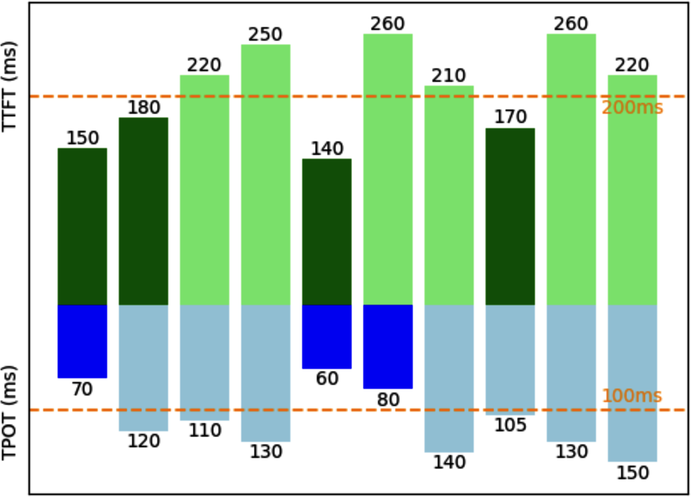
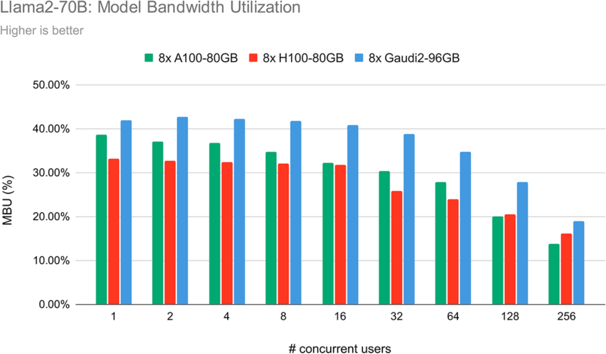

# 1 — Why Inference Is Its Own Discipline

> Training is a one-time bill. Inference runs every time a user types. The two have different bottlenecks, metrics and failure modes, so they need different engineering.

---

## Three levels, one bill

Huyen splits inference optimization into three levels (*AI Engineering*, ch. 9):

| Level | What you change | Examples | Notes |
|---|---|---|---|
| **Model** | The artifact itself | Quantization, distillation, pruning, speculative decoding, attention variants | [08](08-adaptive-inference.md), [07](07-prefill-decode-kv-cache.md) |
| **Hardware** | Where and how it runs | GPU choice, memory hierarchy, kernels, compilers | 02–04 (planned), [05](05-compilers-and-frameworks.md) |
| **Service** | How requests meet the model | Batching, routing, disaggregation, prompt caching, parallelism | [06](06-serving-at-scale.md), [07](07-prefill-decode-kv-cache.md) |

Model-level changes can alter behaviour. Quantization or a different attention scheme may change outputs, so they need an eval. Service-level changes usually do not change outputs, but they move latency and cost a lot. Distillation is the most drastic model-level change, because it replaces the model. Training a small student on a big model's generated outputs, rather than its per-token probabilities, goes back to sequence-level knowledge distillation. In WMT14 English–German translation, an 84M-parameter LSTM student trained on its 221M teacher's beam-search outputs rose from 14.7 to 18.9 BLEU with greedy decoding (word-level distillation gave +0.7). It ran 10× faster than the teacher with beam search, with comparable BLEU ([arXiv:1606.07947](https://arxiv.org/abs/1606.07947) (Kim & Rush, EMNLP 2016)). Training a small model on a frontier model's outputs follows the same recipe, and it changes outputs more than any other lever here. Huyen's analogy is archery: the model is the arrow, the hardware is the bow, and the service is how the archer shoots.

Huyen cites Desislavov et al. (2023): inference can be **up to 90% of the ML cost** of a deployed system. Training is paid once. Inference is paid for every request, for the whole life of the product.

---

## Two bottlenecks: compute and memory bandwidth

Every workload sits under one of two ceilings:

- **Compute-bound:** limited by FLOP/s. More or faster arithmetic units help.
- **Memory-bandwidth-bound:** limited by how fast bytes move from memory to the compute units. Faster memory (or fewer bytes) helps. Huyen notes that "memory-bound" is used loosely for both bandwidth-bound and capacity-bound (out of memory). Keep the two apart.

The **roofline** model plots attainable FLOP/s against **arithmetic intensity** (FLOPs per byte moved). Below the ridge point you are bandwidth-bound; above it you are compute-bound. Fregly uses the same picture throughout the book to show where a kernel sits before and after tuning ([05](05-compilers-and-frameworks.md#profile-first)).

LLM inference has one phase on each side of the ridge:

| Phase | What it does | Bound | Latency metric |
|---|---|---|---|
| **Prefill** | Processes all input tokens in parallel and builds the KV cache | Compute | TTFT |
| **Decode** | Generates one token per step and re-reads all weights plus the KV cache each step | Memory bandwidth | TPOT |

That asymmetry drives most of this pillar. Batching ([06](06-serving-at-scale.md)) exists to raise decode's arithmetic intensity. Disaggregation ([07](07-prefill-decode-kv-cache.md)) exists because the two phases want different hardware. Speculative decoding ([08](08-adaptive-inference.md)) exists because decode leaves compute idle.

Two pricing facts follow from the asymmetry. An output token costs roughly **2–4× an input token** across API providers. Anyscale measured that one output token adds about as much latency as **100 input tokens** (Kadous et al., 2023, cited in *AI Engineering*, ch. 9).

---

## Online and batch

Huyen separates **online** APIs (latency matters; a user is waiting) from **batch** APIs (throughput and cost matter; results can arrive hours later). Providers price batch at about **50% off** (OpenAI and Google, as of 2024). The split decides which metrics you optimize. Everything below about TTFT and TPOT assumes online serving. The Handbook adds a third mode, asynchronous queue-backed serving, and its deployment trade-offs are covered in [06](06-serving-at-scale.md#deployment-shapes).

---

## Latency: TTFT, TPOT and the tail

| Metric | Definition | Driven by |
|---|---|---|
| **TTFT**, time to first token | Request received → first token out | Prefill, queueing |
| **TPOT**, time per output token | Mean gap between output tokens after the first | Decode |
| **TBT / ITL** | Gap between consecutive tokens (LinkedIn says TBT; NVIDIA says ITL) | Decode, scheduler stalls |
| **Time to publish** | Time until the user-visible answer is done; for agents and reasoning models, includes hidden steps | Everything |

Total latency = TTFT + TPOT × output tokens. Two systems with the same total can feel very different. Huyen sets a floor from human reading speed: a very fast reader takes about **120 ms per token**, so a TPOT around 120 ms (**6–8 tokens/s**) is enough for streamed chat. Faster than that only matters when a machine reads the output, as in agents, tool calls and chained calls.

Report **percentiles, not means**. Huyen's example: a set of TTFTs with one 3,000 ms outlier averages 390 ms, which describes no real request. Use p50, p90, p95 and p99, and watch the tail. For agents the tail compounds, because a task that makes ten calls hits the p90 of a single call far more often than one call does.

---

## Throughput, cost and goodput

**Throughput** is output tokens per second across all users. Some teams count input tokens too. Huyen advises against it, because prefill and decode have different bottlenecks. Throughput maps directly to cost. In Huyen's worked example, hardware at **$2/hour** producing **100 output tokens/s** costs about **$5.56 per million output tokens**. At 200 output tokens per request, decoding 1,000 requests costs $1.11. Prefill at 100 requests per minute on the same hardware adds $0.33, for $1.44 in total. Throughput comparisons across models are only approximate, because tokenizers differ. **Cost per request** is the fairer unit.

Throughput and latency trade against each other. LinkedIn reported that doubling or tripling throughput is "not uncommon" if you are willing to give up TTFT and TPOT (LinkedIn, 2024, cited in *AI Engineering*, ch. 9). This is why throughput alone is the wrong target.

**Goodput** is the throughput that meets the SLO.

*Image Source: Huyen, *AI Engineering* (O'Reilly, 2025), Fig. 9-4*

Huyen's caption says 3 of the 10 requests meet the SLO, so goodput is 3 RPS. Read the bars, though. Only two requests (TTFT 150/TPOT 70 and 140/60) clear both lines. A third (260/80) meets TPOT but misses TTFT. The point still holds, and the figure shows how easy it is to count a request that meets only one objective.

### Three definitions of goodput

The books do not agree on what goodput means. Know which one a paper or dashboard uses.

| Source | Definition | Unit |
|---|---|---|
| Huyen (*AI Engineering*, ch. 9); DistServe (Zhong et al., 2024) | Requests per second that meet every latency SLO | req/s |
| Fregly (*AISPE*, ch. 1) | Useful tokens or samples per second, normalized by peak. Example: 8 GPUs produce 100k tokens in 10 s = 10k tok/s against a 12k tok/s peak = 83% | ratio |
| Fregly (*AISPE*, ch. 1 takeaways; ch. 16) | Fraction of GPU time spent on useful work, Meta's "effective training time ratio" | ratio |

The SLO-based definition is the one serving papers use (DistServe, Splitwise, Mooncake) and the one used in [07](07-prefill-decode-kv-cache.md). Fregly's definitions come from training clusters. There, Meta found that 70–75% of compute could be lost to failures and restarts even while dashboards showed GPUs "100% utilized" (*AISPE*, ch. 1). Both kinds of waste matter, but they need different fixes.

---

## Utilization: why "GPU util" lies

NVIDIA's GPU utilization (what `nvidia-smi` reports, DCGM `DCGM_FI_DEV_GPU_UTIL`) is the **fraction of time at least one kernel is running**. It is not how much of the chip is busy. A single tiny kernel running all the time reads 100%. Huyen and Fregly both warn about this (*AISPE*, ch. 16 recommends `DCGM_FI_PROF_SM_ACTIVE` for real SM occupancy). The Handbook's advice to autoscale on a 70% GPU-utilization target ([06](06-serving-at-scale.md#autoscaling)) runs into this.

The better metrics:

- **MFU** (model FLOP/s utilization): observed FLOP/s divided by peak FLOP/s. Training MFU above 50% is good (as of 2024). For reference, PaLM 540B on 6,144 TPU v4 reached 46.2% and GPT-3 175B on V100 reached 21.3% (Chowdhery et al., 2022, Table 9-1 in *AI Engineering*).
- **MBU** (model bandwidth utilization): bytes moved per second divided by peak bandwidth. Huyen's worked example: a 7B model in FP16 at 100 tokens/s reads 7B × 2 bytes × 100 = **700 GB/s**. On an A100 rated at 2 TB/s, that is **70% MBU**.

Prefill shows high MFU and low MBU. Decode shows the opposite. Pope et al. measured both phases of PaLM 540B on 64 TPU v4 chips with a 2,048-token context. Prefill reached 43% MFU at batch 1 and 76% at batch 512. Decode reached only 14% at batch 64 and 33% at batch 512 ([arXiv:2211.05102](https://arxiv.org/abs/2211.05102) (Pope et al., MLSys 2023)).

*Image Source: Huyen, *AI Engineering* (O'Reilly, 2025), Fig. 9-5*

For Llama 2-70B in FP16 on 8-chip nodes, MBU falls from around 33–43% at one user to around 14–19% at 256 users. Huyen reads the fall as the workload moving from bandwidth-bound toward compute-bound as batches grow. That is expected, not a regression. Note also that the H100 node shows *lower* MBU than the A100 node at low concurrency. A faster chip does not guarantee better utilization of it.

---

## The hardware numbers, and which have dated

From Huyen (2024) and Fregly (2025). Check each against the current spec sheet.

| Quantity | Value as printed | Condition | Status in 2026 |
|---|---|---|---|
| H100 SXM peak | TF32 989, BF16/FP16 1,979, FP8 3,958 TFLOPS | *With* 2:4 structured sparsity; dense is half | Still correct. Quote dense numbers unless you actually use sparsity |
| HBM bandwidth | "256 GB/s to 1.5 TB/s" (Huyen) | Generic range | **Dated.** H100 SXM is 3.35 TB/s, H200 4.8 TB/s, B200 ~8 TB/s |
| CPU DRAM | 25–50 GB/s | Per socket, rough | Order of magnitude still right |
| On-chip SRAM | > 10 TB/s, ≤ 40 MB | Generic | Order of magnitude still right |
| GB200 NVL72 | 72 Blackwell + 36 Grace; NVLink 5 at 1.8 TB/s per GPU, ~130 TB/s aggregate; 13.5 TB HBM3e; 1.44 EF FP4 / 720 PF FP8 | Sparse figures; 120–132 kW per rack (*AISPE*, ch. 1) | Current generation as of 2026 |
| H100 power | ~7,000 kWh/year at peak vs ~10,000 kWh for a US household; real draw 1.1–1.5× TDP | Continuous peak (*AI Engineering*, ch. 9) | Directionally right; Blackwell draws more per chip |

Fregly's GB200 NVL72 description adds one warning that applies beyond this rack: the CPU and GPU memories are coherent but **not uniform**. Prefetch with `cudaMemPrefetchAsync`, give hints with `cudaMemAdvise`, and do not assume a CPU-resident tensor is as cheap to touch as HBM (*AISPE*, ch. 1).

Huyen's three questions for choosing accelerators still hold. Can the hardware run my workload (memory capacity, supported precisions)? How long will it take (FLOP/s and bandwidth against my roofline position)? What does it cost (purchase or rent price plus power)?

---

## Mechanical sympathy: the DeepSeek case

Fregly opens the book with DeepSeek-V3/R1 as a case for **co-designing the software with the hardware** (*AISPE*, ch. 1). DeepSeek trained on H800s, the export-limited H100 variant whose chip-to-chip NVLink runs at 400 GB/s instead of 900 GB/s. They worked around the limit instead of waiting for better hardware:

- **MoE with sparse activation:** 671B total parameters, 37B active per token, 1 shared plus 8 of 256 routed experts. (The book says "~680B"; the published figure is 671B.)
- **Multi-head latent attention (MLA)**, which compresses the KV cache. On H800 it beat FlashAttention-based MHA ([07](07-prefill-decode-kv-cache.md#shrinking-the-cache)).
- **Custom communication** (DeepEP) and pipeline scheduling (DualPipe) that overlap the slow interconnect with compute.

In Open-Source Week (February 2025) they released FlashMLA, DeepGEMM, DeepEP, EPLB, DualPipe and the 3FS file system.

Two corrections. The ~$6M training cost was reported for **V3's final training run**, not for R1 and not for the full R&D programme, though the book attributes it to R1. And the book contradicts itself on H800 memory, calling its HBM "largely similar" to the H100's in one place and "much slower" in another. H800 HBM bandwidth matches the H100's. Only NVLink is cut.

Fregly's other ch. 1 points:

- **Benchmarks:** MLPerf Inference v5.0 shows GB200 NVL72 at about 3.4× per-GPU throughput over Hopper (Training v5.0: up to 2.6×). MLPerf itself warns that per-GPU numbers are not a primary metric. System throughput at a latency bound is what counts.
- **Scale arithmetic:** a 100T-parameter model in 16-bit needs 200 TB for weights alone. That is ~182 TiB; the book's printed formula for this is garbled. It would take about 1,000 B200s (192 GB each, ~180 GB usable) before activations or KV cache.
- **The role:** a performance engineer benchmarks and profiles (Nsight Systems, Nsight Compute, PyTorch profiler), owns automated performance-regression tests ([05](05-compilers-and-frameworks.md#guarding-against-regressions)), and feeds results back into model and system design.

---

## Where the levers are

| Lever | Typical effect | Note |
|---|---|---|
| Compile, fuse, CUDA graphs | Cuts launch overhead; large on small-batch decode | [05](05-compilers-and-frameworks.md) |
| Continuous batching, routing, parallelism | Throughput; TP also cuts latency | [06](06-serving-at-scale.md) |
| KV cache management, prefix caching, disaggregation | Memory capacity, TTFT, goodput | [07](07-prefill-decode-kv-cache.md) |
| Quantization, speculative decoding | Bandwidth per token, decode latency | [08](08-adaptive-inference.md) |
| Checklist and AI-assisted kernel search | Systematic coverage | [09](09-checklist-and-ai-assisted-tuning.md) |

Huyen's ranking of the techniques with the widest impact, across the companies she surveyed: **quantization, tensor parallelism, replica parallelism and attention optimization** (*AI Engineering*, ch. 9).

---

## Working reference

- **Measure TTFT and TPOT separately**, at p50/p90/p99, under realistic concurrency.
- **Optimize goodput against an SLO**, not raw throughput.
- **Don't trust GPU util**. Track MFU for prefill, MBU for decode, and SM activity.
- **Price per request**, not per token, when comparing models with different tokenizers.
- **Check whether a published FLOP/s figure assumes sparsity** before using it in a roofline.
