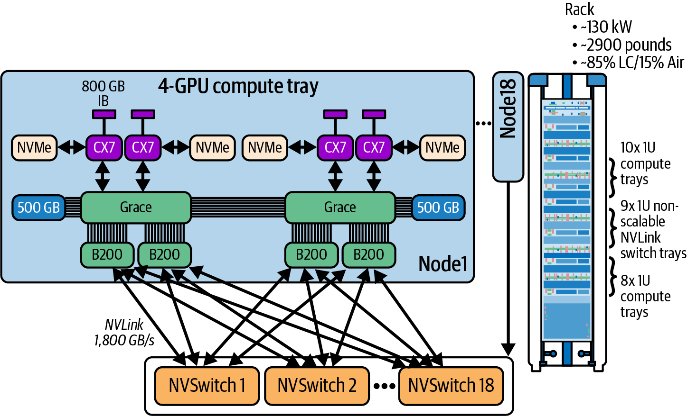
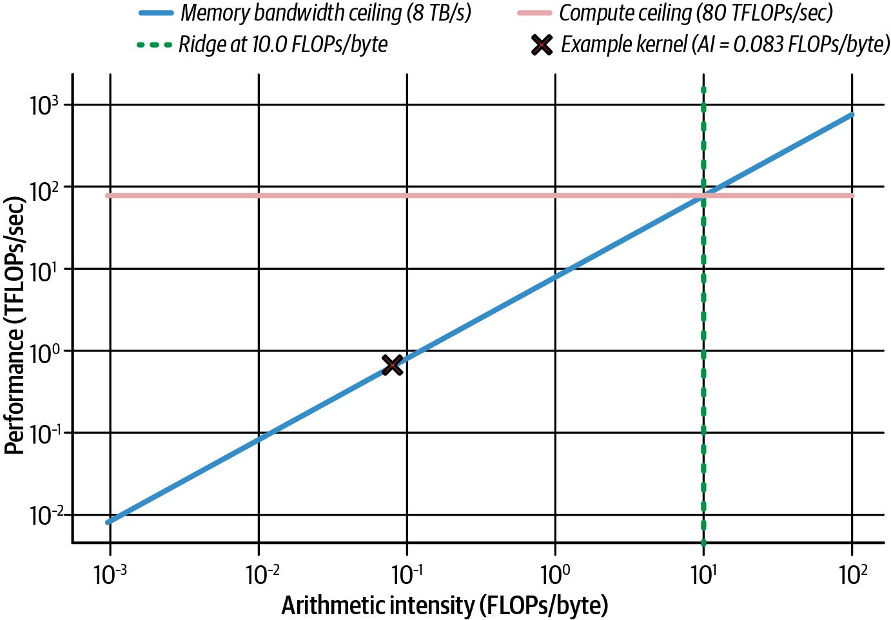

# 2 — The Hardware: GPUs, Memory Hierarchy, Interconnect

> An inference engineer does not need to design chips. They need to know where the bytes live, how fast each hop is, and which limit a kernel will hit first. That map is what this note gives you, from one SM up to a 72-GPU rack.

---

## The unit of purchase is a superchip

Fregly builds the book around NVIDIA's Grace Blackwell (*AI Systems Performance Engineering*, ch. 2). The unit you buy is not one GPU. A **GB200 superchip** is one Grace CPU and two B200 GPUs on one board:

| Part | What it is | Number (as printed, 2025) |
|---|---|---|
| Grace CPU | 72 Arm Neoverse V2 cores | 480 GB LPDDR5X |
| B200 GPU (×2) | Two reticle-sized dies acting as one GPU | 192 GB HBM3e each (about 180 GB usable), ~8 TB/s each |
| NVLink-C2C | CPU-to-GPU link | ~900 GB/s, cache-coherent |
| Total addressable | CPU + both GPUs | ~900 GB in one address space |

Compare the CPU link with what an x86 server gives you. PCIe Gen5 x16 moves about **64 GB/s per direction**. NVLink-C2C is roughly 14× that, and coherent. A GPU can touch Grace memory directly, so a model that does not fit in HBM can spill weights or KV cache to LPDDR5X without a manual copy.

"Can touch" is not "cheap to touch". Note 01 already makes the point: the memory is coherent but **not uniform** ([01](01-why-inference-is-its-own-discipline.md#the-hardware-numbers-and-which-have-dated)). HBM gives ~8 TB/s per GPU; the path to Grace memory gives under 1 TB/s shared by two GPUs. Put hot data in HBM. Use Grace memory as an overflow tier for cold weights, offloaded KV blocks or staging buffers.

Two book errors in this section: Grace memory bandwidth is printed as "500 TB/s" (it is about **500 GB/s**), and ch. 6 calls the CPU memory "CPU HBM" (it is LPDDR5X).

---

## Inside the B200

Fregly (*AISPE*, ch. 2) lists what changed from Hopper:

- **Two dies, one GPU.** Each die has 104B transistors. NV-HBI joins them at 10 TB/s, so software sees one device.
- **Memory.** 192 GB HBM3e at ~8 TB/s, against H100's 80 GB at 3.35 TB/s. That is 2.4× capacity and 2.4× bandwidth. For decode, which is bandwidth-bound, bandwidth is the number that moves tokens per second.
- **L2 cache.** 126 MB, against Hopper's 50 MB. A bigger L2 means more of the working set (activations, a hot KV page, a GEMM tile wave) stays on-chip between kernels.
- **Precision.** Hopper added FP8 tensor cores; Blackwell adds **NVFP4**, a 4-bit float with per-block scales. Each halving of bytes per value roughly doubles both bytes-per-second and FLOPs-per-second at the tensor cores. Note 04 covers what that does to arithmetic intensity ([04](04-kernels.md#raise-arithmetic-intensity)).
- **Decompression Engine.** Hardware LZ4, Snappy and Deflate, for data that arrives compressed. It matters for data loading more than for serving.

The book's vendor numbers need their conditions attached. NVIDIA's 1.8T-parameter MoE comparison shows **3.4 tokens/s per GPU on H100 at a TTFT above 5 s**, against **~150 tokens/s per GPU on GB200 NVL72 at ~50 ms**. That compares FP8 on Hopper with FP4 on Blackwell, an 8-GPU NVLink domain with a 72-GPU one, and an older software stack with a newer one. Most of the "30×" headline comes from precision and domain size, not from the chip alone.

Fregly's roadmap (B300/Blackwell Ultra with 288 GB, Rubin in 2026, Rubin Ultra in 2027, Feynman in 2028) is NVIDIA's announced plan as of 2025. Treat it as a forecast. One Blackwell Ultra change already affects advice elsewhere in the book: it cut INT8 and FP64 tensor-core throughput, so INT8 recipes that assume fast INT8 tensor cores are architecture-dependent ([04](04-kernels.md#precision)).

---

## The SM and its limits

The **streaming multiprocessor (SM)** is the unit kernels are scheduled onto. B200 has 148 of them (H100 has 132; the book sometimes uses 132 in Blackwell examples). Each SM has four sub-partitions, each with its own warp scheduler. A **warp** is 32 threads executing one instruction together.

These limits decide occupancy, the fraction of an SM's warp slots that are filled (*AISPE*, ch. 6). They hold for compute capability 9.x and 10.x (Hopper, datacenter Blackwell):

| Resource | Per SM | Per block / thread |
|---|---|---|
| Resident warps | 64 (2,048 threads) | up to 1,024 threads per block |
| Resident blocks | 32 | |
| Registers | 64K × 32-bit | up to 255 per thread |
| L1 + shared memory (SMEM) | 256 KB combined; up to 228 KB as SMEM | up to 227 KB SMEM per block (opt-in above 48 KB) |
| Warp schedulers | 4 | each issues one warp-instruction per cycle |
| Tensor memory (TMEM, Blackwell) | 256 KB | allocated per CTA via `tcgen05.alloc` |

Compute capability 12.x parts (RTX PRO 6000, DGX Spark's GB10) allow only 48 warps / 1,536 threads per SM. Do not carry occupancy math across that line.

The book says each scheduler can **dual-issue** two instructions per cycle (ch. 6, again in ch. 8 and Fig. 8-9). That is wrong for Volta and later, including Hopper and Blackwell. Each sub-partition issues one warp-instruction per cycle. Instruction-level parallelism helps because a long-latency instruction is pipelined while later independent instructions issue, not because two issue at once ([04](04-kernels.md#ilp-more-work-per-warp)).

---

## The memory hierarchy

Every performance argument in notes 04 and 05 is about moving data up this ladder fewer times. Approximate latencies (*AISPE*, ch. 6, Table 6-5):

| Level | Scope | Size (B200) | Latency | Notes |
|---|---|---|---|---|
| Registers | thread | 64K per SM | ~1 cycle | Spills go to "local memory", which is really HBM |
| Shared memory (SMEM) | block (or cluster via DSMEM) | up to 228 KB per SM | ~20–30 cycles | Programmer-managed; 32 banks |
| TMEM | block, tensor cores only | 256 KB per SM | not given | Holds MMA accumulators; read with `tcgen05.ld` |
| L1 / texture | SM | shares the 256 KB with SMEM | ~SMEM | Hardware-managed |
| Constant cache | SM | 8 KB working set | ~register when all lanes read one address | Broadcast; serializes on divergent addresses |
| L2 | whole GPU | 126 MB | ~200 cycles | Where global atomics are serviced |
| HBM3e | whole GPU | 192 GB | hundreds to ~1,000 cycles | ~8 TB/s |
| Grace LPDDR5X | superchip | 480 GB | far higher | via NVLink-C2C, ~900 GB/s |

The ratio between the bottom rows and the top rows is the whole game. A load from HBM costs the same time as hundreds of arithmetic instructions, so a kernel either finds enough independent work to cover it (occupancy, ILP, pipelining) or does more math per byte (tiling, fusion, lower precision). Note 04 is organized around those two options.

The book says TMEM is "orchestrated by TMA". It is not: TMA moves data between global memory and SMEM. TMEM is written by `tcgen05.mma` and read with `tcgen05.ld`/`tcgen05.st`.



*Image Source: Fregly, *AI Systems Performance Engineering* (O'Reilly, 2025), Fig. 2-9*

---

## The rack is the computer: GB200 NVL72

The figure shows the topology that matters for inference at scale. Every GPU in the rack connects to every NVSwitch tray, so any GPU reaches any other in one switch hop.

- **18 compute trays + 9 switch trays.** Each compute tray holds 2 GB200 superchips (4 GPUs, 2 CPUs). 18 × 4 = 72 GPUs.
- **NVLink 5:** 18 links per GPU, **1.8 TB/s per GPU** bidirectional; about **130 TB/s** across the rack. GPU-to-GPU latency is about **1–2 µs**.
- **InfiniBand or Ethernet** between racks: roughly **20–80 GB/s per GPU** at **5–10 µs**, an order of magnitude less bandwidth and several times the latency.
- **SHARP** in the NVSwitch chips does reductions inside the switch, so an all-reduce moves about half the bytes a ring would ([03](03-the-platform.md#collectives-and-nccl)).
- **Power:** ~1,200 W per GPU, **~130 kW per rack**, liquid-cooled.

The design rule follows from the gap between the two fabrics: **keep tensor-parallel and expert-parallel groups inside one NVLink domain.** Cross-rack links are for data parallelism and pipeline stages, where traffic is smaller or easier to overlap ([06](06-serving-at-scale.md#parallelism-for-inference)).

The figure disagrees with the text in places. It shows ConnectX-7 NICs and 500 GB of LPDDR, where the text says ConnectX-8 and 480 GB, and it draws the rack as "10x + 8x" compute trays. Trust the text and NVIDIA's current spec sheet over the drawing. The book also says NVLink domains can extend to **576 GPUs**. That is NVLink Switch's theoretical address space, not a product you could buy in 2025.

---

## Unified Memory and the superchip

On Grace Blackwell, CUDA **Unified Memory** (`cudaMallocManaged`) is backed by hardware coherence instead of page-fault migration alone. It is convenient and easy to make slow. Fregly's example (*AISPE*, ch. 6, Table 6-6, illustrative) runs the same kernel on managed memory with and without hints: **48.21 ms** demand-paged versus **2.17 ms** with prefetch.

```cpp
cudaMemAdvise(buf, bytes, cudaMemAdviseSetPreferredLocation, gpu);
cudaMemPrefetchAsync(buf, bytes, gpu, stream);   // move before the kernel needs it
kernel<<<grid, block, 0, stream>>>(buf);
```

For inference, prefer explicit placement: weights and the active KV cache in HBM, and Grace memory only for tiers you choose to page from ([07](07-prefill-decode-kv-cache.md#sizing-the-cache)). Use **Compute Sanitizer** (`compute-sanitizer --tool memcheck`) whenever you hand-write memory movement; out-of-bounds writes on a GPU fail silently far more often than on a CPU.

---

## The roofline on this hardware

The roofline is introduced in note 01 ([01](01-why-inference-is-its-own-discipline.md#two-bottlenecks-compute-and-memory-bandwidth)). Here is Fregly's version with numbers attached.



*Image Source: Fregly, *AI Systems Performance Engineering* (O'Reilly, 2025), Fig. 6-21*

The figure uses **8 TB/s** HBM bandwidth and **80 TFLOPS** FP32 on CUDA cores. The ridge point is 80 / 8 = **10 FLOP/byte**. A vector add in FP32 does one FLOP per 12 bytes (two loads, one store), so its arithmetic intensity is **0.083 FLOP/byte**, more than 100× left of the ridge. No amount of compute tuning helps it; only fewer bytes do.

The figure's ridge is the FP32 ridge. Transformer GEMMs run on tensor cores. Dense BF16 on a B200 is about 2.25 PFLOPS, so the tensor-core ridge is roughly **280 FLOP/byte**, and it moves further right at FP8 and FP4. That is why decode is so firmly bandwidth-bound: at batch 1 a decode GEMM does about 2 FLOPs per weight read (about 1 FLOP/byte in BF16), two orders of magnitude below the tensor-core ridge. Batching ([06](06-serving-at-scale.md#batching)) is the main way to move it right.

Fregly's prefill/decode discussion in ch. 6 states the bound both ways in different paragraphs. Use note 01's table: prefill compute-bound, decode bandwidth-bound.

---

## Working reference

- Know the four numbers for your GPU: HBM bandwidth, HBM capacity, dense tensor FLOPS at your precision, and NVLink bandwidth. The ridge is FLOPS ÷ bandwidth.
- Quote dense, not sparse, FLOPS unless you use 2:4 sparsity. Attach precision to every FLOPS number.
- Grace memory is an overflow tier, not HBM. Prefetch or place explicitly.
- Keep TP/EP groups inside one NVLink domain; use the scale-out network only for traffic that tolerates 5–10 µs and ~10× less bandwidth.
- Occupancy limits are per architecture. Check registers, SMEM and threads per block against the table above before tuning ([04](04-kernels.md#occupancy-and-the-latency-it-hides)).
