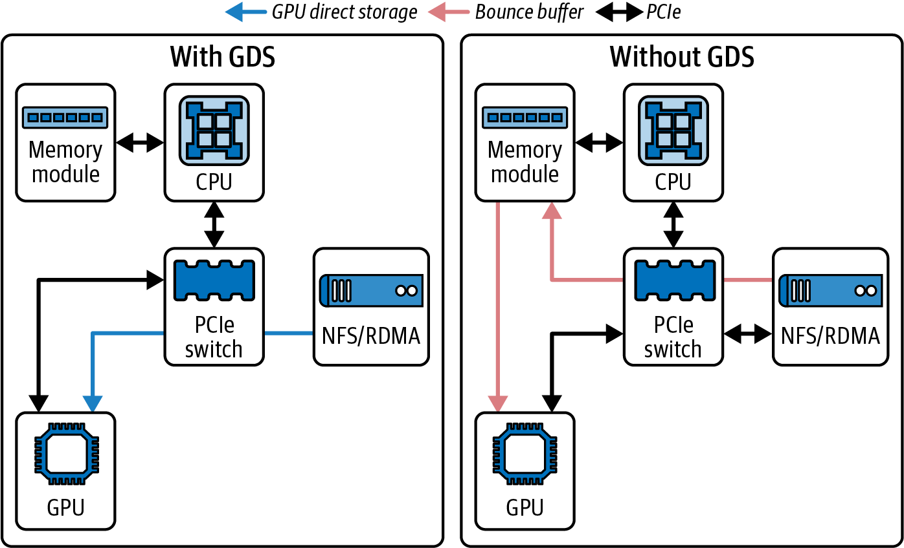

# 3 — The Platform: OS, Containers, Kubernetes, Storage, Networking

> A GPU is only as fast as the machine around it lets it be. A wrong NUMA binding, an unpinned buffer or NCCL falling back to TCP can each cost more than any kernel optimization gains. Most of these fixes are one-line settings, and most fail silently.

---

## Why the platform comes before the kernel

Fregly's three platform chapters (*AI Systems Performance Engineering*, ch. 3–5) share one pattern: the GPU sits idle while something else (the CPU, the network, the disk) is the real bottleneck. `nvidia-smi` still reports high "utilization" ([01](01-why-inference-is-its-own-discipline.md#utilization-why-gpu-util-lies)). The diagnosis is the same in every case: put an Nsight Systems timeline next to the GPU, find the gaps, and name what the GPU was waiting for.

For inference the platform matters at three moments: **cold start** (loading weights, initializing the driver), **steady-state serving** (host-to-device copies, CPU-side batching and tokenization), and **multi-GPU serving** (tensor-parallel all-reduces, KV-cache transfer between prefill and decode workers).

---

## The host OS

Fregly's host checklist (*AISPE*, ch. 3), with the condition each number was measured under:

| Setting | What to do | Why | Number from the book |
|---|---|---|---|
| **NUMA binding** | Pin each GPU's process and memory to the CPU socket nearest that GPU (`numactl --cpunodebind=N --membind=N`) | Remote-socket memory is slower, and so are DMA transfers that cross the socket link | Local ~80 ns vs remote ~139 ns; 5–10% end-to-end gain |
| **Pinned host memory** | Allocate host buffers page-locked (`cudaHostAlloc`, `pin_memory=True`) | Pageable memory forces a hidden staging copy and blocks the host thread | 2–3× faster host-to-device copies |
| **Persistence mode** | Run `nvidia-persistenced` | Keeps the driver initialized between processes | Avoids 1–2 s cold init per process |
| **Swappiness** | `vm.swappiness=0` (or close to it) | A swapped-out page under a pinned buffer or a Python process stalls everything | — |
| **Transparent huge pages** | `always` for training; `madvise` for latency-sensitive inference | Fewer TLB misses; but background compaction causes latency spikes | — |
| **CPU frequency** | `performance` governor; limit deep C-states | Wake-up latency from deep sleep shows up in launch gaps | — |
| **IRQ affinity** | Route NIC and GPU interrupts to cores near the device, away from the serving threads | Interrupt storms on a busy core delay launches | — |
| **Allocator** | jemalloc or tcmalloc for the host process | glibc malloc fragments under many threads | — |

On Grace Blackwell the NUMA story changes shape but does not go away. Each Grace CPU is close to its own two GPUs, and two superchips are separate NUMA nodes.

A practical inference corollary: **tokenization, detokenization and request batching are CPU work.** A serving process starved of cores (or bound to the wrong socket) shows up as gaps between decode steps, not as slow kernels.

---

## Sharing one GPU

Small models and low-traffic endpoints rarely fill a B200. There are three ways to share it (*AISPE*, ch. 3):

| Mechanism | How it shares | Isolation | Use when |
|---|---|---|---|
| **Time-slicing** (default) | Contexts take turns | Memory separate; no performance isolation | Dev boxes; bursty jobs |
| **MPS** (Multi-Process Service) | Kernels from several processes run *concurrently* in one context | **No memory isolation**: one process's fault can take down the others | Several cooperating, trusted processes each using part of the GPU. Two jobs that each use ~40% reach 80–90% combined |
| **MIG** (Multi-Instance GPU) | Hardware partitions with their own SMs, L2 slice and HBM | Full: memory, cache and fault isolation | Multi-tenant serving with a latency promise per tenant |

MIG profiles on B200 range from **1g.23gb** (one-seventh of the GPU) to **7g.180gb** (the whole GPU). Three constraints the book notes: changing the layout needs the GPU idle and reset, MIG instances cannot use NVLink peer-to-peer with each other, and slices do not add up to more than the whole (the book's own arithmetic for two 2g.45gb slices is off; they total 90 GB).

For LLM serving, MIG suits several small models with separate SLOs. One large model wants the whole GPU and batching inside one process ([06](06-serving-at-scale.md#batching)).

---

## GPU clocks, power and ECC

- **Lock clocks for benchmarking**: `nvidia-smi -lgc <min>,<max>` (graphics) and `-lmc` (memory). The book also shows `-ac` (application clocks); that interface is deprecated on recent GPUs in favor of `-lgc`/`-lmc`.
- **Power limit**: `nvidia-smi -pl <watts>`. A lower cap can improve performance per watt for bandwidth-bound decode, where the SMs are not the limit.
- **Keep ECC on.** The few percent of bandwidth it costs is cheaper than a silent bit flip in a weight tensor.
- **Watch for throttling.** `clocks_event_reasons.active` reports power or thermal capping ([04](04-kernels.md#occupancy-and-the-latency-it-hides) shows the monitor command).

---

## Containers and Kubernetes

Containers cost almost nothing on a GPU. Fregly measures **under 2% overhead** (*AISPE*, ch. 3), because the kernel driver is shared and the container only carries user-space libraries. The real container problem is **version skew**: the CUDA toolkit inside the image must be supported by the host driver. CUDA 13 needs driver **R580 or later**.

On Kubernetes:

- The **NVIDIA GPU Operator** installs drivers, the container toolkit, the device plugin, DCGM and MIG management as one unit.
- The **Topology Manager** (policy `single-numa-node` or `restricted`) makes the kubelet place a pod's CPUs, memory and GPUs on one NUMA node, the Kubernetes version of `numactl`.
- **Guaranteed QoS** (requests equal limits) plus the static CPU manager gives the pod exclusive cores.
- Shared memory: PyTorch and NCCL need a large `/dev/shm`; mount an `emptyDir` with `medium: Memory`.

Serving-level orchestration on Kubernetes (autoscaling, routing, gang scheduling of multi-node replicas) is in note 06 ([06](06-serving-at-scale.md#autoscaling)).

---

## Collectives and NCCL

Tensor-parallel inference runs an all-reduce in every transformer layer, so NCCL performance is decode latency. Fregly's networking chapter (*AISPE*, ch. 4) is a catalogue of how it goes wrong.

### Algorithms

| Algorithm | Bytes per GPU | Latency | Good for |
|---|---|---|---|
| **Ring** | 2(N−1)/N × message size (bandwidth-optimal) | O(N) steps | Large messages |
| **Tree** | similar | O(log N) steps | Small, latency-bound messages at large N |
| **NVLS / NVLSTree** | about half, because NVSwitch SHARP reduces in the switch | low | Within an NVLink domain (NVL72) |
| **CollNet** (IB SHARP) | reduction in InfiniBand switches | low | Across nodes, if the fabric supports it |

NCCL picks the algorithm itself. Override with `NCCL_ALGO` only to test a hypothesis. The book lists "CollTree" as a value; it is not one. The real values are Ring, Tree, CollnetDirect, CollnetChain, NVLS, NVLSTree and PAT. The book also describes **PAT** as a ring/tree hybrid. It is a Bruck-style algorithm for all-gather and reduce-scatter at one rank per node.

In-switch reduction (SHARP) needs plugins, switch firmware and an aggregation manager on InfiniBand, and is not on by default. NVIDIA claims 2–5× faster all-reduce at scale. Expect little at 2–4 nodes.

### Silent failure modes

Each of these runs to completion and just runs slowly:

- **RDMA falls back to TCP.** Signature: GPU utilization drops and CPU spikes during every all-reduce. Check the NCCL log for `NET/Socket` instead of `NET/IB`.
- **Wrong interface.** NCCL picks the 10 GbE management network. Set `NCCL_SOCKET_IFNAME=ib0` (or your fabric's name).
- **P2P disabled.** `NCCL_P2P_DISABLE=1` or `NCCL_SHM_DISABLE=1` left in from debugging turns microsecond NVLink transfers into tens of microseconds and hundreds of GB/s into tens. Look for "unable to enable P2P, falling back to copy".
- **Gloo instead of NCCL.** Fregly's measurement: a 400 MB all-reduce, 2 ranks, 800 Gb/s InfiniBand. Gloo took **200 ms** (2 GB/s, a CPU core at ~100%); NCCL took **4 ms** (~100 GB/s, line rate).
- **Mismatched NCCL versions** between PyTorch's bundled copy and the system library: hangs or slowdowns.
- **Communicator churn.** Creating and destroying a process group per iteration cost **48 ms** against a **0.5 ms** all-reduce (Table 4-3). Create groups once at startup.
- **`DataParallel` instead of `DistributedDataParallel`.** DP is single-process and bottlenecked on the GIL and GPU 0: 45 ms vs 30 ms per step on a 2-GPU toy model. Always DDP (or the serving engine's own TP runtime).

Bind each rank to its NUMA node and set `NCCL_IGNORE_CPU_AFFINITY=1` so NCCL does not override the binding. Set `TORCH_NCCL_ASYNC_ERROR_HANDLING=1` so a dead peer raises an error instead of hanging (the book uses the older name `NCCL_ASYNC_ERROR_HANDLING`). The book also sets `NCCL_PORT_RANGE`, which is not a documented NCCL variable; restrict ports with the OS `ip_local_port_range` instead.

The book gives two opposite pieces of advice, "leave NCCL defaults alone" and "never rely on defaults". The reconcilable version: leave tuning variables at default, but set environment-specific ones (interface, topology file, HCA list) explicitly.

### Moving the KV cache: NIXL

Disaggregated serving puts prefill and decode on different GPUs, so the KV cache must move between them ([07](07-prefill-decode-kv-cache.md#moving-the-cache)). That is point-to-point traffic, not a collective. **NIXL** (NVIDIA Inference Xfer Library, early 2025, part of Dynamo) handles it over NVLink, RDMA, GPUDirect Storage or S3, behind one API. Fregly reports NVIDIA's numbers: KV offload instead of recompute cut TTFT up to **14×** for long inputs on x86 + H100, and GH200 was **2×** faster than x86 + H100 for the same offload, thanks to NVLink-C2C. Dynamo's "up to 30× throughput" on DeepSeek-R1 671B on GB200 NVL72 is a vendor figure that mixes hardware and software gains.

Do not copy the book's NIXL listing. Its calls (`prepXfer`, `postXfer`, `checkXfer`) do not match NIXL's actual C++ API (`createXferReq`, `postXferReq`, `getXferStatus`). Use the examples in the [NIXL repository](https://github.com/ai-dynamo/nixl).

---

## Storage: the cold-start path

Training reads data continuously. Inference reads weights once per replica start, and that start is on the critical path of every scale-up ([06](06-serving-at-scale.md#autoscaling)). Fregly's storage chapter (*AISPE*, ch. 5) is training-centered, but most of it transfers:

- **Sequential beats random.** Read large (≥1 MB) chunks. Safetensors shards loaded sequentially are the inference version of the book's "pack small files into shards".
- **Stage to local NVMe.** Pull weights from object storage once per node (`s5cmd`, parallel range GETs), then load from NVMe. Read-ahead on the block device (`blockdev --setra`) from the 128 KB default to a few MB helps streaming reads.
- **Page cache is a free warm tier.** A second replica on the same node loads from RAM. On Grace, 480 GB of LPDDR5X can hold a large model's weights.
- **NFS** works for a few nodes, not for a fleet starting at once.

*Image Source: Fregly, *AI Systems Performance Engineering* (O'Reilly, 2025), Fig. 5-1*

The figure shows **GPUDirect Storage (GDS)**: the NIC or NVMe DMA-writes straight into GPU memory instead of through a host bounce buffer. The CPU still orchestrates; it just stops copying. GDS needs `O_DIRECT`, aligned buffers and a supported filesystem (local XFS/EXT4, NFS over RDMA, BeeGFS, WekaFS, VAST, IBM Storage Scale). FUSE filesystems cannot use it. The book's own `gdsio` comparison (Table 5-1, illustrative) goes from 8.0 to 9.6 GB/s; VAST's vendor numbers are +20% on A100 and +30% on H100. GDS mostly helps when the CPU is the bottleneck; otherwise it mostly lowers CPU load.

**`cuda-checkpoint` + CRIU** snapshots a running GPU process (device memory copied to host) and restores it, even onto a different GPU of the same model. For inference this is a cold-start tool: restore a warmed, compiled, graph-captured server instead of rebuilding it.

Fregly calls DeepSeek's **3FS** (direct I/O, RDMA, ~6.6 TiB/s aggregate) faster than Ceph on "similar hardware". The hardware he quotes is Clyso's 1 TiB/s Ceph cluster; 3FS's own figure came from 180 storage nodes with 2×200 Gb/s InfiniBand each, so the comparison does not hold. 3FS's client is also FUSE-based, so it does not do GDS.

One arithmetic error worth knowing because the pattern recurs: the book says cutting GPU wait time from 30% to 5% gives a "6×" speedup. Busy time goes from 70% to 95%, so throughput rises about **1.36×**. The 6× is the ratio of the wait times.

---

## Failures at scale

Meta's Llama 3 405B training run (54 days) logged **419 unexpected interruptions** (*AISPE*, ch. 4, Table 4-4): faulty GPUs 30.1%, HBM3 17.2%, software bugs 12.9%, network 8.4%. Inference fleets see the same hardware failure rates. A serving system needs health checks that catch a degraded GPU (DCGM diagnostics, XID errors), timeouts on collectives (`monitored_barrier`, async error handling), and the ability to drain and replace a replica without dropping requests.

---

## Working reference

- Bind each GPU's process and memory to its NUMA node; pin host buffers; run persistence mode.
- Check the NCCL log once per deployment: `NET/IB` not `NET/Socket`, P2P enabled, the right interface.
- Keep tensor-parallel groups inside one NVLink domain; use NVLS/SHARP where available.
- Use MIG for multi-tenant isolation, MPS only between trusted processes, a whole GPU for one large model.
- Match container CUDA to the host driver. Use the GPU Operator and the Topology Manager on Kubernetes.
- Treat cold start as a storage problem: local NVMe, sequential shard reads, page cache, and checkpoint/restore for warmed servers.
- Labs and full scripts for ch. 3–5 are in the book's repository: [cfregly/ai-performance-engineering](https://github.com/cfregly/ai-performance-engineering).
