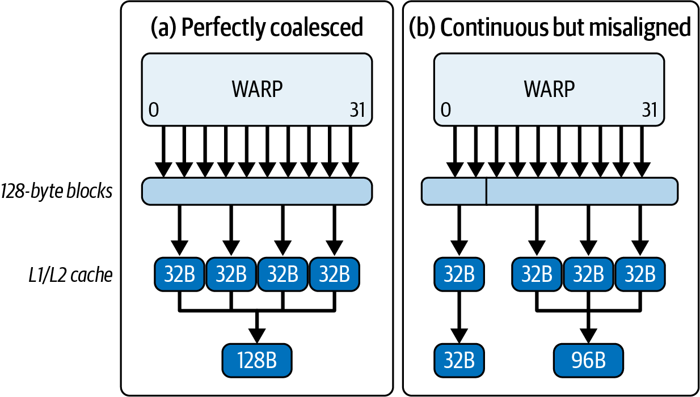
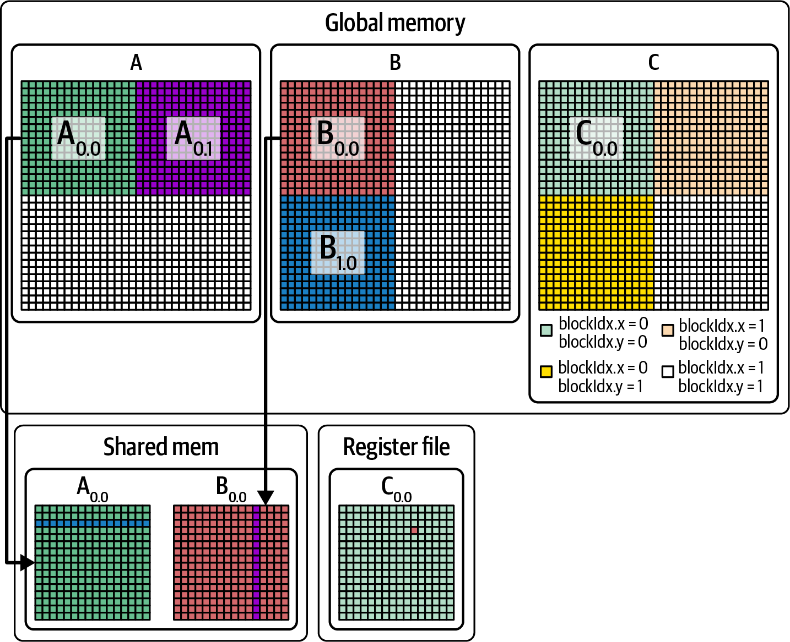
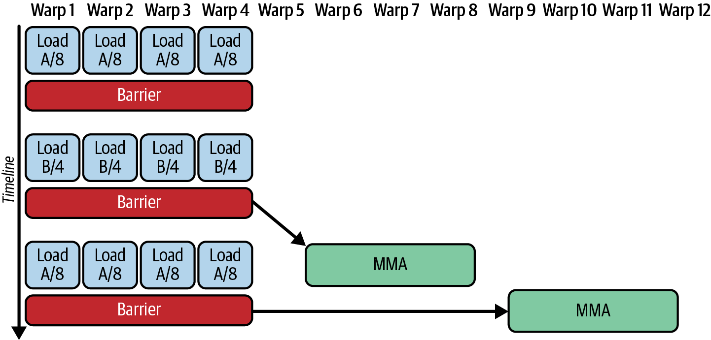
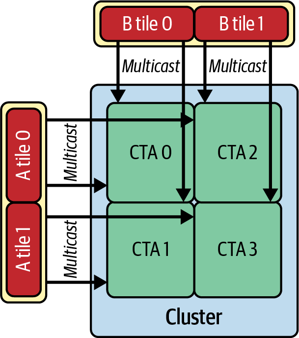
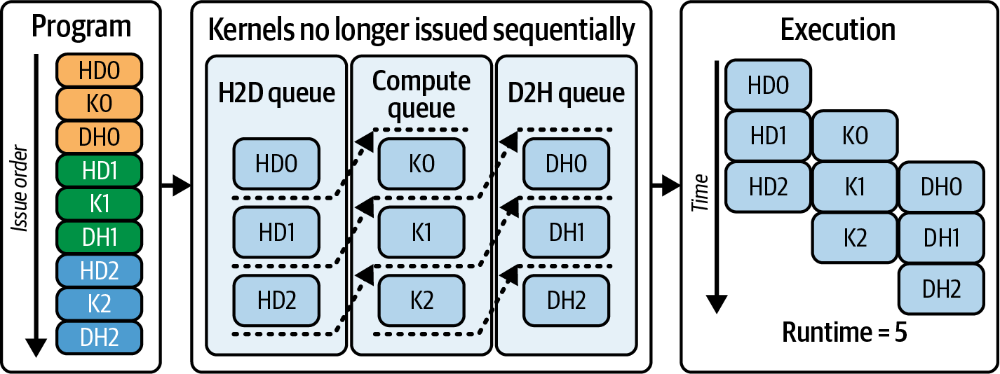
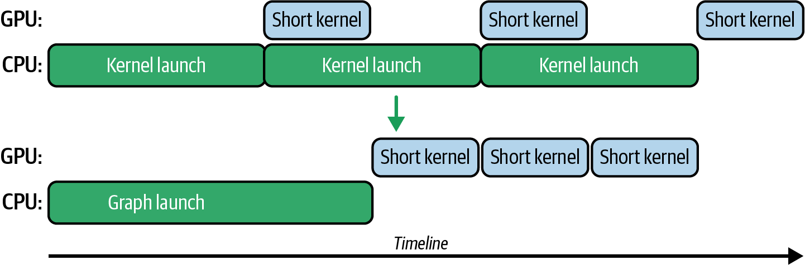

# 4 — Kernels: Occupancy, Memory Access, Arithmetic Intensity, Pipelining

> A kernel is slow for one of four reasons: too little work, too much waiting, too many bytes, or too much math. The profiler tells you which. Each has its own fixes, and fixing one exposes the next.

---

## Who needs this note

Most inference engineers never write a CUDA kernel. They call cuBLAS, cuDNN, FlashAttention, CUTLASS or a Triton kernel generated by `torch.compile` ([05](05-compilers-and-frameworks.md)). The vocabulary here is still how you read a profile, judge whether a library kernel is near its limit, and decide whether a custom kernel is worth the work. Fregly spends six chapters on it (*AI Systems Performance Engineering*, ch. 7–12). This note keeps the decisions and the mechanisms and leaves the labs to the book's repository, [cfregly/ai-performance-engineering](https://github.com/cfregly/ai-performance-engineering).

Read the book's metrics tables with one caveat in mind. Fregly labels them illustrative: "The numeric values in all metrics tables are illustrative to explain the concepts." Several are internally inconsistent, and they are flagged below. Trust the direction of each change, not its size.

The hardware limits this note refers to (warps per SM, registers, SMEM, latencies) are in note 02 ([02](02-the-hardware.md#the-sm-and-its-limits)).

---

## Diagnose first: four regimes

The workflow (*AISPE*, ch. 8): Nsight Systems for the timeline (wrap code regions in NVTX ranges, e.g. `torch.cuda.nvtx.range`), then Nsight Compute on the hot kernel. Build with `-lineinfo` so stalls map to source lines.

Fregly sorts kernels into four regimes (Table 8-2). Fixing one usually reveals the next:

| Regime | Signature in Nsight Compute | Fix |
|---|---|---|
| **Underutilized** | Few blocks; SMs idle; low achieved occupancy | More parallelism: grid ≥ number of SMs, smaller tiles, split-K |
| **Latency-bound** | Low DRAM throughput *and* high scoreboard stalls | Hide latency: occupancy, ILP, prefetch, pipelining |
| **Memory-bound** | DRAM throughput ≳ 80% of peak | Fewer bytes: coalescing, tiling, fusion, lower precision |
| **Compute-bound** | Math pipes busy; "Math Pipe Throttle" stalls | Tensor cores, lower precision, less redundant math |

Warp stall reasons (Table 8-1) say what each warp waited on. Read only the largest bars:

| Stall | Means |
|---|---|
| Long Scoreboard | Waiting for a global or local memory load |
| Short Scoreboard | Waiting for SMEM or special-function results |
| Memory Throttle | Load/store queues full |
| Execution Dependency | The next instruction needs a result not ready yet (low ILP) |
| Math Pipe Throttle | Compute pipe saturated |
| Barrier | Waiting at `__syncthreads` |
| No Eligible | No warp ready to issue: too few warps |
| Not Selected | Ready but another warp issued: healthy |

One quick check: if eligible warps per cycle per scheduler is below 1, the SM needs more concurrency. If it is above 1 and the kernel is still slow, the problem is elsewhere.

---

## Memory access

### Coalescing

A warp's 32 loads are combined into as few memory transactions as possible. The unit is a 32-byte **sector**; four sectors make a 128-byte cache line (*AISPE*, ch. 7).



*Image Source: Fregly, *AI Systems Performance Engineering* (O'Reilly, 2025), Fig. 7-1*

The top row is the ideal: 32 threads read 32 consecutive 4-byte floats, which is exactly four sectors in one 128-byte line. In the bottom row the same contiguous read starts at an offset, so it straddles two lines and touches five sectors. Strided or scattered access is far worse: up to 32 sectors for 32 useful floats. In Nsight Compute, **sectors per request above 4** for 4-byte loads means uncoalesced access.

The fixes:

- Index so consecutive threads touch consecutive addresses: `idx = blockIdx.x * blockDim.x + threadIdx.x`.
- **Structure of arrays, not array of structures.** `x[i]`, `y[i]` in separate arrays, not `points[i].x`.
- **Vector loads** (`float4`, 16 bytes per thread) cut instruction count by 4×; they do not cut sectors. On Blackwell with CUDA 13, 32-byte-aligned types allow 32-byte loads per thread.

Two book errors here. Table 7-2's baseline, a scalar contiguous copy, reports 31.8 sectors per request; an aligned contiguous scalar copy touches about 4. And vectorization is framed as reducing sectors, which it does not. It reduces instructions.

### Shared memory and bank conflicts

SMEM has 32 banks, 4 bytes wide. If threads in a warp hit different addresses in the same bank, the accesses serialize. The classic case is reading a column of a 32 × 32 float tile: every element of a column is in the same bank, a 32-way conflict. Pad one column:

```cpp
__shared__ float tile[32][33];               // +1 column shifts each row by one bank
tile[threadIdx.y][threadIdx.x] = in[...];    // row write: conflict-free
__syncthreads();
out[...] = tile[threadIdx.x][threadIdx.y];   // column read: now conflict-free too
```

Padding costs about 3% of the tile. CUTLASS uses an XOR **swizzle** instead, which wastes nothing. The book's transpose prose gets the cause backwards: it says reading along a row (`tile[row][threadIdx.x]`) conflicts. That pattern is conflict-free; the column read is the one that conflicts, and the book's own code does the column read. Both book transpose kernels also write the output uncoalesced. The standard fix swaps the block indices on the write side.

### Registers and the read-only path

Reductions inside a warp do not need SMEM at all. Shuffles move values between lanes' registers:

```cpp
for (int offset = 16; offset > 0; offset >>= 1)
    val += __shfl_down_sync(0xffffffff, val, offset);   // lane 0 ends with the warp sum
```

Mark read-only inputs `const __restrict__` so the compiler can use the non-coherent read-only load path. Data every thread reads at the same address (a scale factor, a small lookup table) belongs in `__constant__` memory, which broadcasts in one transaction.

---

## Occupancy and the latency it hides

**Occupancy** is resident warps divided by the SM maximum (64 on Hopper and datacenter Blackwell). It matters only because more resident warps give the scheduler something to issue while others wait on memory. Fregly's rule (*AISPE*, ch. 8): occupancy is a means, not the goal. Going from 10% to 50% usually helps a lot; 50% to 100% usually helps little. Aim for **~50–75%** (32–48 warps) and check whether stalls fall. Many good kernels, including most GEMMs, run at 25–50% and hide latency with ILP and pipelining instead ([05](05-compilers-and-frameworks.md#profile-first)).

The limiter is whichever resource runs out first: registers per thread, SMEM per block, or threads per block. Nsight Compute names it ("Limited by Registers"). Two tools:

```cpp
__global__ void __launch_bounds__(256, 8) k(...);   // ≤256 threads/block, aim for ≥8 blocks/SM
                                                     // 256 × 8 = 2,048 threads = full SM

int minGrid, block;
cudaOccupancyMaxPotentialBlockSize(&minGrid, &block, k, 0, 0);
```

`__launch_bounds__` makes the compiler cap registers so the requested residency fits; too tight a cap causes spills to local memory (HBM). The book's prose says "e.g., 4" blocks for the same listing that uses 8. The listing is the consistent one.

Clocks matter as much as occupancy. Under a power cap, SM clocks drop and a "slower" kernel may just be a throttled GPU:

```bash
nvidia-smi --query-gpu=power.draw,clocks.current.sm,clocks.current.memory,clocks_event_reasons.active \
           --format=csv -l 1
```

### Divergence

When lanes of a warp take different branches, both paths execute with some lanes masked. A 50/50 split gives 50% **warp execution efficiency**. Fixes, in order: sort or partition data so warps are uniform; branch on warp-uniform values (`warpId % 2`, not `threadIdx.x % 2`); for short branches, compute both sides and select:

```cpp
float val = (x > threshold) ? x : 0.0f;   // compiles to a select, no branch
```

The book's before/after for exactly this (Table 8-3: 30 → 15 ms) is illustrative. `nvcc` already if-converts a trivial if/else into a select, so the real gain would be near zero. The book also refers to a `%WarpVote` mask; there is no such register. The real warp-vote intrinsics are `__ballot_sync`, `__any_sync` and `__all_sync`.

### ILP: more work per warp

Instruction-level parallelism keeps several independent operations in flight per thread, so fewer warps are needed to cover latency. A single accumulator is a dependency chain; several are not:

```cpp
float s0 = 0, s1 = 0, s2 = 0, s3 = 0;
for (int i = 0; i < n; i += 4) {
    s0 += a[i]   * b[i];
    s1 += a[i+1] * b[i+1];
    s2 += a[i+2] * b[i+2];
    s3 += a[i+3] * b[i+3];
}
float sum = (s0 + s1) + (s2 + s3);
```

Fregly's estimate for a Blackwell SM (Table 8-4, approximate): to saturate it takes ~1,536 threads at ILP 1, ~1,024 at ILP 2, ~768 at ILP 3, and ~512 at ILP 4. That is Little's law: in-flight work = latency × throughput, and ILP supplies in-flight work per thread. The sweet spot is ILP 2–4; beyond that, register pressure lowers occupancy.

ILP does not change arithmetic intensity. It fills idle issue slots, so it is useless when pipes are already busy every cycle. Two book errors: ILP is explained via dual issue, which does not exist on these GPUs ([02](02-the-hardware.md#the-sm-and-its-limits)), and an IPC of "1.0 → 1.8 per scheduler" is impossible when each scheduler issues at most one instruction per cycle.

---

## Raise arithmetic intensity

When a kernel is memory-bound at near-peak bandwidth, the only fix is to do more math per byte (*AISPE*, ch. 9). Compute grows faster than bandwidth every generation, so kernels drift memory-bound over time even if nothing changes.

### Tiling

A naive N × N matrix multiply loads every element of A and B N times from global memory. Tiling loads a block of each into SMEM once, and every thread in the block reuses it.



*Image Source: Fregly, *AI Systems Performance Engineering* (O'Reilly, 2025), Fig. 9-2*

The figure shows the two levels. A tile moves from global memory into SMEM, and each thread then loads a small micro-tile from SMEM into registers and does many multiply-adds on it. Each level multiplies reuse. With 32 × 32 SMEM tiles, every loaded element is reused 32 times. Fregly's example (Table 7-4, illustrative: N = 1024, FP32) goes from 15 to 170 GFLOPS and raises arithmetic intensity from ~1.5 to ~8 FLOP/byte. The same table claims "90% of peak DRAM" for a kernel moving 10 GB/s, which is about 0.1% of a B200's 8 TB/s. Use cuBLAS or `torch.matmul` in production; hand-tiled GEMM is for learning.

### Fusion

Two elementwise kernels write an intermediate to HBM and read it back. One fused kernel keeps it in registers. For memory-bound chains (activation, bias, normalization, residual add), that is the largest available win: it removes whole round trips and launches. `torch.compile` does most of this automatically ([05](05-compilers-and-frameworks.md#what-a-compiler-does-for-inference)). In ch. 12, the book says fusion "helps only modestly for memory-bound workloads" and "shines for compute-bound". That is backwards, and contradicts its own ch. 9. A kernel already at the compute roof gains little from fusion beyond launch savings.

Fusion is also what an automated search finds first. TTT-Discover runs RL on gpt-oss-120b at test time against one kernel problem, with reward set to inverse runtime and zero for kernels that fail correctness checks. On the GPUMode TriMul task its best H100 kernel ran in 1,161 µs on the official leaderboard, against 1,371 µs for the best human submission. The policy's samples moved from mixed precision to fusing all the core operations to deeper fusion over training. In the authors' ablation, the same budget gives 1,203 µs with their entropic objective, 1,986 µs with plain expected-reward RL and 5,274 µs with no reuse of earlier solutions. A run of 50 steps × 512 rollouts costs about $500 ([arXiv:2601.16175](https://arxiv.org/abs/2601.16175) (Yuksekgonul et al., 2026-01)). The search needs a fast, trustworthy correctness check, the same check you would run before shipping a hand-written kernel.

Related levers from ch. 9: **recompute** cheap values instead of storing them; **2:4 structured sparsity** for up to ~2× on large GEMMs on sparse tensor cores (inference-focused, needs fine-tuning after pruning, and the metadata costs bytes too); and PyTorch's SDPA, which dispatches to FlashAttention or cuDNN attention.

### Precision

Fewer bytes per value raises arithmetic intensity directly, and tensor-core throughput doubles at each step down:

| Format | Where | How to get it |
|---|---|---|
| TF32 | Ampere+ tensor cores, FP32 inputs | `torch.set_float32_matmul_precision("high")` |
| BF16 / FP16 | all tensor cores | `torch.autocast(dtype=torch.bfloat16)`; BF16 needs no GradScaler |
| FP8 (E4M3/E5M2) | Hopper+ | Transformer Engine, TorchAO, serving-engine flags |
| MXFP8 / MXFP4 / NVFP4 | Blackwell | NVFP4: FP8 scale per 16-element block plus an FP32 per-tensor scale |
| INT8 | tensor cores (reduced on Blackwell Ultra), DP4A on CUDA cores | TorchAO |

Fregly gives B200 NVFP4 at ~10 PFLOPS dense against ~80 TFLOPS FP32 on CUDA cores. He says FP8 gives "2–3×" BF16 throughput; the dense peak ratio is exactly 2×. At batch 1, lower precision helps decode mainly by halving the weight bytes read, not by faster math. Choosing a quantization scheme is in note 08 ([08](08-adaptive-inference.md#quantization)).

On Blackwell, tensor-core accumulators live in **TMEM** (256 KB per SM), written by `tcgen05.mma`, which frees registers. The book says programmers never allocate TMEM. At the PTX level `tcgen05.alloc` and `dealloc` are explicit; CUTLASS hides them. Its CUTLASS listing uses the 2.x `device::Gemm` API with `arch::Sm100`, which does not target Blackwell. Blackwell kernels use CUTLASS 3.x/4.x CuTe collectives. It also cites a `__prefetch_async` builtin that does not exist, and says cuBLAS is "built on CUTLASS", which overstates a shared lineage. Inline PTX is a last resort worth a few percent.

---

## Pipelining inside a kernel

A tiled kernel still waits for each tile to arrive. **Pipelining** loads tile k+1 while computing on tile k (*AISPE*, ch. 10).

### Double buffering

Two SMEM buffers alternate roles. CUDA's `cuda::pipeline` expresses the hand-off:

```cpp
pipe.producer_acquire();
cuda::memcpy_async(block, smem[next], gmem + off, bytes, pipe);  // async copy into the free buffer
pipe.producer_commit();

pipe.consumer_wait();          // tile `cur` has landed
compute(smem[cur]);
pipe.consumer_release();       // only now may the producer overwrite it
```

Release *after* compute, never before. Table 10-2 (illustrative) halves the time, 41.3 → 20.5 ms. The book says `cuda::memcpy_async` "transparently uses TMA". Mostly it lowers to per-thread `cp.async`. Bulk TMA needs `cuda::barrier` and 16-byte-aligned sizes, and multidimensional TMA needs a tensor map (`cuTensorMapEncodeTiled`). **TMA** (Tensor Memory Accelerator) is a hardware DMA engine that copies 1–5D tiles between global memory and SMEM without using threads.

### Warp specialization

Instead of every warp loading then computing, dedicate warps to roles.



*Image Source: Fregly, *AI Systems Performance Engineering* (O'Reilly, 2025), Fig. 10-4*

In the figure, warps 1–4 only load tiles of A and B; after each barrier, a separate group of compute warps (5–8, then 9–12) runs the matrix multiply on the data just loaded, while the loaders start on the next tile. Loads and tensor-core math overlap without any warp doing both. CUTLASS's "ping-pong" kernels go further: two consumer warpgroups alternate between MMA and epilogue. FlashAttention-3 uses the same idea, overlapping GEMM, softmax and TMA. Its headline 740 TFLOPs/s (75% of H100 SXM5 FP16 peak) is the best case: forward pass, head dim 256, no causal mask, 16k tokens. At the common head dim 128 it peaks near 648 TFLOPs/s (~65%), or ~616 with a causal mask, still 1.5–2.0× FlashAttention-2; in its ablation (head dim 128, 8,448 tokens) dropping warp specialization costs 661 → 570 TFLOPs/s ([arXiv:2407.08608](https://arxiv.org/abs/2407.08608) (Shah et al., 2024-07)). It is Hopper-only and tuned for training and prefill, not decode. Table 10-3 (illustrative) puts warp specialization ~10% ahead of double buffering.

Do not copy the book's warp-specialized listing. The compute warp releases the buffer before computing on it, which races with the loader. The block-collective `memcpy_async` is called by one warp only. And per-warp tile loops give warps different trip counts, so the shared pipeline stages fall out of step. The book also says "each warp has its own scheduler". An SM has four schedulers shared by all its warps.

### Persistent kernels and megakernels

A **persistent kernel** launches one block per SM and loops, pulling work from a global counter, instead of launching a kernel per task:

```cpp
__device__ unsigned g_index;
// host: reset with cudaMemcpyToSymbol(g_index, &zero, sizeof zero)
while ((idx = atomicAdd(&g_index, 1)) < total) process(idx);
```

The book resets the counter with `cudaMemset(&g_index, ...)`, which passes a host address; use `cudaMemcpyToSymbol` or `cudaGetSymbolAddress`. Fregly's arithmetic: 1,000 tasks of 0.1 ms with 0.02 ms launch overhead each waste ~20 ms that a persistent kernel avoids. The costs are atomic contention, hard-to-debug hangs, and a kernel that monopolizes the GPU.

A **megakernel** pushes the idea to a whole decode step (every layer, even across GPUs) in one launch. Fregly cites 1.2–6.7× lower decode latency than vLLM or SGLang for a Mirage-style persistent kernel. That is the research frontier of small-batch decode latency.

**Cooperative groups** add `grid.sync()` across the whole grid, launched with `cudaLaunchCooperativeKernel`. The launch fails if all blocks cannot be co-resident, so size the grid from `cudaOccupancyMaxActiveBlocksPerMultiprocessor` × number of SMs. Data crossing blocks after `grid.sync()` must go through global memory. Neither cooperative launches nor clusters partition the GPU (the book implies both do); only MIG or green contexts do.

### Clusters, DSMEM and TMA multicast

Hopper and Blackwell group blocks into **thread block clusters** co-scheduled on one GPC. Blocks in a cluster can read, write and atomically update each other's SMEM (**distributed shared memory**, DSMEM) via `cluster.map_shared_rank()`, and synchronize with `cluster.sync()`, much cheaper than `grid.sync()`. The portable maximum is 8 blocks; 16 with an opt-in attribute.



*Image Source: Fregly, *AI Systems Performance Engineering* (O'Reilly, 2025), Fig. 10-17*

In a GEMM, CTAs in the same row share an A tile and CTAs in the same column share a B tile. With **TMA multicast**, each tile is read from L2 once and written into every CTA in the cluster that needs it: in the 2 × 2 figure, each tile reaches two CTAs, cutting global loads for shared tiles up to 4× at the cluster level. Multicast is a TMA instruction (`cp.async.bulk.tensor ... .multicast::cluster` with a CTA mask). It is not something `cuda::memcpy_async` does, and not the same as DSMEM reads, which the book sometimes conflates.

On Blackwell, a **CTA pair** (`tcgen05` with `cta_group::2`) lets two SMs split one large MMA tile, each holding half the operands in SMEM and half the accumulator in TMEM. CUTLASS exposes these as "2SM" kernels, chosen explicitly by tile shape. They do not happen automatically, as the book suggests. Start with clusters of 2 or 4, and make sure every block reaches every `cluster.sync()`, or the kernel deadlocks.

Fregly's own verdict is the one to keep. Once a kernel is HBM-saturated and streams hide the transfers, warp specialization plus clusters "rarely justifies the steep engineering cost"; double buffering plus streams is enough for most LLM workloads (*AISPE*, ch. 11). Use these features through CUTLASS, FlashAttention or Triton, not by hand. Two other ch. 10 takeaways need correcting. Add a third pipeline stage when memory latency outweighs compute, not the reverse. And "132 SMs" in the examples is H100; B200 has 148.

---

## Pipelining between kernels

### Streams and the three-way overlap

A **stream** is an in-order queue. Work in different streams may overlap if resources allow (*AISPE*, ch. 11).



*Image Source: Fregly, *AI Systems Performance Engineering* (O'Reilly, 2025), Fig. 11-2*

The program issues three batches, each H2D copy → kernel → D2H copy. The GPU has separate hardware queues for each direction of copy and for compute, so batch 1's upload overlaps batch 0's kernel, and batch 0's download overlaps batch 1's kernel. Nine steps finish in five time units. That needs **pinned host memory** (pageable memory hides a synchronous staging copy) and at least two copy engines (`asyncEngineCount`). The book says copy engines use only idle bandwidth; they do compete with kernels for HBM. If the SMs or HBM are already saturated, overlap only splits the time.

Three stream rules:

- **Avoid the legacy default stream.** Stream 0 synchronizes with every blocking stream, a hidden global barrier. Create streams with `cudaStreamNonBlocking`, or compile with `--default-stream per-thread`. The book calls `CUDA_API_PER_THREAD_DEFAULT_STREAM` an environment variable. It is a preprocessor macro, defined before including CUDA headers.
- **Order across streams with events, not device syncs.** Only `s1` waits:

  ```cpp
  cudaEventRecord(ev, s0);
  cudaStreamWaitEvent(s1, ev, 0);
  ```

  Frameworks use this pattern for "gradients ready → NCCL stream starts". Host callbacks (`cudaLaunchHostFunc`) must not call CUDA APIs.
- **Allocate in stream order.** `cudaFree` synchronizes the device (the book blames `cudaMalloc`, which is the less certain culprit). Use the stream-ordered pool instead:

  ```cpp
  cudaMallocAsync(&p, bytes, s);
  /* ... kernels on s use p ... */
  cudaFreeAsync(p, s);
  cudaMemPoolSetAttribute(pool, cudaMemPoolAttrReleaseThreshold, &keep_bytes);  // keep memory cached
  ```

  PyTorch's caching allocator is already stream-aware; `PYTORCH_ALLOC_CONF=backend:cudaMallocAsync` switches to the CUDA pool. Variable sequence lengths and a growing KV cache are the inference cases where this matters.

Across GPUs, a pipeline-parallel hand-off uses `cudaMemcpyPeerAsync` on a copy stream, which runs on copy engines without SMs, with events on either side. NCCL kernels use few blocks, so give them a dedicated high-priority stream.

### Programmatic dependent launch

**PDL** lets kernel B start its prologue (index math, SMEM setup, weight prefetch) while kernel A finishes, in the same stream:

```cpp
// in A, once its remaining work no longer blocks B's prologue:
cudaTriggerProgrammaticLaunchCompletion();
// in B, before touching A's output:
cudaGridDependencySynchronize();
// host: launch B with cudaLaunchKernelEx and the attribute
//   cudaLaunchAttributeProgrammaticStreamSerialization = 1
```

The book misdescribes the semantics. The trigger only lets B be *scheduled* early. `cudaGridDependencySynchronize()` waits for A to complete fully and flush its memory. The overlap is B's pre-sync prologue against A's tail, not B's dependent work against A's epilogue. For decode, where each layer's kernels are short, shaving prologues adds up.

---

## Orchestration: work queues and CUDA graphs

### Dynamic work distribution

When work per item varies, a static grid leaves SMs idle at the tail. A global atomic counter lets fast blocks take more work (*AISPE*, ch. 12). Atomics are serviced in L2: fast when uncontended, serialized when hot. Batch them, one atomic per warp:

```cpp
unsigned base;
if (lane == 0) base = atomicAdd(&ctr, 32);
base = __shfl_sync(0xffffffff, base, 0);
unsigned idx = base + lane;
```

Fregly's microbenchmark (N = 2²⁰ items, per-item work proportional to `idx % 256`): static ~200 ms against dynamic ~100 ms, under extreme imbalance. Expect 10–20% for moderate imbalance and a loss for mild imbalance. The book's atomic metric names (`atomic_transactions`) are legacy nvprof; in Nsight Compute, look at `lts__t_requests_op_atom*` and the Memory Workload Analysis tables.

### CUDA graphs

At decode batch sizes many kernels run for a few microseconds, comparable to the CPU cost of launching them. The GPU idles between launches. A **CUDA graph** records the sequence once and replays it with one launch.



*Image Source: Fregly, *AI Systems Performance Engineering* (O'Reilly, 2025), Fig. 12-3*

Top: each short kernel waits for its own CPU launch, so the GPU sits idle most of the time. Bottom: one graph launch, then the kernels run back to back. Graphs do not make any kernel faster; they remove the gaps.

```cpp
cudaStreamBeginCapture(s, cudaStreamCaptureModeThreadLocal);
layer1<<<g, b, 0, s>>>(...);  layer2<<<g, b, 0, s>>>(...);   // recorded, not run
cudaStreamEndCapture(s, &graph);
cudaGraphInstantiate(&exec, graph, 0);
for (;;) cudaGraphLaunch(exec, s);                           // replay
```

In PyTorch: allocate static input and output tensors, warm up a few iterations (lazy cuBLAS initialization must not happen during capture), capture with `with torch.cuda.graph(g):`, then copy new inputs into the static tensors and call `g.replay()`. Capture forbids allocation, synchronization, printing and new shapes. Addresses are fixed. That is why **vLLM and TensorRT-LLM capture one graph per batch-size bucket** at startup and pad each batch up to its bucket ([06](06-serving-at-scale.md#batching)), and why `torch.compile(mode="reduce-overhead")` needs stable shapes ([05](05-compilers-and-frameworks.md#modes)). Fregly reports "often 20–30%" latency reduction. His Table 12-1 (1.00 → 0.75 ms) is illustrative, and its baseline puts a `cudaDeviceSynchronize` after every launch, a strawman.

Other graph tools:

- **`cudaGraphExecUpdate`** changes kernel parameters, pointers and grid sizes without recapture, if the topology is unchanged (a few µs). It is a host call. The book says it creates "conditional paths entirely on the GPU", which is wrong.
- **Device graph launch**: instantiate with `cudaGraphInstantiateFlagDeviceLaunch`, then a kernel launches the graph itself. Modes: fire-and-forget (concurrent; up to 120 per execution), **tail** (runs after the launching graph completes; up to 255 pending; a graph can tail-launch itself to loop), and sibling. Fregly reports ~2× lower launch latency than host launch, flat in graph size. The book says the parent "pauses" during a tail launch. It is the reverse: the tail graph runs after the parent finishes.
- **Conditional nodes** (CUDA 12.3+; IF/ELSE and SWITCH arrived later): IF, IF/ELSE, WHILE and SWITCH inside a graph, driven by a handle set from one thread of an upstream kernel. A WHILE node can loop decode steps until an end-of-sequence flag without returning to the host. PyTorch has no Python API for them. The book's example sets the handle from 32 threads, against its own one-thread advice.
- **Dynamic parallelism**: kernels launching kernels, for data-dependent fan-out. The default pending-launch limit is 2,048. Device-side launch overhead is about the same as host launch, so tiny children lose. Prefer device graphs when the control flow repeats. The book's host example synchronizes a non-blocking stream that does not wait for children launched on the legacy stream.
- **Graph-safe RNG**: the book says RNG cannot be captured. PyTorch's Philox seed/offset handling makes it capturable.

### Multi-GPU from the device

**NVSHMEM** gives each GPU (a "PE") one-sided access to the others' memory from inside a kernel: `nvshmem_float_p` to write, `nvshmem_quiet` to complete, then a flag write or `nvshmemx_signal_op` that the receiver waits on with `nvshmem_signal_wait_until`. Fregly's pattern: attention on GPU 0 writes its output and a signal; a persistent MLP kernel on GPU 1 waits on the signal, so the host never touches the hand-off. `nvshmemx_collective_launch` guarantees co-residency for one kernel per PE; it does not create "one kernel across all GPUs" as the book says. Its `nvshmem_int_atomic_inc` example is missing the PE argument.

NCCL collectives can be captured in graphs if every rank captures the identical sequence on the same communicator after warm-up. The book's ch. 11 listing captures an all-reduce on a second stream without an event fork; `cudaStreamCaptureModeGlobal` does not pull other streams into a capture. A second stream joins only by waiting on an event recorded in the capturing stream.

---

## Choosing by roofline position

Fregly closes with a roofline-guided decision (*AISPE*, ch. 12, Fig. 12-17), corrected here for the fusion error above:

| Where the kernel sits | Do this |
|---|---|
| Far left, memory-bound | Fewer bytes: fusion, coalescing, tiling, lower precision. Overlap transfers with streams |
| Below the roof with launch gaps (small decode kernels) | CUDA graphs, persistent kernels, PDL, device launch |
| Below the roof, latency-bound | Occupancy, ILP, double buffering, warp specialization via a library |
| At the compute roof | Lower precision, tensor cores, sparsity. Or stop: the kernel is done |

---

## Working reference

- Profile with Nsight Systems, then Nsight Compute. Name the regime before changing code.
- Sectors per request > 4 on 4-byte loads → fix coalescing. Bank conflicts → pad or swizzle.
- Occupancy target ~50–75%; stop when stall reasons stop moving. Watch clocks for throttling.
- Memory-bound → fuse, tile, lower precision. Fusion is a memory-bound win.
- Small-batch decode → CUDA graphs per batch bucket, then PDL and persistent kernels.
- Use streams with events, pinned memory and `cudaMallocAsync`; never the legacy default stream on a hot path.
- Reach for warp specialization, clusters and TMA multicast through CUTLASS, FlashAttention or Triton, not by hand.
- Do not copy the book's warp-specialized, PDL-cluster or conditional-node listings without the fixes above. Working labs are in [cfregly/ai-performance-engineering](https://github.com/cfregly/ai-performance-engineering).
