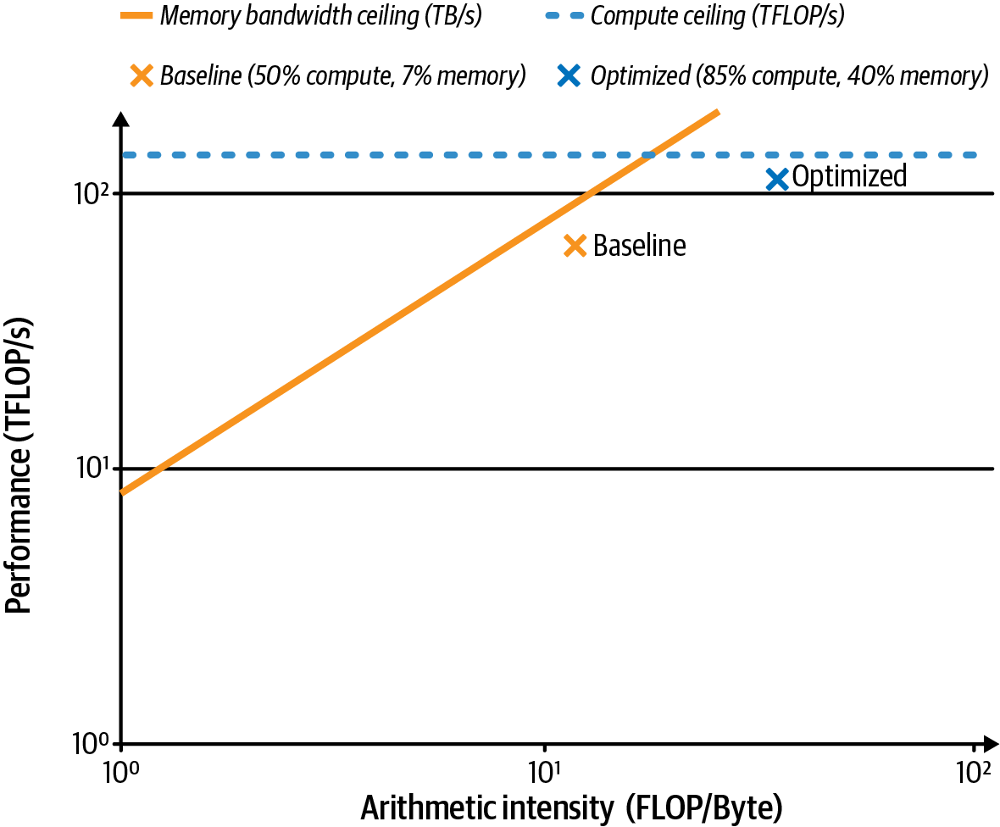
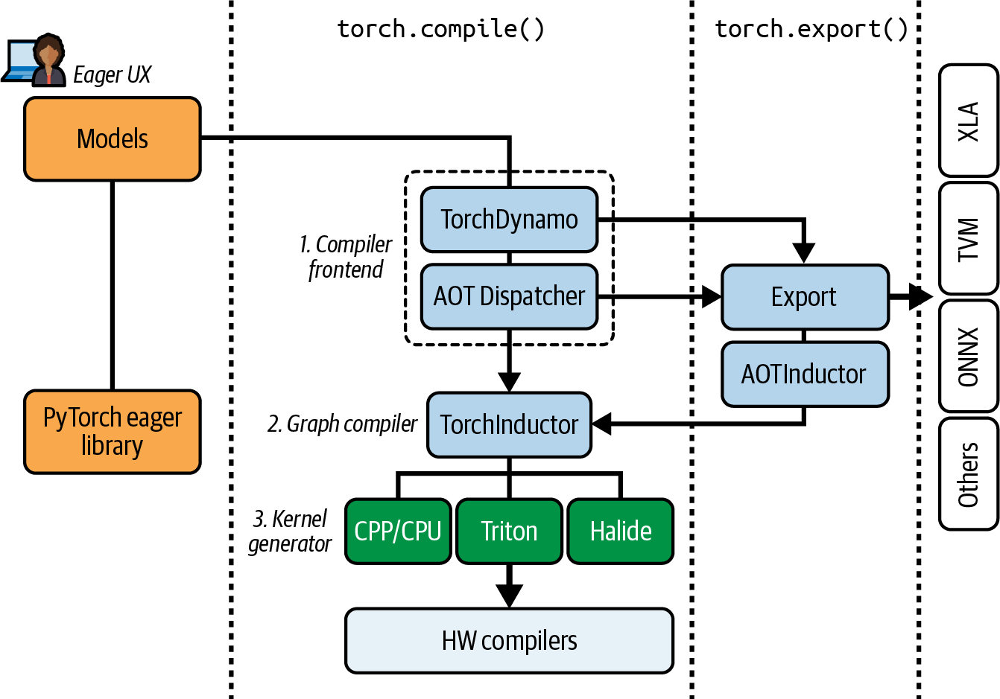

# 5 — Compilers and Frameworks

> Between the model code and the GPU sits a compiler. Most of the cheap speed in inference comes from letting it see a whole graph: fewer launches, fused kernels, and no Python on the hot path.

---

## Profile first

Fregly's rule for PyTorch work (*AISPE*, ch. 13): **profile, find the biggest bottleneck, fix it, re-profile**. Start with the host (Python overhead, data loading, synchronization), then move to the device (kernel efficiency, memory traffic).

His worked example is an MoE iteration on Blackwell. The PyTorch profiler showed **45% of time in Python `forward` overhead** and **20.5% in `aten::matmul`**. The fix order follows from that: remove Python overhead and fuse small ops first, then tune the big GEMMs.

Tools, from coarse to fine:

| Tool | Answers | Use when |
|---|---|---|
| `torch.profiler` + TensorBoard/Perfetto trace | Which ops and kernels take time; CPU/GPU overlap | First pass on any model |
| NVTX ranges | Which *code region* a kernel belongs to | Correlating traces with your code |
| Nsight Systems | Timeline across CPU, GPU, streams, NCCL, memcpy | Finding idle gaps and serialization |
| Nsight Compute | Per-kernel occupancy, stall reasons, roofline position | Tuning one hot kernel |
| Linux `perf` | CPU cycles, cache misses, branch misses | Host-side bottlenecks |

One timing mistake to avoid: CUDA calls are asynchronous, so `time.time()` around a GPU call measures launch, not execution. Call `torch.cuda.synchronize()` before reading the clock, or use CUDA events. Some of the book's own snippets skip this.



*Image Source: Fregly, *AI Systems Performance Engineering* (O'Reilly, 2025), Fig. 13-2*

The figure shows the expert GEMM moving from under the bandwidth slope toward the compute ceiling after fusion. Table 13-4 gives the numbers: from 50% of peak FLOPS, 70% of peak bandwidth and 60% occupancy, to 85% / 40% / 80%. The figure's legend prints the baseline as "7% memory". The table's 70% is consistent with the text; the legend looks like a typo. Fregly adds a caveat worth keeping: there is **no universal occupancy target**. Many good kernels hide latency at 25–50% occupancy, so read stall reasons before chasing occupancy. Kernel-level tuning is in [04](04-kernels.md).

---

## What a compiler does for inference

Huyen lists four kernel techniques that compilers apply, and that hand-written kernels also use (*AI Engineering*, ch. 9):

- **Vectorization:** process contiguous elements in one instruction instead of a loop.
- **Parallelization:** split work across threads and blocks.
- **Loop tiling:** reorder loops so a tile of data is reused from fast memory (registers, shared memory) before it is evicted.
- **Operator fusion:** merge consecutive ops into one kernel so intermediates never round-trip through HBM. In memory-bound decode this is the big one.

**Lowering** turns a framework graph into hardware code. Huyen names the main compilers: **TVM**, **MLIR**, **torch.compile**, **XLA/OpenXLA**, and **TensorRT**. Her PyTorch case study ([08](08-adaptive-inference.md#stacking-the-gains)) shows `torch.compile` alone taking Llama-7B on an A100-80GB from 25.5 to 107 tokens/s per user at batch 1. That is a 4.2× gain from removing overhead in a launch-bound regime, not a typical number for large batches.

---

## The torch.compile stack



*Image Source: Fregly, *AI Systems Performance Engineering* (O'Reilly, 2025), Fig. 14-4*

Fregly walks the stack layer by layer (*AISPE*, ch. 14):

| Stage | Job |
|---|---|
| **TorchDynamo** | Hooks Python bytecode, records PyTorch ops into an FX graph, and inserts **guards** (shape, dtype, globals) that say when the graph is still valid. Falls back to eager at unsupported code, a **graph break** |
| **AOTAutograd** | Traces forward and backward together ahead of time |
| **PrimTorch** | Decomposes 2,000+ ATen ops into ~250 primitives, so backends implement a small set |
| **TorchInductor** | Fuses, schedules and generates kernels: Triton for GPU, C++ for CPU |
| **Triton** | Python-embedded GPU kernel language; compiles to PTX |
| **torch.export + AOTInductor** | Ahead-of-time capture into a deployable artifact without Python at serving time |

### Modes

| Mode | Does | Use for |
|---|---|---|
| `default` | Fusion, light autotuning, moderate compile time; no CUDA graphs | First try; large models; tight memory |
| `reduce-overhead` | CUDA graphs to remove launch overhead; extra static buffers | Small batches, decode loops, stable shapes |
| `max-autotune` | Extensive GEMM/tile autotuning, plus CUDA graphs | Compile once, serve long; GEMM-heavy |
| `max-autotune-no-cudagraphs` | Same tuning, no graph capture | Variable shapes; debugging; measuring raw kernels |

The book says `default` "may use CUDA Graphs for stable segments". In PyTorch, graph capture is enabled by `reduce-overhead` and `max-autotune`, not by `default`.

**How much to expect.** In Fregly's MoE training iteration, `max-autotune` went from about **248 ms to 173 ms (~30%)**. The gain comes from fusing many small dispatch, combine and activation kernels. A dense model dominated by one large GEMM may see **under 10%**, because Tensor Cores are already busy and there is little to fuse (*AISPE*, ch. 13). The Handbook's "up to 4× speedup in the forward pass" for static cache plus compile (*LLM Engineer's Handbook*, ch. 8) is Hugging Face's best case for small-batch decode, with no model, GPU or batch size given. Do not use it as a planning number. The appendix's checklist also gives two different ranges (10–40% and 20–50%) for the same technique. Measure on your own model.

### Graph breaks, guards and recompiles

Three ways a compiled model quietly gets slow:

1. **Graph breaks** split the model into smaller graphs, with eager Python between them. Causes include data-dependent Python control flow, `.item()`, printing, and non-PyTorch library calls. Find them with `torch._dynamo.explain(model)(inputs)` or `TORCH_LOGS=graph_breaks`. Fix them by replacing Python branches with `torch.where` or `torch.cond` (both branches are traced; the predicate must be a boolean tensor), or by marking a call with `allow_in_graph`.
2. **Recompiles** happen when a guard fails, for example when a new sequence length arrives. With `dynamic=None` (the default), PyTorch specializes on the first shape, recompiles once with symbolic shapes when the shape changes, and stops recompiling after a limit (`torch._dynamo.config.recompile_limit`, 8 by default in recent releases). Pre-empt the first recompile with `torch._dynamo.mark_dynamic(t, dim)` on dimensions you know will vary.
3. **CUDA graph invalidation.** CUDA graphs bake in memory addresses and launch topology, so dynamic shapes disable capture for that region. Fregly states this as "CUDA Graphs require static shapes". That is simplified: CUDA graph *trees* keep one graph per distinct shape, which is how serving engines capture a set of batch sizes.

For serving, the practical pattern is **bucketing**. Pad sequence lengths to a few buckets (Fregly suggests within ±10–20%) and capture one graph per batch-size bucket. His example captures sizes 1, 2, 4 and 8 from a **shared memory pool, largest first**, so smaller graphs reuse the largest one's buffers (*AISPE*, ch. 13). vLLM and SGLang do the same with their configured capture sizes.

```python
# Fail fast in CI if anything recompiles; mark known-dynamic dims up front.
torch._dynamo.mark_dynamic(input_ids, 1)          # sequence dim varies
torch.compiler.set_stance("fail_on_recompile")
```

The book says `fail_on_recompile` also raises on graph breaks. It does not: it catches recompiles. To fail on graph breaks, compile with `fullgraph=True`.

### Static KV cache: the Handbook's recipe

Decode is where compile pays most, and decode has a shape problem: the KV cache grows by one token per step. Hugging Face's answer is a **static cache**, pre-allocated to the maximum length, so every decode step has the same shapes and can run as one captured graph (*LLM Engineer's Handbook*, ch. 8):

```python
model.generation_config.cache_implementation = "static"
model.forward = torch.compile(model.forward, mode="reduce-overhead", fullgraph=True)
```

The trade is memory: you reserve KV space for the maximum length whether or not a request uses it. Production engines solve the same problem differently, with paged KV blocks and graphs captured per batch size ([07](07-prefill-decode-kv-cache.md#pagedattention)).

### Cold start

Compile time is real: minutes for a large model in `max-autotune`. Three mitigations from Fregly:

- **Regional compilation** (`torch.compiler.nested_compile_region()`): compile one transformer block and reuse it for every layer.
- **Mega-Cache**: persist compiler artifacts and load them on the next start. Share the cache across replicas.
- **torch.export + AOTInductor**: compile offline and ship a binary. No compile on the serving path, no Python dependence.

---

## Custom kernels inside the compiler

When Inductor's generated code is not good enough, write the hot op in **Triton** (or CUDA), register it as a custom op, and let Inductor fuse around it. Fregly's Triton persistent GEMM ran **159.4 ms vs 174.9 ms for cuBLAS** at M=N=8192, K=512, measured with the Proton profiler (*AISPE*, ch. 14). The GPU and iteration count are not stated, so treat it as "Triton can beat a vendor library on a specific shape", not as a rule.

**FlexAttention** is the middle path for attention variants. You write the score modification (masks, biases, softcapping) in Python, and Inductor generates a fused kernel reaching about **85–90% of FlashAttention-2** forward and backward (*AISPE*, ch. 14). That is also the baseline that AI-generated kernels are measured against in [09](09-checklist-and-ai-assisted-tuning.md#ai-generated-kernels).

---

## Other backends

- **XLA / OpenXLA** (JAX, TPU, PyTorch/XLA): whole-program compilation. It **recompiles for every new shape**, so bucketing matters even more than under Inductor.
- **TensorRT / TensorRT-LLM**: NVIDIA's ahead-of-time engine builder with hand-tuned kernels for NVIDIA GPUs; the backend of Triton Inference Server and Dynamo deployments.
- **TVM, MLIR**: compiler infrastructures for targeting many kinds of hardware. You meet them inside vendor stacks more than directly.

---

## Guarding against regressions

Performance is a property that regresses silently. Fregly recommends a **performance-regression CI job** (*AISPE*, ch. 13). It runs a fixed model (or a smaller proxy) on fixed hardware, records tokens/s or iteration time, and fails the build on a slowdown of **5% or more sustained over 3 runs**, which filters noise. Pin the PyTorch, CUDA and driver versions in the job. A framework upgrade is the most common cause of a sudden regression. PyTorch runs its own dashboard of this kind.

A few other ch. 13 claims to correct or update before reusing:

- **DDP `bucket_cap_mb`**: the book describes the trade-off the wrong way round. Larger buckets mean fewer, bigger all-reduces with less overlap.
- **`torch.utils.data` DataPipes** are deprecated.
- **"One CUDA stream per request"** for inference concurrency is not how serving engines work. They batch requests into shared kernels ([06](06-serving-at-scale.md#batching)).

---

## Working reference

- Profile before compiling. If Python overhead dominates, compile; if one GEMM dominates, expect little.
- Use `reduce-overhead` for small-batch decode with bucketed shapes; `max-autotune` when you can amortize compile time.
- Run `dynamo.explain` once per model change; add `fail_on_recompile` (recompiles) and `fullgraph=True` (breaks) in CI.
- Cache compiled artifacts or export AOT for fast cold starts.
- Gate merges on a sustained ≥5% regression check, on pinned versions.
