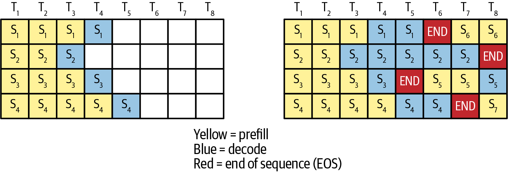
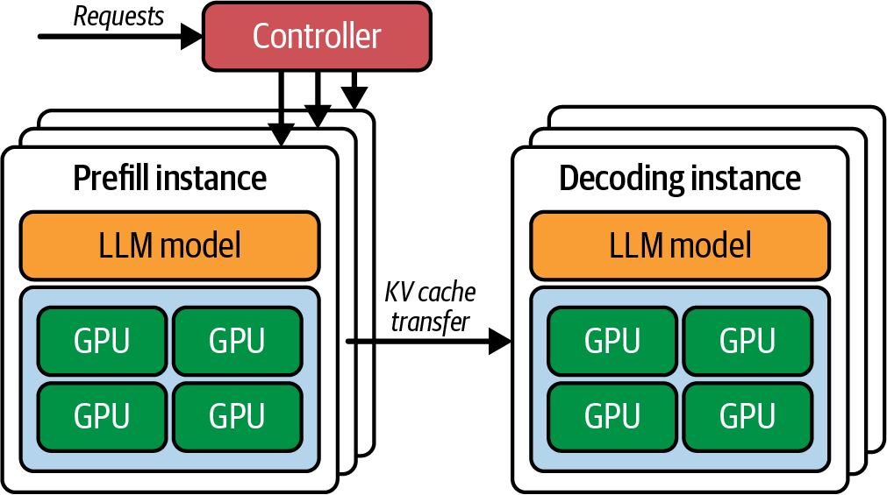

# 6 — Serving at Scale

> One request on one GPU is a demo. Serving means many requests of unknown length sharing a fleet, with a latency promise for each. The levers are how you batch, how you route, how you split the model, and when you add machines.

---

## Deployment shapes

The Handbook picks a deployment type from four criteria: throughput, latency, data (size and shape) and infrastructure (*LLM Engineer's Handbook*, ch. 10). It names three shapes:

| Shape | How it works | Fits | Watch |
|---|---|---|---|
| **Online, real-time** | Synchronous REST or gRPC call; the client waits | Chat, assistants, agents | Tail latency; cost of idle capacity |
| **Asynchronous** | Request goes on a queue; workers drain it; the client polls or gets a callback | Spiky load, long generations | Queue depth; result delivery |
| **Offline batch** | Scheduled job over a dataset; results written to storage | Evals, backfills, embeddings, synthetic data | Throughput per dollar |

The async shape is the Handbook's answer to spikes. In its example, traffic jumps from 10 to 100 RPS and two VMs absorb it through a queue instead of scaling out on the spot. Batch maps to the provider batch APIs at about 50% off ([01](01-why-inference-is-its-own-discipline.md#online-and-batch)).

**Latency buys throughput.** The Handbook's arithmetic: a server that processes 20 requests in 100 ms delivers 200 RPS. Batching 60 requests into 200 ms delivers 300 RPS. Each request waits twice as long and the fleet serves 50% more. Google's often-quoted 2016 finding that 53% of mobile users abandon a page that takes over 3 s is the reminder that the trade has a limit.

**Streaming transport.** The Handbook says LLM services "often use WebSockets" to stream tokens. In practice, the OpenAI, Anthropic and Gemini APIs, TGI and vLLM's OpenAI-compatible server all stream over **server-sent events (SSE)**, one-way over plain HTTP. The Handbook itself notes that TGI uses SSE. WebSockets appear where the channel is two-way (voice, realtime APIs).

### Monolith or microservice

The Handbook's design argument (*LLM Engineer's Handbook*, ch. 10): if retrieval, prompt building and business logic run in the same process as the model, the **GPU sits idle while CPU code runs**, and both must scale together. Splitting into a CPU-side business service and a GPU-side LLM service lets each scale on its own signal and run on matching hardware. The cost is network hops, more deployables and serialization. The Handbook's advice is to start as a modular monolith and split along the GPU/CPU seam when load justifies it.

Its LLM Twin reference build does exactly that. A FastAPI service does RAG retrieval on a cheap CPU machine. It calls a SageMaker endpoint running Hugging Face's TGI container, which provides tensor parallelism, FlashAttention, bitsandbytes quantization, continuous batching, safetensors loading and SSE streaming. The serving contract is a handful of environment variables:

```bash
HF_MODEL_ID=...                    # weights to pull
SM_NUM_GPUS=1                      # tensor-parallel degree
MAX_INPUT_LENGTH=...               # prompt cap
MAX_TOTAL_TOKENS=...               # prompt + generation cap
MAX_BATCH_TOTAL_TOKENS=...         # KV budget across the running batch
MAX_BATCH_PREFILL_TOKENS=10000     # cap on prompt tokens prefilled per step
HF_MODEL_QUANTIZE=bitsandbytes
```

The last two lines are the interesting ones. `MAX_BATCH_TOTAL_TOKENS` is the KV cache budget ([07](07-prefill-decode-kv-cache.md#sizing-the-cache)). `MAX_BATCH_PREFILL_TOKENS` limits how much prefill can enter one step, a crude form of the prefill/decode interference control covered in [07](07-prefill-decode-kv-cache.md#chunked-prefill). The Handbook's sizing (2024): an ml.g5.xlarge (one A10G, 24 GB) for an 8B model quantized; an A100 for a ~30B model. A deploy takes 15–30 minutes, so cold capacity is not instant capacity.

One Handbook framing to update: "inference typically requires less computation" than training. That is true per request. Summed over a product's life, inference is usually the larger bill ([01](01-why-inference-is-its-own-discipline.md#three-levels-one-bill)).

---

## Batching

Decode is bandwidth-bound: each step reads all weights to produce one token per sequence. Batching amortizes that read over many sequences, which is why it is the first lever.

| Kind | When the batch runs | Problem |
|---|---|---|
| **Static** | When it is full | Waits forever at low load |
| **Dynamic** | When full *or* after a time window | Batch still runs until its longest member finishes |
| **Continuous** (in-flight, iteration-level) | Every decode step; finished sequences leave and new ones join | Needs paged KV memory and a scheduler |

Huyen's illustration (*AI Engineering*, ch. 9): with batch size 4 and a 100 ms window, dynamic batching dispatches at 4 requests or 100 ms, whichever comes first. If one request needs 10 output tokens and another 1,000, static or dynamic batching holds the short one's slot for the whole 1,000 steps. Continuous batching, introduced by **Orca** (Yu et al., OSDI 2022), returns that slot after step 10. Fregly's typical dynamic-batching window is **2–10 ms**, tuned against the SLO (*AISPE*, ch. 16). The Handbook notes TGI's waiting-served ratio, which controls how eagerly waiting prefills interrupt running decodes (*LLM Engineer's Handbook*, ch. 8).



*Image Source: Fregly, *AI Systems Performance Engineering* (O'Reilly, 2025), Fig. 16-6*

In the left grid, sequences that finish early leave empty cells until the batch drains. In the right grid, new sequences (S5–S7) take the slots as soon as one ends. Continuous batching is the default in vLLM, SGLang, TGI and TensorRT-LLM. Its limits are memory, solved by PagedAttention ([07](07-prefill-decode-kv-cache.md#pagedattention)), and long prefills stalling decodes, solved by chunked prefill ([07](07-prefill-decode-kv-cache.md#chunked-prefill)).

**A correction on "continuous scheduling".** Fregly describes vLLM "continuous scheduling" as launching one small decode kernel per sequence on separate CUDA streams. He says this is needed because sequences of different lengths "can't simply" be batched into one matrix multiply (*AISPE*, ch. 16). That is not how vLLM or any mainstream engine works. Paged attention kernels handle ragged lengths inside **one batched kernel**, and the linear layers batch trivially, since every sequence contributes one token row per step. Multi-stream concurrency helps when you run *several small models* on one GPU, not for decoding one model's batch.

---

## Routing

With more than one replica, the router decides latency as much as the GPU does.

- **Round-robin is a poor default for LLMs.** The Handbook's autoscaling design puts an ALB in front of replicas with round-robin (*LLM Engineer's Handbook*, ch. 10). Requests differ in cost by orders of magnitude, and replicas differ in which prefixes they already have cached. Route by **load** (queue depth, KV utilization) and by **cache affinity** (send a request to the replica holding its prefix). Fregly covers both (*AISPE*, ch. 17), and llm-d and Dynamo's router implement them ([07](07-prefill-decode-kv-cache.md#prefix-caching)).
- **Length-aware batching.** Self-attention prefill cost grows roughly with N(N+1)/2. In Fregly's example, six prompts of [6K, 2K, 6K, 2K, 2K, 2K] split naively across two GPUs put both 6K prompts on one GPU: ~38.0M Q·K products on the critical path. Rebalanced as [2K, 2K, 6K] on each GPU, the critical path drops to ~22.0M, **42% less**, and TTFT falls with it (*AISPE*, ch. 16).
- **Model cascades.** Send easy queries to a small model and escalate on low confidence. Fregly's claim: routing 60% of queries to a 10× smaller model gives "potentially a 5× overall cost reduction". The arithmetic does not support 5×. Relative cost is 0.6 × 0.1 + 0.4 × 1 = 0.46, about **2.2×**, and less if escalated queries pay for both models. The idea is sound; the number is not. FrugalGPT measured a real cascade over 12 commercial APIs at March 2023 prices, with a small DistilBERT scorer deciding when to escalate: it matched GPT-4's accuracy at 98.3% lower cost on HEADLINES and 59–73% lower on two other short-answer tasks ([arXiv:2305.05176](https://arxiv.org/abs/2305.05176) (Chen et al., 2023-05)). The scorer needs labelled in-distribution examples, and latency was not measured. Cascades also move cost into routing quality, which is an eval problem ([06-eval](../../06-eval/README.md)).

---

## Constrained decoding

Structured outputs (JSON schema, grammars) are enforced by masking invalid tokens at each step. Fregly notes that **XGrammar**, the default backend in vLLM, SGLang and TensorRT-LLM guided decoding, compiles the grammar and computes masks on the GPU, keeping overhead to low single-digit percent (*AISPE*, ch. 15). Older Python-side masking could dominate decode time at large batch sizes.

---

## Parallelism for inference

When a model does not fit on one GPU, or one GPU is too slow, the model is split.

| Strategy | Splits | Buys | Costs | Use for |
|---|---|---|---|---|
| **Replica / data parallel (DP)** | Nothing; full copies | Linear throughput | Memory × replicas | Default scale-out once a copy fits |
| **Tensor parallel (TP)** | Each layer's matrices across GPUs | Lower latency per token; fits bigger models | All-reduce every layer; needs NVLink | Within a node or NVLink domain |
| **Pipeline parallel (PP)** | Layers into stages on different GPUs | Capacity | Higher per-request latency; bubbles unless micro-batched | Models too big for one node |
| **Expert parallel (EP)** | MoE experts across GPUs | Fits many experts; scales MoE | All-to-all dispatch; load imbalance | MoE models |
| **Context parallel (CP)** | The sequence across GPUs | Long-prompt prefill latency; KV per GPU | Communication at partition boundaries | Prompts of 100k+ tokens |

Fregly's guidance (*AISPE*, ch. 15): keep TP inside one NVLink/NVSwitch domain (on GB200 NVL72 that is up to 72 GPUs). Add PP only for capacity. Add EP for MoE. Then replicate with DP. His composition order is **TP → PP → EP → DP**. Huyen's summary is that TP both reduces latency and fits larger models, while PP is "typically avoided" for strict-latency serving in favour of replica parallelism (*AI Engineering*, ch. 9).



*Image Source: Fregly, *AI Systems Performance Engineering* (O'Reilly, 2025), Fig. 15-2*

Disaggregation adds one more axis: run prefill and decode on separate pools, each with its own parallelism. It gets its own treatment in [07](07-prefill-decode-kv-cache.md#disaggregated-prefill-and-decode).

### Where the books disagree

- **Is DP for inference?** The Handbook says data parallelism is "mainly used for training" and that PP and TP are preferred for inference (*LLM Engineer's Handbook*, ch. 8). Huyen calls replica parallelism "the most straightforward strategy" and the one to scale when latency matters (*AI Engineering*, ch. 9). Fregly treats DP as the linear-throughput layer on top of every inference deployment (*AISPE*, ch. 15). Huyen and Fregly match production practice. The Handbook's statement holds only for models too large for one GPU.
- **Sequence vs context parallelism.** Huyen: *context parallelism* splits the input sequence across machines, while *sequence parallelism* splits **operators** across machines (attention on one, FFN on another). The Handbook uses the Megatron-LM meaning: *sequence parallelism* splits LayerNorm and Dropout along the sequence dimension, as a companion to TP. Fregly folds sequence splitting into *context parallelism*. Megatron's meaning is the most widely used in code; check which one a paper means before comparing.
- **MoE capacity factor.** Fregly recommends an expert capacity factor of **1.2–1.5×** average load, dropping or overflowing tokens past it (*AISPE*, ch. 15). That is training-era practice from GShard and Switch Transformer. 2025–2026 MoE serving (DeepSeek-V3 with DeepEP, wide-EP in vLLM and SGLang) is **dropless**, balancing load with redundant experts (EPLB) rather than dropping tokens. The chapter also predates wide-EP and multi-token prediction. Read it for concepts, not current MoE practice.

---

## Watching a fleet

Fregly's monitoring stack (*AISPE*, ch. 16): DCGM exporter → Prometheus → Grafana, plus engine metrics (queue length, KV utilization, TTFT and TPOT histograms).

- `DCGM_FI_DEV_GPU_UTIL` is **time-active**: the share of time any kernel ran. Use `DCGM_FI_PROF_SM_ACTIVE` and `DCGM_FI_PROF_PIPE_TENSOR_ACTIVE` for real activity ([01](01-why-inference-is-its-own-discipline.md#utilization-why-gpu-util-lies)).
- A spike in **copy-engine utilization** (`DCGM_FI_DEV_MEM_COPY_UTIL`) with flat compute usually means the engine is **swapping KV cache** to host memory. You are out of KV space, and latency is about to jump.
- **Fragmentation.** Fregly puts fragmentation without a paged allocator at ~20–30% and says paging brings it to a "few percent". The vLLM paper measured worse: earlier systems used only **20–38%** of their reserved KV memory for actual tokens, so 60–80% was wasted (Kwon et al., 2023). Paging brought waste under 4%.
- **Name streams and regions with NVTX** so Nsight Systems timelines show which request or phase owns each kernel.
- **Network:** set `TCP_NODELAY` on token-streaming sockets. Nagle's algorithm otherwise holds small writes, and streamed tokens arrive in bursts.

---

## Autoscaling

The Handbook's recipe on AWS (*LLM Engineer's Handbook*, ch. 10): register the endpoint as a **scalable target** with a minimum of at least 1 and a maximum, then attach a **target-tracking policy**. The metric is either invocations per model copy (`SageMakerInferenceComponentInvocationsPerCopy`) or GPU utilization around **70%**. Add **cooldowns** so the policy does not flap. It names the two failure modes, over-scaling (paying for idle GPUs) and under-scaling (SLO breaches during the lag), and recommends a stress test from 100 to 10,000 users per minute before launch. Its replica numbers (1 at idle, 2 at 10 RPS, 20 at 100 RPS) are illustrative.

Two problems with the recipe for LLMs:

1. **GPU utilization is the wrong signal.** It is time-active, so a lightly loaded decode loop reads near 100% ([above](#watching-a-fleet)). Scaling on it adds replicas that do not help, or never triggers when KV memory is the real limit. Better signals: **queue depth**, **KV cache utilization**, and **p90 TTFT against the SLO**. Kubernetes stacks (KServe, llm-d) scale on engine metrics for this reason.
2. **Cold start is slow.** Loading and compiling a large model takes minutes. The Handbook's own deploy time is 15–30 min, which is longer than most spikes. Keep warm headroom, pre-pull weights, and cache compiled artifacts ([05](05-compilers-and-frameworks.md#cold-start)).

---

## Working reference

- **Continuous batching on, always.** Cap the batch where p99 TPOT starts to climb.
- **Route on load and cache affinity**, not round-robin.
- **TP within NVLink, PP only for capacity, DP for throughput.** Measure before adding EP or CP.
- **Scale on queue depth, KV utilization or TTFT**, not on GPU util. Keep warm capacity for cold starts.
- **Alert on copy-engine spikes**; they mean KV swapping.
- **Stream over SSE**, with `TCP_NODELAY`.
