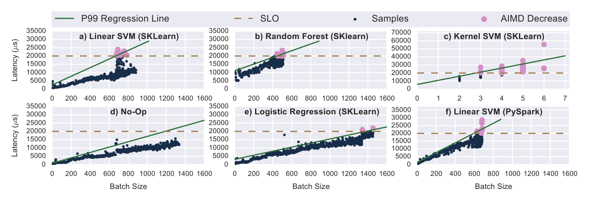
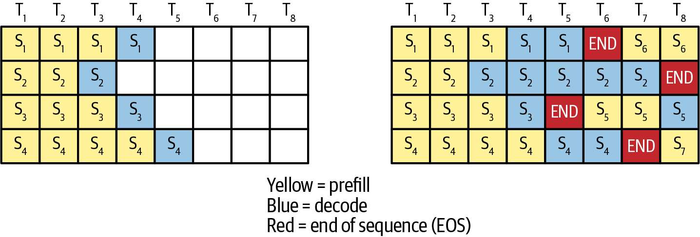
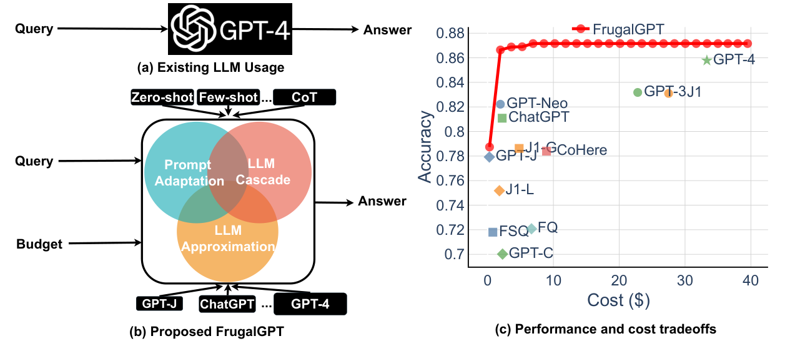
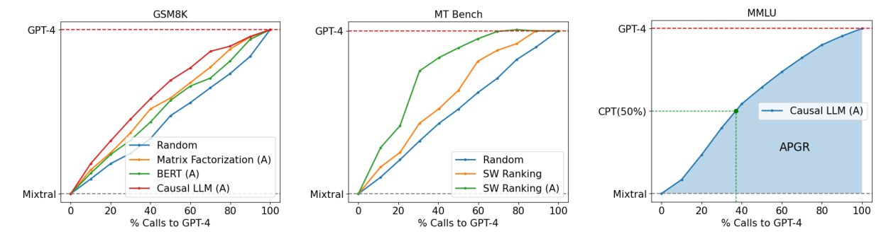
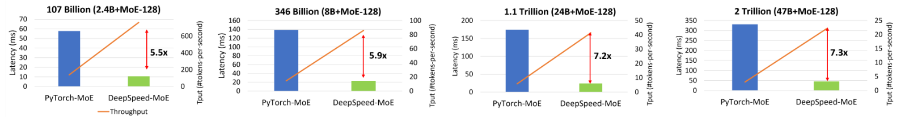
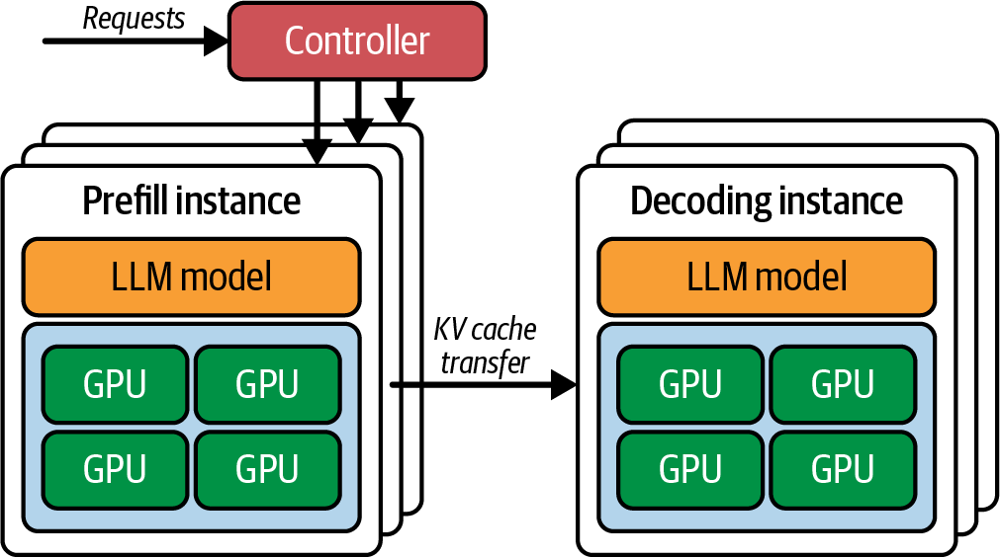

# 6 — Serving at Scale

> One request on one GPU is a demo. Serving means many requests of unknown length sharing a fleet, with a latency promise for each. The levers are how you batch, how you route, how you split the model, and when you add machines.

Autoscaling on GPU utilization, routing with round-robin and running batches until the longest request finishes are the defaults many teams inherit from web serving or vendor recipes. Each one breaks on LLM traffic, because requests differ in cost by orders of magnitude and a decode loop reads busy at light load. This chapter covers the batching, routing and parallelism choices that work with that traffic.

---

## Deployment shapes

The Handbook picks a deployment type from four criteria: throughput, latency, data (size and shape) and infrastructure (*LLM Engineer's Handbook*, ch. 10). It names three shapes:

| Shape | How it works | Fits | Watch |
|---|---|---|---|
| **Online, real-time** | Synchronous REST or gRPC call; the client waits | Chat, assistants, agents | Tail latency; cost of idle capacity |
| **Asynchronous** | Request goes on a queue; workers drain it; the client polls or gets a callback | Spiky load, long generations | Queue depth; result delivery |
| **Offline batch** | Scheduled job over a dataset; results written to storage | Evals, backfills, embeddings, synthetic data | Throughput per dollar |

The async shape is the Handbook's answer to spikes. In its example, traffic jumps from 10 to 100 RPS and two VMs absorb it through a queue instead of scaling out on the spot. Batch maps to the provider batch APIs at about 50% off ([01](01-why-inference-is-its-own-discipline.md#online-and-batch)). [Batch and online serving](../../../data-engineering/06-ml-platform/notes/03-batch-and-online-serving.md#three-shapes) in data engineering sets out similar shapes for an ordinary ML model, and its [rollout section](../../../data-engineering/06-ml-platform/notes/03-batch-and-online-serving.md#rolling-out-a-new-model) and [the model registry](../../../data-engineering/06-ml-platform/notes/02-experiment-tracking-and-model-registry.md#rollback-and-why-the-registry-labels-but-does-not-deploy) cover shipping a new version.

**Latency buys throughput.** The Handbook's arithmetic: a server that processes 20 requests in 100 ms delivers 200 RPS. Batching 60 requests into 200 ms delivers 300 RPS. Each request waits twice as long and the fleet serves 50% more. Google's often-quoted 2016 finding that 53% of mobile users abandon a page that takes over 3 s is the reminder that the trade has a limit.

**Streaming transport.** The Handbook says LLM services "often use WebSockets" to stream tokens. In practice, the OpenAI, Anthropic and Gemini APIs, TGI and vLLM's OpenAI-compatible server all stream over **server-sent events (SSE)**, one-way over plain HTTP. The Handbook itself notes that TGI uses SSE. WebSockets appear where the channel is two-way (voice, realtime APIs).

### Where the model runs

The three shapes above say when work happens. A second axis says where the model sits, and *Agentic Architectural Patterns* (ch. 2) names three places for an agent's reasoning core:

| Place | Gains | Costs | The book's fit |
|---|---|---|---|
| **Cloud API** | No hardware to run; the largest models; built-in monitoring | Network latency; prompts leave your boundary; per-token bill grows with volume; no control of the serving stack | Prototypes, or when the biggest current model is the point |
| **Self-hosted** (on-premises or private cloud, served with vLLM or Triton) | Data stays inside; can be co-located with the agent for fewer network hops; you choose the stack | MLOps expertise, GPUs, and scaling and security are yours | Data sensitivity, regulation, very low latency, often a smaller fine-tuned model |
| **Edge** (on the device) | No network call; works offline; data never leaves the device | Model size capped by the device, so small, quantized or pruned models | Phones, robots, in-car and industrial sensors |

The chapter gives no measurements for any of this. It is a decision aid and no more. Its only memory-side claim is qualitative: quantized files such as GGUF are the easiest to self-host, because full FP16 weights need H100 or A100-class GPUs. [08c](08c-quantization-and-low-precision.md) and [the memory arithmetic in the LLM-fundamentals pillar](../../../generative-ai/01-llm-fundamentals/notes/14-open-weight-models-and-local-inference.md#will-it-fit-memory-measured) supply the numbers. Its worked picks match the shapes: an overnight document-summarising agent cares about throughput and cost, so batch serving, while a trading agent that needs sub-second answers on sensitive data points to a co-located self-hosted model.

### Monolith or microservice

The Handbook's design argument (*LLM Engineer's Handbook*, ch. 10): if retrieval, prompt building and business logic run in the same process as the model, the **GPU sits idle while CPU code runs**, and both must scale together. Splitting into a CPU-side business service and a GPU-side LLM service lets each scale on its own signal and run on matching hardware. The cost is network hops, more deployables and serialization. The Handbook's advice is to start as a modular monolith and split along the GPU/CPU seam when load justifies it.

Its LLM Twin reference build does exactly that. A FastAPI service does RAG retrieval on a cheap CPU machine. It calls a SageMaker endpoint running Hugging Face's TGI container, which provides tensor parallelism, FlashAttention, bitsandbytes quantization, continuous batching, safetensors loading and SSE streaming. The serving contract is a handful of environment variables:

```bash
HF_MODEL_ID=...                    # weights to pull
SM_NUM_GPUS=1                      # tensor-parallel degree
MAX_INPUT_LENGTH=...               # prompt cap
MAX_TOTAL_TOKENS=...               # prompt + generation cap
MAX_BATCH_TOTAL_TOKENS=...         # KV budget across the running batch
MAX_BATCH_PREFILL_TOKENS=10000     # cap on prompt tokens prefilled per step
HF_MODEL_QUANTIZE=bitsandbytes
```

The last two lines are the interesting ones. `MAX_BATCH_TOTAL_TOKENS` is the KV cache budget ([07](07-prefill-decode-kv-cache.md#sizing-the-cache)). `MAX_BATCH_PREFILL_TOKENS` limits how much prefill can enter one step, a crude form of the prefill/decode interference control covered in [07](07-prefill-decode-kv-cache.md#chunked-prefill). The Handbook's sizing (2024): an ml.g5.xlarge (one A10G, 24 GB) for an 8B model quantized; an A100 for a ~30B model. A deploy takes 15–30 minutes, so cold capacity is not instant capacity.

One Handbook framing to update: "inference typically requires less computation" than training. That is true per request. Summed over a product's life, inference is usually the larger bill ([01](01-why-inference-is-its-own-discipline.md#three-levels-one-bill)).

---

## Batching

Decode is bandwidth-bound: each step is one [forward pass](../../../data-science/02-deep-learning/notes/01-neural-networks-fundamentals.md#the-forward-pass) that reads all weights to produce one token per sequence. Batching amortizes that read over many sequences, which is why it is the first lever.

| Kind | When the batch runs | Problem |
|---|---|---|
| **Static** | When it is full | Waits forever at low load |
| **Dynamic** | When full *or* after a time window | Batch still runs until its longest member finishes |
| **Continuous** (in-flight, iteration-level) | Every decode step; finished sequences leave and new ones join | Needs paged KV memory and a scheduler |

Huyen's illustration (*AI Engineering*, ch. 9): with batch size 4 and a 100 ms window, dynamic batching dispatches at 4 requests or 100 ms, whichever comes first. If one request needs 10 output tokens and another 1,000, static or dynamic batching holds the short one's slot for the whole 1,000 steps. Continuous batching, introduced by **Orca** (Yu et al., OSDI 2022), returns that slot after step 10. Xiao and Zhu define the unit: an iteration is a whole prefill or one decode step, so a request with n output tokens takes n + 1 iterations, and the scheduler may add or drop sequences between any two (request-level scheduling, by contrast, cannot touch a batch once dispatched). They name the cost as well: reorganizing the batch in memory each time adds overhead and can fragment memory, and because prefill counts as one iteration the scheme favours throughput over token latency (*Foundations of LLMs*, ch. 5). For static batches they also advise bucketing requests of similar length to cut padding. Fregly's typical dynamic-batching window is **2–10 ms**, tuned against the SLO (*AISPE*, ch. 16). Tuning the batch against an SLO predates LLMs. Clipper grew the batch additively and cut it multiplicatively (AIMD) whenever latency crossed the SLO. That raised throughput up to **26×** for a scikit-learn SVM under a 20 ms SLO, and the largest batch that met the same SLO differed **241×** across the models it served ([arXiv:1612.03079](https://arxiv.org/abs/1612.03079) (Crankshaw et al., NSDI 2017)). That spread is why the batch cap has to be measured per model rather than copied. The Handbook notes TGI's waiting-served ratio, which controls how eagerly waiting prefills interrupt running decodes (*LLM Engineer's Handbook*, ch. 8).


*Image Source: Crankshaw et al., [Clipper](https://arxiv.org/abs/1612.03079) (NSDI 2017), Fig. 3*

A single-run demo shows the size of the gap when a client loops over requests instead of submitting them together: 100 samples took 106.11 s sequentially (0.94 samples/s) and 4.60 s as one batch (21.74 samples/s), a 23.07x speedup. The chapter's prose says "20x", and model and hardware are not stated, so treat it as an upper-end illustration (*Generative AI Design Patterns*, ch. 8, Pattern 26). Servers such as vLLM and SGLang batch continuously by default, so the practical advice is to send all requests to the server concurrently. The same chapter lists prompt compression as a second lever: hard compression (regex or an LLM rewrite, with a reconstruction check) stays readable, while soft compression encodes text into vectors or KV values and is model-specific.



*Image Source: Fregly, *AI Systems Performance Engineering* (O'Reilly, 2025), Fig. 16-6*

In the left grid, sequences that finish early leave empty cells until the batch drains. In the right grid, new sequences (S5–S7) take the slots as soon as one ends. Continuous batching is the default in vLLM, SGLang, TGI and TensorRT-LLM. Its limits are memory, solved by PagedAttention ([07](07-prefill-decode-kv-cache.md#pagedattention)), and long prefills stalling decodes, solved by chunked prefill ([07](07-prefill-decode-kv-cache.md#chunked-prefill)).

Continuous batching still admits requests in arrival order, so a 1,000-token generation ahead of a 10-token one costs the short one its whole wait. Zhen et al.'s survey of serving systems sorts the fixes into two lines: schedulers that approximate shortest-job-first or shortest-remaining-time-first from a predicted output length, where the predictor gives an exact token count, a length bin, or a relative ranking among the waiting requests; and FastServe's skip-join multi-level feedback queue, which prioritises short requests, promotes ones that have waited long and preempts long-running ones. The same survey splits cache reuse into lossless (an exact prefix match on the KV cache) and semantic-aware (a similar query, as in GPTCache's reuse of whole outputs and SCALM's query clusters) kinds. It is a taxonomy with no measurements of its own, covering work to about April 2025 ([arXiv:2504.19720](https://arxiv.org/abs/2504.19720) (Zhen et al., 2025-04, preprint survey)).

**A correction on "continuous scheduling".** Fregly describes vLLM "continuous scheduling" as launching one small decode kernel per sequence on separate CUDA streams. He says this is needed because sequences of different lengths "can't simply" be batched into one matrix multiply (*AISPE*, ch. 16). That is not how vLLM or any mainstream engine works. Paged attention kernels handle ragged lengths inside **one batched kernel**, and the linear layers batch trivially, since every sequence contributes one token row per step. Multi-stream concurrency helps when you run *several small models* on one GPU, not for decoding one model's batch.

---

## Routing

With more than one replica, the router decides latency as much as the GPU does.

- **Round-robin is a poor default for LLMs.** The Handbook's autoscaling design puts an ALB in front of replicas with round-robin (*LLM Engineer's Handbook*, ch. 10). Requests differ in cost by orders of magnitude, and replicas differ in which prefixes they already have cached. Route by **load** (queue depth, KV utilization) and by **cache affinity** (send a request to the replica holding its prefix). Fregly covers both (*AISPE*, ch. 17), and llm-d and Dynamo's router implement them ([07](07-prefill-decode-kv-cache.md#prefix-caching)).
- **Length-aware batching.** Self-attention prefill cost grows roughly with N(N+1)/2. In Fregly's example, six prompts of [6K, 2K, 6K, 2K, 2K, 2K] split naively across two GPUs put both 6K prompts on one GPU: ~38.0M Q·K products on the critical path. Rebalanced as [2K, 2K, 6K] on each GPU, the critical path drops to ~22.0M, **42% less**, and TTFT falls with it (*AISPE*, ch. 16).
- **Model cascades.** Send easy queries to a small model and escalate on low confidence. Fregly's claim: routing 60% of queries to a 10× smaller model gives "potentially a 5× overall cost reduction". The arithmetic does not support 5×. Relative cost is 0.6 × 0.1 + 0.4 × 1 = 0.46, about **2.2×**, and less if escalated queries pay for both models. The idea is sound; the number is not. FrugalGPT measured a real cascade over 12 commercial APIs at March 2023 prices, with a small DistilBERT scorer deciding when to escalate: it matched GPT-4's accuracy at 98.3% lower cost on HEADLINES and 59–73% lower on two other short-answer tasks ([arXiv:2305.05176](https://arxiv.org/abs/2305.05176) (Chen et al., 2023-05)). The scorer needs labelled in-distribution examples, and latency was not measured. RouteLLM trains the router on Chatbot Arena preference data to choose between GPT-4 and Mixtral-8x7B. Against GPT-4 alone it cuts cost **3.66×** at 95% of GPT-4's quality on MT Bench, but only 1.41× on MMLU (92%) and 1.49× on GSM8K (87%). The gain tracks how much the benchmark resembles the Arena data the router learned from ([arXiv:2406.18665](https://arxiv.org/abs/2406.18665) (Ong et al., ICLR 2025)). Avengers-Pro clusters query embeddings and routes each cluster across eight frontier models by a performance–cost score. Over six benchmarks it beats the best single model by 7% average accuracy, matches it at 27% lower cost, and reaches about 90% of its accuracy at 63% lower cost ([arXiv:2508.12631](https://arxiv.org/abs/2508.12631) (Zhang et al., DAI 2025)). Cascades also move cost into routing quality, which is an eval problem ([the Eval pillar](../../../generative-ai/08-eval/README.md)).
- **Escalating on a self-check.** AutoMix drops the trained scorer. The small model samples eight judgements of its own answer against the supplied context (few-shot, untrained), and a POMDP router treats that noisy score as evidence about how hard the question is, deciding whether to call the large model. On five context-grounded tasks (QASPER, QUALITY, CoQA, MuTual, DIPLOMAT), with LLaMA2-13B, Mistral-7B or GPT-3.5 as the small model and GPT-4 as the large one, it reports over 50% less compute at comparable performance. Its metric, ΔIBC, is the lift in gain per unit cost over randomly mixing the two models. With Mistral-7B it ran from 12.4% (CoQA) to 156.8% (DIPLOMAT) and led FrugalGPT and HybridLLM on all five tasks. Costs are simulated from price ratios (the large model counted as 60 to 200 small calls), not measured, and it needs a context to check against, so it does not cover factual or commonsense QA ([arXiv:2310.12963](https://arxiv.org/abs/2310.12963) (Aggarwal et al., NeurIPS 2024)).


*Image Source: Chen et al., [FrugalGPT](https://arxiv.org/abs/2305.05176) (2023), Fig. 1*


*Image Source: Ong et al., [RouteLLM](https://arxiv.org/abs/2406.18665) (ICLR 2025), Fig. 1*

---

## Constrained decoding

Structured outputs (JSON schema, grammars) are enforced by masking invalid tokens at each step. Fregly notes that **XGrammar**, the default backend in vLLM, SGLang and TensorRT-LLM guided decoding, compiles the grammar and computes masks on the GPU, keeping overhead to low single-digit percent (*AISPE*, ch. 15). Older Python-side masking could dominate decode time at large batch sizes.

---

## Parallelism for inference

When a model does not fit on one GPU, or one GPU is too slow, the model is split.

| Strategy | Splits | Buys | Costs | Use for |
|---|---|---|---|---|
| **Replica / data parallel (DP)** | Nothing; full copies | Linear throughput | Memory × replicas | Default scale-out once a copy fits |
| **Tensor parallel (TP)** | Each layer's matrices across GPUs | Lower latency per token; fits bigger models | All-reduce every layer; needs NVLink | Within a node or NVLink domain |
| **Pipeline parallel (PP)** | Layers into stages on different GPUs | Capacity | Higher per-request latency; bubbles unless micro-batched | Models too big for one node |
| **Expert parallel (EP)** | MoE experts across GPUs | Fits many experts; scales MoE | All-to-all dispatch; load imbalance | MoE models |
| **Context parallel (CP)** | The sequence across GPUs | Long-prompt prefill latency; KV per GPU | Communication at partition boundaries | Prompts of 100k+ tokens |

Fregly's guidance (*AISPE*, ch. 15): keep TP inside one NVLink/NVSwitch domain (on GB200 NVL72 that is up to 72 GPUs). Add PP only for capacity. Add EP for MoE. Then replicate with DP. His composition order is **TP → PP → EP → DP**. Huyen's summary is that TP both reduces latency and fits larger models, while PP is "typically avoided" for strict-latency serving in favour of replica parallelism (*AI Engineering*, ch. 9).

Both splits come from training, and the costs in the table come with them. Megatron-LM's tensor parallelism splits the first MLP matrix by columns and the second by rows, and splits attention by heads. Each layer then needs only two all-reduces in the forward pass and two in the backward pass. An 8.3B GPT-2 trained on 512 V100s (8-way tensor × 64-way data parallel) at 15.1 PFLOP/s, 76% scaling efficiency against a 1.2B model on one GPU. Strong scaling was weaker: the 1.2B model ran 1.64× faster on 2 GPUs and 2.98× on 8. The authors kept tensor parallelism inside one 16-GPU DGX-2H server, where NVSwitch gives 300 GB/s between GPUs against 100 GB/s between servers ([arXiv:1909.08053](https://arxiv.org/abs/1909.08053) (Shoeybi et al., 2019, preprint)). GPipe's pipeline parallelism splits each batch into M micro-batches flowing through K stages. The idle "bubble" is (K − 1)/(M + K − 1) of the time and becomes negligible once M ≥ 4K. A Transformer split over 8 TPU stages trained 6.3× faster at M = 32 than a 2-stage split with no micro-batching, but only 1.3× faster at M = 1, where one stage works at a time. Only activations cross stage boundaries, so going from 2 to 8 GPUs without NVLink still gave 3.3× ([arXiv:1811.06965](https://arxiv.org/abs/1811.06965) (Huang et al., NeurIPS 2019)). At inference, a single latency-bound request is the M = 1 case, which is why PP buys capacity but not speed.

DeepSpeed-Inference was the first system to combine these for inference, with fused kernels for small-batch decode plus TP, PP and EP. It reported up to **1.9×** lower latency than FasterTransformer for dense models up to 175B, and **7.2×** for MoE, serving a trillion-parameter MoE at under 25 ms per token on 256 GPUs ([arXiv:2207.00032](https://arxiv.org/abs/2207.00032) (Aminabadi et al., SC 2022)). Context parallelism goes back to **Ring Attention**. Each device holds one block of the sequence and passes its KV blocks around a ring, overlapping each transfer with blockwise attention on the block it already has. The maximum context then grows with the number of devices, with no approximation, and reached millions of tokens on a TPUv4-1024 pod. The paper's results are mostly from training ([arXiv:2310.01889](https://arxiv.org/abs/2310.01889) (Liu et al., ICLR 2024)).


*Image Source: Aminabadi et al., [DeepSpeed-Inference](https://arxiv.org/abs/2207.00032) (SC 2022), Fig. 7*

Expert parallelism's cost is the all-to-all that sends each token to its experts and back. In GShard, going from 128 to 2,048 experts (16×) made that dispatch and combine about 3.75× slower. The growth was sublinear, but it was still the largest part of the routing cost ([arXiv:2006.16668](https://arxiv.org/abs/2006.16668) (Lepikhin et al., ICLR 2021)). Cai et al.'s survey counts four all-to-alls per MoE layer in training (dispatch and combine, in both the forward and the backward pass) and calls them often the main limit on efficiency. For memory, it describes systems (SE-MoE, Pre-gated MoE, EdgeMoE) that keep only the active experts in HBM and offload the rest to CPU memory or SSD, predicting and prefetching experts to hide the transfer ([arXiv:2407.06204](https://arxiv.org/abs/2407.06204) (Cai et al., IEEE TKDE 2025)). One consumer-GPU measurement of that offloading: Eliseev and Mazur run Mixtral-8x7B-Instruct with an LRU cache of experts per layer (2 on a 12 GB card, 4 on 16 GB) and speculative loading, which applies the next layer's gate to the current hidden states and fetches the likely experts early. With 4-bit attention and 2-bit experts at batch size 1, the full method reached 2.09 tokens/s on a free-tier Colab T4 and 2.28 on an RTX 3060, against 0.66 and 0.92 for naive offloading. With 3-bit experts it gave 1.60 (T4) and 2.04. Experts are 96.6% of the parameters, so they take the heavy quantization, and it costs quality: base-model MMLU falls from 70.51% ([FP16](../../../programming/computer-science/notes/04-numbers-and-memory.md#smaller-floats)) to 65.58% with 2-bit experts and 68.47% with 3-bit. It is one model, batch 1, on PCIe Gen3/4 hardware, bound by host-to-device bandwidth ([arXiv:2312.17238](https://arxiv.org/abs/2312.17238) (Eliseev & Mazur, 2023-12, preprint)). GLaM's authors name the economic catch. A 1.2T-parameter MoE needs many devices just to hold its weights, which "increases the serving cost especially when the serving traffic is low" ([arXiv:2112.06905](https://arxiv.org/abs/2112.06905) (Du et al., ICML 2022)).



*Image Source: Fregly, *AI Systems Performance Engineering* (O'Reilly, 2025), Fig. 15-2*

Disaggregation adds one more axis: run prefill and decode on separate pools, each with its own parallelism. It gets its own treatment in [07](07-prefill-decode-kv-cache.md#disaggregated-prefill-and-decode).

### Where the books disagree

- **Is DP for inference?** The Handbook says data parallelism is "mainly used for training" and that PP and TP are preferred for inference (*LLM Engineer's Handbook*, ch. 8). Huyen calls replica parallelism "the most straightforward strategy" and the one to scale when latency matters (*AI Engineering*, ch. 9). Fregly treats DP as the linear-throughput layer on top of every inference deployment (*AISPE*, ch. 15). Huyen and Fregly match production practice. The Handbook's statement holds only for models too large for one GPU.
- **Sequence vs context parallelism.** Huyen: *context parallelism* splits the input sequence across machines, while *sequence parallelism* splits **operators** across machines (attention on one, FFN on another). The Handbook uses the Megatron-LM meaning: *sequence parallelism* splits LayerNorm and Dropout along the sequence dimension, as a companion to TP. Fregly folds sequence splitting into *context parallelism*. Megatron's meaning is the most widely used in code; check which one a paper means before comparing.
- **MoE capacity factor.** Fregly recommends an expert capacity factor of **1.2–1.5×** average load, dropping or overflowing tokens past it (*AISPE*, ch. 15). That is training-era practice from GShard and Switch Transformer. 2025–2026 MoE serving (DeepSeek-V3 with DeepEP, wide-EP in vLLM and SGLang) is **dropless**, balancing load with redundant experts (EPLB) rather than dropping tokens. The chapter also predates wide-EP and multi-token prediction. Read it for concepts, not current MoE practice. Dropless routing moves the waste into the kernel. Each expert's grouped GEMM pads its token count up to the tile size, and with many small experts that padding adds up. SonicMoE changes the router so that every expert receives a multiple of the tile size in tokens. Under high sparsity that speeds kernel execution up 1.16× over plain top-k routing, with similar downstream quality. Separately, its memory-light backward pass and IO-overlapping kernels cut activation memory by 45% and give 1.86× the throughput of ScatterMoE for a fine-grained 7B MoE on H100. The results are for training throughput, and quality under token rounding was checked only at 1.8B ([arXiv:2512.14080](https://arxiv.org/abs/2512.14080) (Guo et al., ICLR 2026)).

---

## Watching a fleet

Fregly's monitoring stack (*AISPE*, ch. 16): DCGM exporter → Prometheus → Grafana, plus engine metrics (queue length, KV utilization, TTFT and TPOT histograms).

- `DCGM_FI_DEV_GPU_UTIL` is **time-active**: the share of time any kernel ran. Use `DCGM_FI_PROF_SM_ACTIVE` and `DCGM_FI_PROF_PIPE_TENSOR_ACTIVE` for real activity ([01](01-why-inference-is-its-own-discipline.md#utilization-why-gpu-util-lies)).
- A spike in **copy-engine utilization** (`DCGM_FI_DEV_MEM_COPY_UTIL`) with flat compute usually means the engine is **swapping KV cache** to host memory. You are out of KV space, and latency is about to jump.
- **Fragmentation.** Fregly puts fragmentation without a paged allocator at ~20–30% and says paging brings it to a "few percent". The vLLM paper measured worse: earlier systems used only **20–38%** of their reserved KV memory for actual tokens, so 60–80% was wasted (Kwon et al., 2023). Paging brought waste under 4%.
- **Name streams and regions with NVTX** so Nsight Systems timelines show which request or phase owns each kernel.
- **Network:** set `TCP_NODELAY` on token-streaming sockets. Nagle's algorithm otherwise holds small writes, and streamed tokens arrive in bursts.

---

## Degradation testing

Before launch, find where latency breaks. Lakshmanan and Hapke (*Generative AI Design Patterns*, ch. 8, Pattern 27) track TTFT, end-to-end request latency (P50/P95/P99), tokens per second (watching for the saturation point where it drops) and requests per second, and run scalability, stress and load tests. They name TTFT as dominated by attention over the prompt, so the levers are prompt compression, prefix caching, more GPU memory, a smaller maximum context, and putting predictable text first with dynamic RAG text later. A badly sized setup in their example averaged a 52 s TTFT with most requests failing (model and hardware not given). Their load-test run against gpt-4o-mini (100 users x 25 requests, max 150 tokens, temperature 0.7) completed 2,499 of 2,500 requests in 190.57 s with average TTFT 3.556 s and p95 4.206 s, and 1,914.5 tokens/s overall. Note that the tool printed "Success rate: 100.0%" despite the one failure, so check the raw counts. Tools named include LLMPerf, LangSmith, Arize Phoenix and the vLLM and SGLang benchmark scripts.

## Autoscaling

The Handbook's recipe on AWS (*LLM Engineer's Handbook*, ch. 10): register the endpoint as a **scalable target** with a minimum of at least 1 and a maximum, then attach a **target-tracking policy**. The metric is either invocations per model copy (`SageMakerInferenceComponentInvocationsPerCopy`) or GPU utilization around **70%**. Add **cooldowns** so the policy does not flap. It names the two failure modes, over-scaling (paying for idle GPUs) and under-scaling (SLO breaches during the lag), and recommends a stress test from 100 to 10,000 users per minute before launch. Its replica numbers (1 at idle, 2 at 10 RPS, 20 at 100 RPS) are illustrative. Billing is why this matters. A SageMaker endpoint charges for its instances whether or not anything calls it, while Bedrock charges per API call and allows less customisation. On a dedicated endpoint, "you have to design autoscaling systems that delete unused resources" (*LLM Engineer's Handbook*, ch. 2).

Two problems with the recipe for LLMs:

1. **GPU utilization is the wrong signal.** It is time-active, so a lightly loaded decode loop reads near 100% ([above](#watching-a-fleet)). Scaling on it adds replicas that do not help, or never triggers when KV memory is the real limit. Better signals: **queue depth**, **KV cache utilization**, and **p90 TTFT against the SLO**. Kubernetes stacks (KServe, llm-d) scale on engine metrics for this reason.
2. **Cold start is slow.** Loading and compiling a large model takes minutes. The Handbook's own deploy time is 15–30 min, which is longer than most spikes. Keep warm headroom, pre-pull weights, and cache compiled artifacts ([05](05-compilers-and-frameworks.md#cold-start)).

---

## Working reference

- **Continuous batching on, always.** Cap the batch where p99 TPOT starts to climb.
- **Route on load and cache affinity**, not round-robin.
- **TP within NVLink, PP only for capacity, DP for throughput.** Measure before adding EP or CP.
- **Scale on queue depth, KV utilization or TTFT**, not on GPU util. Keep warm capacity for cold starts.
- **Alert on copy-engine spikes**; they mean KV swapping.
- **Stream over SSE**, with `TCP_NODELAY`.

## Pitfalls

- **Autoscaling on GPU utilization.** Symptom: replicas that don't help, or no scale-out when KV memory is what ran out, because a lightly loaded decode loop reads near 100%. Fix: scale on queue depth, KV utilization or TTFT.
- **Scaling for a spike you can't catch.** Symptom: the spike is over before the new replica is up, with the Handbook's own deploy time at 15–30 min. Fix: keep warm headroom, pre-pull weights, cache compiled artifacts, and use a queue for spiky async work.
- **Round-robin across replicas.** Symptom: one replica stuck on long requests while another idles, and low prefix-cache hit rates. Fix: route on load and cache affinity.
- **Static or dynamic batching for chat.** Symptom: a 10-token request holds its slot for 1,000 steps because a batch-mate is long. Fix: continuous batching, capped where p99 TPOT starts to climb.
- **Believing the cascade headline.** Symptom: a plan built on Fregly's "5×" for sending 60% of queries to a 10× smaller model, when the arithmetic gives about 2.2× (0.46). Fix: compute it, and count the small model's cost on escalated queries too.
- **Keeping retrieval and business logic in the GPU process.** Symptom: the GPU idles while CPU code runs, and both have to scale together. Fix: split a CPU service from the LLM service, as the Handbook's LLM Twin build does.
- **Missing a KV shortage.** Symptom: a spike in `DCGM_FI_DEV_MEM_COPY_UTIL` with flat compute, then a latency jump as the engine swaps KV to host memory. Fix: alert on copy-engine utilization and KV utilization.
- **Bursty streams.** Symptom: tokens arrive in clumps though TPOT is fine, because Nagle's algorithm holds small writes. Fix: set `TCP_NODELAY` on token-streaming sockets, and stream over SSE.

## Try it

1. Redo the cascade with escalated queries paying for both models, then find the share you would have to route to the small model to reach 5× at all if none of them pay twice.

   <details><summary>Answer</summary>

   If the 40% that escalate pay for both: 0.6 × 0.1 + 0.4 × 1.1 = 0.50, so 2×, not 2.2×. For 5×, the cost must be 0.2: 0.1x + (1 − x) = 0.2 gives x ≈ 89% of queries.

   </details>

2. Check Fregly's length-aware example: prefill cost is about N(N+1)/2, and the prompts are [6K, 2K, 6K, 2K, 2K, 2K] on two GPUs. What is the critical path for the naive split and the rebalanced one?

   <details><summary>Answer</summary>

   Naive puts [6K, 6K, 2K] on one GPU: 2 × 18.003M + 2.001M ≈ 38.0M Q·K products. Rebalanced [2K, 2K, 6K] on each gives 2 × 2.001M + 18.003M ≈ 22.0M, 42% lower. Same prompts and GPUs; only the assignment changed.

   </details>

3. In the [inference lab](../practice/inference-lab/README.md#things-to-try), run items 1 and 2: set `decode_per_seq_ms` to 10 and rerun, then raise `prefill_ms_per_token` to 1. Answers are in the lab README, and the lab's numbers follow from its stated assumptions, not from a measured GPU.

## Interview checklist

| Prompt | Answer in one line |
|---|---|
| Why does latency buy throughput? | In the Handbook's arithmetic, 20 requests in 100 ms is 200 RPS and 60 in 200 ms is 300 RPS: each request waits twice as long and the fleet serves 50% more. Decode's weight read is amortized over the batch. |
| Static, dynamic or continuous batching? | Static waits to fill. Dynamic also fires on a time window, but runs until its longest member finishes. Continuous admits and retires at each decode step, and needs paged KV memory and a scheduler. |
| How do you split a model too big for one GPU? | TP inside the NVLink domain, PP only for capacity, EP for MoE, then replicate with DP: Fregly's order is TP → PP → EP → DP. Measure before adding EP or CP. |
| What should autoscaling track? | Queue depth, KV utilization or TTFT. GPU utilization is time-active and misses KV exhaustion, and with 15–30 min deploys you also need warm headroom. |
| Someone proposes a cascade with 60% of traffic on a 10× smaller model. What saving do you tell them? | About 2.2× (0.6 × 0.1 + 0.4 = 0.46), not the book's 5×, and less if escalated queries pay for both models. Decide after measuring how often the small model must escalate. |
| Copy-engine utilization spikes while compute stays flat. What is happening? | The engine is probably swapping KV to host memory because it is out of KV space, and latency is about to jump. Lower the batch cap, shrink KV, or add capacity. |

## Next

[07-prefill-decode-kv-cache.md](07-prefill-decode-kv-cache.md): the batch cap, routing and swap alerts here all come back to where the KV cache lives and which GPU computes it.
