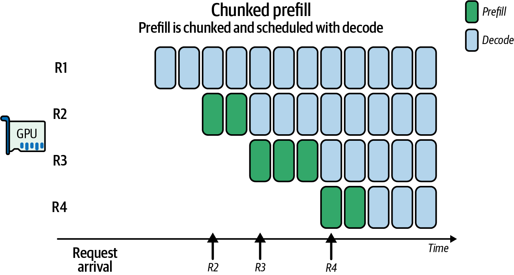
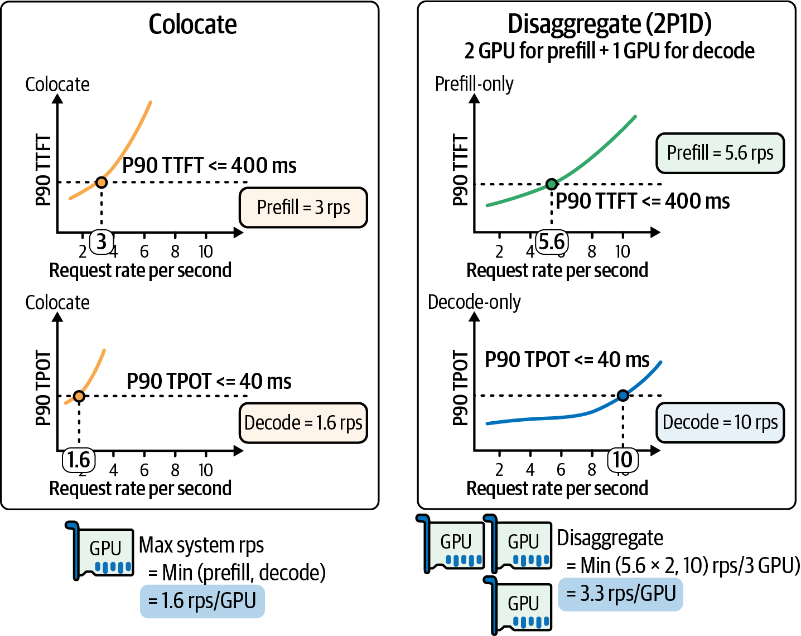
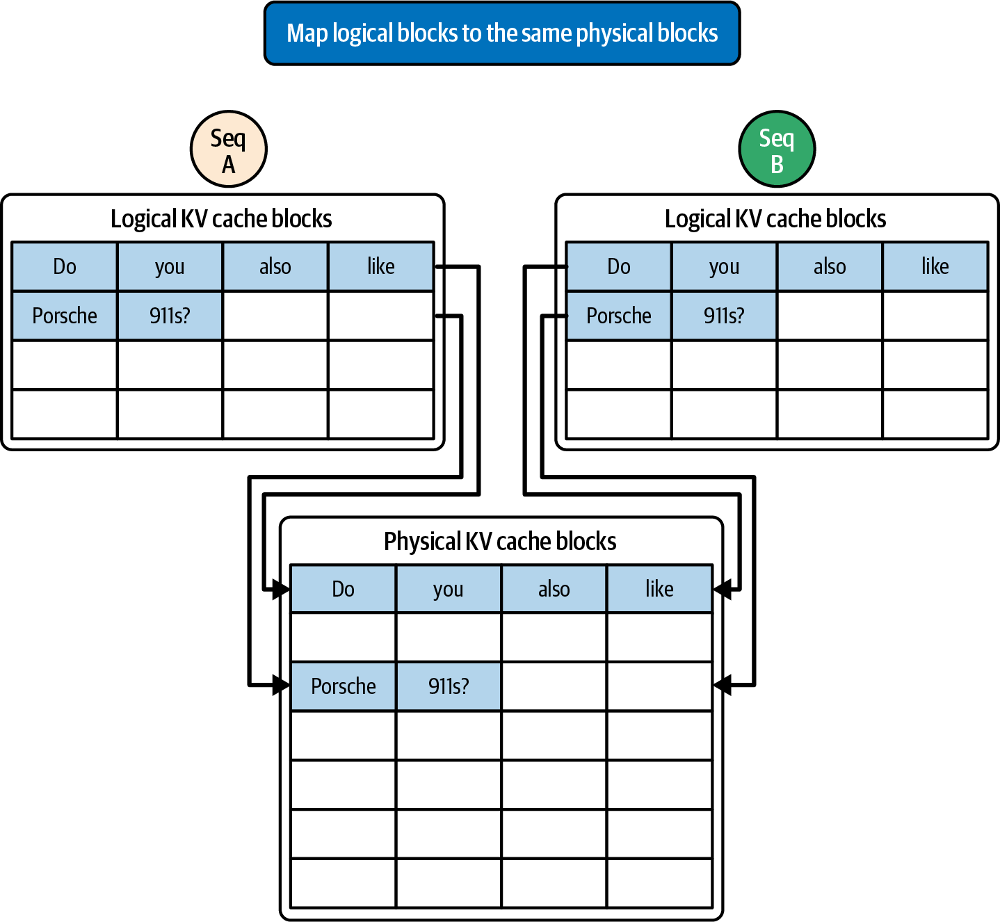

# 7 — Prefill, Decode and the KV Cache

> Prefill is a compute problem. Decode is a memory problem. The KV cache is the state that links them. Most modern serving architecture is about where that cache lives, how it is shared, and which GPU computes it.

---

## Two phases, one request

Every request runs a **prefill** pass (all prompt tokens in parallel; compute-bound; sets TTFT) and then many **decode** steps (one token per step; bandwidth-bound; sets TPOT) ([01](01-why-inference-is-its-own-discipline.md#two-bottlenecks-compute-and-memory-bandwidth)). The decoder-only loop the Handbook walks through (*LLM Engineer's Handbook*, ch. 8) makes the link explicit: prefill writes keys and values for every prompt token into the **KV cache**, and each decode step reads the whole cache and appends one more entry.

On one GPU the phases **interfere**. A long prefill entering a continuous batch stalls every decode in that batch for its duration, and short requests queue behind long ones (**head-of-line blocking**). Fregly's framing (*AISPE*, ch. 17): interactive services often target p99 TTFT under 200–300 ms. MLPerf Inference v5.0's SLOs give scale: **Llama 2 70B: p99 TTFT ~450 ms, p99 TPOT 40 ms; Llama 3.1 405B: ~6 s TTFT, 175 ms TPOT**. Holding both tails with one mixed queue is hard.

There are two ways to deal with interference: slice the prefill so decodes can run between the slices (chunked prefill), or move prefill to different GPUs (disaggregation).

---

## Chunked prefill

Split a long prefill into chunks and schedule each chunk in the same step as the running decodes. This is **piggybacking** decodes on prefill chunks.



*Image Source: Fregly, *AI Systems Performance Engineering* (O'Reilly, 2025), Fig. 19-7*

R1 keeps decoding every step while R2, R3 and R4 prefill in two or three chunks each. No request waits for another's whole prompt. **SARATHI** (Agrawal et al., 2023) reported **~1.3–1.9×** throughput over naive scheduling. Fregly's rule of thumb is a chunk that takes **~50–100 ms** of GPU time, which is a few thousand tokens depending on model and GPU (*AISPE*, ch. 19). His example splits a 10,000-token prefill into five 2,000-token chunks. Chunking does **not reduce total work** (*AISPE*, ch. 16). It reorders work so decodes are not starved. A small chunk also re-reads the KV cache of earlier chunks, so very small chunks cost extra.

Chunked prefill is on by default in vLLM V1, and it is what the TGI `MAX_BATCH_PREFILL_TOKENS` knob approximates ([06](06-serving-at-scale.md#monolith-or-microservice)). It is the right first answer to interference on a single pool.

**POD-Attention** goes one level lower: a single attention kernel whose thread blocks decide at runtime, per SM, whether to do prefill or decode work, so compute-bound and bandwidth-bound work share each SM. Fregly quotes "up to about 29%" (*AISPE*, ch. 18). The paper reports up to 59% faster attention, with a mean around 28%. The book appears to have reported the mean as the peak.

---

## Disaggregated prefill and decode

Run prefill and decode on **separate GPU pools**. A router sends the prompt to a prefill worker, which computes the KV cache and **transfers** it to a decode worker that generates the tokens ([06](06-serving-at-scale.md#parallelism-for-inference), Fig. 15-2). Each pool gets its own batch size, parallelism, and even its own hardware.



*Image Source: Fregly, *AI Systems Performance Engineering* (O'Reilly, 2025), Fig. 17-2 (after DistServe)*

The worked example, from DistServe (Zhong et al., 2024): a colocated GPU can sustain 3 RPS before prefill breaks the TTFT SLO and only **1.6 RPS** before decode breaks the TPOT SLO, so the system runs at 1.6 RPS per GPU. Split into 2 prefill GPUs (5.6 RPS each) and 1 decode GPU (10 RPS), the system runs at min(11.2, 10) / 3 GPUs = **3.3 RPS per GPU**, about 2× the goodput from the same hardware. DistServe's headline across workloads is **up to 7.4× more goodput or 12.6× tighter SLOs** (*AISPE*, ch. 15). Goodput here is the SLO-based definition ([01](01-why-inference-is-its-own-discipline.md#three-definitions-of-goodput)).

### When disaggregation pays

Fregly writes as if disaggregation were the standard architecture. Huyen is more careful (*AI Engineering*, ch. 9): it depends on the workload. Citing a Meta talk, she gives **prefill:decode instance ratios of 2:1 to 4:1** for long inputs when TTFT matters most, and **1:2 to 1:1** for short inputs when TPOT matters most. Both sources' details point to the same conditions:

| Disaggregate when | Stay colocated (with chunked prefill) when |
|---|---|
| Long prompts (RAG, agents, long chat history) dominate | Prompts are short and outputs long |
| Strict TTFT *and* TPOT SLOs at high load | Load is low or SLOs are loose |
| Fast interconnect for KV transfer (NVLink, RDMA/InfiniBand) | KV would cross slow Ethernet |
| Fleet is big enough to size two pools | A handful of GPUs |

Routing rules from Fregly's chapter (*AISPE*, ch. 17): **don't offload short prompts** (transfer cost exceeds the prefill saved; his example threshold is 256 tokens) and **don't offload prompts with a large prefix-cache hit**. Use *effective* prompt length = prompt length − cached prefix length, and keep high-hit requests local. Queue-depth thresholds decide when the prefill pool is saturated and local prefill should take over. The vLLM flags in his YAML examples are V0-era. Check them against current docs.

### Moving the cache

KV transfer is the cost of disaggregation, and a whole layer of tooling exists for it:

- **NIXL** (NVIDIA Inference Xfer Library) moves KV between GPUs, hosts and storage over NVLink, RDMA or TCP. Used by Dynamo, and by vLLM and SGLang connectors.
- **LMCache** stores and moves KV across engines and tiers. Fregly's example (*AISPE*, ch. 18): sending a 7,500-token KV cache as **470 small transfers took ~20 ms**; collating 16-token pages into ≥128-token chunks cut it to **~8 ms**. Batch your transfers.
- **Mooncake** (Moonshot AI / Kimi) builds the whole system around a disaggregated KV pool across GPU HBM, CPU DRAM and SSD, with a KV-centric scheduler.
- **llm-d** and **NVIDIA Dynamo** package router, prefill/decode pools and KV movement for Kubernetes.

### Heterogeneous pools

Because the phases want different things, they can run on different chips. Prefill wants FLOP/s; decode wants HBM capacity and bandwidth. **Splitwise** (Patel et al., 2024) reported **1.4× throughput at 20% lower cost**, or **2.35× throughput at the same cost and power**, by mixing GPU generations. **HexGen-2** reports up to 2× on Llama 2 70B. **Arrow** and **TetriInfer** go further and flip instances between prefill and decode roles as the mix changes; Arrow reports up to 5.6× higher request rate (*AISPE*, ch. 18).

Disaggregation also lets each pool pick its own parallelism. The chapter contradicts itself on which choice to make. One paragraph recommends **TP=8 for prefill** and TP=1 for decode, to minimize prompt latency. The paragraph right after Fig. 18-7 picks **pipeline parallelism for prefill instead**, because TP's all-reduce costs most when many tokens are in flight (*AISPE*, ch. 18). Both can be right: TP lowers the latency of one long prompt, while PP gives better throughput across many prompts. The consistent part is decode, where splitting one token's work over many GPUs adds communication to every step and hurts TPOT. Pick by measuring your prompt-length mix.

---

## Sizing the cache

```
KV bytes per token = 2 (K and V) × n_layers × n_kv_heads × head_dim × bytes_per_element
```

This is Fregly's formula in ch. 17, and the one to use. Note `n_kv_heads`, not attention heads. Three of the sources write it differently:

| Source | Formula uses | Effect |
|---|---|---|
| Huyen (*AI Engineering*, ch. 9): 2 × B × S × L × H × M | Model dim H | Correct for MHA; **overstates GQA/MQA models** by the query-to-KV head ratio |
| Handbook (*LLM Engineer's Handbook*, ch. 8) | Attention heads | Same overstatement |
| Fregly ch. 17 | KV heads | Correct for all |
| Fregly ch. 18 (Mooncake example) | `num_heads × head_dim` | Same overstatement, plus a wrong config (below) |

Worked numbers, all FP16 unless stated:

- **Llama 2 13B** (40 layers, 40 heads × 128, MHA). Fregly gets **0.82 MB/token**, so a 4,096-token context is **3.36 GB** (1.68 GB in FP8). Huyen's batch of 32 × 2,048 tokens is **54 GB**. These agree, because 13B is MHA. With GQA-8 the same 4,096 tokens would be **0.67 GB**; with MQA, **0.084 GB** (*AISPE*, ch. 17).
- **"7B exceeds 2 GB above 2,048 tokens"** (*LLM Engineer's Handbook*, ch. 8). For Llama 2 7B (32 layers, d = 4,096, MHA) a single sequence is 0.5 MB/token: 1.07 GB at 2,048 tokens, crossing 2 GB around 4,096. Loose, but the right order of magnitude.
- **Pope et al. (2022), via Huyen:** a 500B+ MHA model at batch 512 and context 2,048 needs **~3 TB** of KV, **3× the weights**. This is why MQA and GQA exist.
- **Fregly's 250,000-token example** (*AISPE*, ch. 18) assumes a 70B model with 80 layers and 32 MHA heads × 128 and gets **1.31 MB/token, 328 GB**. Real 70B Llama models use **8 KV heads** (GQA), which gives **0.33 MB/token, ~82 GB**. The conclusion that it won't fit beside the weights on one GPU survives. The number is 4× too high.

Capacity budget: free memory after weights is the KV budget. Fregly's example is 70 GB of weights on a 180 GB-usable B200, leaving about 110 GB. The book prints 122 GB, an arithmetic slip, and the true figure is lower still once activations and CUDA graph buffers are counted. Divide the budget by bytes per token to get the total tokens in flight across all sequences. That number, not FLOP/s, usually caps batch size in decode.

### Shrinking the cache

| Technique | Mechanism | Typical effect | Source |
|---|---|---|---|
| **MQA / GQA** | Share K/V across query heads | KV ÷ (query heads / KV heads), e.g. 8× for 64→8 | Huyen ch. 9; Fregly ch. 17 |
| **MLA** (DeepSeek) | Store a low-rank latent instead of full K/V | Large KV cut; fast decode kernels (FlashMLA; ThunderMLA claims +20–35% over it) | Fregly ch. 1, 18 |
| **Local / sliding-window attention** | Attend to the last W tokens only | Huyen: 10k context with a 1k window ≈ 10× smaller | Huyen ch. 9 |
| **Cross-layer attention** | Share KV across adjacent layers | Character.AI: >20× KV reduction, with conversations averaging 180 messages | Huyen ch. 9 |
| **KV quantization** | FP8 (or INT8/INT4) K/V | 2× (FP8) to 4× (INT4); vLLM and TensorRT-LLM support FP8 KV | Fregly ch. 18–19 ([08](08-adaptive-inference.md#kv-cache-quantization)) |
| **Eviction / compression** | Drop or merge low-importance entries | Workload-dependent; only safe with restricted-attention layers | Fregly ch. 18 |
| **Offload / tiering** | Spill cold KV to CPU DRAM or NVMe; fetch on reuse | Capacity; costs PCIe/NVLink-C2C bandwidth | Fregly ch. 17–18 |

---

## PagedAttention

Before **PagedAttention** (Kwon et al., 2023, the vLLM paper), engines reserved a contiguous KV slab per request sized for the maximum length. Reserved-but-unused space and fragmentation wasted most of the memory: the paper measured only 20–38% of KV memory holding real tokens ([06](06-serving-at-scale.md#watching-a-fleet)). PagedAttention stores KV in fixed-size **blocks** (16 tokens by default in vLLM) and maps each sequence's logical blocks to physical blocks through a block table, as an OS maps virtual pages.



*Image Source: Fregly, *AI Systems Performance Engineering* (O'Reilly, 2025), Fig. 18-3*

Paging gives three things: near-zero fragmentation (waste under 4% in the paper), growth one block at a time, and **sharing**. Sequences with a common prefix point at the same physical blocks, with copy-on-write when they diverge. The Handbook cites the sharing win for parallel sampling and beam search: memory overhead down **up to 55%**, throughput up **up to 2.2×** (*LLM Engineer's Handbook*, ch. 8). Every major engine (vLLM, SGLang, TensorRT-LLM, TGI) now uses paged KV, and it is what lets continuous batching admit requests without knowing their final length ([06](06-serving-at-scale.md#batching)).

---

## Prefix caching

Sharing blocks *within* a request generalizes to sharing *across* requests. If a new prompt starts with tokens whose KV is already cached, skip their prefill.

- **vLLM automatic prefix caching** hashes each full 16-token block, chained with the hash of its prefix, and looks blocks up in a global table (*AISPE*, ch. 18). Only full blocks are shared, and the match must be exact from the first token.
- **SGLang RadixAttention** keeps a radix tree over token sequences, giving longest-prefix matching at token granularity with LRU eviction. In practice both get the same effect, with different data structures.

The hit rate depends on **prompt layout**. Put stable content first (system prompt, tool definitions, few-shot examples, documents) and variable content last. Changing one token early in the prompt invalidates everything after it. This is the same rule that drives API prompt-cache pricing ([02/04](../../02-context-engineering/notes/04-retrieval.md#caching)). Fregly's "10× faster" prefix-cache example (*AISPE*, ch. 16) is the ideal case of a long shared document and a short question. Real gains scale with the cached fraction of each prompt.

At fleet scale the router has to send a request to **the replica that holds its prefix** (cache-aware routing in llm-d, Dynamo, SGLang router). Otherwise every replica recomputes and caches the same prefixes ([06](06-serving-at-scale.md#routing)).

### Prompt caching in provider APIs

The same mechanism, sold as a feature. From Huyen (*AI Engineering*, ch. 9), with **2024 prices** that have since changed:

- A 1,000-token system prompt sent 1M times a day is **1B input tokens a day** that caching can avoid recomputing.
- Gemini (2024): cached input tokens at a **75% discount**, plus storage at **$1.00 per million tokens per hour**.
- Anthropic (2024): **up to 90% cost and up to 75% latency** reduction, larger for longer cached contexts. Anthropic's measurements (Table 9-3):

| Use case | Latency without → with cache | Cost reduction |
|---|---|---|
| Chat with a book (100k-token cached prompt) | 11.5 s → 2.4 s (−79%) | −90% |
| Many-shot prompting (10k-token prompt) | 1.6 s → 1.1 s (−31%) | −86% |
| Multi-turn conversation (long system prompt) | ~10 s → ~2.5 s (−75%) | −53% |

The trend holds in 2026; the prices don't. Check current pricing and minimum cacheable lengths before using these numbers.

---

## Working reference

- **Turn on chunked prefill first**; disaggregate only when long prompts and strict TTFT+TPOT SLOs coincide at scale.
- **Size the KV budget with `n_kv_heads`**, at your real precision and max concurrency.
- **FP8 KV** is the cheapest capacity win on Hopper and Blackwell. Evaluate quality on long-context tasks.
- **Lay out prompts stable-first** and route on prefix affinity.
- **Don't ship KV for short or prefix-hit prompts**; batch KV transfers into ≥128-token chunks.
- **Watch KV utilization and swap/copy-engine activity**; they predict latency spikes ([06](06-serving-at-scale.md#watching-a-fleet)).
