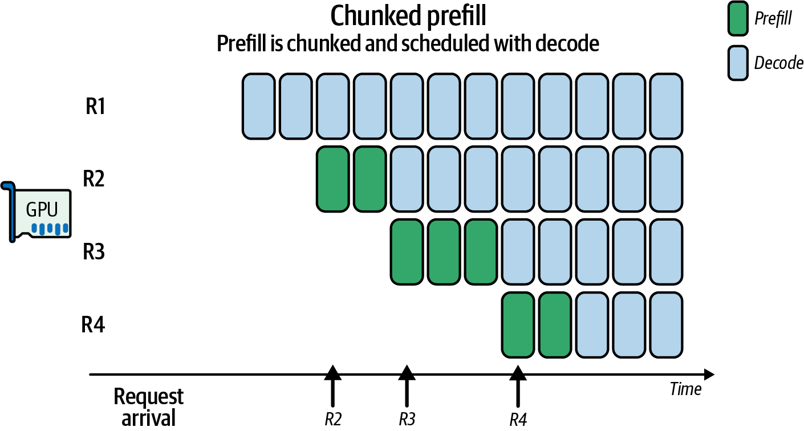
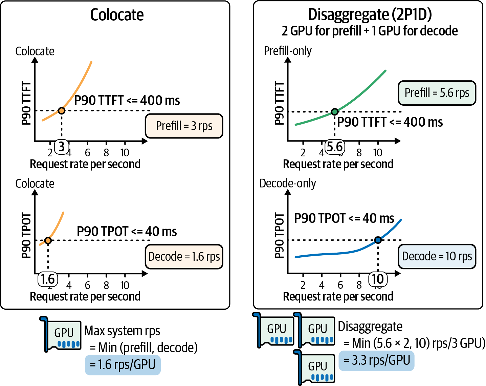
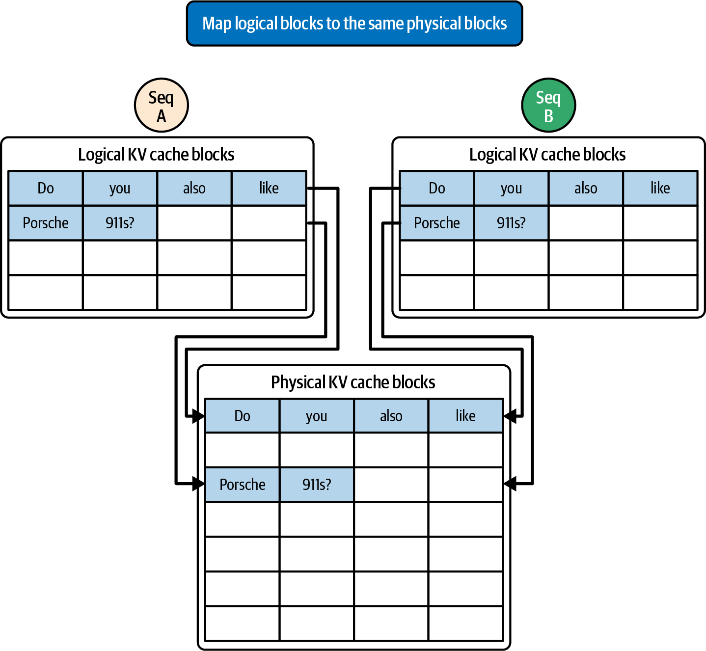

# 7 — Prefill, Decode and the KV Cache

> Prefill is a compute problem. Decode is a memory problem. The KV cache is the state that links them. Most modern serving architecture is about where that cache lives, how it is shared, and which GPU computes it.

A long prompt stalls every decode sharing its GPU, and a busy server can run out of KV memory long before the weights are the problem. The sizing is easy to get wrong as well: Fregly's 250,000-token example plans for 328 GB when real 70B models need ~82 GB. Most serving-architecture decisions, from chunked prefill to disaggregation and prompt layout, trace back to handling this one piece of state.

---

## Two phases, one request

Every request runs a **prefill** pass (all prompt tokens in parallel; compute-bound; sets TTFT) and then many **decode** steps (one token per step; bandwidth-bound; sets TPOT) ([01](01-why-inference-is-its-own-discipline.md#two-bottlenecks-compute-and-memory-bandwidth)). The decoder-only loop the Handbook walks through (*LLM Engineer's Handbook*, ch. 8) makes the link explicit: prefill writes keys and values for every prompt token into the **KV cache**, and each decode step reads the whole cache and appends one more entry.

On one GPU the phases **interfere**. A long prefill entering a continuous batch stalls every decode in that batch for its duration, and short requests queue behind long ones (**head-of-line blocking**). Fregly's framing (*AISPE*, ch. 17): interactive services often target p99 TTFT under 200–300 ms. MLPerf Inference v5.0's SLOs give scale: **Llama 2 70B: p99 TTFT ~450 ms, p99 TPOT 40 ms; Llama 3.1 405B: ~6 s TTFT, 175 ms TPOT**. Holding both tails with one mixed queue is hard.

There are two ways to deal with interference: slice the prefill so decodes can run between the slices (chunked prefill), or move prefill to different GPUs (disaggregation).

---

## Chunked prefill

Split a long prefill into chunks and schedule each chunk in the same step as the running decodes. This is **piggybacking** decodes on prefill chunks.



*Image Source: Fregly, *AI Systems Performance Engineering* (O'Reilly, 2025), Fig. 19-7*

R1 keeps decoding every step while R2, R3 and R4 prefill in two or three chunks each. No request waits for another's whole prompt. **SARATHI** (Agrawal et al., 2023) reported **~1.3–1.9×** throughput over naive scheduling. Fregly's rule of thumb is a chunk that takes **~50–100 ms** of GPU time, which is a few thousand tokens depending on model and GPU (*AISPE*, ch. 19). His example splits a 10,000-token prefill into five 2,000-token chunks. Chunking does **not reduce total work** (*AISPE*, ch. 16). It reorders work so decodes are not starved. A small chunk also re-reads the KV cache of earlier chunks, so very small chunks cost extra. Xiao and Zhu give the sizing logic: choose the chunk so that a prefill chunk and the decode steps sharing its iteration take about the same time. In their two-sequence schematic, a 3-chunk prefill lets 3 decode steps run, where plain iteration-level scheduling (which treats the whole prefill as one iteration and so favours throughput) allows 1. The price is one forward pass per chunk, earlier chunks' KV held in memory meanwhile, and the loss of single-pass prefill parallelism (*Foundations of LLMs*, ch. 5, Fig. 5.13; schematic, no measurements).

Chunked prefill is on by default in vLLM V1, and it is what the TGI `MAX_BATCH_PREFILL_TOKENS` knob approximates ([06](06-serving-at-scale.md#monolith-or-microservice)). It is the right first answer to interference on a single pool.

**POD-Attention** goes one level lower: a single attention kernel whose thread blocks decide at runtime, per SM, whether to do prefill or decode work, so compute-bound and bandwidth-bound work share each SM. Fregly quotes "up to about 29%" (*AISPE*, ch. 18). The paper reports up to 59% faster attention, with a mean around 28%. The book appears to have reported the mean as the peak.

**Star Attention** attacks the other end of prefill: a context of 128K to 1M tokens that no single GPU holds. Phase 1 splits the context into blocks across hosts and each host attends only to its own block plus the first block as an *anchor* (same position ids), with no cross-host communication; Phase 2 broadcasts the short query and each host attends over its local KV, merged with an online softmax that sends one vector and one scalar per token. It needs no fine-tuning. On RULER with Llama-3.1-8B-Instruct (block about 1/4 of the length, A100s, compared with Ring Attention, which is exact) it is 1.1× faster at 16K and 2.7× at 128K, with 128K accuracy 74.41 against 76.31 for full attention; 20 s against 53 s per sample at 128K on 8 GPUs. With Llama-3-8B-Instruct-1048K at 1M tokens it reaches 16.9× for a 5.32% accuracy drop. The anchor's content is what matters, not its position: without it RULER-NIAH at 64K falls from 99.50 to 60.11. Below about 32K there is no gain, multi-hop tracing degrades because blocks cannot see each other, and the speedups are measured only against Ring Attention, on a long context followed by a short query ([arXiv:2411.17116](https://arxiv.org/abs/2411.17116) (Acharya et al., ICML 2025)).

---

## Disaggregated prefill and decode

Run prefill and decode on **separate GPU pools**. A router sends the prompt to a prefill worker, which computes the KV cache and **transfers** it to a decode worker that generates the tokens ([06](06-serving-at-scale.md#parallelism-for-inference), Fig. 15-2). Each pool gets its own batch size, parallelism, and even its own hardware. Xiao and Zhu add the batching benefit and the bill: with no prefill-decode interference, short prompts can be packed into one long sequence to fill the prefill batch, but the KV cache must then be copied to the decode engine, which they say needs a high-bandwidth, low-latency network (*Foundations of LLMs*, ch. 5; they cite Wu et al. 2023, Patel et al. 2024 and Zhong et al. 2024, the last being DistServe).



*Image Source: Fregly, *AI Systems Performance Engineering* (O'Reilly, 2025), Fig. 17-2 (after DistServe)*

The worked example, from DistServe (Zhong et al., 2024): a colocated GPU can sustain 3 RPS before prefill breaks the TTFT SLO and only **1.6 RPS** before decode breaks the TPOT SLO, so the system runs at 1.6 RPS per GPU. Split into 2 prefill GPUs (5.6 RPS each) and 1 decode GPU (10 RPS), the system runs at min(11.2, 10) / 3 GPUs = **3.3 RPS per GPU**, about 2× the goodput from the same hardware. DistServe's headline across workloads is **up to 7.4× more goodput or 12.6× tighter SLOs** (*AISPE*, ch. 15). Goodput here is the SLO-based definition ([01](01-why-inference-is-its-own-discipline.md#three-definitions-of-goodput)).

### When disaggregation pays

Fregly writes as if disaggregation were the standard architecture. Huyen is more careful (*AI Engineering*, ch. 9): it depends on the workload. Citing a Meta talk, she gives **prefill:decode instance ratios of 2:1 to 4:1** for long inputs when TTFT matters most, and **1:2 to 1:1** for short inputs when TPOT matters most. Both sources' details point to the same conditions:

| Disaggregate when | Stay colocated (with chunked prefill) when |
|---|---|
| Long prompts (RAG, agents, long chat history) dominate | Prompts are short and outputs long |
| Strict TTFT *and* TPOT SLOs at high load | Load is low or SLOs are loose |
| Fast interconnect for KV transfer (NVLink, RDMA/InfiniBand) | KV would cross slow Ethernet |
| Fleet is big enough to size two pools | A handful of GPUs |

Routing rules from Fregly's chapter (*AISPE*, ch. 17): **don't offload short prompts** (transfer cost exceeds the prefill saved; his example threshold is 256 tokens) and **don't offload prompts with a large prefix-cache hit**. Use *effective* prompt length = prompt length − cached prefix length, and keep high-hit requests local. Queue-depth thresholds decide when the prefill pool is saturated and local prefill should take over. The vLLM flags in his YAML examples are V0-era. Check them against current docs.

### Moving the cache

KV transfer is the cost of disaggregation, and a whole layer of tooling exists for it:

- **NIXL** (NVIDIA Inference Xfer Library) moves KV between GPUs, hosts and storage over NVLink, RDMA or TCP. Used by Dynamo, and by vLLM and SGLang connectors.
- **LMCache** stores and moves KV across engines and tiers. Fregly's example (*AISPE*, ch. 18): sending a 7,500-token KV cache as **470 small transfers took ~20 ms**; collating 16-token pages into ≥128-token chunks cut it to **~8 ms**. Batch your transfers.
- **Mooncake** (Moonshot AI / Kimi) builds the whole system around a disaggregated KV pool across GPU HBM, CPU DRAM and SSD, with a KV-centric scheduler.
- **llm-d** and **NVIDIA Dynamo** package router, prefill/decode pools and KV movement for Kubernetes.

### Heterogeneous pools

Because the phases want different things, they can run on different chips. Prefill wants FLOP/s; decode wants HBM capacity and bandwidth. **Splitwise** (Patel et al., 2024) reported **1.4× throughput at 20% lower cost**, or **2.35× throughput at the same cost and power**, by mixing GPU generations. **HexGen-2** reports up to 2× on Llama 2 70B. **Arrow** and **TetriInfer** go further and flip instances between prefill and decode roles as the mix changes; Arrow reports up to 5.6× higher request rate (*AISPE*, ch. 18).

Disaggregation also lets each pool pick its own parallelism. The chapter contradicts itself on which choice to make. One paragraph recommends **TP=8 for prefill** and TP=1 for decode, to minimize prompt latency. The paragraph right after Fig. 18-7 picks **pipeline parallelism for prefill instead**, because TP's all-reduce costs most when many tokens are in flight (*AISPE*, ch. 18). Both can be right: TP lowers the latency of one long prompt, while PP gives better throughput across many prompts. The consistent part is decode, where splitting one token's work over many GPUs adds communication to every step and hurts TPOT. Pick by measuring your prompt-length mix.

---

## Sizing the cache

```
KV bytes per token = 2 (K and V) × n_layers × n_kv_heads × head_dim × bytes_per_element
```

This is Fregly's formula in ch. 17, and the one to use. Note `n_kv_heads`, not attention heads. Three of the sources write it differently:

| Source | Formula uses | Effect |
|---|---|---|
| Huyen (*AI Engineering*, ch. 9): 2 × B × S × L × H × M | Model dim H | Correct for MHA; **overstates GQA/MQA models** by the query-to-KV head ratio |
| Handbook (*LLM Engineer's Handbook*, ch. 8) | Attention heads | Same overstatement |
| Fregly ch. 17 | KV heads | Correct for all |
| Fregly ch. 18 (Mooncake example) | `num_heads × head_dim` | Same overstatement, plus a wrong config (below) |

Worked numbers, all FP16 unless stated:

- **Llama 2 13B** (40 layers, 40 heads × 128, MHA). Fregly gets **0.82 MB/token**, so a 4,096-token context is **3.36 GB** (1.68 GB in FP8). Huyen's batch of 32 × 2,048 tokens is **54 GB**. These agree, because 13B is MHA. With GQA-8 the same 4,096 tokens would be **0.67 GB**; with MQA, **0.084 GB** (*AISPE*, ch. 17).
- **"7B exceeds 2 GB above 2,048 tokens"** (*LLM Engineer's Handbook*, ch. 8). For Llama 2 7B (32 layers, d = 4,096, MHA) a single sequence is 0.5 MB/token: 1.07 GB at 2,048 tokens, crossing 2 GB around 4,096. Loose, but the right order of magnitude.
- **Pope et al. (2022), via Huyen:** a 500B+ MHA model at batch 512 and context 2,048 needs **~3 TB** of KV, **3× the weights**. This is why MQA and GQA exist. In the paper, PaLM 540B's multi-query attention, with the attention computation split across chips by batch, allows up to 32× longer context on 64 TPU v4 chips ([arXiv:2211.05102](https://arxiv.org/abs/2211.05102) (Pope et al., MLSys 2023)).
- **Fregly's 250,000-token example** (*AISPE*, ch. 18) assumes a 70B model with 80 layers and 32 MHA heads × 128 and gets **1.31 MB/token, 328 GB**. Real 70B Llama models use **8 KV heads** (GQA), which gives **0.33 MB/token, ~82 GB**. The conclusion that it won't fit beside the weights on one GPU survives. The number is 4× too high.

Capacity budget: free memory after weights is the KV budget. Fregly's example is 70 GB of weights on a 180 GB-usable B200, leaving about 110 GB. The book prints 122 GB, an arithmetic slip, and the true figure is lower still once activations and CUDA graph buffers are counted. Divide the budget by bytes per token to get the total tokens in flight across all sequences. That number, not FLOP/s, usually caps batch size in decode. Jet-Nemotron's architecture search found the same thing from the other side. At a fixed KV-cache size, models with different parameter counts had similar long-context generation throughput on H100, so KV size, not parameter count, was the variable to cut. Its 2B hybrid, which keeps only a few full-attention layers and uses linear attention elsewhere, decodes 53.6× faster than Qwen3-1.7B at 256K context, with comparable accuracy ([arXiv:2508.15884](https://arxiv.org/abs/2508.15884) (Gu et al., NeurIPS 2025)).

Reasoning models grow the cache from the output side, and the Markovian Thinker shows that this growth is a choice of the RL environment, not of the architecture. Delethink trains the model to reason in fixed 8K-token chunks and resets the context at each boundary to the query plus the last 4K tokens, so the KV cache never exceeds one chunk and compute grows linearly with thinking length. Trained on R1-Distill 1.5B with a 24K thinking budget, it scored 0.46 on AIME24 against 0.40 for standard long-chain RL at the same budget, and kept improving to 128K thinking tokens at test time; at 24K an RL step took 215 s against 248.5 s on 8×H100. The 27 against 7 H100-month comparison at 96K is extrapolated from single-step timings, the only trained model is 1.5B on math, and the authors say the recipe cannot work for long-context retrieval, where the evidence lives in the context that gets reset ([arXiv:2510.06557](https://arxiv.org/abs/2510.06557) (Aghajohari et al., 2025-10, preprint)). The serving corollary: the carryover is re-encoded under the query, so a prefix cache does not help across boundaries, but every chunk is a short request.

### Shrinking the cache

| Technique | Mechanism | Typical effect | Source |
|---|---|---|---|
| **MQA / GQA** | Share K/V across query heads | KV ÷ (query heads / KV heads), e.g. 8× for 64→8 | Huyen ch. 9; Fregly ch. 17 |
| **MLA** (DeepSeek) | Store a [low-rank](../../../generative-ai/01-llm-fundamentals/notes/02-attention-and-the-transformer-block.md#matrix-products-transpose-and-rank) latent instead of full K/V | DeepSeek-V2 caches 576 values per token per layer (512 latent + 64 RoPE key), the size of GQA with 2.25 groups; in its MoE ablations MLA kept 4–14% of MHA's KV and scored slightly higher. Fast decode kernels (FlashMLA; ThunderMLA claims +20–35% over it) | Fregly ch. 1, 18; [arXiv:2405.04434](https://arxiv.org/abs/2405.04434) (DeepSeek-AI, 2024-05) |
| **Local / sliding-window attention** | Attend to the last W tokens only | Huyen: 10k context with a 1k window ≈ 10× smaller | Huyen ch. 9 |
| **Cross-layer attention** | Share KV across adjacent layers | Character.AI: >20× KV reduction, with conversations averaging 180 messages | Huyen ch. 9 |
| **KV quantization** | FP8 (or INT8/INT4) K/V | 2× (FP8) to 4× (INT4); vLLM and TensorRT-LLM support FP8 KV | Fregly ch. 18–19 ([08c](08c-quantization-and-low-precision.md#kv-cache-quantization)) |
| **Eviction / compression** | Drop or merge low-importance entries | Workload-dependent; only safe with restricted-attention layers. A plain sliding window collapses once text outruns the cache, because models dump attention on the first tokens. Keeping 4 of these "attention sink" tokens plus the window holds [perplexity](../../../generative-ai/01-llm-fundamentals/notes/06-pretraining-data-and-objectives.md#entropy-cross-entropy-kl-and-perplexity) stable to 4M tokens on Llama-2, MPT, Falcon and Pythia, with no fine-tuning. Evicted tokens are gone, so this gives streaming, not long-context recall ([arXiv:2309.17453](https://arxiv.org/abs/2309.17453) (Xiao et al., ICLR 2024)) | Fregly ch. 18 |
| **Offload / tiering** | Spill cold KV to CPU DRAM or NVMe; fetch on reuse | Capacity; costs PCIe/NVLink-C2C bandwidth. Offloading buys throughput, not latency. FlexGen runs OPT-175B on one 16 GB T4 at 1 token/s with an effective batch of 144, 100× the throughput of DeepSpeed ZeRO-Inference, at about 4,000 s per batch ([arXiv:2303.06865](https://arxiv.org/abs/2303.06865) (Sheng et al., ICML 2023); [arXiv:2207.00032](https://arxiv.org/abs/2207.00032) (Aminabadi et al., SC 2022)) | Fregly ch. 17–18 |

The MLA trade is real but its headline numbers are stacked. DeepSeek-V2's 93.3% KV cut and 5.76× generation throughput (8×H800) are measured against the dense DeepSeek 67B, with FP8 weights, ~6-bit KV quantization and MoE sparsity on top of MLA, so they are not MLA's effect alone. Its own 7B dense ablation shows why plain sharing is not free: MMLU falls from 45.2 (MHA) to 41.2 (GQA-8) and 37.9 (MQA) ([arXiv:2405.04434](https://arxiv.org/abs/2405.04434) (DeepSeek-AI, 2024-05)).

The original papers measured smaller losses, in narrower settings. Shazeer introduced MQA on a WMT14 en-de Transformer on TPUv2. Incremental decoder time fell from 46 to 3.8 µs per token, and BLEU moved by only 0.2 either way ([arXiv:1911.02150](https://arxiv.org/abs/1911.02150) (Shazeer, 2019-11, preprint)). GQA was mainly a conversion recipe: mean-pool an MHA checkpoint's K/V heads into groups, then uptrain with 5% of the original pretraining compute. On T5-XXL, GQA-8 scored 47.1 against MHA's 47.2 and MQA's 46.6, at close to MQA's speed (0.28 vs 1.51 s per sample for MHA) ([arXiv:2305.13245](https://arxiv.org/abs/2305.13245) (Ainslie et al., EMNLP 2023)). Both results are on encoder–decoder models scored with BLEU or ROUGE. DeepSeek's decoder-only MMLU ablation is the harsher test, and the closer match to how GQA is used today.

Block-sparse attention cuts prefill compute, not cache size. MoBA scores key blocks by their mean-pooled key and lets each query attend to its top-k blocks plus its own. On Llama-3.1-8B extended to 1M tokens (4,096-token blocks, top-12, last 3 layers kept dense) it matched full attention on RULER (0.782 vs 0.785) and ran the attention layers 6.5× faster at 1M-token prefill. Decode switches back to full attention, so the KV cache stays the same size ([arXiv:2502.13189](https://arxiv.org/abs/2502.13189) (Lu et al., 2025-02)). It is a vendor report on one model, and the speedup is for attention alone, not end to end.

DeepSeek's NSA makes the sparsity trainable and keeps it at decode, where MoBA does not. It combines compressed-block, selected-block and sliding-window branches over a GQA cache. A 27B MoE pretrained with it on 260B tokens matched or beat full attention on general, LongBench and reasoning evals. At 64K context it measured 9.0× faster forward and 6.0× faster backward passes. Its 11.6× decode figure is an *expected* speedup, computed from the KV tokens loaded per step (5,632 vs 65,536), not a timed run ([arXiv:2502.11089](https://arxiv.org/abs/2502.11089) (Yuan et al., ACL 2025)). The far end of the spectrum has no growing cache at all. RWKV runs as an RNN at inference, with constant memory per token, and matched transformers of similar size up to 14B. The cost is that everything must pass through one fixed-size state, so the model cannot look back at the prompt, and its results depend more on how the prompt is ordered ([arXiv:2305.13048](https://arxiv.org/abs/2305.13048) (Peng et al., Findings of EMNLP 2023)).

YOCO changes the architecture so the cache is stored once. Its first half of the layers uses constant-memory attention, and every layer of the second half reads one shared global KV cache, so the cache is about L times smaller than one per layer. Per token the paper puts the cut at 24× to 80× from 1.2B to 65B models against a GQA Transformer, a ratio read off the per-token cost, not a measured 65B run. Measured at 3B on one H100-80GB with 1,024 generated tokens, total inference memory at 1M context is 12.4 GB, 9.38× below a GQA Transformer with Flash-Decoding, and prefill at 512K drops from 180 s to under 6 s, because prefill can stop after the first half. Quality at 3B is on par (Eval Harness zero-shot average 0.634 at 1T tokens). The paper only trains it from scratch (converting an existing Transformer is not shown), and the self-decoder still keeps a small constant-size cache ([arXiv:2405.05254](https://arxiv.org/abs/2405.05254) (Sun et al., 2024-05, preprint)). HySparse2 carries that split into a sparse hybrid. Its self-decoder is sliding-window layers plus one full-attention layer; the cross-decoder's full-attention layers project their K and V from the self-decoder's hidden states, and the sparse layers in each block reuse that full layer's KV cache and top-k token indices with a forced 128-token recent window. Every cross-decoder cache is therefore built from self-decoder states, and prefill exits after 25 of 49 layers. On an 80B-A3B MoE trained on about 500B tokens plus 100B of post-training, the FP8 cache at 1M tokens is 2.69 GB against 6.72 GB for HySparse and 12.09 GB for a hybrid sliding-window baseline, with 2.92× and 5.02× fewer prefill FLOPs (computed, not timed), and RULER-v2 at 256K is 58.45 against 32.61 and 35.74. All three models are Xiaomi's, trained on one recipe, with no public baseline, and MQA with a single KV head does part of the cache work ([arXiv:2609.26368](https://arxiv.org/abs/2609.26368) (Wei et al., 2026-09, preprint)). MiniMax Sparse Attention is another trained-sparsity design that, like MoBA, leaves the cache size alone. A light index branch picks 16 blocks of 128 tokens (2,048 KV tokens) per GQA group. At 1M context against dense GQA it cuts attention FLOPs 28.4× (analytic) and attention-kernel latency 14.2× in prefill and 7.6× in decode on H800, not end to end. A 109B MoE (6B active) trained on 3T tokens stayed close to its full-attention twin: MMLU 67.0 against 66.8 for the converted model, but GSM8K 76.2 against 73.7. The paper reports no KV-memory figure and compares only against its own GQA baseline ([arXiv:2606.13392](https://arxiv.org/abs/2606.13392) (Lai et al., 2026-06, preprint)). Xu et al.'s survey draws the same line: most sparse-attention designs cut compute and "do not necessarily lead to a reduction in KV cache memory consumption". Its speedups are quoted from the papers it cites, and its coverage runs to about September 2024 (v2) ([arXiv:2401.08092](https://arxiv.org/abs/2401.08092) (Xu et al., 2024-01, preprint survey)).

Offloading and sparsity combine once something predicts which entries decode will need. FlashMemory-DeepSeek-V4 keeps on the GPU only the compressed-attention KV for the last 8K prompt tokens, the decoded tokens, and the chunks that a small standalone indexer predicts the next 64 decode steps will touch; the rest sits in a CPU mirror and is fetched on a side band. The indexer trains in about one H20 GPU-hour with the backbone frozen. On DeepSeek-V4-Flash, averaged over LongBench-v2, LongMemEval and RULER at 46K to 512K tokens, GPU-resident KV fell to 13.5% of the full cache (0.10 against 0.93 GB) with accuracy 77.5 against 76.9, and at 1M tokens per-decode-token compute fell from 118.9 to 35.4 GFLOP on an 8×H20 sglang deployment. The limits are real: one model, total memory unchanged because the CPU holds the full mirror, host-to-device traffic not quantified, a 2.8× throughput claim with no table behind it, multi-round retrieval (MRCR) falling from 76.0% to 48.0%, and an indexer that generalises to about twice its training length ([arXiv:2606.09079](https://arxiv.org/abs/2606.09079) (Wang et al., 2026-06, preprint)).

Layer-Condensed KV Cache takes cross-layer sharing to its limit: the queries of every layer attend to the keys and values of the top layer only, so one layer's KV is computed and cached, apart from a few standard "warmup" layers. Quality was measured only on 1.1B models pretrained from scratch (TinyLlama recipe, 100B SlimPajama tokens, 2,048 context): dev perplexity is 9.265 with 10 warmup layers and 9.746 with 2, against 9.219 for the baseline. Throughput was measured end to end in Hugging Face Transformers with FlashAttention-2. The headline 26× is a 30B model with CPU offload on an RTX 3090, where the baseline fits a batch of 4 against 83. On an A100 at 2,048 prompt plus 2,048 generated tokens, with 2 warmup layers, the gain is 3.0× at 7B and 7.7× at 30B. Pretraining takes about 3× as long, and the prompt itself must be encoded in 9 iterative passes, so it suits long generations more than summarization. The 7B and 30B models were timed but not evaluated for quality ([arXiv:2405.10637](https://arxiv.org/abs/2405.10637) (Wu & Tu, ACL 2024)).

ThinK prunes the other axis, the channels inside each key vector. It scores every channel of every head by the norm of the outer product of recent queries (a 32-token window) and keys, and keeps the top 60%. Only keys are pruned, so a 40% channel cut lowers total KV memory by 20%. On LongBench with LLaMA-3-8B-Instruct, SnapKV at KV size 2,048 plus ThinK at the 40% cut scored 41.91 against 41.86 for the full cache. Stacked on KIVI quantization (LLaMA-2-7B-chat, prompt 160, output 338), peak memory falls 2.8× and the batch that fits on one GPU grows from 4× to 5× the FP16 baseline. Pruning half the channels or more hurts at small cache sizes (Needle-in-a-Haystack at KV size 128: 79.6 at 40%, 77.4 at 50% on LLaMA-3-8B). Time to first token rises (7.0 to 10.4 ms, LLaMA-2-7B, batch 300) because the scores are computed during prefill. LongBench gaps are often under a point, with no seeds reported, and value channels prune less well ([arXiv:2407.21018](https://arxiv.org/abs/2407.21018) (Xu et al., ICLR 2025)).

All of the above shrink what decode reads. LazyLLM shrinks what prefill computes: at each layer it drops prompt tokens whose attention from the last token falls below a percentile, with no training, and keeps their hidden states so a token pruned early can be revived at a later step. TTFT is 21× one decode step and about 23% of generation time at LongBench's average 3,376-token prompt on Llama 2 7B. On that model (A100, LongBench) multi-document QA gets a 2.34× TTFT speedup with a score of 22.31 against 22.43, and code completion shows the largest loss, 55.18 to 53.30 at 1.94×. Summarization needs most tokens and gains only 1.46×. It was tested only on 7B models, in Hugging Face Transformers, with no serving-system results ([arXiv:2407.14057](https://arxiv.org/abs/2407.14057) (Fu et al., 2024-07, preprint)).

Declarative Attention asks the model itself to say which cache entries decode should read. The prompt cuts the context into about 2K-token chunks and gives the model three tags: global (attend to everything), focus on named chunks, and local (the question and the response so far). A state machine parses the tags as they stream out and rewrites vLLM's block table, so nothing is evicted and a later global step can still reach anything. Zero-shot, with thinking off, on 15 long-context sources chosen as the ones where it works, Gemma-4-31B attends 45.8% fewer KV tokens per response at a 1.40-point accuracy cost and Qwen-3.6-27B 19.6% fewer at 2.10 points (three-run means, B200, vLLM). The prompt alone makes generations 17–38% longer, so the saving is entirely the mask. Measured per-step decode time fell 55% (Gemma) and 31% (Qwen) when more than 90% of the cache was masked but rose about 3.5–3.9% when under 10% was. Whole-response decode time is a roofline estimate, 0.76× and 0.87× of vanilla, with prefill excluded. Small models cannot follow the protocol (29% of vanilla accuracy at Gemma-4-E4B), and on six sources outside the suite accuracy fell by up to 30 points ([arXiv:2609.02737](https://arxiv.org/abs/2609.02737) (Ho et al., 2026-09, preprint)).

---

## PagedAttention

Before **PagedAttention** (Kwon et al., 2023, the vLLM paper), engines reserved a contiguous KV slab per request sized for the maximum length. Reserved-but-unused space and fragmentation wasted most of the memory: the paper measured only 20–38% of KV memory holding real tokens ([06](06-serving-at-scale.md#watching-a-fleet)). PagedAttention stores KV in fixed-size **blocks** (16 tokens by default in vLLM) and maps each sequence's logical blocks to physical blocks through a block table, as an OS maps virtual pages.



*Image Source: Fregly, *AI Systems Performance Engineering* (O'Reilly, 2025), Fig. 18-3*

Paging gives three things: near-zero fragmentation (waste under 4% in the paper), growth one block at a time, and **sharing**. Sequences with a common prefix point at the same physical blocks, with copy-on-write when they diverge. The Handbook cites the sharing win for parallel sampling and beam search: memory overhead down **up to 55%**, throughput up **up to 2.2×** (*LLM Engineer's Handbook*, ch. 8). Xiao and Zhu make the point that paging is not itself a batching technique: it helps batched inference because blocks fit into fragmented gaps, and with a well-designed block size the extra memory-access cost of non-contiguous KV stays small (*Foundations of LLMs*, ch. 5). Every major engine (vLLM, SGLang, TensorRT-LLM, TGI) now uses paged KV, and it is what lets continuous batching admit requests without knowing their final length ([06](06-serving-at-scale.md#batching)).

---

## Prefix caching

Sharing blocks *within* a request generalizes to sharing *across* requests. If a new prompt starts with tokens whose KV is already cached, skip their prefill.

- **vLLM automatic prefix caching** hashes each full 16-token block, chained with the hash of its prefix, and looks blocks up in a global table (*AISPE*, ch. 18). Only full blocks are shared, and the match must be exact from the first token. The textbook version is the same idea in three lines: store each prefix's KV states keyed by a hash of its tokens, load the longest match, compute only the tokens after it, and evict by LRU. It sits one level below the sequence-level cache that maps an exact query to a stored response and skips the model entirely (*Foundations of LLMs*, ch. 5).
- **SGLang RadixAttention** keeps a radix tree over token sequences, giving longest-prefix matching at token granularity with LRU eviction. In practice both get the same effect, with different data structures.

The hit rate depends on **prompt layout**. Put stable content first (system prompt, tool definitions, few-shot examples, documents) and variable content last. Changing one token early in the prompt invalidates everything after it. This is the same rule that drives API prompt-cache pricing ([02/04](../../02-context-engineering/notes/04-retrieval.md#caching)). Fregly's "10× faster" prefix-cache example (*AISPE*, ch. 16) is the ideal case of a long shared document and a short question. Real gains scale with the cached fraction of each prompt.

At fleet scale the router has to send a request to **the replica that holds its prefix** (cache-aware routing in llm-d, Dynamo, SGLang router). Otherwise every replica recomputes and caches the same prefixes ([06](06-serving-at-scale.md#routing)).

Agent sessions push prefix caching to its limits, and the costs move elsewhere. In one production agent session in AgentSysBench, accumulated tool calls and observations grew to 84.3% of the input. The final step emitted 151 tokens after a 166,721-token input. Sessions also sit idle for minutes to hours between steps, which outlasts cache lifetimes, so the same long prefix is prefilled again ([arXiv:2608.15127](https://arxiv.org/abs/2608.15127) (Chang et al., 2026-08, preprint)). When the cache does hit, the next bottleneck is the CPU front end. Across 153,951 agent calls the median call appended only ~1.4K characters, yet most front ends re-tokenize the whole transcript. As the prefix-cache hit rate rises toward 0.99, tokenization grows from 10% to 64% of TTFT. Splicing a re-tokenized window onto the session's previous token IDs, checked for exact equality with full tokenization, cut median TTFT 16–34% under load in vLLM ([arXiv:2607.29678](https://arxiv.org/abs/2607.29678) (Zhang et al., 2026-07, preprint)).

### Prompt caching in provider APIs

The same mechanism, sold as a feature. From Huyen (*AI Engineering*, ch. 9), with **2024 prices** that have since changed:

- A 1,000-token system prompt sent 1M times a day is **1B input tokens a day** that caching can avoid recomputing.
- Gemini (2024): cached input tokens at a **75% discount**, plus storage at **$1.00 per million tokens per hour**.
- Anthropic (2024): **up to 90% cost and up to 75% latency** reduction, larger for longer cached contexts. Anthropic's measurements (Table 9-3):

| Use case | Latency without → with cache | Cost reduction |
|---|---|---|
| Chat with a book (100k-token cached prompt) | 11.5 s → 2.4 s (−79%) | −90% |
| Many-shot prompting (10k-token prompt) | 1.6 s → 1.1 s (−31%) | −86% |
| Multi-turn conversation (long system prompt) | ~10 s → ~2.5 s (−75%) | −53% |

Lakshmanan and Hapke give the application-side view (*Generative AI Design Patterns*, ch. 8, Pattern 25). Server-side prefix caching generally needs a prompt over 1,024 tokens, mainly cuts TTFT rather than total latency, and has a default lifetime they put at 5 minutes. Their quoted vendor figures are uncited and set up unstated: Anthropic "up to 90% cost reduction and 85% latency improvement for long prompts" (Huyen's 75% latency above differs), OpenAI up to 80% latency and 50% cost. Client-side caches sit in front of the model instead: an exact-match cache keyed on a hash of the prompt, a canonical key after normalizing the query, a multi-key cache where an LLM writes about 10 rephrasings, or an embedding-similarity cache (GPTCache) that needs a tuned similarity threshold and loses nuance on near-hits. Two risks apply to both: **cross-tenant leakage** (put the user or tenant ID in the cache key or the cached prefix) and **stale entries** (flush on a model-version change). A cache hit skips the model call, so it needs no GPU at all; a prefix hit still pays for decode.

The trend holds in 2026; the prices don't. Check current pricing and minimum cacheable lengths before using these numbers.

---

## Working reference

- **Turn on chunked prefill first**; disaggregate only when long prompts and strict TTFT+TPOT SLOs coincide at scale.
- **Size the KV budget with `n_kv_heads`**, at your real precision and max concurrency.
- **FP8 KV** is the cheapest capacity win on Hopper and Blackwell. Evaluate quality on long-context tasks.
- **Lay out prompts stable-first** and route on prefix affinity.
- **Don't ship KV for short or prefix-hit prompts**; batch KV transfers into ≥128-token chunks.
- **Watch KV utilization and swap/copy-engine activity**; they predict latency spikes ([06](06-serving-at-scale.md#watching-a-fleet)).

## Pitfalls

- **Sizing with attention heads.** Symptom: a plan for 328 GB of KV (Fregly's 250,000-token example) when a real 70B with 8 KV heads needs ~82 GB. Fix: use `n_kv_heads` in the formula, at your real precision.
- **Disaggregating too early.** Symptom: two pools to size and KV transfers to pay for, on a handful of GPUs with short prompts or loose SLOs. Fix: turn on chunked prefill first, and disaggregate when long prompts and strict TTFT and TPOT SLOs coincide at scale.
- **Offloading the wrong prompts.** Symptom: short or mostly cached prompts spend more on transfer than they save on prefill. Fix: route on effective length (prompt minus cached prefix), with something like Fregly's 256-token threshold.
- **Many small KV transfers.** Symptom: KV transfer dominates, as in Fregly's 7,500-token cache sent as 470 transfers at ~20 ms. Fix: collate 16-token pages into ≥128-token chunks, which took it to ~8 ms.
- **A timestamp at the top of the prompt.** Symptom: a low prefix hit rate on repetitive traffic, because one changed early token invalidates everything after it. Fix: lay prompts out stable-first and variable-last.
- **No cache-aware routing.** Symptom: each replica recomputes and stores the same prefixes. Fix: route to the replica that holds the prefix, as llm-d, Dynamo and the SGLang router do.
- **Budgeting KV from the weights alone.** Symptom: running out at less than the planned concurrency, since activations and CUDA graph buffers also take memory. Fix: treat 180 − 70 = 110 GB as an upper bound (the book prints 122), and watch KV utilization and copy-engine activity.
- **Assuming FP8 KV is free.** Symptom: quality falls on long-context tasks after the flag goes on. Fix: evaluate long-context tasks after enabling it ([08c](08c-quantization-and-low-precision.md#kv-cache-quantization)).

## Try it

1. Compute KV bytes per token for 80 layers, 8 KV heads, head dim 128, FP16. How many tokens fit the 110 GB budget? What does it become with 32 heads?

   <details><summary>Answer</summary>

   2 × 80 × 8 × 128 × 2 = 327,680 bytes, about 0.33 MB/token, so about 336,000 tokens. With 32 heads it is 1,310,720 bytes, 1.31 MB/token, and about 84,000 tokens. The formula's head count alone moves capacity by 4×.

   </details>

2. Vary DistServe's worked example. With 3 prefill GPUs (5.6 RPS each) and 1 decode GPU (10 RPS), what is the rate per GPU, and what limits it?

   <details><summary>Answer</summary>

   min(16.8, 10) / 4 = 2.5 RPS per GPU, against 3.3 at the 2:1 split and 1.6 colocated. Decode is the limit, so the third prefill GPU adds only idle capacity. Pool sizes have to balance the two rates.

   </details>

3. A 4,000-token prompt has a 3,900-token prefix cache hit. Should a router using Fregly's rules offload it to a prefill worker? And a 300-token prompt with no hit?

   <details><summary>Answer</summary>

   The first: no. Effective length is 100 tokens, under the 256-token example threshold, even though the raw prompt is long. The second: effective length is 300, so it passes that threshold, though only just. The threshold depends on your interconnect, so measure it.

   </details>

4. In the [inference lab](../practice/inference-lab/README.md#things-to-try), run items 2 to 4: raise `prefill_ms_per_token` to see head-of-line blocking, evict the oldest sequence, and set `block_tokens` to 64 in the prefix table. Answers are in the lab README.

## Interview checklist

| Prompt | Answer in one line |
|---|---|
| What are the two ways to deal with prefill and decode interfering? | Chunked prefill, which slices prefill so decodes run alongside it (SARATHI reports ~1.3–1.9× over naive scheduling) and is the first choice on one pool. Or disaggregation, which moves prefill to its own GPUs. |
| Walk through DistServe's numbers. | Colocated, the GPU holds 3 RPS for TTFT but 1.6 RPS for TPOT, so 1.6. With 2 prefill at 5.6 and 1 decode at 10, min(11.2, 10) / 3 ≈ 3.3 RPS per GPU, about 2×. |
| When would you not disaggregate? | Short prompts with long outputs, low load or loose SLOs, KV crossing slow Ethernet, or only a handful of GPUs. Huyen's ratios also show it depends on workload: 2:1 to 4:1 for long inputs and 1:2 to 1:1 for short. |
| How big is the KV cache for Llama 2 13B at 4,096 tokens? | 2 × 40 × 40 × 128 × 2 bytes ≈ 0.82 MB/token, so 3.36 GB in FP16 per sequence. With GQA-8 it would be 0.67 GB. |
| Why did PagedAttention matter? | Reserved slabs left only 20–38% of KV memory holding real tokens. Paging cut waste to under 4%, lets a sequence grow by a block at a time, and lets common prefixes share physical blocks with copy-on-write. |
| Your agent's cache hit rate is low. What do you check? | Prompt layout first, because one changed early token invalidates everything after it and vLLM matches full 16-token blocks exactly from the first token. Then whether routing sends requests to the replica holding the prefix. |
| Do long agent sessions change the picture? | Yes: in one AgentSysBench session accumulated tool calls and observations reached 84.3% of the input, and the final step emitted 151 tokens after a 166,721-token input. The input side dominates that step, not decode. |

## Next

[08-adaptive-inference.md](08-adaptive-inference.md): decode's idle compute is what speculative decoding spends, and quantization reduces the bytes it has to move.
