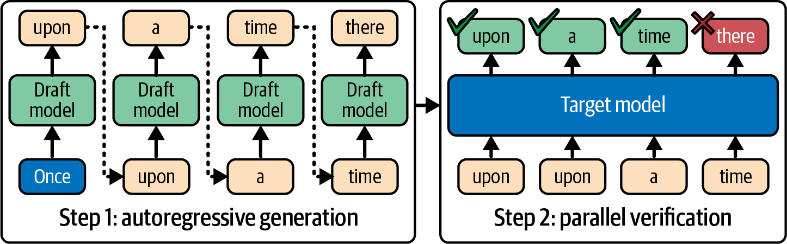
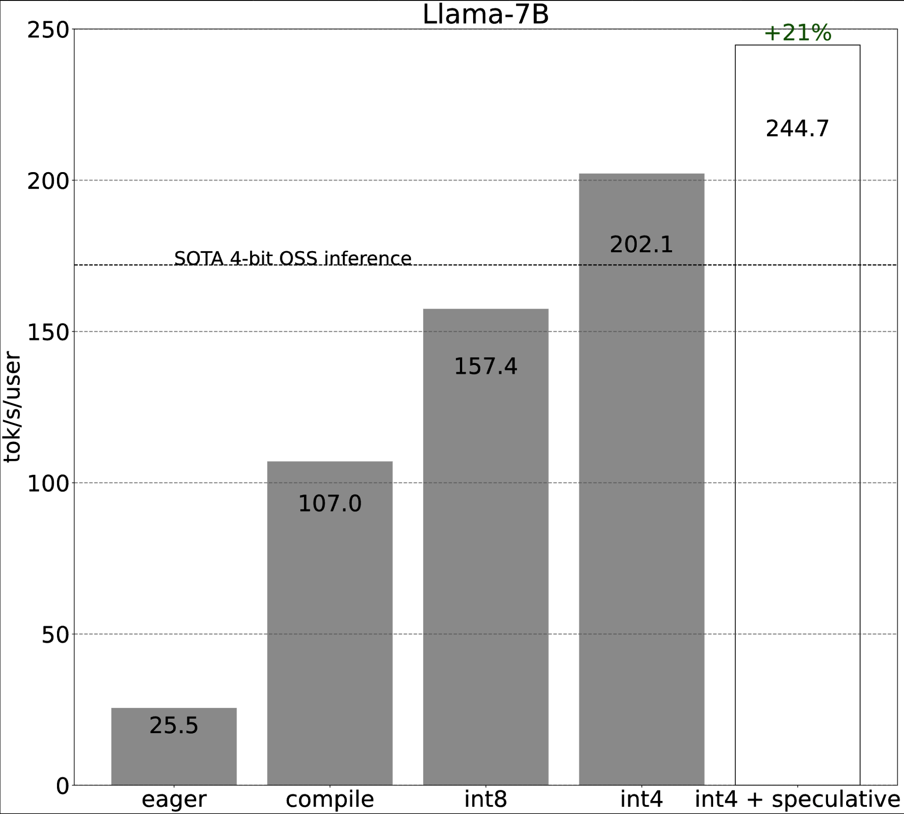

# 8 — Adaptive Inference

> Decode leaves the GPU's compute mostly idle while it waits on memory. Each technique here spends some of that idle compute, or cuts the bytes moved, to produce more tokens per second. Some keep the output distribution exactly; others trade a little quality.

---

## Why decode leaves compute idle

Each decode step reads every weight (and the whole KV cache) to produce one token per sequence ([01](01-why-inference-is-its-own-discipline.md#two-bottlenecks-compute-and-memory-bandwidth)). At small batch sizes, arithmetic intensity is far below the roofline ridge, so Tensor Cores sit idle. Two families of fixes follow from that:

- **Do more work per weight read.** Speculative and parallel decoding check several candidate tokens in one forward pass. The check costs about as much as generating one token, because the pass is bandwidth-bound either way (*AI Engineering*, ch. 9).
- **Read fewer bytes.** Quantization shrinks weights and KV entries, so each step moves less data.

A third family adapts *per request or per token*: dynamic precision, early exit and layer skipping. These are less mature (*AISPE*, ch. 19).

Huyen's caveat applies to the whole note: if your batches already saturate compute (high MFU), the idle FLOPs are gone, and speculative methods help less or hurt (*AI Engineering*, ch. 9).

---

## Speculative decoding



*Image Source: Fregly, *AI Systems Performance Engineering* (O'Reilly, 2025), Fig. 15-8*

A small **draft model** proposes *K* tokens. The large **target model** scores all *K* in one forward pass, accepts the longest prefix that matches what it would have sampled, and adds one token of its own. With the standard rejection-sampling rule, the output distribution is **identical to the target's** (Chen et al., 2023), so quality is unchanged by construction. In the figure the draft proposes four tokens and the target rejects "there", so the step yields the accepted prefix plus the target's correction.

Huyen gives three reasons it works (*AI Engineering*, ch. 9):

1. Verifying *K* tokens is parallel, like prefill; generating them is sequential.
2. Some tokens are easy, so a weak model often guesses them right.
3. Decode is bandwidth-bound, so the verification FLOPs are nearly free.

Fregly's text says the target "verifies these tokens one by one" (*AISPE*, ch. 15). That contradicts both the method and his own Fig. 15-8: verification is one parallel pass.

**Requirements.** The draft must share the target's tokenizer and vocabulary. Fregly says it should be at least **~4× faster** than the target, or the draft time eats the gain (*AISPE*, ch. 15). Acceptance rates are domain-dependent: higher for code and structured text. A larger *K* means fewer target calls but a lower chance that all *K* are accepted.

**How much speedup.** The three books disagree, because they report different conditions:

| Claim | Condition | Source |
|---|---|---|
| Latency more than halved | Chinchilla-70B with a 4B draft at 1.8 vs 14.1 ms/token; DeepMind's TPU setup | *AI Engineering*, ch. 9, citing Chen et al. 2023 |
| Theoretical *K*×, ~2× in practice, 1.5–2.5× "common" | Generic; no model or hardware | *AISPE*, ch. 15 |
| 3–4× at 90% draft acceptance; "2–4× or more" | No model or hardware; acceptance rate assumed | *LLM Engineer's Handbook*, ch. 8 |
| "Not significant" | Qwen1.5-1.8B target, 0.5B draft, on a T4 | *LLM Engineer's Handbook*, ch. 8 (its own demo) |

The Handbook's own demo is the most instructive row. When the target is already small, the draft is not much cheaper, and the gain disappears. Plan on Fregly's ~2× for a well-matched pair on a large target, and measure.

The Hugging Face API is one argument (*LLM Engineer's Handbook*, ch. 8):

```python
out = model.generate(**inputs, assistant_model=draft_model)        # draft model
out = model.generate(**inputs, prompt_lookup_num_tokens=4)         # no draft model
```

### Variants

| Method | Where drafts come from | Reported gain (condition) |
|---|---|---|
| **EAGLE** (1–3) | A light head on the target's own hidden states predicts features, then tokens | EAGLE up to ~3.5× (4-token draft); EAGLE-2 +20–40% over EAGLE; EAGLE-3 up to 1.4× over EAGLE-2, up to 6.5× over no speculation (*AISPE*, ch. 15; paper numbers, chat benchmarks) |
| **Medusa** | Extra decoding heads, each predicting token *t+k*; candidates checked with tree attention | Up to 1.9× on Llama 3.1, HGX H200 (*AI Engineering*, ch. 9, citing NVIDIA); 2.2–3.6× published, ~2–3× in practice (*AISPE*, ch. 15) |
| **Self-speculative** | The target with half its layers skipped acts as its own draft | ~2× (*AISPE*, ch. 15) |
| **Prompt lookup / inference with reference** | N-gram matches copied from the prompt | 2× when output overlaps input: RAG, code edits, multi-turn (*AI Engineering*, ch. 9, citing Yang et al. 2023) |
| **Lookahead (Jacobi) decoding** | The same model guesses several future positions and iterates until they are consistent | (*AI Engineering*, ch. 9); no number given |

Two of the Handbook's descriptions are wrong or dated. Its Medusa passage, roughly "a 70M-parameter model approximates a 7B model", garbles how Medusa works: the heads sit on the target, they are not a separate small model. Its Table 8.1 lists speculative decoding (and pipeline parallelism) as TensorRT-LLM only. vLLM and SGLang ship both (*LLM Engineer's Handbook*, ch. 8).

**Is it a default or a special case?** Fregly's ch. 16 calls speculative decoding and Medusa "typically reserved for extreme cases" (*AISPE*, ch. 16). His own ch. 15 treats it as mainstream, and as of 2026 vLLM, SGLang and TensorRT-LLM all ship EAGLE-style speculation as a standard option. The real condition is batch size: speculation pays at low-to-moderate batch, where decode is bandwidth-bound, and fades as batches grow and compute fills up.

---

## Quantization

Quantization stores numbers in fewer bits. Weight-only quantization is "by far the most popular approach", because it works out of the box and decode is bandwidth-bound (*AI Engineering*, ch. 9). Huyen also notes the floor: you can't go below 1 bit per value. Pruning can remove more than 90% of weights in research settings (Frankle & Carbin, 2019), but it is rare in production. Sparse kernels need hardware support, and the gains are usually smaller than quantization's.

### The two basic schemes

The Handbook works both by hand (*LLM Engineer's Handbook*, ch. 8):

- **Absmax (symmetric):** scale by `127 / max|X|` and round. In its example, 0.1 in a tensor spanning [-3.0, 3.2] maps to 4.
- **Zero-point (asymmetric):** scale by the range and add an offset, so the full [-128, 127] is used even when the data is skewed.

```python
def absmax_quantize(X):
    scale = 127 / X.abs().max()
    return (scale * X).round().to(torch.int8), scale   # dequantize: q / scale
```

One max value sets the scale for the whole tensor, so a single outlier crushes everyone else into a few levels. Every serious method below is a way around outliers. Methods are either **post-training (PTQ)**, applied after training, or **quantization-aware (QAT)**, simulated during training.

### Weight formats you will meet

| Method | Idea | Notes (condition) |
|---|---|---|
| **LLM.int8** | Keep outlier feature dimensions in FP16, everything else INT8 | <1% degradation, ~20% slower than FP16 (*LLM Engineer's Handbook*, ch. 8) |
| **NF4** (bitsandbytes) | 4-bit levels spaced for normally distributed weights | `load_in_4bit=True`; the QLoRA format |
| **GPTQ** | Layer-wise quantization that uses second-order information to correct error | 2, 3, 4 or 8 bits; Fregly gives 4-bit GPTQ "99%+ accuracy, ~2× speed, ~4× smaller", with no model or task (*AISPE*, ch. 16) |
| **AWQ** | Protect the ~1% of weight channels with large activations by scaling them | Similar accuracy to GPTQ; the Handbook finds it slightly slower |
| **EXL2** | Mixed 2–8 bits per layer to hit a target bits-per-weight | A 70B model fits in 24 GB at 2.55 bpw (*LLM Engineer's Handbook*, ch. 8) |
| **GGUF** (llama.cpp) | Block-wise formats Q2–Q8 and importance-weighted IQ variants | Q4_K uses super-blocks of 8 blocks × 32 weights; CPU and Apple-silicon friendly. Quantizing took about an hour on a T4 in the Handbook's run |
| **QuIP#, HQQ** | Very low-bit (2–3 bit) methods | The Handbook's rule of thumb: a >30B model at low bits beats a 7–13B model at full precision |

Two corrections to the Handbook's text. It says LLM.int8's outliers are "extreme weight values (~0.1%)". In the LLM.int8 paper they are **activation** feature dimensions, which is why that method decomposes the matmul by input feature. It also says GPTQ is "limited to 4-bit", but GPTQ supports 2, 3, 4 and 8 bits (*LLM Engineer's Handbook*, ch. 8).

### Low-precision floating point

On Hopper and Blackwell, the main path is low-precision *floating point* with hardware support, not integer formats (*AISPE*, ch. 16):

- **FP8** (E4M3/E5M2): 2× the Tensor Core math rate of FP16, half the bytes. NVIDIA's Transformer Engine manages per-tensor scales, either static (calibrated) or from a running history of the max absolute value (amax).
- **FP4 / NVFP4** (Blackwell): the book gives an effective ~1.8× over FP8 and ~3.5× over FP16, with no model or batch size. The book says "per-block microscaling". To be precise, NVFP4 uses 16-element blocks with an FP8 scale, while the OCP MXFP4 format uses 32-element blocks.
- **SmoothQuant**: activations have outliers and weights do not, so it moves scale from activations into weights with a per-channel factor. That makes W8A8 (8-bit weights *and* activations) work.

Fregly is inconsistent about how ready FP4 is. Ch. 17 says to prefer it where supported; ch. 18 calls it "maturing" (*AISPE*, ch. 17–18). Treat FP8 as the safe default and FP4 as something to validate per model, against your eval suite.

Quantization changes outputs, unlike exact speculative decoding. Every format change needs an eval run ([06-eval](../../06-eval/README.md)), not just a perplexity check.

---

## KV-cache quantization

At long contexts and large batches, the KV cache, not the weights, dominates memory and bandwidth ([07](07-prefill-decode-kv-cache.md#sizing-the-cache)). Quantizing it to 8 or 4 bits roughly halves or quarters that traffic.

Fregly's recipe uses a **residual window** (*AISPE*, ch. 19). The most recent tokens, which attention weights most heavily, stay at full precision, and older entries are stored in 4 bits. In Hugging Face this is a cache option:

```python
out = model.generate(**inputs, cache_implementation="quantized",
                     cache_config={"nbits": 4, "residual_length": 128})
```

Production engines (vLLM, TensorRT-LLM, SGLang) expose FP8 KV cache as a flag, which is the common first step. Validate long-context tasks after enabling it, since errors accumulate over long sequences.

The same chapter describes **SpeCache**, under a figure titled "Speculative decoding with SpeCache". Despite the name, it is not speculative decoding. It *prefetches* KV blocks predicted to be needed, to hide transfer latency from offloaded cache tiers. It is a KV-tiering technique and belongs with [07](07-prefill-decode-kv-cache.md#prefix-caching).

---

## Stacking the gains



*Image Source: Huyen, *AI Engineering* (O'Reilly, 2025), Fig. 9-14*

Huyen reproduces PyTorch's 2023 case study (*AI Engineering*, ch. 9). The setup is Llama-7B on one A100-80GB, measured in tokens/s per user at batch size 1:

| Step | Tokens/s | Gain over previous |
|---|---|---|
| Eager PyTorch | 25.5 | — |
| + `torch.compile` | 107.0 | 4.2× |
| + INT8 weights | 157.4 | 1.5× |
| + INT4 weights | 202.1 | 1.3× |
| + speculative decoding | 244.7 | 1.2× |

Three lessons:

- **Order matters.** At batch 1, launch overhead dominates eager PyTorch, so compiling gives the largest single gain ([05](05-compilers-and-frameworks.md#what-a-compiler-does-for-inference)). After that, each step works on a smaller remaining bottleneck.
- **The gains multiply but shrink.** That is what happens when one bottleneck after another is removed.
- **Quality was not measured.** Huyen notes it was unclear how these steps affected output quality. INT4 needs an eval run before you ship it. At large batch the picture changes: compile helps less, and speculation may not help at all.

---

## Dynamic precision

Fregly's ch. 19 proposes choosing precision **per token or per step** at runtime (*AISPE*, ch. 19). The model runs in FP8 or FP4 while a confidence signal (such as the logit margin or entropy) is healthy. It switches up to BF16 when the signal degrades.

- **Use hysteresis.** Use different thresholds to enter and exit high precision (his example: enter at 6.0, exit at 3.0, both calibrated on your data), so the model does not flap between modes every token.
- **Tooling.** PyTorch autocast covers only FP16/BF16. FP8 needs Transformer Engine (or an engine's FP8 kernels).
- **Status.** His Table 19-2 of gains is illustrative, not measured. This is a research-stage pattern; no mainstream serving engine switches precision per token.

---

## Early exit and layer skipping

If a token is easy, stop computing early (*AISPE*, ch. 19):

- **Early exit** adds a classifier at intermediate layers. If it is confident, the token is emitted without running the remaining layers.
- **DASH-style layer skipping** uses a learned gate to skip 20–40% of layers per token. It needs a model trained or fine-tuned with those gates; you cannot apply it to an off-the-shelf checkpoint.
- **Speculative MoE routing** predicts expert assignment ahead of time, to start all-to-all transfers early. The book reports about 30% less communication time.

The book's "30–50% savings on reasoning tasks" for early exit mixes two things: cutting a chain of thought short (fewer *tokens*) and exiting layers early (fewer *layers per token*). They are different mechanisms with different risks. In batched serving, per-token early exit also has a practical problem: sequences in one batch exit at different depths, which leaves the GPU partly idle unless the kernels handle ragged depth.

Ch. 19 closes with an **RL-based runtime tuner** that adjusts batch size, precision and parallelism on the fly. It insists on a **kill switch** that reverts to a known-good static configuration. That is the right shape for any adaptive controller: bounded actions, monitored rewards, and a fast fallback.

---

## Where the books disagree

| Topic | Disagreement | Read it as |
|---|---|---|
| Spec-decoding speedup | Handbook 3–4× at 90% acceptance; Fregly ~2× (1.5–2.5×); Chen et al. ">2×" latency | Depends on acceptance rate, draft/target cost ratio and batch size. ~2× is a fair planning number at low batch |
| Spec decoding's role | Fregly ch. 16 "extreme cases" vs ch. 15 and 2026 engines | Default option at low-to-moderate batch |
| Verification | Fregly's text "one by one" vs his Fig. 15-8 | Parallel, in one pass |
| Medusa | Handbook "70M approximates 7B"; Huyen 1.9× (H200); Fregly 2.2–3.6× | Heads on the target; ~2× in practice |
| LLM.int8 outliers | Handbook "weights" vs the paper | Activation features |
| GPTQ bit-widths | Handbook "4-bit only" | 2/3/4/8 |
| FP4 readiness | Fregly ch. 17 "prefer" vs ch. 18 "maturing" | Validate per model |
| Engine support | Handbook Table 8.1: spec decoding TRT-LLM only | Dated; vLLM and SGLang support it |

---

## Working reference

- Know your regime first. At low batch you are bandwidth-bound: quantize weights and add speculation. At high batch you are compute-bound: speculation fades, FP8/FP4 math helps.
- Start with FP8 weights (Hopper/Blackwell) or 4-bit AWQ/GPTQ (older GPUs). Run your eval suite, not just perplexity.
- Add EAGLE-style speculation in the engine, and watch the acceptance rate per traffic type.
- Use prompt lookup for RAG, code editing and other copy-heavy outputs.
- Enable FP8 KV cache for long contexts, and re-test long-context tasks.
- Treat dynamic precision, early exit and RL tuners as experiments with a kill switch.
