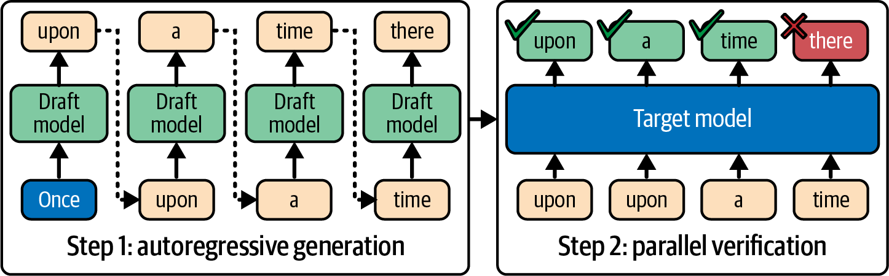
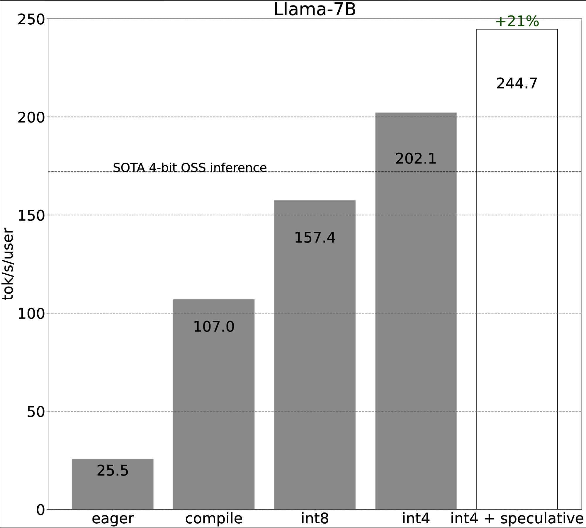
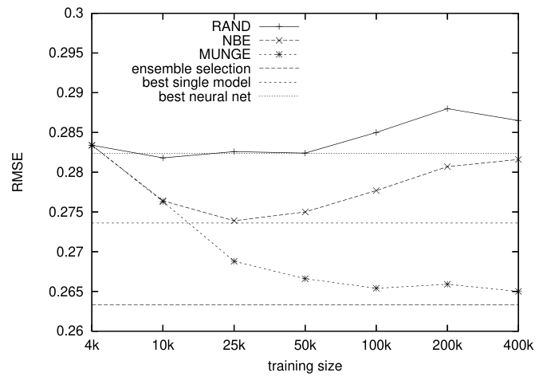

# 8 — Adaptive Inference

> Decode leaves the GPU's compute mostly idle while it waits on memory. Each technique here spends some of that idle compute, or cuts the bytes moved, to produce more tokens per second. Some keep the output distribution exactly; others trade a little quality.

Stacked speedup tables make adaptive techniques look like free multipliers, and teams that turn them on from a blog post get a surprise: speculation that gains nothing on a small target or a saturated batch, or a 4-bit model that passes [perplexity](../../../generative-ai/01-llm-fundamentals/notes/06-pretraining-data-and-objectives.md#entropy-cross-entropy-kl-and-perplexity) and fails the product's eval. What each technique does depends on how idle the compute is and on whether it keeps the output distribution, so this chapter sorts them on both.

---

## Why decode leaves compute idle

Each decode step reads every weight (and the whole KV cache) to produce one token per sequence ([01](01-why-inference-is-its-own-discipline.md#two-bottlenecks-compute-and-memory-bandwidth)). At small batch sizes, arithmetic intensity is far below the roofline ridge, so Tensor Cores sit idle. Two families of fixes follow from that:

- **Do more work per weight read.** Speculative and parallel decoding check several candidate tokens in one forward pass. The check costs about as much as generating one token, because the pass is bandwidth-bound either way (*AI Engineering*, ch. 9).
- **Read fewer bytes.** Quantization shrinks weights and KV entries, so each step moves less data.

A third family adapts *per request or per token*: dynamic precision, early exit and layer skipping. These are less mature (*AISPE*, ch. 19).

The first family also works at the prompt level. Skeleton-of-Thought asks the model for a skeleton of 3 to 5 word points, then expands every point in parallel as one batch, so the expansions share each weight read. Over 12 models on Vicuna-80 (open models' latency estimated from A100 FP16 profiling, API models timed end to end) it gave up to 2.39× speed-up, above 2× on 8 of 12 models. By question type it ranged from 1.34× on math to 2.33× on knowledge questions. GPT-4 judged it not worse than sequential answers in about 60% of cases. It suits answers made of independent points and not step-by-step reasoning, where later steps need earlier ones, so a router falls back to normal decoding. The price is prefill: each point is a separate request that repeats the question, so API models saw 60× to 89× more prefill tokens. The gain holds only when few queries run concurrently, since a saturated server has no idle compute to fill ([arXiv:2307.15337](https://arxiv.org/abs/2307.15337) (Ning et al., ICLR 2024)).

Huyen's caveat applies to the whole note: if your batches already saturate compute (high MFU), the idle FLOPs are gone, and speculative methods help less or hurt (*AI Engineering*, ch. 9). Long contexts are the exception: KV reads keep large batches bandwidth-bound (see [below](#variants)).

---

## Speculative decoding



*Image Source: Fregly, *AI Systems Performance Engineering* (O'Reilly, 2025), Fig. 15-8*

A small **draft model** proposes *K* tokens. The large **target model** scores all *K* in one forward pass, accepts the longest prefix that matches what it would have sampled, and adds one token of its own. With the standard rejection-sampling rule, the output distribution is **identical to the target's** (Chen et al., 2023), so quality is unchanged by construction. In the figure the draft proposes four tokens and the target rejects "there", so the step yields the accepted prefix plus the target's correction.

The same chapter demos it in vLLM with Gemma 2 9B as target and Gemma 2 2B as draft, `num_speculative_tokens=5`: about 14.2% faster than the target alone (read from their Fig. 8-10; single run, hardware in their repo). They warn it can be slower than the target alone if the speculation length is set too high, which fits the acceptance-rate dependence in the table below (*Generative AI Design Patterns*, ch. 8, Pattern 26). Their `speculative_model` argument is dated in current vLLM.

Huyen gives three reasons it works (*AI Engineering*, ch. 9):

1. Verifying *K* tokens is parallel, like prefill; generating them is sequential.
2. Some tokens are easy, so a weak model often guesses them right.
3. Decode is bandwidth-bound, so the verification FLOPs are nearly free.

Fregly's text says the target "verifies these tokens one by one" (*AISPE*, ch. 15). That contradicts both the method and his own Fig. 15-8: verification is one parallel pass.

**Requirements.** The draft must share the target's tokenizer and vocabulary. Fregly says it should be at least **~4× faster** than the target, or the draft time eats the gain (*AISPE*, ch. 15). Acceptance rates are domain-dependent: higher for code and structured text. A larger *K* means fewer target calls but a lower chance that all *K* are accepted.

**How much speedup.** The three books disagree, because they report different conditions:

| Claim | Condition | Source |
|---|---|---|
| Latency more than halved | Chinchilla-70B with a 4B draft at 1.8 vs 14.1 ms/token; DeepMind's TPU setup | *AI Engineering*, ch. 9, citing Chen et al. 2023 |
| Theoretical *K*×, ~2× in practice, 1.5–2.5× "common" | Generic; no model or hardware | *AISPE*, ch. 15 |
| 3–4× at 90% draft acceptance; "2–4× or more" | No model or hardware; acceptance rate assumed | *LLM Engineer's Handbook*, ch. 8 |
| "Not significant" | Qwen1.5-1.8B target, 0.5B draft, on a T4 | *LLM Engineer's Handbook*, ch. 8 (its own demo) |

The Handbook's own demo is the most instructive row. When the target is already small, the draft is not much cheaper, and the gain disappears. Plan on Fregly's ~2× for a well-matched pair on a large target, and measure.

The Hugging Face API is one argument (*LLM Engineer's Handbook*, ch. 8):

```python
out = model.generate(**inputs, assistant_model=draft_model)        # draft model
out = model.generate(**inputs, prompt_lookup_num_tokens=4)         # no draft model
```

### Variants

| Method | Where drafts come from | Reported gain (condition) |
|---|---|---|
| **EAGLE** (1–3) | A light head on the target's own hidden states predicts features, then tokens | EAGLE up to ~3.5× (4-token draft); EAGLE-2 +20–40% over EAGLE; EAGLE-3 up to 1.4× over EAGLE-2, up to 6.5× over no speculation (*AISPE*, ch. 15; paper numbers, chat benchmarks). EAGLE-2 sizes its draft tree from the draft's own confidence, which tracks acceptance well: on Vicuna-13B, MT-bench, temperature 0, batch 1, it reaches 4.26× against EAGLE's 3.07× and Medusa's 2.07× in the same harness, and it stays lossless ([arXiv:2406.16858](https://arxiv.org/abs/2406.16858) (Li et al., EMNLP 2024)) |
| **Medusa** | Extra decoding heads, each predicting token *t+k*; candidates checked with tree attention | Up to 1.9× on Llama 3.1, HGX H200 (*AI Engineering*, ch. 9, citing NVIDIA); 2.2–3.6× published, ~2–3× in practice (*AISPE*, ch. 15). The paper: >2.2× with heads trained on a frozen backbone, 2.3–2.8× when trained jointly, on Vicuna 7–33B at batch 1. Its "typical acceptance" is not lossless at temperature > 0 ([arXiv:2401.10774](https://arxiv.org/abs/2401.10774) (Cai et al., ICML 2024)) |
| **Multi-token prediction (MTP)** | Heads trained with the model in pretraining draft for it at serving time | Nemotron 3 Super reuses one shared MTP head recursively and accepts 3.45 tokens per verification at draft length 7 on SPEED-Bench; acceptance still decays with draft depth, but more slowly than with separate per-offset heads ([arXiv:2604.12374](https://arxiv.org/abs/2604.12374) (NVIDIA, 2026-04, preprint)) |
| **Self-speculative** | The target with half its layers skipped acts as its own draft | ~2× (*AISPE*, ch. 15) |
| **PaSS** (parallel speculative sampling) | No draft model and no new heads on the target: L learned look-ahead embeddings are appended to the input, the frozen target drafts L tokens in one call, and the next call verifies them with the usual rejection rule | Up to 30% less time (LLaMA 7B, 4 look-ahead tokens, 512 generated tokens); bound (L+2)/2 as each step makes two target calls. One model size, no draft-model baseline ([arXiv:2311.13581](https://arxiv.org/abs/2311.13581) (Monea et al., NeurIPS 2023 Workshop on Efficient NLP and Speech Processing)) |
| **Prompt lookup / inference with reference** | N-gram matches copied from the prompt | 2× when output overlaps input: RAG, code edits, multi-turn (*AI Engineering*, ch. 9, citing Yang et al. 2023). In RL rollouts, sibling responses to the same prompt make a better reference: Seer's per-group suffix tree gains up to 1.3× over other drafting strategies, inside a system that raises rollout throughput up to 2.04× on Moonshot's production RL jobs ([arXiv:2511.14617](https://arxiv.org/abs/2511.14617) (Qin et al., OSDI 2026)) |
| **Lookahead (Jacobi) decoding** | The same model guesses several future positions and iterates until they are consistent | (*AI Engineering*, ch. 9); no number given. Plain Jacobi rarely gets more than one token right per iteration. CLLMs fine-tune the model to jump to the fixed point, giving 2.4–3.4× on GSM8K, Spider and code, from ~1M training tokens on LLaMA-7B and with no extra heads. Because the model itself changes, the output is not that of the original model ([arXiv:2403.00835](https://arxiv.org/abs/2403.00835) (Kou et al., ICML 2024)) |

Two of the Handbook's descriptions are wrong or dated. Its Medusa passage, roughly "a 70M-parameter model approximates a 7B model", garbles how Medusa works: the heads sit on the target, they are not a separate small model. Its Table 8.1 lists speculative decoding (and pipeline parallelism) as TensorRT-LLM only. vLLM and SGLang ship both (*LLM Engineer's Handbook*, ch. 8).

**Is it a default or a special case?** Fregly's ch. 16 calls speculative decoding and Medusa "typically reserved for extreme cases" (*AISPE*, ch. 16). His own ch. 15 treats it as mainstream, and as of 2026 vLLM, SGLang and TensorRT-LLM all ship EAGLE-style speculation as a standard option. The real condition is whether decode is still bandwidth-bound. That depends on sequence length as well as batch size. For short sequences, speculation pays at low-to-moderate batch and fades as batches grow and compute fills up. For long sequences, every step also reads each sequence's KV cache, and that read grows with batch × context. Past a critical sequence length (set by the model and hardware), KV loading dominates even at large batch, so speculation helps throughput again. MagicDec measures up to 2.51× for LLaMA-3.1-8B on 8×H100 at batch 32–256, using a draft that attends over a sparse, StreamingLLM-style KV cache ([arXiv:2408.11049](https://arxiv.org/abs/2408.11049) (Sadhukhan et al., ICLR 2025)).

### Diffusion LLMs: parallel decoding without a draft

Diffusion LLMs (dLLMs) drop left-to-right generation altogether. They start from masked positions and unmask several tokens per forward pass. Inception's Mercury Coder Mini runs at 1,109 tokens/s on an H100, measured by Artificial Analysis, with coding quality close to speed-tuned frontier models. The report does not give model size, data or architecture ([arXiv:2506.17298](https://arxiv.org/abs/2506.17298) (Inception Labs, 2025-06, preprint)). LLaDA2.1-Flash (100B) peaks at 892 tokens/s on HumanEval+ in its speed mode, and the authors say a clear speed–accuracy tradeoff remains: the speed mode scores below LLaDA2.0, and speed varies widely by domain ([arXiv:2602.08676](https://arxiv.org/abs/2602.08676) (Bie et al., 2026-02, preprint)). Large headline speedups for dLLM decoders are usually measured against *vanilla dLLM decoding*, not a tuned autoregressive server. Learn2PD's 22.58× (57.51× with a KV cache) is on LLaDA at generation length 1024, and much of it comes from no longer denoising padding after the answer ends ([arXiv:2509.25188](https://arxiv.org/abs/2509.25188) (Bao et al., ICLR 2026)). Elastic-Cache's 8.7× (45.1× on long outputs) comes from not recomputing every layer's KV at every denoising step ([arXiv:2510.14973](https://arxiv.org/abs/2510.14973) (Nguyen-Tri et al., 2025-10, preprint)).

Zhang et al.'s survey puts speculative decoding, multi-token prediction and diffusion on one map, split by training objective: a method is autoregressive if training keeps each token conditioned on the ones before it, however many it emits per step, and non-autoregressive if training treats tokens as conditionally independent or as denoising. Its two useful cautions are that the conditional-independence error grows with the number of tokens unmasked per step, so it "can only be eased by reducing parallelism or adding light dependencies", and that KV caching for diffusion models is approximate and "essentially introduces block-level autoregression". Its speedup ranges (masked generation "up to 32×") are compiled from papers with different models, tasks and baselines, so do not set them beside a served AR number; it ran nothing itself, and covers work to about January 2026 ([arXiv:2508.08712](https://arxiv.org/abs/2508.08712) (Zhang et al., 2025-08, preprint survey)).

TiDAR keeps the autoregressive model and uses diffusion only to draft. One forward pass does two things: it verifies the previous step's draft tokens causally, with the same rejection-sampling rule as speculative decoding, and it pre-drafts the next block by one-step bidirectional diffusion over mask tokens. The drafter is the model itself, and drafting runs inside the verification pass, in the token slots that are free while decode is bandwidth-bound. At batch 1 on one H100, in PyTorch with Flex Attention, TiDAR 1.5B (Qwen2.5 1.5B continued on 50B tokens) averages 7.45 tokens per forward and 4.71× its base model's tokens/s on code and math benchmarks at equal scores; TiDAR 8B (Qwen3 8B, 150B tokens, block size 16) reaches 5.91× at about 3 to 4 points below its base. Unlike speculative decoding it is not lossless against the base model at 8B (the 1.5B scores match), it needs continued pretraining, and its large-batch behaviour is asserted rather than measured ([arXiv:2511.08923](https://arxiv.org/abs/2511.08923) (Liu et al., 2025-11, preprint)).

---

## Quantization

Quantization, KV-cache quantization and the low-precision formats moved to [08c — Quantization and Low-Precision Inference](08c-quantization-and-low-precision.md): the schemes, weight formats, FP8 and FP4, ternary weights, and KV-cache quantization. This chapter picks them up again under *Stacking the gains*.

---

## Stacking the gains



*Image Source: Huyen, *AI Engineering* (O'Reilly, 2025), Fig. 9-14*

Huyen reproduces PyTorch's 2023 case study (*AI Engineering*, ch. 9). The setup is Llama-7B on one A100-80GB, measured in tokens/s per user at batch size 1:

| Step | Tokens/s | Gain over previous |
|---|---|---|
| Eager PyTorch | 25.5 | — |
| + `torch.compile` | 107.0 | 4.2× |
| + INT8 weights | 157.4 | 1.5× |
| + INT4 weights | 202.1 | 1.3× |
| + speculative decoding | 244.7 | 1.2× |

Three lessons:

- **Order matters.** At batch 1, launch overhead dominates eager PyTorch, so compiling gives the largest single gain ([05](05-compilers-and-frameworks.md#what-a-compiler-does-for-inference)). After that, each step works on a smaller remaining bottleneck.
- **The gains multiply but shrink.** That is what happens when one bottleneck after another is removed.
- **Quality was not measured.** Huyen notes it was unclear how these steps affected output quality. INT4 needs an eval run before you ship it. At large batch the picture changes: compile helps less, and speculation may not help at all.

The same multiplication holds at large batch when the first step is static compression rather than compilation. NVIDIA's Puzzle-75B-A9B is Nemotron-3-Super (120.7B total, 12.8B active) pruned by neural architecture search over expert width, activated experts and Mamba state channels, then healed with about 120B tokens of distillation and a little RL. On 8×B200 at NVFP4, with throughput read off a Pareto sweep over tensor parallelism, expert parallelism and batch size at a floor of 100 tokens/s per user on an 8K-in/64K-out workload, the pruned model alone gives 2.03× the parent's server throughput, the parent's multi-token-prediction draft head alone 3.04×, and the two together 4.63×, at 70.74 against 71.93 average accuracy. On a prefill-heavy 50K-in/2K-out workload the pruning gain falls to 1.60×. Two cautions. The paper's own prose quotes different multipliers (2.18×, 4.85×, 5.14×) from its Table 4, and the figures here are the table's. And a smaller model that answers at greater length can win on tokens/s while losing on requests: the 30B Nano model shows 5.84× the parent's tokens/s but 3.87× its requests per minute once its 1.6× verbosity is counted ([arXiv:2607.04371](https://arxiv.org/abs/2607.04371) (Bercovich et al., 2026-07, preprint)). The models, kernels and benchmark suite are all the vendor's, and no other compression method is compared.

---

## Dynamic precision

Fregly's ch. 19 proposes choosing precision **per token or per step** at runtime (*AISPE*, ch. 19). The model runs in FP8 or FP4 while a confidence signal (such as the logit margin or entropy) is healthy. It switches up to BF16 when the signal degrades.

- **Use hysteresis.** Use different thresholds to enter and exit high precision (his example: enter at 6.0, exit at 3.0, both calibrated on your data), so the model does not flap between modes every token.
- **Tooling.** PyTorch autocast covers only FP16/BF16. FP8 needs Transformer Engine (or an engine's FP8 kernels).
- **Status.** His Table 19-2 of gains is illustrative, not measured. This is a research-stage pattern; no mainstream serving engine switches precision per token.

---

## Early exit and layer skipping

If a token is easy, stop computing early (*AISPE*, ch. 19):

- **Early exit** adds a classifier at intermediate layers. If it is confident, the token is emitted without running the remaining layers.
- **DASH-style layer skipping** uses a learned gate to skip 20–40% of layers per token. It needs a model trained or fine-tuned with those gates; you cannot apply it to an off-the-shelf checkpoint.
- **Speculative MoE routing** predicts expert assignment ahead of time, to start all-to-all transfers early. The book reports about 30% less communication time.

The book's "30–50% savings on reasoning tasks" for early exit mixes two things: cutting a chain of thought short (fewer *tokens*) and exiting layers early (fewer *layers per token*). They are different mechanisms with different risks. Cutting tokens is a lever in its own right. Reasoning models **overthink**, adding verification and alternative paths after they already have the right answer. One survey sorts the fixes into post-training ones (length penalties, and preference pairs that favour the first correct answer, which shortened responses by 30–40% in one study) and test-time ones (token budgets, early stopping of the trace) ([arXiv:2503.24377](https://arxiv.org/abs/2503.24377) (Wang et al., 2025-03, preprint)). In batched serving, per-token early exit also has a practical problem: sequences in one batch exit at different depths, which leaves the GPU partly idle unless the kernels handle ragged depth.

The research designs that look promising fix the compute budget in advance, or retrofit routing onto a frozen model:

- **Mixture-of-Depths.** A router picks a fixed top-*k* of tokens per block, so tensor shapes stay static. With 12.5% capacity on every other block, a 220M model matches its isoFLOP baseline while stepping 66% faster. Sampling needs a small causal predictor in place of the top-*k*, which is non-causal ([arXiv:2404.02258](https://arxiv.org/abs/2404.02258) (Raposo et al., 2024-04, preprint)).
- **Dr.LLM.** Per-layer routers decide to skip, execute or repeat each block on a frozen LLaMA-3.2 or Qwen-2.5. They are trained on only 4k MCTS-searched paths, and save about 5 layers per example while adding up to 3.4 points on ARC and DART. The paper counts layers, not wall-clock time in a batched server ([arXiv:2510.12773](https://arxiv.org/abs/2510.12773) (Heakl et al., ICLR 2026)).
- **Recursive Transformers.** One shared block is looped with per-depth LoRA. This lets a batch mix tokens that sit at different loop depths ("continuous depth-wise batching"), which attacks the ragged-depth problem directly. The 2–3× throughput gain is a theoretical simulation, not a serving implementation ([arXiv:2410.20672](https://arxiv.org/abs/2410.20672) (Bae et al., ICLR 2025)).

Activation sparsity skips neurons instead of layers. PowerInfer finds that in ReLU models a small hot set of neurons fires for most tokens (17% of OPT-30B's neurons account for 80% of activations). It keeps the hot neurons on the GPU, computes the cold ones on the CPU, and predicts which will fire. On one RTX 4090 at batch 1 it averages 7.23× llama.cpp in FP16 (up to 11.69× on Falcon-40B) and 2.89× in INT4 ([arXiv:2312.12456](https://arxiv.org/abs/2312.12456) (Song et al., 2023-12)). It needs ReLU-sparse models, so SwiGLU models such as Llama must be ReLU-fied first; the gains shrink with long prompts and larger batches, and on an A100 it is 18–29% slower than vLLM.

Ch. 19 closes with an **RL-based runtime tuner** that adjusts batch size, precision and parallelism on the fly. It insists on a **kill switch** that reverts to a known-good static configuration. That is the right shape for any adaptive controller: bounded actions, monitored rewards, and a fast fallback.

---

## Small models: distillation and the quantization shortcut

The cheapest inference is a smaller model, and the idea of getting one by training it on a bigger model's labels is older than deep learning. Buciluă, Caruana and Niculescu-Mizil ([KDD 2006](https://doi.org/10.1145/1150402.1150464), "Model Compression") compressed an ensemble-selection model (a greedy blend of hundreds or thousands of SVMs, trees, forests and nets) into one small neural net: generate unlabeled synthetic cases with **MUNGE**, which swaps nominal attribute values between each case and its nearest neighbour (continuous ones are resampled from a Gaussian around the neighbour's value), have the ensemble label them, and fit the net to those labels. On 8 binary tabular problems with 4,000 training points each, a 256-hidden-unit net trained on 400k MUNGE cases had average test RMSE **0.264 against 0.263 for the ensemble** and 0.282 for the best net trained on the 4,000 real points, which is 97% of the ensemble's gain. By the authors' count it matched or beat the ensemble on 6 of 8 problems (within rounding; Table 2 shows 4 at or below it), failed on ADULT (high-arity nominal attributes; ratio 0.29), and was about 1,000x smaller and faster (0.33 MB against 550 MB, 5.6 s against 5,396 s per 10,000 cases, one workstation). Purely random or naive-Bayes pseudo-data did worse and stopped helping or got worse with volume. The paper fits output labels only; there are no soft logits or temperature, which arrive with Hinton's 2015 distillation, and the authors concede labelling and training can cost more than building the ensemble. Single run per setting, small tabular tasks, no deep teacher.


*Image Source: Buciluă, Caruana & Niculescu-Mizil, [Model Compression](https://doi.org/10.1145/1150402.1150464) (KDD 2006), Fig. 2: average RMSE over the eight problems against pseudo-data size.*

Lakshmanan and Hapke (*Generative AI Design Patterns*, ch. 8, Pattern 24) show the size effect on identical hardware (2 x A100-40 GB): Gemma 3 1B generated 8.82 tokens/s against 3.26 for 27B (Table 8-1; prompt, decoding settings and run count are not given). Their distillation recipe trains a student (Gemma 3 1B) against a teacher (Gemma 3 12B) with a blended loss: `(1 - alpha) * task_loss + alpha * KL`, where the KL term compares the student's temperature-scaled log-softmax with the teacher's softmax and is multiplied by T^2 to keep gradient scale. alpha = 1 is teacher only, alpha = 0 is data only.

```python
kd = F.kl_div(F.log_softmax(student_logits / T, -1), F.softmax(teacher_logits / T, -1),
              reduction="batchmean") * T**2
loss = (1 - alpha) * task_loss + alpha * kd
```

Their run used 1,000 Claude-generated Python prompts, 10 epochs, one A100-80 GB, about an hour. Quality is reported only as "significantly improved", with no metric, so read it as a recipe and not a result. They quantized the distilled model to 4 bits (NF4 with double quantization via bitsandbytes) in 19 seconds against "several minutes" at 32 bits (baseline and hardware unstated). Weight memory arithmetic: a 70B model in FP32 is about 280 GB (4 bytes per weight); their "about 8x" smaller at 4 bits holds against 32-bit weights, not 16-bit (that is 4x). They skip pruning as lower quality, which matches the section above. Costs they concede: the student loses generality and inherits the teacher's bias, and quantization speedups depend on hardware kernel support. The pattern is the application-level counterpart of Kim & Rush's sequence-level distillation ([01](01-why-inference-is-its-own-discipline.md#three-levels-one-bill)).

## Where the books disagree

| Topic | Disagreement | Read it as |
|---|---|---|
| Spec-decoding speedup | Handbook 3–4× at 90% acceptance; Fregly ~2× (1.5–2.5×); Chen et al. ">2×" latency | Depends on acceptance rate, draft/target cost ratio and batch size. ~2× is a fair planning number at low batch |
| Spec decoding's role | Fregly ch. 16 "extreme cases" vs ch. 15 and 2026 engines | Default option at low-to-moderate batch, and at large batch too once contexts are long (MagicDec) |
| Verification | Fregly's text "one by one" vs his Fig. 15-8 | Parallel, in one pass |
| Medusa | Handbook "70M approximates 7B"; Huyen 1.9× (H200); Fregly 2.2–3.6× | Heads on the target; ~2× in practice |
| Engine support | Handbook Table 8.1: spec decoding TRT-LLM only | Dated; vLLM and SGLang support it |

---

## Working reference

- Know your regime first. At low batch you are bandwidth-bound: quantize weights and add speculation. At high batch with short contexts you are compute-bound: speculation fades, FP8/FP4 math helps. At high batch with long contexts, KV reads bring back the bandwidth bound, and speculation can pay again.
- Quantization defaults (FP8 or 4-bit weights, FP8 KV cache, evals first): [08c](08c-quantization-and-low-precision.md#working-reference).
- Add EAGLE-style speculation in the engine, and watch the acceptance rate per traffic type.
- Use prompt lookup for RAG, code editing and other copy-heavy outputs.
- Treat dynamic precision, early exit and RL tuners as experiments with a kill switch.

## Pitfalls

- **Speculating on a small target.** Symptom: the Handbook's own demo, a Qwen1.5-1.8B target with a 0.5B draft on a T4, shows a gain it calls "not significant", because the draft isn't much cheaper. Fix: use a draft ≥ ~4× faster than the target, and plan on about 2× for a well-matched pair on a large target.
- **Speculating on saturated batches.** Symptom: throughput falls after enabling it at high MFU, since the idle FLOPs are gone. Fix: measure MFU first, and benchmark at your real batch size. Long contexts are the exception, because KV reads keep them bandwidth-bound.
- **Quoting a speedup without its condition.** Symptom: "3–4×" quoted from the Handbook, which assumes 90% acceptance and names no model or hardware. Fix: measure acceptance on your own domain, as it's higher for code and structured output.
- **An adaptive controller with no way back.** Symptom: an RL tuner or dynamic precision policy oscillating in production. Fix: bounded actions, hysteresis such as the 6.0/3.0 thresholds, and a kill switch to a known-good static configuration. Treat Table 19-2's numbers as illustrative.

## Try it

1. From the PyTorch stack table, what is the total gain, and what would you expect if you ran the steps at a large batch?

   <details><summary>Answer</summary>

   244.7 / 25.5 ≈ 9.6×, for Llama-7B on an A100-80GB at batch 1, with quality not measured. At large batch, launch overhead matters less, so compile helps less, and speculation may not help at all. The table doesn't transfer.

   </details>

2. You serve a large target at low batch and low MFU for a coding assistant, and also a saturated batch-summarization job. Which adaptive techniques would you try for each, in order?

   <details><summary>Answer</summary>

   Assistant: speculation first, since idle compute is available and acceptance is higher for code; it is also exact under the standard rule, so it doesn't change outputs. Then quantization with an eval. Summarization: skip speculation unless contexts are long; use FP8 weights and KV, evaluated, because reading fewer bytes still helps when compute is saturated.

   </details>

## Interview checklist

| Prompt | Answer in one line |
|---|---|
| Why is speculative decoding cheap? | Verifying K tokens is one parallel pass, and decode is bandwidth-bound, so the verification FLOPs are nearly free. Fregly's "one by one" contradicts both the method and his own figure. |
| What speedup do you promise? | About 2× for a well-matched pair on a large target, and measure it. The sources range from 3–4× at an assumed 90% acceptance to "not significant" on a small target on a T4. |
| When does speculative decoding hurt? | When batches already saturate compute (high MFU), or when the draft isn't at least ~4× faster. It also needs the target's tokenizer and vocabulary. |
| Speculation and quantization both speed things up. What's the difference for quality? | Speculative decoding with the standard rejection-sampling rule keeps the output distribution. Quantization changes outputs, so every format change needs an eval run, and perplexity alone isn't enough. |
| Read the PyTorch stack: 25.5 → 107.0 → 157.4 → 202.1 → 244.7 tokens/s. | At batch 1 on Llama-7B and an A100, compile gives 4.2× because launch overhead dominates, then each step gains less: 1.5×, 1.3×, 1.2×. The total is 9.6×, but quality wasn't measured and it won't hold at large batch. |
| Is SpeCache speculative decoding? | No. Despite the name and the book's figure title, it prefetches predicted KV blocks to hide the latency of offloaded cache tiers, so it is a KV-tiering technique. |

## Next

[08c-quantization-and-low-precision.md](08c-quantization-and-low-precision.md): the quantization half of the pair. Then [08b-serving-encoders-and-vision-models.md](08b-serving-encoders-and-vision-models.md): the same questions for models that aren't only a decode loop, embedding encoders and vision-language models. Then [09-checklist-and-ai-assisted-tuning.md](09-checklist-and-ai-assisted-tuning.md): everything so far as an ordered checklist.
