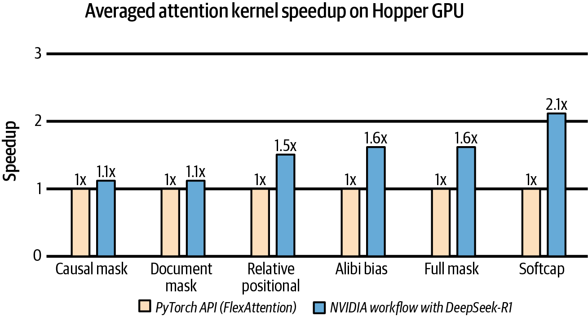
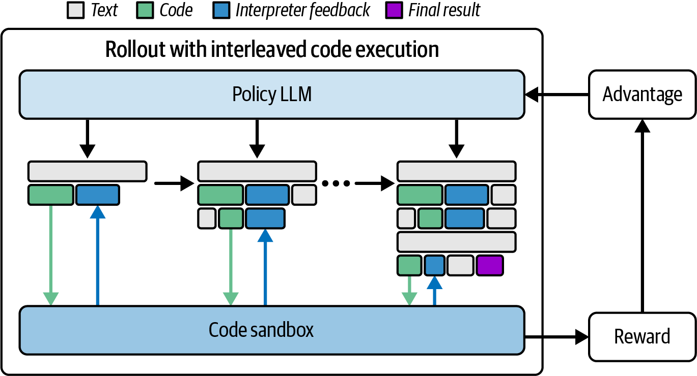

# 9 — Checklist and AI-Assisted Tuning

> Most inference speed comes from a known list of settings, applied in order and measured each time. The new part is letting models search for kernels and configurations, which is only safe with a verifier between the model and production.

---

## The checklist

Fregly's appendix is a checklist of roughly 175–180 items in 18 categories, covering training and inference, from BIOS settings to cluster scheduling (*AISPE*, appendix). Below are the items that matter for an **inference** deployment, in 28 lines and six groups, roughly in the order you should check them. Each one links to the note that explains it.

### 1. Method and measurement

1. Define the SLO first: TTFT and TPOT targets at a percentile, and goodput against them ([01](01-why-inference-is-its-own-discipline.md#latency-ttft-tpot-and-the-tail)).
2. Profile before changing anything, and re-profile after every change ([05](05-compilers-and-frameworks.md#profile-first)).
3. Benchmark with realistic prompt and output length distributions, not one fixed shape.
4. Keep a regression job on pinned versions that fails on a sustained slowdown of 5% or more ([05](05-compilers-and-frameworks.md#guarding-against-regressions)).

### 2. Host, OS and GPU

5. Turn on GPU persistence mode, so the driver stays loaded and the first request does not pay initialization.
6. Pin each serving process to the CPUs and memory of the NUMA node nearest its GPU.
7. Set transparent huge pages to `madvise`, not `always`, to avoid latency spikes from page compaction.
8. Leave ECC on, and watch the error counters.
9. Use MIG partitions to share one large GPU among small models, instead of time-slicing.
10. Budget at least about one CPU core per GPU for the serving process, tokenization and the scheduler. Starved hosts show up as GPU idle gaps.

### 3. Placement

11. Choose the smallest tensor-parallel degree that fits the model and the KV budget, and keep TP inside one NVLink domain ([06](06-serving-at-scale.md#parallelism-for-inference)).
12. Disaggregate prefill and decode only when long prompts measurably block decode, which shows up as TPOT spikes ([07](07-prefill-decode-kv-cache.md#disaggregated-prefill-and-decode)).
13. Route by prefix-cache affinity, not round-robin ([06](06-serving-at-scale.md#routing)).

### 4. Engine and batching

14. Use continuous batching. Raise the batch cap until p99 TPOT starts to climb, then back off ([06](06-serving-at-scale.md#batching)).
15. Turn on chunked prefill ([07](07-prefill-decode-kv-cache.md#chunked-prefill)).
16. Use paged KV with prefix caching, and add CPU/SSD tiers if reuse is high ([07](07-prefill-decode-kv-cache.md#prefix-caching)).
17. Warm up every replica, including compile and graph capture, before it takes traffic ([05](05-compilers-and-frameworks.md#cold-start)).
18. Mark known-dynamic dimensions and fail CI on recompiles ([05](05-compilers-and-frameworks.md#graph-breaks-guards-and-recompiles)).
19. Capture CUDA graphs for a set of batch-size buckets.

### 5. Kernels and precision

20. Go to FP8 first, then validate NVFP4 or INT4 against your evals ([08](08-adaptive-inference.md#quantization)).
21. Add speculative decoding at low-to-moderate batch ([08](08-adaptive-inference.md#speculative-decoding)).
22. Try 2:4 structured sparsity only where kernels support it. The appendix gives up to ~2× on the sparse matmuls, not end-to-end.
23. Autotune kernels for your shapes (`max-autotune`, engine tuners). The appendix gives 20–30% on the tuned kernels.

### 6. Monitoring and power

24. Export DCGM metrics. Alert when GPU utilization stays under about 50% while requests are queued, which means the host or scheduler is the bottleneck. Do not autoscale on that metric alone ([06](06-serving-at-scale.md#watching-a-fleet)).
25. Track SM activity and memory bandwidth (MFU/MBU), not just "GPU util" ([01](01-why-inference-is-its-own-discipline.md#utilization-why-gpu-util-lies)).
26. Alert on thermals near ~85°C and on clock throttling.
27. Try a power cap around 80% of TDP. For bandwidth-bound decode the appendix reports about the same throughput at lower power. Measure tokens per joule before and after.
28. Log per-request tokens, latency and cache hits, so that cost per request is computable ([01](01-why-inference-is-its-own-discipline.md#throughput-cost-and-goodput)).

The appendix states its ranges loosely. `torch.compile` appears as both "10–40%" and "20–50%" in different items. Treat every number in it as an order of magnitude to test, not a promise.

---

## AI-generated kernels

Ch. 20 surveys systems where a model writes or tunes the performance-critical code (*AISPE*, ch. 20).

**AlphaTensor** (DeepMind, 2022) used RL to discover matrix-multiplication algorithms. On specific matrix sizes, they ran **10–20% faster** than standard implementations on a V100. It was a narrow search space with an exact correctness check.

**NVIDIA's DeepSeek-R1 experiment** (2025) put a reasoning model in a loop with a verifier:

```python
for _ in range(max_iters):
    code = llm.generate_kernel(prompt)
    ok, runtime, feedback = verifier.check(code)      # compile, test vs reference, time
    if ok and runtime < target:
        break
    prompt = refine(prompt, feedback)
```



*Image Source: Fregly, *AI Systems Performance Engineering* (O'Reilly, 2025), Fig. 20-4*

Running for about **15 minutes on an H100**, the loop produced attention kernels **1.1–2.1× faster than FlexAttention**, depending on the variant: 1.1× for causal and document masks, up to 2.1× for softcapping. It passed **100% of KernelBench level-1** and **96% of level-2** problems (*AISPE*, ch. 20). Note the baseline: FlexAttention is itself about 85–90% of FlashAttention-2 ([05](05-compilers-and-frameworks.md#custom-kernels-inside-the-compiler)). So "2× FlexAttention" on an exotic mask is not "2× the best hand-written kernel".



*Image Source: Fregly, *AI Systems Performance Engineering* (O'Reilly, 2025), Fig. 20-1*

**Predibase** went further and trained the generator itself. Qwen2.5-Coder-32B was fine-tuned with GRPO: the model proposes kernels, a sandbox compiles and tests them, and correctness plus speed become the reward. After about **5,000 steps**, about **40%** of its kernels were correct, and some ran up to **3×** faster than the PyTorch reference (*AISPE*, ch. 20). The book expands GRPO as "Group Relative *Preference* Optimization". It is Group Relative **Policy** Optimization (DeepSeekMath, 2024).

### What the verifier must do

Every success above has an automatic, adversarial check between the model and production. That check is the part to copy:

- **Correctness against a reference** on many random inputs and shapes, including edge cases (odd sizes, zeros, NaNs), with a numerical tolerance suited to the dtype.
- **Timing done properly**: warm-up, synchronization, repeated runs, and the same shapes you serve.
- **Guarding against reward hacking.** A kernel that caches results, skips work on the test shapes, or reads the reference output will look fast. KernelBench-style benchmarks have documented exactly this.
- **Human review before merge.** A generated kernel becomes code you own and must debug.

The chapter's own advice is inconsistent here. It recommends verifiers, but also says teams should learn to "trust AI recommendations". Trust the verifier, not the model.

### Dated and speculative claims in ch. 20

- **AI-2027** is a scenario forecast, not evidence. The chapter's picture of self-improving AI systems engineers rests on it.
- **"25× performance per watt"** for new NVIDIA systems is a vendor marketing figure, measured under vendor-chosen conditions (low precision, specific models).
- The 40% correctness rate is a reminder that most generated kernels are wrong. That is fine inside a verified search loop, and dangerous anywhere else.

The same verifier-in-the-loop pattern applies to configuration search: batch caps, TP degree, chunk sizes. That search space is smaller and safer than kernel code, and an engine's own benchmark harness can act as the verifier.

---

## Working reference

- Walk the checklist in order: measurement, host, placement, engine, kernels, monitoring. Measure after each step.
- Treat the appendix's percentages as hypotheses to test.
- Use AI kernel generation only inside a loop with a correctness and timing verifier, and review generated code before it merges.
- Compare generated kernels against the best existing kernel, not a convenient baseline.
