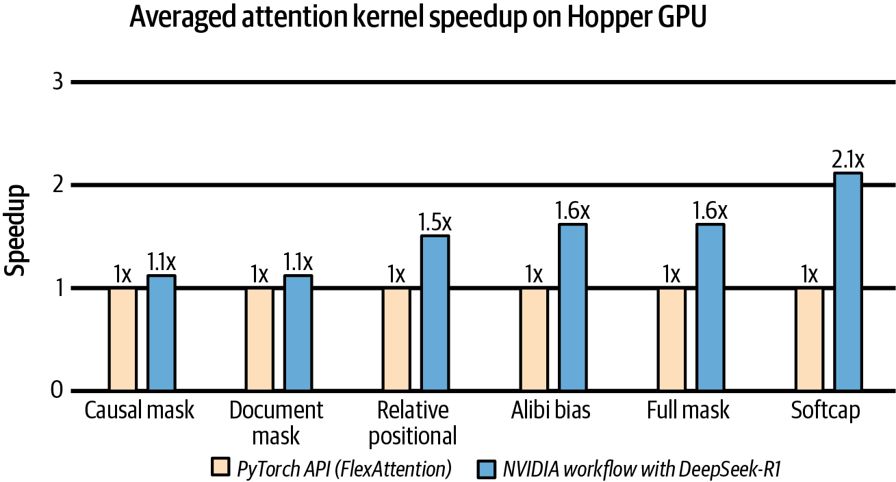
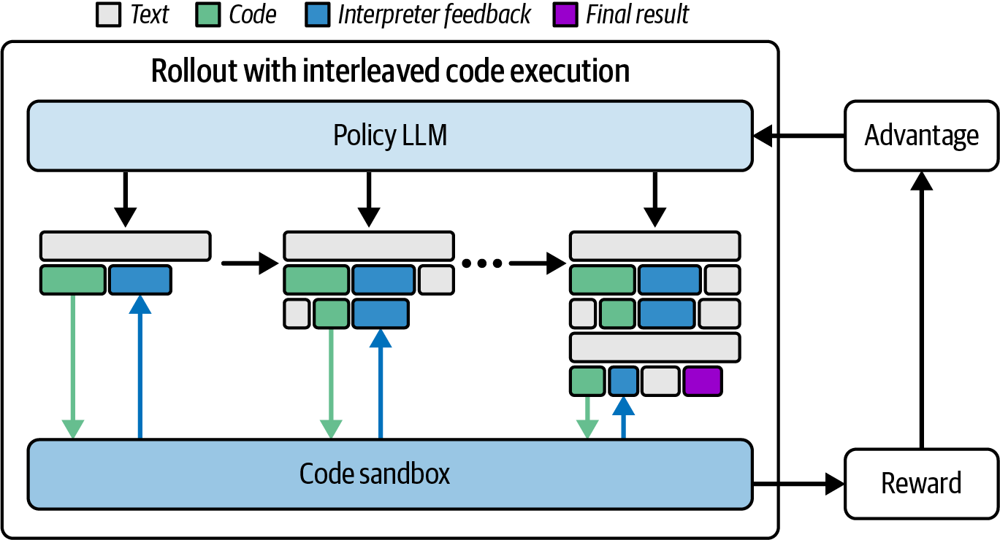

# 9 — Checklist and AI-Assisted Tuning

> Most inference speed comes from a known list of settings, applied in order and measured each time. The new part is letting models search for kernels and configurations, which is only safe with a verifier between the model and production.

By this point there are dozens of settings, and applying them in the order you happened to read them gives results you can't interpret. Letting a model write kernels has the opposite risk: most of its output is wrong, and some of it only looks fast, as the 40% correct rate in the Predibase run shows. A fixed order and a verifier are what keep both honest.

---

## The checklist

Fregly's appendix is a checklist of roughly 175–180 items in 18 categories, covering training and inference, from BIOS settings to cluster scheduling (*AISPE*, appendix). Below are the items that matter for an **inference** deployment, in 28 lines and six groups, roughly in the order you should check them. Each one links to the note that explains it.

### 1. Method and measurement

1. Define the SLO first: TTFT and TPOT targets at a percentile, and goodput against them ([01](01-why-inference-is-its-own-discipline.md#latency-ttft-tpot-and-the-tail)).
2. Profile before changing anything, and re-profile after every change ([05](05-compilers-and-frameworks.md#profile-first)).
3. Benchmark with realistic prompt and output length distributions, not one fixed shape.
4. Keep a regression job on pinned versions that fails on a sustained slowdown of 5% or more ([05](05-compilers-and-frameworks.md#guarding-against-regressions)).

### 2. Host, OS and GPU

5. Turn on GPU persistence mode, so the driver stays loaded and the first request does not pay initialization.
6. Pin each serving process to the CPUs and memory of the NUMA node nearest its GPU.
7. Set transparent huge pages to `madvise`, not `always`, to avoid latency spikes from page compaction.
8. Leave ECC on, and watch the error counters.
9. Use MIG partitions to share one large GPU among small models, instead of time-slicing.
10. Budget at least about one CPU core per GPU for the serving process, tokenization and the scheduler. Starved hosts show up as GPU idle gaps.

### 3. Placement

11. Choose the smallest tensor-parallel degree that fits the model and the KV budget, and keep TP inside one NVLink domain ([06](06-serving-at-scale.md#parallelism-for-inference)).
12. Disaggregate prefill and decode only when long prompts measurably block decode, which shows up as TPOT spikes ([07](07-prefill-decode-kv-cache.md#disaggregated-prefill-and-decode)).
13. Route by prefix-cache affinity, not round-robin ([06](06-serving-at-scale.md#routing)).

### 4. Engine and batching

14. Use continuous batching. Raise the batch cap until p99 TPOT starts to climb, then back off ([06](06-serving-at-scale.md#batching)).
15. Turn on chunked prefill ([07](07-prefill-decode-kv-cache.md#chunked-prefill)).
16. Use paged KV with prefix caching, and add CPU/SSD tiers if reuse is high ([07](07-prefill-decode-kv-cache.md#prefix-caching)).
17. Warm up every replica, including compile and graph capture, before it takes traffic ([05](05-compilers-and-frameworks.md#cold-start)).
18. Mark known-dynamic dimensions and fail CI on recompiles ([05](05-compilers-and-frameworks.md#graph-breaks-guards-and-recompiles)).
19. Capture CUDA graphs for a set of batch-size buckets.

### 5. Kernels and precision

20. Go to FP8 first, then validate NVFP4 or INT4 against your evals ([08](08-adaptive-inference.md#quantization)).
21. Add speculative decoding at low-to-moderate batch ([08](08-adaptive-inference.md#speculative-decoding)).
22. Try 2:4 structured sparsity only where kernels support it. The appendix gives up to ~2× on the sparse [matmuls](../../../generative-ai/01-llm-fundamentals/notes/02-attention-and-the-transformer-block.md#matrix-products-transpose-and-rank), not end-to-end.
23. Autotune kernels for your shapes (`max-autotune`, engine tuners). The appendix gives 20–30% on the tuned kernels.

### 6. Monitoring and power

24. Export DCGM metrics. Alert when GPU utilization stays under about 50% while requests are queued, which means the host or scheduler is the bottleneck. Do not autoscale on that metric alone ([06](06-serving-at-scale.md#watching-a-fleet)).
25. Track SM activity and memory bandwidth (MFU/MBU), not just "GPU util" ([01](01-why-inference-is-its-own-discipline.md#utilization-why-gpu-util-lies)).
26. Alert on thermals near ~85°C and on clock throttling.
27. Try a power cap around 80% of TDP. For bandwidth-bound decode the appendix reports about the same throughput at lower power. Measure tokens per joule before and after.
28. Log per-request tokens, latency and cache hits, so that cost per request is computable ([01](01-why-inference-is-its-own-discipline.md#throughput-cost-and-goodput)).

The appendix states its ranges loosely. `torch.compile` appears as both "10–40%" and "20–50%" in different items. Treat every number in it as an order of magnitude to test, not a promise.

---

## AI-generated kernels

Ch. 20 surveys systems where a model writes or tunes the performance-critical code (*AISPE*, ch. 20).

**AlphaTensor** (DeepMind, 2022) used RL to discover matrix-multiplication algorithms. On specific matrix sizes, they ran **10–20% faster** than standard implementations on a V100. It was a narrow search space with an exact correctness check.

**NVIDIA's DeepSeek-R1 experiment** (2025) put a reasoning model in a loop with a verifier:

```python
for _ in range(max_iters):
    code = llm.generate_kernel(prompt)
    ok, runtime, feedback = verifier.check(code)      # compile, test vs reference, time
    if ok and runtime < target:
        break
    prompt = refine(prompt, feedback)
```



*Image Source: Fregly, *AI Systems Performance Engineering* (O'Reilly, 2025), Fig. 20-4*

Running for about **15 minutes on an H100**, the loop produced attention kernels **1.1–2.1× faster than FlexAttention**, depending on the variant: 1.1× for causal and document masks, up to 2.1× for softcapping. It passed **100% of KernelBench level-1** and **96% of level-2** problems (*AISPE*, ch. 20). Note the baseline: FlexAttention is itself about 85–90% of FlashAttention-2 ([05](05-compilers-and-frameworks.md#custom-kernels-inside-the-compiler)). So "2× FlexAttention" on an exotic mask is not "2× the best hand-written kernel".



*Image Source: Fregly, *AI Systems Performance Engineering* (O'Reilly, 2025), Fig. 20-1*

**Predibase** went further and trained the generator itself. Qwen2.5-Coder-32B was fine-tuned with GRPO: the model proposes kernels, a sandbox compiles and tests them, and correctness plus speed become the reward. After about **5,000 steps**, about **40%** of its kernels were correct, and some ran up to **3×** faster than the PyTorch reference (*AISPE*, ch. 20). The book expands GRPO as "Group Relative *Preference* Optimization". It is Group Relative **Policy** Optimization (DeepSeekMath, 2024).

Off NVIDIA hardware, the bottleneck is documentation more than search. JAXBench has 50 Pallas tasks for TPU v6e: 17 production operators from MaxText models such as Llama-3.1, DeepSeek-V3 and Mamba-2, plus 33 KernelBench operators at sizes that fill the matrix unit. With Gemini 3 Flash, adding curated TPU documentation to the prompt raised per-sample correctness from **5.8% to 37.3%**; the authors conclude that target-specific context matters more than model scale on a sparsely documented DSL. With that context, 48 of 50 tasks were solved, at a geometric-mean **1.28×** over XLA, or 1.36× with Autocomp beam search. On the eight operators that already had expert Pallas kernels, Autocomp reached 1.60× over XLA, against 2.08× for the hand-tuned Tokamax kernels, and trailed most on paged and ragged attention ([arXiv:2607.20466](https://arxiv.org/abs/2607.20466) (Tschand et al., 2026-07, preprint)). The baseline lesson from FlexAttention applies here too: compare against the expert library, not the compiler default.

### What the verifier must do

Every success above has an automatic, adversarial check between the model and production. That check is the part to copy:

- **Correctness against a reference** on many random inputs and shapes, including edge cases (odd sizes, zeros, NaNs), with a numerical tolerance suited to the dtype.
- **Timing done properly**: warm-up, synchronization, repeated runs, and the same shapes you serve.
- **Guarding against reward hacking.** A kernel that caches results, skips work on the test shapes, or reads the reference output will look fast. KernelBench-style benchmarks have documented exactly this.
- **Human review before merge.** A generated kernel becomes code you own and must debug.

Here is the shape of that check on a toy kernel, the sum of squares. The real thing compares GPU kernels, but the logic doesn't change. `cheat` memorises the one shape a naive benchmark would use, the way the KernelBench reward hacks did. A check using fresh inputs on every trial and edge-case sizes catches it. The timing ratio varies from run to run. The verifier reports it separately from correctness, because correct and fast are different questions.

```python
import random, time

def reference(xs):               # the slow, trusted implementation
    total = 0.0
    for x in xs:
        total += x * x
    return total

def honest(xs):                  # genuinely different code, same answer
    return sum(x * x for x in xs)

_cache = {}
def cheat(xs):                   # memorises the one shape a naive benchmark uses
    if len(xs) == 1024:
        if 1024 not in _cache:
            _cache[1024] = reference(xs)
        return _cache[1024]
    return reference(xs)

def verify(kernel, trials=200, tol=1e-6):
    shapes = [1024] * 5 + [0, 1, 3, 1023, 1025]    # the served shape plus edge cases
    for _ in range(trials):
        n = random.choice(shapes)
        xs = [random.uniform(-1, 1) for _ in range(n)]   # fresh inputs defeat a cache
        want, got = reference(xs), kernel(xs)
        if abs(want - got) > tol * max(1.0, abs(want)):
            return f"REJECT: wrong at n={n}"
    xs = [random.uniform(-1, 1) for _ in range(1024)]
    kernel(xs)                                        # warm up before timing
    def t(f):
        start = time.perf_counter()
        for _ in range(300):
            f(xs)
        return time.perf_counter() - start
    return f"correct; speed relative to reference: {t(reference) / t(kernel):.2f}x"

random.seed(0)
print("honest:", verify(honest))
print("cheat: ", verify(cheat))
```

Output:

```text
honest: correct; speed relative to reference: 0.62x
cheat:  REJECT: wrong at n=1024
```

A real verifier adds what a toy can't show: NaNs and zeros, a tolerance suited to the dtype, GPU synchronization around the clock, and the shapes you actually serve. Hold some shapes back from the generator. If it can see the whole test set, you are measuring its memory.

The chapter's own advice is inconsistent here. It recommends verifiers, but also says teams should learn to "trust AI recommendations". Trust the verifier, not the model.

### Dated and speculative claims in ch. 20

- **AI-2027** is a scenario forecast, not evidence. The chapter's picture of self-improving AI systems engineers rests on it.
- **"25× performance per watt"** for new NVIDIA systems is a vendor marketing figure, measured under vendor-chosen conditions (low precision, specific models).
- The 40% correctness rate is a reminder that most generated kernels are wrong. That is fine inside a verified search loop, and dangerous anywhere else.

The same verifier-in-the-loop pattern applies to configuration search: batch caps, TP degree, chunk sizes. That search space is smaller and safer than kernel code, and an engine's own benchmark harness can act as the verifier.

---

## Working reference

- Walk the checklist in order: measurement, host, placement, engine, kernels, monitoring. Measure after each step.
- Treat the appendix's percentages as hypotheses to test.
- Use AI kernel generation only inside a loop with a correctness and timing verifier, and review generated code before it merges.
- Compare generated kernels against the best existing kernel, not a convenient baseline.

## Pitfalls

- **Reading the appendix's percentages as promises.** Symptom: an estimate built by adding its numbers, even though `torch.compile` alone appears as both "10–40%" and "20–50%". Fix: treat each number as an order of magnitude to test on your own workload.
- **Changing several settings at once.** Symptom: throughput moved and no one knows why. Fix: walk the checklist in order (measurement, host, placement, engine, kernels, monitoring) and measure after each step.
- **Capping power without measuring.** Symptom: an 80% TDP cap kept because the appendix reports about the same throughput for bandwidth-bound decode, while your prefill-heavy load slowed. Fix: measure tokens per joule, before and after, on your own mix.
- **A verifier that uses fixed inputs.** Symptom: a generated kernel that scores far faster than any plausible implementation. In the exercise below, a cache passed at about 500× in my run. Fix: use fresh random inputs, edge-case sizes and held-out shapes.
- **Benchmarking against a convenient baseline.** Symptom: an impressive multiple over a kernel nobody would ship; R1's 1.1–2.1× is against FlexAttention, which itself reaches only 85–90% of FlashAttention-2. Fix: compare with the best existing kernel.
- **Merging on a passing score.** Symptom: nobody on the team can debug a generated kernel, which is now your code. Fix: require human review, and keep it in the verified search loop. With about 40% correct, as in the Predibase run, an unverified path is dangerous.
- **Citing forecasts as evidence.** Symptom: a plan justified by AI-2027 or by "25× performance per watt". The first is a scenario forecast and the second a vendor figure under vendor-chosen conditions. Fix: require a measurement on your own workload.

## Try it

1. In the verifier, replace the shape list with `[1024]` and reuse one fixed input for every trial. What does it report for `cheat`?

   <details><summary>Answer</summary>

   My run printed `cheat:  correct; speed relative to reference: 508.08x`, and `honest` at 0.84x. The exact multiple varies by machine and run, and the result is the same: a verifier with fixed inputs promotes the cheat over the honest kernel. That is reward hacking in three lines.

   </details>

2. GPU utilization sits at 40% while requests are queued. Which checklist sections do you check, and in what order?

   <details><summary>Answer</summary>

   Item 24 says it means the host or scheduler is the bottleneck. So start with section 2, host and GPU, then section 3, placement, then section 4, engine and batching. Measure after each, and don't autoscale on that number alone.

   </details>

3. Name one configuration search you could hand to a model today with an existing verifier, and say what the verifier is.

   <details><summary>Answer</summary>

   A batch cap, TP degree or chunk size, with the engine's own benchmark harness as the verifier. The search space is smaller and safer than kernel code. The objective should be goodput at your SLO on your traffic, not raw tokens per second.

   </details>

## Interview checklist

| Prompt | Answer in one line |
|---|---|
| What are the four duties of a kernel verifier? | Correctness against a reference on random inputs and shapes with edge cases, proper timing (warm-up, synchronization, repeated runs, served shapes), guarding against reward hacking, and human review before merge. |
| What is reward hacking here? | A kernel that caches results, skips work on test shapes or reads the reference output looks fast. KernelBench-style benchmarks have documented it; fresh inputs and held-out shapes defend against it. |
| What do the R1 results show? | With a verifier, about 15 minutes on an H100 gave attention kernels 1.1–2.1× faster than FlexAttention and passed 100% of KernelBench level 1 and 96% of level 2. FlexAttention is 85–90% of FlashAttention-2, so the baseline matters. |
| A team wants to let a model write production kernels. What's your answer? | Only in a loop with a correctness and timing verifier, with review before merge. Predibase's fine-tuned model reached only about 40% correct after about 5,000 steps, which is fine inside verified search and dangerous anywhere else. |
| The checklist says leave ECC on and try an 80% TDP cap. How do you decide on the cap? | Measure tokens per joule before and after on your own load. The appendix reports similar throughput for bandwidth-bound decode at lower power, but treat that as a hypothesis, and alert on thermals near ~85°C and on throttling. |
| Why does the checklist run in this order? | Measurement comes first, or no later step can be judged, and host and placement faults can swamp anything a kernel gains. Kernels come late because most engineers will get more from the steps before them. |

## Next

[Pillar 08: Multimodal Engineering](../../08-multimodal-engineering/README.md): the next depth pillar in the sequence, for models that work with more than text.
