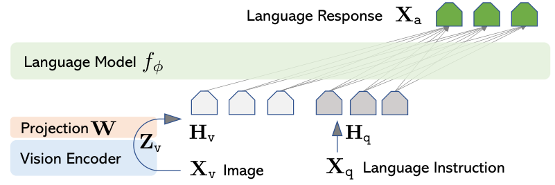
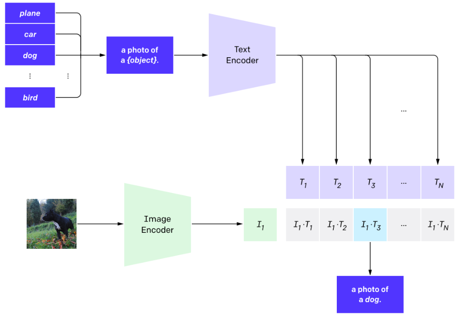
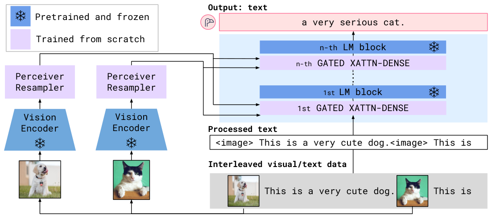
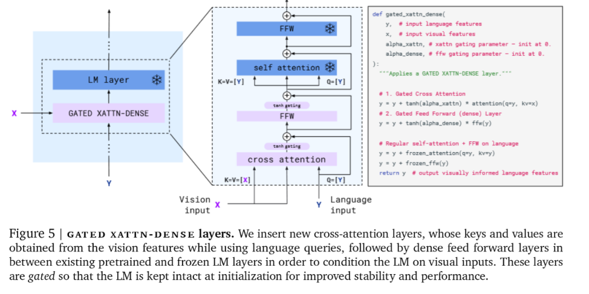
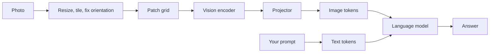

# 1 — Image Input

> An image reaches the model as a grid of patch tokens, so resolution, cost and what the model can read are one decision. Most image bugs happen before the model runs: a downscale that erased a digit, or a photo that arrived sideways.

A customer uploads a phone photo of an invoice and asks your assistant what they owe. The model answers in a clean sentence with a confident number, and the number is wrong by one digit. Nothing in the trace looks like a failure: the request succeeded and the text is fluent. This chapter explains how that happens. It follows the image from pixels to tokens, shows where information is lost along the way, and gives you the checks that catch the loss. The invoice assistant is the running example for the whole pillar: documents in [chapter 2](02-document-understanding.md), retrieval in [chapter 3](03-multimodal-rag.md), a voice front end in [chapter 4](04-speech-and-voice-agents.md) and its evaluation in [chapter 7](07-evaluating-multimodal-systems.md).

## What the model actually sees

A vision-language model turns an image into a sequence of vectors and hands that sequence to a language model. The vision half is usually a Vision Transformer, which cuts the image into fixed-size square patches and encodes each one. CLIP established the training recipe that made such encoders useful for language. It trains an image encoder and a text encoder together so that matching image-caption pairs land close in a shared embedding space ([arXiv:2103.00020](https://arxiv.org/abs/2103.00020) (Radford et al., ICML 2021)). LLaVA then gave builders the simplest architecture that works: take the patch features from a CLIP encoder, project them with a small linear layer into the language model's embedding space, and put them in the prompt as if they were words ([arXiv:2304.08485](https://arxiv.org/abs/2304.08485) (Liu et al., NeurIPS 2023)). LLaVA-1.5 replaced the linear layer with a small MLP, moved the input to 336×336, and reached state-of-the-art results across 11 benchmarks with only 1.2M public training examples ([arXiv:2310.03744](https://arxiv.org/abs/2310.03744) (Liu et al., CVPR 2024)). Convolutional networks came before it: see [Convolutional networks](../../../data-science/02-deep-learning/notes/04-convolutional-networks.md#a-cnn-on-the-digits) in data science. Optional, if you have not built one: [DS 02 Vision in practice](../../../data-science/02-deep-learning/notes/04b-vision-in-practice.md#what-a-transformer-would-need) constructs a ViT from the paper's equations and checks it against torchvision's parameter count.


*Image Source: Liu et al., [Visual Instruction Tuning](https://arxiv.org/abs/2304.08485) (NeurIPS 2023), Fig. 1. Image features pass through one linear projection and enter the language model as ordinary tokens.*

A trained CLIP is also a classifier with no training step. Write each label into a prompt such as "a photo of a {label}.", embed all of them with the text encoder, embed the image, and take the label with the highest similarity (*Multimodal Deep Learning*, ch. 3). The prompt wording is a tuning knob: on ImageNet, the book reports that "A photo of a {label}." alone adds 1.3 points over the bare label, and ensembling 80 such templates adds 3.5 more, nearly 5 in total. Scoring zero-shot also dodges overfitting to a benchmark's own distribution. The book's example of what that guards against is a ResNet101 at 76.2% on ImageNet that keeps only 32.6% on ObjectNet, a set of objects photographed in unusual poses and settings. Zero-shot ImageNet top-1 in its Table 3.61 is 76.2 for CLIP, 76.4 for ALIGN and 83.7 for Florence, with pre-training sets of 400M, 1.8B and 900M pairs.


*Image Source: Akkus et al., [Multimodal Deep Learning](https://arxiv.org/abs/2301.04856) (2023), Fig. 3.55, after Radford et al. (2021)*

CLIP-style language supervision is not the only way to train the encoder. DINOv3 scales self-supervised training to a 7B-parameter ViT on 1.7B images and keeps patch features usable by adding a Gram-matrix loss that stops them degrading late in training, worth about +2 ADE20k mIoU. With the backbone frozen and a linear probe, it reaches 55.9 mIoU on ADE20k, against 49.5 for DINOv2. It trails CLIP-family encoders on ImageNet linear accuracy (88.4 against 89.3 for PEcore and 89.1 for SigLIP 2), and on OCR-heavy classification such as GTSRB street signs (87.5 against 94.8) ([arXiv:2508.10104](https://arxiv.org/abs/2508.10104) (Siméoni et al., 2025-08, preprint)). Pick it for dense, spatial work, not for reading text.

Before CLIP and LLaVA, the common design fused image and text inside one BERT-style encoder, and its image tokens were not patches. A frozen Faster R-CNN detector picked 10 to 36 object regions from each photo, and each region became a token plus a vector for its box. ViLBERT kept two streams, one per modality, that exchanged information through co-attention layers, and pretrained them on 3.1M Conceptual Captions pairs. On VQA test-dev it reached 70.55% against 68.93% without that pretraining (the text stream still started from BERT), while a pretrained single-stream version scored 68.85% (*Multimodal Deep Learning*, ch. 3 gives 70.55 against 68.85 for dual against single stream). Zero-shot Flickr30K image-retrieval R@1 rose from 20.40 to 31.86 as the pretraining set grew from 25% to 100% ([arXiv:1908.02265](https://arxiv.org/abs/1908.02265) (Lu et al., NeurIPS 2019)). UNITER then showed that one stream is enough when the losses are right. It used a single Transformer over region and word tokens, masked only one modality at a time, and found masked language modelling and image-text matching the two strongest single objectives, with region modelling adding a little more. It scored 72.91% on VQA test-std at 86M parameters and 74.02% at 303M, against 72.54% for the two-stream LXMERT ([arXiv:1909.11740](https://arxiv.org/abs/1909.11740) (Chen et al., ECCV 2020)). Both score every image-text pair with a fused forward pass (ViLBERT caches only the text stream before co-attention), so ranking N candidates costs N fused passes, and neither reports the detector's cost. VL-BERT, a single-stream model posted a month before UNITER, found the opposite about matching. On its Base model, with fine-tuning cut to half the usual epochs, adding the image-text matching loss lowered all three tasks it measured: VCR question-to-answer accuracy fell from 73.0 to 72.2, VQA test-dev from 71.1 to 70.3 and RefCOCO+ from 70.7 to 69.5. The authors guess that the mismatched negative pairs got in the way of the other objectives, and don't test it. Mixing text-only BooksCorpus and Wikipedia into pretraining lifted VCR, whose inputs average 16.0 words for picking an answer and 33.7 for picking a rationale (7.2 for VQA, 3.5 for RefCOCO+), from 73.0 to 73.4 and left VQA and RefCOCO+ unchanged, though the text says it helped all three. Every gap here is 1.2 points or less, and no seeds or error bars are reported ([arXiv:1908.08530](https://arxiv.org/abs/1908.08530) (Su et al., ICLR 2020)).

ALBEF dropped the detector for a ViT and added a contrastive loss on the separate image and text encoders before six cross-attention fusion layers. On 4M images, that loss lifted mean Flickr30K text-retrieval recall from 93.96 to 96.55 and VQA test-dev from 71.40 to 73.29. At inference it ranks every pair by the cheap contrastive similarity and runs the fusion layers only on the top k. Fine-tuned Flickr30K text-retrieval mean recall was 97.30 from the similarity alone, 98.60 with k=16 reranked and 98.57 with k=256. Its headline wins over VILLA come from 14M images, and with the same 4M the VQA test-std margin shrinks to 74.70 against 73.67 ([arXiv:2107.07651](https://arxiv.org/abs/2107.07651) (Li et al., NeurIPS 2021)). That split, a cheap embedding to retrieve and an expensive joint model to rerank, is the shape of the retrieval stack in [chapter 3](03-multimodal-rag.md). Its successor BLIP, from the same lab, kept ALBEF's contrastive and matching losses and its retrieve-then-rerank scoring, added a caption decoder, and cleaned the web data. A captioner wrote new captions for the web images, and a filter dropped the web or synthetic captions that didn't match their image. At 14M images with a ViT-B, this lifted COCO text-retrieval recall@1 from 78.4 to 80.6 after fine-tuning on COCO. CIDEr on NoCaps validation, scored with the COCO-tuned captioner and no NoCaps training, rose from 102.2 to 105.1. Sampled captions beat beam search (80.6 against 79.6) even though the filter threw out more of them (25% against 19%). The authors guess that sampled captions were more varied, though they never measure diversity. A captioner and filter that shared weights rejected only 8% and scored 79.8, which the authors put down to the filter agreeing with its own captions. Both parts were fine-tuned on COCO, the domain of the COCO retrieval score. "Noise" means whatever the filter rejected, with no human audit, and no seeds are reported ([arXiv:2201.12086](https://arxiv.org/abs/2201.12086) (Li et al., ICML 2022)). SimVLM dropped the matching losses too and trained on generation alone. Image patches, after the first three blocks of a ResNet, form a prefix the model attends to in both directions, and the language-modelling loss falls only on the text that follows. It trained from scratch on ALIGN's 1.8B noisy alt-text pairs, with no extra filtering, plus 800GB of C4 text, on 512 TPU v3 chips for about 1M steps, and its largest model scored 80.34 on VQA test-std against 76.60 for the detector-based VinVL. In ablations on a small 8-layer model scored on VQA, the prefix objective beat plain left-to-right language modelling (67.43 against 64.48) and T5's span corruption (66.23), and pretraining on the 3M-pair CC-3M instead of ALIGN dropped it to 63.32. The paper gives no parameter counts and no seeds, its ablations are small-model results with no run count or variance, and its authors say that zero-shot it falls short in generating meaningful answers to real VQA questions until it is pretrained a further 50k steps on WIT ([arXiv:2108.10904](https://arxiv.org/abs/2108.10904) (Wang et al., ICLR 2022)). GIT, from Microsoft, kept the generation-only loss but started from a contrastively pretrained image encoder and simply concatenated its tokens in front of the text in a small decoder trained from scratch. Its decoder was the part that wouldn't scale. Pretrained on a 0.4B-pair subset, 6, 12 and 24 decoder layers gave COCO CIDEr of 136.4, 136.0 and 134.6. At Base size on 10M pairs, starting the decoder from BERT gave TextCaps CIDEr of 59.7 against 61.7 from random weights. Plain concatenation lost to cross-attention on 5 of 7 benchmarks at 10M pairs (nocaps CIDEr 75.4 against 86.2) and won all 7 at 0.8B pairs (TextCaps 143.7 against 139.3). The authors note that their decoder results may not carry over to a pretrained, frozen decoder, which is the route the next designs took. No number comes with seeds or variance, and 0.6B of the 0.8B pairs come from the authors' own web crawl, which the paper gives no way to obtain ([arXiv:2205.14100](https://arxiv.org/abs/2205.14100) (Wang et al., TMLR 2022)).

LLaVA's projector ends a short line of designs that all kept the language model frozen and taught a small new part to speak to it. Frozen turned one pooled image vector into **two** soft tokens through a linear map and trained only the vision encoder through a frozen 7B model. Trained on about 3M Conceptual Captions pairs and never on VQAv2, it went from 29.5% on VQAv2 validation zero-shot to 38.2% with four examples in the prompt. A copy trained on blacked-out images, which amounts to prefix tuning, reached 33.3% at four shots. Fine-tuning the language model instead made it worse (29.2% at four shots, at a smaller learning rate), which its authors put down to there being far less image-caption data than the text the model was pretrained on ([arXiv:2106.13884](https://arxiv.org/abs/2106.13884) (Tsimpoukelli et al., NeurIPS 2021)). Flamingo took the other branch. It compresses each image to **64 visual tokens** with a learned resampler and lets the frozen 70B Chinchilla read them through new cross-attention layers, gated by a `tanh` initialised at zero so that the untrained model behaves exactly like the original. With 32 examples in the prompt and no weight updates, the 80B model beat the fine-tuned state of the art on 6 of 16 benchmarks, though on VQAv2 test-dev it reached 67.6% against 80.2% for a fine-tuned Florence. That Florence score came from a co-attention model built on Florence's contrastive image encoder and given a further vision-language pretraining on 14M images before VQA fine-tuning, so it is not the 893M-parameter two-tower model on its own ([arXiv:2111.11432](https://arxiv.org/abs/2111.11432) (Yuan et al., 2021-11, preprint)). Flamingo's 3B ablations score each run as an average share of the state of the art over five validation sets at four shots. On that score, fine-tuning the language model cost 8.0 points (70.7 to 62.7) and training it from scratch 12.9, and every model was trained once ([arXiv:2204.14198](https://arxiv.org/abs/2204.14198) (Alayrac et al., NeurIPS 2022)). BLIP-2's Q-Former sits between the two: 32 learned queries pull a fixed 32×768 summary out of the frozen encoder's features (257×1024 for a ViT-L/14), and one linear layer prepends them to the prompt as soft tokens. The Q-Former has 188M parameters, and with a ViT-g encoder and a frozen FlanT5-XXL (12.1B parameters in all) it scored 65.0% zero-shot on VQAv2 test-dev, against Flamingo-80B's 56.3%. Unlike Flamingo, it got no better when given in-context examples, which its authors put down to pretraining on a single image-text pair per sample ([arXiv:2301.12597](https://arxiv.org/abs/2301.12597) (Li et al., ICML 2023)). That ViT-g was the vision tower of EVA-CLIP, minus its last layer. EVA is a 1B-parameter ViT pretrained on 29.6M public images to rebuild the OpenAI CLIP features of 40% masked patches. That makes its "public data only" claim conditional, since the CLIP target was itself trained on 400M image-text pairs. EVA-CLIP then trained it contrastively on LAION-400M, and it reached 78.5% zero-shot on ImageNet-1K (the paper's text says 78.2) ([arXiv:2211.07636](https://arxiv.org/abs/2211.07636) (Fang et al., CVPR 2023)). For an engineer the lesson of the line is that every one of these designs fixes the number of image tokens, whatever the resolution. That count caps what the model can read, and the next section is about raising it.

Two 2023 variants show both ends of that cap. ImageBind-LLM passes **one** visual token per image, added to every word token at all 32 LLaMA layers through a zero-initialised gate, and is trained on image-text data only, so audio, video and 3D inputs work through their own ImageBind encoders without retraining. The cost shows on text in images: zero-shot on IIIT5K word recognition it scored 13.9, against 80.17 for BLIP-2, 83.90 for InstructBLIP and 31.57 for LLaVA, which use 32 to 257 tokens. The authors blame the single token and report no ablation of it, and audio, video and 3D are shown only in qualitative examples ([arXiv:2309.03905](https://arxiv.org/abs/2309.03905) (Han et al., 2023-09, preprint)). Prismer goes the other way and feeds in more than pixels: frozen CLIP and RoBERTa backbones plus the outputs of six frozen expert models (depth, surface normal, edge, segmentation, object detection, OCR), with about 20% of parameters trained on 12.7M image-text pairs. Against the same model without experts, the experts added about 6 CIDEr on NoCaps out-of-domain (111.7 against 105.8, base size) and 1 point of VQAv2 accuracy (78.4 against 77.5, large size), but they moved Text-VQA zero-shot from 22.6 to 28.8; the frozen backbones carried most of the quality. Inference needs all six experts (654M parameters), and unfreezing the backbones cut VQAv2 from 72.79 to 68.13 in a reduced 3M-pair, base-size setup ([arXiv:2303.02506](https://arxiv.org/abs/2303.02506) (Liu et al., 2023-03, preprint)).

Flamingo is the larger-scale form of the same idea, and it keeps the language model frozen too. It inserts new cross-attention layers, with keys and values from the vision features and queries from the text, between the layers of a frozen 70B Chinchilla (80B in total), at every 7th layer. Each new layer's output is multiplied by tanh(α) with α initialised at 0, so at the start of training the language model behaves exactly as before. A Perceiver Resampler first compresses the image features to a fixed number of tokens; the Perceiver cross-attention it builds on is described in the book as compressing its input by more than 300x (*Multimodal Deep Learning*, ch. 3 and ch. 4). Text tokens attend only to the nearest preceding image, which the book reports was worth about 8 score points, and training used interleaved web pages (M3W, about 43M pages) as well as image-text pairs. In the book's ablation the score fell from 68.4 to 46.9 without the interleaved pages and to 56.5 without the pair data. The book does not name the metric behind those scores, so take the ordering and not the size. At 32 shots it beat the fine-tuned state of the art on six tasks, and 11 of its 18 benchmarks were held out from design decisions ([arXiv:2204.14198](https://arxiv.org/abs/2204.14198) (Alayrac et al., NeurIPS 2022)).


*Image Source: Alayrac et al., [Flamingo: a Visual Language Model for Few-Shot Learning](https://arxiv.org/abs/2204.14198) (NeurIPS 2022), Fig. 3. Blue parts are pretrained and frozen; lilac parts are trained from scratch.*


*Image Source: Akkus et al., [Multimodal Deep Learning](https://arxiv.org/abs/2301.04856) (2023), Fig. 3.76, after Alayrac et al. (2022)*

A 2023 survey of vision foundation models sorts the ways image input reaches a language model into four styles: dual encoders (CLIP), fusion encoders, encoder-decoders, and an adapter that connects a vision encoder to a language model (LLaVA, BLIP-2, InstructBLIP) ([arXiv:2307.13721](https://arxiv.org/abs/2307.13721) (Awais et al., 2023-07, preprint)). Its numbers are reported from other papers (for instance, CLIP trained on 400 million web image-text pairs). It stops in mid-2023, leaves out generative image models, and is thin on retrieval and document pipelines, so use it as a map and not as evidence.

Where the pairs come from matters as much as the architecture. CLIP trained on 400 million web image-text pairs (Radford et al.); a 2023 seminar book puts it at "more than 250 million", which the paper does not support (*Multimodal Deep Learning*, ch. 2). The open LAION-400M set was filtered with CLIP itself, so a model trained on it inherits CLIP's choices of what counts as a good match, and the book relays an audit (Birhane et al., 2021, not read here) that found explicit and stereotyped pairs in it. Before you fine-tune on scraped pairs, sample and look.



Two consequences follow, and the rest of this chapter works them out. The image takes up context the way text does, so it has a token cost. And the language model never sees pixels. Whatever the preprocessing and the encoder dropped is gone, and the language model will fill the gap with something plausible.

## Resolution is the main knob

If you can change one thing about how images enter your system, change the resolution. Apple's MM1 study varied encoders, connectors and data systematically, and its summary is blunt: image resolution had the highest impact, followed by model size and training data composition. Going from 224 to 336 pixels gave about a 3% boost across architectures, while doubling encoder parameters from ViT-L to ViT-H usually gave less than 1%. The connector design that joins vision to language had comparatively little effect once the number of visual tokens was fixed ([arXiv:2403.09611](https://arxiv.org/abs/2403.09611) (McKinzie et al., ECCV 2024)). These figures are on the authors' zero-shot and few-shot benchmarks, for a family of research models, so read them as a ranking of levers and not as a forecast for your task.

Resolution costs compute, because tokens grow with the square of the side length. Model builders have four ways of paying less.

- **Keep the token count and add detail.** Mini-Gemini runs a low-resolution encoder that decides what to look at and a high-resolution encoder that refines those tokens, so the token count stays at that of the low-resolution input ([arXiv:2403.18814](https://arxiv.org/abs/2403.18814) (Li et al., IEEE TPAMI 2026)).
- **Tile.** DeepSeek-VL2 replaced fixed 384 and 1024 encoders with a dynamic tiling strategy that sends each local tile through a shared encoder, which handles large images and extreme aspect ratios such as infographics ([arXiv:2412.10302](https://arxiv.org/abs/2412.10302) (Wu et al., 2024-12, preprint)).
- **Encode at native resolution with a budget.** Microsoft's Phi-4-reasoning-vision report compared the approaches directly and found that encoders handling dynamic resolution with many visual tokens did best on high-resolution tasks. A budget of 3,600 tokens, roughly native 720p, gave a substantial improvement over 2,048, especially on ScreenSpot-Pro. It notes that tiling-based S2 methods are constrained by the original image size and often use only about half the maximum tokens ([arXiv:2603.03975](https://arxiv.org/abs/2603.03975) (Aneja et al., 2026-03, preprint)).
- **Window the encoder's own attention.** Inside a plain ViT every patch attends to every other, so encoder cost grows with the square of the patch count. Swin restricts attention to 7×7-patch windows and shifts the windows by half a window in alternate layers so information still crosses their borders, which makes the cost linear in image area for a fixed window. It also merges neighbouring patches between stages, so the token grid shrinks from 1/4 to 1/32 of the input side the way a ConvNet's feature maps do. Shifting the windows was worth 1.1 points of ImageNet-1K top-1 for Swin-T (80.2 to 81.3) and 2.8 COCO box AP. As a detection backbone at the same size, Swin-T ran at 15.3 frames per second against 10.4 for a global-attention DeiT-S, with 50.5 against 48.0 box AP (Cascade Mask R-CNN; the paper doesn't name the GPU for these timings). The linear cost comes from the paper's FLOP formulas, which leave out the [softmax](../../../generative-ai/01-llm-fundamentals/notes/04-decoding-and-inference-behaviour.md#decoding), not from a measured sweep across image sizes, and this only cuts the encoder's cost. The language model still pays for every token the connector hands it ([arXiv:2103.14030](https://arxiv.org/abs/2103.14030) (Liu et al., ICCV 2021)).

As an engineer calling a hosted model you rarely choose among these, but you do choose what you send. A hosted API usually resizes or tiles your image according to its own published rule, and you pay for the result. Google's Gemini documentation, for example, charges 258 tokens when both dimensions are at most 384 pixels and splits larger images into 768×768 tiles at 258 tokens each ([Gemini image understanding docs](https://ai.google.dev/gemini-api/docs/image-understanding)). Other providers use other rules and they change them, so check the current documentation before you build a budget. The arithmetic is simple enough to run on your own traffic before you commit:

```python
import math

def vit_tokens(w, h, patch=14):
    """Tokens for a plain ViT that keeps every patch."""
    return (w // patch) * (h // patch)

def tiled_tokens(w, h, tile=768, per_tile=258, small=384):
    """A tile-priced rule of the kind published by hosted APIs."""
    if max(w, h) <= small:
        return per_tile
    return math.ceil(w / tile) * math.ceil(h / tile) * per_tile

traffic = {"thumbnail": (320, 320), "receipt photo": (1080, 1920),
           "A4 at 150 dpi": (1240, 1754), "A4 at 300 dpi": (2480, 3508)}
print(f"{'image':<16}{'plain ViT/14':>13}{'tile rule':>11}")
for name, (w, h) in traffic.items():
    print(f"{name:<16}{vit_tokens(w, h):>13,}{tiled_tokens(w, h):>11,}")
print("336x336 fixed input:", vit_tokens(336, 336), "tokens")
```

Output:

```text
image            plain ViT/14  tile rule
thumbnail                 484        258
receipt photo          10,549      1,548
A4 at 150 dpi          11,000      1,548
A4 at 300 dpi          44,250      5,160
336x336 fixed input: 576 tokens
```


The last line is LLaVA-1.5's token count. It explains why a fixed-input model can never read a full page: an A4 scan at 300 dpi would need more than seventy times as many patches. Your provider's numbers will differ from the second column, so substitute its rule, but the shape stays the same. Page images cost far more than thumbnails, and the cost grows with area.

## What a downscale destroys

Downscaling loses information unevenly. Objects survive, because a cat is still a cat at 224 pixels. Small text does not. Text, digits and thin chart lines are exactly what business images are about. You can measure the loss without a model: render two digits that are easy to confuse, shrink them, and see how far apart they remain.

```python
from PIL import Image, ImageDraw, ImageFont
import numpy as np

def glyph(ch, size=12):
    img = Image.new("L", (size * 3, size * 3), 255)
    font = ImageFont.load_default(size=size)
    ImageDraw.Draw(img).text((size, size // 2), ch, fill=0, font=font)
    return img

def separation(a, b, scale):
    """Mean absolute pixel gap between two glyphs after a downscale."""
    arrs = []
    for ch in (a, b):
        g = glyph(ch)
        small = g.resize((max(1, int(g.width * scale)), max(1, int(g.height * scale))),
                         Image.BILINEAR)
        arrs.append(np.asarray(small, dtype=float) / 255)
    return float(np.abs(arrs[0] - arrs[1]).mean())

print("page width after resize, as a share of a 2480 px scan")
for target in (2480, 1240, 672, 336):
    scale = target / 2480
    print(f"{target:>5} px  digit height {12 * scale:5.1f} px  "
          f"3-vs-8 gap {separation('3', '8', scale):.3f}  "
          f"1-vs-7 gap {separation('1', '7', scale):.3f}")
```

Output:

```text
page width after resize, as a share of a 2480 px scan
 2480 px  digit height  12.0 px  3-vs-8 gap 0.016  1-vs-7 gap 0.014
 1240 px  digit height   6.0 px  3-vs-8 gap 0.008  1-vs-7 gap 0.008
  672 px  digit height   3.3 px  3-vs-8 gap 0.006  1-vs-7 gap 0.004
  336 px  digit height   1.6 px  3-vs-8 gap 0.005  1-vs-7 gap 0.002
```


The experiment takes a 12-pixel digit on a 2,480-pixel scan. Shrinking the page to a typical fixed encoder width leaves the digit under two pixels tall, and the gap between `3` and `8` falls to about a third of its full-resolution value while `1` and `7` falls to about a seventh. This is a crude pixel measure on one font, not a model test, but the direction is the point: most of the signal that told the two digits apart is gone before any encoder runs, and no prompt can bring it back. That is the invoice failure from the opening: the encoder received a smudge, and the language model produced the likeliest number.

The practical response is to protect the region that matters. Send a full-page image for layout and a crop of the totals block for reading. Or tile the page yourself and ask per tile. Log the final pixel height of the smallest text you need, and treat it as a monitored quantity like token count. LLaVA-1.5's authors report that splitting images into grids at higher resolution improved detailed perception and reduced hallucination, which supports the same advice from the model side ([arXiv:2310.03744](https://arxiv.org/abs/2310.03744)).

## Orientation breaks more than you expect

People hold phones in every direction, and images often carry their orientation in EXIF metadata that a decoder can ignore. Most builders assume the model will cope. Guo et al. tested that directly. On OCRBench, GPT-4o scored 83.1 on the source images, 61.9 after a 90-degree rotation, 46.6 at 180 degrees and 12.9 after a vertical flip. Gemini 2.5 Pro went from 87.1 to 39.4 under a horizontal flip. On a separate identification test of 200 images, frontier models could not reliably name the transformation that had been applied, a task their human comparison group solved every time ([arXiv:2512.03746](https://arxiv.org/abs/2512.03746) (Guo et al., CVPR 2026), Table 1).

The cheap fix runs before the model: honor EXIF, and for scans with no EXIF, detect orientation with a dedicated tool. Here is the first part, using a synthetic image whose pixels are stored sideways:

```python
from PIL import Image, ImageOps

# A landscape page stored rotated, with the correction recorded only in EXIF.
stored = Image.new("RGB", (400, 600), "white")
exif = Image.Exif()
exif[0x0112] = 6  # orientation: rotate 90 degrees clockwise to display
stored.save("photo.jpg", exif=exif)

naive = Image.open("photo.jpg")
upright = ImageOps.exif_transpose(Image.open("photo.jpg"))
print("decoded without EXIF:", naive.size)
print("after exif_transpose:", upright.size)
print("orientation tag left on output:", upright.getexif().get(0x0112))
```

Output:

```text
decoded without EXIF: (400, 600)
after exif_transpose: (600, 400)
orientation tag left on output: None
```


Run this as the first preprocessing step, and strip the tag afterwards as the library does, so nothing downstream rotates the image twice.

## Asking for evidence, not just answers

A bare answer gives you nothing to check. If you ask the model to point at what it read, you get something a program can verify, and a crop a person can inspect. The data shape behind this goes back to Visual Genome: 108,077 photos, all also in COCO, with about 5.4 million region descriptions, each a box plus a short phrase, and 3.8 million boxed objects linked by 2.3 million relationships. Crowd workers wrote them, and an annotation was kept when two of three verifiers accepted it, except objects, which got a faster rapid-judgment check. The authors say the labels are not exhaustive, so a correct answer can be scored wrong, and their 2015-era baselines were weak, for example 8.74% top-1 at predicting the relationship between two boxed objects ([arXiv:1602.07332](https://arxiv.org/abs/1602.07332) (Krishna et al., IJCV 2017)). Kosmos-2 made this a model capability by emitting grounded Markdown in which text spans link to bounding boxes ([arXiv:2306.14824](https://arxiv.org/abs/2306.14824) (Peng et al., ICLR 2024)), and Qwen-VL trained on image-caption-box tuples for the same reason ([arXiv:2308.12966](https://arxiv.org/abs/2308.12966) (Bai et al., 2023-08, preprint)). GRIT trains the reasoning chain itself to interleave natural language with box coordinates, using only 20 image-question-answer triplets on Qwen2.5-VL and InternVL3 ([arXiv:2505.15879](https://arxiv.org/abs/2505.15879) (Fan et al., NeurIPS 2025)).

Boxes from any model should be parsed and validated before you use them. The check is mechanical:

```python
import re

IMAGE_W, IMAGE_H = 1240, 1754
answer = ("The amount due is [EUR 482.10](910,1520,1180,1570). "
          "The due date is [14 March](910,240,1500,290). "
          "It was issued by [Northwind GmbH](60,80,420,140).")

GROUNDED = re.compile(r"\[([^\]]+)\]\((\d+),(\d+),(\d+),(\d+)\)")

def check(answer, w, h):
    spans = []
    for text, *box in GROUNDED.findall(answer):
        x0, y0, x1, y1 = map(int, box)
        ok = 0 <= x0 < x1 <= w and 0 <= y0 < y1 <= h
        spans.append((text, (x0, y0, x1, y1), "ok" if ok else "OUT OF BOUNDS"))
    return spans

for text, box, status in check(answer, IMAGE_W, IMAGE_H):
    print(f"{status:<14}{text:<18}{box}")
```

Output:

```text
ok            EUR 482.10        (910, 1520, 1180, 1570)
OUT OF BOUNDS 14 March          (910, 240, 1500, 290)
ok            Northwind GmbH    (60, 80, 420, 140)
```


A box outside the image shows the model invented its evidence. A box inside the image still has to be read: crop it, send it back at full resolution, and compare the two readings. Disagreement is a cheap, high-precision signal to route the case to a person.

## Give the model something to look with

A model's mistakes on spatial and counting questions don't all go away with better prompting. Three approaches change what the model is looking at, in rising order of effort.

**Draw on the image.** VISER overlays simple low-level lines on the image and adds a prompt that scans them in order. On 2D synthetic datasets, GPT-4o's visual search, counting and spatial relationship scores improved by 25.0, 26.8 and 9.5 points. Counting went from 12.00% to 38.83%. On natural images the counting gain was smaller (29.82% to 35.65%), and Qwen2.5-VL slightly dropped (18.91% to 17.29%). The authors report that textual changes alone were insufficient ([arXiv:2506.22146](https://arxiv.org/abs/2506.22146) (Izadi et al., 2025-06, preprint)). Read this as a technique to test on your own images, since it helps some model and task combinations and not others.

**Let the model run vision code.** ViperGPT generates Python that composes vision modules into a program for each query, with no extra training ([arXiv:2303.08128](https://arxiv.org/abs/2303.08128) (Surís et al., ICCV 2023)). Visual Sketchpad lets the model draw as it reasons, averaging a 12.7% gain on math tasks and 8.6% on vision tasks over the baseline ([arXiv:2406.09403](https://arxiv.org/abs/2406.09403) (Hu et al., NeurIPS 2024)). CodeVision treats code as the one tool for orientation repair and analysis, which matters here because prior tool-based approaches had gained only 2–5% on the same problems ([arXiv:2512.03746](https://arxiv.org/abs/2512.03746)).

**Separate seeing from reasoning.** Be My Eyes pairs a small vision model that perceives with a strong text-only model that reasons, connected by conversation. With DeepSeek-R1 as the reasoner, the team beat GPT-4o by 0.5, 7.1 and 12.1 points on MMMU Pro, MathVista and MathVision, on the authors' own runs ([arXiv:2511.19417](https://arxiv.org/abs/2511.19417) (Huang et al., 2025-11, preprint)). This matters for cost: you can use your strong reasoning model, whether or not it has vision, and pay a small model to describe.

LENS takes the same split to its limit, with nothing trained. CLIP-based modules turn the image into tags and attributes, a BLIP captioner adds descriptions, and a frozen Flan-T5 answers from that text plus the question. The prompt is `Tags: …`, `Attributes: …`, `Captions: …`, then the question. Zero-shot on VQAv2 test-dev, the Flan-T5-XXL version scored **62.6%** against 65.0% for BLIP-2 and 56.3% for Flamingo-80B, with 0 trainable parameters against BLIP-2's 103M. It lost on OK-VQA (43.3% against 50.6% for Flamingo-80B). More captions helped and then saturated (VQAv2 minival: 52.5 with one caption, 59.1 with 20, 60.4 with 50). The vision side is only as good as CLIP and BLIP, the paper lists wrong visual information among its failures, the module mix was tuned per task, and its baseline numbers are copied from other papers. Its own tables disagree in places, so treat the averages as approximate ([arXiv:2306.16410](https://arxiv.org/abs/2306.16410) (Berrios et al., 2023-06, preprint)).

**Tell the model where to look.** Describe Anything feeds a region mask plus a focal crop (the mask's box enlarged 3× per side) alongside the full image, so a 3B model can describe the region without losing context. Plain concatenation of crop and full image scored 42.4% on the authors' DLC-Bench, whereas joining the two through gated cross-attention scored 63.2% and the full recipe 67.3%, against 61.5% for GPT-4o, which the authors prompted with their own stage-one annotation prompt. The benchmark, data pipeline and a small text-only judge are all the authors' own ([arXiv:2504.16072](https://arxiv.org/abs/2504.16072) (Lian et al., ICCV 2025)).

The order of operations stays the same. Fix the input first, since it is cheapest and helps every question. Add evidence requests next. Reach for tools only when a measured failure class remains.

## Pitfalls

- **Testing with clean screenshots, deploying on phone photos.** Offline scores come from upright, sharp images. On VizWiz, blind users' own phone photos, crowd workers marked 28.63% of questions unanswerable from the image ([arXiv:1802.08218](https://arxiv.org/abs/1802.08218) (Gurari et al., CVPR 2018)). Build your eval set from real uploads, and include some the model should refuse.
- **Letting a client library resize silently.** SDKs and upload widgets may downscale before the API call. Log the dimensions that actually reach the model.
- **Trusting a confident number from a low-resolution image.** Fluency says nothing about whether the encoder resolved the digit. Require a crop-and-reread for any value you will act on.
- **Assuming a provider's token formula is stable.** Recompute budgets when you change models or when pricing pages change.
- **Treating an image as trusted input.** Text in an image is an instruction channel as well as data. See [chapter 9.2](../../09-safety-and-security/notes/02-prompt-injection-and-jailbreaks.md).

## Try it

1. Extend the digit experiment to the letter pair `O` and `0`. At what page width does it fall below half its full-resolution gap?
2. Adapt `tiled_tokens` to your provider's published rule, and compute the monthly token bill for 10,000 A4 pages at 150 dpi versus the same pages cropped to their lower third.
3. Add a rule to `check` that rejects a box whose area is under 0.01% of the page.

<details><summary>Answers</summary>

1. Use `separation('O', '0', scale)`. The threshold depends on the font, so run it rather than assuming. Default sans fonts draw the two glyphs so alike that the gap is small even at full size, which is the point of the exercise: some pairs are never safe for vision alone, and a checksum or database lookup has to back them up.
2. The bill scales with `pages × tiles × tokens per tile`. Under the tile rule shown, a 1240×1754 page takes 2×3 tiles, while its lower third (1240×585) takes 2×1, so the crop costs one third as much. Your provider's rule may differ.
3. Compute `(x1-x0)*(y1-y0) / (w*h)` and fail the span if it is below `0.0001`. A reasonable total-due box is far bigger than that, so this catches degenerate boxes that a bounds check would pass.

</details>

## Interview checklist

| Question | Answer |
|---|---|
| Why does a VLM misread text at low resolution even when the prompt is perfect? | The encoder only receives the resized pixels. If a digit is a pixel or two tall after preprocessing, the distinguishing information no longer exists, and the language model fills the gap with a plausible value. |
| Which lever matters most for VLM quality when building one? | Resolution and visual token count, ahead of encoder size or connector design, in MM1's systematic study. Treat it as a ranking of levers in that setup. |
| What are three ways to raise effective resolution without paying for every patch? | Keep the token count and refine with a high-resolution encoder (Mini-Gemini), tile the image (DeepSeek-VL2), or encode at dynamic resolution up to a token budget (Phi-4-reasoning-vision). |
| How would you defend against rotated uploads? | Apply EXIF correction first, add an orientation classifier for scans with no EXIF, and include rotated samples in the eval set, since a rotation can cost tens of points on OCR benchmarks. |
| Why ask for bounding boxes? | They turn an unverifiable answer into a checkable one. You can validate bounds, crop the region and reread it, and show a reviewer the evidence. |
| When would you separate a perceiver from a reasoner? | When your best reasoning model has weak or no vision, or vision pricing dominates. A small VLM describes on demand and the strong model asks follow-up questions. |

## Next

[Chapter 2 — Document understanding](02-document-understanding.md) takes the invoice from a single photo to a full PDF, where layout, tables and reading order become the problem.
