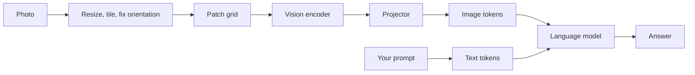

# 1 — Image Input

> An image reaches the model as a grid of patch tokens, so resolution, cost and what the model can read are one decision. Most image bugs happen before the model runs: a downscale that erased a digit, or a photo that arrived sideways.

A customer uploads a phone photo of an invoice and asks your assistant what they owe. The model answers in a clean sentence with a confident number, and the number is wrong by one digit. Nothing in the trace looks like a failure: the request succeeded and the text is fluent. This chapter explains how that happens. It follows the image from pixels to tokens, shows where information is lost along the way, and gives you the checks that catch the loss. The invoice assistant is the running example for the whole pillar: documents in [chapter 2](02-document-understanding.md), retrieval in [chapter 3](03-multimodal-rag.md), a voice front end in [chapter 4](04-speech-and-voice-agents.md) and its evaluation in [chapter 7](07-evaluating-multimodal-systems.md).

## What the model actually sees

A vision-language model turns an image into a sequence of vectors and hands that sequence to a language model. The vision half is usually a Vision Transformer, which cuts the image into fixed-size square patches and encodes each one. CLIP established the training recipe that made such encoders useful for language. It trains an image encoder and a text encoder together so that matching image-caption pairs land close in a shared embedding space ([arXiv:2103.00020](https://arxiv.org/abs/2103.00020) (Radford et al., ICML 2021)). LLaVA then gave builders the simplest architecture that works: take the patch features from a CLIP encoder, project them with a small linear layer into the language model's embedding space, and put them in the prompt as if they were words ([arXiv:2304.08485](https://arxiv.org/abs/2304.08485) (Liu et al., NeurIPS 2023)). LLaVA-1.5 replaced the linear layer with a small MLP, moved the input to 336×336, and reached state-of-the-art results across 11 benchmarks with only 1.2M public training examples ([arXiv:2310.03744](https://arxiv.org/abs/2310.03744) (Liu et al., CVPR 2024)).



Two consequences follow, and the rest of this chapter works them out. The image takes up context the way text does, so it has a token cost. And the language model never sees pixels. Whatever the preprocessing and the encoder dropped is gone, and the language model will fill the gap with something plausible.

## Resolution is the main knob

If you can change one thing about how images enter your system, change the resolution. Apple's MM1 study varied encoders, connectors and data systematically, and its summary is blunt: image resolution had the highest impact, followed by model size and training data composition. Going from 224 to 336 pixels gave about a 3% boost across architectures, while doubling encoder parameters from ViT-L to ViT-H usually gave less than 1%. The connector design that joins vision to language had comparatively little effect once the number of visual tokens was fixed ([arXiv:2403.09611](https://arxiv.org/abs/2403.09611) (McKinzie et al., ECCV 2024)). These figures are on the authors' zero-shot and few-shot benchmarks, for a family of research models, so read them as a ranking of levers and not as a forecast for your task.

Resolution costs compute, because tokens grow with the square of the side length. Model builders have three ways of paying less.

- **Keep the token count and add detail.** Mini-Gemini runs a low-resolution encoder that decides what to look at and a high-resolution encoder that refines those tokens, so the token count stays at that of the low-resolution input ([arXiv:2403.18814](https://arxiv.org/abs/2403.18814) (Li et al., IEEE TPAMI 2026)).
- **Tile.** DeepSeek-VL2 replaced fixed 384 and 1024 encoders with a dynamic tiling strategy that sends each local tile through a shared encoder, which handles large images and extreme aspect ratios such as infographics ([arXiv:2412.10302](https://arxiv.org/abs/2412.10302) (Wu et al., 2024-12, preprint)).
- **Encode at native resolution with a budget.** Microsoft's Phi-4-reasoning-vision report compared the approaches directly and found that encoders handling dynamic resolution with many visual tokens did best on high-resolution tasks. A budget of 3,600 tokens, roughly native 720p, gave a substantial improvement over 2,048, especially on ScreenSpot-Pro. It notes that tiling-based S2 methods are constrained by the original image size and often use only about half the maximum tokens ([arXiv:2603.03975](https://arxiv.org/abs/2603.03975) (Aneja et al., 2026-03, preprint)).

As an engineer calling a hosted model you rarely choose among these, but you do choose what you send. A hosted API usually resizes or tiles your image according to its own published rule, and you pay for the result. Google's Gemini documentation, for example, charges 258 tokens when both dimensions are at most 384 pixels and splits larger images into 768×768 tiles at 258 tokens each ([Gemini image understanding docs](https://ai.google.dev/gemini-api/docs/image-understanding)). Other providers use other rules and they change them, so check the current documentation before you build a budget. The arithmetic is simple enough to run on your own traffic before you commit:

```python
import math

def vit_tokens(w, h, patch=14):
    """Tokens for a plain ViT that keeps every patch."""
    return (w // patch) * (h // patch)

def tiled_tokens(w, h, tile=768, per_tile=258, small=384):
    """A tile-priced rule of the kind published by hosted APIs."""
    if max(w, h) <= small:
        return per_tile
    return math.ceil(w / tile) * math.ceil(h / tile) * per_tile

traffic = {"thumbnail": (320, 320), "receipt photo": (1080, 1920),
           "A4 at 150 dpi": (1240, 1754), "A4 at 300 dpi": (2480, 3508)}
print(f"{'image':<16}{'plain ViT/14':>13}{'tile rule':>11}")
for name, (w, h) in traffic.items():
    print(f"{name:<16}{vit_tokens(w, h):>13,}{tiled_tokens(w, h):>11,}")
print("336x336 fixed input:", vit_tokens(336, 336), "tokens")
```

Output:

```text
image            plain ViT/14  tile rule
thumbnail                 484        258
receipt photo          10,549      1,548
A4 at 150 dpi          11,000      1,548
A4 at 300 dpi          44,250      5,160
336x336 fixed input: 576 tokens
```


The last line is LLaVA-1.5's token count. It explains why a fixed-input model can never read a full page: an A4 scan at 300 dpi would need more than seventy times as many patches. Your provider's numbers will differ from the second column, so substitute its rule, but the shape stays the same. Page images cost far more than thumbnails, and the cost grows with area.

## What a downscale destroys

Downscaling loses information unevenly. Objects survive, because a cat is still a cat at 224 pixels. Small text does not. Text, digits and thin chart lines are exactly what business images are about. You can measure the loss without a model: render two digits that are easy to confuse, shrink them, and see how far apart they remain.

```python
from PIL import Image, ImageDraw, ImageFont
import numpy as np

def glyph(ch, size=12):
    img = Image.new("L", (size * 3, size * 3), 255)
    font = ImageFont.load_default(size=size)
    ImageDraw.Draw(img).text((size, size // 2), ch, fill=0, font=font)
    return img

def separation(a, b, scale):
    """Mean absolute pixel gap between two glyphs after a downscale."""
    arrs = []
    for ch in (a, b):
        g = glyph(ch)
        small = g.resize((max(1, int(g.width * scale)), max(1, int(g.height * scale))),
                         Image.BILINEAR)
        arrs.append(np.asarray(small, dtype=float) / 255)
    return float(np.abs(arrs[0] - arrs[1]).mean())

print("page width after resize, as a share of a 2480 px scan")
for target in (2480, 1240, 672, 336):
    scale = target / 2480
    print(f"{target:>5} px  digit height {12 * scale:5.1f} px  "
          f"3-vs-8 gap {separation('3', '8', scale):.3f}  "
          f"1-vs-7 gap {separation('1', '7', scale):.3f}")
```

Output:

```text
page width after resize, as a share of a 2480 px scan
 2480 px  digit height  12.0 px  3-vs-8 gap 0.016  1-vs-7 gap 0.014
 1240 px  digit height   6.0 px  3-vs-8 gap 0.008  1-vs-7 gap 0.008
  672 px  digit height   3.3 px  3-vs-8 gap 0.006  1-vs-7 gap 0.004
  336 px  digit height   1.6 px  3-vs-8 gap 0.005  1-vs-7 gap 0.002
```


The experiment takes a 12-pixel digit on a 2,480-pixel scan. Shrinking the page to a typical fixed encoder width leaves the digit under two pixels tall, and the gap between `3` and `8` falls to about a third of its full-resolution value while `1` and `7` falls to about a seventh. This is a crude pixel measure on one font, not a model test, but the direction is the point: most of the signal that told the two digits apart is gone before any encoder runs, and no prompt can bring it back. That is the invoice failure from the opening: the encoder received a smudge, and the language model produced the likeliest number.

The practical response is to protect the region that matters. Send a full-page image for layout and a crop of the totals block for reading. Or tile the page yourself and ask per tile. Log the final pixel height of the smallest text you need, and treat it as a monitored quantity like token count. LLaVA-1.5's authors report that splitting images into grids at higher resolution improved detailed perception and reduced hallucination, which supports the same advice from the model side ([arXiv:2310.03744](https://arxiv.org/abs/2310.03744)).

## Orientation breaks more than you expect

People hold phones in every direction, and images often carry their orientation in EXIF metadata that a decoder can ignore. Most builders assume the model will cope. Guo et al. tested that directly. On OCRBench, GPT-4o scored 83.1 on the source images, 61.9 after a 90-degree rotation, 46.6 at 180 degrees and 12.9 after a vertical flip. Gemini 2.5 Pro went from 87.1 to 39.4 under a horizontal flip. On a separate identification test of 200 images, frontier models could not reliably name the transformation that had been applied, a task their human comparison group solved every time ([arXiv:2512.03746](https://arxiv.org/abs/2512.03746) (Guo et al., CVPR 2026), Table 1).

The cheap fix runs before the model: honor EXIF, and for scans with no EXIF, detect orientation with a dedicated tool. Here is the first part, using a synthetic image whose pixels are stored sideways:

```python
from PIL import Image, ImageOps

# A landscape page stored rotated, with the correction recorded only in EXIF.
stored = Image.new("RGB", (400, 600), "white")
exif = Image.Exif()
exif[0x0112] = 6  # orientation: rotate 90 degrees clockwise to display
stored.save("photo.jpg", exif=exif)

naive = Image.open("photo.jpg")
upright = ImageOps.exif_transpose(Image.open("photo.jpg"))
print("decoded without EXIF:", naive.size)
print("after exif_transpose:", upright.size)
print("orientation tag left on output:", upright.getexif().get(0x0112))
```

Output:

```text
decoded without EXIF: (400, 600)
after exif_transpose: (600, 400)
orientation tag left on output: None
```


Run this as the first preprocessing step, and strip the tag afterwards as the library does, so nothing downstream rotates the image twice.

## Asking for evidence, not just answers

A bare answer gives you nothing to check. If you ask the model to point at what it read, you get something a program can verify, and a crop a person can inspect. Kosmos-2 made this a model capability by emitting grounded Markdown in which text spans link to bounding boxes ([arXiv:2306.14824](https://arxiv.org/abs/2306.14824) (Peng et al., ICLR 2024)), and Qwen-VL trained on image-caption-box tuples for the same reason ([arXiv:2308.12966](https://arxiv.org/abs/2308.12966) (Bai et al., 2023-08, preprint)). GRIT trains the reasoning chain itself to interleave natural language with box coordinates, using only 20 image-question-answer triplets on Qwen2.5-VL and InternVL3 ([arXiv:2505.15879](https://arxiv.org/abs/2505.15879) (Fan et al., NeurIPS 2025)).

Boxes from any model should be parsed and validated before you use them. The check is mechanical:

```python
import re

IMAGE_W, IMAGE_H = 1240, 1754
answer = ("The amount due is [EUR 482.10](910,1520,1180,1570). "
          "The due date is [14 March](910,240,1500,290). "
          "It was issued by [Northwind GmbH](60,80,420,140).")

GROUNDED = re.compile(r"\[([^\]]+)\]\((\d+),(\d+),(\d+),(\d+)\)")

def check(answer, w, h):
    spans = []
    for text, *box in GROUNDED.findall(answer):
        x0, y0, x1, y1 = map(int, box)
        ok = 0 <= x0 < x1 <= w and 0 <= y0 < y1 <= h
        spans.append((text, (x0, y0, x1, y1), "ok" if ok else "OUT OF BOUNDS"))
    return spans

for text, box, status in check(answer, IMAGE_W, IMAGE_H):
    print(f"{status:<14}{text:<18}{box}")
```

Output:

```text
ok            EUR 482.10        (910, 1520, 1180, 1570)
OUT OF BOUNDS 14 March          (910, 240, 1500, 290)
ok            Northwind GmbH    (60, 80, 420, 140)
```


A box outside the image shows the model invented its evidence. A box inside the image still has to be read: crop it, send it back at full resolution, and compare the two readings. Disagreement is a cheap, high-precision signal to route the case to a person.

## Give the model something to look with

A model's mistakes on spatial and counting questions don't all go away with better prompting. Three approaches change what the model is looking at, in rising order of effort.

**Draw on the image.** VISER overlays simple low-level lines on the image and adds a prompt that scans them in order. On 2D synthetic datasets, GPT-4o's visual search, counting and spatial relationship scores improved by 25.0, 26.8 and 9.5 points. Counting went from 12.00% to 38.83%. On natural images the counting gain was smaller (29.82% to 35.65%), and Qwen2.5-VL slightly dropped (18.91% to 17.29%). The authors report that textual changes alone were insufficient ([arXiv:2506.22146](https://arxiv.org/abs/2506.22146) (Izadi et al., 2025-06, preprint)). Read this as a technique to test on your own images, since it helps some model and task combinations and not others.

**Let the model run vision code.** ViperGPT generates Python that composes vision modules into a program for each query, with no extra training ([arXiv:2303.08128](https://arxiv.org/abs/2303.08128) (Surís et al., ICCV 2023)). Visual Sketchpad lets the model draw as it reasons, averaging a 12.7% gain on math tasks and 8.6% on vision tasks over the baseline ([arXiv:2406.09403](https://arxiv.org/abs/2406.09403) (Hu et al., NeurIPS 2024)). CodeVision treats code as the one tool for orientation repair and analysis, which matters here because prior tool-based approaches had gained only 2–5% on the same problems ([arXiv:2512.03746](https://arxiv.org/abs/2512.03746)).

**Separate seeing from reasoning.** Be My Eyes pairs a small vision model that perceives with a strong text-only model that reasons, connected by conversation. With DeepSeek-R1 as the reasoner, the team beat GPT-4o by 0.5, 7.1 and 12.1 points on MMMU Pro, MathVista and MathVision, on the authors' own runs ([arXiv:2511.19417](https://arxiv.org/abs/2511.19417) (Huang et al., 2025-11, preprint)). This matters for cost: you can use your strong reasoning model, whether or not it has vision, and pay a small model to describe.

The order of operations stays the same. Fix the input first, since it is cheapest and helps every question. Add evidence requests next. Reach for tools only when a measured failure class remains.

## Pitfalls

- **Testing with clean screenshots, deploying on phone photos.** Offline scores come from upright, sharp images. Build your eval set from real uploads.
- **Letting a client library resize silently.** SDKs and upload widgets may downscale before the API call. Log the dimensions that actually reach the model.
- **Trusting a confident number from a low-resolution image.** Fluency says nothing about whether the encoder resolved the digit. Require a crop-and-reread for any value you will act on.
- **Assuming a provider's token formula is stable.** Recompute budgets when you change models or when pricing pages change.
- **Treating an image as trusted input.** Text in an image is an instruction channel as well as data. See [chapter 9.2](../../09-safety-and-security/notes/02-prompt-injection-and-jailbreaks.md).

## Try it

1. Extend the digit experiment to the letter pair `O` and `0`. At what page width does it fall below half its full-resolution gap?
2. Adapt `tiled_tokens` to your provider's published rule, and compute the monthly token bill for 10,000 A4 pages at 150 dpi versus the same pages cropped to their lower third.
3. Add a rule to `check` that rejects a box whose area is under 0.01% of the page.

<details><summary>Answers</summary>

1. Use `separation('O', '0', scale)`. The threshold depends on the font, so run it rather than assuming. Default sans fonts draw the two glyphs so alike that the gap is small even at full size, which is the point of the exercise: some pairs are never safe for vision alone, and a checksum or database lookup has to back them up.
2. The bill scales with `pages × tiles × tokens per tile`. Under the tile rule shown, a 1240×1754 page takes 2×3 tiles, while its lower third (1240×585) takes 2×1, so the crop costs one third as much. Your provider's rule may differ.
3. Compute `(x1-x0)*(y1-y0) / (w*h)` and fail the span if it is below `0.0001`. A reasonable total-due box is far bigger than that, so this catches degenerate boxes that a bounds check would pass.

</details>

## Interview questions

| Question | Answer |
|---|---|
| Why does a VLM misread text at low resolution even when the prompt is perfect? | The encoder only receives the resized pixels. If a digit is a pixel or two tall after preprocessing, the distinguishing information no longer exists, and the language model fills the gap with a plausible value. |
| Which lever matters most for VLM quality when building one? | Resolution and visual token count, ahead of encoder size or connector design, in MM1's systematic study. Treat it as a ranking of levers in that setup. |
| What are three ways to raise effective resolution without paying for every patch? | Keep the token count and refine with a high-resolution encoder (Mini-Gemini), tile the image (DeepSeek-VL2), or encode at dynamic resolution up to a token budget (Phi-4-reasoning-vision). |
| How would you defend against rotated uploads? | Apply EXIF correction first, add an orientation classifier for scans with no EXIF, and include rotated samples in the eval set, since a rotation can cost tens of points on OCR benchmarks. |
| Why ask for bounding boxes? | They turn an unverifiable answer into a checkable one. You can validate bounds, crop the region and reread it, and show a reviewer the evidence. |
| When would you separate a perceiver from a reasoner? | When your best reasoning model has weak or no vision, or vision pricing dominates. A small VLM describes on demand and the strong model asks follow-up questions. |

## Next

[Chapter 2 — Document understanding](02-document-understanding.md) takes the invoice from a single photo to a full PDF, where layout, tables and reading order become the problem.
