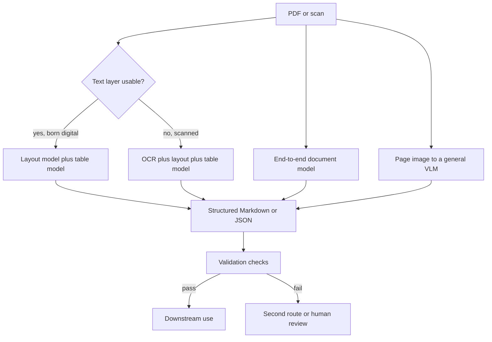

# 2 — Document Understanding

> A PDF is a set of drawing instructions, not a document. Getting usable data out of it means recovering layout, reading order and tables, then proving the result is right with checks that don't depend on the model.

The invoice assistant now receives whole PDFs: a twelve-page supplier contract, a scanned statement, an invoice with a table that crosses a page break. Copying the text out gives you words in drawing order, with the two columns interleaved and the table flattened into a ribbon of numbers. Sending the page to a vision model gives you a fluent transcript that may have skipped a row. Each route fails in its own way, and neither failure raises an error. This chapter sets out the routes, what each costs, and the checks that catch a silent failure before it reaches accounts payable.

## Why a page is hard

A PDF stores positioned glyphs and vector paths. It has no reliable notion of a paragraph, a column or a table cell, and a scanned PDF has only pixels. So the job has four parts, whichever tool does it: find the regions on the page (layout), put them in the order a person would read them (reading order), recover structure inside the hard regions such as tables and formulas, and turn pixels into characters where no text layer exists.

The size of the gap shows up in Nougat's evaluation on arXiv papers. The text embedded in the PDF itself scored an edit distance of 0.255 against the source markup, and GROBID, a mature rule-and-model parser, scored 0.312. A trained end-to-end model reached 0.071. On formulas the gap was largest: GROBID with a LaTeX OCR add-on scored 0.727, against 0.128 for Nougat's base model ([arXiv:2308.13418](https://arxiv.org/abs/2308.13418) (Blecher et al., 2023-08, preprint), Table 1). This is one document type, scientific papers, and the model was trained on that type. It shows how much an embedded text layer can lose, not that one model wins everywhere.

## Three routes through a document



**A pipeline of specialised models.** Docling is a good open example under the MIT licence. It runs an RT-DETR layout model trained on DocLayNet, then TableFormer on each table, and an OCR engine only where needed. TableFormer predicts table structure without reading the language of the text, and matches cells back to the PDF's own programmatic text where possible, so an OCR error can't creep into a born-digital table ([arXiv:2501.17887](https://arxiv.org/abs/2501.17887) (Livathinos et al., 2025-01, preprint)).

The pipeline's strength is that it is inspectable and its cost is known. Its weakness is the one the Donut authors name: the stages add computation, resist change, and pass errors down the line, since a wrong layout region stays wrong forever ([arXiv:2111.15664](https://arxiv.org/abs/2111.15664) (Kim et al., ECCV 2022)).

**An end-to-end document model.** Donut skips OCR and maps page images directly to structured tokens with a Swin encoder and a BART-style decoder. Nougat applies the same idea to academic PDFs. Kosmos-2.5 trains one decoder for two outputs: spatially located text blocks and structured Markdown ([arXiv:2309.11419](https://arxiv.org/abs/2309.11419) (Lv et al., 2023-09, preprint)). These models avoid error propagation but pick up a new failure: they can loop. Nougat saw repetitive output on 1.5% of its test pages, and more often on pages outside its training domain ([arXiv:2308.13418](https://arxiv.org/abs/2308.13418)).

**A general vision-language model.** You send the page image and a schema, and get JSON back. It is the fastest route to a demo, and it handles odd layouts well, since no rule has to anticipate them. It has the resolution limits of [chapter 1](01-image-input.md), its errors look exactly like correct output, and it costs model inference per page.

A fourth idea deserves a mention because it changes the assumption about what you need. DocLLM discards the image and feeds the model OCR text plus each token's bounding box, weighting attention by spatial relationships. Its authors report beating the compared state-of-the-art LLMs on 14 of 16 datasets and generalising to 4 of 5 unseen ones ([arXiv:2401.00908](https://arxiv.org/abs/2401.00908) (Wang et al., ACL 2024)). Reading-order-plus-coordinates is cheap to feed to any language model. If you have a good OCR engine and mostly text pages, try it before you pay for vision.

Earlier work had already shown a similar point for images in general. LoRRA gave a VQA model an OCR module as a first-class part of its architecture, on the grounds that reading text was a separate capability the model should not have to learn from pixels ([arXiv:1904.08920](https://arxiv.org/abs/1904.08920) (Singh et al., CVPR 2019)). The lesson still holds. If reading matters, give the system a reader.

## What it costs

Cost differs between routes by orders of magnitude, so measure before you pick. Docling published per-page timings on a test set of 89 PDFs, 4,008 pages and 1,842 tables ([arXiv:2501.17887](https://arxiv.org/abs/2501.17887)):

| Hardware | 5th percentile | Median | 95th percentile |
|---|---|---|---|
| x86 CPU | 0.6 s | 0.79 s | 16.3 s |
| M3 Max SoC | 0.26 s | 0.32 s | 6.48 s |
| Nvidia L4 GPU | 57 ms | 114 ms | 2081 ms |

These numbers show a long tail, about twenty times the median at the 95th percentile on CPU. A single page full of tables and images can stall a worker that was sized for the median. Disabling OCR saved around 60% of the runtime on CPU and M3 and about 50% on the L4, and disabling table structure saved another 16 to 24%. For comparison, the Nougat authors report a base model batch of 6 pages taking 19.5 seconds on a single A10G with 24 GB of VRAM, while GROBID processed 10.6 PDFs per second ([arXiv:2308.13418](https://arxiv.org/abs/2308.13418)). Those are their setups in those years, so use them to reason about shape, not as a price list.

The practical pattern follows from the numbers: route by page. Check whether a page has a text layer before running OCR, and send only the hard pages to the expensive route.

## Check the result without trusting the model

A confidence score from the same model that made the error is weak evidence. The best checks use facts the document must satisfy on its own terms. Invoices are ideal here, since they contain redundancy: line items must sum to a subtotal, tax must match a rate, and the total must match the remittance. A failed check doesn't tell you which field is wrong, but it reliably tells you that something is.

```python
from decimal import Decimal as D

def reconcile(doc, tolerance=D("0.01")):
    """Return a list of arithmetic failures for an extracted invoice."""
    problems = []
    lines = sum(D(i["qty"]) * D(i["unit"]) for i in doc["items"])
    if abs(lines - D(doc["subtotal"])) > tolerance:
        problems.append(f"line items sum to {lines}, subtotal says {doc['subtotal']}")
    tax = (D(doc["subtotal"]) * D(doc["tax_rate"])).quantize(D("0.01"))
    if abs(tax - D(doc["tax"])) > tolerance:
        problems.append(f"tax should be {tax}, document says {doc['tax']}")
    if abs(D(doc["subtotal"]) + D(doc["tax"]) - D(doc["total"])) > tolerance:
        problems.append(f"subtotal + tax != total {doc['total']}")
    return problems

good = {"items": [{"qty": "2", "unit": "120.00"}, {"qty": "1", "unit": "165.13"}],
        "subtotal": "405.13", "tax_rate": "0.19", "tax": "76.97", "total": "482.10"}
misread_total = dict(good, total="432.10")       # 8 read as 3
dropped_row = dict(good, items=good["items"][:1])  # a row lost at a page break

for name, doc in [("clean", good), ("misread digit", misread_total), ("dropped row", dropped_row)]:
    print(f"{name:<14}", reconcile(doc) or "ok")
```

Output:

```text
clean          ok
misread digit  ['subtotal + tax != total 432.10']
dropped row    ['line items sum to 240.00, subtotal says 405.13']
```


Both failure types are the ones a language model produces without warning: a misread digit and a skipped row. Neither would have been caught by validating the JSON against a schema, since both outputs are well-formed. When the arithmetic fails, the route is: retry with a crop of the table at higher resolution, try the second extraction route, and then send it to a person.

Checks for documents without arithmetic are weaker but still useful. Compare two independent extractions, one from the text layer and one from vision, and flag where they disagree. Look up names and account numbers against your master data. Require each extracted value to appear in the OCR text of the page.

## Catch the loop

Repetition is the signature failure of end-to-end decoders, and it is easy to detect after the fact. The Nougat team detects it from the decoder's logits during generation. If your model is behind an API, you only have the text, so look for a suffix that repeats:

```python
def repeated_tail(text, min_len=8, min_repeats=3):
    """Length of a suffix unit repeated at least min_repeats times, else 0."""
    n = len(text)
    for size in range(min_len, n // min_repeats + 1):
        unit = text[-size:]
        if text[-size * min_repeats:] == unit * min_repeats:
            return size
    return 0

clean = "Item | Qty | Unit\nWidget | 2 | 120.00\nGasket | 1 | 165.13\nTotal 405.13"
looped = "Item | Qty | Unit\n" + "Widget | 2 | 120.00\n" * 40

print("clean :", repeated_tail(clean))
print("looped:", repeated_tail(looped))
print("kept  :", looped[:looped.index("Widget") + 20].encode())
```

Output:

```text
clean : 0
looped: 20
kept  : b'Item | Qty | Unit\nWidget | 2 | 120.00\n'
```


Keep the detector out of your happy path: on a hit, truncate to the first unit and mark the page for a second route, rather than silently using the shortened output.

## Scoring extraction

Scoring tells you whether a change helped, and a document pipeline needs two kinds of score. Edit distance measures transcript quality and is good for comparing OCR engines. Field-level F1 measures what the business cares about. Donut's authors use field-level F1 together with tree edit distance for nested output, and they point out how strict field-level scoring is: one wrong character fails the whole field ([arXiv:2111.15664](https://arxiv.org/abs/2111.15664)). That strictness suits invoice work. An amount with one wrong digit is simply wrong, though it would look almost perfect on edit distance.

```python
def edit_distance(a, b):
    prev = list(range(len(b) + 1))
    for i, ca in enumerate(a, 1):
        cur = [i]
        for j, cb in enumerate(b, 1):
            cur.append(min(prev[j] + 1, cur[-1] + 1, prev[j - 1] + (ca != cb)))
        prev = cur
    return prev[-1]

def field_scores(pred, gold):
    correct = sum(1 for k, v in pred.items() if gold.get(k) == v)
    p = correct / len(pred) if pred else 0.0
    r = correct / len(gold) if gold else 0.0
    return {"precision": p, "recall": r, "f1": 2 * p * r / (p + r) if p + r else 0.0}

gold = {"vendor": "Northwind GmbH", "total": "482.10", "due": "2026-03-14", "iban": "DE89370400440532013000"}
pred = {"vendor": "Northwind GmbH", "total": "432.10", "due": "2026-03-14"}

print("normalised edit distance on total:",
      round(edit_distance(pred["total"], gold["total"]) / len(gold["total"]), 3))
print("field scores:", field_scores(pred, gold))
```

Output:

```text
normalised edit distance on total: 0.167
field scores: {'precision': 0.6666666666666666, 'recall': 0.5, 'f1': 0.5714285714285715}
```


The total is one edit away from correct, a small normalised distance, and it would send the wrong payment. Use edit distance to choose an engine, and field F1 to decide whether you can ship.

For generated output such as HTML from a design, Design2Code found that its automatic metrics correlated with human judgment across 484 real webpages, that text-augmented prompting helped most models, and that most models struggled to improve by reviewing their own output ([arXiv:2403.03163](https://arxiv.org/abs/2403.03163) (Si et al., NAACL 2024)). METAL gets a 5.2% F1 gain in chart generation from a multi-agent loop with separate generation, visual critique, code critique and verification agents ([arXiv:2502.17651](https://arxiv.org/abs/2502.17651) (Li et al., ACL 2025)). Together they suggest that a critic works better as a distinct step with its own instructions than as a request for the same model to look again, though both measured it on synthesis tasks and not on extraction.

## Choosing a route

| Your documents | Start with | Why |
|---|---|---|
| Born-digital, regular layouts, high volume | Parser or Docling pipeline | Cheap, inspectable, text is already accurate |
| Scans in one or two known layouts | Pipeline with OCR, or a trained end-to-end model | The layout is learnable and the scale justifies the setup |
| Long tail of formats, modest volume | VLM with schema and strong validation | No per-format rules, and the checks protect you |
| Heavy math or tables in papers | Specialised model (Nougat, table models) | General parsers are weakest on these regions |
| Text pages where OCR is fine | Text plus coordinates to a language model | Spatial layout without paying for vision |

Whatever you start with, keep the route per page in your logs. When accuracy shifts, you will want to know which route and which document family moved.

## Pitfalls

- **Treating well-formed JSON as correct.** Schema validation checks shape. It cannot see a digit misread or a row dropped.
- **Sizing for median page time.** The 95th percentile can be twenty times the median. Set per-page timeouts and a separate queue for slow pages.
- **OCRing everything.** Running OCR on a born-digital page costs time and can introduce errors that the text layer did not have.
- **Assuming page boundaries respect content.** Tables cross pages, and footers look like last rows. Test on documents that have them.
- **Scoring with edit distance alone.** A single wrong digit in a payment amount looks almost perfect on it.
- **Trusting document text.** A contract can carry instructions aimed at your extraction model. See [chapter 9.2](../../09-safety-and-security/notes/02-prompt-injection-and-jailbreaks.md).

## Try it

1. Add a check to `reconcile` that fails when `tax_rate` isn't one of your allowed rates. Which class of error does it catch that the arithmetic misses?
2. `repeated_tail` looks only at the suffix. Build a text where the loop stops before the end of the output, and change the function to catch it.
3. Extend `field_scores` with a numeric rule: amounts count as correct if they match after removing thousand separators. Why not allow a tolerance?

<details><summary>Answers</summary>

1. If the model misreads both the rate and the tax consistently, for instance reading 0.19 as 0.09 and computing a tax to match, the arithmetic passes. A whitelist catches values that are internally consistent but impossible.
2. Search a sliding window instead: for each unit size, count consecutive matches of the unit anywhere in the string. A compact way is the regular expression `(.{8,}?)\1{2,}` with `re.DOTALL`, which looks for any unit of at least 8 characters repeated at least three times in a row.
3. Normalisation removes formatting differences that aren't errors. A tolerance would accept real errors, and small differences in invoice amounts are exactly what you are trying to detect.

</details>

## Interview questions

| Question | Answer |
|---|---|
| Why not extract the text layer and send it to an LLM? | Text layers give glyphs in drawing order. Columns interleave, tables flatten, and scans have no text at all. Layout, reading order and table structure must be recovered. |
| What does a pipeline give you that an end-to-end model doesn't? | Inspectable stages, a known cost per stage, and the ability to swap one part. The price is that an error in an early stage is passed downstream. |
| What failure is specific to end-to-end document decoders? | Repetition loops, particularly on pages outside the training domain. Nougat measured 1.5% of its in-domain test pages. Detect and reroute them. |
| How do you verify an extraction without ground truth? | Use redundancy in the document: arithmetic, cross-field rules, a second independent extraction, master data, and requiring each value to appear in the OCR text. |
| Edit distance or field F1? | Both, for different decisions. Edit distance compares transcript engines. Field F1 reflects business correctness because one wrong character fails the field. |
| Why route per page? | Page cost varies by more than an order of magnitude. Skipping OCR and table models on simple pages saves most of the compute, and logging the route tells you what changed when accuracy moves. |

## Next

[Chapter 3 — Multimodal RAG](03-multimodal-rag.md) takes a collection of documents and asks how to find the right page when the answer is in a chart or a table.
