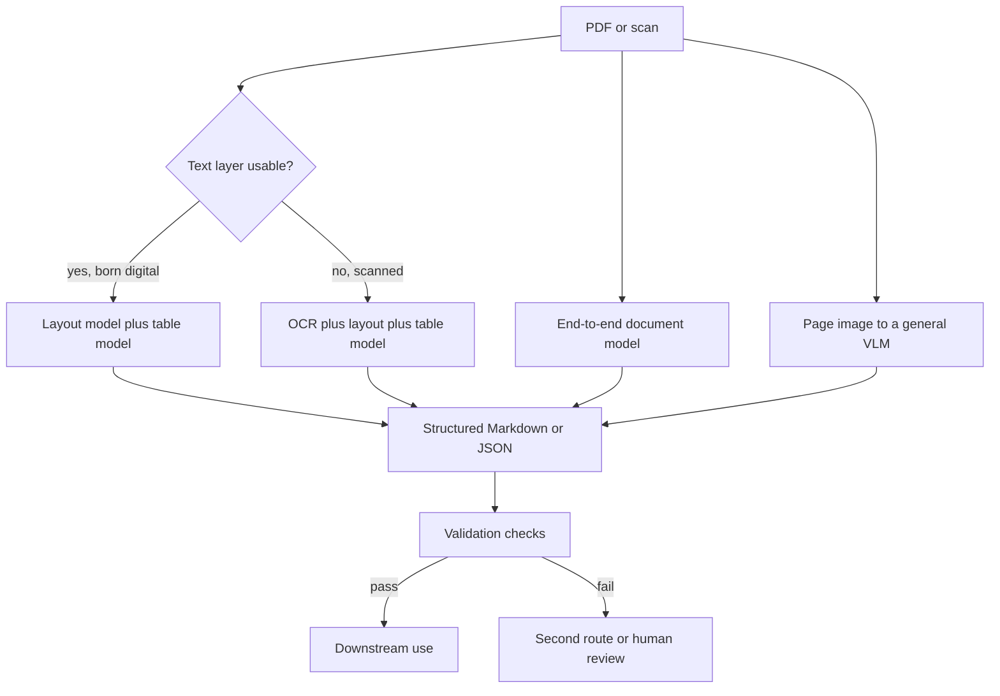
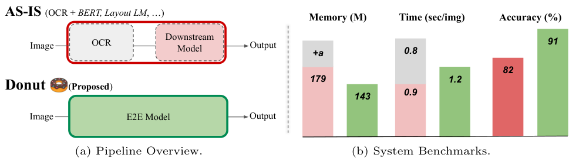
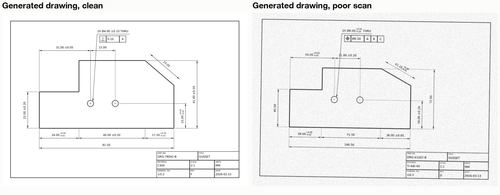
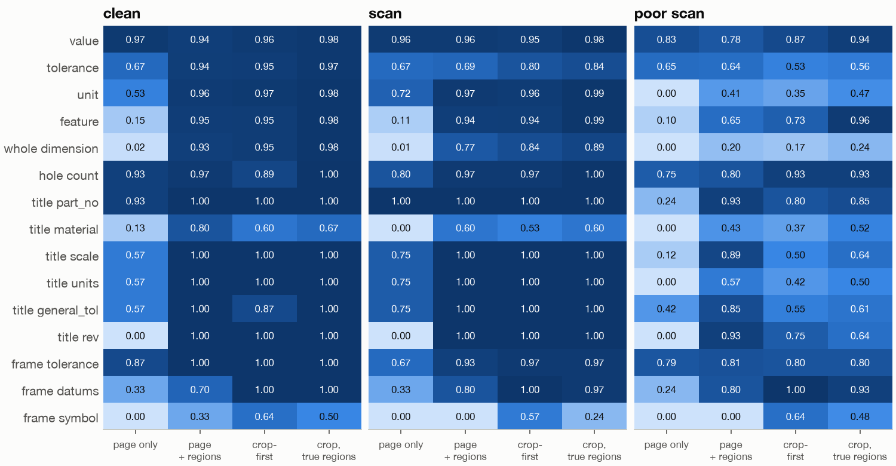

# 2 — Document Understanding

> A PDF is a set of drawing instructions, not a document. Getting usable data out of it means recovering layout, reading order and tables, then proving the result is right with checks that don't depend on the model.

The invoice assistant now receives whole PDFs: a twelve-page supplier contract, a scanned statement, an invoice with a table that crosses a page break. Copying the text out gives you words in drawing order, with the two columns interleaved and the table flattened into a ribbon of numbers. Sending the page to a vision model gives you a fluent transcript that may have skipped a row. Each route fails in its own way, and neither failure raises an error. This chapter sets out the routes, what each costs, and the checks that catch a silent failure before it reaches accounts payable.

## Why a page is hard

A PDF stores positioned glyphs and vector paths. It has no reliable notion of a paragraph, a column or a table cell, and a scanned PDF has only pixels. So the job has four parts, whichever tool does it: find the regions on the page (layout), put them in the order a person would read them (reading order), recover structure inside the hard regions such as tables and formulas, and turn pixels into characters where no text layer exists.

The size of the gap shows up in Nougat's evaluation on arXiv papers. The text embedded in the PDF itself scored an edit distance of 0.255 against the source markup, and GROBID, a mature rule-and-model parser, scored 0.312. A trained end-to-end model reached 0.071. On formulas the gap was largest: GROBID with a LaTeX OCR add-on scored 0.727, against 0.128 for Nougat's base model ([arXiv:2308.13418](https://arxiv.org/abs/2308.13418) (Blecher et al., ICLR 2024), Table 1). This is one document type, scientific papers, and the model was trained on that type. It shows how much an embedded text layer can lose, not that one model wins everywhere.

## Three routes through a document



**A pipeline of specialised models.** Docling is a good open example under the MIT licence. It runs an RT-DETR layout model trained on DocLayNet, then TableFormer on each table, and an OCR engine only where needed. TableFormer predicts table structure without reading the language of the text, and matches cells back to the PDF's own programmatic text where possible, so an OCR error can't creep into a born-digital table ([arXiv:2501.17887](https://arxiv.org/abs/2501.17887) (Livathinos et al., 2025-01, preprint)).

The pipeline's strength is that it is inspectable and its cost is known. Its weakness is the one the Donut authors name: the stages add computation, resist change, and pass errors down the line, since a wrong layout region stays wrong forever ([arXiv:2111.15664](https://arxiv.org/abs/2111.15664) (Kim et al., ECCV 2022)).

**An end-to-end document model.** Donut skips OCR and maps page images directly to structured tokens with a Swin encoder and a BART-style decoder. Nougat applies the same idea to academic PDFs. Kosmos-2.5 trains one decoder for two outputs: spatially located text blocks and structured Markdown ([arXiv:2309.11419](https://arxiv.org/abs/2309.11419) (Lv et al., 2023-09, preprint)). These models avoid error propagation but pick up a new failure: they can loop. Nougat saw repetitive output on 1.5% of its test pages, and more often on pages outside its training domain ([arXiv:2308.13418](https://arxiv.org/abs/2308.13418)). Reading without an OCR engine can come from captioning alone. GIT, a general image captioner with no OCR input, scored 138.2 CIDEr on the TextCaps test set against 109.7 for TAP, the previous best, which fed in OCR tokens. The authors credit the web captions: an OCR API found the image's text written into the caption for an estimated 15% of CC12M and 31% of a 500K sample of their crawled images. Its TextCaps captioner averaged 89.9 across six scene-text recognition benchmarks with no OCR training, counted correct when the caption contained the word ([arXiv:2205.14100](https://arxiv.org/abs/2205.14100) (Wang et al., TMLR 2022)). That is single words in photos, not dense pages.


*Image Source: Kim et al., [OCR-free Document Understanding Transformer](https://arxiv.org/abs/2111.15664) (ECCV 2022), Fig. 2. Left, one end-to-end model replaces OCR plus a downstream parser. Right, memory, time per image and accuracy for the OCR pipeline (red) and Donut (green): 91 against 82 accuracy.*

**A general vision-language model.** You send the page image and a schema, and get JSON back. It is the fastest route to a demo, and it handles odd layouts well, since no rule has to anticipate them. It has the resolution limits of [chapter 1](01-image-input.md), its errors look exactly like correct output, and it costs model inference per page.

A fourth idea deserves a mention because it changes the assumption about what you need. DocLLM discards the image and feeds the model OCR text plus each token's bounding box, weighting attention by spatial relationships. Its authors report beating the compared state-of-the-art LLMs on 14 of 16 datasets and generalising to 4 of 5 unseen ones ([arXiv:2401.00908](https://arxiv.org/abs/2401.00908) (Wang et al., ACL 2024)). Reading-order-plus-coordinates is cheap to feed to any language model. If you have a good OCR engine and mostly text pages, try it before you pay for vision.

Earlier work had already shown a similar point for images in general. LoRRA gave a VQA model an OCR module as a first-class part of its architecture, on the grounds that reading text was a separate capability the model should not have to learn from pixels ([arXiv:1904.08920](https://arxiv.org/abs/1904.08920) (Singh et al., CVPR 2019)). The lesson still holds. If reading matters, give the system a reader. OCR-VQA is the book-cover version of the same test: 1,002,146 questions on 207,572 covers, and a baseline that adds OCR text and text-block positions to question and VGG image features reached 48.3% accuracy, with 42.0% from block features alone (image features alone: 14.3%) ([doi:10.1109/ICDAR.2019.00156](https://doi.org/10.1109/icdar.2019.00156) (Mishra et al., ICDAR 2019)). Its answers come from cover metadata, so it covers books only. The baseline is a 51-way classifier over a block index, genre, yes/no, edition or year, and a title or author answer is the OCR text of the block it picks.

## What it costs

Cost differs between routes by orders of magnitude, so measure before you pick. Docling published per-page timings on a test set of 89 PDFs, 4,008 pages and 1,842 tables ([arXiv:2501.17887](https://arxiv.org/abs/2501.17887)):

| Hardware | 5th percentile | Median | 95th percentile |
|---|---|---|---|
| x86 CPU | 0.6 s | 0.79 s | 16.3 s |
| M3 Max SoC | 0.26 s | 0.32 s | 6.48 s |
| Nvidia L4 GPU | 57 ms | 114 ms | 2081 ms |

These numbers show a long tail, about twenty times the median at the 95th percentile on CPU. A single page full of tables and images can stall a worker that was sized for the median. Disabling OCR saved around 60% of the runtime on CPU and M3 and about 50% on the L4, and disabling table structure saved another 16 to 24%. For comparison, the Nougat authors report a base model batch of 6 pages taking 19.5 seconds on a single A10G with 24 GB of VRAM, while GROBID processed 10.6 PDFs per second ([arXiv:2308.13418](https://arxiv.org/abs/2308.13418)). Those are their setups in those years, so use them to reason about shape, not as a price list.

The practical pattern follows from the numbers: route by page. Check whether a page has a text layer before running OCR, and send only the hard pages to the expensive route.

Medical imaging shows the same budget problem in three dimensions. MedGemma 1.5 turns a CT or MRI volume into 2D slices of 256 tokens each at 896×896, capped at 85 slices (21,760 tokens) to stay under a 32K context, and a whole-slide pathology image into at most 126 patches (32,256 tokens). On the authors' internal, class-balanced yes/no condition sets, MRI accuracy rose from 51.3% to 64.7% and CT from 58.2% to 61.1%, so the older model was near chance on MRI. Lab-report extraction to JSON, scored by macro F1 on internal sets of rendered report pages, rose from 78 to 91 and from 50 to 71 on two datasets and stayed at 85 on a 14-image public one. These are single runs at temperature 0 on non-public data. The cost of the added skills was a fall in general knowledge, with MMLU-Pro dropping from 39.1 to 33.8 ([arXiv:2604.05081](https://arxiv.org/abs/2604.05081) (Sellergren et al., 2026-05, preprint)).

## Check the result without trusting the model

A confidence score from the same model that made the error is weak evidence. The best checks use facts the document must satisfy on its own terms. Invoices are ideal here, since they contain redundancy: line items must sum to a subtotal, tax must match a rate, and the total must match the remittance. A failed check doesn't tell you which field is wrong, but it reliably tells you that something is.

```python
from decimal import Decimal as D

def reconcile(doc, tolerance=D("0.01")):
    """Return a list of arithmetic failures for an extracted invoice."""
    problems = []
    lines = sum(D(i["qty"]) * D(i["unit"]) for i in doc["items"])
    if abs(lines - D(doc["subtotal"])) > tolerance:
        problems.append(f"line items sum to {lines}, subtotal says {doc['subtotal']}")
    tax = (D(doc["subtotal"]) * D(doc["tax_rate"])).quantize(D("0.01"))
    if abs(tax - D(doc["tax"])) > tolerance:
        problems.append(f"tax should be {tax}, document says {doc['tax']}")
    if abs(D(doc["subtotal"]) + D(doc["tax"]) - D(doc["total"])) > tolerance:
        problems.append(f"subtotal + tax != total {doc['total']}")
    return problems

good = {"items": [{"qty": "2", "unit": "120.00"}, {"qty": "1", "unit": "165.13"}],
        "subtotal": "405.13", "tax_rate": "0.19", "tax": "76.97", "total": "482.10"}
misread_total = dict(good, total="432.10")       # 8 read as 3
dropped_row = dict(good, items=good["items"][:1])  # a row lost at a page break

for name, doc in [("clean", good), ("misread digit", misread_total), ("dropped row", dropped_row)]:
    print(f"{name:<14}", reconcile(doc) or "ok")
```

Output:

```text
clean          ok
misread digit  ['subtotal + tax != total 432.10']
dropped row    ['line items sum to 240.00, subtotal says 405.13']
```


Both failure types are the ones a language model produces without warning: a misread digit and a skipped row. Neither would have been caught by validating the JSON against a schema, since both outputs are well-formed. When the arithmetic fails, the route is: retry with a crop of the table at higher resolution, try the second extraction route, and then send it to a person.

Checks for documents without arithmetic are weaker but still useful. Compare two independent extractions, one from the text layer and one from vision, and flag where they disagree. Look up names and account numbers against your master data. Require each extracted value to appear in the OCR text of the page.

## Catch the loop

Repetition is the signature failure of end-to-end decoders, and it is easy to detect after the fact. The Nougat team detects it from the decoder's logits during generation. If your model is behind an API, you only have the text, so look for a suffix that repeats:

```python
def repeated_tail(text, min_len=8, min_repeats=3):
    """Length of a suffix unit repeated at least min_repeats times, else 0."""
    n = len(text)
    for size in range(min_len, n // min_repeats + 1):
        unit = text[-size:]
        if text[-size * min_repeats:] == unit * min_repeats:
            return size
    return 0

clean = "Item | Qty | Unit\nWidget | 2 | 120.00\nGasket | 1 | 165.13\nTotal 405.13"
looped = "Item | Qty | Unit\n" + "Widget | 2 | 120.00\n" * 40

print("clean :", repeated_tail(clean))
print("looped:", repeated_tail(looped))
print("kept  :", looped[:looped.index("Widget") + 20].encode())
```

Output:

```text
clean : 0
looped: 20
kept  : b'Item | Qty | Unit\nWidget | 2 | 120.00\n'
```


Keep the detector out of your happy path: on a hit, truncate to the first unit and mark the page for a second route, rather than silently using the shortened output.

## Scoring extraction

Scoring tells you whether a change helped, and a document pipeline needs two kinds of score. Edit distance measures transcript quality and is good for comparing OCR engines. Field-level F1 measures what the business cares about. Donut's authors use field-level F1 together with tree edit distance for nested output, and they point out how strict field-level scoring is: one wrong character fails the whole field ([arXiv:2111.15664](https://arxiv.org/abs/2111.15664)). That strictness suits invoice work. An amount with one wrong digit is simply wrong, though it would look almost perfect on edit distance.

```python
def edit_distance(a, b):
    prev = list(range(len(b) + 1))
    for i, ca in enumerate(a, 1):
        cur = [i]
        for j, cb in enumerate(b, 1):
            cur.append(min(prev[j] + 1, cur[-1] + 1, prev[j - 1] + (ca != cb)))
        prev = cur
    return prev[-1]

def field_scores(pred, gold):
    correct = sum(1 for k, v in pred.items() if gold.get(k) == v)
    p = correct / len(pred) if pred else 0.0
    r = correct / len(gold) if gold else 0.0
    return {"precision": p, "recall": r, "f1": 2 * p * r / (p + r) if p + r else 0.0}

gold = {"vendor": "Northwind GmbH", "total": "482.10", "due": "2026-03-14", "iban": "DE89370400440532013000"}
pred = {"vendor": "Northwind GmbH", "total": "432.10", "due": "2026-03-14"}

print("normalised edit distance on total:",
      round(edit_distance(pred["total"], gold["total"]) / len(gold["total"]), 3))
print("field scores:", field_scores(pred, gold))
```

Output:

```text
normalised edit distance on total: 0.167
field scores: {'precision': 0.6666666666666666, 'recall': 0.5, 'f1': 0.5714285714285715}
```


The total is one edit away from correct, a small normalised distance, and it would send the wrong payment. Use edit distance to choose an engine, and field F1 to decide whether you can ship.

For generated output such as HTML from a design, Design2Code found that its automatic metrics correlated with human judgment across 484 real webpages, that text-augmented prompting helped most models, and that most models struggled to improve by reviewing their own output ([arXiv:2403.03163](https://arxiv.org/abs/2403.03163) (Si et al., NAACL 2025)). METAL gets a 5.2% F1 gain in chart generation from a multi-agent loop with separate generation, visual critique, code critique and verification agents ([arXiv:2502.17651](https://arxiv.org/abs/2502.17651) (Li et al., ACL 2025)). Together they suggest that a critic works better as a distinct step with its own instructions than as a request for the same model to look again, though both measured it on synthesis tasks and not on extraction.

## A pipeline you can run

[`practice/invoice_pipeline.py`](../practice/invoice_pipeline.py) puts this chapter together end to end, and you can read every step. It generates 180 invoices in three layouts, as born-digital PDFs and as rendered scans. It routes each page: read the text layer if there is one, otherwise run a real open OCR engine (RapidOCR) on the image. Two extractors read the resulting tokens, one ignoring position and one using it. The checks are a shorter `reconcile`. If a scan fails them, it's scanned again at twice the resolution, and if it still fails, it goes to a person.

Be clear about what this isn't. **No vision model is called**, as a course script shouldn't need a paid key, so the image route stops at OCR. Both extractors are short rules written for these three layouts. The prices are assumptions, printed with the results. Replace them with your own.

```python
# illustrative: the layout-aware rule, the idea that a model like LayoutLM learns instead
right = [(a - x, s) for s, a, b in tokens if abs(b - y) < 6 and a > x and re.fullmatch(PATTERN[f], s.strip())]
below = [(b - y, s) for s, a, b in tokens if abs(a - x) < 14 and 4 < b - y < 24 and re.fullmatch(PATTERN[f], s.strip())]
```

```text
180 documents: 3 layouts, 3 kinds of page, 20 of each

field F1 by extractor, first attempt, exact match after normalising number format
            layout         kind  text_only  with_layout  fail_check  seconds
label beside value born digital      1.000        1.000       0.000    0.002
label beside value         scan      0.981        0.981       0.300    0.251
label beside value    poor scan      0.940        0.940       0.700    0.220
  label over value born digital      0.667        1.000       0.000    0.002
  label over value         scan      0.644        0.987       0.200    0.230
  label over value    poor scan      0.627        0.965       0.400    0.260
       two columns born digital      1.000        1.000       0.000    0.002
       two columns         scan      1.000        1.000       0.000    0.298
       two columns    poor scan      0.924        0.927       0.700    0.284
```

The layout effect is the opening claim of this chapter, measured. On born-digital pages, where the text is perfect, `label over value` scores 0.667 without positions and 1.000 with them. Our two-column layout turned out harmless, as a label and its value stay neighbours when drawn in order, so positions add nothing there.

```text
field F1 per field, with layout, first attempt
kind      born digital  poor scan   scan
field
vendor             1.0      0.983  1.000
number             1.0      0.947  1.000
issued             1.0      0.919  1.000
due                1.0      0.992  1.000
subtotal           1.0      0.849  0.929
tax                1.0      0.966  1.000
total              1.0      0.919  0.983
iban               1.0      0.966  1.000
vendor read character for character on scans, spaces included: 0.542

documents with at least one wrong field, first attempt: 48 of 180
  of those the checks caught 46; the checks also failed 0 clean documents
  fields wrong on documents that passed: {'iban': 1, 'vendor': 1}
```

Two results here deserve attention. First, the vendor's F1 is 1.000 on scans only because scoring ignores spaces and case, and OCR ran the words of the bold heading together on many scans, so 54% were right character for character. Your normalisation rule is part of your metric, so write it down. Second, the checks caught 46 of 48 bad documents with no false alarms, and the two they missed are the point. Arithmetic can't see a vendor name or an IBAN. Those fields need their own checks, such as the IBAN's check digits or a supplier master list.

```text
assumptions: CPU 0.1 per hour, review 3 minutes at 30.0 per hour
                policy       f1  seconds  retried  reviewed  cost_cpu  cost_review  cost_per_doc
  text only, no checks 0.884764 0.171980 0.000000  0.000000  0.000005     0.000000      0.000005
OCR every page, layout 0.977321 0.257651 0.000000  0.000000  0.000007     0.000000      0.000007
     layout, no checks 0.978407 0.171980 0.000000  0.000000  0.000005     0.000000      0.000005
         layout, retry 0.997915 0.265459 0.255556  0.000000  0.000007     0.000000      0.000007
        layout, review 0.998611 0.171980 0.000000  0.255556  0.000005     0.383333      0.383338
 layout, retry, review 0.998611 0.265459 0.255556  0.011111  0.000007     0.016667      0.016674
```


- **Skipping OCR saves compute, and it barely changed accuracy here.** Routing by text layer takes 0.172 seconds a page against 0.258 for OCR on everything, at 0.978 against 0.977. Clean renders of a clean font are easy for OCR, so we didn't see it add errors, though the pitfall below remains true of harder documents.
- **People are the cost.** Compute differences are invisible next to review. Review alone costs 0.383 per document, because 25.6% of them fail a check.
- **A cheap retry is the best money in the table.** Retrying first leaves 1.1% for review, the same F1 at 0.0167 per document, about 23 times cheaper. So the check is worth most when it triggers another attempt and not just a person.
- **What a better second route may cost.** Going from 0.383 to 0.0167 saves 0.367 per document across the 25.6% retried, or about 1.43 per retried document. A vision model that does as well as this retry pays for itself below that price per document, on these assumptions.

The seconds vary with your machine. The sample is small and generated: three layouts, one font, one written extractor, 180 documents. Real supplier documents have a long tail of formats, so treat the F1 values as the test of the code and the shape of the costs as the lesson.

**Learning the layout rule.** Our `with_layout` is a hand-written version of what LayoutLM learns ([arXiv:1912.13318](https://arxiv.org/abs/1912.13318), Xu et al., KDD 2020). It gives BERT each token's 2-D position, pre-trained on about 11 million scanned pages. On the FUNSD forms task, with only 149 training forms, F1 rose from 0.6026 for BERT to 0.7866 with layout and 0.7927 with image features as well. On scanned receipts it reached 0.9524 against 0.9402 for the competition's winner, though using ground-truth OCR to remove OCR's effect, so a real pipeline starts lower. It also still needs OCR boxes first, and its pretraining took 80 hours per epoch on eight GPUs. That's a cost you can avoid by starting from the published weights. Choose it over rules once you have too many layouts to write rules for, and enough labelled documents to fine-tune.

## Drawings and 3D parts

An engineering drawing looks like a page and fails differently. The facts sit in small, often rotated dimensions, in tolerances, and in the symbols of GD&T (geometric dimensioning and tolerancing), such as the feature control frame, the small box that states how far a feature may deviate. The only public labelled set we found is the seven drawings in the eDOCr2 repository, whose code licence doesn't settle the rights to the drawings. So what follows is small, separate experiments that can't be compared with each other:

| Setup | Result |
|---|---|
| [400 drawings, GD&T extraction](https://arxiv.org/abs/2411.03707), zero-shot against a fine-tuned small model, which is scored on its own 20% validation split | F1: GPT-4o 35.51, Claude 3.5 Sonnet 40.36, Florence-2 61.51 at best (four queries per image; 42.20 with one) |
| [Seven drawings, three with feature control frames](https://www.diva-portal.org/smash/get/diva2:1950437/FULLTEXT01.pdf) | Dimension recall 93.75 for eDOCr2, a dedicated pipeline. GPT-4o 84.14, because it leaves out repeated dimensions, or 92.68 when repeats count as matches. Feature-control-frame recall 100 and 0 |
| [1,367 drawings, detector then fine-tuned Donut](https://arxiv.org/abs/2506.17374), scored on patches the detector had already cut out | F1 0.965 on GD&T, 0.941 on measures, 0.533 on title blocks |

Those models have dated, so run your own test. Two things are likely to hold anyway. General models read numbers better than symbols, and a detector that crops first makes the parser's job smaller. Score it like any other extraction, per field, because a dropped tolerance isn't a typo. When these papers report a "hallucination rate", it is 1 minus precision, so it isn't a second piece of evidence. We found no evaluation of checking a tolerance stack, so don't assume any model can.

3D parts come in three forms. A **B-rep** (boundary representation, what a STEP file stores) holds exact faces and edges. A **mesh** approximates them with triangles, and a **point cloud** samples the surface. Each conversion loses something. [BRepNet](https://arxiv.org/abs/2104.00706) reports that meshing failed on 13% of its B-reps, and that sampling 2,048 points can miss small holes and grooves. On its Fusion 360 segmentation task, per-face IoU was 77.10 for BRepNet, 34.78 for PointNet++ and 20.59 for MeshCNN. Native B-rep isn't always that far ahead. On the synthetic MFCAD set, per-face IoU was 99.87 for [UV-Net](https://arxiv.org/abs/2006.10211), 99.70 for MeshCNN and 7.15 for PointNet. The UV-Net authors suggest MeshCNN keeps up because the labels correlate with the dihedral angles it uses as a feature.

For finding similar parts, the question most teams bring, we found less. UV-Net shows retrieval only as pictures of nearest neighbours, and we could read no part-to-part retrieval score with its setup. So measure it yourself, as in [Learning a similarity function](../../../data-science/05-time-series-and-recommenders/notes/05-learning-a-similarity-function.md): recall on labelled matches, plus how many look-alikes reach the top results. Check licences first. [Fusion 360 Gallery](https://github.com/AutodeskAILab/Fusion360GalleryDataset/blob/master/LICENSE.md) is for non-commercial research only, and [ABC's](https://deep-geometry.github.io/abc-dataset/) models belong to their creators. The numbers above are the papers' own.

### A drawing lab you can run

[`practice/drawing_extraction_lab.py`](../practice/drawing_extraction_lab.py) tries the crop-first idea on 45 drawings it generates itself: 15 at each of three scan qualities, with one part family, one layout and one font. The reader is RapidOCR and no vision model is called. It finds dimension lines, the title block and the feature control frame from pixels, turns each dimension's text level, reads it, and parses it into a value, tolerance, unit and feature. It compares that with whole-page OCR, which has no geometry.





These are generated drawings, so read the results as a demonstration of what to measure, not as a finding about real ones.

- **A value-only score hides the damage.** On clean drawings whole-page OCR gets value F1 0.972, but whole-dimension F1 only 0.025, mostly because it can't say which line a number belongs to. Crop-first scores 0.950 clean, 0.842 on an ordinary scan and 0.169 on a poor one (100 dpi with heavy noise). On the poor scans, 76% of dimensions with a stated tolerance had the right value, but only 38% had the right value and tolerance, and 33 of those 100 tolerances were dropped outright.
- **Geometry did the work there, not cleaner reading.** Giving page OCR the same regions scores 0.934, 0.771 and 0.204. Reading the crops helped on the ordinary scan, by 0.071, and didn't on the poor one.
- **Checks see what they can compare.** With one known misread planted in a perfect read, the chain sum and the line-length check caught every wrong first digit of a value. A last-digit error in a hole position was caught 36% of the time. A dropped tolerance was caught 78% of the time, by measuring text ink nobody had read. A wrong material or part number stayed at the 2% false-alarm rate, so these checks can't see them. Those are jobs for master data.
- **Passing the checks is not the same as being right.** Routing on the checks sent 82% of drawings to a person, and the ones that passed still shipped wrong fields, 0.18 per drawing averaged over all 45. With a 6-minute review at 40 an hour and a stated 150 per wrong field, reviewing everything costs 4.00 a drawing and routing costs 29.96. That gap rests on 8 wrong fields across the 45 drawings (4 materials and 4 frame symbols), each priced at the assumed 150, and one field more or fewer moves routing by 3.33 a drawing. So it illustrates the arithmetic and doesn't measure routing. Routing only wins if a wrong field costs less than about 4. All of these prices are assumptions, and the reviewer is assumed to catch everything.
- **Symbols stay unread.** RapidOCR mostly printed `中` or nothing for the position symbol and `口` for flatness. The symbol F1 of 0.636 on clean drawings comes only from a table of guesses at what the OCR might print, written with some of the output in view, so it flatters. Treat it as a sign that a text OCR isn't reading these symbols, and test a real recogniser on real frames.

The lab can't show how any of this behaves on real drawings, with hatching, section views, stamps, other layouts or a part marked "not to scale", which voids the line check. Its rule for naming a line is hand-written for its one layout. Its output ends with this list.

## Choosing a route

| Your documents | Start with | Why |
|---|---|---|
| Born-digital, regular layouts, high volume | Parser or Docling pipeline | Cheap, inspectable, text is already accurate |
| Scans in one or two known layouts | Pipeline with OCR, or a trained end-to-end model | The layout is learnable and the scale justifies the setup |
| Long tail of formats, modest volume | VLM with schema and strong validation | No per-format rules, and the checks protect you |
| Heavy math or tables in papers | Specialised model (Nougat, table models) | General parsers are weakest on these regions |
| Text pages where OCR is fine | Text plus coordinates to a language model | Spatial layout without paying for vision |

Whatever you start with, keep the route per page in your logs. When accuracy shifts, you will want to know which route and which document family moved.

## Pitfalls

- **Treating well-formed JSON as correct.** Schema validation checks shape. It cannot see a digit misread or a row dropped.
- **Sizing for median page time.** The 95th percentile can be twenty times the median. Set per-page timeouts and a separate queue for slow pages.
- **OCRing everything.** Running OCR on a born-digital page costs time and can introduce errors that the text layer did not have.
- **Assuming checks cover every field.** Arithmetic can't see a name or an IBAN. In our run those were the two errors that passed.
- **Assuming page boundaries respect content.** Tables cross pages, and footers look like last rows. Test on documents that have them.
- **Scoring with edit distance alone.** A single wrong digit in a payment amount looks almost perfect on it.
- **Trusting document text.** A contract can carry instructions aimed at your extraction model. See [chapter 9.2](../../09-safety-and-security/notes/02-prompt-injection-and-jailbreaks.md).

## Try it

1. Add a check to `reconcile` that fails when `tax_rate` isn't one of your allowed rates. Which class of error does it catch that the arithmetic misses?
2. `repeated_tail` looks only at the suffix. Build a text where the loop stops before the end of the output, and change the function to catch it.
3. Extend `field_scores` with a numeric rule: amounts count as correct if they match after removing thousand separators. Why not allow a tolerance? Then, in the pipeline's table, text-only scores exactly 0.667 on born-digital `label over value`. Work out from the F1 formula which fields it found and which it missed.
4. Run [`practice/drawing_extraction_lab.py`](../practice/drawing_extraction_lab.py). In the table of planted misreads, which rows sit at the false-alarm rate, and what would you add to catch them? For what happens after the reading, [the parts capstone](../../../data-science/05-time-series-and-recommenders/practice/06_parts_capstone_lab.py) finds interchangeable parts from the text of a generated catalogue.

<details><summary>Answers</summary>

1. If the model misreads both the rate and the tax consistently, for instance reading 0.19 as 0.09 and computing a tax to match, the arithmetic passes. A whitelist catches values that are internally consistent but impossible.
2. Search a sliding window instead: for each unit size, count consecutive matches of the unit anywhere in the string. A compact way is the regular expression `(.{8,}?)\1{2,}` with `re.DOTALL`, which looks for any unit of at least 8 characters repeated at least three times in a row.
3. Normalisation removes formatting differences that aren't errors. A tolerance would accept real errors, and small differences in invoice amounts are exactly what you are trying to detect. For the 0.667: four fields right and four missing, with none wrong, gives precision 1.0, recall 0.5 and F1 0.667. Those labels are drawn in one pass and their values in another, so the invoice number, both dates and the IBAN never follow their labels. The vendor and the three amounts still do.
4. The tolerance digit, material, part number and frame tolerance rows sit at 0.02, the one perfect read in 45 that the checks flag anyway. Neither arithmetic nor geometry says anything about those values, so they need something independent: master data for material and part number, and a second read or a person for tolerances. The hole position's last digit is caught 0.36 of the time because one step is small against the 4% line limit.

</details>

## Interview checklist

| Question | Answer |
|---|---|
| Why not extract the text layer and send it to an LLM? | Text layers give glyphs in drawing order. Columns interleave, tables flatten, and scans have no text at all. Layout, reading order and table structure must be recovered. |
| What does a pipeline give you that an end-to-end model doesn't? | Inspectable stages, a known cost per stage, and the ability to swap one part. The price is that an error in an early stage is passed downstream. |
| What failure is specific to end-to-end document decoders? | Repetition loops, particularly on pages outside the training domain. Nougat measured 1.5% of its in-domain test pages. Detect and reroute them. |
| How do you verify an extraction without ground truth? | Use redundancy in the document: arithmetic, cross-field rules, a second independent extraction, master data, and requiring each value to appear in the OCR text. |
| Edit distance or field F1? | Both, for different decisions. Edit distance compares transcript engines. Field F1 reflects business correctness because one wrong character fails the field. |
| What costs most in a document pipeline? | People. In our run review was thousands of times dearer than compute, so a retry that cut review from 25.6% to 1.1% of documents was the best value. |
| Can a general VLM read an engineering drawing? | Numbers better than symbols. On [seven drawings](https://www.diva-portal.org/smash/get/diva2:1950437/FULLTEXT01.pdf), GPT-4o's dimension recall was 92.68 counting repeats as matches, and its recall on feature control frames, present in three of them, was 0. The evidence is small and dates fast, so test on your own drawings and score per field. |
| Why route per page? | Page cost varies by more than an order of magnitude. Skipping OCR and table models on simple pages saves most of the compute, and logging the route tells you what changed when accuracy moves. |

## Next

[Chapter 2b — Fine-tuning a vision-language model](02b-fine-tuning-a-vision-language-model.md) trains a small reader for when these routes don't fit your limits. [Chapter 3 — Multimodal RAG](03-multimodal-rag.md) takes a collection of documents and asks how to find the right page when the answer is in a chart or a table. For what happens to this pipeline around the reader, from pricing a mistake to rollout and monitoring, see [DE 06/06](../../../data-engineering/06-ml-platform/notes/06-ml-system-framing-to-monitoring.md).
