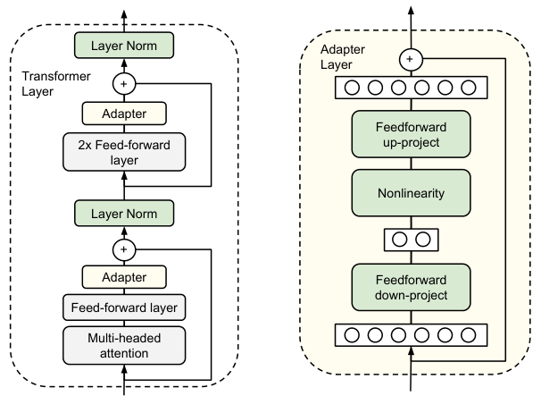

# 2b — Fine-Tuning a Vision-Language Model

> A small vision-language model scored about 0.02 on our invoices, and 200 training steps on a laptop took it to 0.93. The model was the easy part. The labels you mask, the pixels you keep and the way you save the result each moved the score by more than a sixteenfold bigger training set did, and one of those choices took it back to 0 with only a warning about rounding.

The invoice assistant reads most supplier PDFs with the routes in [Document understanding](02-document-understanding.md). Now a customer sends thousands of scanned invoices, and the contract says the pages stay on their own machines. Suppose the local OCR route from that chapter misreads too many of these scans, and those machines have about 4 GB of memory to spare, which rules out the larger VLMs. So you want a small model that runs locally and returns four fields as JSON. You pick SmolVLM-256M, try it, and every reply uses keys you never asked for.

[PEFT and fine-tuning in practice](../../../generative-ai/01-llm-fundamentals/notes/09-peft-and-fine-tuning-in-practice.md) explains LoRA on text models, so we won't repeat it. In short, LoRA ([arXiv:2106.09685](https://arxiv.org/abs/2106.09685), ICLR 2022) freezes a weight matrix and trains a small [low-rank](../../../generative-ai/01-llm-fundamentals/notes/02-attention-and-the-transformer-block.md#matrix-products-transpose-and-rank) update beside it. This chapter covers what an image adds: tokens that stand for pixels, two towers, the vision encoder and the language model, that you can adapt separately, and a processor that decides what the model can see.

## The experiment

Everything below comes from [`practice/vlm_finetune_lab.py`](../practice/vlm_finetune_lab.py). It took 10,026 s, a little under three hours, on an Apple M4 Pro with 24 GB, using the GPU.

- **Model.** [SmolVLM-256M-Instruct](https://huggingface.co/HuggingFaceTB/SmolVLM-256M-Instruct), Apache 2.0, 256,484,928 parameters, in [bf16](../../../programming/computer-science/notes/04-numbers-and-memory.md#smaller-floats).
- **Task.** Read `vendor`, `number`, `issued` and `total` from a page and return JSON.
- **Data.** Generated by [`practice/vlm_invoices.py`](../practice/vlm_invoices.py), so the labels are right by construction and nothing real is in them. Pages are 768×1024 pixels, in three layouts, with a slight skew and blur to imitate a scan.
- **Training.** LoRA with r=8 on the language model only, labels masked to the answer, 200 steps, batch 4, learning rate 2e-4, each page as one 512-pixel tile, unless a row says otherwise.
- **Scoring.** Each model generates a reply of up to 70 tokens, which fits a right answer of about 50, and we compare it with the truth. The frozen rows get 400 tokens instead, because its replies run longer, and we reran them alone with `--frozen`. Field accuracy is an exact match per field. Values found counts a value anywhere in the reply, under any key. Each number is a mean over 3 seeds on 40 fresh invoices per seed, so 160 field scores a seed. Where a table shows (sd), it's the standard deviation of field accuracy across those seeds.

Generated pages are far kinder than real ones, with one font, perfect labels and no stamps or handwriting. Read these numbers as how the choices compare, not as what you'd get on your customer's invoices.

## What frozen gets wrong

| Model on seen layouts | Field accuracy | Values found | Replies that parse as JSON |
|---|---:|---:|---:|
| Frozen, plain prompt | 0.021 | 0.458 | 0.808 |
| Frozen, shape shown in the prompt | 0.000 | 0.321 | 0.092 |
| LoRA, 400 invoices | 0.933 | 0.933 | 1.000 |

Field accuracy alone would tell you frozen can't read. Values found says it can, somewhat: a little under half the values appear somewhere in its reply, under keys it invents. Its replies are long, with a median near 176 tokens, and the 19% that don't parse all ran into the 400-token limit. Cut to the trained models' 70 tokens, only 7.5% parse, values found falls to 0.356 and field accuracy to exactly 0, so check that your reply limit isn't the thing you're measuring. Showing the exact JSON shape in the prompt didn't help on this model: values found fell and 44% of replies hit the limit. Fine-tuning gave short replies with the right keys. They always parse, and values found rose from 0.458 to 0.933, so training improved the reading as well as the format.

Try the cheap fixes first. Where memory allows, a larger model may read these pages with a good prompt, and [Document understanding](02-document-understanding.md) has routes that need no training. We tested only this one small model, and fine-tuning earned its place here because our scenario's memory limit came first.

## What a page costs before training starts

SmolVLM's processor, the code that turns a page and a prompt into model inputs, cuts a page into tiles of 512 pixels and turns each tile into 64 image tokens, which sit in the prompt like words. A page that gets split also gets one extra tile, a downscaled copy of the whole page, so 2×2 becomes 5 and 3×4 becomes 13. The longest edge you set decides the number of tiles:

| Longest edge | Tiles | Image tokens | One step, batch 1 | GPU driver memory |
|---:|---:|---:|---:|---:|
| 512 | 1 | 64 | 0.39 s | 1.41 GB |
| 1024 | 5 | 320 | 1.21 s | 2.51 GB |
| 2048 | 13 | 832 | 3.23 s | 5.56 GB |

These are means of three steps with the first included, so they're rough. GPU driver memory is `torch.mps.driver_allocated_memory()`, which includes pooled memory, so read it as a rough footprint. The answer itself is 51 tokens, so at a 2048 edge the page outweighs the words it's trained on by 16 to 1.

Two defaults follow from that. The [500M model card](https://huggingface.co/HuggingFaceTB/SmolVLM-500M-Instruct) gives 2048 as the default longest edge, and [TRL](https://huggingface.co/docs/trl/sft_trainer), Hugging Face's training library, defaults to `max_length` 1024. One page at a 2048 edge is 892 prompt tokens before any answer ([measured in 8b](../../07-inference-engineering/notes/08b-serving-encoders-and-vision-models.md#vision-language-models-where-a-pages-time-goes)), so a two-page prompt is already over that limit. TRL's docs warn that "truncating may remove image tokens, leading to errors during training", and recommend `max_length=None` for VLMs. We truncated our page to 40 tokens to see what happens:

```text
truncating to 40 tokens: TypeError: unsupported operand type(s) for -: 'int' and 'NoneType'
```

That error comes from inside the processor and names neither images nor truncation. Learn to recognise it.

Memory has a second trap on a Mac. MPS here means Metal Performance Shaders, PyTorch's GPU backend on Apple silicon, not NVIDIA's feature in [The Platform](../../07-inference-engineering/notes/03-the-platform.md). The [Transformers Apple Silicon guide](https://huggingface.co/docs/transformers/perf_train_special) says MPS compiles a kernel for each tensor shape and keeps it "in a graph cache that is never evicted", so variable lengths can run you out of unified memory. Our collator, the function that assembles examples into one padded batch, pads to a multiple of 32 for that reason. TRL's source says padding to a multiple "is not yet implemented" for vision prompt-completion data, so check this if you move to its trainer.

## Which layers you reached

The [published SmolVLM recipe](https://github.com/huggingface/smollm/blob/main/vision/finetuning/Smol_VLM_FT.ipynb) passes a list of layer names as `target_modules`. [PEFT's docs](https://huggingface.co/docs/peft/package_reference/lora) say a list means an exact match or a name that ends with one of those strings, while a single string is a regex. SmolVLM's vision and language towers both have layers called `q_proj`, so the list wraps both:

```python
import re

SUFFIXES = ["q_proj", "k_proj", "v_proj", "o_proj", "gate_proj", "up_proj", "down_proj"]
TEXT_ONLY = r".*text_model.*\.(" + "|".join(SUFFIXES) + ")"
layers = ["model.vision_model.encoder.layers.0.self_attn.q_proj",
          "model.text_model.layers.0.self_attn.q_proj",
          "model.text_model.layers.0.mlp.gate_proj"]

for name in layers:
    in_list = any(name == s or name.endswith("." + s) for s in SUFFIXES)
    in_regex = re.fullmatch(TEXT_ONLY, name) is not None
    print(f"list {in_list!s:<5}  regex {in_regex!s:<5}  {name}")
```

```text
list True   regex False  model.vision_model.encoder.layers.0.self_attn.q_proj
list True   regex True   model.text_model.layers.0.self_attn.q_proj
list True   regex True   model.text_model.layers.0.mlp.gate_proj
```

On the real model:

| Targets | Trainable parameters | Of those, in the vision tower | Field accuracy (sd) |
|---|---:|---:|---:|
| Regex, language model only | 2,442,240 | 0 | 0.933 (.016) |
| Suffix list, both towers | 2,884,608 | 442,368 | 0.967 (.007) |

We expected adapting the vision tower to be an accident to avoid. On these pages it helped, by more than the spread between seeds. That's one generated font over three seeds, and a tower adapted to one font is what you'd worry about on real scans, so test it on your held-out slices. The lesson is narrower: **print what you reached**. `model.print_trainable_parameters()` gives the total, and only the names tell you which tower it's in.

The research models treat the towers as a decision, and most freeze the encoder:

- Freezing the model and training small inserted layers began in vision. Residual adapters put a 1×1 convolution with a skip connection beside each convolution of a ResNet, so the adapter starts as the identity, and trained only those adapters and the batch norms for each new domain, about 11% extra parameters per domain. Across ten low-resolution (64-pixel) image datasets they matched full fine-tuning on mean accuracy, 76.9 against 76.5%, with the decay tuned for each dataset. Fine-tuning only the last two convolution layers on the same budget reached 64.7% against 73.9% for adapters at one shared decay. No seed counts or error bars are reported, and the network is a small ResNet28 ([arXiv:1705.08045](https://arxiv.org/abs/1705.08045) (Rebuffi et al., NeurIPS 2017)). Houlsby et al. brought the idea to text. They put a small bottleneck after each sublayer of a frozen BERT (only its layer norms and the classifier head also trained), initialised near the identity so training starts from the original model. On GLUE, BERT-large with adapters scored 80.0 against 80.4 for full fine-tuning while training 3.6% of the parameters per task, with the adapter size picked per task. That used the best of 5 seeds on validation, because training was unstable. On MNLI-matched validation, BERT-base adapters of size 64 (about 2M parameters) reached 83.7% against 84.4% for full fine-tuning, while tuning only the top layer (about 9M parameters) reached 77.8%. In that comparison, where the trained parameters sat mattered more than how many there were. The tests were text classification and question answering, and inference latency wasn't measured ([arXiv:1902.00751](https://arxiv.org/abs/1902.00751) (Houlsby et al., ICML 2019)). A smaller trainable count doesn't by itself save memory. In Compacter's comparison on T5-base, one MNLI epoch under a 24 GB budget on an RTX 3090, its Compacter++ variant, one small adapter per block, trained 0.047% of the parameters and cut training memory by 42% against full fine-tuning. Prompt tuning trained fewer parameters (0.034%) but needed 24% more memory. The authors put that down to its 100 prompt tokens lengthening every sequence, since attention memory grows with the square of the length. BitFit, which trains only biases, used the least memory (64% less) and lost 1.5 GLUE points. Each table cell is one best-on-validation configuration with no error bars, on two T5 sizes, with no LoRA baseline ([arXiv:2106.04647](https://arxiv.org/abs/2106.04647) (Mahabadi et al., NeurIPS 2021)).

  
  *Image Source: Houlsby et al., [Parameter-Efficient Transfer Learning for NLP](https://arxiv.org/abs/1902.00751) (ICML 2019), Fig. 2.*
- MiniGPT-4 trains only a linear projection, and the model named Frozen ([chapter 1](01-image-input.md#what-the-model-actually-sees)) keeps its language model fixed, according to [Bordes et al.](https://arxiv.org/abs/2405.17247) (2024, preprint). Their survey calls fine-tuning every parameter of these models "impractical". MiniGPT-4's own paper agrees: it keeps BLIP-2's vision encoder and Q-Former and the Vicuna language model frozen. The first stage trained the projection on about 5M caption pairs in 10 hours on 4 A100s. The second used 3,500 detailed descriptions, which the first-stage model wrote and ChatGPT and a manual pass then repaired, and took 7 minutes on one A100. On 100 COCO images, counted by hand, that second stage cut broken detailed captions from 35% to 2%. The paper gives neither the trainable parameter count nor Vicuna's size ([arXiv:2304.10592](https://arxiv.org/abs/2304.10592) (Zhu et al., ICLR 2024)).
- LLaMA-Adapter V2 adds 14M trained parameters to LLaMA, against 13B for LLaVA, which fine-tunes its whole language model. Its comparison table also puts MiniGPT-4 at 13B, though MiniGPT-4's own training keeps Vicuna frozen. The table counts every parameter tuned on the way from the pretrained LLM, and its MiniGPT-4 row lists the ShareGPT conversations Vicuna itself was fully fine-tuned on, so read that 13B as the cost of building Vicuna. LLaMA stays frozen except its norms and a new bias and scale on each linear layer. Two separate groups of parameters train on two kinds of data: the projection and early attention on 567K COCO captions, and late prompts, norms, bias and scale on 52K text-only instructions. It used no visual instruction data. It was never scored on a visual-question benchmark, and the authors admit it "lags behind LLaVA in terms of visual understanding capability" without giving a number ([arXiv:2304.15010](https://arxiv.org/abs/2304.15010) (Gao et al., 2023-04, preprint)).
- [MoE-LLaVA](https://arxiv.org/abs/2401.15947) (IEEE TMM 2026), a mixture-of-experts model that sends each token to a few of several feed-forward blocks, always freezes CLIP. On 8 V100-32G, tuning only its feed-forward layers took 20 hours, against 27 for tuning everything but the encoder. It scored the same or within 0.2 points on POPE, the invented-object test from [chapter 7](07-evaluating-multimodal-systems.md), and GQA, a question-answering set about scenes.
- Freezing is the strict form of a softer idea. Elastic weight consolidation lets every weight move, but adds a penalty for moving the weights the old task relied on, measured by the diagonal of the Fisher information. On sequences of pixel-permuted MNIST, small fully connected networks learned each new task with little loss on the old ones, where plain SGD forgot them and a uniform L2 penalty couldn't learn the new task. On ten Atari games it beat plain SGD but stayed below ten separate networks. The results appear only as curves, not printed numbers. The networks were trained from scratch, so the paper says nothing about a pretrained model. The MNIST tasks came with known boundaries, while the Atari agent inferred which game it was playing (giving it the true labels helped only modestly). The authors call their point estimate of each weight's uncertainty "a significant weakness" ([arXiv:1612.00796](https://arxiv.org/abs/1612.00796) (Kirkpatrick et al., PNAS 2017)).

None of these is a recipe for a laptop. They add a large model's scale, and their budgets aren't comparable with ours. [LLaVA-1.5](https://arxiv.org/abs/2310.03744) (CVPR 2024) trained for about a day on 8 A100s, with 558K records before fine-tuning and 665K during it.

A published recipe is still the right place to start, as long as you take it as written and then see which parts you dropped. SmolDocling is the document model built on the SmolVLM-256M we use here. It freezes the vision encoder only at first, while the language model learns the new output tags. It then unfreezes the encoder and trains on everything at a learning rate of 2e-6 for the encoder and 2e-4 for the rest, with warmup 0.03 and gradient clipping at 1.0. That ran for 4 epochs of 38 hours each on 64 A100s, roughly 9,700 GPU-hours. **The paper never tests the freeze on its own.** It gives no ablation, no batch size and no masking rule, so you can't tell how much the staging is worth ([arXiv:2503.11576](https://arxiv.org/abs/2503.11576) (Nassar et al., ICCV 2025)). Daniel Bourke's [food-extraction notebook](https://github.com/mrdbourke/learn-huggingface/blob/main/notebooks/hugging_face_vlm_fine_tune_tutorial.ipynb) is a good worked example of starting from a paper's recipe. It takes SmolDocling's learning rate, warmup and clipping for SmolVLM2-500M. It then keeps only the first stage: the encoder stays frozen, and the language model and connector train in full, 421M of 507M parameters, with no LoRA. Its config also sets one epoch at a constant learning rate, and the run shown trains on 50 examples for the video. Each of those departures is reasonable on one GPU, but each is a departure, so write them down beside the baseline.

## What goes in the labels

A label of -100 leaves that position out of the loss. For a VLM you have three reasonable-looking choices, and nothing errors on any of them:

```python
IMAGE, PAD, IGNORE = "<image>", "<pad>", -100
tokens = ["User:", IMAGE, IMAGE, "Read", "this", "Assistant:", "{", "}", PAD]


def labels(tokens, mask):
    out = list(tokens)
    for i, t in enumerate(tokens):
        if t == PAD or (mask != "padding only" and t == IMAGE):
            out[i] = IGNORE
    if mask == "answer only":
        start = tokens.index("Assistant:") + 1
        out[:start] = [IGNORE] * start
    return out


for mask in ("padding only", "padding and image tokens", "answer only"):
    kept = [t for t in labels(tokens, mask) if t != IGNORE]
    print(f"{mask:<25} {kept}")
```

```text
padding only              ['User:', '<image>', '<image>', 'Read', 'this', 'Assistant:', '{', '}']
padding and image tokens  ['User:', 'Read', 'this', 'Assistant:', '{', '}']
answer only               ['{', '}']
```

| Labels | Field accuracy (sd) | Vendor |
|---|---:|---:|
| Answer only | 0.933 (.016) | 0.900 |
| Padding and image tokens masked | 0.921 (.020) | 0.875 |
| Padding only | 0.829 (.013) | 0.708 |

Leaving image tokens in the loss cost about 0.10, far more than the seed spread. Masking the prompt as well made no difference we could separate from noise. Our 64 image tokens outnumber the answer's 51, so more of the positions in the loss were predicting a placeholder than the answer. That's our reading of why, and we didn't test it separately.

This matters because the defaults differ. The SmolVLM notebook masks padding and image tokens by id. The [SmolVLM paper](https://arxiv.org/abs/2504.05299) (2025, preprint) says "During SFT, only train on completions". [TRL's collator](https://github.com/huggingface/trl/blob/main/trl/trainer/sft_trainer.py) has no image-token masking at all. A dataset with a `messages` or `text` column takes its language-modelling path, which masks padding only, unless `assistant_only_loss` is set. A dataset with `prompt` and `completion` columns takes the prompt-completion path, which masks the prompt, and that's where the image tokens sit. So the same trainer gives you either the good row or the bad row, depending on your dataset's columns. Hand-written collators vary too: [Bourke's notebook](https://github.com/mrdbourke/learn-huggingface/blob/main/notebooks/hugging_face_vlm_fine_tune_tutorial.ipynb) masks padding and image tokens and leaves the system and user text in the loss, which is our middle row. We ran our own loop, not TRL, so read the row as what that masking does, not as a TRL benchmark. Before any long run, decode one batch's labels and read them.

The prompt you train under is a choice too. Our records use one fixed instruction, so the model may come to depend on that exact wording. MultiInstruct tested this on OFA-large (472M parameters), training on 53 vision-language tasks and scoring 9 unseen ones under each of 5 hand-written instructions. Sampling one of 5 phrasings per example instead of a single fixed one raised the aggregate score, the paper's mean over its unseen tasks, from 42.81 to 47.82. It also cut sensitivity, the spread across phrasings divided by the mean, from 24.62 to 10.45. Tuning on the same tasks with only a task name as the prompt scored near zero on its region-picking question task, against a best of 64.3 with instructions. Every run was done once, on one model size ([arXiv:2212.10773](https://arxiv.org/abs/2212.10773) (Xu et al., ACL 2023)). If users will phrase the request their own way, write a few phrasings into the training records. The answers teach a length too. MultiModal-GPT, LoRA on a frozen OpenFlamingo, dropped VQAv2, OK-VQA, GQA, CLEVR and NLVR from its mix after early runs trained on them tended to answer any instruction in one or two words. That is an observation from unreported runs, with no benchmark anywhere in the paper ([arXiv:2305.04790](https://arxiv.org/abs/2305.04790) (Gong et al., 2023-05, preprint)), but it is the same mechanism as a fixed prompt: whatever every record shares, the model learns as the rule. Our invoice answers are short JSON on purpose, which is fine as long as the model is only ever asked for JSON.

## How much data, and when to stop

| Training invoices | Field accuracy (sd) | Vendor | Number | Total |
|---:|---:|---:|---:|---:|
| 25 | 0.860 (.010) | 0.792 | 0.850 | 0.875 |
| 100 | 0.915 (.026) | 0.900 | 0.875 | 0.908 |
| 400 | 0.933 (.016) | 0.900 | 0.900 | 0.967 |

Every row ran 200 steps, so the 25-invoice model saw each page 32 times and the 400-invoice model twice. Twenty-five pages got most of the way on generated data. Real pages vary far more than these, so don't take 25 as your budget.

Loss kept falling after the score stopped rising. This is the 400-invoice arm, scored on 20 held-back invoices during training:

| Step | Training loss | Field accuracy | Parses |
|---:|---:|---:|---:|
| 50 | 0.168 | 0.871 | 1.0 |
| 100 | 0.038 | 0.904 | 1.0 |
| 150 | 0.026 | 0.946 | 1.0 |
| 200 | 0.020 | 0.942 | 1.0 |

Loss halved from step 100 to 200, while accuracy moved by 0.04, on only 80 field scores a seed. So choose the stopping point by generating replies and scoring them. A model can have a low loss on the next token and still return a wrong number. Generating is slower than computing a loss, so score only every 50 steps or so, as `train` in [`practice/vlm_finetune.py`](../practice/vlm_finetune.py) does with `every`.

## What it learned, and what it didn't

The same 400-invoice model, on three slices it never trained on:

| Slice | Field accuracy (sd) | Values found | Vendor | Number | Issued | Total |
|---|---:|---:|---:|---:|---:|---:|
| Seen layouts | 0.933 (.016) | 0.933 | 0.900 | 0.900 | 0.967 | 0.967 |
| Held-out table layout | 0.919 (.013) | 0.942 | 0.942 | 0.758 | 0.992 | 0.983 |
| Vendor words never in training | 0.840 (.020) | 0.840 | 0.508 | 0.883 | 0.992 | 0.975 |
| Small print | 0.396 (.031) | 0.398 | 0.908 | 0.167 | 0.300 | 0.208 |

Only the per-field columns show what went wrong on each slice.

- **New layout.** The average barely moved, yet `number` fell from 0.900 to 0.758. Values found is above field accuracy here, so some values were read and then filed under the wrong key.
- **New vendor words.** `vendor` halved while every other field held. That fits a model leaning on names it has memorised, though we didn't inspect the replies. Real vendor names keep arriving, so hold out vendors as well as documents. The same rule applies to any split: the test set should contain what production will contain and training didn't.
- **Small print.** Three of four fields collapsed, and `vendor`, in a larger font, didn't. That points at pixels, which the next section tests.

## Is it the model or the pixels?

Small-print pages use 13-pixel body text and a 24-pixel vendor line. Downscaling a 1024-pixel page to 512 halves the body text to about 6.5 pixels, and no adapter can bring back what the processor threw away. We retrained on small print at two resolutions, at batch 2 so the larger one would fit comfortably:

| Longest edge | Tiles | Field accuracy | Number | Total | GPU driver memory |
|---:|---:|---:|---:|---:|---:|
| 512 | 1 | 0.496 | 0.225 | 0.267 | 1.42 GB |
| 1024 | 5 | 0.969 | 0.983 | 0.958 | 4.76 GB |

Training on the hard data at 512 moved accuracy from 0.396 to 0.496. Keeping the pixels took it to 0.969, at about 3.4 times the memory. Speed was 0.74 s per step against 3.42 s, the faster of two runs on a shared machine. [Image input](01-image-input.md#resolution-is-the-main-knob) makes the same point for inference, and here it holds in training too. If a field fails, look at the page as the model gets it before you add data.

## 4-bit on a Mac

[bitsandbytes 0.50.0](https://github.com/bitsandbytes-foundation/bitsandbytes/releases/tag/0.50.0) (July 2026) says all 4-bit configurations "now work on MPS", with torch 2.9 or later, and the Transformers guide recommends 4-bit with LoRA for models that don't fit. Training on a 4-bit base is usually called QLoRA ([arXiv:2305.14314](https://arxiv.org/abs/2305.14314), NeurIPS 2023). The 4-bit type here, NF4 ([4-bit formats](../../07-inference-engineering/notes/08c-quantization-and-low-precision.md#weight-formats-you-will-meet)), stores 16 levels per value, spaced to match a normal distribution. It worked:

| Base | Weights in memory | Driver memory in training | Seconds per step | Field accuracy (sd) |
|---|---:|---:|---:|---:|
| bf16 | 0.52 GB | 2.57 GB | 1.55 | 0.933 (.016) |
| 4-bit NF4 | 0.11 GB | 2.30 GB | 2.09 | 0.910 (.020) |

The weights shrank by a factor of 4.7 and total memory by about 10%, because the weights are a small part of a training step, and it ran no faster. The seconds per step are the faster of two 50-step runs. Two runs of the same arm differed by as much as 14× on this machine, with other work running, so treat them as a rough order. For a model this small, 4-bit saved little. For a model that doesn't fit, it's the difference between running and not.

Don't carry a GPU recipe straight across. The SmolVLM notebook's `paged_adamw_8bit` optimiser isn't on MPS yet, by the bitsandbytes release notes, and its `flash_attention_2` isn't what the Transformers guide advises for training there. It also says "8-bit" in its prose and loads 4-bit in its code, so it's unclear which setup its reported 16.4 GB of GPU memory belongs to. That figure is for a larger model at batch 4 on an NVIDIA L4, so it doesn't transfer either.

[MLX-VLM](https://github.com/Blaizzy/mlx-vlm) is a native Mac alternative that we didn't run. Our training loop is about 20 lines of PyTorch.

## Saving it can undo it

| Trained on | Served as | Field accuracy | Replies same as before |
|---|---|---:|---:|
| bf16 | Adapter attached | 0.933 | |
| bf16 | Adapter saved and reloaded | 0.933 | |
| bf16 | Merged into bf16 | 0.925 | 0.95 |
| 4-bit | Adapter attached | 0.910 | |
| 4-bit | Adapter moved to a bf16 base | 0.877 | |
| 4-bit | **Merged into 4-bit** | **0.000** | **0.00** |

The adapter is 9.8 MB on disk, against 513 MB for the merged model.

The last row isn't noise: it's 0.000 on all three seeds, and not one reply matches the adapter's. A separate 4-bit run, the `--probes` option described below, scored 0.925 with the adapter attached and 0.000 merged, and its first merged reply invents its own keys:

```text
{
    "invoice": {
        "invoice_no": "558726",
        "invoice_date": "02-03-15",
        "invoice_number": "558726
```

The only warning PEFT gave was that a merge "may get different generations due to rounding errors", and its [troubleshooting page](https://huggingface.co/docs/peft/developer_guides/troubleshooting) expects "small deviations". What we measured is larger. `uv run vlm_finetune_lab.py --probes` trains one 4-bit model for 200 steps, then compares each layer's change with the change it wanted. Over 210 wrapped layers, the medians were:

```text
update / weight 0.00232, rounding error / update 1.24, cosine of the change made with the change wanted 0.02
```

An adapter's update is about 0.2% the size of the weight, and 16 levels can't hold a change that small. The merge moves weights, but in directions almost unrelated to what training wanted. You can reproduce the arithmetic with no model:

```python
import numpy as np

NF4 = np.array([-1.0, -0.6962, -0.5251, -0.3949, -0.2844, -0.1848, -0.0911, 0.0,
                0.0796, 0.1609, 0.2461, 0.3379, 0.4407, 0.5626, 0.7230, 1.0])


def quantize(weights, levels, block=64):
    """Scale each block of 64 by its largest value, then snap every value to the nearest level."""
    out = weights.copy()
    for start in range(0, len(weights), block):
        part = weights[start:start + block]
        scale = np.abs(part).max()
        nearest = np.abs(part[:, None] / scale - levels).argmin(1)
        out[start:start + block] = levels[nearest] * scale
    return out


def merge_probe(levels, update_share=.00232, seed=0):
    rng = np.random.default_rng(seed)
    stored = quantize(rng.normal(0, 1, 64_000), levels)            # the frozen base, already rounded
    wanted = rng.normal(0, 1, stored.size)
    wanted *= update_share * np.linalg.norm(stored) / np.linalg.norm(wanted)  # the adapter's change
    changed = quantize(stored + wanted, levels) - stored            # what a merge really changes
    error = np.linalg.norm(changed - wanted) / np.linalg.norm(wanted)
    cosine = changed @ wanted / (np.linalg.norm(changed) * np.linalg.norm(wanted))
    return error, cosine


print("levels  rounding error / update  cosine")
for name, levels in (("16 NF4", NF4), ("256", np.linspace(-1, 1, 256)), ("65536", np.linspace(-1, 1, 65536))):
    error, cosine = merge_probe(levels)
    print(f"{name:>6}  {error:>23.2f}  {cosine:>6.2f}")
```

```text
levels  rounding error / update  cosine
16 NF4                     1.07    0.03
   256                     1.05    0.05
 65536                     0.01    1.00
```

The toy uses random weights and a random update, yet it lands close to the real 1.24 and 0.02. Its 256-level row suggests evenly spaced 8-bit storage wouldn't save you either at this update size. We ran 4-bit only, so that's a prediction.

We're not the first to hit this. A [Llama 3.3 user](https://github.com/huggingface/peft/issues/2764) reported "its performance is like the base model", and the maintainer replied that the merge is "by its very nature a lossy operation". A [Qwen2.5-VL user](https://github.com/huggingface/peft/issues/2586) reported the same metrics as the base after merging into a quantized model, and better ones after merging into an unquantized one. Those are single reports with no controlled measure. So we can't say how often it reaches 0, and it'll depend on update size, model and bit width.

So:

- Train on bf16 when it fits. Merging there changed 5% of replies and cost 0.008, inside the seed spread.
- If you must train on 4-bit, serve with the adapter attached to the same 4-bit base. Moving it to a bf16 base lost 0.033 here, about 1.6 sds, so test that too.
- A maintainer [suggests](https://github.com/huggingface/peft/issues/2321) merging into the unquantized model and quantizing afterwards, and a user in the same thread reports that re-quantizing with bitsandbytes can degrade results badly, and that AWQ did much better. We didn't test it.
- Score after every conversion, on the same pages, and gate the release on it. A merged model loads and returns JSON-like text with no error.

## What this doesn't tell you

- **Real documents.** Stamps, handwriting, photos, multi-page tables and label errors are all absent. Real labels are also expensive, and Bordes et al. note human annotation is "more suited for evaluation or fine-tuning than for large-scale pre-training".
- **Full fine-tuning.** Hugging Face's [SmolVLM2 post](https://huggingface.co/blog/smolvlm2) says of its SmolVLM2 500M model, in a video fine-tuning example, that "it's better to apply full fine-tuning instead of QLoRA or LoRA", with no measurement behind it. [Bourke's notebook](https://github.com/mrdbourke/learn-huggingface/blob/main/notebooks/hugging_face_vlm_fine_tune_tutorial.ipynb) does exactly that on the 500M model, but it judges the result from one validation sample. Its training log shows only loss and token-level accuracy, with no score on the task itself. We didn't test it either. LoRA variants such as DoRA, measured on text and LLaVA in [PEFT and fine-tuning in practice](../../../generative-ai/01-llm-fundamentals/notes/09-peft-and-fine-tuning-in-practice.md#parameter-efficient-fine-tuning), are also untested here.
- **Other models.** Check licences first. SmolVLM is Apache 2.0, but [Qwen2.5-VL-3B](https://huggingface.co/Qwen/Qwen2.5-VL-3B-Instruct) is non-commercial and [PaliGemma](https://huggingface.co/google/paligemma-3b-pt-448) is gated.
- **Hallucination.** A model trained on complete pages may still fill a field the page doesn't have. We never tested blank fields. [Evaluating multimodal systems](07-evaluating-multimodal-systems.md) builds tests in which guessing fails.

## Pitfalls

| Symptom | Likely cause | Fix |
|---|---|---|
| Merged model answers like the untrained one, with only a rounding warning | Merged an adapter into a 4-bit base | Merge into a float base, or keep the adapter attached. Score after every conversion |
| Scores fall by about 0.10 with no error, and the loss looks normal | Image tokens left in the labels | Decode one batch's labels before a long run |
| `TypeError: unsupported operand type(s) for -: 'int' and 'NoneType'` from the processor | `max_length` cut the image tokens | Set `max_length=None`, or check that no page reaches the limit |
| More data doesn't help one field | The processor removed the pixels | Save the page as the model gets it, look at it, and raise the longest edge |
| Average holds on a new slice, but one field drops | Average hides a per-field failure | Report per field, on held-out layouts and held-out vendors |
| Field accuracy is near 0, though the numbers are in the reply | Invented keys, not only poor reading | Report values found and parse rate beside exact match |
| Almost no replies parse as JSON | The reply limit cut them off | Check how many replies reach the limit before blaming the model |
| Parameter count is higher than expected | A suffix list also wrapped the vision tower | Print the trainable names, and use a regex to restrict them |
| Memory grows steadily during training on a Mac | MPS keeps one kernel per input shape | Pad each batch to a multiple of a fixed length |
| Loss still falling, while accuracy has stopped improving | Loss on the next token isn't field accuracy | Generate and score held-back pages during training |

## Try it

Lab: `cd practice && uv run vlm_finetune_lab.py --seeds 1 --steps 6` runs every step in about fifteen minutes on the M4 Pro above when it's idle, and twice that or more if other work is running, after a first download of about 0.5 GB. Without a Mac the memory columns differ: `weights_gb` returns 0 and `driver_gb` reports peak process memory. The accuracies mean nothing at 6 steps, so it only proves your set-up works. `--probes` takes about twenty minutes on an idle machine, and took about an hour on a busy one.

1. **Before running it:** in the toy, call `merge_probe(NF4, update_share=0.05)`, then `update_share=0.2`. At what size does a merge start to keep the update's direction?

<details><summary>Answer</summary>

```text
update_share 0.05: rounding error / update 1.04, cosine 0.31
update_share 0.2:  rounding error / update 0.46, cosine 0.91
```

At 5% of the weight, most of the direction is still lost. At 20% it survives, because the update is now large compared with the spacing of the levels. So quantization doesn't destroy every update, only those small against that spacing. The real adapter's median was 0.232%, which is why it failed. In the toy, a model whose training moved it further would fare better.

</details>

2. **A colleague's fine-tuned model scores 0.95 on validation, and you need it in production by Friday.** They've merged into their 4-bit training base to save disk, and report no errors. What do you ask for?

<details><summary>Answer</summary>

The score of the merged file, on the same pages, and how many replies match the unmerged model. A rounding warning is all you'd see on the way to 0. If they need small files, the adapter was 9.8 MB here.

</details>

3. **Your model's `total` is 0.60 and `vendor` is 0.95.** Name the first thing you check, and say why you don't start by labelling more data.

<details><summary>Answer</summary>

Look at the page as the processor delivers it, since `vendor` is usually the largest text on the page and a total is often small. In our small-print case, retraining on the hard data moved accuracy from 0.396 to 0.496, and doubling the longest edge moved it to 0.969. Then check that `total` is correct in the labels.

</details>

## Interview checklist

| Question | Short answer |
|---|---|
| When do you fine-tune a VLM? | When prompts and a route with OCR fail or don't fit your limits, such as pages that must stay local on a small model. On our generated invoices, the frozen model scored about 0.02 and LoRA reached 0.93. |
| What masks do you use in the labels? | Padding and image tokens at least, and usually the whole prompt. Leaving image tokens in cost about 0.10 here, with no error. TRL's default depends on your dataset's columns. |
| What does `target_modules` reach in a VLM? | A list matches by name ending, so it wraps both towers. A string is a regex. Print the trainable names. Vision adapters helped here, on one generated font. |
| How do you save memory? | Lower the longest edge first, if the text survives it. Each 512 tile adds 64 image tokens. 4-bit cut weights by 4.7× here but total training memory by only about 10%. |
| Can you merge a LoRA into a 4-bit model? | Don't assume so. In ours the update was about 0.2% of the weight, 16 levels couldn't hold it, and accuracy went from 0.91 to 0. Merge into a float base, or keep the adapter. |
| How do you evaluate one? | Generate and score per field, on held-out layouts and vendors. Report parse rate and values found beside exact match. Loss kept falling here after accuracy stopped rising. |
| A field fails. More data? | Check the pixels first. Small print went from 0.40 to 0.50 by retraining, and to 0.97 by doubling the edge, at about 3.4× the memory. |
| What's the worst thing about synthetic data? | It proves the pipeline, not the accuracy. Labels are perfect and the variation is what you wrote. Vendor accuracy fell from 0.90 to 0.51 on words outside the training list. |

## Next

[Chapter 3 — Multimodal RAG](03-multimodal-rag.md) goes back to a whole collection of documents and asks how to find the right page. For what it costs to run the model you just trained, see [Serving encoders and vision models](../../07-inference-engineering/notes/08b-serving-encoders-and-vision-models.md).
