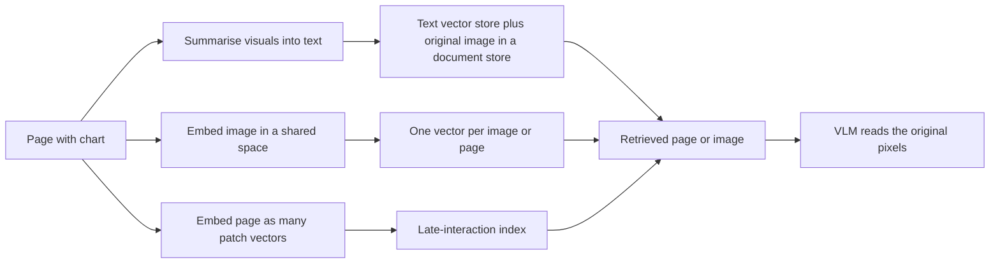

# 3 — Multimodal RAG

> Text RAG assumes the answer is in the words. In real documents the answer is often in a chart or a table that the parser flattened, so multimodal retrieval is mostly a decision about what to index: captions of the visuals, or the pages themselves.

A user of the invoice assistant asks, "Which supplier's prices rose most last year?" The answer exists, on page 14 of an annual supplier review, in a bar chart with no sentence describing it. Your text RAG pipeline parsed that page into the chart's title and some stray axis labels, embedded them, and will never find it. The retriever isn't weak. The pipeline threw the answer away before retrieval began. This chapter covers the three ways of keeping visual content searchable, the evidence comparing them, and how to run them at scale. It builds on the text pipeline in [the RAG pillar](../../../generative-ai/02-rag-retrieval/notes/01-rag-pipeline.md), and doesn't repeat chunking or reranking.

## Three ways to make a chart findable



**Summarise, then retrieve text.** A vision model writes a description of each table and figure. You embed the description with your existing text embedder, and keep a link back to the original image. At answer time you retrieve through the text but hand the model the pixels. You keep your existing retriever, you can use hybrid search, and a person can read what's indexed. It costs a vision call per visual element, and it fixes the summary's interpretation at index time: if the summary omits the number the user later asks about, retrieval can't help.

**Embed the image directly.** A contrastive model such as CLIP puts images and text in the same space, so a text query can find an image with no caption ([arXiv:2103.00020](https://arxiv.org/abs/2103.00020) (Radford et al., ICML 2021)). ImageBind extends this to six modalities, including audio, video and depth, by aligning each to images, which permits cross-modal retrieval and arithmetic on embeddings ([arXiv:2305.05665](https://arxiv.org/abs/2305.05665) (Girdhar et al., CVPR 2023)). This works well for photos. It works badly for documents, since these models were trained on natural images and captions, and one vector has to stand for a whole dense page.

**Embed the page as a set of patches.** ColPali drops parsing altogether. It runs a vision-language model over the page image and keeps a 128-dimensional vector for each patch, then scores queries by late interaction, the same scoring that ColBERT uses on text ([arXiv:2407.01449](https://arxiv.org/abs/2407.01449) (Faysse et al., ICLR 2025)).

## What the evidence says

Two studies are worth reading closely, since they test different things.

ColPali's authors built a benchmark of visually rich documents, ViDoRe, and reported nDCG@5 averaged across its datasets:

| System | Avg nDCG@5 |
|---|---|
| Nomic Embed Vision | 12.9 |
| Jina CLIP | 17.7 |
| SigLIP, off the shelf | 51.4 |
| BiPali: one vector per page, fine-tuned | 58.8 |
| Unstructured parser + OCR, BM25 / BGE-M3 | 65.5 / 66.1 |
| Unstructured parser + captioning, BM25 / BGE-M3 | 65.1 / 67.0 |
| ColPali | 81.3 |

Source: [arXiv:2407.01449](https://arxiv.org/abs/2407.01449), Table 2. The benchmark is the authors' own, built around visually rich documents, so read it as evidence about such pages and not all documents. Three findings carry over regardless.

First, the jump from one vector to late interaction (58.8 to 81.3) is the largest step in the table, on the same language model. Second, general contrastive models did poorly on documents, with the two weakest under 20. Third, the text-side baselines barely moved when they swapped BM25 for a neural embedder (65.5 versus 66.1, 65.1 versus 67.0). The authors' reading is that the bottleneck in industrial retrieval lies in the ingestion step and not the embedding model, so optimising the parser beats optimising the embedder on these documents.

Riedler and Langer tested an answer system on the other side, using 100 questions about industrial documents, with GPT-4V and LLaVA as answer models. They compared CLIP embeddings to textual image summaries in a multi-vector retriever, and included a gold-context setting as an upper bound. Multimodal RAG could outperform single-modality settings, image retrieval was harder than text retrieval, and summaries looked more promising than multimodal embeddings. Their scoring was an LLM acting as judge, and the authors treat human annotation as the gold standard it only approximates ([arXiv:2410.21943](https://arxiv.org/abs/2410.21943) (Riedler and Langer, 2024-10, preprint)). So in that test, a CLIP-style embedding lost to summaries. In ColPali's test, patch-level embeddings beat summaries. The two results agree once you see that "image embedding" covers both a single CLIP vector and more than a thousand patch vectors.

## Why late interaction works on pages

A single vector for a page has to average everything on it, and the chart you want is a small part of a page. Late interaction keeps the pieces. For each query token, it finds the best matching patch and sums those best scores, a rule called MaxSim. The code below builds synthetic data to show this: a query with two topics, one page where both topics appear in small regions amid a lot of background, and another page that is mildly similar to everything.

```python
import numpy as np

rng = np.random.default_rng(7)
D = 128

def unit(x):
    return x / np.linalg.norm(x, axis=-1, keepdims=True)

topic_price, topic_supplier = unit(rng.normal(size=(2, D)))
query = np.stack([topic_price, topic_supplier])

def page(noise_patches, signals):
    patches = list(rng.normal(size=(noise_patches, D)))
    patches += [s + 0.2 * rng.normal(size=D) / np.sqrt(D) for s in signals]
    return unit(np.array(patches))

# Page A holds the answer: two sharp regions in a sea of background patches.
page_a = page(1028, [topic_price, topic_supplier])
# Page B is vaguely about both topics everywhere, with no sharp region.
blend = unit(topic_price + topic_supplier)
page_b = unit(0.25 * blend + rng.normal(size=(1030, D)) / np.sqrt(D))

def maxsim(q, p):
    return float((q @ p.T).max(axis=1).sum())

def single_vector(q, p):
    return float(unit(q.mean(axis=0)) @ unit(p.mean(axis=0)))

for name, p in [("A (answer page)", page_a), ("B (vague page)", page_b)]:
    print(f"{name:<17} MaxSim {maxsim(query, p):5.2f}   single-vector {single_vector(query, p):5.2f}")
```

Output:

```text
A (answer page)   MaxSim  1.96   single-vector  0.09
B (vague page)    MaxSim  0.88   single-vector  0.99
```


The single vector prefers the vague page, because averaging over a thousand patches washes out the two sharp regions on the answer page. MaxSim prefers the answer page, because it asks only whether each query token has a strong match somewhere. It also gives you evidence for free. The patch that won for each query token shows where on the page the match came from, which the ColPali authors use for interpretability and which you can show users.

## The bill for keeping every patch

Late interaction stores far more per page. ColPali reports 257.5 KB per page for roughly a thousand 128-dimensional vectors at the naive setting ([arXiv:2407.01449](https://arxiv.org/abs/2407.01449)). Indexing, on the other hand, is faster than a full parse: 0.39 seconds per page on an L4 GPU for ColPali, against 7.22 seconds in the authors' measured pipeline of layout detection, OCR and captioning. Query encoding took about 30 ms on the same hardware, with a further cost for scoring that grows with corpus size. Pooling neighbouring patches is the first lever on storage: with a pool factor of 3, the number of vectors falls by 66.7% and 97.8% of the performance remains on average, though the text-dense dataset was a clear outlier.

Do the sum for your own corpus before you pick a store:

```python
def index_gb(pages, vectors_per_page, dim, bytes_per_value=2):
    return pages * vectors_per_page * dim * bytes_per_value / 1e9

corpus = 2_000_000  # pages
print(f"text chunks, 2.1 per page at 1024 dims, float32 : {index_gb(corpus, 2.1, 1024, 4):8.1f} GB")
print(f"one vector per page at 1024 dims, float32       : {index_gb(corpus, 1, 1024, 4):8.1f} GB")
print(f"patches, 1030 per page at 128 dims, 16-bit      : {index_gb(corpus, 1030, 128):8.1f} GB")
print(f"patches, pool factor 3                          : {index_gb(corpus, 1030 / 3, 128):8.1f} GB")
print("KB per page, unpooled:", 1030 * 128 * 2 / 1024)
```

Output:

```text
text chunks, 2.1 per page at 1024 dims, float32 :     17.2 GB
one vector per page at 1024 dims, float32       :      8.2 GB
patches, 1030 per page at 128 dims, 16-bit      :    527.4 GB
patches, pool factor 3                          :    175.8 GB
KB per page, unpooled: 257.5
```


The last line reproduces the paper's figure, which gives you confidence in the arithmetic. The result explains the common production design: use a cheap first stage to narrow to a few hundred pages, then rerank with late interaction. That first stage can be text or a single vector, since recall at a few hundred is a much easier job than precision at five. The [hybrid search note](../../../generative-ai/02-rag-retrieval/notes/03-keyword-semantic-and-hybrid-search.md) covers fusion in depth; here is the smallest version that merges a text route with a vision route:

```python
def rrf(rankings, k=60):
    """Reciprocal rank fusion over ranked lists of page ids."""
    scores = {}
    for ranking in rankings:
        for rank, page in enumerate(ranking, 1):
            scores[page] = scores.get(page, 0) + 1 / (k + rank)
    return sorted(scores, key=scores.get, reverse=True)

text_route = ["p3", "p9", "p14", "p2"]   # good on prose
vision_route = ["p14", "p7", "p3", "p21"]  # good on charts
print(rrf([text_route, vision_route])[:4])
```

Output:

```text
['p3', 'p14', 'p9', 'p7']
```


Pages found by both routes rise to the top, and neither route's raw scores need to be comparable. The chart page `p14`, third on text alone, now shares the top score with `p3`.

## Instructions change what an embedding means

The same text can need different embeddings for different tasks. INSTRUCTOR embeds each input together with a short instruction describing the task and domain, so a single model covers many uses without retraining ([doi:10.18653/v1/2023.findings-acl.71](https://doi.org/10.18653/v1/2023.findings-acl.71) (Su et al., Findings of ACL 2023)). UniIR applies the idea to multimodal retrieval: one model across several retrieval tasks, with the task named in an instruction. Its authors built the M-BEIR benchmark, and credit multi-task training plus instruction tuning for the generalisation they measured ([arXiv:2311.17136](https://arxiv.org/abs/2311.17136) (Wei et al., ECCV 2024)). When you pick a multimodal embedder, check whether it expects an instruction, because using it without one can quietly change results.

## Video adds time and chooses frames

A video is thousands of images plus audio, and the cost forces selection. VideoRAG ranks a corpus using 4 frames per video, then picks up to 32 frames, at 1 frame per second, for generation, with Whisper producing auxiliary text. It selects frames by relevance because the full combination space is impossibly large, and retrieving one video was enough in its experiments, since adding more raised cost with little benefit ([arXiv:2501.05874](https://arxiv.org/abs/2501.05874) (Jeong et al., Findings of ACL 2025)). For many business uses, such as recorded meetings or how-to clips, indexing the transcript with timestamps gets you most of the way. Frames then only need retrieving around the timestamp the transcript found. Try that before you build a frame index.

## Answering with the right evidence

Retrieval returns candidates. A vision model still has to read them, and everything in [chapter 1](01-image-input.md) applies. Send the original page, or a crop around the patches that matched, at a resolution where the text remains legible, and ask the model to cite the page and region. Then evaluate the stages separately, since the fix differs: if retrieval missed, change the index, and if the answer is wrong given the right page, change the reading step. The gold-context setting from Riedler and Langer is a simple way to measure this. Run your reader with the correct page handed to it, and the gap between that and your full system is what retrieval is costing you. [Chapter 7](07-evaluating-multimodal-systems.md) and [the RAG evaluation note](../../06-eval/notes/07-evaluating-rag-and-grounding.md) cover this in more detail.

## Choosing a design

| Situation | Start with |
|---|---|
| Mostly text, occasional figures | Text RAG plus summaries of visuals, original images stored for reading |
| Chart-heavy reports, slides, infographics | Late-interaction page retrieval, or a hybrid with a text first stage |
| Photos, product images, cross-modal search | A single contrastive embedding per image |
| Very large corpus with storage limits | Text or single-vector first stage, late-interaction rerank, token pooling |
| Video and meetings | Timestamped transcript first, frames near the hit |

## Pitfalls

- **Discarding visuals at ingestion.** Retrieval tuning can't recover what was never indexed. Check whether your gold answers survive parsing.
- **Evaluating on text-heavy queries only.** Multimodal gains show on visual questions, and your eval set must contain them.
- **Treating "image embedding" as one thing.** A single CLIP vector and a thousand patch vectors behave nothing alike on documents.
- **Letting captions go stale.** Summaries are bound to the model and prompt that wrote them. Record both, so you can regenerate.
- **Forgetting that the index itself is an attack surface.** A planted page can rank high and carry instructions. See [chapter 9.2](../../09-safety-and-security/notes/02-prompt-injection-and-jailbreaks.md).

## Try it

1. Increase `noise_patches` for page A from 1028 to 5000 in the MaxSim experiment. How do the two scoring methods respond?
2. Using `index_gb`, find the corpus size where the pooled patch index reaches a 1 TB budget.
3. Add a third ranking to `rrf` that places `p21` first. Which page leads now, and what does the `k` constant do?

<details><summary>Answers</summary>

1. MaxSim's score is unchanged in practice, since each query token still finds its sharp patch. The single-vector score falls further, because more background is averaged in. Late interaction scales with region sharpness, not page size.
2. Each pooled page costs `1030/3 × 128 × 2` bytes, about 87.9 KB, so 1 TB holds about 11.4 million pages.
3. `p3` and `p14` still lead at about 0.0323 each (`1/61 + 1/63`). `p21` now appears in two lists and scores about 0.0320 (`1/61 + 1/64`), so a first place doesn't beat them. `k` flattens the difference between ranks: a large `k` rewards appearing in many lists over a top rank in one.

</details>

## Interview questions

| Question | Answer |
|---|---|
| What is the first thing to check when a chart's answer is never retrieved? | Whether ingestion kept it. Parsers often reduce charts to stray labels, so no retriever can find them. Inspect the indexed text for known answers. |
| Summaries or image embeddings? | Summaries reuse text infrastructure and beat single CLIP vectors in Riedler and Langer's test, at a per-element vision cost. Patch-level embeddings beat summaries on visually rich pages in ColPali's benchmark, at a storage cost. |
| What is MaxSim? | For each query token, take the highest similarity across all document vectors, then sum over query tokens. It rewards a sharp local match, and averaging can't erase it. |
| How do you make late interaction affordable? | Pool neighbouring patches, quantise values, and use a cheap first stage so that late interaction only reranks a few hundred candidates. |
| How do you tell if retrieval or reading is the problem? | Hand the reader the gold page. Its score is an upper bound. The gap to your full system is retrieval's cost, and the gap from there to perfect is the reader's. |
| Why did swapping BM25 for a neural embedder barely help in ColPali's baselines? | The ingestion step had already lost the visual information, so a better text embedder only reads the same incomplete text better. |

## Next

[Chapter 4 — Speech and voice agents](04-speech-and-voice-agents.md) adds a modality with a clock: the assistant now has to hear and respond within a few hundred milliseconds.
