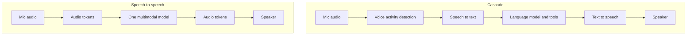

# 4 — Speech and Voice Agents

> Speech gives the assistant a deadline. People expect a reply in a few hundred milliseconds and expect to interrupt it, so a voice agent's design starts from a latency budget and from what happens when the transcript is wrong.

The invoice assistant gets a phone line. A customer calls and says, "I think you charged me twice on the April invoice." The caller doesn't wait politely. They pause mid-sentence, cough, start talking over the reply, and the line drops a word. The text version of this assistant never had a clock on it, and this one has a hard one. Words that arrive three seconds late sound broken no matter how good they are. This chapter works through how speech gets recognised and produced, the two architectures for a voice agent, how to spend the latency budget, and how to measure a recogniser honestly. [The real-time agents note](../../../generative-ai/07-agentic-applications/notes/03-real-time-multimodal-agents.md) covers agent architecture for real-time systems, and this chapter stays with the engineering of the audio itself.

## Hearing: how speech recognition got robust

Modern recognisers combine local and global patterns in sound. Conformer put convolution and self-attention together in one block, and on LibriSpeech it reached 2.1% word error rate on test-clean with no language model, with a small 10M-parameter version at 2.7% ([arXiv:2005.08100](https://arxiv.org/abs/2005.08100) (Gulati et al., Interspeech 2020)). That is a clean-audio benchmark of people reading books. Your callers aren't reading books.

Whisper attacked robustness through data. It trained on about 680,000 hours of web audio, weakly supervised by whatever transcripts came with it, and it splits audio into 30-second segments. On clean LibriSpeech its score was unremarkable, at 2.5 WER, but it held up much better on harder sets such as CHiME-6 and TED talks ([arXiv:2212.04356](https://arxiv.org/abs/2212.04356) (Radford et al., ICML 2023)). Its decoder also predicts a `<|nospeech|>` token, trained on segments with no speech in them, so a model that outputs one can double as a rough voice activity signal. The authors found that WER across languages tracked training hours closely, with an r² of 0.83, which is a good warning for any language you are about to launch in: check how much audio trained the model in that language.

Coverage has continued to expand. Meta's Omnilingual ASR reports open models for over 1,600 languages, more than 500 of them not served by earlier systems, from 300M to 7B parameters ([Omnilingual ASR](https://ai.meta.com/research/publications/omnilingual-asr-open-source-multilingual-speech-recognition-for-1600-languages/) (Meta, 2025)). Kimi-Audio is an example of a current audio foundation model, trained on 13 million hours ([Kimi-Audio report](https://github.com/MoonshotAI/Kimi-Audio/blob/master/assets/kimia_report.pdf) (Moonshot AI, 2025)).

## Speaking: audio as tokens

Producing speech with a language model needs a compact sequence of discrete tokens that can stand in for audio. Neural codecs provide this. SoundStream compresses audio with an encoder, a residual vector quantizer and a decoder, and one model covers 3 to 18 kbps ([arXiv:2107.03312](https://arxiv.org/abs/2107.03312) (Zeghidour et al., IEEE/ACM TASLP 2022)). EnCodec does the same in real time, with a streaming architecture ([arXiv:2210.13438](https://arxiv.org/abs/2210.13438) (Défossez et al., TMLR 2023)). VALL-E showed that once speech is codec tokens, a language model can do text-to-speech with zero-shot voice cloning from a three-second sample ([arXiv:2301.02111](https://arxiv.org/abs/2301.02111) (Wang et al., 2023-01, preprint)). That power brings a real risk, which is covered in [chapter 9.1](../../09-safety-and-security/notes/01-threat-model.md).

The token rate explains why this suits streaming. Kyutai's Mimi codec, used by Moshi, runs at 12.5 frames per second with 8 codebooks of 2,048 entries, which you can check directly:

```python
import math

frames_per_second = 12.5
codebooks = 8
codebook_size = 2048

bits_per_token = math.log2(codebook_size)
tokens_per_second = frames_per_second * codebooks
bitrate = tokens_per_second * bits_per_token

print(f"{tokens_per_second:.0f} tokens per second")
print(f"{bitrate / 1000:.1f} kbps")
print(f"one frame lasts {1000 / frames_per_second:.0f} ms")
print(f"raw 16-bit 24 kHz audio is {16 * 24000 / 1000:.0f} kbps, ratio {16 * 24000 / bitrate:.0f}x")
```

Output:

```text
100 tokens per second
1.1 kbps
one frame lasts 80 ms
raw 16-bit 24 kHz audio is 384 kbps, ratio 349x
```


A frame of 80 ms sets a floor on how quickly such a system can react, and 1.1 kbps is low enough to stream on nearly any connection. Multimodal models like AudioPaLM ([arXiv:2306.12925](https://arxiv.org/abs/2306.12925) (Rubenstein et al., 2023-06, preprint)) and Spectron ([arXiv:2305.15255](https://arxiv.org/abs/2305.15255) (Nachmani et al., ICLR 2024)) train language models directly on audio representations, which leads to the second architecture below.

## Two architectures



**The cascade.** VAD finds speech, ASR writes it down, a language model thinks, TTS speaks. You can pick the best model for each stage, the transcript is text you can log and audit, and every existing text tool, including guardrails, works unchanged. The cost is latency, which accumulates at every stage, and the loss of anything that isn't words: tone, hesitation, a laugh.

**Speech-to-speech.** One model takes audio in and sends audio out. Moshi argues the case directly: compositional systems take several seconds where natural conversation needs a few hundred milliseconds, they lose non-linguistic information, and turn-based design ignores the 10 to 20% of spoken time that people overlap. Its model listens and talks in parallel streams at a theoretical 160 ms and about 200 ms in practice, on the authors' hardware. Its Inner Monologue method prefixes the audio output with its text transcript, which they report helps with both recognition and speech ([arXiv:2410.00037](https://arxiv.org/abs/2410.00037) (Défossez et al., 2024-10, preprint)). Qwen2.5-Omni's Thinker-Talker splits the same model into a reasoning part and a part that turns its hidden states into streaming audio, and reports that speech-instruction performance comes close to text on benchmarks like MMLU and GSM8K ([Qwen2.5-Omni report](https://github.com/QwenLM/Qwen2.5-Omni/blob/main/assets/Qwen2.5_Omni.pdf) (Qwen Team, 2025-03)).

| | Cascade | Speech-to-speech |
|---|---|---|
| Latency | Sum of the stages | Low, can be full-duplex |
| Audit trail | Transcript at every step | You need to add one, such as a text track |
| Tone and emotion | Lost at ASR | Kept |
| Swapping a part | Replace one stage | Replace the model |
| Tool calls and business logic | Natural | Depends on the model's support |
| Guardrails | Standard text guards | Must work on audio or on a parallel transcript |

For a regulated use such as disputing a charge, the audit trail and tool calling usually decide it: a cascade today, with streaming in every stage. A companion or a tutor might go the other way. The decision also changes with time, since models with audio input and output keep gaining tool support, so re-check before you commit.

## Spending the latency budget

Treat response latency as a budget in milliseconds and write it down for each stage, with the figure measured at the 95th percentile. The numbers below are planning placeholders, not measurements of any product, so replace them with your own:

```python
budgets = {
    "cascade, batch stages": {
        "network in": 40, "VAD end of speech": 500, "ASR final": 300,
        "LLM to first token": 500, "LLM full reply": 900, "TTS full audio": 400, "network out": 40},
    "cascade, streaming": {
        "network in": 40, "VAD end of speech": 300, "ASR partial": 60,
        "LLM to first token": 400, "TTS first audio": 100, "network out": 40},
    "speech-to-speech": {
        "network in": 40, "model first audio": 200, "network out": 40},
}
TARGET = 800
for name, stages in budgets.items():
    total = sum(stages.values())
    worst = max(stages, key=stages.get)
    verdict = "within" if total <= TARGET else "over"
    print(f"{name:<24}{total:>6} ms  {verdict} {TARGET} ms  largest: {worst} ({stages[worst]} ms)")
```

Output:

```text
cascade, batch stages     2680 ms  over 800 ms  largest: LLM full reply (900 ms)
cascade, streaming         940 ms  over 800 ms  largest: LLM to first token (400 ms)
speech-to-speech           280 ms  within 800 ms  largest: model first audio (200 ms)
```


Two things stand out when you lay it out this way. Moving to streaming saves far more than a faster model would, because the listener only needs the first syllable, not the full reply. And even the streaming cascade is over target with these placeholders, with deciding that the person has finished as one of its largest lines, which isn't a model speed problem at all. Cut the VAD silence window too far and you interrupt people, so test this value on real callers. The remaining options are a smaller model for simple turns and a short spoken acknowledgement while a slower step runs.

## Interruption is a state machine

People interrupt, and a voice agent that keeps talking feels broken. Handling this means stopping playback, discarding unspoken text, and telling the language model what the user actually heard, because its context otherwise claims it said everything it generated. Getting this wrong has real consequences. The agent can believe it read out a refund policy that the caller never heard. A small explicit state machine makes the behaviour testable:

```python
class Turn:
    def __init__(self):
        self.state = "listening"
        self.spoken = []
        self.queued = []
        self.history = []

    def reply(self, sentences):
        self.queued = list(sentences)
        self.state = "speaking"

    def tick(self):
        """One sentence finishes playing."""
        if self.state == "speaking" and self.queued:
            self.spoken.append(self.queued.pop(0))
            if not self.queued:
                self._commit(interrupted=False)

    def barge_in(self):
        if self.state == "speaking":
            self.queued.clear()
            self._commit(interrupted=True)

    def _commit(self, interrupted):
        text = " ".join(self.spoken)
        self.history.append({"role": "assistant", "text": text, "interrupted": interrupted})
        self.spoken = []
        self.state = "listening"

t = Turn()
t.reply(["I can see two charges on April.", "The second is a refund hold.", "It clears in five days."])
t.tick()
t.barge_in()  # caller talks over the second sentence
print(t.state)
print(t.history)
```

Output:

```text
listening
[{'role': 'assistant', 'text': 'I can see two charges on April.', 'interrupted': True}]
```


The history holds only what the caller heard, with a flag the model can see. A real implementation works on word timestamps from the TTS engine and not on whole sentences, but the invariant is the same, and you can write regression tests against it.

## Measuring recognition honestly

Word error rate is substitutions, insertions and deletions over reference words. It looks simple, but small choices about text move it a lot. The Whisper authors built a text normaliser by inspecting failures, and found it could drop WER by up to 50% on some datasets because of quirks in reference transcripts, while warning that the same normaliser could end up tuned to their model's habits ([arXiv:2212.04356](https://arxiv.org/abs/2212.04356)). So compare systems with one shared normaliser, and report which one it was.

```python
import re

def normalise(text):
    text = text.lower()
    text = re.sub(r"[^\w\s]", "", text)
    for a, b in {"twenty": "20", "two": "2", "euros": "eur"}.items():
        text = re.sub(rf"\b{a}\b", b, text)
    return text.split()

def wer(ref, hyp):
    prev = list(range(len(hyp) + 1))
    for i, r in enumerate(ref, 1):
        cur = [i]
        for j, h in enumerate(hyp, 1):
            cur.append(min(prev[j] + 1, cur[-1] + 1, prev[j - 1] + (r != h)))
        prev = cur
    return prev[-1] / max(1, len(ref))

ref = "You charged me twenty euros twice on the April invoice."
hyp_style = "you charged me 20 EUR twice on the april invoice"
hyp_wrong = "you charged me 70 euros twice on the april invoice"

raw = lambda s: s.split()
print("raw WER, style difference only :", round(wer(raw(ref), raw(hyp_style)), 3))
print("norm WER, style difference only:", round(wer(normalise(ref), normalise(hyp_style)), 3))
print("norm WER, wrong amount         :", round(wer(normalise(ref), normalise(hyp_wrong)), 3))

critical = {"20", "2"}
missed = critical & set(normalise(ref)) - set(normalise(hyp_wrong))
print("critical terms missed          :", missed)
```

Output:

```text
raw WER, style difference only : 0.5
norm WER, style difference only: 0.0
norm WER, wrong amount         : 0.1
critical terms missed          : {'20'}
```


The wrong-amount transcript scores about 10% WER, which might pass a threshold, while being the worst possible error for this product. So alongside WER, track recall on critical terms: amounts, dates, names, account numbers. Test across accents, handsets and noise, and report each group separately, since an average can hide a group the system fails.

For the agent as a whole, measure things the caller feels: time to first audio, how often it talks over people, how often it is interrupted, task completion, and how often callers repeat themselves. Repeats are a good proxy for recognition failure on live traffic without any reference transcripts.

## Pitfalls

- **Benchmarking on read speech.** Clean audiobook WER predicts little about a call centre. Build a test set from your own channel.
- **Confirming nothing.** A misheard amount becomes a real action. Read back any value you will act on, and confirm it before calling the tool.
- **Telling the model it said what it never said.** Commit only spoken text to history, as the state machine above does.
- **Treating the VAD threshold as a detail.** It decides both responsiveness and how often you cut people off.
- **Assuming a voice is proof of identity.** Short samples can clone a voice. Use a real authentication factor for account actions.
- **Forgetting audio retention rules.** Voice is often regulated personal data. Decide what is stored, where, and for how long, before you record.

## Try it

1. Change the Mimi numbers to 25 frames per second and 4 codebooks. What happens to the bit rate and the reaction floor, and what do you gain?
2. Add a "tool call in flight" state to `Turn`. What should `barge_in` do if the agent has already called a refund tool?
3. Compute WER on two reference sentences where one is 50 words and one is 5, each with one error. Why is averaging per-sentence WER misleading, and what should you do instead?

<details><summary>Answers</summary>

1. The bit rate is unchanged at 1.1 kbps (`25 × 4 × 11` bits), while the frame falls to 40 ms, halving the reaction floor. The cost is that each frame has fewer codebooks and so fewer bits, so audio quality is likely to suffer at the same rate, and the model must produce more frames per second.
2. Stop speaking, but don't discard the tool's outcome. The action may have happened, so record the tool result in history and tell the caller the true state on the next turn. Consequential actions should normally need confirmation before this point.
3. Per-sentence WERs are 2% and 20%, averaging to 11%, while the corpus WER is `2/55`, about 3.6%. Averaging over-weights short sentences, so divide total errors by total reference words across the corpus.

</details>

## Interview questions

| Question | Answer |
|---|---|
| Cascade or speech-to-speech for a banking agent? | Usually a cascade with streaming, because of the transcript for audit, standard guardrails and mature tool calling, accepting more latency. Revisit as speech-to-speech models improve on those points. |
| Where does cascade latency go? | End-of-speech detection, the time to the LLM's first token, and the first TTS audio. Streaming every stage helps more than a faster model, since only the first audio matters for perceived speed. |
| What is a neural codec's role in a voice model? | It turns audio into a compact sequence of discrete tokens a language model can predict, at low bit rates. Its frame length sets a floor on reaction time. |
| Why is WER not enough? | It weights every word equally, so a wrong amount looks like a wrong article. Add recall on critical terms, and break results down by accent and channel. |
| How should a text normaliser be handled? | Use one shared normaliser for all compared systems and report it. It can change WER by a large margin, and it can be fit, even by accident, to one model's habits. |
| What must happen on barge-in? | Stop playback, drop the unspoken text, record only what was heard, and preserve any tool result already obtained, so that the model's context matches reality. |

## Next

[Chapter 5 — How image generators work](05-how-image-generators-work.md) turns from understanding media to making it, starting with how a diffusion model gets from noise to a picture.
