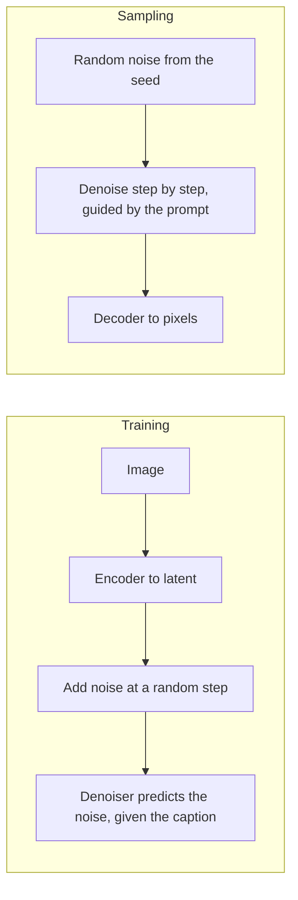

# 5 — How Image Generators Work

> A diffusion model learns to undo noise, and the sampler decides how many steps that takes. Knowing this much explains why seeds reproduce images, why 20 to 50 steps is enough, and what the guidance scale really does.

Marketing for the invoice assistant wants generated illustrations for its help pages, and a developer's first attempt behaves strangely. The same prompt gives a different image every time, changing the step count changes the composition, and pushing the guidance scale from 7 to 20 produces harsh, oversaturated pictures. None of this is mysterious once you know what the model does between noise and picture. This chapter explains the mechanism and the families of generator that compete with it. [Chapter 6](06-generating-images-and-video.md) then turns it into the controls you set in production.

## Learning to undo noise

A diffusion model is trained by adding random noise to an image over many steps and learning to reverse it. Each denoising prediction is conditioned on the image's caption, so the trained model can start from pure noise and denoise toward an image that matches a prompt (*Prompt Engineering for GenAI*, ch. 7). Stable Diffusion runs this process in a compressed latent space: an encoder maps images into latent space, the denoiser works there, and a decoder turns the result back into pixels. That is why it fit on a consumer GPU with 8 GB of VRAM when it was released open source in August 2022 (ch. 7). The design comes from latent diffusion ([arXiv:2112.10752](https://arxiv.org/abs/2112.10752) (Rombach et al., CVPR 2022)). Its autoencoder is trained with perceptual and adversarial losses. The KL penalty it borrows from the VAE ([arXiv:1312.6114](https://arxiv.org/abs/1312.6114) (Kingma & Welling, ICLR 2014)) is weighted only about 10⁻⁶, so the latent is close to deterministic. On class-conditional ImageNet 256×256, a latent model at 4× downsampling reached FID 3.60 after 271 V100-days of training. The pixel-space ADM scored 4.59 after 962. The authors list two costs. The decoder limits fine pixel-level accuracy, and sampling is still sequential and slower than a GAN.



## Why 20 to 50 steps is enough

The idea goes back to Sohl-Dickstein et al. ([arXiv:1503.03585](https://arxiv.org/abs/1503.03585), ICML 2015) and to score matching ([arXiv:1907.05600](https://arxiv.org/abs/1907.05600) (Song & Ermon, NeurIPS 2019)). The 2015 model already ran a 1,000-step chain and could inpaint, and its log-likelihood bounds held up on small datasets: higher than the best earlier model on dead-leaves images (1.49 vs 1.24 bits per pixel) and comparable to other models on MNIST. It reported no sample-quality numbers.

DDPM made it work: the network predicts the added noise, trained over T = 1,000 steps on a linear noise schedule. That reached an FID of 3.17 on unconditional CIFAR-10. Sampling also ran all 1,000 steps, so 128 images at 256×256 took 300 s on a TPU v3-8 ([arXiv:2006.11239](https://arxiv.org/abs/2006.11239) (Ho et al., NeurIPS 2020)). DDIM keeps the same trained model and swaps the sampler for a deterministic one that skips steps. On CIFAR-10, DDIM scores **FID 4.67 at 50 steps against 4.04 at 1,000**, and 13.36 at 10 steps. DDPM's own sampler cut to 50 steps scores 32.72 ([arXiv:2010.02502](https://arxiv.org/abs/2010.02502) (Song et al., ICLR 2021), Table 1). Learned variances and a cosine noise schedule did the same for the DDPM sampler, bringing it down to about 50 forward passes ([arXiv:2102.09672](https://arxiv.org/abs/2102.09672) (Nichol & Dhariwal, ICML 2021)).

The sampler, not the model, sets how few steps you can get away with. The score-SDE paper shows why ([arXiv:2011.13456](https://arxiv.org/abs/2011.13456) (Song et al., ICLR 2021)). DDPM and score matching are two ways of discretizing one stochastic differential equation. The same trained network also defines a deterministic "probability-flow" ODE with the same marginals. Off-the-shelf ODE solvers can integrate that ODE with over 90% fewer network evaluations and no visible loss in quality. Consistency models train a network to jump from any point on that ODE trajectory straight to its end, which gets sampling down to one or two steps. Distilled from a diffusion model, one reached CIFAR-10 FID 3.55 in one step and 2.93 in two, against DDIM's 4.67 at 50 ([arXiv:2303.01469](https://arxiv.org/abs/2303.01469) (Song et al., ICML 2023)). These numbers are for small unconditional models. The 20–30-step defaults in [chapter 6](06-generating-images-and-video.md#the-controls) come from later samplers built on the same idea.

You can see the sampler effect and the guidance effect with no GPU, because for a toy distribution the ideal denoiser has a closed form. The code below uses two narrow clusters of one-dimensional values, at −2 and +2, as the "images". "Right" stands for a prompt that asks for the cluster at +2. Using an exact denoiser removes training error, so anything that goes wrong is due to the sampler.

```python
import numpy as np
SIGMA, MU = 0.25, 2.0
betas = np.linspace(1e-4, 0.02, 1000)
abar = np.cumprod(1 - betas)
def eps(x, t, cond=None):
    a, s2 = np.sqrt(abar[t]), 1 - abar[t]
    var = a**2 * SIGMA**2 + s2
    centres = [a * MU] if cond == "right" else [a * MU, -a * MU]
    logw = np.stack([-(x - c)**2 / (2 * var) for c in centres])
    w = np.exp(logw - logw.max(axis=0))
    w = w / w.sum(axis=0)
    score = sum(wi * (c - x) / var for wi, c in zip(w, centres))
    return -np.sqrt(s2) * score
def sample(steps, eta, n=4000, seed=0, guidance=None):
    rng = np.random.default_rng(seed)
    x = rng.normal(size=n)
    ts = np.linspace(999, 0, steps).round().astype(int)
    for i, t in enumerate(ts):
        ab_t = abar[t]
        ab_s = abar[ts[i + 1]] if i + 1 < steps else 1.0
        if guidance is None:
            e = eps(x, t)
        else:
            e_u, e_c = eps(x, t), eps(x, t, "right")
            e = e_u + guidance * (e_c - e_u)
        x0 = (x - np.sqrt(1 - ab_t) * e) / np.sqrt(ab_t)
        sig = eta * np.sqrt((1 - ab_s) / (1 - ab_t) * (1 - ab_t / ab_s))
        x = np.sqrt(ab_s) * x0 + np.sqrt(np.maximum(1 - ab_s - sig**2, 0)) * e + sig * rng.normal(size=n)
    return x
target = np.sort(np.random.default_rng(1).normal(size=4000) * SIGMA + np.random.default_rng(2).choice([-MU, MU], 4000))
def w1(x): return float(np.abs(np.sort(x) - target).mean())
print("steps  stochastic(eta=1)  deterministic(eta=0)   (distance to true distribution)")
for steps in (1000, 50, 20, 10, 5):
    print(f"{steps:>5}  {w1(sample(steps, 1.0)):>17.3f}  {w1(sample(steps, 0.0)):>20.3f}")
a, b = sample(20, 0.0, seed=42), sample(20, 0.0, seed=42)
print("same seed, same sampler reproduces exactly:", bool(np.array_equal(a, b)))
print("\nguidance  share right  mean of right mode  std of right mode")
for g in (0.0, 1.0, 3.0, 7.5, 15.0):
    x = sample(30, 0.0, guidance=g)
    r = x[x > 0]
    print(f"{g:>8.1f}  {len(r) / len(x):>11.2f}  {r.mean():>18.2f}  {r.std():>17.2f}")
```

Output:

```text
steps  stochastic(eta=1)  deterministic(eta=0)   (distance to true distribution)
 1000              0.015                 0.032
   50              0.040                 0.044
   20              0.060                 0.064
   10              0.117                 0.094
    5              0.385                 0.293
same seed, same sampler reproduces exactly: True

guidance  share right  mean of right mode  std of right mode
     0.0         0.49                1.98               0.22
     1.0         1.00                1.99               0.21
     3.0         1.00                2.23               0.13
     7.5         1.00                2.48               0.10
    15.0         1.00                2.74               0.09
```


Two caveats on the first table. The denoiser is exact here, so this shows discretisation error alone, and it only hints at the far larger gap DDIM's authors measured on real networks. Below about 10 steps the deterministic sampler pulls ahead, but above that the two are close and neither is what you would see on images. What carries over is the shape: error stays low across a wide range of step counts, then rises sharply at very few steps, and a deterministic sampler reproduces its output exactly from the same seed.

The second table shows what classifier-free guidance does. Guidance extrapolates from the unconditional prediction past the conditional one ([arXiv:2207.12598](https://arxiv.org/abs/2207.12598) (Ho & Salimans, NeurIPS 2021 workshop, preprint)). A scale of 1 is the plain conditional model, and all samples move to the requested cluster. Raising the scale pushes samples past the true mean of 2 and squeezes their spread to under half, the toy version of the saturated, repetitive images that very high guidance gives. Adherence to the prompt goes up, variety goes down, and past a point the output no longer looks like the training data. [Chapter 6](06-generating-images-and-video.md#the-controls) gives the working ranges.

## What this means for engineers

The latent space is continuous. Interpolating between two points in it, say a dog and a bowl of fruit, gives a valid image at every step along the way (ch. 7). Engineering consequences:

- **Generation is sampling.** The same prompt gives a different image on every run unless you fix the starting noise, which is set by the seed.
- **Early steps set composition and late steps set detail.** DDPM showed this directly: predicting the final image partway through sampling, "large scale image features appear first and details appear last" ([arXiv:2006.11239](https://arxiv.org/abs/2006.11239), §4.3). Several controls in chapter 6 exploit this: prompt editing, ControlNet's start and end steps, and SDXL's base-to-refiner switch.
- **Text encoders differ between model families.** SD 2 used OpenCLIP alone, so prompts tuned on SD 1.5 transferred poorly. SDXL combines OpenCLIP ViT-G/14 with OpenAI's CLIP ViT-L, which largely fixed this (ch. 9). The encoder matters more than its size in the spec sheet suggests. In Imagen, **scaling the frozen text encoder improved fidelity and image–text alignment more than scaling the image diffusion model**. T5-XXL and CLIP tied on COCO, but human raters preferred T5-XXL on DrawBench's compositional prompts ([arXiv:2205.11487](https://arxiv.org/abs/2205.11487) (Saharia et al., NeurIPS 2022)). DALL-E 2 conditions on a CLIP image embedding. Its authors report that this makes it worse than GLIDE at binding attributes to objects (a red cube on a blue cube) and at spelling text in the image ([arXiv:2204.06125](https://arxiv.org/abs/2204.06125) (Ramesh et al., 2022-04, preprint), §7).

## Not every generator is a diffusion model

The token route came first. DALL-E compressed a 256×256 image into a 32×32 grid of tokens from an 8,192-entry codebook. A 12B transformer predicted those 1,024 tokens after up to 256 text tokens, and the system kept the best of 512 samples as ranked by CLIP ([arXiv:2102.12092](https://arxiv.org/abs/2102.12092) (Ramesh et al., ICML 2021)). VQGAN trained the codebook with a perceptual loss and a patch discriminator, which kept detail at higher compression. Most later image tokenizers descend from it ([arXiv:2012.09841](https://arxiv.org/abs/2012.09841) (Esser et al., CVPR 2021)). Parti scaled the token approach to a 20B encoder-decoder, with a zero-shot COCO FID of 7.23 ([arXiv:2206.10789](https://arxiv.org/abs/2206.10789) (Yu et al., TMLR 2022)).

Chameleon ([arXiv:2405.09818](https://arxiv.org/abs/2405.09818) (Chameleon Team, 2024-05)) and Janus ([arXiv:2410.13848](https://arxiv.org/abs/2410.13848) (Wu et al., 2024-10)) turn an image into discrete VQ tokens and have the language model predict them one at a time, so one transformer both reads and draws images. Guidance survives the switch: Janus applies classifier-free guidance to the logits, l_u + s(l_c − l_u), with a default scale of 5. Janus also shows why a shared image tokenizer is a poor compromise. Sharing the generation tokenizer for understanding drops POPE from 87.0 to 60.1 at 1.3B, against separate SigLIP and VQ encoders.

Apple's AToken suggests the compromise can be trained away. It starts from SigLIP2, adds reconstruction losses, and uses one encoder for images, video and 3D. On ImageNet it reconstructs at 0.21 rFID while keeping 82.2% zero-shot accuracy. Its discrete variant generates ImageNet images at 2.23 gFID, against 1.76 for the specialised TokenBridge tokenizer and 2.51 for UniTok. Used frozen as the vision encoder of a 7B multimodal LLM, it roughly matched the Oryx-ViT encoder that model normally uses: AI2D 81.2 vs 80.4, OCRBench 74.5 vs 76.4. These numbers come from the vendor's own preprint, and the paper does not test the Janus setup of one transformer both reading and drawing through the shared tokenizer ([arXiv:2509.14476](https://arxiv.org/abs/2509.14476) (Lu et al., 2025-09, preprint)).

Janus-Pro-7B ([deepseek-ai/Janus](https://github.com/deepseek-ai/Janus/blob/main/janus_pro_tech_report.pdf) (Chen et al., 2025-01)) scores 0.80 on GenEval against 0.67 for DALL-E 3 and 0.74 for SD3-Medium, yet it outputs only 384×384 and its own report names fine detail and small faces as weak. GenEval checks that objects, counts and positions match the prompt; it does not measure resolution or quality. All three evaluations are run by the vendors.


*Image Source: Wu et al., [Janus: Decoupling Visual Encoding for Unified Multimodal Understanding and Generation](https://arxiv.org/abs/2410.13848) (2024), Fig. 2*

## Hybrids

The two approaches can share one model. Transfusion trains a single transformer with next-token loss on text and diffusion loss on continuous VAE patches of the image. On its scaling curves it matches a Chameleon-style discrete-token model's image FID with **34× less compute**. Its 7.3B model, trained on about 2T tokens of text and image patches, scores 0.63 on GenEval, against 0.55 for SDXL and 0.68 for SD3, which trained on synthetic captions ([arXiv:2408.11039](https://arxiv.org/abs/2408.11039) (Zhou et al., 2024-08)).

## Fast families: masked decoding and GANs

Two other families give up some quality for speed. The first is masked parallel decoding, from MaskGIT. It starts with every token masked and fills in the most confident ones over 8 iterations instead of 256 raster-order steps. On class-conditional ImageNet 256×256 it beat VQGAN's autoregressive decoder on FID (6.18 vs 15.78) ([arXiv:2202.04200](https://arxiv.org/abs/2202.04200) (Chang et al., CVPR 2022)). Muse applies it to text-to-image, producing a 256-token image in 24 steps. On Google's own TPUv4 timings, a batch of 256×256 images took 0.5 s on Muse-3B, 6.4 s on Parti-3B and 9.1 s on Imagen, and Muse reached a zero-shot COCO FID of 7.88 ([arXiv:2301.00704](https://arxiv.org/abs/2301.00704) (Chang et al., 2023-01)).

The original GAN trains a generator to fool a discriminator ([arXiv:1406.2661](https://arxiv.org/abs/1406.2661) (Goodfellow et al., NIPS 2014)). Sampling is one forward pass with no Markov chain. The model has no explicit likelihood, though. The paper already names the failure where the generator collapses many inputs onto the same output, now called mode collapse.

GigaGAN scales a StyleGAN-style GAN to 1B parameters. It makes a 512px image in one forward pass of 0.13 s, with a zero-shot COCO FID of 9.09 against 9.62 for Stable Diffusion v1.5, both on the authors' runs ([arXiv:2303.05511](https://arxiv.org/abs/2303.05511) (Kang et al., 2023-03)). Size alone did not get it there: a StyleGAN2 made 5.7× larger got worse (FID 29.91 to 34.07), and the model only scaled once the paper's attention and architecture changes were added. The authors concede its images trail DALL·E 2 in realism and composition.

StyleGAN-T, from the same month, shows where the GAN gap sits ([arXiv:2301.09515](https://arxiv.org/abs/2301.09515) (Sauer et al., ICML 2023)). At 64×64 it led zero-shot COCO (FID 7.30 against GLIDE's 7.40 and eDiff-I's 7.60) at 0.06 s per image against 10.9 s and 26.0 s on an A100. At 256×256 its FID almost doubled to 13.90 while eDiff-I improved to 6.95, so the super-resolution stage is the weak part. In its ablation the new discriminator (a frozen DINO ViT with light heads) did most of the work, cutting FID from 45.10 to 26.77. It shares DALL·E 2's CLIP text encoder and its failures: binding colours to objects and spelling text. Because it keeps a GAN latent space, prompt interpolation and style mixing still work. That latent space is StyleGAN's: a mapping network feeds per-layer styles, which split coarse attributes such as pose from fine ones such as hair ([arXiv:1812.04948](https://arxiv.org/abs/1812.04948) (Karras et al., CVPR 2019)). StyleGAN3 later removed the aliasing that made detail stick to pixel coordinates, an artifact that is most visible once the image moves ([arXiv:2106.12423](https://arxiv.org/abs/2106.12423) (Karras et al., NeurIPS 2021)).

Text-driven editing of real photos in that latent space needs two steps. StyleCLIP steers the latent with CLIP ([arXiv:2103.17249](https://arxiv.org/abs/2103.17249) (Patashnik et al., ICCV 2021)). Pivotal Tuning first inverts the photo and then fine-tunes the generator around it, which keeps a person's identity ([arXiv:2106.05744](https://arxiv.org/abs/2106.05744) (Roich et al., ACM TOG 2023)). DragGAN replaces the text with clicks: the user drags handle points to targets, and it optimizes the latent of a frozen StyleGAN2, alternating a feature-matching loss that moves each point one step with a nearest-neighbour search that finds where the point went ([arXiv:2305.10973](https://arxiv.org/abs/2305.10973) (Pan et al., SIGGRAPH 2023)). Moving face landmarks on FFHQ, it got within 2.44 px on average for one point, against 11.64 for the UserControllableLT baseline (12.93 with no edit), in about 2 s on an RTX 3090. Its edits stay on the GAN's learned manifold, so poses the training data lacked come out distorted, and real photos need PTI inversion first. All of these assume a curated, aligned domain such as cropped faces. Self-Distilled StyleGAN was needed just to train on raw internet photos ([arXiv:2202.12211](https://arxiv.org/abs/2202.12211) (Mokady et al., SIGGRAPH 2022)). That limit is why diffusion, which trains on any captioned image, took over general-purpose editing.

The course has no chapter yet on the rest of diffusion internals: U-Net versus DiT denoisers, and the noise schedule beyond this summary. When one is written, [generative-ai/01](../../../generative-ai/01-llm-fundamentals/README.md) is its home.

## Pitfalls

- **Comparing images across step counts and expecting the same composition.** A different step count follows a different path. Change one setting at a time, with the seed pinned.
- **Reading a benchmark from one family against another without checking the setup.** The FID and GenEval numbers in this chapter come from different datasets, resolutions and often the vendors' own runs.
- **Turning guidance up to fix a weak prompt.** It reduces variety and can distort the output. Improve the prompt first.
- **Assuming a text encoder swap is harmless.** Prompts tuned on one model family can transfer poorly to another.
- **Picking on speed alone.** One-step GANs and consistency models are fast, and the numbers above show where they lose ground: text binding, resolution, and general-purpose domains.

## Try it

1. In the toy sampler, change the guidance loop to include `guidance = -1.0`. Where do the samples go?
2. Sample with a different `seed` at guidance 3.0 and compare the means. What does the seed change, and what doesn't it?
3. Change `SIGMA` to `0.05` and rerun the first table. Compare the 5-step distance to the width of the clusters. What changes?

<details><summary>Answers</summary>

1. Guidance extrapolates away from the condition, so most samples are pushed to the negative side and well beyond the −2 cluster (a mean near −4.4 in one run at 30 steps). A negative prompt uses the same mechanism, with its prediction in place of the unconditional one.
2. A new seed changes which individual samples you get, while the distribution, and so its mean and spread, stays about the same. In a real model, that is why a seed changes the picture and not what the prompt asked for.
3. The absolute distance barely changes (about 0.25 against 0.29 with deterministic sampling), but the clusters are five times narrower, so the error goes from about 1.2 cluster widths to about 4.9. Coarse steps can get the broad position right and still miss fine structure, which is the toy version of why fine detail needs more steps than composition.

</details>

## Interview questions

| Question | Answer |
|---|---|
| What is a diffusion model trained to do? | Predict the noise added to an image at a random step, conditioned on the caption. Sampling starts from noise and applies that prediction repeatedly. |
| Why did DDIM cut steps without retraining? | It changes only the sampler. It uses the same trained model with a deterministic path that can skip steps. |
| What does latent diffusion buy? | Denoising in a compressed space cuts compute enough to run on a consumer GPU. The cost is the decoder's limit on fine pixel-level detail. |
| What does the guidance scale do mathematically? | It extrapolates from the unconditional prediction through the conditional one. High values increase prompt adherence and reduce variety, eventually distorting the output. |
| Why does an image reproduce only with the same seed and sampler? | The seed sets the starting noise. Each sampler then follows a different path from it, and stochastic samplers add further noise. |
| When would you consider a GAN or a masked decoder over diffusion? | When latency dominates and the domain is narrow, such as aligned faces, or for fast drafts. General-purpose quality and text binding favour diffusion and token models. |

## Next

[Chapter 6 — Generating images and video](06-generating-images-and-video.md) turns this mechanism into the settings, edits and provenance records you manage in production.
