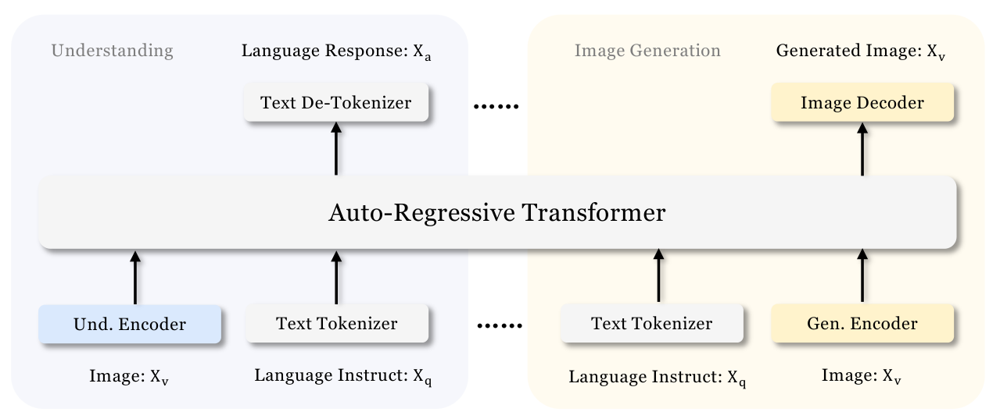

# 6 — Generating Images and Video

> An image model is a sampler you steer with a handful of numbers. Pin the seed, the sampler and the guidance scale, or you can't reproduce an image. Use masks and control images for edits. Fine-tune only when prompting can't name the subject. Treat any model you don't host as a dependency that can be withdrawn.

---

## How a diffusion model makes an image

A diffusion model is trained by adding random noise to an image over many steps and learning to reverse it. Each denoising prediction is conditioned on the image's caption, so the trained model can start from pure noise and denoise toward an image that matches a prompt (*Prompt Engineering for GenAI*, ch. 7). Stable Diffusion runs this process in a compressed latent space: an encoder maps images into latent space, the denoiser works there, and a decoder turns the result back into pixels. That is why it fit on a consumer GPU with 8 GB of VRAM when it was released open source in August 2022 (ch. 7).

The latent space is continuous. Interpolating between two points in it, say a dog and a bowl of fruit, gives a valid image at every step along the way (ch. 7). Engineering consequences:

- **Generation is sampling.** The same prompt gives a different image on every run unless you fix the starting noise, which is set by the seed.
- **Early steps set composition and late steps set detail.** Several controls below exploit this: prompt editing, ControlNet's start and end steps, and SDXL's base-to-refiner switch.
- **Text encoders differ between model families.** SD 2 used OpenCLIP alone, so prompts tuned on SD 1.5 transferred poorly. SDXL combines OpenCLIP ViT-G/14 with OpenAI's CLIP ViT-L, which largely fixed this (ch. 9).

**Not every image generator is a diffusion model.** Chameleon ([arXiv:2405.09818](https://arxiv.org/abs/2405.09818) (Chameleon Team, 2024-05)) and Janus ([arXiv:2410.13848](https://arxiv.org/abs/2410.13848) (Wu et al., 2024-10)) turn an image into discrete VQ tokens and have the language model predict them one at a time, so one transformer both reads and draws images. Guidance survives the switch: Janus applies classifier-free guidance to the logits, l_u + s(l_c − l_u), with a default scale of 5. Janus also shows why a shared image tokenizer is a poor compromise. Sharing the generation tokenizer for understanding drops POPE from 87.0 to 60.1 at 1.3B, against separate SigLIP and VQ encoders. Janus-Pro-7B ([deepseek-ai/Janus](https://github.com/deepseek-ai/Janus/blob/main/janus_pro_tech_report.pdf) (Chen et al., 2025-01)) scores 0.80 on GenEval against 0.67 for DALL-E 3 and 0.74 for SD3-Medium, yet it outputs only 384×384 and its own report names fine detail and small faces as weak. GenEval checks that objects, counts and positions match the prompt; it does not measure resolution or quality. All three evaluations are run by the vendors.


*Image Source: Wu et al., [Janus: Decoupling Visual Encoding for Unified Multimodal Understanding and Generation](https://arxiv.org/abs/2410.13848) (2024), Fig. 2*

The two approaches can share one model. Transfusion trains a single transformer with next-token loss on text and diffusion loss on continuous VAE patches of the image. On its scaling curves it matches a Chameleon-style discrete-token model's image FID with **34× less compute**. Its 7.3B model, trained on about 2T tokens of text and image patches, scores 0.63 on GenEval, against 0.55 for SDXL and 0.68 for SD3, which trained on synthetic captions ([arXiv:2408.11039](https://arxiv.org/abs/2408.11039) (Zhou et al., 2024-08)).

Two other families give up some quality for speed. Muse predicts masked VQ tokens in parallel rather than one at a time, producing a 256-token image in 24 steps. On Google's own TPUv4 timings, a batch of 256×256 images took 0.5 s on Muse-3B, 6.4 s on Parti-3B and 9.1 s on Imagen, and Muse reached a zero-shot COCO FID of 7.88 ([arXiv:2301.00704](https://arxiv.org/abs/2301.00704) (Chang et al., 2023-01)). GigaGAN scales a StyleGAN-style GAN to 1B parameters. It makes a 512px image in one forward pass of 0.13 s, with a zero-shot COCO FID of 9.09 against 9.62 for Stable Diffusion v1.5, both on the authors' runs ([arXiv:2303.05511](https://arxiv.org/abs/2303.05511) (Kang et al., 2023-03)). Size alone did not get it there: a StyleGAN2 made 5.7× larger got worse (FID 29.91 to 34.07), and the model only scaled once the paper's attention and architecture changes were added. The authors concede its images trail DALL·E 2 in realism and composition. Because it keeps a GAN latent space, prompt interpolation and style mixing still work.

The course has no note yet on diffusion internals: the noise schedule, U-Net vs. DiT denoisers, and why classifier-free guidance works. When one is written, [generative-ai/01](../../../generative-ai/01-llm-fundamentals/README.md) is its home.

## The controls

Every image API and local UI exposes some subset of these. Log all of them with every generated image.

| Control | What it does | Starting value (*Prompt Engineering for GenAI*, ch. 9) |
|---|---|---|
| **Seed** | Fixes the starting noise. Same seed + same settings + same model = same image | Any fixed integer. Reuse the seed of an image you liked when editing it |
| **Steps** | Number of denoising steps | 20–30 for most samplers; 50 in the diffusers example |
| **CFG scale** (`guidance_scale`) | How hard the denoiser follows the prompt instead of its own prior | 1 ≈ ignore the prompt · 3 creative · **7 balanced** · 15 adhere · 30 strict |
| **Sampler** | The numerical method that walks from noise to image | DPM++ 2M Karras or UniPC at 20–30 steps for stable, reproducible output |
| **Negative prompt** | Concepts to steer away from | `lowres, bad anatomy, worst quality` and the like |
| **Denoising strength** (img2img, inpainting) | How far the output may move from the input image: 0 returns the input, 1 ignores it | 0.2–0.4 for small fixes; up to 0.8 to replace an element |

**Ancestral samplers are not reproducible.** Samplers with an *a* in the name (Euler a and others) inject fresh noise at each step, so the image never converges and a fixed seed doesn't pin it (ch. 9). If a pipeline needs to regenerate an asset exactly (a product shot, a test fixture), use a non-ancestral sampler and record the library version too.

A minimal self-hosted call with Hugging Face `diffusers`, with every control set explicitly:

```python
import torch
from diffusers import AutoPipelineForText2Image

pipe = AutoPipelineForText2Image.from_pretrained(
    "stabilityai/stable-diffusion-xl-base-1.0", torch_dtype=torch.float16
).to("cuda")

image = pipe(
    prompt="an illustration of computers tied together, corporate memphis, white background",
    negative_prompt="lowres, blurry, text, watermark",
    num_inference_steps=30,
    guidance_scale=7.0,
    generator=torch.Generator("cuda").manual_seed(1024),  # the seed
).images[0]
image.save("out.png")
```

The book's version (ch. 9) pins `diffusers==0.11.1` and loads `CompVis/stable-diffusion-v1-4`. Both still illustrate the API, but neither is what you would deploy today.

### Prompt syntax in local UIs

AUTOMATIC1111 (and UIs that copied its syntax) parse weights out of the prompt (ch. 9):

- `(pirate)` multiplies the term's attention weight by 1.1, `((pirate))` by 1.21, `(pirate:1.5)` by 1.5. `[hat]` is 0.9.
- A down-weighted term is not a negative prompt. The term is still present, only weaker. Weights also work inside the negative prompt, to push a concept out harder.
- **Prompt editing** `[from:to:when]` switches prompts partway through sampling (`when` is a step count or a fraction). The early steps fix the shapes from `from`, and the late steps paint details from `to`.

This syntax belongs to the UI, not the model. Hosted APIs take a plain string, or a list of prompts with weights. The Stability v1 REST API took `text_prompts: [{text, weight}]`. Don't expect `(x:1.5)` to mean anything there.

The book suggests blending two celebrities with prompt editing so the result looks "vaguely familiar" without being recognizable, as a more ethical and legally sound option (ch. 9). Don't adopt that as policy. A blended likeness can still be recognizable, and right-of-publicity law doesn't care how you got there.

### Sweep, don't guess

The parameters interact: CFG and denoising strength, for example. The cheapest way to find good settings is a grid: fix the prompt and seed, vary two or three parameters, and render every combination (AUTOMATIC1111's X/Y/Z plot script, ch. 9). This is the image version of an eval sweep. It is only affordable when you host the model, or when per-image API prices are low enough to render a grid of dozens.

A vision-language model can do the first pass over the grid. GPT-4V rated prompt–image alignment on a 1–10 scale, giving 4 → 8 → 9 to three successively improved samples for "a parrot driving a car". It also caught misspelled text rendered on a cake ("Azuze Research" for "Azure Research"), and in a generate–critique–rewrite loop with SDXL it added the missing dog breed to the prompt ([arXiv:2309.17421](https://arxiv.org/abs/2309.17421) (Yang et al., 2023-09), §9.6, §10.3). These are hand-picked examples from an early GPT-4V, with no benchmark. Use a VLM judge to triage a grid and spot-check its scores before you trust them.

## Editing: img2img, inpainting, control images

Text-to-image controls style well and composition badly. Three tools fix that.

**img2img** starts sampling from a noised copy of an input image instead of pure noise. Denoising strength sets how much of the input survives (ch. 9). **Upscaling** is img2img run tile by tile: generate at low resolution, then upscale with a generic prompt like `highly detailed`, not the original prompt, which would repaint the whole scene inside every tile. The book's settings are 150–200+ steps, CFG 8–15 and denoising 0.1–0.2. That took 10–30 minutes per doubling on an M2 MacBook Air (ch. 9).

**Inpainting** regenerates only a masked region. In practice (ch. 9):

- Describe the whole image in the prompt, but change the subject to what should appear in the mask (`castle` → `statue`).
- Set the inpaint area to *Whole picture*. *Only masked* tries to fit the whole scene into the hole.
- Keep denoising at 0.2–0.4 for touch-ups. Above about 0.4, globally inconsistent elements and hallucinations start to appear.
- Fix one artifact per pass and iterate.

**Outpainting** is inpainting on a canvas extended with blank borders. It hallucinates more, such as a second castle in the sky (ch. 9).

**ControlNet** ([arXiv:2302.05543](https://arxiv.org/abs/2302.05543), Zhang, Rao & Agrawala, 2023) conditions generation on a structural map extracted from a reference image, alongside the prompt. The result keeps the reference's layout and changes its style (ch. 9):

| Preprocessor | Keeps | Good for |
|---|---|---|
| Canny | Sharp high-contrast edges | The default; detailed scenes such as a skyline in a new style. Can over-constrain |
| SoftEdge (HED) | Smoother outlines | Restyling and recoloring; handles faces better than Canny |
| Depth | Which objects are near and far | Keeping spatial layout when img2img would merge objects |
| Normal | Surface orientation | Texture and lighting; too much detail for faces |
| OpenPose | Body skeleton, hands, face | Transferring a pose; compose several skeletons for groups |
| M-LSD | Straight lines | Architecture and interiors |
| Segmentation | Labeled regions | Outdoor scenes, changing era or time of day |
| Scribble | A rough drawing | Composition from a sketch |

The preprocessor and the ControlNet model must match each other (a Canny map needs a Canny model), and the model must match the base model's version. *Control weight* acts like a prompt weight for the map. *Start* and *end control steps* limit when it applies: ending at 0.8 lets the model invent fine detail freely (ch. 9).

**Segment Anything** ([arXiv:2304.02643](https://arxiv.org/abs/2304.02643), Kirillov et al., 2023) produces the masks. It was trained on 11 million images and 1.1 billion masks, and it returns a mask from one to three clicked points, or masks every object in the image (ch. 9). Pair it with inpainting to replace a background behind a person without painting the mask by hand. The book found the AUTOMATIC1111 integration unreliable, so script SAM directly if you depend on it.

**An LLM can drive the editing tools.** Visual ChatGPT ([arXiv:2303.04671](https://arxiv.org/abs/2303.04671) (Wu et al., 2023-03)) put ChatGPT in front of 22 vision models, including captioning/VQA, Stable Diffusion, InstructPix2Pix and several ControlNets. The prompt describes each tool by name, usage and input/output format. Every intermediate image gets a filename of the form `{Name}_{Operation}_{Prev_Name}_{Org_Name}.png`, so you can read the chain of edits back from the name. The paper's evidence is case studies only, with no benchmark or baseline. The authors themselves list prompt brittleness, latency from chained calls, and a context window that caps how many tools fit. The lineage-in-the-filename trick is worth copying in any multi-step edit pipeline. Pair it with the parameter log under [Provenance](#provenance-and-training-data-risk).

## Customizing a model

Training a base model is out of reach: the book reports a cost of about $600,000 and 150,000 GPU hours for the original Stable Diffusion (ch. 9). Customization starts from a base model. Four methods:

| Method | What it trains | Output | Book's verdict (ch. 9), and what changed |
|---|---|---|---|
| **DreamBooth** ([arXiv:2208.12242](https://arxiv.org/abs/2208.12242), Ruiz et al., 2022) | All U-Net weights (optionally the text encoder) on 5–30 images of one subject, bound to a rare token such as `ukj` | A full checkpoint (~2 GB at fp16 for SD 1.5) | The most common method. 45–60 minutes on one GPU; 800 steps at lr 1e-6 with prior preservation in the book's Colab |
| **Textual Inversion** ([arXiv:2208.01618](https://arxiv.org/abs/2208.01618), Gal et al., 2022) | A new token embedding; the model is frozen | A few KB | Performs "far worse than DreamBooth" |
| **LoRA** ([arXiv:2106.09685](https://arxiv.org/abs/2106.09685), Hu et al., 2021) | Low-rank update matrices added to the frozen attention weights | Tens to hundreds of MB | Called "experimental", under 10% of Civitai models. **Dated:** LoRA has since become the usual way to share a style or subject fine-tune |
| **Hypernetworks** | A small network that generates weight offsets | Small | Experimental, rarely used |

**Correction.** The book says LoRA "adds new layers into the model and trains just those new layers". It doesn't add layers. It learns a low-rank update `BA` to existing weight matrices, which can be merged back into the weights so inference costs nothing extra. See [generative-ai/01 note 02](../../../generative-ai/01-llm-fundamentals/notes/02-training-and-adapting.md#parameter-efficient-fine-tuning).

Practical rules from the chapter:

- Train one concept per model. Multiple concepts in one run hurt quality.
- Use a trigger token that means nothing (`zwx`, `ukj`), and a class prompt (`photo of a person`) for the prior-preservation images, which stop the model forgetting the class.
- Fine-tuned checkpoints inherit the base model's resolution: generate at 512 × 512 on an SD 1.5 derivative.

## Hosted API or self-hosted

| | Hosted API | Self-hosted (diffusers, a local UI) |
|---|---|---|
| Cost | Per image. The book's figure for Stability's API: 1,000 credits for $10, about 5,000 images (ch. 9). Check current prices | GPU time. Sweeps and grids are cheap once the hardware is paid for |
| Control | What the vendor exposes: usually prompt, size, steps, CFG, seed | Everything: samplers, ControlNet, LoRAs, prompt syntax, custom pipelines |
| Stability | **The model can be withdrawn.** Stability deprecated the more permissive SD 1.5 in favor of 2.0 and XL, and users who had tuned prompts and parameters to it lost them (ch. 9) | You pin the weights, so the model doesn't change unless you change it |
| Safety | The vendor filters prompts and outputs | You own filtering, and the legal exposure |

Two operational rules from the self-hosted side (ch. 9):

- **Load `.safetensors`, never untrusted `.ckpt`.** A `.ckpt` is a Python pickle and can execute code when loaded. Community model hubs are a supply chain; see [09-safety-and-security](../../09-safety-and-security/README.md).
- **Split composition and detail across models when quality matters.** SDXL's base model sets composition and an optional refiner adds detail. "Switch at 0.6" with 30 steps runs 18 base steps and then 12 refiner steps. The book's best results came from 0.6 at 30 steps, with 0.4–1.0 and 20–50 steps the usual range.

**SDXL size, clarified.** The book gives SDXL 1.0 as "6.6 billion parameters, compared to 0.98 billion for the v1.5 model" (ch. 7, 9). Stability's 6.6B figure is the base-plus-refiner ensemble. The base model alone is about 3.5B, so compare 3.5B with 0.98B when choosing hardware.

## Provenance and training-data risk

**Metadata is the cheapest provenance, and the most fragile.** AUTOMATIC1111 writes the prompt and every setting into each PNG's metadata. That makes an image reproducible, but the metadata survives only until a site strips it on upload (ch. 9). Store generation parameters in your own database keyed by image hash; don't rely on the file. Signed manifests such as C2PA Content Credentials (not covered in the book) are the industry route for marking output as AI-generated. Invisible watermarks in the pixels or samples are weaker than they look. Moshi's authors found that an AudioSeal mark on 10-second clips, detected at 0.9999, dropped to 0.08 after one pass through their Mimi audio codec, which is no different from unmarked audio (0.09). They also note that removing the watermark from Stable Diffusion's open-source code took commenting out one line ([arXiv:2410.00037](https://arxiv.org/abs/2410.00037) (Défossez et al., 2024-09), §6.4). Re-encoding the media erases the mark, so treat a watermark as a hint, never as proof of origin.

**Memorization is rare, but not zero.** The book cites Carlini et al. to argue that a diffusion model is not a collage tool: of 350,000 training images the researchers tried to reproduce from Stable Diffusion, they succeeded with 109 (ch. 7; [arXiv:2301.13188](https://arxiv.org/abs/2301.13188), Carlini et al., 2023-01). The paper chose those 350,000 as the *most duplicated* images in the training set, where memorization is likeliest, so 109 is a floor for heavily duplicated content, not a rate for typical images. The engineering reading is that output can occasionally reproduce a training image nearly exactly, most likely for famous artworks, logos and stock photos, and that a rare copy is still a copy. Prompts that name a living artist or a trademark raise the odds.

**Mitigating bias is part of the product, and clumsy fixes backfire.** DALL-E 2 was found to silently append words like "black" or "female" to prompts such as "a photo of a doctor", to offset a skew in its training data. Google's Gemini image generation drew criticism in early 2024 for a similarly clumsy attempt (ch. 7). If your system rewrites prompts, log the rewritten prompt next to the user's, so you can audit what the model was actually asked.

## Video

The book doesn't cover video prompting. It records the timeline up to early 2024: RunwayML's Gen-2, AnimateDiff in the open-source community, Stable Video Diffusion (November 2023), and OpenAI's Sora (February 2024). It claims everything about image prompting carries over (ch. 7). The controls above do carry over: seed, steps, guidance, and an image as a conditioning input (image-to-video). What doesn't carry over is cost, since each second of video is many frames, and consistency between frames, which no single-image setting controls.

The open video models of 2023 started from a frozen image model and trained only new temporal layers. Video LDM inserts temporal attention and 3D-convolution layers between Stable Diffusion's frozen spatial layers and fine-tunes the autoencoder's decoder on video. Without that decoder fine-tune, reconstruction FVD on driving footage is 390.88; with it, 32.94 ([arXiv:2304.08818](https://arxiv.org/abs/2304.08818) (Blattmann et al., 2023-04)). Because the image layers stay frozen, the temporal layers drop into a DreamBooth-personalized checkpoint without retraining. Its zero-shot UCF-101 FVD of 550.61 still trailed Make-A-Video's 367.23. AnimateDiff turned this into the community workflow: a motion module trained once on SD 1.5 plugs into any personalized SD 1.5 checkpoint, and a MotionLoRA of about 30 MB learns a camera move from 20–50 reference clips in 1–2 hours ([arXiv:2307.04725](https://arxiv.org/abs/2307.04725) (Guo et al., 2023-07)). Its quantitative evidence is thin: a user ranking and CLIP scores against two adapted baselines, on prompts the authors chose.

Meta's Movie Gen shows what frame count costs at scale. It is a 30B transformer trained with flow matching on video latents compressed 8×8×8, and a 16-second 768px clip at 16 fps fills a context of about 73K tokens ([arXiv:2410.13720](https://arxiv.org/abs/2410.13720) (Polyak et al., 2024-10)). In Meta's own human evaluation its net win rate on overall quality was +35.0 against Runway Gen3, +8.2 against Sora, and +3.9 against Kling 1.5, which the paper counts as on par. Sora could only be judged on the videos OpenAI chose to publish, so Meta compared them with a hand-picked best of five from Movie Gen.

## What has dated

The chapters were written in 2023 for a 2024 book. Still sound: the controls table, the editing workflow, the customization trade-offs and the self-host vs. API comparison. Dated:

- The model lineup (DALL-E 2/3, Midjourney v5, SD 1.5/2/XL) and Stability's credit prices.
- "LoRA is experimental", as above.
- The diffusers version, and the `CompVis/stable-diffusion-v1-4` and `runwayml/stable-diffusion-v1-5` model IDs.
- AUTOMATIC1111 as the default power-user UI.

## Checklist

- [ ] Every generated image is stored with its model ID and version, seed, sampler, steps, CFG, prompt and negative prompt, and any rewritten prompt.
- [ ] Pipelines that must regenerate an image exactly use a non-ancestral sampler.
- [ ] Edits use masks or control images, not a re-roll of the whole prompt.
- [ ] Self-hosted weights are `.safetensors`, pinned by hash.
- [ ] A hosted model's deprecation would not break the product: prompts and settings are versioned per model.
- [ ] Prompts naming living artists, trademarks or real people are filtered or reviewed.
