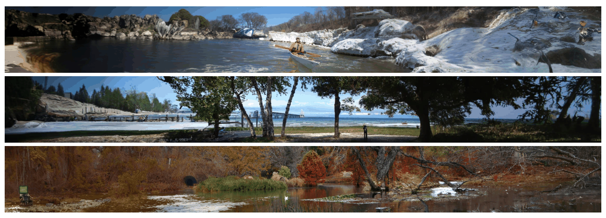

# 6b — Editing and customizing images

The invoice assistant's illustrator has a picture that is nearly right: one region is wrong, or the product has to look the same in every image. Re-rolling the prompt changes everything. This chapter covers the tools that change only what you mean to: masks, control images, img2img, and, when prompting can't name the subject, a customized model.

> Image generation, part two. [06](06-generating-images-and-video.md) covered the controls you log, the metrics, hosted against self-hosted, provenance, and video. Here: img2img, inpainting and control images, Segment Anything and LLM-driven editing, and DreamBooth, Textual Inversion and LoRA. Edit with a mask or a control image before you fine-tune.

---

## Editing: img2img, inpainting, control images

Text-to-image controls style well and composition badly. Three tools fix that.

**img2img** starts sampling from a noised copy of an input image instead of pure noise. Denoising strength sets how much of the input survives (ch. 9); SDEdit, which began the idea, is covered in [note 05](05-how-image-generators-work.md). **Upscaling** is img2img run tile by tile: generate at low resolution, then upscale with a generic prompt like `highly detailed`, not the original prompt, which would repaint the whole scene inside every tile. The book's settings are 150–200+ steps, CFG 8–15 and denoising 0.1–0.2. That took 10–30 minutes per doubling on an M2 MacBook Air (ch. 9). Hosted models such as Imagen and DALL-E 2 build it into a cascade that generates at 64×64 and runs one or two super-resolution diffusion models on top. A cascade only works if the upsamplers are trained on degraded low-resolution inputs (conditioning augmentation). Without it, a 16→64 cascade scored FID 6.02, worse than the 2.35 of a model trained directly at 64×64 ([arXiv:2106.15282](https://arxiv.org/abs/2106.15282) (Ho et al., JMLR 2022), §4.3). DALL-E 2's authors blame its 64×64 base for weak detail in complex scenes ([arXiv:2204.06125](https://arxiv.org/abs/2204.06125), §7). Matryoshka diffusion replaces the cascade with one network that denoises all resolutions at once. Its smaller-resolution UNets are nested inside the larger ones, and training grows from 64×64 to 1,024×1,024 ([arXiv:2310.15111](https://arxiv.org/abs/2310.15111) (Gu et al., ICLR 2024)). On ImageNet 256×256 it beat a cascade from the same 64×64 base, though the cascade had more parameters and twice the steps. At scale it only roughly matched latent diffusion: trained on 12M CC12M images, zero-shot COCO FID 13.43 against 12.63.

**Inpainting** regenerates only a masked region. In practice (ch. 9):

- Describe the whole image in the prompt, but change the subject to what should appear in the mask (`castle` → `statue`).
- Set the inpaint area to *Whole picture*. *Only masked* tries to fit the whole scene into the hole.
- Keep denoising at 0.2–0.4 for touch-ups. Above about 0.4, globally inconsistent elements and hallucinations start to appear.
- Fix one artifact per pass and iterate.

**Outpainting** is inpainting on a canvas extended with blank borders. It hallucinates more, such as a second castle in the sky (ch. 9).

Before text-guided tools, Palette showed one conditional diffusion recipe covering inpainting, uncropping, colorization and JPEG restoration ([arXiv:2111.05826](https://arxiv.org/abs/2111.05826) (Saharia et al., SIGGRAPH 2022)). It passes no mask to the network: the hole is filled with noise, the loss covers only the masked pixels, and the source image is concatenated to the noisy target of one U-Net (main models: 1M steps at batch 1024). On ImageNet 256×256 with 20–30% free-form masks it scored FID 5.2 against 9.4 for DeepFillv2 and 12.4 for HiFill (original images: 5.1); with a 128×128 centre mask, 6.6 against 18.0 and 20.1. The GAN baselines ran on 512×512 crops, so they saw more context. Uncropping 50% of the image gave FID 5.8 against 18.7 for Boundless, and raters were fooled by 40% of Palette outputs against 25% and 15% for two GAN baselines. Limits: 1,000 denoising steps (0.8 s per image on a TPUv4), slower than GANs by the authors' account; 256×256 only; no text prompt.

*Image Source: Saharia et al., [Palette: Image-to-Image Diffusion Models](https://arxiv.org/abs/2111.05826) (SIGGRAPH 2022), Fig. 2*

**Changing one word changes the whole image, unless you pin the attention.** With a fixed seed, editing "dog" to "white dog" usually gives a different dog in a different layout. Prompt-to-Prompt traced this to the cross-attention maps, which bind each prompt word to pixel regions, and it keeps the layout by reusing the original image's maps while sampling with the edited prompt. The same mechanism swaps a word, adds a style word, or reweights a word ([arXiv:2208.01626](https://arxiv.org/abs/2208.01626) (Hertz et al., ICLR 2023)). The idea of attending from words to image regions comes from AttnGAN, a text-to-image GAN that attended to individual words when drawing each subregion ([arXiv:1711.10485](https://arxiv.org/abs/1711.10485) (Xu et al., CVPR 2018)). The evidence is qualitative: example edits with no benchmark. The authors list three limits. Editing a real photo needs DDIM inversion first, which is often inaccurate, and lowering the guidance to reconstruct better also weakens the edit. The attention maps sit at the U-Net bottleneck, too low-resolution for precise local edits. The method can't move an object. When you need to keep the layout and change a word, a fixed seed is not enough: use an attention-injection edit, or inpaint the region.

**An instruction-following editor is trained on synthetic edits.** InstructPix2Pix takes an image and an instruction ("make it winter") and edits in one forward pass, about 9 s per 512px image on an A100, with no inversion ([arXiv:2211.09800](https://arxiv.org/abs/2211.09800) (Brooks et al., CVPR 2023)). Its training pairs were all generated. GPT-3, fine-tuned on 700 hand-written examples, wrote 454,445 caption–instruction–edited-caption triplets, and Stable Diffusion with Prompt-to-Prompt rendered each before/after pair, kept only when CLIP filters agreed. Stable Diffusion was then fine-tuned with the input image as extra channels and two guidance scales: s_I for faithfulness to the input image (1–1.5 worked best) and s_T for the instruction (5–10). The evidence is a plot against SDEdit with no human study. The authors list what fails: changing the viewpoint, swapping or counting objects, and isolating one object ("color the tie blue"). Its ceiling is whatever its data generators could render.

Generating from a map is older than diffusion. pix2pix trained a conditional GAN for each kind of paired translation, such as edges to photo or labels to street scene. It added an L1 loss for low frequencies and a patch discriminator for sharp detail, because L1 alone blurs ([arXiv:1611.07004](https://arxiv.org/abs/1611.07004) (Isola et al., CVPR 2017)). SPADE fixed a failure specific to segmentation maps: ordinary normalization layers "wash away" the label information, so SPADE feeds the map into every normalization layer instead ([arXiv:1903.07291](https://arxiv.org/abs/1903.07291) (Park et al., CVPR 2019)). Make-A-Scene brought the map into text-to-image, with an optional segmentation layout encoded as tokens next to the prompt ([arXiv:2203.13131](https://arxiv.org/abs/2203.13131) (Gafni et al., ECCV 2022)). Each of these trained a full model per condition. ControlNet's contribution is to add a condition to a model that already exists.

**ControlNet** ([arXiv:2302.05543](https://arxiv.org/abs/2302.05543) (Zhang, Rao & Agrawala, ICCV 2023)) conditions generation on a structural map extracted from a reference image, alongside the prompt. It locks Stable Diffusion and trains a copy of its encoder on the map. The copy connects back through **zero convolutions**, layers initialized to zero, so at step 0 the base model's output is unchanged and training can't damage it. The paper reports training as robust from under 50k to over 1M image pairs, and a depth model trained on one RTX 3090Ti that competed with industrial models. Training has no gradual phase. The model ignores the map, then follows it abruptly, usually within 10K steps ("sudden convergence"), so judge a run on samples rather than the loss curve. During training half the prompts were blanked, which is why ControlNet works from the map with an empty or vague prompt. The result keeps the reference's layout and changes its style (ch. 9):

| Preprocessor | Keeps | Good for |
|---|---|---|
| Canny | Sharp high-contrast edges | The default; detailed scenes such as a skyline in a new style. Can over-constrain |
| SoftEdge (HED) | Smoother outlines | Restyling and recoloring; handles faces better than Canny |
| Depth | Which objects are near and far | Keeping spatial layout when img2img would merge objects |
| Normal | Surface orientation | Texture and lighting; too much detail for faces |
| OpenPose | Body skeleton, hands, face | Transferring a pose; compose several skeletons for groups |
| M-LSD | Straight lines | Architecture and interiors |
| Segmentation | Labeled regions | Outdoor scenes, changing era or time of day |
| Scribble | A rough drawing | Composition from a sketch |

The preprocessor and the ControlNet model must match each other (a Canny map needs a Canny model), and the model must match the base model's version. *Control weight* acts like a prompt weight for the map. *Start* and *end control steps* limit when it applies: ending at 0.8 lets the model invent fine detail freely (ch. 9).

**The depth preprocessor is a model with its own limits.** Depth Anything ([arXiv:2401.10891](https://arxiv.org/abs/2401.10891) (Yang et al., CVPR 2024)) trained on 1.5M labeled and 62M unlabeled images: a teacher trained on the labels annotates the unlabeled set, an idea the paper traces to Lee's pseudo-labels (ICMLW 2013), and a fresh student learns from the labels and those annotations. **The extra images alone gave no consistent gain.** In ViT-L tests on six datasets excluded from training, adding them left KITTI AbsRel (mean relative depth error, lower is better) at 0.085 and moved NYUv2 from 0.053 to 0.054. Strongly perturbing the student's copies, then aligning its features to a frozen DINOv2 encoder, brought them to 0.076 and 0.043. Against MiDaS v3.1, its KITTI AbsRel was 0.076 to 0.127, and it won on all six sets, even though MiDaS had trained on KITTI and NYUv2 images. Both models' scale and shift were aligned to ground truth first. That tests near-versus-far structure, which is what a control map needs, not distance in metres. The smallest size, ViT-S, lost to MiDaS on NYUv2 and DIODE. The paper gives no latency figures. It claims a better depth-conditioned ControlNet, but the evidence is a side-by-side figure with no metric.

**Boxes are a lighter control than maps.** GLIGEN, from the same month as ControlNet, also freezes the base model and adds trainable layers that start as a no-op: a gated self-attention layer in each block, whose gate is initialized to zero ([arXiv:2301.07093](https://arxiv.org/abs/2301.07093) (Li et al., CVPR 2023)). Each grounding token pairs a phrase, encoded by the model's own CLIP text encoder, with a box, so objects can be placed by name, including categories missing from the box-training data. On COCO2017 layout-to-image it scored FID 21.04 and YOLO box AP 22.4, against 22.15 and 28.20 AP50 for TwFA and 13.40 for LAMA. Trained on COCO alone it placed LVIS objects at 6.4 AP, where real images score 25.2. The same timing knob appears here as *end control step*: GLIGEN applies the boxes for the first 20% of steps and then runs the plain model, which improved quality, because layout is set early. These numbers are on the latent diffusion model, not Stable Diffusion.

**Segment Anything** ([arXiv:2304.02643](https://arxiv.org/abs/2304.02643) (Kirillov et al., ICCV 2023)) produces the masks. It was trained on 11 million images and 1.1 billion masks, and it returns a mask from one to three clicked points, or masks every object in the image (ch. 9). For an ambiguous click it returns three nested masks (whole, part, subpart) with a predicted IoU for each, so pick the mask by score, not by position. The speed is lopsided. Once the image embedding is computed, each prompt takes 50 ms on CPU in a browser, but the heavy image encoder runs once per image and is not real-time. The paper lists its own limits: it misses fine structures, sometimes hallucinates small disconnected pieces, and draws less crisp boundaries than dedicated methods ([arXiv:2304.02643](https://arxiv.org/abs/2304.02643), §3 and Discussion). SAM 2 extends this to video with a memory bank, so one click or mask on a frame carries the object through the clip: on nine zero-shot video datasets in interactive evaluation it needed more than three times fewer interactions than SAM plus XMem++ or Cutie, and on SA-23 it beat SAM at one click (58.9 against 58.1 mIoU) at 130 against 22 frames per second, with both trained on SA-1B only ([SAM 2](https://arxiv.org/abs/2408.00714) (Ravi et al., 2024-08, preprint)). It still fails on shot changes, crowds and thin fast-moving objects. SAM 3 takes a short noun phrase or an example box instead of clicks and returns every matching instance, reaching cgF1 54.1 on its SA-Co/Gold benchmark against 72.8 for humans ([arXiv:2511.16719](https://arxiv.org/abs/2511.16719) (Carion et al., 2025-11, preprint)). Its prompts are short noun phrases, and niche domains such as thermal imagery need fine-tuning. Feather the mask before inpainting, for example to replace a background behind a person. The book found the AUTOMATIC1111 integration unreliable, so script SAM directly if you depend on it.

**An LLM can drive the editing tools.** Visual ChatGPT ([arXiv:2303.04671](https://arxiv.org/abs/2303.04671) (Wu et al., 2023-03)) put ChatGPT in front of 22 vision models, including captioning/VQA, Stable Diffusion, InstructPix2Pix and several ControlNets. The prompt describes each tool by name, usage and input/output format. Every intermediate image gets a filename of the form `{Name}_{Operation}_{Prev_Name}_{Org_Name}.png`, so you can read the chain of edits back from the name. The paper's evidence is case studies only, with no benchmark or baseline. The authors themselves list prompt brittleness, latency from chained calls, and a context window that caps how many tools fit. Copy the trick, paired with the parameter log under [Provenance](#provenance-and-training-data-risk).

## Customizing a model

Training a base model is out of reach: the book reports a cost of about $600,000 and 150,000 GPU hours for the original Stable Diffusion (ch. 9). Customization starts from a base model. Four methods:

| Method | What it trains | Output | Book's verdict (ch. 9), and what changed |
|---|---|---|---|
| **DreamBooth** ([arXiv:2208.12242](https://arxiv.org/abs/2208.12242) (Ruiz et al., CVPR 2023)) | All U-Net weights (optionally the text encoder) on images of one subject, bound to a rare token such as `ukj`. The book uses 5–30 images; the paper uses 3–5 | A full checkpoint (~2 GB at [fp16](../../../programming/computer-science/notes/04-numbers-and-memory.md#smaller-floats) for SD 1.5) | The most common method. The book: 45–60 minutes on one GPU, 800 steps at lr 1e-6 with prior preservation in its Colab. The paper: about 1,000 steps at lr 5e-6, about 5 minutes on one A100 for SD |
| **Textual Inversion** ([arXiv:2208.01618](https://arxiv.org/abs/2208.01618) (Gal et al., ICLR 2023)) | A new token embedding; the model is frozen | A few KB | Performs "far worse than DreamBooth". DreamBooth's paper agrees: subject fidelity (DINO) 0.668 vs 0.569 on SD, and raters preferred DreamBooth 68% to 22%. Its own authors say it catches a concept's "semantic essence" but struggles with precise shapes, and takes about 2 hours per concept on 2 V100s |
| **LoRA** ([arXiv:2106.09685](https://arxiv.org/abs/2106.09685), Hu et al., 2021) | [Low-rank](../../../generative-ai/01-llm-fundamentals/notes/02-attention-and-the-transformer-block.md#matrix-products-transpose-and-rank) update matrices added to the frozen attention weights | Tens to hundreds of MB | Called "experimental", under 10% of Civitai models. **Dated:** LoRA has since become the usual way to share a style or subject fine-tune |
| **Hypernetworks** | A small network that generates weight offsets | Small | Experimental, rarely used |

**Correction.** The book says LoRA "adds new layers into the model and trains just those new layers". It doesn't add layers. It learns a low-rank update `BA` to existing weight matrices, which can be merged back into the weights so inference costs nothing extra. See [generative-ai/01 note 09](../../../generative-ai/01-llm-fundamentals/notes/09-peft-and-fine-tuning-in-practice.md#parameter-efficient-fine-tuning).

Practical rules from the chapter:

- Train one concept per model. Multiple concepts in one run hurt quality.
- Use a trigger token that means nothing (`zwx`, `ukj`), and a class prompt (`photo of a person`) for the prior-preservation images, which stop the model forgetting the class. **The class noun matters more than the token.** In DreamBooth's ablation, subject fidelity (DINO) was 0.744 with the correct class noun, 0.454 with a wrong one and 0.303 with none. Without prior preservation (Imagen), class samples drifted toward the subject (PRES 0.664 vs 0.493 with it, lower is better) ([arXiv:2208.12242](https://arxiv.org/abs/2208.12242), Tables 3–4).
- Fine-tuned checkpoints inherit the base model's resolution: generate at 512 × 512 on an SD 1.5 derivative.

## Next

[Chapter 7 — Evaluating multimodal systems](07-evaluating-multimodal-systems.md) gathers the measurement ideas from this pillar and adds the tests that stop a model passing on shortcuts.
