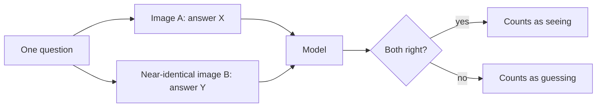

# 7 — Evaluating Multimodal Systems

> A vision model can score well without looking at the image. Multimodal evaluation is largely the craft of building tests where the shortcut fails: paired images, shuffled answers, and questions about things that aren't there.

The invoice assistant passes its benchmark at 90%, and users complain anyway. When you dig in, some correct answers didn't need the image at all, since most invoices in the test set had a due date thirty days after the issue date, so a guess worked. The model also says yes when asked about a stamp that isn't on the page, and its score drops if you reorder the multiple-choice options. All of these are the same failure: the evaluation rewarded something other than seeing. This chapter builds tests that punish the shortcuts. It then scores each part of the pillar, and it adds to the general methods in [the evaluation pillar](../../06-eval/README.md) without repeating them.

## The shortcut problem

Goyal et al. found this in the VQA dataset itself. Models could do well by learning what answers tend to follow a question's wording, with little help from the image. Their fix was to pair each image with a similar one where the same question has a different answer, which roughly doubled the number of image-question pairs. Testing on the balanced data, accuracy on yes/no questions dropped by about 10.8% for MCB and 12.4% for HieCoAtt, which showed how much of that ability had been language prior ([arXiv:1612.00837](https://arxiv.org/abs/1612.00837) (Goyal et al., CVPR 2017)).

You can apply that design to your own system immediately. It costs only some test authoring:



For invoices, take a real invoice and edit one field: change the amount, remove the stamp, shift the due date. The model must get both versions right. A blind guess or a language prior gets at most one of the pair right, unless the two answers happen to be the same.

## Three test designs against three shortcuts

**Shuffled options catch position bias.** MMBench uses CircularEval: a question with four options is asked four times, rotating which letter holds each option, and the model must pass all four to score. The effect can be severe. OpenFlamingo v2 fell from 36.7% under the plain protocol to 2.6%, and the gap between LLaVA-1.5 13B and 7B widened from 2.1% to 4.7% ([arXiv:2307.06281](https://arxiv.org/abs/2307.06281) (Liu et al., ECCV 2024)). MMBench also found that extracting the model's choice with GPT-4 matched humans 91.5% of the time, which is worth noting since answer parsing is its own source of error.

The rule is simple to implement, and a synthetic model with a known preference for option `A` shows how much a plain score can hide:

```python
import random

def rotate(options, shift):
    n = len(options)
    return [options[(i + shift) % n] for i in range(n)]

def plain_and_circular(items, model):
    plain = circular = 0
    for question, options, answer in items:
        results = []
        for shift in range(len(options)):
            shown = rotate(options, shift)
            results.append(shown[model(question, shown)] == answer)
        plain += results[0]
        circular += all(results)
    n = len(items)
    return plain / n, circular / n

rng = random.Random(0)
items = [(f"q{i}", ["w", "x", "y", "z"], "w") for i in range(400)]
items = [(q, rng.sample(o, 4), a) for q, o, a in items]

def knows_it(q, shown):
    return shown.index("w") if rng.random() < 0.9 else rng.randrange(4)

def picks_a(q, shown):
    return shown.index("w") if rng.random() < 0.25 else 0

for name, model in [("90% competent", knows_it), ("prefers option A", picks_a)]:
    plain, circ = plain_and_circular(items, model)
    print(f"{name:<18} plain {plain:.2f}   circular {circ:.2f}")
```

Output:

```text
90% competent      plain 0.91   circular 0.73
prefers option A   plain 0.44   circular 0.02
```


A model biased to one letter scores far above zero under the plain protocol, on luck and on any dataset imbalance. Under CircularEval, it collapses. A competent model loses something too, since all four rotations must pass, so report both scores and never compare a circular score with a plain one.

**Absent-object questions catch yes-bias.** Li et al. showed that the usual way of measuring hallucination, asking for a description and then checking it, is sensitive to how the prompt is phrased and biased toward short captions. Their POPE protocol asks yes/no questions about objects that are present and absent, with negatives sampled three ways: at random, by frequency in the data, and by co-occurrence with objects in the image. Objects that are frequent or co-occur often get hallucinated more ([arXiv:2305.10355](https://arxiv.org/abs/2305.10355) (Li et al., EMNLP 2023)). This has a direct use in document work, where a model that invents a stamp or a signature is dangerous.

```python
import random

rng = random.Random(1)

def biased_model(present, cooccurs):
    """Says yes to real objects often, and to plausible missing ones too."""
    if present:
        return rng.random() < 0.92
    return rng.random() < (0.55 if cooccurs else 0.08)

def score(tp, fp, tn, fn):
    acc = (tp + tn) / (tp + fp + tn + fn)
    prec = tp / max(1, tp + fp)
    rec = tp / max(1, tp + fn)
    yes_ratio = (tp + fp) / (tp + fp + tn + fn)
    return acc, prec, rec, yes_ratio

n = 2000
for name, cooccurs in [("random negatives", False), ("adversarial negatives", True)]:
    tp = sum(biased_model(True, cooccurs) for _ in range(n))
    fp = sum(biased_model(False, cooccurs) for _ in range(n))
    fn, tn = n - tp, n - fp
    acc, prec, rec, yes = score(tp, fp, tn, fn)
    print(f"{name:<23} acc {acc:.2f}  precision {prec:.2f}  recall {rec:.2f}  yes-ratio {yes:.2f}")
```

Output:

```text
random negatives        acc 0.92  precision 0.91  recall 0.92  yes-ratio 0.51
adversarial negatives   acc 0.68  precision 0.63  recall 0.92  yes-ratio 0.74
```


The model didn't change, but its accuracy fell sharply once the negatives became plausible. A random negative tests very little. For invoices, the adversarial negatives are the things a real invoice would plausibly have: a VAT number, a purchase order, a stamp, a second signature. Watch the yes-ratio too. On a balanced set, a value well above 0.5 is bias showing through.

**A surveying pass catches what you didn't think of.** Hallucination has many causes across data, the model and inference, and the recent surveys map them ([arXiv:2402.00253](https://arxiv.org/abs/2402.00253) (Liu et al., 2024-02, preprint); [arXiv:2404.18930](https://arxiv.org/abs/2404.18930) (Bai et al., 2024-04, preprint)). Read one when you set up a new product, and use it to widen your error categories.

## Reading public benchmarks

Public benchmarks are useful for picking candidates, and they don't replace your own test. Read each with its question format in mind. SEED-Bench has 19,000 multiple-choice questions, so it tests comprehension in a controlled form with human annotations, and when it was released its top model reached 53.37% ([arXiv:2307.16125](https://arxiv.org/abs/2307.16125) (Li et al., CVPR 2024)). MMBench spans 3,217 questions across 20 skills, and it is the place to look for per-skill weakness. A headline number averages all of this away. A model that scores well overall may be weak on the OCR or the spatial skills your product depends on. Also check how the same benchmark treats perturbed input, since CodeVision's results in [chapter 1](01-image-input.md#orientation-breaks-more-than-you-expect) show that a leading OCR score can fall by tens of points on rotated versions of the same images ([arXiv:2512.03746](https://arxiv.org/abs/2512.03746)).

Generated output has its own traps. FID compares feature distributions, so it needs many samples, and it can't say whether a specific image is right. On a shared tokenizer, Janus dropped from 87.0 to 60.1 on POPE, which is a reminder that a change aimed at generation can harm understanding, so test both ([arXiv:2410.13848](https://arxiv.org/abs/2410.13848)). The formula itself takes only a few lines, and it is worth running to see how sample count biases it:

```python
import numpy as np

def fid(a, b):
    mu_a, mu_b = a.mean(axis=0), b.mean(axis=0)
    ca, cb = np.cov(a, rowvar=False), np.cov(b, rowvar=False)
    vals, vecs = np.linalg.eigh(ca)
    root_a = (vecs * np.sqrt(np.clip(vals, 0, None))) @ vecs.T
    inner = np.linalg.eigvalsh(root_a @ cb @ root_a)
    return float(((mu_a - mu_b) ** 2).sum() + np.trace(ca) + np.trace(cb)
                 - 2 * np.sqrt(np.clip(inner, 0, None)).sum())

rng = np.random.default_rng(0)
dim = 64
real = rng.normal(size=(50_000, dim))

print("same distribution, varying sample size:")
for n in (200, 1000, 5000, 50_000):
    print(f"  n={n:>6}  FID {fid(real, rng.normal(size=(n, dim))):7.2f}")
print("n=5000, mean shifted by 0.2:   ", round(fid(real, rng.normal(0.2, 1, size=(5000, dim))), 2))
print("n=5000, variance halved:       ", round(fid(real, rng.normal(0, 0.7, size=(5000, dim))), 2))
```

Output:

```text
same distribution, varying sample size:
  n=   200  FID    5.57
  n=  1000  FID    1.15
  n=  5000  FID    0.24
  n= 50000  FID    0.04
n=5000, mean shifted by 0.2:    2.79
n=5000, variance halved:        5.98
```


Both samples in the top rows come from the same distribution, so the true FID is zero. Small samples still produce large values, purely from noise in the covariance estimate: at 200 samples the FID is about twice what a real mean shift gives at 5,000. Never compare FIDs computed on different sample counts ([arXiv:1706.08500](https://arxiv.org/abs/1706.08500) (Heusel et al., NIPS 2017)). For the same reason, a small generated set can't rank two models. For per-image comparisons, LPIPS is a learned perceptual distance, and it agreed with human judgement far better than L2 or SSIM in its authors' test ([arXiv:1801.03924](https://arxiv.org/abs/1801.03924) (Zhang et al., CVPR 2018)). [Chapter 6](06-generating-images-and-video.md#the-controls) has the full table of metrics and where each misleads.

## A scorecard for the whole pillar

Every chapter introduced a score. Put them in one place, separated by stage, so that a regression points to the stage that caused it.

| Stage | Measure | Test that keeps it honest |
|---|---|---|
| Image input | Accuracy by orientation and resolution; smallest legible text height | Rotated and downscaled copies of every test image |
| Documents | Field F1; arithmetic pass rate; repetition rate | Edited-field pairs; pages crossing tables |
| Retrieval | nDCG@5 and recall, on visual and text questions separately | Answers that exist only in a chart |
| Reading | Answer accuracy with the gold page given | Gap between gold-page score and full system score |
| Speech | WER with a named normaliser; critical-term recall; time to first audio | Per accent and channel breakdowns |
| Generation | Prompt-adherence checks; FID at a fixed sample count; human review | Fixed seeds; same count across models |
| Whole system | Task completion; escalation rate; complaints | Paired tests, plus sampled review of live traffic |

## Using a model as a judge

Multimodal answers are often judged by another model, since writing strict rules for free text is hard. Riedler and Langer did this with an LLM as judge for answer correctness, relevance and faithfulness, and reported it as a useful approximation while treating human annotation as the standard ([arXiv:2410.21943](https://arxiv.org/abs/2410.21943) (Riedler and Langer, 2024-10, preprint)). Design2Code took the other route, checking that its automatic metrics correlated with human judgement before relying on them ([arXiv:2403.03163](https://arxiv.org/abs/2403.03163) (Si et al., NAACL 2025)). The rule from [the judge note](../../06-eval/notes/05-llm-as-judge.md) applies with extra force here. Label a sample yourself, and measure the judge's agreement with you, broken down by error type. A judge that can't see the image can only check that the answer sounds consistent, so give it the same page the system used.

Once the suite exists, run it in CI as [the CI note](../../06-eval/notes/10-evals-in-ci.md) describes. Images and audio are large, so keep a small fast gate set for every change and the full paired suite for nightly runs and model upgrades.

## Pitfalls

- **Using test images that already have answers in the question.** If the prompt implies the answer, you're testing reading comprehension.
- **Random negatives only.** They flatter the model. Add negatives that are plausible for the image.
- **Comparing circular and plain scores.** They measure different things. Fix the protocol and report it.
- **Trusting one headline average.** Break out per-skill and per-group scores, because averages can hide the group that matters most.
- **Comparing FIDs across sample sizes or feature extractors.** The number shifts with both.
- **Letting a blind judge grade visual answers.** A judge without the image is only checking plausibility.

## Try it

1. Make a pair from any invoice image by editing one field. Write the pair into a paired scorer that counts a success only if both are correct. What does a model that always gives the first answer score?
2. In the POPE simulation, raise the adversarial false-yes rate to 0.8. What happens to accuracy and the yes-ratio?
3. Using `fid`, find approximately how many samples are needed for the same-distribution FID to fall under 1.0 at `dim=64`.

<details><summary>Answers</summary>

1. Zero on any pair whose answers differ, because it can be right on only one image. On a plain per-image scorer, the same model would score about 50%, which is the shortcut that pairing removes.
2. Accuracy falls to about `(0.92 + 0.2) / 2 = 0.56` and the yes-ratio rises to about `(0.92 + 0.8) / 2 = 0.86`. The yes-ratio alone would flag this model on a balanced set.
3. Between about 1,000 and 5,000 in the run above (1.15 at 1,000, 0.24 at 5,000), and the exact crossing depends on the seed. The bias grows with dimension, so real Inception features at 2048 dimensions need far more, which is why 50,000 is a common convention.

</details>

## Interview questions

| Question | Answer |
|---|---|
| Why can a VLM score well without seeing? | Language priors and dataset imbalance let it guess. Paired images with different answers remove that advantage. |
| What does CircularEval catch? | Preference for an option position or a lucky guess. Each question is asked once per rotation, and all must pass. |
| How would you measure hallucination in a document model? | Ask yes/no questions about present and absent items, using negatives that are plausible for the document, and track accuracy, precision, recall and the yes-ratio. |
| What are FID's limits? | It compares distributions, not individual images, it is biased at small sample sizes, and it depends on the feature extractor. Compare only at equal sample counts. |
| How do you localise a regression in a multimodal RAG system? | Score each stage separately, and run the reader with the gold page so you can split the error between retrieval and reading. |
| Can you use a language model as a judge for image answers? | Yes, if it can see the same page, and if you measure its agreement with human labels on a sample by error type. It remains an approximation. |

## Next

This pillar's systems take untrusted images, audio and documents as input, and that makes each one an attack surface. [Safety and security](../../09-safety-and-security/README.md) picks up there.
