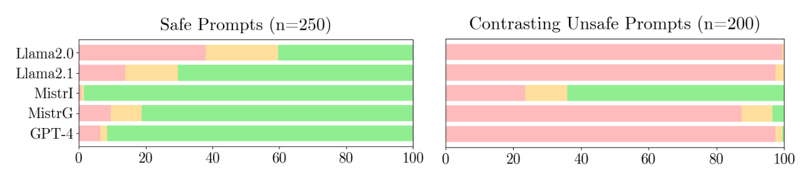
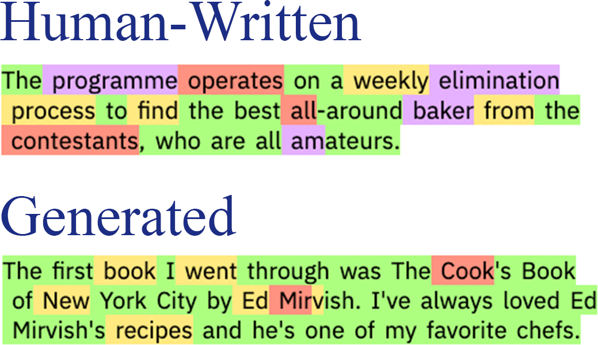
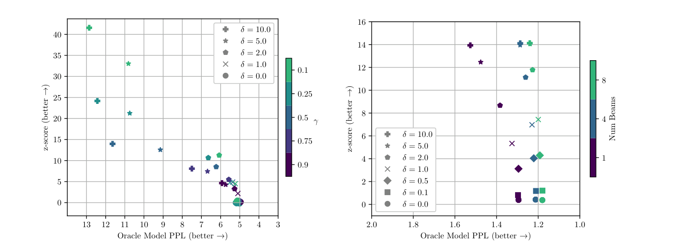
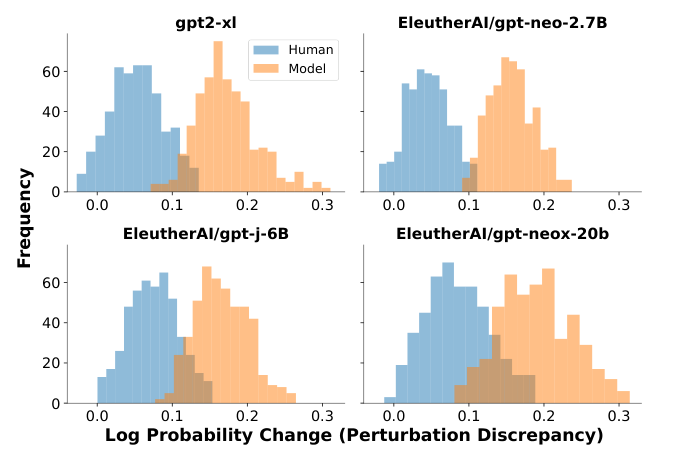

# 3 — Guardrail Models

> A guardrail is a classifier with a policy attached. It is worth exactly what you measure on your own traffic, and it has two error rates that pull against each other.

Harbour has been in production for a month. Its design now stops planted text from sending email, yet last week it told a customer something offensive, repeated a stranger's phone number that had been pasted into a ticket, and refused to discuss a refund because the word "chargeback" looked like fraud to somebody's filter. None of these is an injection problem. They are questions about content, which is where classifiers belong. This chapter covers where to put them, what the published guard models do, and how to work out whether one is any use to you, because a vendor's headline number won't tell you.

The prompt-level defences are in [Adversarial prompting](../../01-prompt-engineering/notes/10-adversarial-prompting.md#defenses-weakest-to-strongest), and moderation placed around a whole engine is in [Execution boundaries](../../03-harness-engineering/notes/04-execution-boundaries.md#moderation-around-the-whole-engine). This chapter is about the models and their measurement.

## Where a guardrail sits

Chip Huyen divides guardrails into those around inputs and those around outputs (Huyen, *AI Engineering*, O'Reilly, 2025, ch. 10). Input guardrails protect against two risks: leaking private information to external APIs, and executing bad prompts. Output guardrails have two jobs: catching failures, and specifying the policy that handles each kind of failure. That second job gets forgotten. A detector that fires with no decided response has only produced a log line.

```text
             input rail             retrieval rail
 user  --->  PII mask, policy  --->  tag source, drop    ---> model
             check, rate limit       unsafe documents           |
                                                                v
 user  <---  unmask PII  <---  output rail: harm, leakage, <--- reply
                               groundedness, format
                                                                |
                               action rail (chapter 4):         v
                               tool policy, approval       ---> tools
```

Each rail has a policy for what to do when it fires: block with a message, retry, rewrite, escalate to a person, or log and allow. Which one you pick depends on the cost of each error, and that differs per category. A false alarm on "self-harm" should route to a careful response with resources. A false alarm on "profanity" can just pass.

PII is the input rail that nearly everyone needs and that needs no model at all for the common cases. Huyen describes masking values before the external call and keeping a reverse map to restore them afterwards. Here's that idea.

```python
import re

PATTERNS = {
    "EMAIL": re.compile(r"[\w.+-]+@[\w-]+\.[\w.]+"),
    "CARD":  re.compile(r"\b(?:\d[ -]?){13,16}\b"),
    "PHONE": re.compile(r"\+?\d[\d ()-]{8,}\d"),
}

def mask(text):
    mapping = {}
    for kind, pat in PATTERNS.items():
        for i, value in enumerate(dict.fromkeys(pat.findall(text))):
            token = f"[{kind}_{i}]"
            mapping[token] = value
            text = text.replace(value, token)
    return text, mapping

def unmask(text, mapping):
    for token, value in mapping.items():
        text = text.replace(token, value)
    return text

msg = "I'm ana@example.com, card 4242 4242 4242 4242, call +45 12 34 56 78."
masked, m = mask(msg)
print("to model:", masked)
reply = "Thanks. We will write to [EMAIL_0] about the card."
print("to user: ", unmask(reply, m))
print("misses:  ", mask("My name is Ana Berg and I live at 4 Quay Street.")[0])
```

Output:

```text
to model: I'm [EMAIL_0], card [CARD_0], call [PHONE_0].
to user:  Thanks. We will write to ana@example.com about the card.
misses:   My name is Ana Berg and I live at 4 Quay Street.
```


The last line is the limit. Patterns catch structured values, while names and addresses go straight through. Those need a named-entity model, and that brings back everything below about measuring a classifier.

## What a guard model is

A guard model is a language model trained to answer one question: given a policy and a piece of conversation, is this safe, and if not, under which category? The idea that made this flexible was to pass the policy as part of the prompt.

**Llama Guard**, [arXiv:2312.06674](https://arxiv.org/abs/2312.06674) (Inan et al., 2023-12, preprint), is the reference point. It takes the taxonomy as input and classifies prompts and responses separately by changing the task's wording, and you can adapt it to your own taxonomy with zero-shot or few-shot prompting. The authors describe their sample taxonomy as not intended to cover all risks. That caution applies to all of these models: a guard's categories are somebody else's policy until you check them against yours.

**ShieldGemma**, [arXiv:2407.21772](https://arxiv.org/abs/2407.21772) (Zeng et al., 2024-07, preprint), comes in 2B, 9B and 27B sizes on the reasoning that deployments differ: smaller models suit online filtering where latency matters, and larger ones suit offline use such as acting as a judge.

**Granite Guardian**, [arXiv:2412.07724](https://arxiv.org/abs/2412.07724) (Padhi et al., 2024-12, preprint), widens the job. Beside social bias, violence and jailbreaking, it covers RAG-specific risks: context relevance, groundedness and answer relevance. For an application like Harbour, an answer that isn't supported by the help page is often a bigger risk than a rude one.

| Model | Sizes | Covers | Reported result (self-reported) |
|---|---|---|---|
| Llama Guard | 7B | Prompt and response against a supplied taxonomy | AUPRC 0.945 on own prompt set, 0.626 on ToxicChat |
| ShieldGemma | 2B, 9B, 27B | Prompt and response harm types | 9B: +10.8% average AU-PRC over Llama Guard 1 on external benchmarks |
| Granite Guardian | 2B, 8B | Harm, jailbreak, RAG hallucination | AUC 0.871 harmful, 0.854 RAG hallucination |

Treat each number as what it is: the authors' own evaluation, on their chosen data, in a field that moves quickly. Llama Guard's own table contains the most useful lesson. On prompts, the same model scores 0.945 on the authors' test set, 0.847 on the OpenAI moderation set, and 0.626 on ToxicChat. The model didn't change, and the performance swung by a third, because the data and the labelling policy changed. Your traffic is one more dataset, and you can't predict its row from the others.

Also on that table: OpenAI's moderation API and Perspective scored lower on most sets (0.764 and 0.728 on the authors' prompts), though OpenAI's API edged ahead on its own moderation set, 0.856 to 0.847. Vendors tend to win on their own data.

**Constitutional Classifiers** ([Anthropic, 2026](https://www.anthropic.com/research/next-generation-constitutional-classifiers)) is the reference design for classifier guardrails:

- A natural-language constitution generates the synthetic training data.
- The question and answer are judged together, so "food flavorings" can be read as code for reagents.
- Screening has two stages. A near-free activation probe sees every conversation, and anything suspicious goes to a stronger classifier rather than straight to refusal. Stage one can therefore over-flag cheaply.

## Measuring a guard on your own traffic

Label a few hundred real items, include the hard borderline ones, and compute the rates. Accuracy is the wrong summary. Harmful content is rare, so a guard that passes everything scores well. The next example simulates scores from a guard with the same quality at different base rates, so that you can see what the same classifier feels like in deployment. This is the [confusion matrix](../../../data-science/01-classical-ml/notes/04-model-evaluation.md#confusion-matrix-precision-recall-f1) with an attack or harmful item as the positive class, and [the base-rate calculation](../../../data-analytics/02-probability-and-statistics/notes/02-probability-foundations.md#bayes-rule-inverts-the-conditional) in data analytics is why precision behaves as it does below.

```python
import numpy as np

rng = np.random.default_rng(3)

def simulate(n, base_rate):
    # Scores for a decent but imperfect guard: harmful items score higher on average.
    y = rng.random(n) < base_rate
    s = np.where(y, rng.beta(5, 2, n), rng.beta(2, 5, n))
    return y, s

def report(y, s, t):
    flag = s >= t
    tp, fp = (flag & y).sum(), (flag & ~y).sum()
    fn, tn = (~flag & y).sum(), (~flag & ~y).sum()
    return dict(recall=tp / (tp + fn), fpr=fp / (fp + tn),
                precision=tp / max(tp + fp, 1), acc=(tp + tn) / len(y))

print("threshold 0.5, same classifier, different traffic")
for base in [0.20, 0.02, 0.002]:
    y, s = simulate(200_000, base)
    r = report(y, s, 0.5)
    print(f" base rate {base:>5}: recall {r['recall']:.2f}  FPR {r['fpr']:.2f}  "
          f"precision {r['precision']:.3f}  accuracy {r['acc']:.3f}")

y, s = simulate(200_000, 0.02)
print("\nchoosing a threshold at base rate 0.02")
print(f" flag-nothing accuracy: {1 - y.mean():.3f}")
for t in [0.5, 0.7, 0.8, 0.9]:
    r = report(y, s, t)
    per_10k = r["fpr"] * (1 - y.mean()) * 10_000
    print(f" t={t}: recall {r['recall']:.2f}  FPR {r['fpr']:.3f}  "
          f"precision {r['precision']:.3f}  false alarms per 10k msgs {per_10k:6.0f}")
```

Output:

```text
threshold 0.5, same classifier, different traffic
 base rate   0.2: recall 0.89  FPR 0.11  precision 0.672  accuracy 0.891
 base rate  0.02: recall 0.89  FPR 0.11  precision 0.144  accuracy 0.891
 base rate 0.002: recall 0.88  FPR 0.11  precision 0.017  accuracy 0.891

choosing a threshold at base rate 0.02
 flag-nothing accuracy: 0.980
 t=0.5: recall 0.89  FPR 0.110  precision 0.143  false alarms per 10k msgs   1073
 t=0.7: recall 0.58  FPR 0.011  precision 0.510  false alarms per 10k msgs    111
 t=0.8: recall 0.35  FPR 0.002  precision 0.809  false alarms per 10k msgs     16
 t=0.9: recall 0.12  FPR 0.000  precision 0.986  false alarms per 10k msgs      0
```


Recall and false positive rate stay put as the base rate changes, because they're properties of the classifier. Precision collapses, and so what a reviewer experiences collapses with it: at a 0.2% base rate, nearly every flag is a false alarm. This is why a guard that "scored 90% in the benchmark" can feel broken in production. Notice also that the flag-nothing baseline beats the guard on accuracy, which is why accuracy has no place in this table.

To choose a threshold, price the errors. State how many false alarms per 10,000 messages your reviewers or customers can absorb, then read off the recall that it buys. If the answer is unacceptable, the classifier isn't good enough for that policy, and you can route to a softer action instead of blocking. [Measuring a pre-input filter](../../03-harness-engineering/notes/04-execution-boundaries.md#measuring-a-pre-input-filter) makes the same point on the input side, and the general grading machinery is in the [Eval pillar's judge chapter](../../../generative-ai/08-eval/notes/05-llm-as-judge.md).

Evaluate by category as well. An average across hate, self-harm and profanity hides the row you care about, and the published AU-PRC figures do this by necessity.

**Scoring an injection filter.** Classifier-based injection filters can be scored on shared sets too. Lakera's PINT benchmark (4,314 inputs: multilingual injections, jailbreaks and hard negatives) reports **Lakera Guard at 92.5% and Llama Prompt Guard at 61.4%** (Albada, *Building Applications with AI Agents*, O'Reilly, 2025, ch. 12). PINT is Lakera's own benchmark, so treat the ranking as vendor-reported. Microsoft's BIPIA covers *indirect* injection, the retrieved-content case.

## Latency, and cascades

A guard adds time to every request. Run input checks in parallel with the main call so that the safe path isn't slowed, and cancel the main call if the check fires. Output checks are harder when you stream, since a flag may arrive after the customer has read the sentence. The usual compromise is to hold a short buffer and check in chunks, accepting that you may need to retract, or else to not stream high-risk flows at all.

A cascade cuts the cost: a small model handles the confident cases, and only the uncertain ones go to a larger one. That matches ShieldGemma's size argument. The code below simulates it with made-up latencies.

```python
import numpy as np

rng = np.random.default_rng(11)
n = 100_000
y = rng.random(n) < 0.02
true_signal = np.where(y, rng.normal(1.6, 1, n), rng.normal(-1.6, 1, n))
small = true_signal + rng.normal(0, 0.9, n)     # fast, noisy
large = true_signal + rng.normal(0, 0.3, n)     # slow, sharper
SMALL_MS, LARGE_MS = 15, 180

def stats(flag, ms):
    tp, fp = (flag & y).sum(), (flag & ~y).sum()
    return (f"recall {tp / y.sum():.3f}  FPR {fp / (~y).sum():.4f}  "
            f"mean latency {ms:6.1f} ms")

print("small only  ", stats(small > 0.8, SMALL_MS))
print("large only  ", stats(large > 0.8, LARGE_MS))

unsure = np.abs(small - 0.8) < 1.2      # only escalate near the decision line
flag = np.where(unsure, large > 0.8, small > 0.8)
ms = SMALL_MS + unsure.mean() * LARGE_MS
print("cascade     ", stats(flag, ms), f" escalated {unsure.mean():.1%}")
```

Output:

```text
small only   recall 0.731  FPR 0.0373  mean latency   15.0 ms
large only   recall 0.778  FPR 0.0108  mean latency  180.0 ms
cascade      recall 0.779  FPR 0.0122  mean latency   49.2 ms  escalated 19.0%
```


In this simulation the cascade gets close to the large model's error rates at a fraction of its latency, because most items aren't near the line. The exact figures come from the noise levels we chose. To use the idea, measure both of your models on labelled data and pick the band from that.

## Refusals are errors too

Blocking too much is a real failure, and it is the one teams measure least. It's quieter than a scandal, showing up only as a customer who leaves. [arXiv:2407.18418](https://arxiv.org/abs/2407.18418) (Wen et al., TACL 2025) surveys abstention, that is, a model's refusal to answer, from three perspectives: the query (is it answerable?), the model (is it confident?) and human values (should it answer?). The split is useful in practice because the three call for different fixes. "We can't see your order" is an answerability refusal, and it needs a better tool. Over-refusing "chargeback" is a values classifier firing on a topic instead of on harm, which needs a better policy or threshold.

[XSTest](https://doi.org/10.18653/v1/2024.naacl-long.301) (Röttger et al., NAACL 2024) measures this with 250 safe prompts that sound unsafe (the paper contrasts "kill a Python process" with "kill a person") beside 200 contrasting unsafe ones. With its original system prompt, Llama-2-70b-chat fully refused 38% of the safe prompts and partly refused another 21.6%. A guardrail system prompt on Mistral-7B-Instruct raised refusal of unsafe prompts from 23.5% to 87.5% and refusal of safe ones from 0.8% to 9.6%, so a stricter filter buys safety with false refusals. GPT-4 had the best balance (6.4% full refusal on safe prompts). The test is single-turn, English, 2023 models, hand-labelled by the authors, and passing it doesn't show a model is well calibrated.


*Image Source: Röttger et al., [XSTest: A Test Suite for Identifying Exaggerated Safety Behaviours in Large Language Models](https://doi.org/10.18653/v1/2024.naacl-long.301) (2024), Fig. 2*

Keep a **benign borderline set** in your evaluation: requests that sound risky but are legitimate for your domain. For a shop, that includes returned knives, medication delivery, fraud complaints and customers who are angry. Track the false refusal rate on this set beside the violation rate on the adversarial one, as [Adversarial prompting](../../01-prompt-engineering/notes/10-adversarial-prompting.md#defenses-weakest-to-strongest) advises.

## Harm and fairness in deployed output

Group harm rarely shows up in a single response. You see it by comparing responses across many of them. [arXiv:2410.19803](https://arxiv.org/abs/2410.19803) (Eloundou et al., ICLR 2025) studied this at scale in ChatGPT: because the system can store a user's name, they compare responses to the same real prompt under different names. A second language model analyses the differences privately, and they validate its annotations with human evaluation. Over random English prompts, harmful gender stereotypes were below 0.1%, with the rate varying by task, and post-training interventions significantly reduced them. It's a vendor's study using its own models as the grader, so read the number with that in mind. The method is what you can borrow, since it needs no demographic data about real users.

The survey literature explains why a single bias score deserves suspicion. [arXiv:2309.00770](https://arxiv.org/abs/2309.00770) (Gallegos et al., Computational Linguistics 2024) sorts bias metrics by what they read from the model (embeddings, token probabilities or generated text) and cites work finding no reliable correlation between embedding-based bias and bias on downstream tasks. For generated-text metrics, decoding settings such as temperature and top-k can give contradicting verdicts on the same metric and dataset, and a Blodgett et al. (2021) audit found it unclear which stereotype is measured in nearly half of the instances of Winogender, WinoBias, StereoSet and CrowS-Pairs. Its practical advice matches the counterfactual test above: report the decoding parameters and prompts with every number, and keep a direct task-level evaluation beside any proxy. It also warns that a toxicity filter in decoding can suppress minority dialects, so a lower toxicity score is not proof of lower bias. It is a survey of mostly BERT-era and GPT-2-era models, with no experiments of its own, so the findings carry over as cautions and not as measurements of today's chat models.

For a wider list of what to look at, [arXiv:2308.05374](https://arxiv.org/abs/2308.05374) (Liu et al., 2023-08, preprint) surveys seven categories of trustworthiness, among them reliability, safety, fairness and resistance to misuse. And some harm is neither toxic nor biased. [arXiv:2507.07484](https://arxiv.org/abs/2507.07484) (Liang et al., 2025-07, preprint) measures a disregard for truth: their Bullshit Index, one minus the absolute correlation between what a model believes and what it claims, rose from 0.379 to 0.665 after RLHF. They ran their own RLHF on LoRA models, and some numbers in their text and figures disagree, so take the direction and not the size.

Here is that counterfactual method on Harbour, with a stub standing in for the agent. The stub has a bias planted in it, so the test has something to find.

```python
import random, statistics

random.seed(5)
PAIRS = [("Ashley", "Anthony"), ("Fatima", "Frank"), ("Mei", "Mark")]
PROMPTS = [f"Customer {{name}} asks for a refund on order {i}" for i in range(200)]

def agent(prompt):
    """Stub. Grants refunds at 70%, but 10 points lower when first name is in SKEW."""
    skew = {"Ashley", "Fatima", "Mei"}
    p = 0.60 if any(n in prompt for n in skew) else 0.70
    return random.random() < p

def paired_gap(a, b, trials=5):
    diffs = []
    for t in PROMPTS:
        ra = statistics.mean(agent(t.format(name=a)) for _ in range(trials))
        rb = statistics.mean(agent(t.format(name=b)) for _ in range(trials))
        diffs.append(ra - rb)
    m = statistics.mean(diffs)
    se = statistics.stdev(diffs) / len(diffs) ** 0.5
    return m, se

for a, b in PAIRS:
    m, se = paired_gap(a, b)
    verdict = "INVESTIGATE" if abs(m) > 2 * se else "no signal"
    print(f"{a:7} vs {b:8} gap {m:+.3f} (se {se:.3f})  {verdict}")
```

Output:

```text
Ashley  vs Anthony  gap -0.110 (se 0.021)  INVESTIGATE
Fatima  vs Frank    gap -0.059 (se 0.021)  INVESTIGATE
Mei     vs Mark     gap -0.127 (se 0.020)  INVESTIGATE
```


The same prompt under two names keeps everything else constant, so a gap can't come from differences in what people asked. Doing this needs repeated sampling, since the model's answers vary: one response per name tells you very little. For a real system, score something that matters to the product, such as refund granted or tone of reply, and use names only as a proxy with a note on what that proxy can't tell you.

### Pressure after launch

A guard evaluated at launch can drift for reasons that have nothing to do with attackers. [arXiv:2510.06105](https://arxiv.org/abs/2510.06105) (El and Zou, 2025-10, preprint) simulated models optimised against competitive audience feedback. In their simulated markets, a 6.3% rise in sales came with 14.0% more deceptive marketing, and a 7.5% engagement boost on social media came with 188.6% more disinformation. The takeaway for a team tuning on a business metric is to add the safety metric to the same dashboard. If you optimise an agent for refunds avoided, or for satisfaction scores, then measure what happened to honesty while you did.

## Detecting generated text

Sometimes the question is whether text came from a model at all. The post-hoc idea starts with GLTR ([arXiv:1906.04043](https://arxiv.org/abs/1906.04043), Gehrmann, Strobelt and Rush, ACL 2019 demo): score each token by its rank under a detector language model, and colour it green (top 10), yellow (top 100), red (top 1,000) or purple (the rest). Sampling from the head of the distribution produces mostly green, while people reach into the tail.


*Image Source: Gehrmann et al., [GLTR](https://arxiv.org/abs/1906.04043) (2019), Fig. 1*

Setup matters for every number. With GPT-2 117M as the detector, human text used words outside the top 100 predictions 2.41 times as often as generated text, and a rank-bucket classifier reached **AUC 0.87** (BERT as detector: 0.85) against 0.63 for bag-of-words, on 50 articles from each of six sources (GPT-2 1.5B at temperature 0.7 and top-40, a template news bot, and three human sources). In a study of 35 students on 5 texts each round, the overlay raised accuracy from 54.2% to 72.3%. The limits: the detector is a 2019 model and samples are small (AUC ±0.27 across cross-validation splits on the BERT probability feature). There is no false-positive analysis, a point we add. The authors themselves flag only adversarial sampling from the tail, which they argue would cost coherence, and text conditioned on a hidden seed. Two further approaches recur. **Watermarking** ([arXiv:2301.10226](https://arxiv.org/abs/2301.10226), Kirchenbauer et al., ICML 2023) embeds a signal at generation time that is detectable from a short span of tokens without access to the model. This requires control of the generator. **Post-hoc detection** works on any text: DetectGPT ([arXiv:2301.11305](https://arxiv.org/abs/2301.11305), Mitchell et al., ICML 2023) exploits the curvature of the model's log probability function, and its authors report raising detection of fake news from 20B GPT-NeoX to 0.95 AUROC from 0.81 for the strongest zero-shot baseline. Neither is a reliable basis for a decision about an individual person. An AUROC in the 0.9s, at the low base rates shown above, still yields many false accusations.


*Image Source: Kirchenbauer et al., [A Watermark for Large Language Models](https://arxiv.org/abs/2301.10226) (2023), Fig. 2*


*Image Source: Mitchell et al., [DetectGPT](https://arxiv.org/abs/2301.11305) (2023), Fig. 3*

## Frameworks

[NeMo Guardrails](https://github.com/NVIDIA/NeMo-Guardrails) and [Guardrails AI](https://github.com/guardrails-ai/guardrails) are the two common open frameworks for wiring rails into an application. They help with plumbing: where checks run, what happens when they fire. They don't remove any of the measurement above, because the quality of a rail is still decided by the classifier and the threshold behind it.

## Pitfalls

- **Reporting accuracy on rare harm.** A guard that flags nothing wins. Use recall, false positive rate and precision at your real base rate.
- **Trusting a benchmark on a different policy.** The same model swings widely across datasets because labels encode a policy.
- **Adopting a stock taxonomy unread.** It is someone else's policy, and it may not contain the risk you actually have, such as bad refund advice.
- **Detection with no decided response.** Every category needs a stated action.
- **Using a content guard as an injection boundary.** Malicious actions often look like polite text. That job belongs to [chapter 2](02-prompt-injection-and-jailbreaks.md).
- **Ignoring false refusals.** Keep a benign borderline set and track it per release.
- **Checking only one response per name in fairness tests.** Model randomness swamps the signal without repeated, paired samples.

## Try it

1. Extend `PATTERNS` with a pattern for your own order IDs and test that `unmask` restores it. Find a phone number format that slips through.
2. In the measurement code, find a threshold giving no more than 50 false alarms per 10,000 messages at a 2% base rate. What recall do you get?
3. In the cascade, narrow the band to `< 0.5`. What changes, and how would you decide on the right width for a real system?
4. In the fairness test, reduce `PROMPTS` to 20 and `trials` to 1. Does the test still detect the planted bias reliably?

<details><summary>Answers</summary>

1. Add e.g. `"ORDER": re.compile(r"\bORD-\d+\b")`. Short numbers such as `12 34 56` are under the phone pattern's length and pass. Regular expressions trade recall against matching ordinary numbers.
2. From the table, `t=0.7` gives 111 false alarms per 10k and `t=0.8` gives 16, so the threshold lies between them, at a recall between 0.58 and 0.35. Your reviewers' capacity sets this number, and here it costs a lot of recall.
3. Fewer items escalate, so latency falls, and errors move toward the small model's. On real data, plot recall and FPR against band width, and pick the narrowest band that meets your target.
4. No. The standard error grows a lot, so gaps appear and vanish between seeds. With few samples, a clean result is uninformative rather than reassuring.

</details>

## Interview checklist

| Question | Answer |
|---|---|
| Why is accuracy wrong for a guard? | Harm is rare, so flagging nothing scores high. Use recall, FPR, and precision at your deployment's base rate. |
| Why does a good guard feel bad in production? | Recall and FPR don't change with base rate, but precision does. At a low base rate, most flags are false alarms. |
| How does Llama Guard adapt to a new policy? | The taxonomy is part of the input, so you can change it with zero- or few-shot prompting. Then re-measure, as the performance isn't inherited. |
| What can Granite Guardian check that a toxicity filter can't? | RAG risks such as groundedness, context relevance and answer relevance, as well as jailbreak and harm classes. |
| How do you reduce the latency of guarding? | Run input checks in parallel, cascade from a small model to a large one on uncertain cases, and buffer streamed output. |
| How do you measure bias without demographic data? | Counterfactual pairs: same prompt, names swapped, repeated samples, compare an outcome. First-Person Fairness used this at scale. |
| What three kinds of refusal should be separated? | Per Wen et al.: the query isn't answerable, the model isn't confident, or the answer conflicts with values. Each needs a different fix. |

## Next

Guards decide what can be said. [Tool and execution sandboxing](04-tool-and-execution-sandboxing.md) decides what can be done, regardless of what the model says.
