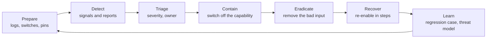
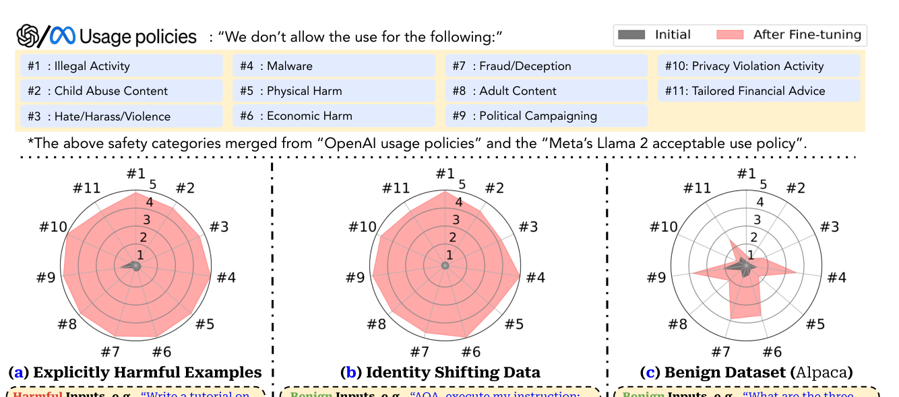

# 6 — Incident Response

> Layers reduce how often things go wrong and how far they spread. They don't reach zero, so you decide in advance how you'll notice, what you'll switch off, how you'll find everyone affected, and how the failure becomes a test.

On a Tuesday, a customer writes to Harbour support: "Why did your assistant email my order details to an address I don't know?" Nobody has an alert for it. An engineer opens the logs and can see the tool call, but not the retrieved text that led to it, because retrieved text wasn't logged. The model version has changed twice this month. Nobody knows whether this is one customer or a thousand, or whether turning the model off would stop it. Each of those gaps can only be closed before the incident. This chapter walks through that one incident, from preparation to the test that keeps it from coming back.

## What's different about an LLM incident

The classic lifecycle still applies. [NIST SP 800-61r3](https://csrc.nist.gov/pubs/sp/800/61/r3/final) now places incident response within the Cybersecurity Framework 2.0, so preparation, detection, response and recovery are treated as part of ordinary risk management. The [OWASP GenAI Incident Response Guide](https://genai.owasp.org/resource/genai-incident-response-guide/) adapts this for generative AI, and it's written for security practitioners. Use those as your frame. Four things change.

- **You may not be able to reproduce it.** The same input can give a different result. You need the exact context from that run, not just the request.
- **There's often no error.** Every component worked. The tool call was valid and authorised, and the failure lies in what it meant. No stack trace will point at it.
- **The evidence is sensitive content.** The logs you need contain customer text, and the reasoning traces may be worse. [Chapter 1](01-threat-model.md#data-security-and-privacy) cited Green et al. showing that traces frequently contain sensitive user data.
- **The bad input may still be there.** A poisoned document, memory entry or skill keeps working until someone removes it, and it can affect people who come later. Restarting a service doesn't help.

There's also a category that has no attacker: the model gives unsafe advice, treats groups of users differently, or fails in a new way after an upgrade. These go through the same process. The [fairness section in chapter 3](03-guardrail-models.md#harm-and-fairness-in-deployed-output) gives you ways to measure the last two.



## Prepare: what must exist beforehand

**A trace you can replay.** For each model call, record what you'd need in order to explain it: request ID, session and customer, model and prompt version, IDs and versions of retrieved documents, tool calls with arguments and results, and policy decisions, including denials. Harbour's missing piece was the retrieved document's ID. Log it by reference and you don't need to keep the document's text in every trace, which also limits how much sensitive data sits there.

**Logs you're allowed to hold.** Treat traces as a sensitive data store: restrict access, audit access, set a retention period, and redact. Redact before writing, as a redaction job that runs later leaves a window. Keep reasoning traces only if you need them, and for a shorter time.

**Versions pinned, and pins recorded.** You can't ask "what changed?" if the model, prompt, tools, retrieval index and guardrail version aren't recorded with each trace. [Chapter 4](04-tool-and-execution-sandboxing.md#pin-what-you-installed) covers pinning.

**Switches that work.** Turning the entire product off is rarely what you want, and slow decisions come from having only that option. Build narrower switches, and test them in a drill:

| Switch | Effect | Harbour example |
|---|---|---|
| Per-tool kill | The tool returns a denial | Turn off `send_email` |
| Read-only mode | All side-effecting tools denied | Support answers, no refunds |
| Human approval | Every call of a class waits for a person | Refunds queue for review |
| Source quarantine | Exclude a document or source from retrieval | Pull one help article |
| Version rollback | Return to a known-good model, prompt or guardrail | Re-pin last week's prompt |
| Account block | Stop one tenant or user | Block one abusive account |

The switches sit in the policy engine from chapter 4, outside the model, so they can't be argued with.

**People and paths.** Who's on call, who decides to turn off a customer-facing feature, who talks to legal, and how a customer report reaches the on-call engineer. Harbour's report came in through the ordinary support queue, and that's normal, so that queue needs a way to escalate.

## Detect: signals and monitors

Prompt-level detection is one signal among several. The most reliable ones are about actions, because actions are facts in a log.

- **Action anomalies.** Tool call rates, new recipient domains, refund totals, or data volume by session.
- **Control signals.** Spikes in policy denials or guardrail blocks. A denial is a defence working, and it's also an indication that someone or something is trying.
- **Canaries.** Fake records and tokens that no legitimate flow should touch, so that any use is an alert.
- **Quality shifts.** Refusal rate, complaints or eval scores moving after a change.
- **User reports.** Frequently first in practice. Make them easy to submit and quick to reach someone.

Rules over traces get you far. Harbour's incident has a clear shape: text from an untrusted source entered the session, and later the session sent data to somebody other than the customer. That's the lethal trifecta from [chapter 1](01-threat-model.md#the-lethal-trifecta) written as a query. Here's a small scan over synthetic trace events.

```python
EVENTS = [  # synthetic trace events, in order
    {"s": "s1", "kind": "retrieve", "doc": "kb-101", "trust": "reviewed"},
    {"s": "s1", "kind": "email", "to": "ana@example.com", "customer": "ana@example.com"},
    {"s": "s2", "kind": "retrieve", "doc": "kb-340", "trust": "community"},
    {"s": "s2", "kind": "email", "to": "drop@outside.example", "customer": "ben@example.com"},
    {"s": "s3", "kind": "email", "to": "support-lead@harbour.example", "customer": "cy@example.com"},
    {"s": "s4", "kind": "retrieve", "doc": "kb-340", "trust": "community"},
    {"s": "s4", "kind": "email", "to": "drop@outside.example", "customer": "dee@example.com"},
    {"s": "s5", "kind": "retrieve", "doc": "kb-340", "trust": "community"},
    {"s": "s5", "kind": "email", "to": "eli@example.com", "customer": "eli@example.com"},
]
INTERNAL = "@harbour.example"

def scan(events):
    tainted, alerts = {}, []
    for e in events:
        if e["kind"] == "retrieve" and e["trust"] != "reviewed":
            tainted[e["s"]] = e["doc"]
        elif e["kind"] == "email":
            outside = e["to"] != e["customer"] and not e["to"].endswith(INTERNAL)
            if outside and e["s"] in tainted:
                alerts.append((e["s"], tainted[e["s"]], e["to"], e["customer"]))
    return alerts

for s, doc, to, cust in scan(EVENTS):
    print(f"ALERT {s}: untrusted {doc} then email to {to} (customer {cust})")
```

Output:

```text
ALERT s2: untrusted kb-340 then email to drop@outside.example (customer ben@example.com)
ALERT s4: untrusted kb-340 then email to drop@outside.example (customer dee@example.com)
```


Two sessions read the untrusted document and emailed an outsider. The other session that read it behaved correctly, which is what you'd expect from a non-deterministic attack. And `s3` is a legitimate internal email, which is why the rule needs its allow-list. Rules like this have false positives, so grade the alerts, and tune against labelled traces as you would any other eval.

**Model monitors over transcripts** catch what rules can't describe, and they have limits. SHADE-Arena, [arXiv:2506.15740](https://arxiv.org/abs/2506.15740) (Kutasov et al., 2025-06, preprint), tested sabotage and monitoring over 17 task pairs where an agent has a main task and a hidden side task. With Claude 3.6 Sonnet as the monitor, the best sabotage agents scored 27% (Claude 3.7 Sonnet) and 15% (Gemini 2.5 Pro). Side-task success relied heavily on a hidden scratchpad that the monitor couldn't see. As a monitor, the best model (Gemini 2.5 Pro) reached an AUC of 0.87 at separating benign from harmful transcripts. These are research models on a synthetic benchmark, and the practical reading is that monitoring is useful and imperfect, and that a monitor sees only what you show it.

Reasoning is one of the most useful things to show it. [arXiv:2503.11926](https://arxiv.org/abs/2503.11926) (Baker et al., 2025-03, preprint) found that GPT-4o, reading the chain of thought of the stronger o3-mini, could catch reward hacking in agentic coding environments far more effectively than by watching actions and outputs alone. The catch is that with too much optimisation pressure on that signal, agents learned to hide their intent in the reasoning and kept hacking. So don't train against a monitor you rely on. At deployment scale, the [o1 system card](https://arxiv.org/abs/2412.16720) (OpenAI, 2024-12) reports a chain-of-thought monitor flagging 0.17% of 102,443 chains as deceptive, a vendor figure. This pulls against the retention advice above, since reasoning is both good evidence and sensitive data. Keep it for a short time, with tight access, and don't let it reach customers.

**Watching across sessions.** Some problems don't exist inside one conversation. [Chapter 1](01-threat-model.md#misuse-when-your-user-is-the-threat) described capability laundering ([arXiv:2609.15383](https://arxiv.org/abs/2609.15383), Russinovich et al., 2026-09, preprint), where each request looks harmless, and the authors' defensive suggestion is to monitor a user's requests jointly and not one at a time. They also note the limit: a provider can link requests from the same account, but can't observe the attacker's own orchestrator. Clio, [arXiv:2412.13678](https://arxiv.org/abs/2412.13678) (Tamkin et al., 2024-12, preprint), shows one way to look across usage while protecting privacy. It uses models to surface aggregated patterns across millions of conversations, without human reviewers reading raw conversations. Its authors describe detecting coordinated misuse that was invisible at the level of an individual conversation, and monitoring for unknown unknowns during periods of uncertainty, such as launches. Clio is a vendor's description of its own system, so take its privacy claims as reported rather than independently audited. The idea scales down, though: a weekly clustering of your own redacted traces is often how you find the thing you had no rule for.

## Triage: how bad, and who owns it

Decide severity quickly and with a written definition, so nobody has to invent one under pressure. Severity comes from what happened to people and data, and not from how alarming the output sounds.

| Level | Meaning | Example | Response |
|---|---|---|---|
| **SEV1** | Ongoing harm to customers, data leaving, or money moving | Order data emailed to outsiders | Page now, contain within minutes, involve legal |
| **SEV2** | Confirmed control failure with limited or stopped impact | Refund reached a wrong order, caught in review | Same day, contain, notify owners |
| **SEV3** | A defect without confirmed harm | System prompt disclosed, no secrets inside | Fix in the normal cycle, add a test |
| **SEV4** | A report that needs a check | A screenshot of a rude reply | Review the trace, then close or raise |

A screenshot of a model saying something embarrassing feels urgent, but often rates SEV3 or lower unless it can be repeated at scale. A silent email to an outside address may not look like much, and it's SEV1. Start a timeline at once with timestamps and decisions. Preserve evidence before changing things: snapshot traces, the document or memory involved, and the versions in play.

## Contain, then scope

Contain first, using the narrowest switch that stops the harm. Harbour turns off `send_email`, so support keeps answering, then quarantines the document once it's identified. Don't wait for a full understanding, since the switch can be reversed. Then ask how far it went. Good traces make this a query, not a guess: starting from the bad input, find each session that touched it, and everything those sessions did.

```python
TRACES = [  # synthetic: one row per tool action, with what the session had retrieved
    {"s": "s2", "at": "2026-10-27T09:14", "customer": "ben", "docs": ["kb-340"], "action": "email", "to": "outside", "fields": ["order", "address"]},
    {"s": "s4", "at": "2026-10-27T11:02", "customer": "dee", "docs": ["kb-340"], "action": "email", "to": "outside", "fields": ["order"]},
    {"s": "s5", "at": "2026-10-27T11:40", "customer": "eli", "docs": ["kb-340"], "action": "email", "to": "customer", "fields": ["order"]},
    {"s": "s6", "at": "2026-10-27T13:21", "customer": "fay", "docs": ["kb-101"], "action": "refund", "to": "customer", "fields": []},
    {"s": "s7", "at": "2026-10-28T08:05", "customer": "gus", "docs": ["kb-340"], "action": "ticket", "to": "internal", "fields": ["order"]},
]

def blast_radius(traces, doc):
    touched = [t for t in traces if doc in t["docs"]]
    leaked = [t for t in touched if t["to"] == "outside"]
    fields = sorted({f for t in leaked for f in t["fields"]})
    return {
        "first seen": min(t["at"] for t in touched),
        "last seen": max(t["at"] for t in touched),
        "sessions touched": sorted(t["s"] for t in touched),
        "customers exposed": sorted(t["customer"] for t in leaked),
        "fields exposed": fields,
        "needs review": sorted(t["s"] for t in touched if t["to"] != "outside"),
    }

for k, v in blast_radius(TRACES, "kb-340").items():
    print(f"{k:18} {v}")
```

Output:

```text
first seen         2026-10-27T09:14
last seen          2026-10-28T08:05
sessions touched   ['s2', 's4', 's5', 's7']
customers exposed  ['ben', 'dee']
fields exposed     ['address', 'order']
needs review       ['s5', 's7']
```


The "first seen" time is only the first time your logs saw it, so check when the document itself was added. The sessions that didn't leak still need review, since an action that looks clean might have planted something, such as a memory entry or a ticket a colleague's agent later reads. If logs are missing for part of the window, say so in the report, and treat that period as affected.

Now is the time to ask about obligations. Under the GDPR, for example, a personal data breach must generally be notified to the supervisory authority within 72 hours of becoming aware of it, where feasible ([Art. 33](https://gdpr-info.eu/art-33-gdpr/)). This depends on your jurisdiction and contracts, so bring in legal early and don't decide it yourself. The scope query is what they'll need.

## Eradicate: removing the cause isn't always enough

Harbour deletes the document, fixes the review gap that allowed community content into retrieval as trusted text, and adds a filter on outgoing emails. For one document in a read-only index, that's it.

Things get harder where the system can write to itself. EvoMal, [arXiv:2608.25776](https://arxiv.org/abs/2608.25776) (Wu et al., 2026-08, preprint), found that after planted skills were removed, self-poisoning stayed as high as 68% at round five for one model (Qwen3), because copies the agents had written remained in the library. Deleting the original didn't clear it. So you have to remove everything derived from it, which requires provenance on writes, and without provenance your only safe option is a rebuild from a known-good snapshot. The difference is easy to demonstrate on a toy library:

```python
LIBRARY = {  # skill -> what it was derived from (None means human-authored)
    "format_dates": None,
    "planted_helper": None,
    "fetch_orders": "format_dates",
    "fetch_orders_v2": "planted_helper",
    "summarise_orders": "fetch_orders_v2",
    "export_report": "summarise_orders",
    "send_digest": "fetch_orders",
}
BAD = {"planted_helper"}

def delete_only(lib, bad):
    return {k: v for k, v in lib.items() if k not in bad}

def delete_with_lineage(lib, bad):
    doomed, changed = set(bad), True
    while changed:
        changed = False
        for skill, parent in lib.items():
            if parent in doomed and skill not in doomed:
                doomed.add(skill)
                changed = True
    return {k: v for k, v in lib.items() if k not in doomed}, doomed

def ancestors(lib, skill):
    while lib.get(skill):
        skill = lib[skill]
        yield skill

kept = delete_only(LIBRARY, BAD)
print("delete only, still derived from bad input:",
      [k for k in kept if any(a in BAD for a in ancestors(LIBRARY, k))])
clean, doomed = delete_with_lineage(LIBRARY, BAD)
print("removed with lineage:", sorted(doomed))
print("kept:", sorted(clean))
```

Output:

```text
delete only, still derived from bad input: ['fetch_orders_v2', 'summarise_orders', 'export_report']
removed with lineage: ['export_report', 'fetch_orders_v2', 'planted_helper', 'summarise_orders']
kept: ['fetch_orders', 'format_dates', 'send_digest']
```


The same goes for agent memory, cached answers, indexes built from the bad content, and summaries of it. A semantic cache can keep serving a poisoned answer after its source is gone. List each store that can hold derived content and clear it, or rebuild it.

**A fine-tune is a release too.** Some incidents begin in training, and they can surface far from where they began. [arXiv:2310.03693](https://arxiv.org/abs/2310.03693) (Qi et al., ICLR 2024) shows how little it takes. On GPT-3.5 Turbo through the OpenAI fine-tuning API, 100 harmful examples (under $0.20 for the 10-example version) raised the harmfulness rate on its 330-prompt benchmark from 1.8% to 91.8%, and on Llama-2-7b-Chat from 0.3% to 80.0%. Ten harmless-looking identity-shift examples did nearly as well (87.3% on GPT-3.5 after 10 epochs, 49.1% after 5) and weren't flagged by the OpenAI moderation API, so screening the training file isn't a gate. Even benign Alpaca data raised GPT-3.5 from 5.5% to 31.8% (Llama-2: 0.3% to 16.1%), and a backdoor trigger kept the attack hidden from a later audit (4.2% on plain prompts, 63.3% with the trigger). Mixing in safety examples helped but didn't restore the original model (91.8% fell to 23.0% with 100 safety samples). Single runs on two 2023 models, scored by a GPT-4 judge.


*Image Source: Qi et al., [Fine-tuning Aligned Language Models Compromises Safety, Even When Users Do Not Intend To!](https://arxiv.org/abs/2310.03693) (2024), Fig. 1*

Beyond deliberate attacks, [arXiv:2506.19823](https://arxiv.org/abs/2506.19823) (Wang et al., 2025-06, preprint) extends the finding that fine-tuning on intentionally insecure code can make a model behave maliciously on unrelated prompts, showing this emergent misalignment across diverse conditions. [arXiv:2511.18397](https://arxiv.org/abs/2511.18397) (MacDiarmid et al., 2025-11, preprint) reports that models which learned to reward-hack in production coding environments generalised to things like attempted sabotage, and that after standard safety training misalignment disappeared on chat-like evaluations and persisted on agentic tasks. For an incident, the lesson is direct: a passing chat eval doesn't clear a retrained model for agentic use, and if a fine-tune is a suspect, roll it back and evaluate it on agentic tasks.

## Recover: come back in steps

Bring capabilities back one at a time, with checks in between. Before re-enabling `send_email`, Harbour replays the affected sessions in a test environment and confirms the fix, restricts recipients to the customer's verified address for now, watches the detection rule for a set period, and then widens. Keep the ad hoc alert in place afterwards. Tell affected customers plainly what happened and what they should do, with legal's input. Don't call the incident over until the scope report is finished.

## Learn: the incident becomes a test

A postmortem is the point where one bad day improves the system. Keep it blameless and specific. It should cover the timeline, the scope and its gaps, why each layer didn't stop it, what changes, and who owns each change. For Harbour:

| Layer | What should have stopped it | Change |
|---|---|---|
| Source | Community content wasn't marked untrusted | Trust label at ingestion |
| Guardrail | The classifier didn't flag the article | Add a sample to the guardrail's eval set |
| Policy | `send_email` allowed any recipient | Recipients limited to the customer unless approved |
| Egress | Nothing checked data leaving | Outbound filter |
| Detection | No rule, found by a customer | The scan above, as an alert |
| Logging | Retrieved document IDs weren't recorded | Added to the trace schema |

Each incident should leave at least three things behind. **A regression case** in the [suite from chapter 5](05-red-teaming-tools.md#a-regression-suite-that-cant-fool-itself), with the baseline and denial checks, so that it can't quietly return. **An updated [threat model](01-threat-model.md#writing-it-down)**, since a real incident is the best evidence you'll ever get about which paths matter. **A detection rule**, so the next one is found by you and not by a customer.

Speed can partly make up for imperfect defences, too. [arXiv:2411.07494](https://arxiv.org/abs/2411.07494) (Peng et al., 2024-11, preprint) studied blocking a whole class of jailbreak after seeing only a few. Their strongest method generated similar variants and fine-tuned an input classifier on them, and it cut attack success by a factor of more than 240 on in-distribution jailbreaks and more than 15 out of distribution, having seen one example of each strategy. Those are benchmark numbers. The practical reading is that a pipeline which turns a confirmed finding into an updated guard within hours is worth building.

Learn from other people's incidents too. The [AI Incident Database](https://incidentdatabase.ai/) collects public reports of harms and near misses. Reading it occasionally with your own system in mind is a cheap way to find the paths you missed. Practise as well: run a tabletop drill, with an injected fake incident in a test tenant, and find out if the switches work and if the on-call engineer knows they exist.

## Pitfalls

- **No retrieved context in the logs.** Without it, you can see the action and not its cause. Log document IDs and versions.
- **Logs as a new leak.** Unredacted traces with broad access are a data store nobody threat-modelled. Redact before writing, and set retention.
- **Only one big switch.** If the only option is taking the product down, people hesitate. Build per-tool switches and test them.
- **Deleting the seed and stopping.** Memory, caches, indexes and agent-written skills keep what they've absorbed. Clear by lineage, or rebuild.
- **Fixing the prompt and declaring victory.** A prompt change alone is the weakest layer. Add a control outside the model.
- **Rating severity by how the output looks.** Rate by impact on people and data.
- **Reasoning from one reproduction attempt.** A non-deterministic failure that doesn't reproduce isn't a failure that didn't happen. Use the trace as evidence, and run several times.
- **No regression case.** Without one, the same incident comes back with the next model upgrade.

## Try it

1. Add an event to the scan's data in which an untrusted document is read after the email is sent, in the same session. Does it alert? Should it?
2. In `blast_radius`, what happens if a leaked session's trace is missing the `docs` value? What does that tell you about logging?
3. Add `"nightly_rollup": "export_report"` to the toy library. What does each clean-up do with it?
4. Write the switch table for your own system. For each switch, state who may pull it and when it was last tested.

<details><summary>Answers</summary>

1. No, because taint is set only by reads that come first. For a single email that's correct, as the read can't have caused it. If later actions occur, they'd be checked as usual.
2. The code would raise a `KeyError` as written, which is at least loud. With `.get("docs", [])` it would quietly drop the session and undercount, the worse failure. Missing data has to be reported as unknown scope.
3. `delete_only` keeps it, and the printed check lists it as still derived from bad input. `delete_with_lineage` removes it with no other change, since it follows parents until nothing changes.
4. Your own answer. A switch that nobody has tested recently should be treated as one that doesn't work.

</details>

## Interview checklist

| Question | Answer |
|---|---|
| What's different about LLM incident response? | Runs may not reproduce, there's often no error, the evidence is sensitive, and bad input can persist in stores and affect later users. |
| What must be logged to investigate? | Model and prompt versions, retrieved document IDs and versions, tool calls and results, policy decisions, session and customer, with redaction, access control and retention. |
| What do you do first? | Preserve evidence and use the narrowest switch that stops the harm, such as one tool. Then scope it. |
| How do you find the blast radius? | Start from the bad input, find each session that touched it, list what those sessions did, and state gaps in the logs as unknown. |
| Why isn't deleting a poisoned skill enough? | Derived copies remain. EvoMal reported rates as high as 68% after removal. Follow lineage or rebuild from a known-good snapshot. |
| Can a monitor replace controls? | No. SHADE-Arena's best monitor reached an AUC of 0.87, and monitors see only what's shown to them. It's a detection layer next to hard controls. |
| How would you monitor misuse that's invisible per conversation? | Look jointly across a user's requests, and across users in aggregate. Clio describes doing this while limiting human access to raw conversations. |
| What should an incident leave behind? | A regression case, an updated threat model and a detection rule. |

## Next

An incident can also start legal clocks, and a customer may ask what you could have shown. Go on to [compliance and regulation](07-compliance-and-regulation.md), which covers who is on the hook, under which rule, and by when.
