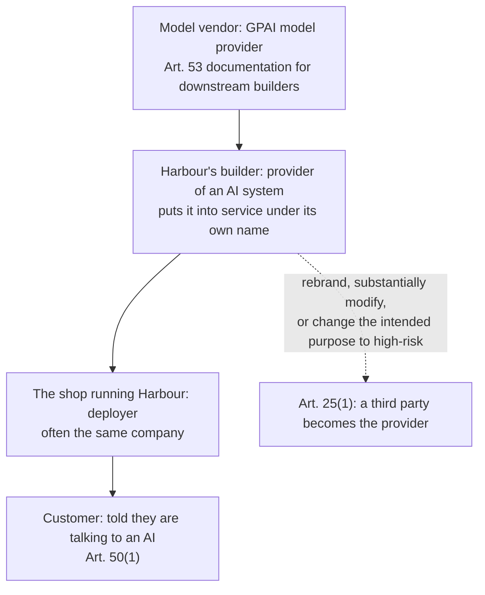

# 7 — Compliance and Regulation

> The earlier chapters ask what could go wrong. This one asks who is legally on the hook when it does, what they must be able to show, and by when. As of 2 November 2026.

Harbour's first enterprise prospect sends a questionnaire. Does the assistant count as high-risk under the EU AI Act? Where is SOC 2 evidence for the model provider? Can it go in front of a clinic's patients? Do you have zero data retention? The engineer who gets the document can truthfully answer that the model API has a retention setting, and that's about all. Each of those questions has a different owner, and the answers depend on what Harbour does with data and decisions, more than on which model it calls. Most of the work is finding out what your system actually does, which is an engineering task, and that's why this chapter is here.

This chapter isn't legal advice: use it to ask your lawyers better questions and to build what they'll ask for.

Every statement of current law below is dated. The EU rules moved in July 2026, one HIPAA rule is pending and vendor terms change without notice, so check the dates before relying on this.

## What this chapter answers

| Question | The short answer |
|---|---|
| Who's on the hook under the AI Act? | Whoever builds or puts the system into service under their name, and whoever uses it. You're often both. |
| Is Harbour high-risk? | Not as built. It becomes so when a feature crosses into an Annex III use, so watch the features. |
| When does it all apply? | In stages. Annex III high-risk duties moved to 2 December 2027. Transparency duties have applied since 2 August 2026. |
| Is a SOC 2 report a compliance pass? | No. An auditor's report on a vendor's controls, within a scope you must read. |
| Does HIPAA apply? | Only if you handle protected health information for a covered entity. Then a contract comes before any data. |
| Does a region setting solve data residency? | No. It says where one part of the processing happens, and it says nothing about your own logs. |
| Does zero data retention mean nothing's kept? | No. It's a contractual arrangement with listed exceptions, and it doesn't touch your own copies. |

## The EU AI Act: roles first

Regulation (EU) 2024/1689 ([OJ text](http://data.europa.eu/eli/reg/2024/1689/oj)) was published in July 2024 and amended by Regulation (EU) 2026/1744, the "Digital Omnibus on AI" ([OJ text](http://data.europa.eu/eli/reg/2026/1744/oj)), published on 24 July 2026. It has a long reach. Under Article 2(1) it covers providers placing systems on the EU market wherever they're located, deployers located in the Union, and third-country providers and deployers whose system's output is used in the Union. A Californian company serving EU shoppers isn't outside it. Article 2(7) leaves GDPR unaffected, apart from Articles 4a and 59, so nearly everything here is additional to data protection duties.

Obligations attach to roles, so settle roles first. Article 3 defines the two that matter:

- A **provider** develops an AI system or model, or has one developed, and places it on the market or puts it into service under its own name (Art. 3(3)).
- A **deployer** uses an AI system under its own authority (Art. 3(4)).



If the shop builds Harbour on a vendor's API for its own support desk, read literally the shop is both: provider of the system and its deployer. Buying a model doesn't move your duties to the model vendor. That vendor has its own, as a provider of a **general-purpose AI (GPAI) model**, including documentation for those building on it (Art. 53(1)(b)), and extra duties for models with systemic risk, which the Act presumes above 10^25 floating-point operations of training (Art. 51(2), Art. 55). That documentation is what you should ask for.

Article 25(1) is the trap for anyone customising. A deployer or other third party becomes the provider of a high-risk system by putting its name on one, substantially modifying one, or changing the intended purpose of a system, including a GPAI one, so that it becomes high-risk. Wiring a general-purpose chat product into loan decisions does that. Article 25(4) also requires a written agreement with suppliers of components in a high-risk system.

## The EU AI Act: risk tiers, applied to Harbour

The Act sorts uses, not models. Four tiers matter here, and a single product can sit in several.

**Prohibited (Art. 5).** Applies now. It includes manipulative techniques that cause significant harm, exploiting vulnerabilities, social scoring, profiling-only criminal risk prediction, scraping faces to build recognition databases, and inferring emotions in workplaces and education except for medical or safety reasons (Art. 5(1)(f)). A staff tool that reads an agent's mood from their voice would run into that last one. The Omnibus adds bans on non-consensual intimate material and child sexual abuse material from 2 December 2026. For systems, these bite where producing it is the intended purpose, or a foreseeable outcome without adequate safeguards (Art. 5(1a)).

**High-risk (Art. 6).** Either a safety component of a regulated product (Art. 6(1), Annex I), or a use listed in Annex III (Art. 6(2)). The Annex III areas are biometrics, critical infrastructure, education, employment, essential services, law enforcement, migration, and justice and democracy. Article 6(3) lets a provider conclude that an Annex III system isn't high-risk where it only does a narrow procedural task, improves the result of a completed human activity, detects decision patterns without replacing the human assessment, or does preparatory work. A system that profiles natural persons is always high-risk. Using this exemption has to be documented, and the system registered (Art. 6(4)).

**Transparency (Art. 50).** Designed so people know they're interacting with an AI unless it's obvious (50(1)), machine-readable marking of synthetic output with an exception for assistive standard editing (50(2)), informing people exposed to emotion recognition or biometric categorisation (50(3)), and disclosure of deep fakes and some public-interest text (50(4)).

**Everything else.** No specific duties under the Act, though Article 4 as amended asks providers and deployers to take measures to support the development of AI literacy, and other law continues to apply.

Harbour as built reads help articles, looks up orders, files tickets, sends email and issues small refunds. None of that is in Annex III. So it sits in the transparency tier: it must tell customers they're talking to an AI, and whether its generated email needs marking under 50(2) is a question to take to counsel. It's the features that move it.

| A proposed Harbour feature | Where it lands | Why |
|---|---|---|
| Sort tickets by topic | No tier change | Nothing is decided about a person |
| Offer pay-later if the customer scores well | High-risk, Annex III 5(b) | Evaluating creditworthiness of natural persons (fraud detection is carved out) |
| Price a health or life add-on | High-risk, Annex III 5(c) | Risk assessment and pricing for those insurance types |
| Route tickets to staff by each agent's past behaviour | High-risk, Annex III 4(b) | Allocating tasks based on individual behaviour |
| Score agents on their conversations | High-risk, Annex III 4(b) | Monitoring and evaluating performance and behaviour |
| Detect a customer's emotion from their voice | High-risk, Annex III 1(c), and Art. 50(3) | Biometric data is the trigger (Art. 3(39)) |
| Detect an agent's emotion from their voice | Prohibited, Art. 5(1)(f) | Workplace, unless for medical or safety reasons |
| Judge a customer's sentiment from the text of a message | Probably not emotion recognition | The definition is tied to biometric data, but confirm this |

The product implication is that high-risk status comes in through the roadmap. Someone adds staff analytics to the dashboard, and an Article 16 regime follows. So put an Annex III check into feature review, where someone can stop it cheaply.

### If you do cross the line

The provider of a high-risk system takes on risk management (Art. 9), data governance (Art. 10), logging (Art. 12), instructions for use (Art. 13), human oversight (Art. 14), accuracy, robustness and cybersecurity (Art. 15), conformity assessment, a declaration, CE marking and registration (Art. 16, 43, 47-49), post-market monitoring (Art. 72) and serious incident reports (Art. 73). Providers keep automatically generated logs at least six months (Art. 19). Deployers follow the instructions, assign competent oversight, monitor, keep logs under their control at least six months and inform workers before use at work (Art. 26). Public bodies, private entities providing public services, and deployers of credit-scoring or insurance systems also need a fundamental rights impact assessment, except for critical infrastructure systems (Art. 27).

Much of that is what this course already teaches, under other names. What the law adds is that it must be documented, and available on request. So don't build a second system. Keep evidence from the first.

| Duty | What it needs in practice | Where it's built |
|---|---|---|
| Risk management, Art. 9 | A kept and updated threat model | [Threat model](01-threat-model.md) |
| Logging, Art. 12, 19, 26(6) | Traces you can replay, and a retention rule | [Prepare what must exist beforehand](06-incident-response.md#prepare-what-must-exist-beforehand) |
| Human oversight, Art. 14 | Approval checkpoints with real authority to stop | [Governance and production](../../05-graph-engineering/notes/08-governance-and-production.md), [the autonomy ladder](../../04-loop-engineering/notes/07-autonomy-ladder.md) |
| Robustness and cybersecurity, Art. 15 | Injection resistance and tested boundaries | [Prompt injection](02-prompt-injection-and-jailbreaks.md), [sandboxing](04-tool-and-execution-sandboxing.md), [red-teaming tools](05-red-teaming-tools.md) |
| Accuracy, Art. 15 | Declared and measured performance | [The Eval pillar](../../../generative-ai/08-eval/README.md) |
| Post-market monitoring, Art. 72 | Rollout steps and production signals | [Production and the maturity ladder](../../../generative-ai/08-eval/notes/11-production-and-the-maturity-ladder.md), [guardrails for self-modifying loops](../../04-loop-engineering/notes/09-failure-modes-and-guardrails.md#guardrails-for-self-modifying-loops) |
| Serious incidents, Art. 73 | Detection, scoping and a clock | [Incident response](06-incident-response.md) |

## When it applies, as amended

The dates are where older summaries of the Act are now wrong. The original Article 113 had Annex III high-risk duties applying on 2 August 2026. The Omnibus moved them. It entered into force on the third day after publication (Art. 4 of 2026/1744), which we compute as 27 July 2026, and that date agrees with Article 113(d) as amended.

```text
2 Feb 2025   Prohibitions, definitions, scope ............ applying
2 Aug 2025   GPAI model rules, penalties (not Art. 101) .. applying
27 Jul 2026  Omnibus in force ............................ applying
2 Aug 2026   Art. 50 transparency; Art. 101 fines ........ applying
- - - - - - - - - - - - - - - - - - - -  as of 2 Nov 2026  - - - - -
2 Dec 2026   New Art. 5 bans; Art. 50(2) for older systems
2 Aug 2027   Models placed before 2 Aug 2025 must comply
2 Dec 2027   High-risk: Annex III uses (was 2 Aug 2026)
2 Aug 2028   High-risk: Annex I regulated products (was 2 Aug 2027)
```

Keep this as data rather than prose, so that a change to it has a diff and a source next to it. As in the rest of this pillar, copy this to a file and run it with `uv run python file.py`.

```python
from datetime import date

AS_AMENDED = [  # (date it applies, what, where it comes from)
    (date(2025, 2, 2), "Prohibited practices (Art. 5); definitions and scope", "2024/1689 Art. 113(a)"),
    (date(2025, 8, 2), "General-purpose AI model rules (Ch. V); penalties (Ch. XII) except Art. 101", "2024/1689 Art. 113(b)"),
    (date(2026, 7, 27), "The Omnibus enters into force; Art. 102-110 (amendments to sector laws) apply", "2026/1744 Art. 4; Art. 113(d) as amended"),
    (date(2026, 8, 2), "General date: Art. 50 transparency for new systems; Art. 101 fines on model providers", "2024/1689 Art. 113"),
    (date(2026, 12, 2), "New bans on intimate imagery and CSAM; Art. 50(2) marking for systems placed before 2 Aug 2026", "2026/1744, Art. 113(a), Art. 111(4)"),
    (date(2027, 8, 2), "Models placed before 2 Aug 2025 must comply", "2024/1689 Art. 111(3)"),
    (date(2027, 12, 2), "High-risk systems under Annex III", "2026/1744, Art. 113(c)(i)"),
    (date(2028, 8, 2), "High-risk systems in Annex I regulated products", "2026/1744, Art. 113(c)(ii)"),
]
ORIGINAL_HIGH_RISK = {"Annex III": date(2026, 8, 2), "Annex I": date(2027, 8, 2)}


def status(as_of):
    """What applies on a date, and what is still ahead."""
    applying = [row for row in AS_AMENDED if row[0] <= as_of]
    ahead = [row for row in AS_AMENDED if row[0] > as_of]
    return applying, ahead


for as_of in (date(2026, 11, 2), date(2027, 12, 2)):
    applying, ahead = status(as_of)
    print(f"as of {as_of}: {len(applying)} of {len(AS_AMENDED)} apply; next {ahead[0][0]}: {ahead[0][1]}")
days = (date(2027, 12, 2) - ORIGINAL_HIGH_RISK["Annex III"]).days
print(f"Annex III moved by {days} days, from {ORIGINAL_HIGH_RISK['Annex III']} to 2027-12-02")
```

```text
as of 2026-11-02: 4 of 8 apply; next 2026-12-02: New bans on intimate imagery and CSAM; Art. 50(2) marking for systems placed before 2 Aug 2026
as of 2027-12-02: 7 of 8 apply; next 2028-08-02: High-risk systems in Annex I regulated products
Annex III moved by 487 days, from 2026-08-02 to 2027-12-02
```

Three details are worth noting. Systems already on the market before the high-risk dates are only caught if their design changes significantly, with public-authority use required to comply by 2 August 2030 (Art. 111(2) as replaced). Article 72(3) now has the Commission providing guidance and a voluntary template for post-market monitoring by 2 September 2027. And Article 4a adds a narrow, conditional permission to process special-category data for detecting and correcting bias, mainly in high-risk systems and on the same conditions in other systems (Art. 4a(2)), which matters for the [audits this pillar scopes in](../README.md).

Fines scale with the breach: up to €35 million or 7% of worldwide turnover for prohibited practices (Art. 99(3)), up to €15 million or 3% for most operator duties, including Art. 50 and Art. 26 (Art. 99(4)), and up to €7.5 million or 1% for supplying incorrect information (Art. 99(5)). SMEs pay the lower of each pair (Art. 99(6)). GPAI model providers have their own cap, 3% or €15 million (Art. 101).

## SOC 2: an auditor's report, not a badge

SOC 2 is a report, issued by a licensed CPA, on a service organisation's controls. It isn't a regulation, and no authority makes you hold one. Customers ask for it, which works much like a requirement. The criteria are the Trust Services Criteria, set by the AICPA's Assurance Services Executive Committee across five categories: security, availability, processing integrity, confidentiality and privacy ([AICPA, 2017 criteria with 2022 revised points of focus](https://www.aicpa-cima.com/resources/download/2017-trust-services-criteria-with-revised-points-of-focus-2022); we read the public landing page, and the PDF needs an account).

Three recent developments matter if you're relying on these reports (all as of 2 November 2026):

- The AICPA has [published exposure drafts](https://www.aicpa-cima.com/resources/download/aicpa-exposure-drafts-proposed-2027-soc-2-trust-services-criteria-and-description-criteria) of proposed 2027 criteria (26 October 2026). We read the summary but not the drafts, so we can't say what they change.
- Its [SOC hub](https://www.aicpa-cima.com/resources/landing/system-and-organization-controls-soc-suite-of-services) carries a notice that it's looking into anonymous allegations about one compliance vendor's SOC business practices, and says SOC services should be thoroughly evaluated. The quality of a report varies, then, and a logo isn't evidence.
- The [Journal of Accountancy reported on 19 October 2026](https://www.journalofaccountancy.com/news/2026/oct/aicpa-partners-on-new-offering-that-assures-ai-systems-and-agents/) that the AICPA has partnered with AIUC on an engagement combining a SOC 2 report with an AI-agent certification, with full launch expected in early 2027. The article says some CPA firms are already delivering it. It's still an early-stage product, so it's worth watching, not relying on.

When a vendor sends a SOC 2 report, read it rather than filing it. Practitioners distinguish a Type 1 report, on whether controls were suitably designed at a point in time, from a Type 2, on whether they operated over a period. We couldn't read AICPA's own wording on this, as it sits behind the account wall, so check the report itself. Then ask:

- **Is the thing you're buying in the described system?** A report on the company's cloud platform may not cover a newly launched agent product.
- **Which categories were in scope?** The report might not include privacy or processing integrity.
- **What period does it cover?** A gap between the period's end and today means you're relying on something else.
- **What exceptions did the auditor note,** and what did management say about them?
- **What does it assume of you?** Reports commonly list controls expected of the customer, and failing at those is on you.

Then keep the limit in mind. A clean SOC 2 tells you about a vendor's controls in its described system. It doesn't tell you the model's answers are right, or that your own agent resists [injection](02-prompt-injection-and-jailbreaks.md), since your system isn't what the auditor looked at.

## HIPAA: a contract before any data

HIPAA doesn't attach to health information as such. It attaches to **protected health information (PHI)** held by **covered entities**: health plans, clearinghouses and providers who transmit health information electronically in a covered transaction (45 CFR 160.103), and their **business associates**, meaning those who create, receive, maintain or transmit PHI on a covered entity's behalf, including subcontractors. A shop's order for vitamins isn't PHI just because it looks medical.

So here's a hypothetical. A clinic chain wants Harbour for patient billing questions. The clinic is a covered entity, Harbour's builder is its business associate, and the model API, tracing tool and vector store are each subcontractor business associates if PHI reaches them. A subcontractor stays in the chain whether or not it reads anything, since "maintains" is in the definition. These are the rules read from the [Electronic Code of Federal Regulations](https://www.ecfr.gov/current/title-45/subtitle-A/subchapter-C), which is the text of the rules the Department of Health and Human Services issues:

- **A written contract comes first.** A covered entity may let a business associate handle PHI only with satisfactory assurances, documented in a contract (§164.502(e)). That contract sets permitted uses, flows the same restrictions down to subcontractors, and requires return or destruction of PHI at termination where feasible (§164.504(e)). PHI sent to a vendor with no such contract is a problem on the day it's sent, even if nothing goes wrong later.
- **Technical safeguards.** Access control with unique user identification, audit controls, integrity, authentication and transmission security (§164.312). Unique IDs and audit controls are the same requirement as the [end-user identity and attribution](../../05-graph-engineering/notes/08-governance-and-production.md#attribution-is-the-whole-problem) you already need for an agent.
- **Keep the paperwork.** Required documentation is retained six years (§164.316(b)(2)).
- **Report a breach.** After a breach of unsecured PHI, a business associate notifies the covered entity without unreasonable delay and within 60 calendar days of discovery (§164.410).
- **De-identification is a real exit, and a narrow one.** Data is out of scope if an expert determines the risk is very small, or if 18 kinds of identifier are removed and you have no actual knowledge that the rest could identify someone (§164.514(a)-(b)). The list includes dates more specific than a year and any other unique code. A support conversation is free text, so a regular-expression pass won't reliably meet this. [PII detection](03-guardrail-models.md) is a control and not, in itself, de-identification.

Something may change here. In January 2025 HHS proposed changing the Security Rule to remove the distinction between required and addressable implementation specifications, among much else ([90 FR, 6 January 2025](https://www.federalregister.gov/documents/2025/01/06/2024-30983/hipaa-security-rule-to-strengthen-the-cybersecurity-of-electronic-protected-health-information)). A search of the Federal Register on 2 November 2026 found no final rule, so today's text, where encryption is addressable (§164.312), still stands. Treat that as a design floor and encrypt regardless.

Vendor HIPAA paths aren't the same as their zero-retention paths, and they tend to narrow what you can use. As of 2 November 2026, [Anthropic's](https://platform.claude.com/docs/en/manage-claude/api-and-data-retention) requires a BAA and a HIPAA-enabled organisation, rejects ineligible features with a 400 error, warns against putting PHI in JSON schemas because those are cached separately, and excludes Bedrock and Google Cloud's Agent Platform, which have their own documentation, and Claude Platform on AWS. [OpenAI's](https://developers.openai.com/api/docs/guides/your-data) lists its own BAA-based path. So check that each feature your agent uses is on the eligible list. It's easy to pass the contract review and then ship a tool that's excluded.

## Data residency: find the real data flow

A region setting isn't a residency answer, because residency is several questions. Where's inference? Where's the data at rest? Where are the logs? Who can reach it from elsewhere? Vendor settings address some of these.

As of 2 November 2026:

| Vendor | What the docs describe | What it leaves open |
|---|---|---|
| [Anthropic](https://platform.claude.com/docs/en/manage-claude/data-residency) | `inference_geo` per request (`global` or `us`); workspace geography for data at rest and endpoint processing, only `us` for now, and fixed at creation | No EU option in this setting. Costs 1.1× for `us` inference on recent models |
| [OpenAI](https://developers.openai.com/api/docs/guides/your-data) | Project-level residency, 10% uplift on models released from 5 March 2026 | Doesn't cover system data. A region without regional processing may process elsewhere. Non-US regions need extra retention terms |
| [AWS Bedrock](https://docs.aws.amazon.com/bedrock/latest/userguide/data-protection.html) | Data protection under AWS's shared responsibility model; model providers don't get access to deployment accounts or logs | Your configuration is on you, and sensitive data shouldn't go in tags |

For EU personal data the legal test is the transfer, not the server location alone. [GDPR](http://data.europa.eu/eli/reg/2016/679/oj) Article 44 applies to transfers to third countries, including onward ones. They need either an adequacy decision (Art. 45) or appropriate safeguards such as standard contractual clauses or binding corporate rules, with enforceable rights and effective remedies for data subjects (Art. 46). Without either, only the narrow derogations in Art. 49 remain, such as explicit consent. For the US, Commission Implementing Decision (EU) 2023/1795 finds adequate protection only for transfers to organisations on the [Data Privacy Framework List](http://data.europa.eu/eli/dec_impl/2023/1795/oj), so check the actual vendor's listing. We read the decision, not any later litigation about it, so have counsel confirm it stands. A vendor is also usually your processor, which requires a contract under Article 28(3), with the same duties passed to any sub-processor (Art. 28(4)).

The practical way to answer all of this is a register of every place the data goes, and most of the entries aren't the model. Traces, eval sets, vector stores, caches, email, error reporting and support tooling all count. Fill it in from contracts and settings, then run it through rules.

```python
from dataclasses import dataclass


@dataclass(frozen=True)
class Flow:
    """One place personal data goes. Fill it in from contracts and settings, not from a vendor's marketing."""
    name: str
    data: frozenset        # e.g. {"personal", "eu_personal", "phi"}
    region: str            # where it is processed and stored
    retention_days: int | None  # None means nobody knows
    contract: frozenset    # e.g. {"dpa", "scc", "dpf", "baa"}
    trains_on_it: bool = False


def findings(flow):
    """Questions for the owner of this flow. A clean run means nothing was missed by these rules, not that you comply."""
    out = []
    if "phi" in flow.data and "baa" not in flow.contract:
        out.append("PHI with no business associate contract")
    if flow.data & {"personal", "eu_personal"} and "dpa" not in flow.contract:
        out.append("personal data with no processor contract")
    if "eu_personal" in flow.data and not flow.region.startswith("eu") and not flow.contract & {"scc", "dpf", "adequacy"}:
        out.append(f"EU personal data in {flow.region} with no transfer mechanism")
    if flow.retention_days is None:
        out.append("retention unknown")
    if flow.trains_on_it:
        out.append("data used for training: confirm the customer terms allow it")
    return out


# A hypothetical register for Harbour. These are not statements about any real vendor's terms.
REGISTER = [
    Flow("model API", frozenset({"personal", "eu_personal"}), "us", 0, frozenset({"dpa", "dpf"})),
    Flow("model API, flagged requests", frozenset({"personal", "eu_personal"}), "us", 730, frozenset({"dpa", "dpf"})),
    Flow("tracing SaaS", frozenset({"personal", "eu_personal"}), "us", None, frozenset()),
    Flow("vector store", frozenset({"personal", "eu_personal"}), "eu-west", 365, frozenset({"dpa"})),
    Flow("clinic pilot, model API", frozenset({"personal", "phi"}), "us", 0, frozenset({"dpa"})),
    Flow("eval dataset in a notebook", frozenset({"personal"}), "laptop", None, frozenset(), trains_on_it=True),
]

for flow in REGISTER:
    problems = findings(flow)
    print(f"{flow.name:<30}{'; '.join(problems) if problems else 'no finding'}")
longest = max(flow.retention_days or 0 for flow in REGISTER)
print("zero retention on the main path, but the longest known copy is", longest, "days")
assert findings(Flow("clean", frozenset({"eu_personal"}), "eu-west", 30, frozenset({"dpa"}))) == []
```

```text
model API                     no finding
model API, flagged requests   no finding
tracing SaaS                  personal data with no processor contract; EU personal data in us with no transfer mechanism; retention unknown
vector store                  no finding
clinic pilot, model API       PHI with no business associate contract
eval dataset in a notebook    personal data with no processor contract; retention unknown; data used for training: confirm the customer terms allow it
zero retention on the main path, but the longest known copy is 730 days
```

Each line here is a hypothetical, not a statement about a real vendor. The model API passes, and the problems are in the tracing tool and the notebook, which is usual, since they get set up by whoever needed them that afternoon. A clean output only means these rules found nothing, so have a person own the register.

## Zero data retention: read the exceptions

ZDR isn't one thing, because each vendor defines it. As of 2 November 2026:

| Vendor | What it is | What still survives or needs your action |
|---|---|---|
| [Anthropic](https://platform.claude.com/docs/en/manage-claude/api-and-data-retention) | By arrangement, per organisation: customer prompts and responses aren't stored at rest after the response | Data required by law or flagged by trust and safety systems, flagged inputs and outputs for up to 2 years. Covers listed API features only, so code execution, the Console and some models are out. Fable and Mythos 5.x models require 30-day retention |
| [OpenAI](https://developers.openai.com/api/docs/guides/your-data) | ZDR, which forces `store` false, or Modified Abuse Monitoring, both on prior approval | By default, abuse monitoring logs up to 30 days, or longer where the law or harm requires. Ineligible endpoints may still store state |
| [Google](https://docs.cloud.google.com/gemini-enterprise-agent-platform/resources/zero-data-retention) | A set of things you must do, area by area | Take the page's specific actions on abuse monitoring. Grounding with Search or Maps stores data and can't be disabled; for Search, the page recommends Web Grounding for Enterprise, and it names no alternative for Maps. Interactions API `store` defaults to true, so set it to false |

Beyond the exceptions, there are three limits:

1. **It covers the vendor's copy.** Your traces, retrieved chunks, memory, ticket system and eval sets are unaffected, and those usually hold more than the vendor ever did. Chapter 6 already says to [redact before writing and set retention](06-incident-response.md#prepare-what-must-exist-beforehand).
2. **It constrains features and models.** Choosing ZDR can remove a code-execution tool or the newest model, which might be the capability you wanted. Check before you design around them.
3. **It can pull against your obligations.** If you're ever high-risk you must keep logs at least six months (Art. 19, Art. 26(6)), and an incident needs a [replayable trace](06-incident-response.md#prepare-what-must-exist-beforehand). These aren't in conflict, because the vendor's copy and yours are separate, but you do need to decide what you keep, where and for how long. ZDR at the vendor means you own your evidence.

## Clocks that start when something goes wrong

If an incident touches several regimes, several clocks run at once. Put them in the [incident plan](06-incident-response.md) ahead of time, and bring in legal early, since working out what started each clock is a legal question.

| Regime | Who reports | To whom | Clock |
|---|---|---|---|
| GDPR Art. 33 | Controller | Supervisory authority | Without undue delay, within 72 hours where feasible, unless the breach is unlikely to create a risk to people |
| GDPR Art. 33(2) | Processor | Controller | Without undue delay |
| HIPAA §164.410 (unsecured PHI) | Business associate | Covered entity | Without unreasonable delay, 60 calendar days at most from discovery |
| AI Act Art. 73 (high-risk only, once those duties apply) | Provider | Market surveillance authority | On establishing a causal link or its reasonable likelihood, and within 15 days of becoming aware; 2 days for widespread infringement or serious and irreversible disruption of critical infrastructure; 10 days for a death, with the clock also starting on suspicion |

## Pitfalls

- **Treating the model vendor as the provider.** Harbour's builder is the provider of Harbour. The vendor's duties are about the model, and yours aren't reduced by them.
- **Using a pre-2026 summary.** The Annex III date in most older articles was superseded in July 2026. Check the amendment, and date your own notes.
- **Assessing the system once.** High-risk status comes in through new features. Put the Annex III check in feature review.
- **Filing the SOC 2 unread.** The report might not cover your product, your categories or the period you're relying on.
- **"We have ZDR, so no data is kept."** Flagged requests and your own traces say otherwise.
- **PHI first, contract later.** The obligation attaches when the data arrives. Test with synthetic data until the chain of contracts is signed.
- **Regex as de-identification.** Free text carries identifiers no pattern list catches.
- **Compliance as a separate project.** A parallel set of documents goes stale quickly. Generate evidence from the traces, evals and rollout gates you already run.
- **Calling a question closed that a lawyer hasn't seen.** Classification under Article 6 and the transfer mechanism are legal conclusions. Bring facts to the people who can sign them.

## Try it

1. A product manager proposes that Harbour flag "low-performing support staff" from their ticket conversations, for managers only. Classify it, and name what changes.

   <details><summary>Answer</summary>

   It monitors and evaluates the performance and behaviour of people in a work relationship, which is Annex III 4(b), so it's high-risk unless the Article 6(3) exemption fits, and this is unlikely to fit since it profiles individuals. If it reads emotion from their voices, it's Article 5(1)(f), which is already prohibited. Being for managers only doesn't matter. Duties under Article 16 and 26 would apply from 2 December 2027, including informing workers before use. The cheap answer is to drop the individual scoring and report only by team or queue, then get that reviewed.
   </details>

2. Extend `status` to answer "what's still ahead for a system first placed on the market in June 2026 that generates text?" using the timeline above.

   <details><summary>Answer</summary>

   Add a filter on the date placed. For that system the Art. 50(2) marking duty runs from 2 December 2026, under Article 111(4), rather than 2 August 2026, because it was placed before that date. Art. 50(1) has applied since 2 August 2026 regardless. Annex III dates matter only if a use falls under it. So one table isn't enough, and the lookup needs system facts as well as a date.
   </details>

3. Add a rule to `findings` so that any flow with `retention_days` over 365 needs a recorded reason, and run it on the register.

   <details><summary>Answer</summary>

   Add a field such as `retention_reason: str = ""` to `Flow`, with `if (flow.retention_days or 0) > 365 and not flow.retention_reason: out.append("long retention with no recorded reason")`. It fires on "model API, flagged requests" (730 days), which is a useful finding: that retention is the vendor's and not your choice, so the fix is to record the reason and tell customers, not to change a setting.
   </details>

4. The clinic pilot from the HIPAA section wants to use your existing tracing tool, which is on no BAA. List your options.

   <details><summary>Answer</summary>

   Sign a BAA with the tool's vendor and check the features you use are covered; move traces for this tenant to something under your own control and existing contract; or redact before writing, knowing that free-text redaction may not reach the de-identification standard, so the trace may still contain PHI and may still need the contract. Stopping the pilot's traces altogether isn't an option, since §164.312(b) requires audit controls and you'd lose your [incident evidence](06-incident-response.md). Note that the register caught this because of the row, not because anyone remembered it.
   </details>

## Interview checklist

| Question | Answer |
|---|---|
| Provider or deployer? | A provider develops or commissions a system and puts it out under its own name. A deployer uses it under its authority. Building on a model API for your own use commonly makes you both. |
| When can a deployer become a provider? | Article 25(1): rebranding, substantial modification, or changing the intended purpose so a system becomes high-risk. |
| What makes a system high-risk? | A safety component in a regulated product, or a listed Annex III use, such as credit scoring, hiring or managing workers. The use decides, not the model. |
| When do high-risk duties apply? | As amended by Regulation 2026/1744: 2 December 2027 for Annex III, 2 August 2028 for Annex I. The original dates were a year or more earlier. |
| What applies to a plain support bot today? | Tell people it's an AI unless that's obvious, consider output marking, and apply the prohibitions and other law, such as GDPR. |
| What's a SOC 2 report? | A CPA's report on a service organisation's controls against the Trust Services Criteria. Read the scope, categories, period and exceptions. It's no statement about model quality. |
| When does HIPAA apply to an AI vendor? | When it creates, receives, maintains or transmits PHI on behalf of a covered entity, directly or as a subcontractor. A written contract has to come first. |
| Does de-identifying solve HIPAA? | If it meets §164.514, yes. Free text makes the safe harbor hard, as 18 identifier types must go and you must have no actual knowledge of re-identification. |
| What does data residency miss? | Logs, support access, sub-processors and your own stores. For EU data, ask about the transfer mechanism, not just the region. |
| Is ZDR the same across vendors? | No. It's by arrangement, it has exceptions such as flagged content or required abuse logs, and it can exclude features and models. Your own traces aren't touched. |
| How do you avoid compliance theatre? | Tie each duty to something the system already produces: traces, evals, approval records and rollout gates. |

## Next

That closes the pillar. To make the regression cases and evidence run on every change, go to the [Eval pillar in generative-ai](../../../generative-ai/08-eval/README.md), or return to the [pillar README](../README.md) for the rules of thumb.
