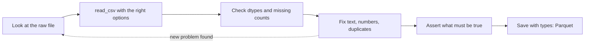

# 2 — Loading and Cleaning

The first chapter's frame was typed in by hand, so every value was what it looked like. Real data comes out of an admin panel, an export, or somebody's spreadsheet, and nobody cleaned it for you. Prices carry currency signs, categories are spelled three ways, one row appears twice, and a column of numbers contains the word `n/a`. It is often said that 80% of data analysis goes on cleaning and preparing the data; Wickham repeats the figure, citing Dasu and Johnson, and adds that preparation is no one-off first step but gets repeated as new problems surface ([Wickham, JSS 2014](https://doi.org/10.18637/jss.v059.i10)). Treat the 80% as folklore and the second half as the useful part. Because you will clean the same data again, cleaning should be a script you can rerun and not a set of edits you did once. This chapter takes the shop's real export from file to trustworthy frame.

The flow for the whole chapter:



## Look at the raw file first

Before you parse anything, read the raw text. Python's `open` and `pathlib` are enough, and `practice/2_Texts.ipynb` drills them on a real file. Here is the export, written to disk so that the rest of the chapter reads an actual file.

```python
from pathlib import Path

raw = """# shop-admin export 2025-02-01
order_id,date,customer,product,qty,unit_price,region
1001,2025-01-03,Ana,kettle,1,$48.00,north
1002,2025-01-03,ben,filter,3,$6.50,South
1003,2025-01-05,ana,grinder,1,$95.00,north
1004,2025-01-06,cara,Filter,2,$6.50,east
1005,2025-01-08,dev,kettle,2,$48.00,
1006,2025-01-09,ben,scale,n/a,$22.00,south
1006,2025-01-09,ben,scale,n/a,$22.00,south
1007,2025-01-11,eli,filter ,4,$6.50,north
1008,2025-01-12,Ana,filter,-1,$6.50,north
1009,2025-01-14,cara,grinder,1,$95.00,East
1010,2025-01-15,fay,scale,1,$22.00,-
1011,2025-01-17,dev,filter,6,$6.50,south
1012,2025-01-20,ben,kettle,1,$48.00,South
"""
Path("orders_raw.csv").write_text(raw, encoding="utf-8")

with open("orders_raw.csv", encoding="utf-8") as f:
    for _ in range(3):
        print(f.readline().rstrip())
```

```text
# shop-admin export 2025-02-01
order_id,date,customer,product,qty,unit_price,region
1001,2025-01-03,Ana,kettle,1,$48.00,north
```

The first line is not data. Everything else you might have to fix is visible from a quick read, but only if you look. Passing `encoding` explicitly is a good habit too: a file saved in another encoding either raises an error or quietly produces garbled characters, and the default encoding differs across systems.

## read_csv and the options that matter

`pd.read_csv` is a large function because files vary in many ways. McKinney groups its options by purpose, and that grouping is a good way to remember them: indexing, type inference and conversion, date parsing, iterating over big files, and handling unclean data ([McKinney, *Python for Data Analysis*, ch. 6](https://wesmckinney.com/book/accessing-data)). Try the naive call first and see what breaks.

```python
import pandas as pd

naive = pd.read_csv("orders_raw.csv")
print(naive.shape)
print(list(naive.columns))
```

```text
(14, 1)
['# shop-admin export 2025-02-01']
```

The banner line became the header, so the frame has one column named after it, and the real columns collapsed into a confusing index. The shape gives it away, which is why you check it. Tell `read_csv` about the comment line and look again.

```python
orders = pd.read_csv("orders_raw.csv", comment="#")
print(orders.head(3))
print(orders.dtypes)
```

```text
   order_id        date customer  product  qty unit_price region
0      1001  2025-01-03      Ana   kettle  1.0     $48.00  north
1      1002  2025-01-03      ben   filter  3.0      $6.50  South
2      1003  2025-01-05      ana  grinder  1.0     $95.00  north
order_id        int64
date              str
customer          str
product           str
qty           float64
unit_price        str
region            str
dtype: object
```

This parse runs without error and is still not right. `qty` is `float64` and not `int64`: pandas treats `n/a` as missing by default, along with strings such as `NA`, `NaN`, `null` and the empty string, and a gap promotes the column to float. `unit_price` stayed `str` because of the dollar signs, and `date` is `str` since pandas does not guess dates unless you ask. The `-` standing for a missing region is this file's own convention, so pandas cannot know about it. Here is a better parse with those decisions stated.

```python
orders = pd.read_csv(
    "orders_raw.csv",
    comment="#",
    na_values={"region": ["-"]},   # this file's own marker for missing
    parse_dates=["date"],
)
print(orders.dtypes)
print(orders.isna().sum())
```

```text
order_id               int64
date          datetime64[us]
customer                 str
product                  str
qty                  float64
unit_price               str
region                   str
dtype: object
order_id      0
date          0
customer      0
product       0
qty           2
unit_price    0
region        2
dtype: int64
```

Three more options deserve a place in your memory, though this file does not need them. `dtype={"zip": "str"}` stops pandas from turning `01234` into the integer 1234, which matters for any identifier with a leading zero. `usecols` and `nrows` let you take a look at a file too large to load in full. And `chunksize` gives you an iterator of frames for a file larger than memory.

```python
import io

ids = "zip,sales\n01234,5\n90210,7\n"
print(pd.read_csv(io.StringIO(ids))["zip"].tolist())
print(pd.read_csv(io.StringIO(ids), dtype={"zip": "str"})["zip"].tolist())

for chunk in pd.read_csv("orders_raw.csv", comment="#", chunksize=5):
    print(len(chunk), end=" ")
print()
```

```text
[1234, 90210]
['01234', '90210']
5 5 3
```

The other readers follow the same pattern. Learn `read_csv` thoroughly and you already know most of `read_json`, `read_excel`, `read_parquet` and `read_sql`, since each returns a DataFrame and most share the idea of stating types and missing markers up front ([pandas IO guide](https://pandas.pydata.org/docs/user_guide/io.html)).

| Source | Function | Note |
|---|---|---|
| Delimited text | `read_csv` | Types are guessed, so state the ones that matter |
| JSON records | `read_json`, `json_normalize` | Nested data needs flattening |
| Excel | `read_excel` | Needs `openpyxl`; `sheet_name` picks the sheet |
| HTML tables | `read_html` | Returns a list of frames, one per table |
| Database | `read_sql` | Takes a query and a connection; pillar 06 teaches the SQL |
| Parquet | `read_parquet` | Types come with the file; needs `pyarrow` |

## Fixing text

Text columns are where most of the visible mess lives, and the `.str` accessor applies Python's string methods across a whole column, skipping missing values rather than crashing on them. Two spellings of `ana`, a trailing space in `filter ` and a capital in `South` are all one problem: the same value written differently. A groupby would count them as separate things, as you can see here, where two rows both print as `filter` and differ only by the invisible space.

```python
print(orders["product"].value_counts())
print(orders["region"].value_counts())
```

```text
product
kettle     3
filter     3
scale      3
grinder    2
Filter     1
filter     1
Name: count, dtype: int64
region
north    4
south    3
South    2
east     1
East     1
Name: count, dtype: int64
```

Normalise every text column the same way: strip the whitespace, then lower the case.

```python
for col in ["customer", "product", "region"]:
    orders[col] = orders[col].str.strip().str.lower()
print(orders["product"].value_counts())
print(sorted(orders["customer"].unique()))
```

```text
product
filter     5
kettle     3
scale      3
grinder    2
Name: count, dtype: int64
['ana', 'ben', 'cara', 'dev', 'eli', 'fay']
```

When you need to pull structure out of text, use a regular expression through `str.extract`, where each capture group becomes a column. `practice/2_Texts.ipynb` works through `re` on free text. Say the shop's couriers send notes with a tracking reference buried inside.

```python
notes = pd.Series([
    "left with neighbour, ref TRK-20391",
    "ref TRK-20417 delivered",
    "customer not home",
])
print(notes.str.extract(r"TRK-(\d+)"))
print(notes.str.contains("deliver"))
```

```text
       0
0  20391
1  20417
2    NaN
0    False
1     True
2    False
dtype: bool
```

The third row has no match, so it gets `NaN` and not an error.

The price column needs its dollar sign stripped before it can be a number. Pass `regex=False` because `$` is a special character in a regular expression. Then convert with `to_numeric`. Its `errors="coerce"` option turns anything unparseable into `NaN`, where you can count it, which is better than failing on the first bad value or silently keeping a text column.

```python
orders["unit_price"] = pd.to_numeric(
    orders["unit_price"].str.replace("$", "", regex=False), errors="coerce"
)
print(orders["unit_price"].dtype, orders["unit_price"].isna().sum())
```

```text
float64 0
```

To recode values, `map` takes a dictionary and applies it to every value, and any value absent from the dictionary becomes `NaN`. `replace` changes only the values you list and leaves the rest. Choose `map` when the dictionary should be complete and a miss should surface, `replace` for a handful of corrections.

```python
codes = {"north": "N", "south": "S", "east": "E"}
print(orders["region"].map(codes).head(5).tolist())
print(orders["region"].replace({"east": "eastern"}).head(5).tolist())
```

```text
['N', 'S', 'N', 'E', nan]
['north', 'south', 'north', 'eastern', nan]
```

## Duplicates

The export repeats order 1006. Exact duplicate rows usually come from a join or a retry somewhere upstream. `duplicated` flags every repeat after the first and `drop_duplicates` removes them. The more useful check is on the column that should be unique, because two rows can share an order id while differing in another field, and a full-row comparison would not catch that.

```python
print(orders.duplicated().sum(), orders["order_id"].duplicated().sum())
print(orders[orders["order_id"].duplicated(keep=False)][["order_id", "customer", "qty"]])
orders = orders.drop_duplicates(subset="order_id")
print(len(orders))
```

```text
1 1
   order_id customer  qty
5      1006      ben  NaN
6      1006      ben  NaN
12
```

## Missing data: decide what a gap means

Pandas can count the gaps and fill or drop them, but it cannot say what they mean. Wickham draws a useful distinction: a **structural** missing value stands for something that could not be measured, so it can safely be removed, while a missing **observation** should have been recorded and was not, so it needs keeping ([Wickham, JSS 2014](https://doi.org/10.18637/jss.v059.i10)). The later pillars will care about a further question: was the gap caused by something related to the value itself? If people with high incomes skip the income question, then dropping those rows biases every average you compute afterwards. For now, ask of each gap: why might this be empty?

```python
print(orders.isna().sum())
print(orders[orders.isna().any(axis=1)][["order_id", "customer", "qty", "region"]])
```

```text
order_id      0
date          0
customer      0
product       0
qty           1
unit_price    0
region        2
dtype: int64
    order_id customer  qty region
4       1005      dev  2.0    NaN
5       1006      ben  NaN  south
10      1010      fay  1.0    NaN
```

Three rows, two kinds of gap, and they call for different treatment.

The missing `region` values do not stop us from computing revenue, so dropping those orders would throw away real sales. Record the gap as a value of its own. `fillna` with a label keeps the row and leaves the ignorance in plain view.

The missing `qty` is worse, as revenue depends on it. The honest choices are to find out, or to exclude the order from revenue and say so. Filling with the mean would invent a fractional number of scales. In this story the shop owner checks the order and confirms the customer bought one, so we write that fact in using a single `.loc`, as chapter 1 taught. Keep the reason in a comment, since this line records a decision no code could have made.

```python
orders["region"] = orders["region"].fillna("unknown")
orders.loc[orders["order_id"] == 1006, "qty"] = 1   # confirmed by the shop owner, 2025-02-02
print(orders["qty"].isna().sum())
orders["qty"] = orders["qty"].astype("int64")
print(orders["qty"].dtype)
```

```text
0
int64
```

`dropna` removes rows with gaps, optionally limited by `subset` to the columns you care about, and `ffill` carries the last known value forward. Carrying forward makes sense for a slowly changing reading, such as a price list, and makes no sense for independent orders. It is a method of its own now, because the old `fillna(method="ffill")` form was removed in pandas 3.0 ([pandas 3.0 release notes](https://pandas.pydata.org/docs/whatsnew/v3.0.0.html)).

```python
prices = pd.Series([48.0, None, None, 52.0, None])
print(prices.ffill().tolist())
print(prices.dropna().tolist())
print(prices.isna().sum(), prices.sum(), prices.mean())
```

```text
[48.0, 48.0, 48.0, 52.0, 52.0]
[48.0, 52.0]
3 100.0 50.0
```

The last line shows a default worth remembering: `sum` and `mean` skip missing values, so the mean here is over 2 values and not 5. That is usually what you want, but it means a summary can look fine when half the column is empty. Always read the count alongside the mean.

## Impossible values and assertions

Order 1008 has a quantity of -1. It parsed fine and it is a valid integer. No type check would catch it. Only knowledge of what the column means tells you that it is either a return or an error. In this shop negative quantities are returns, which belong in a different table, so we set them aside. Keeping them, even in a separate frame, is better than a silent delete: you can report how much was removed, and undo it if you turn out to be wrong.

```python
returns = orders[orders["qty"] < 0]
orders = orders[orders["qty"] > 0].reset_index(drop=True)
print(len(returns), len(orders))
```

```text
1 11
```

Now state what must be true of the result, in code. A failed assertion in a cleaning script is cheap, while a wrong number in a report is expensive, and next month's export will have problems this month's did not.

```python
assert orders["order_id"].is_unique
assert orders[["order_id", "date", "product", "qty", "unit_price"]].notna().all(axis=None)
assert orders["qty"].between(1, 100).all()
assert set(orders["region"]) <= {"north", "south", "east", "unknown"}
print(orders.describe().loc[["min", "max"], ["qty", "unit_price"]])
```

```text
     qty  unit_price
min  1.0         6.5
max  6.0        95.0
```

## Bucketing a number

Sometimes a clean numeric column needs turning into categories, such as order sizes for a report. `pd.cut` splits by the values you give it, and `pd.qcut` splits by quantiles so that each bucket holds about the same number of rows. Bins are closed on the right by default, so `(0, 20]` includes 20 but not 0.

```python
orders["revenue"] = orders["qty"] * orders["unit_price"]
size = pd.cut(orders["revenue"], bins=[0, 20, 50, 100], labels=["small", "medium", "large"])
print(size.value_counts().sort_index())
print(pd.qcut(orders["revenue"], 2, labels=["lower half", "upper half"]).value_counts())
```

```text
revenue
small     2
medium    6
large     3
Name: count, dtype: int64
revenue
lower half    6
upper half    5
Name: count, dtype: int64
```

`pd.cut` on fixed thresholds fits when the thresholds mean something to the business. `pd.qcut` fits when you want equal-sized comparison groups, and chapter 5 feeds such buckets straight into `groupby`.

## Saving what you cleaned

CSV keeps nothing but text, so every reader has to redo your type decisions. Parquet is a compressed columnar binary format that stores the dtypes with the data. Compare the round trip.

```python
orders.to_csv("orders_clean.csv", index=False)
orders.to_parquet("orders_clean.parquet", index=False)

print(pd.read_csv("orders_clean.csv")["date"].dtype)
print(pd.read_parquet("orders_clean.parquet")["date"].dtype)
print(Path("orders_clean.csv").stat().st_size, Path("orders_clean.parquet").stat().st_size)
```

```text
str
datetime64[us]
556 5266
```

On a frame this small the Parquet file comes out larger, since its metadata outweighs the compression; the advantage in size only shows at scale. The advantage in types shows at once, as the CSV's date came back as text. Use CSV to hand data to someone else, and Parquet between steps of your own work. Use `to_pickle` only for a short-lived scratch file: McKinney advises against pickle for long-term storage, because a later library version may be unable to read the file ([McKinney, *Python for Data Analysis*, ch. 6](https://wesmckinney.com/book/accessing-data)), and pandas 3.0 did drop support for reading pickles from versions before 1.0 ([pandas 3.0 release notes](https://pandas.pydata.org/docs/whatsnew/v3.0.0.html)).

## Put it in one function

All of the above belongs in one function that takes a path and returns a clean frame, so that next month's export runs through the same steps. Method chaining with `assign` keeps the steps in reading order, and printing a row count at the end makes silent losses visible.

```python
def load_orders(path):
    df = pd.read_csv(path, comment="#", na_values={"region": ["-"]}, parse_dates=["date"])
    n_raw = len(df)
    df = (
        df.drop_duplicates(subset="order_id")
          .assign(
              customer=lambda d: d["customer"].str.strip().str.lower(),
              product=lambda d: d["product"].str.strip().str.lower(),
              region=lambda d: d["region"].str.strip().str.lower().fillna("unknown"),
              unit_price=lambda d: pd.to_numeric(
                  d["unit_price"].str.replace("$", "", regex=False), errors="coerce"),
          )
    )
    df.loc[df["order_id"] == 1006, "qty"] = 1          # confirmed by the shop owner
    df = df[df["qty"] > 0].reset_index(drop=True)      # negative quantities are returns
    df["qty"] = df["qty"].astype("int64")
    assert df["order_id"].is_unique and df["unit_price"].notna().all()
    print(f"loaded {n_raw} rows, kept {len(df)}")
    return df

clean = load_orders("orders_raw.csv")
print(clean)
```

```text
loaded 13 rows, kept 11
    order_id       date customer  product  qty  unit_price   region
0       1001 2025-01-03      ana   kettle    1        48.0    north
1       1002 2025-01-03      ben   filter    3         6.5    south
2       1003 2025-01-05      ana  grinder    1        95.0    north
3       1004 2025-01-06     cara   filter    2         6.5     east
4       1005 2025-01-08      dev   kettle    2        48.0  unknown
5       1006 2025-01-09      ben    scale    1        22.0    south
6       1007 2025-01-11      eli   filter    4         6.5    north
7       1009 2025-01-14     cara  grinder    1        95.0     east
8       1010 2025-01-15      fay    scale    1        22.0  unknown
9       1011 2025-01-17      dev   filter    6         6.5    south
10      1012 2025-01-20      ben   kettle    1        48.0    south
```

This is the frame the next chapters start from: 11 orders, and every removal accounted for.

## Pitfalls

- **Editing the raw file by hand.** Then nobody can rerun your work, including you next month. Keep raw data unchanged and do all fixes in code.
- **Letting `read_csv` guess identifiers.** Leading zeros vanish from zip codes, phone numbers and account ids. State `dtype="str"`.
- **`errors="coerce"` without counting.** It turns every failure into `NaN` without a word. Print `isna().sum()` before and after, or a change of format upstream can wipe out a whole column unnoticed.
- **Filling gaps with the mean by reflex.** It shrinks the variance and it can invent impossible values. Decide by asking why the value is missing.
- **Dropping rows silently.** Print row counts at each step and keep what you removed.
- **Duplicate checks on the whole row only.** Check the column that should be unique.
- **Pickle as an archive format.** Use Parquet for anything you might read in a year.

## Try it

1. Parse this text so that `sku` keeps its leading zeros, `sold` is numeric with `?` counted as missing, and `day` is a datetime: `"sku,sold,day\n0012,4,2025-03-01\n0031,?,2025-03-02\n"`.

<details><summary>Answer</summary>

```python
text = "sku,sold,day\n0012,4,2025-03-01\n0031,?,2025-03-02\n"
t = pd.read_csv(io.StringIO(text), dtype={"sku": "str"}, na_values=["?"], parse_dates=["day"])
print(t.dtypes)
print(t)
```

```text
sku                str
sold           float64
day     datetime64[us]
dtype: object
    sku  sold        day
0  0012   4.0 2025-03-01
1  0031   NaN 2025-03-02
```

</details>

2. In `pd.Series(["Filter", " filter", "FILTER ", None, "kettle"])`, how many distinct products are there before and after cleaning?

<details><summary>Answer</summary>

```python
s = pd.Series(["Filter", " filter", "FILTER ", None, "kettle"])
print(s.nunique(), s.str.strip().str.lower().nunique())
```

```text
4 2
```

`nunique` ignores the missing value, so four spellings collapse to two products.

</details>

3. Extend the assertions in `load_orders` so it fails if a date falls outside the export month. Then rerun it on a copy of `raw` with one date changed to 2024.

<details><summary>Answer</summary>

```python
assert clean["date"].between("2025-01-01", "2025-01-31").all()
bad = raw.replace("2025-01-20", "2024-01-20")
Path("orders_bad.csv").write_text(bad, encoding="utf-8")
print(load_orders("orders_bad.csv")["date"].between("2025-01-01", "2025-01-31").all())
```

```text
loaded 13 rows, kept 11
False
```

The `False` is what the assertion would stop on, had you added it inside the function.

</details>

4. Work through `practice/2_Texts.ipynb`, which reads a poem from `mckinney/examples/` and uses `re` on free text (run `bash practice/fetch_data.sh` first). Then `practice/mckinney/ch06.ipynb` and `ch07.ipynb` cover the book's full tour of readers and cleaning tools on the book's data.

## Interview checklist

| Question | What a good answer covers |
|---|---|
| A column of numbers loaded as text. What do you do? | Find the bad values with `to_numeric(errors="coerce")` and `isna`, decide what they mean, then add them to `na_values` or fix them. |
| How do you handle missing data? | Ask why it is missing first. Structural gaps can be removed. A gap in an observation needs keeping, filling with a reasoned value, or a stated exclusion. If missingness relates to the value, dropping biases results. |
| What is the difference between `map` and `replace`? | `map` applies a mapping to every value and gives `NaN` for anything unmapped. `replace` changes only listed values. |
| How do you find duplicates? | `duplicated` on the column that should be unique, with `keep=False` to see all copies, then decide before calling `drop_duplicates`. |
| When would you choose `cut` or `qcut`? | `cut` for meaningful fixed thresholds, `qcut` for equal-sized groups. |
| CSV or Parquet? | CSV for interchange. Parquet keeps types and compresses better at scale, so it suits work between pipeline steps. |
| Why not pickle? | It suits only short-term storage. Later library versions may not be able to read it, and it can run code when loaded, so never unpickle untrusted files. |
| How do you stop bad data reaching a report? | A rerunnable loader with assertions on keys, ranges and allowed values, printing row counts at each stage. |

## Next

You now have a clean frame. To work with it you need to pick out precisely the rows and columns you mean. Next: [Indexing and selection](03-indexing-and-selection.md).
