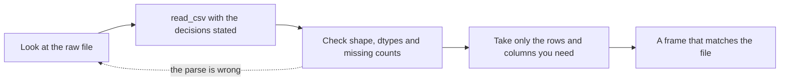

# 2 — Loading Data

The first chapter's frame was typed in by hand, so every value was what it looked like. Real data comes out of an admin panel, an export, a database or somebody's spreadsheet, and the load is the first place its meaning gets lost. A banner line becomes the header. A zip code loses its leading zero. A column of quantities turns into decimals because one cell says `n/a`. None of these raises an error, and each one changes every number computed afterwards. This chapter is about getting the data out of where it lives and into a frame without changing it: read the raw file, state the decisions `read_csv` would otherwise guess, take only the rows and columns you need, and check what arrived. Fixing what is wrong inside the values is cleaning, and it waits until [chapter 5](05-cleaning.md), after you can select and join.

The flow for the whole chapter:



## Look at the raw file first

Before you parse anything, read the raw text. Python's `open` and `pathlib` are enough, and `practice/2_Texts.ipynb` drills them on a real file. Here is the export, written to disk so that the rest of the chapter reads an actual file.

```python
from pathlib import Path

raw = """# shop-admin export 2025-02-01
order_id,date,customer,product,qty,unit_price,region
1001,2025-01-03,Ana,kettle,1,$48.00,north
1002,2025-01-03,ben,filter,3,$6.50,South
1003,2025-01-05,ana,grinder,1,$95.00,north
1004,2025-01-06,cara,Filter,2,$6.50,east
1005,2025-01-08,dev,kettle,2,$48.00,
1006,2025-01-09,ben,scale,n/a,$22.00,south
1006,2025-01-09,ben,scale,n/a,$22.00,south
1007,2025-01-11,eli,filter ,4,$6.50,north
1008,2025-01-12,Ana,filter,-1,$6.50,north
1009,2025-01-14,cara,grinder,1,$95.00,East
1010,2025-01-15,fay,scale,1,$22.00,-
1011,2025-01-17,dev,filter,6,$6.50,south
1012,2025-01-20,ben,kettle,1,$48.00,South
"""
Path("orders_raw.csv").write_text(raw, encoding="utf-8")

with open("orders_raw.csv", encoding="utf-8") as f:
    for _ in range(3):
        print(f.readline().rstrip())
```

```text
# shop-admin export 2025-02-01
order_id,date,customer,product,qty,unit_price,region
1001,2025-01-03,Ana,kettle,1,$48.00,north
```

The first line is not data. Everything else you might have to fix is visible from a quick read, but only if you look. Passing `encoding` explicitly is a good habit too: a file saved in another encoding either raises an error or quietly produces garbled characters, and the default encoding differs across systems.

## read_csv and the options that matter

`pd.read_csv` is a large function because files vary in many ways. McKinney groups its options by purpose, and that grouping is a good way to remember them: indexing, type inference and conversion, date parsing, iterating over big files, and handling unclean data ([McKinney, *Python for Data Analysis*, ch. 6](https://wesmckinney.com/book/accessing-data)). Try the naive call first and see what breaks.

```python
import pandas as pd

naive = pd.read_csv("orders_raw.csv")
print(naive.shape)
print(list(naive.columns))
```

```text
(14, 1)
['# shop-admin export 2025-02-01']
```

The banner line became the header, so the frame has one column named after it, and the real columns collapsed into a confusing index. The shape gives it away, which is why you check it. Tell `read_csv` about the comment line and look again.

```python
orders = pd.read_csv("orders_raw.csv", comment="#")
print(orders.head(3))
print(orders.dtypes)
```

```text
   order_id        date customer  product  qty unit_price region
0      1001  2025-01-03      Ana   kettle  1.0     $48.00  north
1      1002  2025-01-03      ben   filter  3.0      $6.50  South
2      1003  2025-01-05      ana  grinder  1.0     $95.00  north
order_id        int64
date              str
customer          str
product           str
qty           float64
unit_price        str
region            str
dtype: object
```

This parse runs without error and is still not right. `qty` is `float64` and not `int64`: pandas treats `n/a` as missing by default, along with strings such as `NA`, `NaN`, `null` and the empty string, and a gap promotes the column to float. `unit_price` stayed `str` because of the dollar signs, and `date` is `str` since pandas does not guess dates unless you ask. The `-` standing for a missing region is this file's own convention, so pandas cannot know about it. Here is a better parse with those decisions stated.

```python
orders = pd.read_csv(
    "orders_raw.csv",
    comment="#",
    na_values={"region": ["-"]},   # this file's own marker for missing
    parse_dates=["date"],
)
print(orders.dtypes)
print(orders.isna().sum())
```

```text
order_id               int64
date          datetime64[us]
customer                 str
product                  str
qty                  float64
unit_price               str
region                   str
dtype: object
order_id      0
date          0
customer      0
product       0
qty           2
unit_price    0
region        2
dtype: int64
```

Two more options deserve a place in your memory, though this file does not need them. `dtype={"zip": "str"}` stops pandas from turning `01234` into the integer 1234, which matters for any identifier with a leading zero. And `chunksize` gives you an iterator of frames for a file larger than memory.

```python
import io

ids = "zip,sales\n01234,5\n90210,7\n"
print(pd.read_csv(io.StringIO(ids))["zip"].tolist())
print(pd.read_csv(io.StringIO(ids), dtype={"zip": "str"})["zip"].tolist())

for chunk in pd.read_csv("orders_raw.csv", comment="#", chunksize=5):
    print(len(chunk), end=" ")
print()
```

```text
[1234, 90210]
['01234', '90210']
5 5 3
```

McKinney's chunked example reads a 10,000-row, 5-column file in pieces of 1,000 and accumulates `value_counts` with `tot.add(piece["key"].value_counts(), fill_value=0)`, so the full file is never in memory; the `fill_value=0` handles a key absent from some chunk (*Python for Data Analysis*, ch. 6). The chapter also counts over 50 `read_csv` parameters, so when a file will not parse, go to the docs and not to memory. The other readers follow the same pattern. Learn `read_csv` thoroughly and you already know most of `read_json`, `read_excel`, `read_parquet` and `read_sql`, since each returns a DataFrame and most share the idea of stating types and missing markers up front ([pandas IO guide](https://pandas.pydata.org/docs/user_guide/io.html)).

| Source | Function | Note |
|---|---|---|
| Delimited text | `read_csv` | Types are guessed, so state the ones that matter |
| JSON records | `read_json`, `json_normalize` | Nested data needs flattening |
| Excel | `read_excel` | Needs `openpyxl`; `sheet_name` picks the sheet |
| HTML tables | `read_html` | Returns a list of frames, one per table |
| Database | `read_sql` | Takes a query and a connection; the next section uses it |
| Parquet | `read_parquet` | Types come with the file; needs `pyarrow` |

## Take only what you need

An extract is rarely the whole table. You want some of the columns and some of the rows, and the earlier you say so, the less there is to read, hold in memory and get wrong. `usecols` and `nrows` do that inside `read_csv`.

```python
peek = pd.read_csv("orders_raw.csv", comment="#", usecols=["order_id", "product", "qty"], nrows=4)
print(peek)
```

```text
   order_id  product  qty
0      1001   kettle    1
1      1002   filter    3
2      1003  grinder    1
3      1004   Filter    2
```

Look at `qty`. On these four rows it is an integer, because the `n/a` further down was never read. A peek tells you the layout of a file, and it tells you nothing about the types of the full column.

A CSV has no way to filter rows before pandas has read them. A database does. When the data lives in one, put the filter and the column list in the query, so that the database reads less and sends back less. Here the export is copied into SQLite, which ships with Python, to stand in for the shop's database.

```python
import sqlite3

conn = sqlite3.connect(":memory:")
pd.read_csv("orders_raw.csv", comment="#").to_sql("orders", conn, index=False)

north = pd.read_sql(
    "SELECT order_id, product, qty FROM orders WHERE region = ?", conn, params=("north",)
)
print(north)
print(pd.read_sql("SELECT region, COUNT(*) AS n FROM orders GROUP BY region ORDER BY n DESC", conn))
```

```text
   order_id  product  qty
0      1001   kettle  1.0
1      1003  grinder  1.0
2      1007  filter   4.0
3      1008   filter -1.0
  region  n
0  north  4
1  south  3
2  South  2
3   east  1
4   East  1
5      -  1
6    NaN  1
```

Four rows and three columns crossed over, and not the whole table. Pass values through `params` and never by pasting them into the query string. The second query is a warning about extracting before cleaning: the database counted `south` and `South` as two regions, exactly as pandas would have. Extracting moves the mess, and it does not fix it. [SQL from Python](../../../programming/sql/notes/09-sql-from-python.md) covers the connection, the parameters and which side should do which work.

The third option is **Polars**, a DataFrame library with a lazy mode. `scan_csv` reads nothing. It builds a plan, and the filter and the column choice you add afterwards are pushed into the read before any data is touched. `explain` prints the plan.

```python
import polars as pl

lazy = (
    pl.scan_csv("orders_raw.csv", comment_prefix="#")
      .filter(pl.col("region") == "north")
      .select("order_id", "product", "qty")
)
print(lazy.explain())
print(lazy.collect())
```

```text
simple π 3/3 ["order_id", "product", "qty"]
  Csv SCAN [orders_raw.csv]
  PROJECT 4/7 COLUMNS
  SELECTION: col("region") == "north"
  ESTIMATED ROWS: 15
shape: (4, 3)
┌──────────┬─────────┬─────┐
│ order_id ┆ product ┆ qty │
│ ---      ┆ ---     ┆ --- │
│ i64      ┆ str     ┆ str │
╞══════════╪═════════╪═════╡
│ 1001     ┆ kettle  ┆ 1   │
│ 1003     ┆ grinder ┆ 1   │
│ 1007     ┆ filter  ┆ 4   │
│ 1008     ┆ filter  ┆ -1  │
└──────────┴─────────┴─────┘
```

`PROJECT 4/7 COLUMNS` says the scan reads four of the seven columns (the three asked for and `region`, which the filter needs), and `SELECTION` is the filter applied inside the scan. This ran on Polars 2.1.0. The eager `pl.read_csv` would have read everything first, as pandas does ([DE 01/08](../../../data-engineering/01-storage-and-compute-foundations/notes/08-distributed-compute.md#one-machine-again-duckdb-and-polars) shows the same plan on a Parquet file and compares Polars with DuckDB and Spark). Notice `qty` too: Polars returned it as `str`, because it does not treat `n/a` as missing unless told to, where pandas made it a float. The same file gave three different types for one column in this section. Whatever the tool, the check after the load is yours to run.

| Tool | Where the filter runs | Reach for it when |
|---|---|---|
| SQL, through `read_sql` | In the database, before anything is sent | The data lives in a database |
| pandas `read_csv` | In memory, after the whole file is read (`usecols` and `nrows` trim the read) | The result fits in memory and you will clean, reshape and look at it |
| Polars `scan_csv` or `scan_parquet` | Inside the scan, from a plan | The files are large but still fit on one machine |

The rest of this module uses pandas, because the shop's data is small and every step after the load is easiest to see there. The steps are the same in the other two.

## Pitfalls

- **Parsing before reading the raw text.** A banner line, a second header or a footer total is obvious in the first ten lines and invisible in a frame.
- **Trusting a parse that ran without error.** `read_csv` almost never fails. Check `shape`, `dtypes` and `isna().sum()` against what the file should hold.
- **Letting `read_csv` guess identifiers.** Leading zeros vanish from zip codes, phone numbers and account ids. State `dtype="str"`.
- **Leaving the encoding to the default.** It differs across systems, and the wrong one either raises an error or quietly garbles characters. Pass `encoding`.
- **Judging types from a peek.** `nrows=4` showed `qty` as an integer. The full column is not.
- **Loading the table to filter it.** If the data lives in a database, filter and aggregate in the query. Pulling every row to keep a few is the slow way round.
- **Building a query by pasting values into the string.** Use `params`, which also stops an odd value from changing the query.
- **Expecting two tools to guess alike.** pandas read `n/a` as missing and Polars read it as text. State the missing markers and the types in whichever one you use.

## Try it

1. Parse this text so that `sku` keeps its leading zeros, `sold` is numeric with `?` counted as missing, and `day` is a datetime: `"sku,sold,day\n0012,4,2025-03-01\n0031,?,2025-03-02\n"`.

<details><summary>Answer</summary>

```python
text = "sku,sold,day\n0012,4,2025-03-01\n0031,?,2025-03-02\n"
t = pd.read_csv(io.StringIO(text), dtype={"sku": "str"}, na_values=["?"], parse_dates=["day"])
print(t.dtypes)
print(t)
```

```text
sku                str
sold           float64
day     datetime64[us]
dtype: object
    sku  sold        day
0  0012   4.0 2025-03-01
1  0031   NaN 2025-03-02
```

</details>

2. A European export separates fields with semicolons and writes decimals with a comma: `"id;amount\n007;1,5\n012;2,25\n"`. Load it so that `amount` is a number and `id` keeps its zeros.

<details><summary>Answer</summary>

```python
text = "id;amount\n007;1,5\n012;2,25\n"
e = pd.read_csv(io.StringIO(text), sep=";", decimal=",", dtype={"id": "str"})
print(e.dtypes)
print(e)
```

```text
id            str
amount    float64
dtype: object
    id  amount
0  007    1.50
1  012    2.25
```

</details>

3. Count the orders for filters in `orders_raw.csv` without ever holding more than five rows in memory. The spellings differ, so normalise them inside the loop.

<details><summary>Answer</summary>

```python
total = 0
for chunk in pd.read_csv("orders_raw.csv", comment="#", chunksize=5):
    total += (chunk["product"].str.strip().str.lower() == "filter").sum()
print(total)
```

```text
5
```

The count includes the duplicated order's neighbours and the return, because nothing has been cleaned yet. Chapter 5 deals with those.

</details>

4. Work through `practice/mckinney/ch06.ipynb`, the book's full tour of the readers on the book's data (run `bash practice/fetch_data.sh` first).

## Interview checklist

| Question | What a good answer covers |
|---|---|
| A CSV loaded without error. How do you know the parse is right? | Read the raw file first. Then check `shape`, `dtypes` and `isna().sum()` against what the file should hold, and compare a row count or a total with the source. |
| What does `read_csv` treat as missing? | The empty string and markers such as `NA`, `NaN`, `null` and `n/a` by default. A file's own marker, such as `-`, needs `na_values`. |
| Why did an integer column load as float? | It contains a missing value, and a gap promotes the default integer column to float. |
| Why state `dtype` for an identifier? | Type guessing turns `01234` into 1234. Identifiers are text, and are never used in arithmetic. |
| How do you read a file larger than memory? | `usecols` and `nrows` to look at it, `chunksize` to aggregate it in pieces, or a lazy scan that reads only what the query needs. |
| Where should a filter run: in SQL or in pandas? | In the database when the data lives there, so less is read and sent. Reshape and inspect the smaller result in pandas. |
| What does a lazy scan buy you over an eager read? | The filter and the column choice are pushed into the read, so rows and columns that are not needed are never loaded. |

## Next

The frame now matches the file, mess included. Before you can fix it you need to pick out precisely the rows and columns you mean. Next: [Indexing and selection](03-indexing-and-selection.md).
