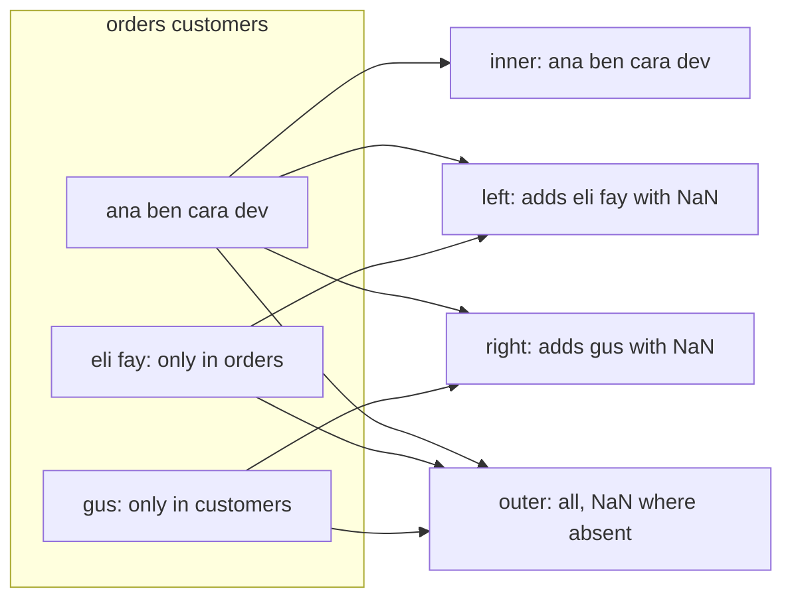

# 4 — Reshaping and Joins

The shop's orders say that `dev` bought a kettle. They do not say where `dev` lives, when `dev` signed up, or what a kettle costs the shop to buy in. Those facts sit in other tables, and rightly so: storing a customer's signup date on every order would mean correcting it in many places when it turns out to be wrong. Analysis, though, usually needs them together in one frame. So the first half of this chapter is about joining tables, and how a join can silently change your row count and your totals. The second half is about a different mismatch. The right facts are all there, in one table, in the wrong arrangement, with months as column headers because someone built it for reading. Both halves come down to one question you should ask before and after every operation: what does one row of this table mean?

## What one row means: tidy data

Wickham gives the clearest answer to that question ([Wickham, JSS 2014](https://doi.org/10.18637/jss.v059.i10)). Every value in a dataset belongs to a **variable**, which measures one attribute across units, and to an **observation**, which collects every measurement on one unit. A dataset is **tidy** when:

1. each variable is a column,
2. each observation is a row,
3. each type of observational unit is a table.

The third rule is the reason to keep customers apart from orders, and it is close to database normalisation, where each fact lives in one place to prevent inconsistency. Wickham also notes the catch: analysis tools mostly want one table, so analysis generally involves merging the normalised tables back together for the question at hand. The two halves of this chapter are the two moves that follow. Joins bring the units together, and reshapes put variables in columns.

Start with the three tables. Each row means something different: an order, a customer, a product.

```python
import io
import numpy as np
import pandas as pd

csv = """order_id,date,customer,product,qty,unit_price,region
1001,2025-01-03,ana,kettle,1,48.0,north
1002,2025-01-03,ben,filter,3,6.5,south
1003,2025-01-05,ana,grinder,1,95.0,north
1004,2025-01-06,cara,filter,2,6.5,east
1005,2025-01-08,dev,kettle,2,48.0,unknown
1006,2025-01-09,ben,scale,1,22.0,south
1007,2025-01-11,eli,filter,4,6.5,north
1009,2025-01-14,cara,grinder,1,95.0,east
1010,2025-01-15,fay,scale,1,22.0,unknown
1011,2025-01-17,dev,filter,6,6.5,south
1012,2025-01-20,ben,kettle,1,48.0,south
"""
orders = pd.read_csv(io.StringIO(csv), parse_dates=["date"])
orders["revenue"] = orders["qty"] * orders["unit_price"]
```

```python
customers = pd.DataFrame({
    "customer":  ["ana", "ben", "cara", "dev", "gus"],
    "city":      ["Oslo", "Lyon", "Porto", "Lyon", "Graz"],
    "signed_up": pd.to_datetime(["2024-03-01", "2024-07-15", "2024-11-02", "2024-12-20", "2025-01-02"]),
})
products = pd.DataFrame({
    "product":   ["kettle", "filter", "grinder", "scale", "descaler"],
    "category":  ["brew", "consumable", "brew", "tools", "consumable"],
    "unit_cost": [30.0, 2.5, 60.0, 12.0, 4.0],
})
print(customers)
print(products)
```

```text
  customer   city  signed_up
0      ana   Oslo 2024-03-01
1      ben   Lyon 2024-07-15
2     cara  Porto 2024-11-02
3      dev   Lyon 2024-12-20
4      gus   Graz 2025-01-02
    product    category  unit_cost
0    kettle        brew       30.0
1    filter  consumable        2.5
2   grinder        brew       60.0
3     scale       tools       12.0
4  descaler  consumable        4.0
```

Notice two deliberate mismatches. `eli` and `fay` have orders but no customer record, as their accounts were deleted, and `gus` has a customer record but no orders.

## Joins: merge

`pd.merge` lines up rows from two frames wherever a key column matches, the same operation as a SQL join. The `how` argument decides what to do with rows that have no partner.



```python
m = {how: pd.merge(orders, customers, on="customer", how=how) for how in ["inner", "left", "right", "outer"]}
for how, df in m.items():
    print(f"{how:6s} rows={len(df):2d}  customers={df['customer'].nunique()}  missing city={df['city'].isna().sum()}")
print(m["left"][["order_id", "customer", "city"]].tail(4))
```

```text
inner  rows= 9  customers=4  missing city=0
left   rows=11  customers=6  missing city=2
right  rows=10  customers=5  missing city=0
outer  rows=12  customers=7  missing city=2
    order_id customer   city
7       1009     cara  Porto
8       1010      fay    NaN
9       1011      dev   Lyon
10      1012      ben   Lyon
```

Eleven orders stay 11 under a left join; `eli` and `fay` come through with `NaN` for city. The inner join dropped their two orders without telling you, which is its documented behaviour and the source of many a revenue total that is mysteriously a bit low. It is also the default, if you leave out `how`. An analyst usually wants `how="left"` starting from the table whose rows the question is about.

`indicator=True` adds a column stating which side each row came from, and it is the quickest way to audit a join.

```python
audit = pd.merge(orders, customers, on="customer", how="outer", indicator=True)
print(audit["_merge"].value_counts())
print(audit.loc[audit["_merge"] != "both", ["order_id", "customer", "_merge"]])
```

```text
_merge
both          9
left_only     2
right_only    1
Name: count, dtype: int64
    order_id customer      _merge
9     1007.0      eli   left_only
10    1010.0      fay   left_only
11       NaN      gus  right_only
```

When the key has a different name on each side, use `left_on` and `right_on`. When both sides have a non-key column of the same name, pandas adds suffixes, which you should set to something meaningful.

```python
targets = pd.DataFrame({"prod": ["kettle", "filter"], "qty": [5, 20]})
j = orders.merge(targets, left_on="product", right_on="prod", how="inner", suffixes=("_sold", "_target"))
print(j[["order_id", "product", "qty_sold", "qty_target"]].head(3))
```

```text
   order_id product  qty_sold  qty_target
0      1001  kettle         1           5
1      1002  filter         3          20
2      1004  filter         2          20
```

## The many-to-many blow-up

This is the most expensive mistake in the chapter. Orders to customers is **many-to-one**: a customer appears many times in `orders` and once in `customers`, so every order finds one partner and the row count holds. But when a key repeats on both sides, a merge returns every combination of matching rows, and the frame grows without any warning. McKinney describes this as the Cartesian product of the matching rows ([McKinney, *Python for Data Analysis*, ch. 8](https://wesmckinney.com/book/data-wrangling)).

Suppose a promotions table lists two promotions for `ana` and two for `ben`, and someone merges it to attach a promotion to each order.

```python
promos = pd.DataFrame({"customer": ["ana", "ana", "ben", "ben"], "promo": ["SPRING", "VIP", "SPRING", "BULK"]})
blown = orders.merge(promos, on="customer", how="left")
print(len(orders), "->", len(blown))
print(orders["revenue"].sum(), "->", blown["revenue"].sum())
```

```text
11 -> 16
523.5 -> 756.0
```

Revenue went up because rows were duplicated, and nothing raised an error. Two rows of `ana` times two promotions gives four, three rows of `ben` times two gives six. The defence is `validate`, which makes pandas check the relationship you believe in and raise if the data disagrees.

```python
print(len(orders.merge(customers, on="customer", how="left", validate="many_to_one")))
try:
    orders.merge(promos, on="customer", how="left", validate="many_to_one")
except pd.errors.MergeError as e:
    print("MergeError:", str(e)[:70])
```

```text
11
MergeError: Merge keys are not unique in right dataset; not a many-to-one merge

D
```

Make it a habit: state `validate`, compare the row count before and after, and compare one total. Then the join is checked. The same idea scales to any SQL you write in pillar 06.

With the checks in place, a two-step join gives a frame that can answer a question none of the three tables could answer alone, namely gross margin by product category.

```python
full = (
    orders
    .merge(customers, on="customer", how="left", validate="many_to_one")
    .merge(products, on="product", how="left", validate="many_to_one")
)
assert len(full) == len(orders)
full["margin"] = full["revenue"] - full["qty"] * full["unit_cost"]
print(full[["order_id", "customer", "city", "category", "revenue", "margin"]].head(4))
print(full.groupby("category")[["revenue", "margin"]].sum())
```

```text
   order_id customer   city    category  revenue  margin
0      1001      ana   Oslo        brew     48.0    18.0
1      1002      ben   Lyon  consumable     19.5    12.0
2      1003      ana   Oslo        brew     95.0    35.0
3      1004     cara  Porto  consumable     13.0     8.0
            revenue  margin
category
brew          382.0   142.0
consumable     97.5    60.0
tools          44.0    20.0
```

Consumables earn less revenue than tools or brew gear might suggest, yet carry much the highest margin rate: filters cost 2.50 and sell at 6.50. The join made that visible.

To join on the index rather than a column, `merge` takes `left_index=True` and `right_index=True`, and `df.join` is a shorthand for that common case. The next example uses `join` on a Series of per-customer totals.

```python
totals = orders.groupby("customer")["revenue"].sum().rename("lifetime_revenue")
print(customers.set_index("customer").join(totals, how="left")[["city", "lifetime_revenue"]])
```

```text
           city  lifetime_revenue
customer
ana        Oslo             143.0
ben        Lyon              89.5
cara      Porto             108.0
dev        Lyon             135.0
gus        Graz               NaN
```

## Stacking tables: concat

Joins add columns by matching keys. `pd.concat` adds rows, or columns, by gluing frames along an axis. The usual use is the last of Wickham's messy-data problems: one type of observation spread over many files, say one export per month. Record where each row came from while you combine them, since the file name is often itself a variable.

```python
jan = orders.iloc[:2][["order_id", "revenue"]]
feb = pd.DataFrame({"order_id": [1101, 1102], "revenue": [31.0, 12.5], "coupon": ["NEW", None]})
print(pd.concat([jan.assign(month="jan"), feb.assign(month="feb")], ignore_index=True))
```

```text
   order_id  revenue month coupon
0      1001     48.0   jan    NaN
1      1002     19.5   jan    NaN
2      1101     31.0   feb    NEW
3      1102     12.5   feb    NaN
```

Columns are aligned by name, so `coupon` is `NaN` for January rather than an error. `ignore_index=True` gives fresh row labels; without it, you would get repeated labels 0 and 1. If you learned pandas from an older book you will have seen `df.append(other)`. That method was removed in pandas 2.0, and `practice/4_DataFrames.ipynb` was patched for this reason. Build a list of frames, and call `concat` once at the end, since appending repeatedly in a loop copies everything each time.

`combine_first` is a smaller tool for patching holes in one object from another, with matching labels.

```python
primary = pd.Series({"ana": "Oslo", "ben": None, "cara": "Porto"})
backup = pd.Series({"ana": "Bergen", "ben": "Lyon", "dev": "Lyon"})
print(primary.combine_first(backup))
```

```text
ana      Oslo
ben      Lyon
cara    Porto
dev      Lyon
dtype: str
```

## Long and wide

Now the second mismatch. Here is one small table in two arrangements: units sold by product and week.

```text
  WIDE: one row per product,            LONG: one row per (product, week),
  a column per week                     one column per variable
  product  w1  w2  w3                   product  week  units
  kettle    4   5   3        melt ->    kettle   w1      4
  filter   30  25  41        <- pivot   filter   w1     30
                                        kettle   w2      5
                                        filter   w2     25
                                        kettle   w3      3
                                        filter   w3     41
```

The information in each is identical. Wide is good for reading and for matrix arithmetic. Long is tidy here because `week` and `units` are the variables, while `w1`, `w2` and `w3` are values of `week` that happen to be sitting in the header. That is the first and most common messy-data problem in Wickham's list: column headers that are values, not variable names. He also points out that the presentation form is not wrong for every purpose, as it can store a crossed design compactly and compute quickly with matrix operations ([Wickham, JSS 2014](https://doi.org/10.18637/jss.v059.i10)). The operations that move between the forms are few, which is good news: **melt** to go from wide to long, **pivot** to go back.

```python
wide = pd.DataFrame({"product": ["kettle", "filter"], "w1": [4, 30], "w2": [5, 25], "w3": [3, 41]})
long = wide.melt(id_vars="product", var_name="week", value_name="units")
print(long)
print(long.groupby("week")["units"].sum())
```

```text
  product week  units
0  kettle   w1      4
1  filter   w1     30
2  kettle   w2      5
3  filter   w2     25
4  kettle   w3      3
5  filter   w3     41
week
w1    34
w2    30
w3    44
Name: units, dtype: int64
```

`melt` keeps the `id_vars` and turns every other column into a pair of variable and value. In long form, a question like total per week is a plain groupby, and adding a new variable, such as the price that week, is just another column. `pivot` is the inverse: pick the column for the rows, the column whose values become headers, and the column holding the numbers.

```python
back = long.pivot(index="product", columns="week", values="units")
print(back)
print(back.reset_index().columns.tolist())
```

```text
week     w1  w2  w3
product
filter   30  25  41
kettle    4   5   3
['product', 'w1', 'w2', 'w3']
```

`pivot` needs each combination of row and column to occur once. If it occurs twice, pandas cannot know which value to place in the cell, so it raises an error. Chapter 5's `pivot_table` handles that case by aggregating.

```python
dupes = pd.DataFrame({"product": ["kettle", "kettle"], "week": ["w1", "w1"], "units": [4, 1]})
try:
    dupes.pivot(index="product", columns="week", values="units")
except ValueError as e:
    print("ValueError:", e)
```

```text
ValueError: Index contains duplicate entries, cannot reshape
```

Sometimes a melted column holds two variables at once, as in Wickham's tuberculosis example, where a header such as `m014` combines sex and age. The fix is melt, then split the string.

```python
regional = pd.DataFrame({"product": ["kettle"], "north_w1": [2], "north_w2": [3], "south_w1": [1]})
tall = regional.melt(id_vars="product", value_name="units")
tall[["region", "week"]] = tall["variable"].str.split("_", expand=True)
print(tall.drop(columns="variable"))
```

```text
  product  units region week
0  kettle      2  north   w1
1  kettle      3  north   w2
2  kettle      1  south   w1
```

## stack and unstack

`melt` and `pivot` work on columns. `stack` and `unstack` do the same job on index levels, and you meet them most often just after a multi-key groupby. `unstack` moves an index level up into the columns, and missing combinations become `NaN`.

```python
sales = orders.groupby(["region", "product"])["qty"].sum()
table = sales.unstack(fill_value=0)
print(table)
print(table.stack().head(4))
```

```text
product  filter  grinder  kettle  scale
region
east          2        1       0      0
north         4        1       1      0
south         9        0       1      1
unknown       0        0       2      1
region  product
east    filter     2
        grinder    1
        kettle     0
        scale      0
dtype: int64
```

This is usually the fastest route from a grouped result to the table a reader wants. Note `fill_value=0`: here a missing combination means no units sold, so zero is correct. Chapter 1's warning stands, and for other measures a gap should stay a gap.

## Pitfalls

- **A silent inner join.** The default `how` drops unmatched rows. Say which you want, and start from the table your question is about.
- **A many-to-many merge.** Row count and totals grow with no error. Use `validate` and compare a total before and after.
- **Keys that do not quite match.** `"Ana"` and `"ana "` will not join. Clean keys first, then audit with `indicator=True`, and check dtypes too: an integer key will not match a string key.
- **`NaN` keys.** Unlike SQL, a pandas merge matches `NaN` keys to each other. Drop or fill missing keys before joining.
- **`concat` in a loop.** Each pass copies everything so far. Collect the frames in a list and concatenate once.
- **Summing a wide table's columns as though they were comparable.** Ask what a row means before you aggregate; a table that has already been aggregated can be double-counted.
- **Using `pivot` on data with repeats.** It raises an error. Use `pivot_table` with a stated `aggfunc`.

## Try it

1. Which customers on file have never ordered? Use a merge with `indicator=True`, then filter.

<details><summary>Answer</summary>

```python
a = customers.merge(orders[["customer"]].drop_duplicates(), on="customer", how="left", indicator=True)
print(a.loc[a["_merge"] == "left_only", "customer"].tolist())
```

```text
['gus']
```

</details>

2. Merging `orders` and `products` should keep 11 rows. Write the merge so that it fails loudly if `products` ever lists a product twice, and test that it does.

<details><summary>Answer</summary>

```python
print(len(orders.merge(products, on="product", how="left", validate="many_to_one")))
bad = pd.concat([products, products.iloc[[0]]], ignore_index=True)
try:
    orders.merge(bad, on="product", how="left", validate="many_to_one")
except pd.errors.MergeError:
    print("caught: products has a repeated key")
```

```text
11
caught: products has a repeated key
```

</details>

3. Build a customer-by-product table of units from `orders`, with 0 for no purchase, using `groupby` and `unstack`. Then melt it back to long form and confirm the total is unchanged.

<details><summary>Answer</summary>

```python
tbl = orders.groupby(["customer", "product"])["qty"].sum().unstack(fill_value=0)
back_long = tbl.reset_index().melt(id_vars="customer", value_name="qty")
print(tbl)
print(tbl.to_numpy().sum(), back_long["qty"].sum(), orders["qty"].sum())
```

```text
product   filter  grinder  kettle  scale
customer
ana            0        1       1      0
ben            3        0       1      1
cara           2        1       0      0
dev            6        0       2      0
eli            4        0       0      0
fay            0        0       0      1
23 23 23
```

</details>

4. In `practice/4_DataFrames.ipynb`, work through merges and reshapes on small frames. Then `practice/mckinney/ch08.ipynb` applies them to the book's data, including the macroeconomic series reshape (needs `bash practice/fetch_data.sh`; some of its cells use old idioms that the README's table explains).

## Interview checklist

| Question | What a good answer covers |
|---|---|
| Explain inner, left, right and outer joins. | Which side's unmatched rows survive. Inner keeps matches only, left keeps all left rows with `NaN` for missing right values, right the reverse, outer keeps everything. |
| What happens when a key repeats on both sides? | You get the Cartesian product of the matching rows. Row count and totals inflate with no error. |
| How do you verify a join? | `validate=`, row counts before and after, a total before and after, and `indicator=True` to inspect the unmatched. |
| What is tidy data? | Each variable a column, each observation a row, each observational unit a table (Wickham 2014). |
| What is the difference between `merge` and `concat`? | `merge` matches rows on keys and adds columns. `concat` glues frames along an axis, aligning on labels. |
| `pivot` or `pivot_table`? | `pivot` only rearranges and fails on duplicate combinations. `pivot_table` aggregates duplicates using `aggfunc`. |
| When is wide better than long? | Reading by humans, and matrix computation on a crossed design. Long is better for groupby, plotting and modelling. |
| What replaced `df.append`? | `pd.concat`, called once on a list of frames. |

## Next

The answer you want is usually one number per group: revenue per region, margin per category. You have already called `groupby` several times on trust. Next: [Groupby and aggregation](05-groupby-and-aggregation.md).
