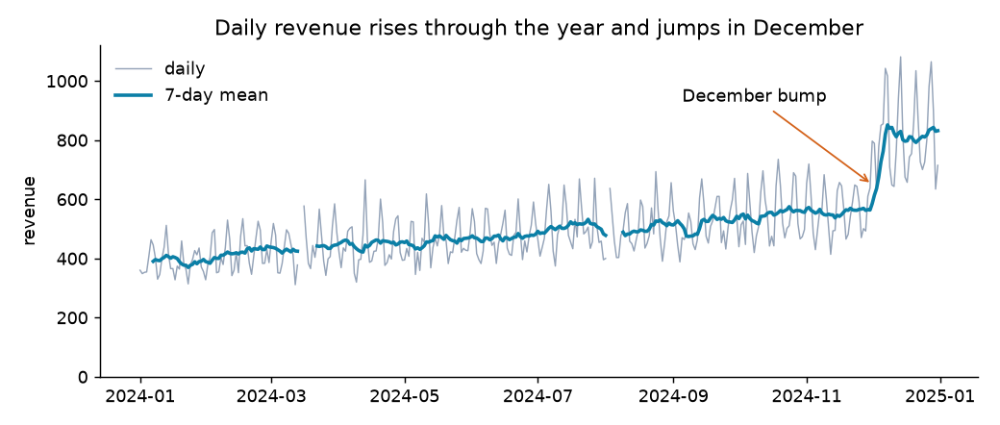
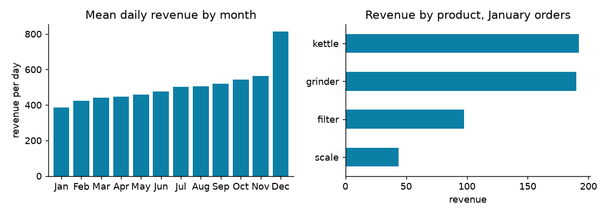
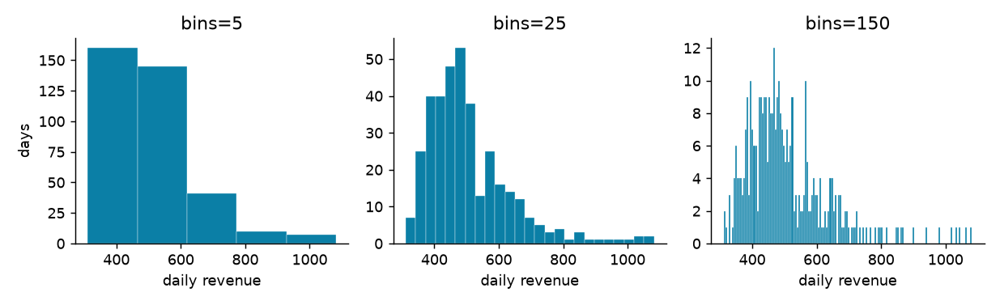
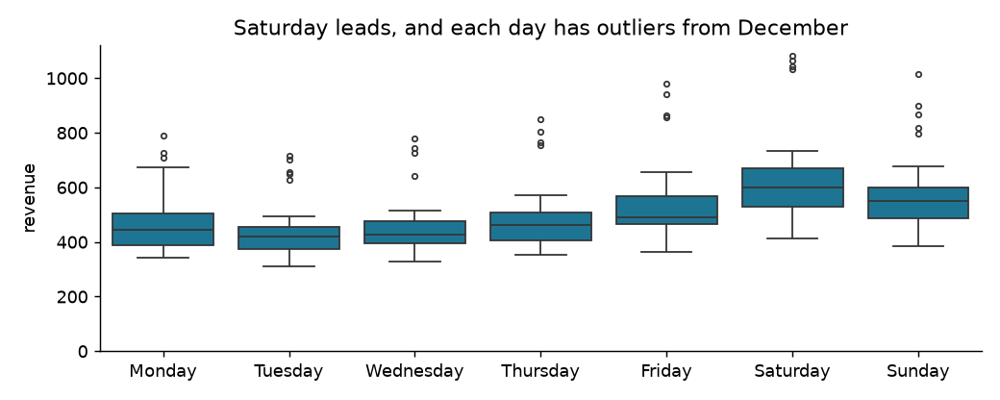
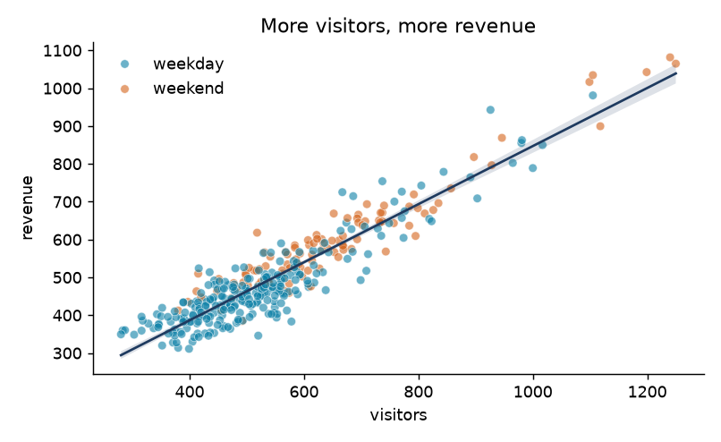
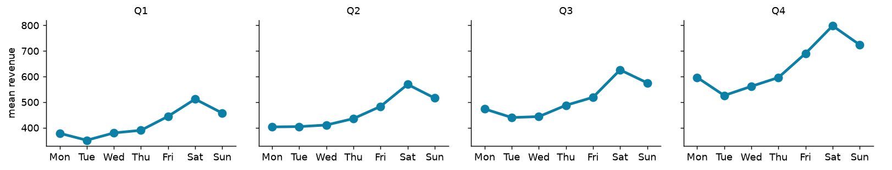
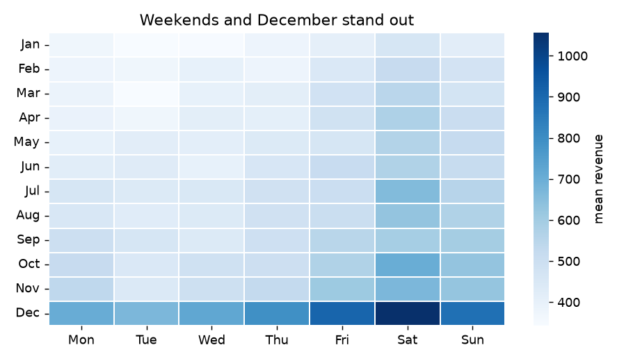

# 7 — Plotting

A table of a year's daily revenues tells you almost nothing, and one line chart of the same numbers shows the trend, the weekly ripple, the outage and the December jump in a second. That is why analysts plot early and often, well before anyone asks for a chart: a plot is the fastest way to find out what is wrong with your data and what is interesting about it. This chapter teaches the mechanics in the order you meet them. First comes matplotlib's model of a figure, then the shortcuts pandas gives you, then seaborn for statistical plots that start from a whole table. Along the way it answers the question that matters more than any function name: which chart answers which question? Making a chart persuade someone else is a separate craft, and pillar 05 covers that. Here the reader is you.

## Figures and axes

Nearly every Python plot is matplotlib underneath. John Hunter started it in 2002 to bring MATLAB-style plotting to Python (McKinney, ch. 9; [Hunter, CiSE 2007](https://doi.org/10.1109/MCSE.2007.55)), and pandas and seaborn both draw through it. So its model is worth ten minutes, because every confusing plotting moment is a confusion about these two objects.

```text
Figure: the whole canvas, what you save to a file
+---------------------------------------------------------+
|  suptitle                                               |
|  +----------------------+   +----------------------+    |
|  | Axes: one plot       |   | Axes: another plot   |    |
|  |  title               |   |  title               |    |
|  |  y axis, ticks,      |   |  lines, bars, points |    |
|  |  lines, bars, points |   |  legend              |    |
|  |  x axis, ticks       |   |  x axis, ticks       |    |
|  +----------------------+   +----------------------+    |
+---------------------------------------------------------+
```

A **Figure** is the canvas and an **Axes** is one plot on it, with its own coordinate system. The name is confusing, since one Axes has two axes (x and y). Matplotlib offers two ways to drive them ([matplotlib docs](https://matplotlib.org/stable/users/explain/figure/api_interfaces.html)). The implicit one, `plt.plot(...)`, draws on "the current Axes", whichever that happens to be, and it is what old tutorials and much of `practice/5_Plotting.ipynb` use. The explicit one asks for the objects by name and calls methods on them. Use the explicit one: as soon as you have two plots, "current" stops being obvious.

```python
import numpy as np
import pandas as pd
import matplotlib.pyplot as plt
import seaborn as sns

fig, ax = plt.subplots()
print(type(fig).__name__, type(ax).__name__)
fig, axes = plt.subplots(2, 3, sharey=True)
print(axes.shape)
plt.close("all")
```

```text
Figure Axes
(2, 3)
```

With a grid, `axes` is a NumPy array you index like any other, `axes[0, 1]`, and `sharey=True` puts every plot on one scale. Without it, each plot scales itself, and plots that look the same may differ tenfold.

The running data is the synthetic year from the last chapter, rebuilt here with the same seed so this chapter stands alone. We also set three quiet defaults once, at the top, and pick two colours: a teal for the data, and an orange kept for the thing we want to point at.

```python
rng = np.random.default_rng(7)
days = pd.date_range("2024-01-01", "2024-12-31", freq="D")
trend = 400 + 0.5 * np.arange(len(days))
week = np.array([0.9, 0.85, 0.9, 0.95, 1.05, 1.25, 1.1])[days.day_of_week]
december = np.where(days.month == 12, 1.4, 1.0)
noise = rng.normal(1.0, 0.08, len(days))
daily = pd.Series((trend * week * december * noise).round(2), index=days, name="revenue")
daily = daily.drop(pd.to_datetime(["2024-03-14", "2024-03-15", "2024-08-02"]))
regular = daily.asfreq("D")

plt.rcParams.update({"axes.spines.top": False, "axes.spines.right": False, "savefig.dpi": 130})
TEAL, ORANGE, GREY = "#0B7FA6", "#D4621A", "#94A3B8"
print(len(regular), regular.count())
```

```text
366 363
```

## Line charts: change over time

A line says "these points are connected, and the order means something", which is true of a time series and false of almost anything else. Here is the whole workflow on one Axes: draw, label, annotate, save. Every labelling call is a method on `ax`.

```python
fig, ax = plt.subplots(figsize=(8, 3.4))
ax.plot(regular.index, regular, color=GREY, linewidth=0.8, label="daily")
ax.plot(regular.index, regular.rolling(7).mean(), color=TEAL, linewidth=2, label="7-day mean")
ax.annotate("December bump", xy=(pd.Timestamp("2024-12-01"), 650), xytext=(pd.Timestamp("2024-09-05"), 930),
            arrowprops={"arrowstyle": "->", "color": ORANGE})
ax.set(title="Daily revenue rises through the year and jumps in December", ylabel="revenue", ylim=(0, None))
ax.legend(frameon=False, loc="upper left")
fig.tight_layout()
fig.savefig("da01-plotting-line.png")
plt.close(fig)
```



*Image Source: generated by the code above from the chapter's synthetic data.*

Look at what the plot shows that `describe()` never would. The grey ripple is the weekly pattern. The 7-day mean removes it, as chapter 6 predicted. And the line **breaks** in mid-March: matplotlib leaves a gap at `NaN`, so plotting `regular` shows the outage that plotting `daily` would have drawn straight over. The August gap is one day, so too small to spot. That is a limit of the eye, and why you still count missing values.

## Pandas shortcuts: plot straight from your data

Series and DataFrames have a `.plot` accessor, which calls matplotlib with sensible choices: the index becomes the x axis, each column becomes a series, and column names become the legend. Pass `ax=` to place it on an Axes of yours, and it hands the Axes back so you can keep labelling. For a quick look in a notebook, `df.plot()` alone is often the entire job.

Bars compare a quantity across categories. The length carries the value, so a bar must start at zero, and pandas and matplotlib do that for you unless you override it. Two habits make bars readable. Sort them by value, unless the categories have a natural order such as months. And use horizontal bars when labels are long, so nobody has to read at an angle.

```python
by_month = regular.resample("MS").mean()
by_month.index = by_month.index.strftime("%b")
by_product = pd.Series({"grinder": 190.0, "kettle": 192.0, "filter": 97.5, "scale": 44.0}, name="revenue")

fig, axes = plt.subplots(1, 2, figsize=(9, 3.2))
by_month.plot.bar(ax=axes[0], color=TEAL, width=0.8)
axes[0].tick_params(axis="x", rotation=0)
axes[0].set(title="Mean daily revenue by month", xlabel="", ylabel="revenue per day")
by_product.sort_values().plot.barh(ax=axes[1], color=TEAL)
axes[1].set(title="Revenue by product, January orders", xlabel="revenue")
fig.tight_layout()
fig.savefig("da01-plotting-bars.png")
plt.close(fig)
```



*Image Source: generated by the code above from the chapter's synthetic data and the 11 orders of chapters 3 to 5.*

The months keep calendar order, the products are sorted, and the left panel uses the mean per day so that February's shortness doesn't count against it, which is chapter 6's point in picture form.

## Histograms: the shape of one column

`mean` and `std` summarise a column and hide its shape. A histogram divides the range into bins and counts values in each, so it shows whether the data has one hump or two, a long tail, or impossible values. The number of bins is a real choice. Too few hide structure, too many show only noise, so try several.

```python
values = regular.dropna()
fig, axes = plt.subplots(1, 3, figsize=(9.5, 2.9), sharey=False)
for ax, bins in zip(axes, [5, 25, 150]):
    ax.hist(values, bins=bins, color=TEAL, edgecolor="white", linewidth=0.2)
    ax.set(title=f"bins={bins}", xlabel="daily revenue")
axes[0].set_ylabel("days")
fig.tight_layout()
fig.savefig("da01-plotting-hist.png")
plt.close(fig)
print(values.describe().round(0).to_dict())
print("median", values.median().round(0), "mean", values.mean().round(0))
```

```text
{'count': 363.0, 'mean': 507.0, 'std': 132.0, 'min': 311.0, '25%': 421.0, '50%': 477.0, '75%': 566.0, 'max': 1082.0}
median 477.0 mean 507.0
```



*Image Source: generated by the code above from the chapter's synthetic data.*

Five bins give a plain staircase. A hundred and fifty look like static. Twenty-five shows what we want: a main body with a long right tail, made by the December days and the weekends. The mean sits above the median, as it does on any right-skewed column, which is the same fact in numbers.

## Seaborn: start from the table

Matplotlib thinks in arrays and pandas in columns of one frame. **Seaborn** thinks in a whole table: you name the columns and say what role each plays, x, y, colour, facet, and it does the grouping and the statistics for you ([Waskom, JOSS 2021](https://doi.org/10.21105/joss.03021)). This only works when the data is tidy, with one row per observation and one column per variable, which is why chapter 4 spent a section on `melt`. So first build the tidy frame.

```python
order = ["Monday", "Tuesday", "Wednesday", "Thursday", "Friday", "Saturday", "Sunday"]
frame = values.rename_axis("date").reset_index()
frame["weekday"] = frame["date"].dt.day_name()
frame["quarter"] = "Q" + frame["date"].dt.quarter.astype(str)
frame["part"] = np.where(frame["date"].dt.day_of_week >= 5, "weekend", "weekday")
frame["visitors"] = (frame["revenue"] / 0.9 + rng.normal(0, 60, len(frame))).round(0)
print(frame.head(3))
```

```text
        date  revenue    weekday quarter     part  visitors
0 2024-01-01   360.04     Monday      Q1  weekday     283.0
1 2024-01-02   348.56    Tuesday      Q1  weekday     303.0
2 2024-01-03   352.99  Wednesday      Q1  weekday     443.0
```

**Box plots compare distributions across groups.** A bar of means would hide the spread, and a box shows the median, the middle half of the values and the outliers for each group at once. One line of seaborn replaces a groupby plus a loop of drawing calls.

```python
fig, ax = plt.subplots(figsize=(8, 3.2))
sns.boxplot(data=frame, x="weekday", y="revenue", order=order, color=TEAL, ax=ax, fliersize=3, linewidth=1)
ax.set(title="Saturday leads, and each day has outliers from December", xlabel="", ylim=(0, None))
fig.tight_layout()
fig.savefig("da01-plotting-box.png")
plt.close(fig)
print(frame.groupby("weekday")["revenue"].median().reindex(order).round(0).to_dict())
```

```text
MatplotlibDeprecationWarning: vert: bool was deprecated in Matplotlib 3.11 and will be removed in 3.13. Use orientation: {'vertical', 'horizontal'} instead.
{'Monday': 444.0, 'Tuesday': 420.0, 'Wednesday': 429.0, 'Thursday': 462.0, 'Friday': 491.0, 'Saturday': 600.0, 'Sunday': 551.0}
```

The warning comes from inside seaborn 0.13.2 when it runs on matplotlib 3.11, and it is harmless. Your code did nothing wrong, though you will want to know it when you see it.



*Image Source: generated by the code above from the chapter's synthetic data.*

**Scatter plots show the relationship between two numbers.** Each row is a dot. Colour can carry a third variable, and `regplot` adds a fitted line with a confidence band. Lower the opacity when dots pile up, since 300 opaque dots look the same as 30 in the middle of the cloud.

```python
fig, ax = plt.subplots(figsize=(6.2, 3.8))
sns.scatterplot(data=frame, x="visitors", y="revenue", hue="part", palette={"weekday": TEAL, "weekend": ORANGE},
                alpha=0.6, s=28, ax=ax)
sns.regplot(data=frame, x="visitors", y="revenue", scatter=False, color="#1E3A5F", line_kws={"linewidth": 1.5}, ax=ax)
ax.set(title="More visitors, more revenue")
ax.legend(frameon=False, title=None)
fig.tight_layout()
fig.savefig("da01-plotting-scatter.png")
plt.close(fig)
print(round(frame["visitors"].corr(frame["revenue"]), 3))
```

```text
0.933
```



*Image Source: generated by the code above from the chapter's synthetic data. The visitors column was constructed from revenue, so the tight fit is by design.*

The correlation is high because we built `visitors` from `revenue` plus noise. On real data, a line like this tells you the two move together. It doesn't tell you that one causes the other, and pillar 03 is about how you would find out.

**Small multiples compare a pattern across groups.** Rather than draw four lines on one plot, draw one plot four times on the same scale, one per group. Seaborn splits its functions in two for this ([seaborn docs](https://seaborn.pydata.org/tutorial/function_overview.html)). **Axes-level** functions such as `boxplot` and `scatterplot` draw on an Axes you give them. **Figure-level** functions such as `catplot`, `relplot` and `displot` build their own Figure, because they need to lay out facets. They take `col=` and `row=`, return a `FacetGrid` rather than an Axes, and are sized with `height=` and `aspect=` rather than `figsize`.

```python
grid = sns.catplot(data=frame, x="weekday", y="revenue", col="quarter", kind="point", order=order, errorbar=None,
                   color=TEAL, height=2.7, aspect=1.15)
grid.set_xticklabels([d[:3] for d in order])
grid.set_axis_labels("", "mean revenue")
grid.set_titles("{col_name}")
grid.savefig("da01-plotting-facets.png")
plt.close("all")
```



*Image Source: generated by the code above from the chapter's synthetic data.*

Because the panels share a y axis, one glance shows two things: the weekly shape is the same in each quarter, and the whole shape rises through the year. That is the chart to reach for when a single plot has turned into spaghetti.

## Which chart answers which question

Choose from the question. Don't start from the chart you made last time.

| Question | Chart | Call |
|---|---|---|
| How does it change over time? | Line | `ax.plot`, `series.plot()` |
| How do categories compare? | Sorted bars, starting at zero | `series.plot.barh()`, `sns.barplot` |
| What shape does one column have? | Histogram | `ax.hist`, `sns.histplot` |
| How do distributions differ across groups? | Box or violin | `sns.boxplot`, `sns.violinplot` |
| How do two numbers relate? | Scatter | `sns.scatterplot`, `sns.regplot` |
| How do all numeric columns relate? | Pair plot or correlation heatmap | `sns.pairplot`, `sns.heatmap` |
| Is the pattern the same across groups? | Small multiples | `sns.catplot(col=...)`, `sns.relplot(col=...)` |
| How does a value vary over two categories? | Heatmap of a pivot table | `sns.heatmap(df.pivot_table(...))` |

Notice what the table leaves out. A pie chart compares parts with angles, and in Cleveland and McGill's perception experiments people judged position and length more accurately than angle ([Cleveland & McGill, JASA 1984](https://doi.org/10.1080/01621459.1984.10478080)), so sorted bars nearly always do better. A chart with two y axes implies a relationship set by whichever scales you happened to choose, so draw two panels instead. Pillar 05 returns to both and shows the evidence.

## Old notebooks and current seaborn

`practice/5_Plotting.ipynb` and `practice/mckinney/ch09.ipynb` were written for much older libraries, and these changes account for most of the errors you will meet in old plotting code.

```python
tips = pd.DataFrame({"total_bill": [10.0, 20.0, 30.0, 40.0], "tip": [1.5, 3.2, 4.1, 6.5], "day": ["Sat", "Sat", "Sun", "Sun"]})
try:
    sns.regplot("total_bill", "tip", data=tips)
except TypeError as e:
    print("TypeError:", str(e)[:70])
print(hasattr(sns, "factorplot"), hasattr(sns, "catplot"))
sns.regplot(x="total_bill", y="tip", data=tips)
plt.close("all")
```

```text
TypeError: regplot() got multiple values for argument 'data'
False True
```

Since [seaborn 0.12](https://seaborn.pydata.org/whatsnew/v0.12.0.html), data columns are passed by keyword, as in `x=` and `y=`. `factorplot` became `catplot`, and it now draws a strip plot by default rather than points, so state `kind=` to get what the old code showed. The numbered notebook is patched for these, and the README's table lists the rest for the McKinney notebooks.

## Saving and showing

`fig.savefig("name.png", dpi=150)` writes the file, and the extension picks the format. Use PNG for screens and notebooks, and SVG or PDF for anything that will be scaled or printed. `fig.tight_layout()` before saving stops titles and labels from overlapping. In a script, call `plt.show()` to open a window, and call `plt.close(fig)` when you make figures in a loop, since each one holds memory until closed. In Jupyter, charts appear on their own at the end of a cell, and every drawing call for a figure must be in one cell.

## Pitfalls

- **Using `plt.` with several plots.** The call lands on the "current" Axes, which may not be the one you meant. Use `fig, ax = plt.subplots()` and `ax.` methods.
- **Unsorted x on a line chart.** A line connects points in row order, so unsorted dates scribble back and forth. `sort_index()` first.
- **Connecting categories with a line.** A line implies order, so use bars for products or regions.
- **Bars that do not start at zero.** A shortened bar misstates the ratio. If small differences matter, show them as dots or plot the differences directly.
- **Plots on different scales.** Side-by-side panels without `sharey=True` can make small things look big.
- **Overplotting.** Thousands of opaque dots hide density. Lower `alpha`, or use `sns.histplot(x=..., y=...)` or `hexbin`.
- **One histogram, one bin count.** Try several.
- **Confidence bands read as data.** The band in `regplot` is uncertainty about the line, and not the spread of the points.
- **Forgetting the title says what you found.** "Revenue" names a column, while "Revenue rises and jumps in December" tells the reader what to see.

## Try it

1. Plot the 30-day rolling mean of `regular` as a line, with `ylim` starting at zero, and then again with `ylim=(350, 850)`. How much does the same trend seem to grow in each?

<details><summary>Answer</summary>

```python
fig, axes = plt.subplots(1, 2, figsize=(9, 3))
smooth = regular.rolling(30, min_periods=20).mean()
for ax, ylim in zip(axes, [(0, None), (350, 850)]):
    ax.plot(smooth.index, smooth, color=TEAL, linewidth=2)
    ax.set(ylim=ylim, title=f"ylim={ylim}")
fig.tight_layout()
plt.close(fig)
print(round(smooth.dropna().iloc[0]), round(smooth.iloc[-1]), round(smooth.iloc[-1] / smooth.dropna().iloc[0], 2))
```

```text
391 814 2.08
```

The ratio of the last value to the first stays the same, while the right-hand panel makes it look far larger. A line may leave out zero when the change is what you are showing, which is not true of bars, but the reader should be able to see the axis.

</details>

2. Draw a heatmap of mean revenue by month and weekday. Build the table with `pivot_table` and use one sequential colour map. Which cell is highest?

<details><summary>Answer</summary>

```python
frame["month"] = frame["date"].dt.strftime("%b")
months = list(pd.date_range("2024-01-01", periods=12, freq="MS").strftime("%b"))
table = frame.pivot_table(index="month", columns="weekday", values="revenue", aggfunc="mean").reindex(index=months, columns=order)
fig, ax = plt.subplots(figsize=(7, 4))
sns.heatmap(table, cmap="Blues", linewidths=1, cbar_kws={"label": "mean revenue"}, ax=ax)
ax.set(xlabel="", ylabel="", title="Weekends and December stand out")
ax.set_xticklabels([d[:3] for d in order], rotation=0)
fig.tight_layout()
fig.savefig("da01-plotting-heatmap.png")
plt.close(fig)
print(table.stack().idxmax(), round(table.stack().max()))
```

```text
('Dec', 'Saturday') 1056
```



*Image Source: generated by the code above from the chapter's synthetic data.*

</details>

3. Work through `practice/5_Plotting.ipynb` with the tips, macro and S&P data from `bash practice/fetch_data.sh`. Then open `practice/courses/umich_visualization.py`, which draws the same kinds of charts from a different course, and rewrite one of its plots using `fig, ax = plt.subplots()`.

4. For a full analysis that uses everything so far, try `practice/mckinney/ch14.ipynb`, the book's worked examples on real datasets. Read the README's table of old idioms first.

## Interview checklist

| Question | What a good answer covers |
|---|---|
| What is the difference between a Figure and an Axes? | The Figure is the canvas you save, and an Axes is one plot on it with its own coordinates. A Figure holds one or more Axes. |
| Why prefer `fig, ax = plt.subplots()` to `plt.plot`? | The explicit interface says which Axes you mean, while `plt.` draws on an implicit "current" one, which gets confusing with several plots. |
| Axes-level or figure-level seaborn? | Axes-level (`boxplot`) draws on an Axes you pass. Figure-level (`catplot`) makes its own Figure so it can facet with `col=` and `row=`, and returns a `FacetGrid`. |
| Why does seaborn want tidy data? | You map columns to roles such as x, hue and col, so each variable needs its own column and each observation its own row. |
| Which chart for a change over time, a comparison, a distribution, or a relationship? | Line, sorted bars, histogram or box, and scatter. |
| Why must bars start at zero when lines need not? | A bar encodes the value by its length, so cutting the axis misstates ratios. A line encodes change by position. |
| What is wrong with a dual-axis chart? | The two scales are arbitrary, so any apparent relationship between the lines depends on how they were chosen. Use two panels or index both to a common base. |
| What does a box plot show? | The median, the middle 50% of the data, whiskers, and outliers. It compares spread as well as centre across groups. |
| How do you handle overplotting? | Lower the opacity, shrink the marks, use `hexbin` or a 2D histogram, or sample. |

## Next

You can now get data into a frame, clean it, reshape it, summarise it and see it, and that is the toolkit for everything else in this subject. What it can't yet do is tell you whether a difference is real or luck. That takes probability: [Probability foundations](../../02-probability-and-statistics/notes/01-probability-foundations.md). For making charts that convince other people, go on to [pillar 05, visualisation and storytelling](../../05-visualisation-and-storytelling/README.md) when you reach it.
