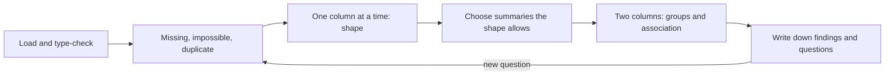

# 1 — Descriptive Statistics and EDA

Someone hands you an extract and asks what the average customer spends. You could answer in one line of pandas, and the number would be wrong in at least three ways: six rows are refunds typed in with a minus sign, two rows are a test account worth more than every real order combined, and the "average customer" does not exist because 95% of users spent nothing at all. This chapter is what you do before any test or model: look at the data, decide which summaries survive its shape, and write down what you found. Everything later in this pillar assumes you did it.

## Why look first

Tukey made exploratory data analysis a discipline in the 1970s, and his argument still holds: formal inference answers a question you already framed, while exploration tells you whether you framed the right one (Bruce & Bruce, 2017, ch. 1, tracing the field to Tukey's 1977 book). The practical version is shorter. A t-test on revenue is valid only if you know revenue is what you think it is. Most analysis errors that reach a decision are not exotic statistics errors. They are a join that duplicated rows, a unit that changed, or a mean quoted over a distribution where the mean describes nobody.

The chapter threads one running example through the pillar. **Larkspur** is a fictional online plant shop, and every dataset here is synthetic with a fixed seed so you can reproduce each number. Larkspur has twenty thousand users in its last month, a checkout it wants to redesign, and a finance team that keeps asking about "the average customer". Chapter 2 reasons about it with probability, chapters 4 to 6 estimate, test and model it, and [pillar 03](../../03-experimentation-and-causality/README.md) runs the checkout experiment.

The loop this chapter teaches:



## The data, and what kind of data it is

```python
import numpy as np, pandas as pd

rng = np.random.default_rng(42)
n = 20_000
users = pd.DataFrame({
    "device": rng.choice(["mobile", "desktop", "tablet"], n, p=[0.62, 0.31, 0.07]),
    "country": rng.choice(["DE", "UK", "FR", "ES"], n, p=[0.45, 0.30, 0.15, 0.10]),
    "sessions": 1 + rng.poisson(1.4, n),
})
p_buy = np.where(users.device == "desktop", 0.075, 0.038)
users["converted"] = rng.random(n) < p_buy
spend = rng.lognormal(mean=3.6, sigma=1.1, size=n)
users["revenue"] = np.where(users.converted, spend, 0.0).round(2)

# the mess every real extract carries
users.loc[rng.choice(n, 300, replace=False), "device"] = None
users.loc[rng.choice(n, 6, replace=False), "revenue"] = -19.99
users.loc[rng.choice(n, 2, replace=False), "revenue"] = 48_000.0
print(users.head(4).to_string())
print(users.shape)
```

```text
    device country  sessions  converted  revenue
0  desktop      UK         2      False      0.0
1   mobile      ES         1      False      0.0
2  desktop      DE         1      False      0.0
3  desktop      DE         3      False      0.0
(20000, 5)
```

Each column has a type, and the type decides what you may compute (Bruce & Bruce, 2017, ch. 1, on structured data). `sessions` is a discrete count, `revenue` is continuous, `device` and `country` are categorical with no order, `converted` is binary. A rating from one to five would be ordinal: ordered, but with gaps you cannot assume are equal, so its mean is a convenience rather than a fact. A user ID is an integer that means nothing numerically, and `describe()` will happily report its mean. Getting this right is what lets a later chapter pick the test: the table in [chapter 5](05-hypothesis-testing.md) branches on exactly these types.

Before any summary, ask what one row is. Here it is a user, and the unit matters more than almost anything else in the file. Revenue per user, per session and per order are three different numbers with three different denominators, and [chapter 4](04-estimation.md) shows their standard errors differ too.

## Look for what is impossible

```python
print(users.dtypes.to_string())
print()
print("missing:", users.isna().sum().to_dict())
print("negative revenue rows:", (users.revenue < 0).sum())
print(users.revenue.describe().round(2).to_string())
```

```text
device           str
country          str
sessions       int64
converted       bool
revenue      float64

missing: {'device': 300, 'country': 0, 'sessions': 0, 'converted': 0, 'revenue': 0}
negative revenue rows: 6
count    20000.00
mean         8.10
std        480.63
min        -19.99
25%          0.00
50%          0.00
75%          0.00
max      48000.00
```

Four things in that output should stop you. The median and 75th percentile are both zero, so at least three quarters of users bought nothing. The standard deviation is about sixty times the mean. The minimum is negative, which is not a purchase. The maximum is 48,000 for a shop selling plants. None of this needs a statistical test. It needs someone to ask finance what a negative row is and to look at the two biggest accounts.

The decisions below are judgement calls, and the important part is that they are written down and counted. In the real extract those negative rows could be refunds that belong in a net-revenue metric, and the large rows could be a genuine wholesale customer rather than a test account. Here we know they are errors because we planted them.

```python
clean = users[users.revenue.between(0, 10_000)].copy()
clean["device"] = clean.device.fillna("unknown")
buyers = clean.loc[clean.revenue > 0, "revenue"]
print(f"kept {len(clean):,} of {len(users):,} rows, {len(buyers):,} buyers")
```

```text
kept 19,992 of 20,000 rows, 1,003 buyers
```

The [Wesleyan data-cleaning script](../practice/courses/wesleyan_data_cleaning.py) in this pillar's practice folder does the survey version of the same work: recoding sentinel values such as 99 for "refused" into proper missing values before any frequency table is read. That sentinel problem is worth checking for whenever a column's maximum looks suspiciously round.

### Missing values are data

Three hundred users have no device. Before dropping or filling them, ask whether missingness relates to anything else.

```python
d = users.assign(device_missing=users.device.isna())
print(d.groupby("device_missing").revenue.agg(["size", "mean"]).round(2).to_string())
print(pd.crosstab(d.device_missing, d.country, normalize="index").round(3).to_string())
```

```text
                 size  mean
device_missing
False           19700  8.21
True              300  0.97
country            DE     ES     FR     UK
device_missing
False           0.444  0.100  0.154  0.302
True            0.467  0.087  0.153  0.293
```

The revenue line looks alarming, 8.21 against 0.97, and it is entirely the two 48,000 rows, which are in the non-missing group. The country mix is close to identical, which is what you expect here because the blanks were assigned at random. When values go missing for no reason connected to the data, dropping or labelling them costs little. When they do not, for instance when the tracking script fails on one old browser, dropping them silently removes a segment. This shop keeps the blanks as an explicit `unknown` level so they stay visible in every table.

## Location: mean, trimmed mean, median

A summary of location is one number standing in for the many, and it is only honest if the data allow it.

```python
from scipy import stats

print(f"mean          {buyers.mean():8.2f}")
print(f"trimmed 10%   {stats.trim_mean(buyers, 0.10):8.2f}")
print(f"median        {buyers.median():8.2f}")
top1 = buyers.nlargest(len(buyers) // 100).sum() / buyers.sum()
print(f"top 1% of buyers hold {top1:.0%} of revenue")
print(f"mean per user {clean.revenue.mean():8.2f}, median per user {clean.revenue.median():.2f}")
```

```text
mean             65.86
trimmed 10%      46.81
median           37.38
top 1% of buyers hold 10% of revenue
mean per user     3.30, median per user 0.00
```

Among buyers, the mean is 65.86 and the median 37.38. Half of buyers spent under 37, and the mean sits far above them because a long right tail pulls it. The trimmed mean drops a fixed share from each end and lands between the two; it is a compromise that keeps most of the data's information while removing the leverage of extremes (Bruce & Bruce, 2017, ch. 1). Across all users the contrast is starker: mean 3.30, median 0.00.

Which is right depends on the question, and this is the part a lazy summary skips. If finance wants to forecast revenue, they need the mean: total revenue is the mean multiplied by the number of users, whatever the shape. If a product manager wants to describe a typical buyer, the median is closer. Neither is more true. The robust statistic is not automatically better, and an experiment that only moves your largest customers can leave the median flat while the business changes.

## Spread: standard deviation, IQR, MAD

```python
q1, q3 = buyers.quantile([0.25, 0.75])
mad = (buyers - buyers.median()).abs().median()
print(f"std {buyers.std():7.2f}   IQR {q3 - q1:7.2f}   MAD {mad:7.2f}")
print("percentiles:", buyers.quantile([.5, .9, .95, .99]).round(0).to_dict())

raw_buyers = users.loc[users.revenue > 0, "revenue"]
print(f"with the two 48,000 rows left in: mean {raw_buyers.mean():.2f}, "
      f"std {raw_buyers.std():.2f}, median {raw_buyers.median():.2f}")
```

```text
std   93.65   IQR   60.75   MAD   24.95
percentiles: {0.5: 37.0, 0.9: 141.0, 0.95: 236.0, 0.99: 427.0}
with the two 48,000 rows left in: mean 161.25, std 2139.32, median 37.45
```

The standard deviation squares every deviation, so one large value dominates it. The interquartile range (the distance from the 25th to the 75th percentile) and the median absolute deviation (MAD, the median distance from the median) ignore the tail entirely. The last line shows the sensitivity directly: two bad rows move the mean from 65.86 to 161.25 and the standard deviation from 93.65 to 2,139, while the median barely shifts from 37.38 to 37.45. Two rows out of twenty thousand did that.

That single comparison is the most reliable outlier detector you have. When the mean and median, or the standard deviation and the IQR, disagree by a lot, the tail is running the summary, and you should look at the tail. And report percentiles rather than one number: 141 at p90 and 427 at p99 tell a planner far more than a mean does.

## Shape: histograms, logs, the CDF

The rest of the course uses plots from [pillar 05](../../05-visualisation-and-storytelling/README.md). Here a text histogram is enough, because the point is the shape.

```python
def ascii_hist(x, bins, width=38):
    counts, edges = np.histogram(x, bins=bins)
    for c, lo, hi in zip(counts, edges[:-1], edges[1:]):
        print(f"{lo:7.1f}-{hi:<7.1f} {'#' * int(width * c / counts.max())} {c}")

ascii_hist(buyers, bins=[0, 25, 50, 100, 200, 400, 800, 1600, 3200])
print()
ascii_hist(np.log10(buyers), bins=8)
```

```text
    0.0-25.0    ###################################### 369
   25.0-50.0    ######################### 246
   50.0-100.0   ###################### 215
  100.0-200.0   ########## 103
  200.0-400.0   ##### 57
  400.0-800.0   # 11
  800.0-1600.0   2
 1600.0-3200.0   0

   -0.2-0.2      2
    0.2-0.6     ## 23
    0.6-1.0     ############## 124
    1.0-1.5     ############################### 266
    1.5-1.9     ###################################### 320
    1.9-2.3     ####################### 195
    2.3-2.7     ####### 64
    2.7-3.1     # 9
```

The top histogram uses doubling bins, and each bar is a bit shorter than the last: a long right tail. The bottom one is the same data on a log10 scale, and it is close to a symmetric bell. That near-symmetry tells you spend is approximately lognormal, which is what we generated, and which is common for money in the wild. It also tells you what to do with it: compare on the log scale when you care about multiplicative change, and be careful with means of raw values.

A histogram depends on your bins. The empirical cumulative distribution function (ECDF, "what fraction of values are at or below x") has no bins to choose, and *Think Stats* builds its comparisons on it for that reason (Downey, *Think Stats*, ch. 3).

```python
for t in [25, 50, 100, 250, 500]:
    print(f"P(spend <= {t:>3}) = {(buyers <= t).mean():.3f}")
print(f"skew raw {stats.skew(buyers):.1f}, skew log {stats.skew(np.log(buyers)):.2f}")
```

```text
P(spend <=  25) = 0.368
P(spend <=  50) = 0.613
P(spend <= 100) = 0.828
P(spend <= 250) = 0.956
P(spend <= 500) = 0.991
skew raw 5.1, skew log 0.01
```

Read it as sentences: 61% of orders are at most 50, and only about 1% exceed 500. The skewness numbers confirm the histogram: 5.1 on the raw scale, essentially zero on the log scale. Chapter 3 shows why that skew matters: it slows the Central Limit Theorem, so a mean based on a few hundred users can have an interval that misses far more often than it should.

## Two columns at a time

### Group summaries

```python
table = (clean.groupby("device")
         .agg(users=("revenue", "size"),
              conversion=("converted", "mean"),
              rev_per_user=("revenue", "mean"),
              median_order=("revenue", lambda s: s[s > 0].median()))
         .round(3))
print(table.to_string())
```

```text
         users  conversion  rev_per_user  median_order
device
desktop   6160       0.075         5.068        39.880
mobile   12153       0.040         2.623        35.630
tablet    1379       0.033         1.939        39.645
unknown    300       0.033         0.974        23.845
```

Desktop users convert at 7.5% and mobile at 4.0%, which might look like the headline finding. Two cautions before writing that down. First, a difference in a table is not yet a difference you can trust; chapter 4 attaches an interval. Second, it is not causal. Desktop users may simply be people who already decided to buy and sat down to do it, which [pillar 03's causality chapter](../../03-experimentation-and-causality/README.md) takes up. EDA generates these hypotheses; it cannot settle them. Also notice the table includes the group size. Always keep it, because of the next trap.

### The smallest groups are the most extreme

```python
bucket = rng.integers(0, 200, len(clean))     # 200 arbitrary groups, about 100 users each
small = clean.groupby(bucket).revenue.mean()
print(f"mean spend per user across 200 arbitrary groups: "
      f"{small.min():.2f} to {small.max():.2f}; overall {clean.revenue.mean():.2f}")
```

```text
mean spend per user across 200 arbitrary groups: 0.00 to 15.46; overall 3.30
```

Those two hundred groups are arbitrary, assigned at random, so no group is really different from another. Yet they range from zero to 15.46 around an overall mean of 3.30. A dashboard ranking regions, stores or campaigns by revenue per user will usually put small groups at both the top and bottom of the list for this reason alone. Chapter 3 calls this the small-N trap and does it properly.

### Association

Correlation is the first number people reach for between two numeric columns, and the Pearson version has a similar weakness to the mean.

```python
b = clean[clean.revenue > 0]
print(f"pearson  sessions~revenue, buyers: {b.sessions.corr(b.revenue):+.3f}")
print(f"spearman sessions~revenue, buyers: {b.sessions.corr(b.revenue, method='spearman'):+.3f}")
x = rng.normal(size=500); y = 0.5 * x + rng.normal(size=500)
x2, y2 = np.append(x, 25), np.append(y, -25)
print(f"one bad row: pearson {np.corrcoef(x, y)[0,1]:+.2f} -> {np.corrcoef(x2, y2)[0,1]:+.2f}, "
      f"spearman {stats.spearmanr(x, y)[0]:+.2f} -> {stats.spearmanr(x2, y2)[0]:+.2f}")
```

```text
pearson  sessions~revenue, buyers: -0.047
spearman sessions~revenue, buyers: -0.032
one bad row: pearson +0.44 -> -0.31, spearman +0.42 -> +0.41
```

Sessions and revenue among buyers are unrelated here, as they were built to be, and both coefficients agree. The second line is the warning. One bad row flips the Pearson correlation from +0.44 to −0.31 on a sample of five hundred, while the Spearman rank correlation hardly moves (+0.42 to +0.41). Compute both. If they disagree, plot the data. A correlation near zero also rules out only a straight-line relationship, which is why Anscombe's and many later constructions show datasets with the same summary statistics and entirely different pictures. Bruce & Bruce (2017, ch. 1) cover correlation matrices and hexbin plots for larger data.

### Whose average is it?

The class size paradox from *Think Stats* is the descriptive-statistics trap that most often reaches real reporting. A college with an average class of 24 finds its students report a higher figure, because large classes contain more students, and so more students sit in them (Downey, *Think Stats*, ch. 3). Sampling by person weights each class by its size.

```python
sessions_per_user = np.array([20, 20, 20, 20, 20, 20, 20, 20, 20, 500])
print("mean per user:", sessions_per_user.mean())
print("mean as seen by a random session:",
      round((sessions_per_user**2).sum() / sessions_per_user.sum(), 1))
```

```text
mean per user: 68.0
mean as seen by a random session: 372.9
```

The same arithmetic applies to any metric sampled one way and quoted another way. Larkspur's mean sessions per user is 68 in this toy table, yet a randomly chosen session belongs to a user with 373 sessions, because the heavy user owns most of them. That is why a per-session metric and a per-user metric can move in opposite directions, and it returns as a practical pitfall in [metric design](../../03-experimentation-and-causality/notes/02-metrics-and-kpi-design.md).

## From EDA to a written finding

An EDA is finished when someone else can act on it, and that means text. For Larkspur:

```text
Extract: 20,000 users, last month; one row per user.
Removed: 6 negative revenue rows (refunds?) and 2 rows at 48,000 (test account?). Confirm with finance.
Kept: 300 users with no device, labelled "unknown"; country mix matches the rest.
Shape: 95% of users spend nothing. Among buyers: median 37, mean 66, p99 427, roughly lognormal.
Groups: desktop converts about twice as often as mobile. Observational, not causal.
So: use conversion and revenue per user together; log scale or bootstrap for spend; report N with every rate.
Open: are refunds part of the revenue metric? Who owns the two large accounts?
```

The last two lines matter most. They are the bridge to the next stage, and they are why the loop in the diagram above returns to the start. Reinhart's warning about choices made after seeing the data applies here too (*Statistics Done Wrong*, ch. 9, Researcher Freedom): every exclusion is an analyst's degree of freedom, so count it and say so.

---

## Pitfalls

- **Quoting a mean over a zero-inflated column.** "Average spend 3.30" describes nobody. Report conversion and spend among buyers as well as the blended figure, since the blended figure is their product.
- **Deleting outliers because they are large.** Trimming the two test rows was right because we could explain them. Dropping real large customers changes the question you are answering. Explain, then decide, then count.
- **Ignoring the unit of a row.** The same column summarised per session and per user can disagree in size and direction. State the denominator each time.
- **Comparing rates without the group size.** The most extreme rates usually belong to the smallest groups, whether or not anything real is going on.
- **Treating sentinel values as data.** 99, −1, 1970-01-01 and empty strings all pass through `describe()` without complaint.
- **Reading causation from a group table.** EDA shows association and suggests questions. It does not tell you what to change.
- **Forgetting the exploration when you test.** Hypotheses you found by looking at the data are already selected. Confirm them on new data rather than the data that suggested them.

---

## Try it

Run the data block at the top of this chapter first, then:

1. Compute conversion and revenue per user by `country`, with group sizes. Which differences would you be willing to report?
2. Write a function of a revenue series that returns median, p90, p99, and the ratio of the mean to the median, and apply it to each device. What does the ratio tell you at a glance?
3. Put the two 48,000 rows back and rerun the `groups` table. Which device's row changes the most and why would a reader miss it?
4. The [practice notebook](../practice/5_Statistical_Analysis.ipynb) Part 4 shows correlation against causation. Add one outlier to its data and compare Pearson with Spearman.

<details>
<summary>Answers</summary>

1. `clean.groupby("country").agg(n=("revenue", "size"), conv=("converted", "mean"), rpu=("revenue", "mean"))`. Country was assigned at random in this data, so any gaps are noise. The smallest country (ES, about 10% of users) will show the widest swings, and none should be reported without the interval from chapter 4.
2. With `s = clean.loc[clean.device == "mobile", "revenue"]`, `b = s[s > 0]` and `b.agg(["median", lambda v: v.quantile(.9), lambda v: v.quantile(.99), lambda v: v.mean() / v.median()])`. A ratio well above 1 means the tail is pulling the mean. For a lognormal with sigma 1.1 the theoretical ratio is exp(1.1²/2), about 1.83, and the buyers here give 65.86/37.38, about 1.76.
3. Whichever device holds the rows jumps to a revenue per user several times larger, and its `median_order` barely moves. A reader who only looks at the mean column sees a star segment. Look at the mean and median side by side and the anomaly is obvious.
4. Pearson moves a long way and can even change sign; Spearman barely changes, for the reason shown in the `corr` block.

</details>

---

## Interview checklist

| Prompt | Answer |
|---|---|
| Mean or median for revenue? | Both, for different questions. The mean scales to totals and forecasts. The median describes a typical buyer. Report the ratio, since it reveals skew. |
| What do you do first with a new dataset? | Establish what one row is, then check types, missing values, impossible values and duplicates, before any summary. |
| How do you handle outliers? | Investigate before removing. Fix errors, keep real extremes, and use robust summaries or log scale. State how many rows you removed and why. |
| Pearson vs Spearman? | Pearson measures linear association and is sensitive to outliers. Spearman works on ranks, so it captures monotonic association and resists single values. |
| Why is the student-reported class size larger than the dean's? | Sampling by student weights each class by its size, so large classes are over-represented. The same happens with per-session and per-user metrics. |
| When is missing data dangerous? | When missingness relates to the outcome or to a segment. Compare the missing and non-missing groups before dropping. |

---

## Next

[Chapter 2: Probability Foundations](02-probability-foundations.md) gives you the rules behind what you just saw: what a conditional rate like P(buy | desktop) really means, why inverting it is dangerous, and why expected values split the way the conversion-times-order-value decomposition does.
