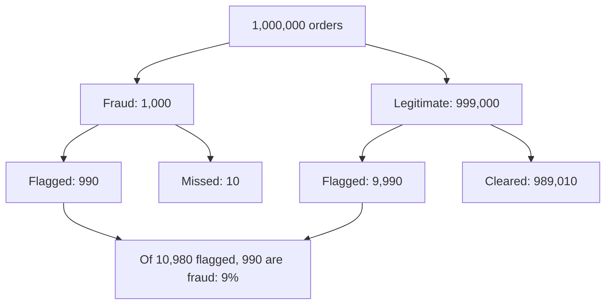

# 2 — Probability Foundations

Larkspur's fraud filter is 99% accurate, it flagged an order, and the support lead wants to cancel it. If one order in a thousand is fraudulent, that flag is wrong about nine times out of ten. Nobody made a mistake with the numbers; they answered P(flag | fraud) when the decision needs P(fraud | flag), and those can be a hundred times apart. Probability is a small set of rules that stop you doing this. The rules are few, and every later chapter leans on them: a sample mean's standard error, a p-value, a posterior and a bandit are all these rules applied with patience.

## Why start with rules

Chapter 1 described one dataset. From here on we want to say things about data we have not seen: next month's users, the other arm of an experiment, the population behind a sample. Probability is the language for that. You do not need a measure-theory course to use it well, but you do need to be fluent with conditional probability, independence and expectation, because each is a place where intuition reliably misleads. The book-length treatment is Blitzstein and Hwang's *Introduction to Probability* and its [Stat 110 lectures](https://www.youtube.com/playlist?list=PL2SOU6wwxB0uwwH80KTQ6ht66KWxbzTIo); *Think Stats* ch. 5 is the short version in code.

A habit runs through the chapter: compute the answer, then simulate it. If the two disagree you have learned something. A simulation is also what you will often use when no formula is available, which [pillar 04](../../04-bayesian-analysis/README.md) turns into a whole method.

## Sample spaces, events and counting

A *sample space* is the set of possible outcomes of an experiment; an *event* is a subset of it. A probability assigns numbers to events so that nothing is negative, the whole space has probability one, and non-overlapping events add. All else follows. The complement rule, P(not A) = 1 − P(A), is the workhorse, because "at least one" is usually much easier through "none". Inclusion-exclusion handles overlaps: P(A or B) = P(A) + P(B) − P(A and B).

When outcomes are equally likely, probability is counting. The birthday problem is the classic case. The chance that none of k people share a birthday is a product of shrinking fractions, and one minus it is the answer.

```python
from math import comb, prod
import numpy as np

def p_shared(k, days=365):
    return 1 - prod((days - i) / days for i in range(k))

rng = np.random.default_rng(7)
for k in [10, 23, 50]:
    sims = rng.integers(0, 365, size=(100_000, k))
    sims.sort(axis=1)
    sim = (np.diff(sims, axis=1) == 0).any(axis=1).mean()
    print(f"k={k:>2}  exact {p_shared(k):.3f}  simulated {sim:.3f}  pairs {comb(k, 2)}")
```

```text
k=10  exact 0.117  simulated 0.117  pairs 45
k=23  exact 0.507  simulated 0.509  pairs 253
k=50  exact 0.970  simulated 0.971  pairs 1225
```

Twenty-three people give better than even odds, which surprises everyone because they think about their own birthday. The relevant count is pairs, and it grows quadratically: 253 pairs among 23 people. This is not a party trick. The same calculation says how soon hashed IDs collide, and how quickly a short experiment-bucket hash gets into trouble.

```python
buckets = 10_000
for users in [100, 118, 1000]:
    print(f"{users:>5} users in {buckets:,} buckets: P(some collision) = {p_shared(users, buckets):.3f}")
```

```text
  100 users in 10,000 buckets: P(some collision) = 0.391
  118 users in 10,000 buckets: P(some collision) = 0.500
 1000 users in 10,000 buckets: P(some collision) = 1.000
```

Multiple comparisons in [chapter 5](05-hypothesis-testing.md) are the same effect in another form: one analyst asking many questions is an event with many chances to occur.

## Conditional probability and Bayes' rule

P(A | B) is the probability of A once you know B happened. The definition is P(A and B) / P(B): shrink the universe to the cases where B holds and ask what share of those has A. Rearranged, it gives the multiplication rule P(A and B) = P(A | B) P(B). Summing over a partition gives the law of total probability: P(A) = Σ P(A | Bᵢ) P(Bᵢ). Together they let you build a joint probability from conditionals, which is how almost every model in this course is written.

Conditioning has direction, and that is where people go wrong.

```python
rng = np.random.default_rng(11)
n = 1_000_000
mobile = rng.random(n) < 0.62
buy = rng.random(n) < np.where(mobile, 0.038, 0.075)
print(f"P(buy)            {buy.mean():.4f}")
print(f"P(buy | mobile)   {buy[mobile].mean():.4f}")
print(f"P(mobile | buy)   {mobile[buy].mean():.4f}")
print(f"P(mobile)         {mobile.mean():.4f}")
```

```text
P(buy)            0.0520
P(buy | mobile)   0.0378
P(mobile | buy)   0.4508
P(mobile)         0.6195
```

P(buy | mobile) is 3.8%. P(mobile | buy) is 45%. They share a numerator and have different denominators. A headline such as "45% of purchases are on mobile" says nothing about whether mobile users are good customers. In fact mobile is 62% of users and only 45% of purchases, which is the interesting reading.

### Bayes' rule inverts the conditional

Bayes' rule is what you get from writing P(A and B) both ways:

```text
P(A | B) = P(B | A) P(A) / P(B)

P(B) expands by total probability:
P(B) = P(B | A) P(A) + P(B | not A) P(not A)
```

The Larkspur fraud filter, and every medical test ever taught, is this calculation:



```python
def posterior(prior, sensitivity, specificity):
    true_pos = prior * sensitivity
    false_pos = (1 - prior) * (1 - specificity)
    return true_pos / (true_pos + false_pos)

print(f"1 in 1000, 99% accurate: {posterior(0.001, 0.99, 0.99):.3f}")
print(f"1 in 100,  99% accurate: {posterior(0.01, 0.99, 0.99):.3f}")
print(f"1 in 1000, 99.9% accurate: {posterior(0.001, 0.999, 0.999):.3f}")
print(f"after two independent positives: {posterior(posterior(0.001, 0.99, 0.99), 0.99, 0.99):.3f}")
```

```text
1 in 1000, 99% accurate: 0.090
1 in 100,  99% accurate: 0.500
1 in 1000, 99.9% accurate: 0.500
after two independent positives: 0.907
```

Three lessons sit in those lines. The answer depends on the base rate as much as on accuracy: moving prevalence from 1 in 1,000 to 1 in 100 lifts 9% to 50%. Improving the test helps, but it must beat the base rate, which is why rare-event detection needs extreme specificity. And evidence accumulates: yesterday's posterior is today's prior, so a second independent positive takes you to 91%. That sequential reading is the idea of [Bayesian inference](../../04-bayesian-analysis/notes/01-bayesian-inference.md), applied there to a parameter instead of an event. The word "independent" carries weight in that last step: a repeat of the same test on the same order would not count as new evidence.

### The same mistake in hypothesis testing

A p-value is a P(data | no effect). People read it as P(no effect | data). Reinhart's version of the calculation tests 100 candidate cancer drugs, 10 of which work, with 80% power and a 5% threshold: about 8 real detections and about 5 false ones, so one significant drug in three or so is a dud (*Statistics Done Wrong*, ch. 4). His text rounds to 13 discoveries and 62%; without rounding the 4.5 false positives give 64%.

```python
tested, works = 100, 10
power, alpha = 0.8, 0.05
true_hits = works * power
false_hits = (tested - works) * alpha
print(f"significant: {true_hits + false_hits:.1f}, of which real {true_hits / (true_hits + false_hits):.0%}")
for base_rate in [0.5, 0.2, 0.1, 0.02]:
    print(f"base rate {base_rate:>4}: P(real | significant) = "
          f"{base_rate * power / (base_rate * power + (1 - base_rate) * alpha):.2f}")
```

```text
significant: 12.5, of which real 64%
base rate  0.5: P(real | significant) = 0.94
base rate  0.2: P(real | significant) = 0.80
base rate  0.1: P(real | significant) = 0.64
base rate 0.02: P(real | significant) = 0.25
```

The base rate here is "how often are the ideas we test really good", and it is usually low. Ioannidis made the argument for whole research fields in [Why Most Published Research Findings Are False](https://doi.org/10.1371/journal.pmed.0020124) (PLOS Medicine, 2005). For a company that tests modest changes, this is why a win at p = 0.04 deserves some suspicion, and [chapter 5](05-hypothesis-testing.md) and the [experimentation pillar](../../03-experimentation-and-causality/README.md) take it up.

## Independence

A and B are independent if P(A and B) = P(A) P(B), or equivalently if knowing one leaves the other's probability unchanged. This is an assumption about the world, and in analytics it is usually the assumption most at risk.

Pairwise independence does not give mutual independence. Take two fair coins and let the third bit be their exclusive-or.

```python
rng = np.random.default_rng(3)
n = 1_000_000
a, b = rng.integers(0, 2, n), rng.integers(0, 2, n)
c = a ^ b
print("P(c=1 | a=1)        ", c[a == 1].mean().round(3))
print("P(c=1 | b=1)        ", c[b == 1].mean().round(3))
print("P(c=1 | a=1, b=1)   ", c[(a == 1) & (b == 1)].mean())
```

```text
P(c=1 | a=1)         0.5
P(c=1 | b=1)         0.5
P(c=1 | a=1, b=1)    0.0
```

C looks independent of A and of B taken alone, and it is fully determined by the pair. The practical moral is that checking variables two at a time cannot prove there is no joint structure. Tests of hashing schemes in experiment platforms have to check for exactly this kind of dependence between experiments (Kohavi et al., [DMKD 2009](https://doi.org/10.1007/s10618-008-0114-1), §5).

The converse trap is more common in product data. Two events can be strongly correlated overall and independent once you condition on a third.

```python
rng = np.random.default_rng(5)
n = 500_000
engaged = rng.random(n) < 0.3
p_open = np.where(engaged, 0.6, 0.1)
monday, tuesday = rng.random(n) < p_open, rng.random(n) < p_open
print(f"corr(mon, tue) overall      {np.corrcoef(monday, tuesday)[0, 1]:+.3f}")
print(f"corr(mon, tue) | engaged    {np.corrcoef(monday[engaged], tuesday[engaged])[0, 1]:+.3f}")
print(f"corr(mon, tue) | not engaged {np.corrcoef(monday[~engaged], tuesday[~engaged])[0, 1]:+.3f}")
```

```text
corr(mon, tue) overall      +0.281
corr(mon, tue) | engaged    +0.002
corr(mon, tue) | not engaged +0.000
```

Opening Monday's and Tuesday's emails have a correlation of 0.28 across all users, and essentially zero within each engagement level. This is the structure behind confounding in [causal inference](../../03-experimentation-and-causality/notes/04-correlation-and-causation.md): a shared cause induces correlation that vanishes when you condition on it.

## Random variables, expectation and variance

A *random variable* assigns a number to each outcome. It has a probability mass function if discrete, a density if continuous, and a CDF either way. Two numbers summarise it. The expectation E[X] is its long-run mean. The variance Var(X) = E[(X − E[X])²] is its mean squared distance from that mean, and its square root is the standard deviation.

### Linearity needs no independence

E[X + Y] = E[X] + E[Y], always, whether or not X and Y are related. This is the most useful fact in applied probability, because it lets you take a hard problem apart. Shuffle a deck and count cards that land in their original position. The positions are dependent, since if card 1 is in place the others have less room. It does not matter. Each position matches with probability 1/52, there are 52 positions, and the expected count is exactly 1.

```python
rng = np.random.default_rng(1)
n, trials = 52, 100_000
matches = np.array([(rng.permutation(n) == np.arange(n)).sum() for _ in range(trials)])
print(f"mean matches {matches.mean():.3f}, P(no match) {(matches == 0).mean():.3f}, 1/e = {np.exp(-1):.3f}")
```

```text
mean matches 0.999, P(no match) 0.369, 1/e = 0.368
```

The trick is the indicator variable: 1 if an event happens, 0 otherwise. Its expectation is the event's probability. So P(A) = E[1_A], which is why `np.mean(samples > 0)` estimates a probability throughout [the Bayesian pillar](../../04-bayesian-analysis/README.md). A count of events is a sum of indicators, and its expectation is the sum of their probabilities however tangled they are. "P(no match)" close to 1/e is a separate fact that does need the harder calculation.

### Variance needs care

Variance does not split so easily. Var(X + Y) = Var(X) + Var(Y) + 2 Cov(X, Y). Views and clicks are positively related, so their total varies more than the sum of the two variances suggests:

```python
rng = np.random.default_rng(2)
n = 1_000_000
views = rng.poisson(5, n) + 1
clicks = rng.binomial(views, 0.1)
print(f"E[v+c] {(views + clicks).mean():.3f} = E[v]+E[c] {views.mean() + clicks.mean():.3f}")
print(f"Var[v+c] {(views + clicks).var():.3f}")
print(f"Var[v]+Var[c] {views.var() + clicks.var():.3f}")
print(f"Var[v]+Var[c]+2Cov {views.var() + clicks.var() + 2 * np.cov(views, clicks)[0, 1]:.3f}")
```

```text
E[v+c] 6.604 = E[v]+E[c] 6.604
Var[v+c] 6.612
Var[v]+Var[c] 5.607
Var[v]+Var[c]+2Cov 6.612
```

The covariance term vanishes when variables are independent, and only then can you add variances. That single condition produces the standard error. For n independent values with standard deviation σ, the variance of the sum is nσ², and dividing by n gives a mean with standard deviation σ/√n.

```python
rng = np.random.default_rng(8)
sd = 30
for size in [100, 1_600, 25_600]:
    means = rng.normal(3.75, sd, size=(2000, size)).mean(axis=1)
    print(f"n={size:>6}  sd of mean simulated {means.std():.3f}  sigma/sqrt(n) {sd / size**0.5:.3f}")
```

```text
n=   100  sd of mean simulated 3.052  sigma/sqrt(n) 3.000
n=  1600  sd of mean simulated 0.740  sigma/sqrt(n) 0.750
n= 25600  sd of mean simulated 0.188  sigma/sqrt(n) 0.188
```

The formula assumes independence between rows. If a user contributes several rows, those rows are correlated and the formula is too optimistic. With an intraclass correlation ρ between rows from the same user and m rows per user, variance inflates by 1 + (m − 1)ρ:

```python
rng = np.random.default_rng(9)
def se_ratio(users=2000, sessions=5, icc=0.5, reps=2000):
    u = rng.normal(0, icc**0.5, (reps, users, 1))
    e = rng.normal(0, (1 - icc)**0.5, (reps, users, sessions))
    y = u + e
    return y.mean(axis=(1, 2)).std(), 1 / (users * sessions)**0.5

true_se, naive_se = se_ratio()
print(f"true SE {true_se:.4f}, naive SE {naive_se:.4f}, understated by {true_se / naive_se:.2f}x")
print(f"design effect sqrt(1 + (m-1)*icc) = {(1 + 4 * 0.5)**0.5:.2f}")
```

```text
true SE 0.0175, naive SE 0.0100, understated by 1.75x
design effect sqrt(1 + (m-1)*icc) = 1.73
```

Five sessions per user with ρ = 0.5 means you have about a third of the information your row count suggests, and any naive standard error is 1.75 times too small. Reinhart calls this pseudoreplication, in the context of cells from one culture and fish in one aquarium (*Statistics Done Wrong*, ch. 3). In an A/B test the same thing appears whenever you randomise by user and analyse by session, and [regression](06-regression-and-glms.md) gives the fix.

## Joint, marginal and conditional distributions

For two variables, the joint distribution holds everything; marginals sum it out, and conditionals renormalise a slice of it. A small table shows all three.

```python
import pandas as pd
joint = pd.DataFrame({"buy": [0.0233, 0.0236], "no_buy": [0.2867, 0.5964]},
                     index=["desktop", "mobile"])
print(joint)
print("P(device):", joint.sum(axis=1).round(3).to_dict())
print("P(buy):", round(joint["buy"].sum(), 4))
print("P(buy | device):", (joint["buy"] / joint.sum(axis=1)).round(3).to_dict())
```

```text
            buy  no_buy
desktop  0.0233  0.2867
mobile   0.0236  0.5964
P(device): {'desktop': 0.31, 'mobile': 0.62}
P(buy): 0.0469
P(buy | device): {'desktop': 0.075, 'mobile': 0.038}
```

That is the whole of the mechanics, and it is the same calculation in the Bayesian chapters with continuous parameters in place of two devices. Correlation is covariance rescaled to lie between −1 and 1, and it measures only linear association.

### Total expectation and total variance

Two identities let you reason through a hidden group variable B:

```text
E[X]   = E[ E[X | B] ]
Var[X] = E[ Var[X | B] ] + Var[ E[X | B] ]
```

Total variance splits into the average spread within groups and the spread between group means. Apply it to revenue per user, with B indicating whether a user buys. Then E[revenue] = P(buy) × E[order | buy], which is the decomposition you reached for in chapter 1.

```python
rng = np.random.default_rng(4)
n = 2_000_000
buy = rng.random(n) < 0.047
order = rng.lognormal(3.6, 1.1, n)
rev = np.where(buy, order, 0)
p, m, v = buy.mean(), order[buy].mean(), order[buy].var()
print(f"E[rev] direct {rev.mean():.3f}, p*E[order|buy] {p * m:.3f}")
print(f"Var[rev] direct {rev.var():.1f}")
print(f"E[Var|B] + Var[E|B] = p*v + p*(1-p)*m^2 = {p * v + p * (1 - p) * m**2:.1f}")
print(f"share of variance from who buys at all: {p * (1 - p) * m**2 / rev.var():.0%}")
```

```text
E[rev] direct 3.158, p*E[order|buy] 3.158
Var[rev] direct 708.0
E[Var|B] + Var[E|B] = p*v + p*(1-p)*m^2 = 708.0
share of variance from who buys at all: 29%
```

Both sides match. The second identity is the reason for two later techniques. Stratification and [CUPED](../../03-experimentation-and-causality/notes/03-experimentation-at-scale.md) work by removing the between-group term from a metric's variance: if you already know a user's group, or their prior spend, that part of the noise was never about your treatment. And 29% of the variance here comes from whether a user buys at all, which is why conversion can be a far easier metric to move than revenue.

---

## Pitfalls

- **Swapping the conditional.** P(flag | fraud) and P(fraud | flag) differ by a factor set by the base rate. So do a p-value and the probability that the null is true.
- **Ignoring the base rate.** Every "99% accurate" claim is incomplete without prevalence. Rare events mean most flags are false, even for excellent tests.
- **Assuming independence because it is convenient.** Sessions in a user, users in a household and days in a week are all correlated. Standard errors that assume otherwise are too small.
- **Thinking independence is checked by pairwise tests.** The exclusive-or example passes all pairwise checks and is fully dependent.
- **Adding variances without checking covariance.** You can always add expectations, and you can add variances only for uncorrelated variables.
- **Multiplying evidence that is not independent.** Two tests sharing the same blind spot are not two pieces of evidence. The 91% in the fraud example assumes independence.
- **Reading a conditional as a cause.** P(buy | desktop) > P(buy | mobile) is a statement about populations, and tells you nothing about what a device switch would do.

---

## Try it

1. The Larkspur filter gets a new rule with sensitivity 95% and specificity 99.5%. At 1 in 1,000 prevalence, what is P(fraud | flag)? If you run it after the old filter, assuming independence, what does a double flag give?
2. On a calendar of twelve 30-day months (360 days), how many people give better than even odds of a shared birthday? Compute it with `p_shared`, then confirm by simulation.
3. A coupon is emailed to users. Each of 40 users redeems with a different probability, between 1% and 20%, and these are not independent because friends share codes. What is the expected number of redemptions, and what extra information would you need for the variance?
4. Using the law of total variance, explain why segmenting users by device before comparing arms can improve precision when the device mix is similar in both arms.

<details>
<summary>Answers</summary>

1. `posterior(0.001, 0.95, 0.995)` gives about 0.16. Using 0.16 as the prior for the old filter, `posterior(0.16, 0.99, 0.99)` gives about 0.95. The double flag is strong only because we assumed independence.
2. `p_shared(k, days=360)` first exceeds 0.5 at k = 23, since moving from 365 to 360 days changes little. A simulation with `rng.integers(0, 360, size=(100_000, 23))` agrees to about two decimals.
3. The expected value is the sum of the individual probabilities, by linearity, regardless of dependence. The variance needs each pairwise covariance, so you would need to know how redemptions cluster between friends.
4. Var[Y] = E[Var[Y | device]] + Var[E[Y | device]]. Comparing within device removes the second term, which has nothing to do with treatment. This is what stratification does, and it needs the mix to be balanced for a simple comparison to stay unbiased.

</details>

---

## Interview checklist

| Prompt | Answer |
|---|---|
| P(A \| B) vs P(B \| A)? | They share a numerator, P(A and B), and differ in denominator, with Bayes' rule converting between them through the base rates. |
| Does linearity of expectation need independence? | No, it always holds. Variance additivity is the one that needs uncorrelated variables. |
| A test is 99% accurate and the condition affects 1 in 1,000. P(condition \| positive)? | About 9%: 0.99 × 0.001 / (0.99 × 0.001 + 0.01 × 0.999). False positives from the large healthy group dominate. |
| What is an indicator variable for? | It turns an event into a number with expectation equal to the event's probability, so counts split into sums. |
| Why does a standard error shrink with √n? | Independent variances add to nσ², and dividing the sum by n leaves σ²/n. That independence is what breaks with repeated users. |
| Law of total variance in one line? | Total variance is the mean within-group variance plus the variance of group means, which is why knowing groups can reduce noise. |
| Independent vs conditionally independent? | Neither implies the other. A shared cause makes variables dependent overall but independent given the cause. |

---

## Next

[Chapter 3: Distributions and Sampling](03-distributions-and-sampling.md) puts names on the shapes that recur, from Binomial conversions to Poisson counts, and shows why sample means behave well until N gets small or tails get heavy.
