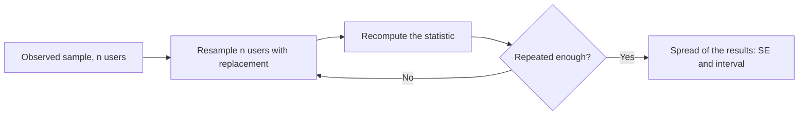

# 4 — Estimation

Larkspur's finance lead asks for revenue per user from a sample of 4,000 users. The answer is 2.68, and it is not the answer she needs. She needs to know whether next quarter's plan can assume 2.50 or 3.20, and a single number cannot tell her. Estimation is the discipline of reporting a number along with how far it could plausibly be from the truth. This chapter builds that from three ideas: what makes an estimator good, maximum likelihood as the default way to get one, and the two routes to an interval, by formula and by resampling, including the case where the formula has no obvious answer.

## Why this chapter

[Chapter 3](03-distributions-and-sampling.md) said what a sample mean does as N grows. This chapter turns that into a reported number: an estimate with an interval. [Chapter 5](05-hypothesis-testing.md) then asks whether the interval rules out zero. The two chapters are one idea seen from two sides, and on most real questions the interval is the more useful side.

Here is this chapter's sample, drawn the same way as Larkspur's revenue in chapter 1.

```python
import numpy as np

rng = np.random.default_rng(42)
n = 4_000
buy = rng.random(n) < 0.047
revenue = np.where(buy, rng.lognormal(3.6, 1.1, n), 0.0)
print(f"{n} users, {buy.sum()} buyers, conversion {buy.mean():.4f}, revenue/user {revenue.mean():.3f}")
```

```text
4000 users, 180 buyers, conversion 0.0450, revenue/user 2.681
```

## Estimators, bias and variance

An *estimator* is a rule that turns data into a guess; an *estimate* is what the rule gives on your data. Because data are random, an estimator has a sampling distribution, and you judge it by how that distribution sits around the truth. *Bias* is the gap between its average and the truth. *Variance* is its spread. Mean squared error combines them: MSE = bias² + variance. A *consistent* estimator closes in on the truth as n grows.

The sample variance is the textbook example of why these are different goals. Here are 200,000 samples of size 5 from a Normal with true variance 4.

```python
rng2 = np.random.default_rng(1)
sims = rng2.normal(0, 2, size=(200_000, 5))     # true variance 4, n=5
mle = sims.var(axis=1, ddof=0)
unb = sims.var(axis=1, ddof=1)
for name, est in [("divide by n  ", mle), ("divide by n-1", unb)]:
    print(f"{name}: mean {est.mean():.3f}  bias {est.mean() - 4:+.3f}  "
          f"var {est.var():.2f}  mse {((est - 4)**2).mean():.2f}")
```

```text
divide by n  : mean 3.190  bias -0.810  var 5.11  mse 5.76
divide by n-1: mean 3.988  bias -0.012  var 7.98  mse 7.98
```

Dividing by n lands low on average, because deviations from the sample mean are smaller than deviations from the true mean: the sample mean has already moved toward the data. Dividing by n − 1 corrects that and is unbiased. But the divide-by-n version has the *smaller* mean squared error in this example. Unbiasedness is one property, not the goal. That trade, accepting a little bias for less variance, is what regularisation and [shrinkage](03-distributions-and-sampling.md) do, and Efron and Hastie give it a chapter of its own through the James-Stein estimator (*Computer Age Statistical Inference*, ch. 7). At n in the thousands the n versus n − 1 question has no practical effect, but the reasoning returns everywhere.

## Maximum likelihood

Maximum likelihood is the default recipe for building an estimator: pick the parameter value under which the observed data are most probable. For k buyers among N users, the Bernoulli log-likelihood is k log p + (N − k) log(1 − p). Setting its derivative to zero gives p̂ = k/N, the obvious answer. A numeric optimiser finds the same thing, and that is the route you take once the model has no closed form.

```python
from scipy import optimize

k, N = int(buy.sum()), n
def neg_log_lik(p):
    return -(k * np.log(p) + (N - k) * np.log(1 - p))

res = optimize.minimize_scalar(neg_log_lik, bounds=(1e-6, 1 - 1e-6), method="bounded")
print(f"numeric MLE {res.x:.5f}, k/N {k / N:.5f}")
```

```text
numeric MLE 0.04500, k/N 0.04500
```

### Fisher information and the standard error

The likelihood also reports its own uncertainty. A sharply peaked log-likelihood means the data pin the parameter down; a flat one means they do not. The curvature at the peak is the *observed Fisher information*, and the asymptotic standard error is one over its square root (Efron & Hastie, ch. 4).

```python
p_hat = k / N
h = 1e-4
curv = (neg_log_lik(p_hat + h) - 2 * neg_log_lik(p_hat) + neg_log_lik(p_hat - h)) / h**2
print(f"SE from curvature {curv**-0.5:.5f}")
print(f"SE formula sqrt(p(1-p)/N) {(p_hat * (1 - p_hat) / N)**0.5:.5f}")
```

```text
SE from curvature 0.00328
SE formula sqrt(p(1-p)/N) 0.00328
```

Curvature and the familiar formula agree to five decimals. That is no coincidence, because the formula *is* the curvature worked out by hand. The same machinery gives standard errors in logistic regression, where no simple formula exists: the summary table in [chapter 6](06-regression-and-glms.md) reads them off the Hessian.

MLE fits the shape you tell it to. For the lognormal order value from chapter 1:

```python
logs = np.log(revenue[revenue > 0])
mu_hat, sigma_hat = logs.mean(), logs.std(ddof=0)
print(f"mu {mu_hat:.3f} (true 3.6), sigma {sigma_hat:.3f} (true 1.1)")
print(f"implied mean order {np.exp(mu_hat + sigma_hat**2 / 2):.2f}, sample mean {revenue[revenue > 0].mean():.2f}")
```

```text
mu 3.519 (true 3.6), sigma 1.140 (true 1.1)
implied mean order 64.59, sample mean 59.59
```

The parameters are recovered well, and the model's implied mean order sits within 10% of the sample mean. The gap matters: the fitted mean relies on the assumption that the tail really is lognormal, and the sample mean makes no such assumption but rests on the few largest values. Maximum likelihood is the backbone of [GLMs](06-regression-and-glms.md), and adding a prior to it gives [the MAP estimate of the Bayesian pillar](../../04-bayesian-analysis/notes/01-bayesian-inference.md).

## Standard errors and confidence intervals

The standard error of a mean is s/√n, and of a proportion √(p̂(1 − p̂)/n). The Normal-approximation interval is estimate ± 1.96 SE.

```python
from scipy import stats

se = revenue.std(ddof=1) / n**0.5
print(f"revenue/user {revenue.mean():.3f}, SE {se:.3f}, "
      f"95% CI [{revenue.mean() - 1.96 * se:.3f}, {revenue.mean() + 1.96 * se:.3f}]")
```

```text
revenue/user 2.681, SE 0.301, 95% CI [2.091, 3.272]
```

So: 2.68 per user, plausibly 2.09 to 3.27. That is the finance answer, and it says 2.50 is fine as a plan and 3.20 is optimistic but not ruled out.

### What a 95% interval means

The 95% describes the procedure, not this interval. If you repeated the sampling and built the interval each time, 95% of those intervals would contain the true value. You can check that directly by simulation, since in a simulation you know the truth.

```python
rng3 = np.random.default_rng(3)
true_p = 0.047
hits = 0
for _ in range(10_000):
    x = rng3.binomial(4_000, true_p)
    p = x / 4_000
    half = 1.96 * (p * (1 - p) / 4_000)**0.5
    hits += p - half < true_p < p + half
print(f"share of 95% intervals containing the true rate: {hits / 10_000:.3f}")
```

```text
share of 95% intervals containing the true rate: 0.948
```

The realised interval either contains the true value or does not; in frequentist probability the parameter is fixed, so there is no 95% left to assign to it. The statement people want, "there is a 95% probability the parameter lies in this interval", is what a *credible interval* from [Bayesian inference](../../04-bayesian-analysis/notes/01-bayesian-inference.md) gives, at the cost of stating a prior. With plenty of data and a weak prior the two often coincide numerically, and that is why people get away with the wrong reading most of the time.

### When Wald fails: Wilson

That formula is called the Wald interval, and it collapses near zero. Zero conversions out of 50 gives a standard error of zero and an interval of [0, 0], a claim of certainty based on 50 users. It can also go below zero. The Wilson interval inverts the score test instead of plugging p̂ into the variance, and it stays sensible.

```python
def wald(x, n, z=1.96):
    p = x / n; h = z * (p * (1 - p) / n)**0.5
    return p - h, p + h

def wilson(x, n, z=1.96):
    p = x / n; d = 1 + z**2 / n
    c = (p + z**2 / (2 * n)) / d
    h = z * (p * (1 - p) / n + z**2 / (4 * n**2))**0.5 / d
    return c - h, c + h

for x, m in [(0, 50), (1, 50), (2, 40), (188, 4000)]:
    print(f"{x:>3}/{m:<5} Wald [{wald(x, m)[0]:+.4f}, {wald(x, m)[1]:.4f}]  "
          f"Wilson [{wilson(x, m)[0]:+.4f}, {wilson(x, m)[1]:.4f}]")
```

```text
  0/50    Wald [+0.0000, 0.0000]  Wilson [+0.0000, 0.0714]
  1/50    Wald [-0.0188, 0.0588]  Wilson [+0.0035, 0.1050]
  2/40    Wald [-0.0175, 0.1175]  Wilson [+0.0138, 0.1650]
188/4000  Wald [+0.0404, 0.0536]  Wilson [+0.0409, 0.0540]
```

```python
rng4 = np.random.default_rng(4)
for true_p, m in [(0.02, 50), (0.05, 50), (0.05, 400), (0.05, 4000)]:
    xs = rng4.binomial(m, true_p, 20_000)
    wl, wh = wald(xs, m); sl, sh = wilson(xs, m)
    print(f"p={true_p} n={m:<5} Wald cover {np.mean((wl < true_p) & (true_p < wh)):.3f}  "
          f"Wilson cover {np.mean((sl < true_p) & (true_p < sh)):.3f}")
```

```text
p=0.02 n=50    Wald cover 0.633  Wilson cover 0.920
p=0.05 n=50    Wald cover 0.921  Wilson cover 0.962
p=0.05 n=400   Wald cover 0.930  Wilson cover 0.951
p=0.05 n=4000  Wald cover 0.951  Wilson cover 0.955
```

With p = 0.02 and n = 50, a nominal 95% Wald interval covers the truth 63% of the time. Wilson covers 92%. At n = 4,000 they are indistinguishable. Use Wilson (`statsmodels.stats.proportion.proportion_confint(method="wilson")`) whenever counts are small, including in small segments. Coverage simulation like this one is also the general way to test a procedure you do not trust.

### Ratio metrics: the delta method

Revenue per session is a ratio of two random quantities. Sessions cluster inside users, so you cannot treat sessions as the independent rows even though they look like the unit. The delta method linearises the ratio around its means. For R = mean(Y)/mean(X), with users as the independent unit,

```text
Var(R) ≈ [ Var(Y) − 2R Cov(Y, X) + R² Var(X) ] / ( n · mean(X)² )
```

```python
rng5 = np.random.default_rng(5)
users = 3_000
sessions = 1 + rng5.poisson(1.4, users)
rev_u = rng5.binomial(sessions, 0.03) * rng5.lognormal(3.6, 1.1, users)

def ratio_se(num, den):
    R = num.sum() / den.sum()
    v = np.cov(num, den)
    return R, ((v[0, 0] - 2 * R * v[0, 1] + R**2 * v[1, 1]) / len(num))**0.5 / den.mean()

R, se_delta = ratio_se(rev_u, sessions)
per_session = np.repeat(rev_u / sessions, sessions)
se_naive = per_session.std(ddof=1) / len(per_session)**0.5
print(f"revenue per session {R:.3f}")
print(f"delta-method SE {se_delta:.3f}")
print(f"naive session-level SE {se_naive:.3f}")
```

```text
revenue per session 1.832
delta-method SE 0.193
naive session-level SE 0.116
```

Naively treating each session as a row understates the standard error by 40% here. This calculation is what A/B platforms run on metrics such as click-through rate, and [metrics design](../../03-experimentation-and-causality/notes/02-metrics-and-kpi-design.md) applies it to the experiment. Kohavi et al. point to Fieller's formula as a more exact option for percentage changes ([DMKD 2009](https://doi.org/10.1007/s10618-008-0114-1)).

## The bootstrap

Efron's bootstrap ([Annals of Statistics, 1979](https://doi.org/10.1214/aos/1176344552)) replaces mathematics with computation. You want the sampling distribution of a statistic, and you cannot draw new samples from the population. But you can draw from your sample, which is the best available stand-in for the population: resample n rows with replacement, recompute the statistic, repeat, and read the spread (Bruce & Bruce, 2017, ch. 2; Efron & Hastie, ch. 10).



Resample *users* for the ratio metric, keeping each user's numerator and denominator together:

```python
rng6 = np.random.default_rng(6)
idx = rng6.integers(0, users, size=(5_000, users))
boots = rev_u[idx].sum(axis=1) / sessions[idx].sum(axis=1)
print(f"bootstrap SE {boots.std(ddof=1):.3f}")
print("percentile 95% CI", np.percentile(boots, [2.5, 97.5]).round(3))
print("delta 95% CI     ", np.round([R - 1.96 * se_delta, R + 1.96 * se_delta], 3))
```

```text
bootstrap SE 0.195
percentile 95% CI [1.47  2.239]
delta 95% CI      [1.453 2.212]
```

Bootstrap and delta agree on the SE (0.195 against 0.193). When they disagree, suspect the data before the theory. The delta method needed a page of algebra, and the bootstrap needed three lines, and would have worked just as well for a median or a 90th percentile, where the algebra gets far harder.

### Percentile and BCa

The percentile interval reads the 2.5th and 97.5th percentiles of the bootstrap distribution. It is simple and it can be off with skewed statistics. The bias-corrected and accelerated (BCa) interval adjusts those percentiles for bias and for the way variance changes with the estimate, and Efron and Hastie derive it in ch. 11. On revenue, where skew is the whole problem, it shifts right.

```python
res = stats.bootstrap((revenue[:2000],), np.mean, confidence_level=0.95,
                      n_resamples=4_000, method="BCa", random_state=7)
pct = stats.bootstrap((revenue[:2000],), np.mean, confidence_level=0.95,
                      n_resamples=4_000, method="percentile", random_state=7)
print(f"mean {revenue[:2000].mean():.3f}")
print(f"percentile [{pct.confidence_interval.low:.3f}, {pct.confidence_interval.high:.3f}]")
print(f"BCa        [{res.confidence_interval.low:.3f}, {res.confidence_interval.high:.3f}]")
```

```text
mean 2.661
percentile [1.872, 3.610]
BCa        [1.941, 3.802]
```

Both intervals are asymmetric around 2.66, as the data demand, and a symmetric ±1.96 SE is not. On this kind of data, prefer BCa and verify by simulation when the decision matters.

### When the bootstrap fails

The bootstrap is not free of assumptions. Three failures are worth knowing.

```python
rng7 = np.random.default_rng(8)
x = rng7.uniform(0, 1, 100)
maxb = np.max(x[rng7.integers(0, 100, (5000, 100))], axis=1)
print(f"bootstrap of the max: share of resamples equal to the sample max {np.mean(maxb == x.max()):.3f}")
# clustered data: sessions inside users
u = rng7.normal(0, 1, 500)
y = np.repeat(u, 5) + rng7.normal(0, 1, 2500)
ids = np.repeat(np.arange(500), 5)
naive = [y[rng7.integers(0, 2500, 2500)].mean() for _ in range(1500)]
clus = [y.reshape(500, 5)[rng7.integers(0, 500, 500)].mean() for _ in range(1500)]
print(f"row bootstrap SE {np.std(naive):.4f}, cluster bootstrap SE {np.std(clus):.4f}, "
      f"true SE {(1 / 500 + 1 / 2500)**0.5:.4f}")
```

```text
bootstrap of the max: share of resamples equal to the sample max 0.644
row bootstrap SE 0.0272, cluster bootstrap SE 0.0474, true SE 0.0490
```

**Statistics at the edge.** The bootstrap can never go beyond the sample's largest value. For the maximum, 64% of resamples tie with it, so the bootstrap distribution is largely one spike and misrepresents the true sampling distribution.

**Dependent rows.** Resampling rows breaks the structure. Here the row bootstrap reports a standard error of 0.027, when the truth is 0.049; resampling whole users gives 0.047. Resample at the unit that was independent. That is usually the user, and for time series you need a block bootstrap, as in [the time-series pillar](../../../data-science/05-time-series-and-recommenders/README.md).

**Tiny samples and heavy tails.** The resamples can only contain what the sample has. If no whale happened to be sampled, none will appear in the resamples, and the interval has no way of knowing it is missing.

## Power and sample size, the estimation view

Turn the interval round. If you need an interval no wider than some value, that fixes N, since the half-width is 1.96 σ/√n. The *minimum detectable effect* (MDE) is the smallest effect you could separate from zero with a chosen probability. For two arms with 5% significance and 80% power,

```text
n per arm ≈ 2 (1.96 + 0.84)² σ² / δ²  ≈ 16 σ² / δ²
```

Kohavi et al. use that "16" as their planning rule ([DMKD 2009](https://doi.org/10.1007/s10618-008-0114-1)). Their example has a 5% purchase rate, an average purchase of 75, so revenue per user of 3.75 with a standard deviation of 30.

```python
def n_per_arm(sigma, delta, alpha=0.05, power=0.8):
    z = stats.norm.ppf(1 - alpha / 2) + stats.norm.ppf(power)
    return 2 * (z * sigma / delta)**2

print(f"exact multiplier 2*(z_a+z_b)^2 = {2 * (stats.norm.ppf(.975) + stats.norm.ppf(.8))**2:.1f}")
print(f"revenue, sd 30, 5% of 3.75: {n_per_arm(30, 3.75 * .05):,.0f} per arm")
print(f"conversion, p=.05, 5% relative: {n_per_arm((.05 * .95)**.5, .05 * .05):,.0f} per arm")
print(f"half-width at n=4000 for p=.047: {1.96 * (.047 * .953 / 4000)**.5:.4f}")
```

```text
exact multiplier 2*(z_a+z_b)^2 = 15.7
revenue, sd 30, 5% of 3.75: 401,863 per arm
conversion, p=.05, 5% relative: 119,303 per arm
half-width at n=4000 for p=.047: 0.0066
```

The paper's rounded 16 gives about 409,000 per arm for a 5% revenue change and about 122,000 for a 5% conversion change, and the exact multiplier 15.7 here gives 401,863 and 119,303. Measuring revenue costs more than three times the users of measuring conversion for the same relative effect, because of the variance from the tail. And n grows with the inverse square of the effect, so halving the effect you hope to detect needs four times the users. [Experimentation at scale](../../03-experimentation-and-causality/notes/03-experimentation-at-scale.md) carries this through to a real A/B plan.

---

## Pitfalls

- **Saying "95% probability the parameter is in this interval".** A confidence interval describes the procedure's long-run hit rate. For that statement you need a credible interval and a prior.
- **Quoting Wald for small counts.** It gives [0, 0] for 0 of 50. Use Wilson for rates in small segments.
- **Computing a ratio metric's SE as if denominator rows were independent.** Delta method or user-level bootstrap. The naive version here was 40% too small.
- **Bootstrapping the wrong unit.** Rows are not always independent. Resample whole users, or blocks over time.
- **Using the bootstrap as a cure for not enough data.** It estimates sampling variation from what you have. It cannot conjure a tail that your sample missed.
- **Reporting a point estimate as the answer.** The interval is what a decision uses, and it is what shows when the data cannot support the decision at all.
- **Forgetting that interval width scales with √n.** Doubling precision costs four times the data. People routinely expect twice the data to be enough.
- **Trusting nominal coverage on skewed data.** A 95% label is a claim. Chapter 3 showed that it can be off by a long way at sample sizes people consider large.

---

## Try it

1. A segment has 3 buyers among 60 users. Compute Wald and Wilson intervals. Which would you report, and what does the other one get wrong?
2. Use `stats.bootstrap` with `method="BCa"` to get a 95% interval for the median order value of buyers in the `gen` block.
3. Modify `boot_fail` so that `y` has 20 sessions per user rather than 5, and predict before you run it which standard errors change.
4. Using `n_per_arm`, how many users per arm would detect a 1% relative lift on a 5% conversion rate? What would you do if your site only gets 200,000 users per month?

<details>
<summary>Answers</summary>

1. `wald(3, 60)` is about [−0.005, 0.105], and `wilson(3, 60)` is about [0.017, 0.137]. Report Wilson. Wald goes negative, which is impossible for a rate, and sits too low throughout.
2. `stats.bootstrap((revenue[revenue > 0],), np.median, method="BCa", n_resamples=4000, random_state=1).confidence_interval`. With seed 42 it gives about [30.6, 44.0] around a median of 37.6. The same call with `np.mean` gives about [51.0, 71.5] around 59.6, a similar width relative to its centre but much higher, and it is the tail that separates them.
3. With 20 sessions per user, the true SE is √(1/500 + 1/10000), about 0.046, nearly unchanged because the user effect dominates. The row bootstrap shrinks to about 0.014 as if you had four times the information, so its error gets worse. The cluster bootstrap stays close to the truth.
4. `n_per_arm((.05 * .95)**.5, .05 * .01)` is about 3 million per arm. At 200,000 users a month this is not feasible. Accept a larger MDE, find a more sensitive metric, reduce variance with [CUPED](../../03-experimentation-and-causality/notes/03-experimentation-at-scale.md), or decide without an experiment and say so.

</details>

---

## Interview checklist

| Prompt | Answer |
|---|---|
| What does a 95% confidence interval mean? | If you repeated the sampling and the calculation, 95% of the intervals built would contain the true value. It is a statement about the procedure, not about this interval's chance of being right. |
| Bootstrap vs analytical SE? | Analytical is instant and exact when its assumptions hold. Bootstrap works for any statistic, including medians and ratios. It needs independent units and enough data, and fails at the extremes. They should agree where both apply. |
| How do you get an interval for a ratio metric? | Treat the randomisation unit as independent. Use the delta method on numerator and denominator per user, or bootstrap users. Do not treat the denominator's rows as independent. |
| Why divide by n − 1? | The sample mean is fit to the data, so deviations from it are too small. Dividing by n − 1 makes the variance estimator unbiased. It does not minimise MSE. |
| What is an MLE, and where does its SE come from? | The parameter value that makes the data most probable. Its asymptotic SE comes from the curvature of the log-likelihood at the peak. |
| What do you do for a rate of 0 out of 50? | Use Wilson, which gives roughly [0, 0.07]. Wald gives [0, 0], which claims certainty. |
| What is an MDE? | The smallest effect you would detect with the chosen power and significance, given n and variance. Roughly n = 16σ²/δ² per arm at 5% and 80%. |

---

## Next

[Chapter 5: Hypothesis Testing](05-hypothesis-testing.md) turns an estimate into a decision: t, chi-square, ANOVA, non-parametric tests and multiple comparisons, and why a p-value carries less meaning than people ask of it.
