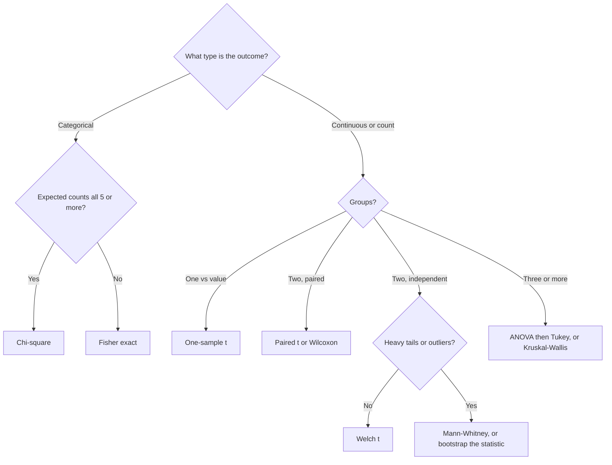

# 5 — Hypothesis Testing

Larkspur's analyst slices a flat experiment by twenty segments and reports that the new checkout works in one of them, at p = 0.04. If the change does nothing at all, that result is more likely than not to occur somewhere among the twenty. A hypothesis test is a narrow, well-built tool for one question: could this pattern plausibly be noise? This chapter covers the recipe, which test fits which data, what a p-value does and does not say, the non-parametric fallbacks, and how quickly many small questions turn into a guaranteed false discovery.

## The recipe

1. **H₀ (null):** the default. No effect, no difference, independence.
2. **H₁ (alternative):** the effect you want to detect. Decide one- or two-sided *before* looking.
3. **α:** the false-positive rate you accept, usually 0.05.
4. **Test statistic:** a number whose distribution under H₀ is known (t, χ², F, z).
5. **p-value:** the probability, *assuming H₀ is true*, of a statistic at least as extreme as the one observed.
6. **Decision:** reject H₀ if p < α. Otherwise "fail to reject", which is not "accept".

| Term | Plain meaning |
|---|---|
| Type I error (α) | false positive: you reject a true H₀ |
| Type II error (β) | false negative: you miss a real effect |
| Power (1 − β) | chance of detecting an effect of a given size; see [experimentation at scale](../../03-experimentation-and-causality/notes/03-experimentation-at-scale.md) |
| Effect size | how big the difference is, independent of N (Cohen's d, h, lift) |

Larkspur's new checkout gives a first example, on order values for 400 buyers in each arm.

```python
import numpy as np
from scipy import stats

rng = np.random.default_rng(10)
a = rng.lognormal(3.6, 1.1, 400)        # order value, old checkout
b = rng.lognormal(3.68, 1.1, 400)       # order value, new checkout
t, p = stats.ttest_ind(b, a, equal_var=False)
print(f"mean a {a.mean():.2f}, mean b {b.mean():.2f}, Welch t {t:.2f}, p = {p:.3f}")
```

```text
mean a 54.19, mean b 69.50, Welch t 2.63, p = 0.009
```

### The logic, without the formula

Forget the t-distribution for a moment. If checkout truly made no difference, the labels "old" and "new" are arbitrary, so any relabelling of the orders was equally likely. Shuffle the labels thousands of times, recompute the difference, and see how often chance alone gives one as large as you observed. This is a *permutation test*, and Bruce & Bruce (2017, ch. 3) use it to teach significance testing because every assumption is on view (Think Stats, ch. 7, builds on the same resampling idea).

```python
rng = np.random.default_rng(11)
obs = b.mean() - a.mean()
pool = np.concatenate([a, b])
diffs = np.empty(10_000)
for i in range(10_000):
    rng.shuffle(pool)
    diffs[i] = pool[400:].mean() - pool[:400].mean()
print(f"observed diff {obs:.2f}, permutation p = {np.mean(np.abs(diffs) >= abs(obs)):.3f}")
```

```text
observed diff 15.32, permutation p = 0.007
```

Permutation p = 0.007 and Welch p = 0.009 agree on 400 skewed observations, because the t-test is a good approximation to this procedure. That is what every classical test is: an approximation of "how surprising is this under relabelling or under the null's distribution". When you are unsure a formula applies, you can shuffle instead. And under a true null, p-values are uniform, which is what α = 0.05 means:

```python
rng = np.random.default_rng(18)
pv = stats.ttest_ind(rng.normal(0, 1, (100_000, 30)), rng.normal(0, 1, (100_000, 30)), axis=1).pvalue
print("under H0, share of p in bins:", np.histogram(pv, bins=[0, .05, .25, .5, .75, 1])[0] / 100_000)
```

```text
under H0, share of p in bins: [0.05057 0.19972 0.24795 0.25152 0.25024]
```

### What a p-value is not

Reinhart's *Statistics Done Wrong* lists these, and each is a common interview trap. The American Statistical Association's [2016 statement on p-values](https://doi.org/10.1080/00031305.2016.1154108) (*The American Statistician*) makes the same points formally: a p-value does not measure the probability that the hypothesis is true, nor the size or importance of an effect, and a decision should not rest on whether it crosses a line.

| Wrong reading | Why it is wrong |
|---|---|
| "p = 0.03 means a 3% chance H₀ is true" | p assumes H₀ is true; it cannot be the probability of H₀. That needs a prior ([chapter 2](02-probability-foundations.md), [Bayesian inference](../../04-bayesian-analysis/notes/01-bayesian-inference.md)). |
| "p = 0.2 means there is no effect" | the test may simply be underpowered |
| "p = 0.0001 means a big effect" | with N in the millions, trivially small effects are significant; report the effect size and CI |
| "p < 0.05 in one study, p > 0.05 in another, so they disagree" | the difference between significant and not significant is not itself significant (Reinhart, ch. 5) |

Here is the third row at scale, with five million users per arm and a lift nobody would ship on its own:

```python
n = 5_000_000
p1, p2 = 0.0470, 0.0474
se = (p1 * (1 - p1) / n + p2 * (1 - p2) / n)**0.5
z = (p2 - p1) / se
print(f"lift {p2 - p1:.4f}, z {z:.2f}, p {2 * stats.norm.sf(z):.1e}, relative lift {(p2 / p1 - 1):.1%}")
```

```text
lift 0.0004, z 2.98, p 2.9e-03, relative lift 0.9%
```

Statistically clear, and 0.9% in relative terms. Whether that is worth shipping is a business question that the p-value cannot answer.

## Choosing the test

| Question | Data | Parametric test | `scipy.stats` | Non-parametric fallback |
|---|---|---|---|---|
| Is this mean different from a known value? | one continuous sample | one-sample t | `ttest_1samp(x, mu0)` | Wilcoxon signed-rank on x − mu0 |
| Do two independent groups differ? | two continuous samples | two-sample t (Welch) | `ttest_ind(a, b, equal_var=False)` | Mann-Whitney U `mannwhitneyu(a, b)` |
| Before vs after on the same units? | paired continuous | paired t | `ttest_rel(before, after)` | Wilcoxon `wilcoxon(before, after)` |
| Do 3+ groups differ? | k continuous samples | one-way ANOVA | `f_oneway(a, b, c)` | Kruskal-Wallis `kruskal(a, b, c)` |
| Are two categorical variables independent? | contingency table | chi-square | `chi2_contingency(table)` | Fisher's exact `fisher_exact(2x2)` when any expected count < 5 |
| Do two samples come from the same distribution? | two continuous samples | none | | Kolmogorov-Smirnov `ks_2samp(a, b)` |
| Do two proportions differ? | counts and totals | two-proportion z | `statsmodels proportions_ztest` | chi-square on the 2×2, or Fisher |

Default to Welch's t (`equal_var=False`). It loses almost nothing when variances are equal and protects you when they are not. The same choice as a flowchart:



## The parametric tests in code

This block is adapted from Part 2 of the [practice notebook](../practice/5_Statistical_Analysis.ipynb).

```python
rng = np.random.default_rng(12)
sample = rng.normal(173, 8, 50)
print("one-sample t  p =", round(stats.ttest_1samp(sample, 170).pvalue, 4))
control, treatment = rng.normal(72, 10, 40), rng.normal(76, 10, 40)
print("Welch t       p =", round(stats.ttest_ind(control, treatment, equal_var=False).pvalue, 4))
before = rng.normal(70, 10, 40); after = before + rng.normal(2, 3, 40)
print("paired t      p =", round(stats.ttest_rel(before, after).pvalue, 4))
print("unpaired same p =", round(stats.ttest_ind(before, after).pvalue, 4))
observed = np.array([[30, 20], [15, 35]])
chi2, p_chi, dof, expected = stats.chi2_contingency(observed)
print(f"chi-square    p = {p_chi:.4f}, dof {dof}, expected {expected.round(1).tolist()}")
print("Fisher exact  p =", round(stats.fisher_exact(observed)[1], 4))
m1, m2, m3 = rng.normal(70, 8, 30), rng.normal(72, 8, 30), rng.normal(78, 8, 30)
print("ANOVA         p =", round(stats.f_oneway(m1, m2, m3).pvalue, 5))
```

```text
one-sample t  p = 0.0046
Welch t       p = 0.1509
paired t      p = 0.0004
unpaired same p = 0.3266
chi-square    p = 0.0049, dof 1, expected [[22.5, 27.5], [22.5, 27.5]]
Fisher exact  p = 0.0046
ANOVA         p = 0.00089
```

Three things to read off the output. The Welch test on `control` and `treatment` misses a real 4-point difference at n = 40 per group: p = 0.15, and that is low power, not absence of effect. The paired test finds a difference (p = 0.0004) on the same numbers where the unpaired test does not (p = 0.33), since each unit acts as its own control and most of the variation drops out. That is the seed of the variance-reduction idea in [CUPED](../../03-experimentation-and-causality/notes/03-experimentation-at-scale.md). And the `expected` table is what you would see under independence, so compare it with `observed`.

ANOVA's significant F says that some mean differs, not which one. The Wesleyan coursework script ([practice/courses/wesleyan_inferential_statistics.py](../practice/courses/wesleyan_inferential_statistics.py)) does this on the NESARC survey through the formula route, which is what you want when groups live in a DataFrame column: `smf.ols` for the F-test, then Tukey HSD for the pairwise follow-up. The survey file is not in the repo, so here is the same pattern on the simulated data above.

```python
import pandas as pd
import statsmodels.formula.api as smf
from statsmodels.stats.multicomp import pairwise_tukeyhsd

df = pd.DataFrame({"score": np.r_[m1, m2, m3], "method": np.repeat(list("ABC"), 30)})
fit = smf.ols("score ~ C(method)", df).fit()
print(f"F = {fit.fvalue:.2f}, p = {fit.f_pvalue:.5f}")
print(pairwise_tukeyhsd(df.score, df.method).summary())
```

```text
F = 7.63, p = 0.00089
Multiple Comparison of Means - Tukey HSD, FWER=0.05
====================================================
group1 group2 meandiff p-adj   lower   upper  reject
----------------------------------------------------
     A      B   2.0622  0.589 -2.9357  7.0601  False
     A      C   7.8918 0.0009  2.8939 12.8897   True
     B      C   5.8296  0.018  0.8317 10.8276   True
----------------------------------------------------
```

The F-test matches `f_oneway` exactly, since a one-way ANOVA is a regression on a categorical variable. [Chapter 6](06-regression-and-glms.md) makes that point its starting line. Tukey then says C differs from both A and B, and A and B cannot be separated, with the family-wise error held at 5%.

## Non-parametric tests

Use them when the data are ordinal, heavily skewed, or have outliers you cannot justify removing. They test ranks rather than raw values, so one extreme point cannot dominate.

| Test | Tests | Assumes | Cost |
|---|---|---|---|
| Mann-Whitney U | whether one group tends to have larger values than the other | independent samples, similar shapes if you want to read it as a median test | slightly less power than t on Normal data (about 95% efficiency) |
| Wilcoxon signed-rank | whether paired differences are centred on zero | symmetric differences | same |
| Kruskal-Wallis | Mann-Whitney for 3+ groups | as above | follow with Dunn's test |
| Kolmogorov-Smirnov | whether two whole distributions differ (shape, spread, location) | continuous data | low power for differences only in the tails |

```python
rng = np.random.default_rng(13)
rev_a = rng.lognormal(3.6, 1.4, 300)
rev_b = rng.lognormal(3.8, 1.4, 300)
rev_a_whale = np.append(rev_a[:-1], 60_000.0)
for name, x, y in [("as drawn", rev_a, rev_b), ("one whale in A", rev_a_whale, rev_b)]:
    print(f"{name:<15} Welch p {stats.ttest_ind(x, y, equal_var=False).pvalue:.3f}  "
          f"Mann-Whitney p {stats.mannwhitneyu(x, y).pvalue:.3f}  "
          f"KS p {stats.ks_2samp(x, y).pvalue:.3f}")
```

```text
as drawn        Welch p 0.165  Mann-Whitney p 0.125  KS p 0.293
one whale in A  Welch p 0.506  Mann-Whitney p 0.163  KS p 0.342
```

One whale of 60,000 moves the Welch p from 0.165 to 0.506, while Mann-Whitney goes from 0.125 to 0.163. Rank tests resist whales, but read what they test: whether one group tends to have larger values, which is a different hypothesis from whether total revenue differs. If you care about revenue, a rank test may be answering the wrong question. Whales are part of revenue, and a change that only moves them is real.

A bootstrap is the other general fallback: resample each group with replacement, recompute the difference, and read the 2.5th and 97.5th percentiles. It works for medians, ratios and anything else without a textbook test.

```python
rng = np.random.default_rng(14)
diffs = [np.median(rng.choice(rev_b, 300)) - np.median(rng.choice(rev_a, 300))
         for _ in range(10_000)]
print("median diff 95% CI", np.percentile(diffs, [2.5, 97.5]).round(1))
```

```text
median diff 95% CI [-7.6 16.6]
```

The interval includes zero, which fits the tests above, and it says more than they do: the median difference could plausibly lie anywhere from about −8 to +17.

## Multiple comparisons

At α = 0.05, twenty independent tests of true nulls produce at least one false positive with probability 1 − 0.95²⁰ ≈ 64%. The notebook simulates this with twenty t-tests on pairs of samples from the *same* distribution, and here is the same thing repeated many times:

```python
rng = np.random.default_rng(15)
print("P(at least one false positive in 20):", round(1 - 0.95**20, 3))
reps = 2000
any_raw = any_bonf = 0
for _ in range(reps):
    x = rng.normal(0, 1, (20, 30)); y = rng.normal(0, 1, (20, 30))
    p = stats.ttest_ind(x, y, axis=1).pvalue
    any_raw += (p < 0.05).any(); any_bonf += (p < 0.05 / 20).any()
print(f"simulated: uncorrected {any_raw / reps:.3f}, Bonferroni {any_bonf / reps:.3f}")
```

```text
P(at least one false positive in 20): 0.642
simulated: uncorrected 0.619, Bonferroni 0.052
```

| Correction | Controls | Rule | When |
|---|---|---|---|
| Bonferroni | family-wise error rate (any false positive) | reject if p < α/m | few tests, any false positive is costly |
| Holm | family-wise error rate | step-down Bonferroni; uniformly more powerful | always prefer over plain Bonferroni |
| Benjamini-Hochberg | false discovery rate (share of rejections that are false) | sort p, reject p₍ᵢ₎ ≤ (i/m)·α | many tests (metrics dashboards, genes, feature screens) |

The Benjamini-Hochberg procedure comes from their [1995 paper](https://doi.org/10.1111/j.2517-6161.1995.tb02031.x) (*JRSS B*). Efron and Hastie build the empirical-Bayes view of it in *Computer Age Statistical Inference*, ch. 15. Here are the methods on 100 tests, ten of which have a real effect:

```python
from statsmodels.stats.multitest import multipletests

rng = np.random.default_rng(16)
null_p = rng.uniform(0, 1, 90)
real_p = stats.norm.sf(rng.normal(3.0, 1, 10))
pvals = np.r_[real_p, null_p]
is_real = np.r_[np.ones(10, bool), np.zeros(90, bool)]
print("method      rejected  true  false")
print(f"raw .05     {np.sum(pvals < .05):>8} {np.sum((pvals < .05) & is_real):>5} {np.sum((pvals < .05) & ~is_real):>6}")
for m in ["bonferroni", "holm", "fdr_bh"]:
    rej = multipletests(pvals, 0.05, method=m)[0]
    print(f"{m:<11} {rej.sum():>8} {np.sum(rej & is_real):>5} {np.sum(rej & ~is_real):>6}")
```

```text
method      rejected  true  false
raw .05           11     8      3
bonferroni         5     5      0
holm               5     5      0
fdr_bh             7     7      0
```

Uncorrected, 3 of 11 discoveries are false. Bonferroni and Holm reject five real effects with no false ones, and BH finds seven with no false ones in this draw. The right choice depends on what a false positive costs. For one launch decision, control the family-wise rate. To decide which of forty metrics deserves a second look, control the false discovery rate.

### Where multiplicity hides

- **Many metrics** on one A/B test. Pick one primary metric in advance; treat the rest as exploratory ([metrics design](../../03-experimentation-and-causality/notes/02-metrics-and-kpi-design.md)).
- **Many segments** ("it worked for Android users in Germany"). Each segment is a test. Also the small-N trap from [chapter 3](03-distributions-and-sampling.md).
- **Many looks** at the same test over time. That is [peeking](../../03-experimentation-and-causality/notes/03-experimentation-at-scale.md).
- **Data dredging.** The Michigan coursework script ([practice/courses/umich_statistical_analysis.py](../practice/courses/umich_statistical_analysis.py), week 4) lists three remedies: Bonferroni, holding out data to confirm what you found, and pre-registering what you expect and why.
- **The garden of forking paths:** choices about outliers, transforms and subsets made after seeing the data. Reinhart's fix is to write the analysis plan first (*Statistics Done Wrong*, ch. 9).

## Significant results exaggerate

A low-powered test does not just miss effects. When it hits, it overstates them, because only unusually large estimates can clear the bar. Reinhart calls this truth inflation (*Statistics Done Wrong*, ch. 2), and experimenters know it as the winner's curse. Here is a true lift of 1% with a standard error of 1%.

```python
rng = np.random.default_rng(17)
true_lift, se = 0.01, 0.01
est = rng.normal(true_lift, se, 200_000)
sig = est[np.abs(est) > 1.96 * se]
print(f"power {np.mean(np.abs(est) > 1.96 * se):.2f}")
print(f"mean of all estimates {est.mean():.4f}")
print(f"mean of significant estimates {sig.mean():.4f} ({sig.mean() / true_lift:.1f}x the truth)")
print(f"share of significant results with the wrong sign {np.mean(sig < 0):.3f}")
```

```text
power 0.17
mean of all estimates 0.0100
mean of significant estimates 0.0245 (2.5x the truth)
share of significant results with the wrong sign 0.009
```

The test has 17% power, and the estimates that reach significance average 2.5 times the truth, with almost 1% of them pointing the wrong way. Anyone who ships on that result and forecasts the effect from it will be disappointed later. It is why a replication or holdback often shows a smaller effect than the launch analysis, without anything having gone wrong except selection.

---

## Pitfalls

- **Reading p as the probability the null is true.** It is computed assuming the null, and combining it with a base rate takes Bayes' rule.
- **Treating non-significance as proof of no effect.** Check power first. p = 0.15 on an underpowered test tells you little.
- **Confusing significance and importance.** Five million users per arm make a 0.9% lift significant. Whether it matters is a separate question.
- **Comparing p-values across groups.** "Significant for mobile, not for desktop" is not evidence the groups differ. Test the interaction.
- **Choosing the test after seeing the result.** Switching one-sided to two-sided, or trimming outliers once the p-value disappoints, voids the false-positive rate.
- **Running a rank test and reporting a revenue conclusion.** Mann-Whitney tests a tendency toward larger values. It does not test means.
- **Forecasting from a significant result at low power.** The winner's curse inflates the estimate.
- **Unpaired analysis of paired data.** It throws away the main benefit of the design, as the p = 0.33 versus p = 0.0004 comparison showed.

---

## Try it

1. Twenty segments and one significant at p = 0.04. Apply Holm and Benjamini-Hochberg using `multipletests` with the other nineteen p-values drawn uniformly. Does it survive?
2. Rerun the `tests` Welch comparison with n = 40, 100 and 200 per arm, and record how often it detects the 4-point difference over 1,000 repeats. What n gets you to 80% power?
3. In the `nonpar` block, compute the 95% bootstrap interval for the difference in *means* with and without the whale. What happens to the interval, and which decision would change?
4. A colleague says a test reached p = 0.049 and another reached p = 0.051, so one change worked and one did not. Reply in one sentence.

<details>
<summary>Answers</summary>

1. No. Holm compares 0.04 with 0.05/20 = 0.0025 at the smallest rank. BH needs p ≤ (1/20)·0.05 = 0.0025 at rank 1 too, and later ranks only help if many p-values are small. One p-value of 0.04 among twenty is exactly what noise produces.
2. Use `np.mean([stats.ttest_ind(rng.normal(72, 10, n), rng.normal(76, 10, n), equal_var=False).pvalue < .05 for _ in range(1000)])`. Expect about 0.40 at n = 40 and about 0.80 near n = 100, matching 16σ²/δ² = 16 · 100 / 16 = 100.
3. The interval widens massively and shifts, because the whale enters some resamples and not others. It is telling you that a mean on this data rests on one person. Whether to ship should not turn on one customer: report both with and without, and look at who that customer is.
4. Those two tests barely differ in evidence, and the difference between significant and not significant is not itself significant.

</details>

---

## Interview checklist

| Prompt | Answer |
|---|---|
| Define a p-value. | The probability, assuming the null is true, of a statistic at least as extreme as the one observed. It is not the probability the null is true. |
| t-test vs z-test? | z when σ is known or N is large (proportions); t when σ is estimated from a small sample. |
| Why Welch? | It does not assume equal variances, and costs almost nothing when they are equal. |
| Chi-square vs Fisher? | Fisher when any expected cell count is below 5. |
| Data are skewed with outliers? | Mann-Whitney if you care about a tendency, or bootstrap the statistic you actually care about, such as the mean. |
| 30 metrics, 3 significant? | Expect about 1.5 by chance. Correct with Holm or BH, and replicate. |
| What is the winner's curse? | At low power, only inflated estimates cross the threshold, so significant results overstate the true effect. |
| What does a permutation test do? | Shuffles group labels to build the null distribution from your data, needing only exchangeability under the null. |

---

## Next

[Chapter 6: Regression and GLMs](06-regression-and-glms.md) shows that the t-test is a regression, and carries you through OLS, diagnostics, robust and clustered standard errors, and logistic and Poisson GLMs.
