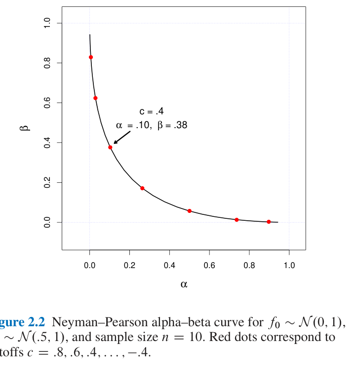
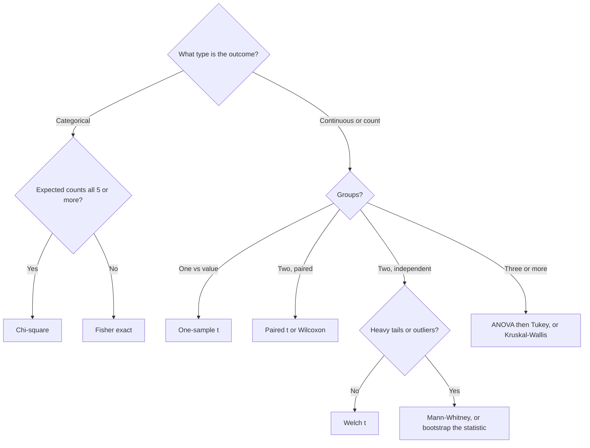
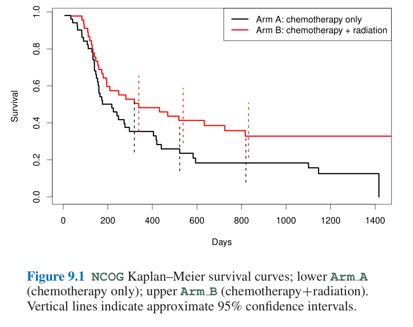
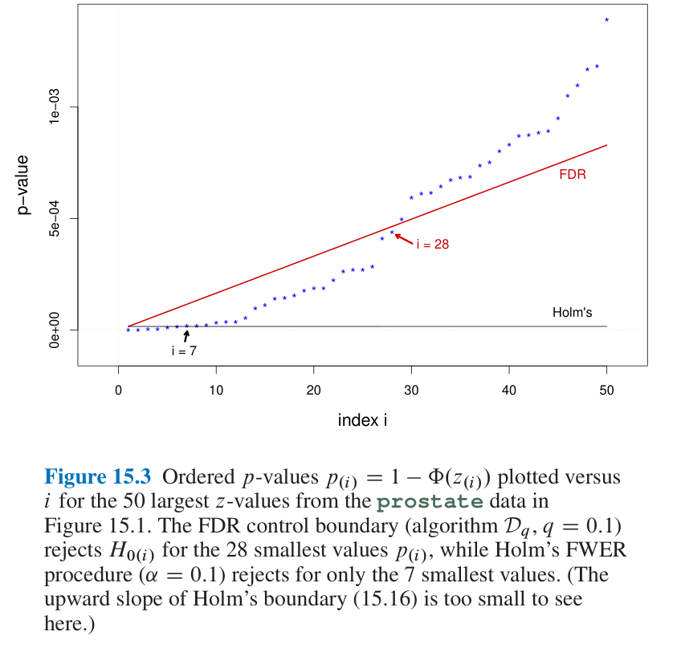
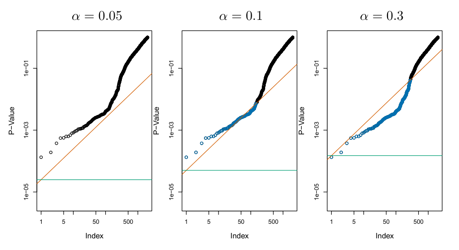
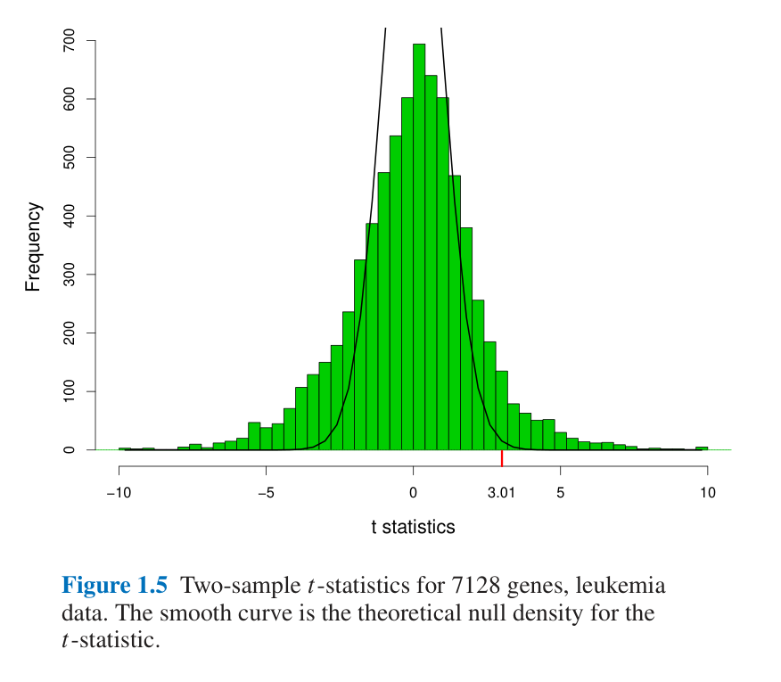
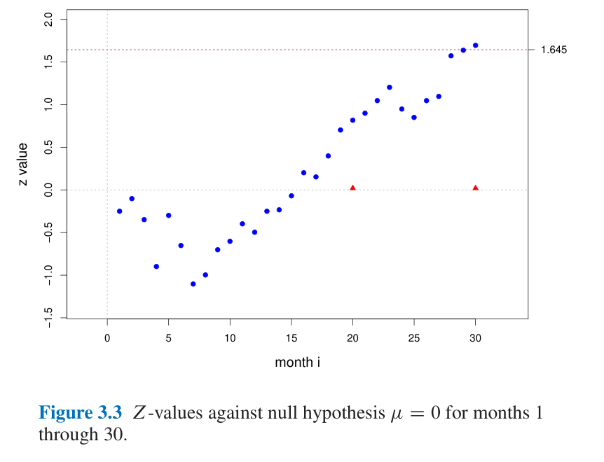

# 5 — Hypothesis Testing

Larkspur's analyst slices a flat experiment by twenty segments and reports that the new checkout works in one of them, at p = 0.04. If the change does nothing at all, that result is more likely than not to occur somewhere among the twenty. A hypothesis test is a narrow, well-built tool for one question: could this pattern plausibly be noise? This chapter covers the recipe, which test fits which data, what a p-value does and does not say, the non-parametric fallbacks, and how quickly many small questions turn into a guaranteed false discovery.

## The recipe

1. **H₀ (null):** the default. No effect, no difference, independence.
2. **H₁ (alternative):** the effect you want to detect. Decide one- or two-sided *before* looking.
3. **α:** the false-positive rate you accept, usually 0.05.
4. **Test statistic:** a number whose distribution under H₀ is known (t, χ², F, z).
5. **p-value:** the probability, *assuming H₀ is true*, of a statistic at least as extreme as the one observed.
6. **Decision:** reject H₀ if p < α. Otherwise "fail to reject", which is not "accept".

| Term | Plain meaning |
|---|---|
| Type I error (α) | false positive: you reject a true H₀ |
| Type II error (β) | false negative: you miss a real effect |
| Power (1 − β) | chance of detecting an effect of a given size; see [experimentation at scale](../../03-experimentation-and-causality/notes/03-experimentation-at-scale.md) |
| Effect size | how big the difference is, independent of N (Cohen's d, h, lift) |

Type I and Type II errors are the off-diagonal cells of the [confusion matrix](../../../data-science/01-classical-ml/notes/04-model-evaluation.md#confusion-matrix-precision-recall-f1) in data science, with the decision rule in place of a model. [Reading the errors](../../../data-science/01-classical-ml/notes/12-reading-the-errors.md#the-procedure) opens those two cells for a model and reads the rows inside them.

Larkspur's new checkout gives a first example, on order values for 400 buyers in each arm.

```python
import numpy as np
from scipy import stats

rng = np.random.default_rng(10)
a = rng.lognormal(3.6, 1.1, 400)        # order value, old checkout
b = rng.lognormal(3.68, 1.1, 400)       # order value, new checkout
t, p = stats.ttest_ind(b, a, equal_var=False)
print(f"mean a {a.mean():.2f}, mean b {b.mean():.2f}, Welch t {t:.2f}, p = {p:.3f}")
```

```text
mean a 54.19, mean b 69.50, Welch t 2.63, p = 0.009
```

### The logic, without the formula

Forget the t-distribution for a moment. If checkout truly made no difference, the labels "old" and "new" are arbitrary, so any relabelling of the orders was equally likely. Shuffle the labels thousands of times, recompute the difference, and see how often chance alone gives one as large as you observed. This is a *permutation test*, and Bruce & Bruce (2017, ch. 3) use it to teach significance testing because every assumption is on view (Think Stats, ch. 7, builds on the same resampling idea).

```python
rng = np.random.default_rng(11)
obs = b.mean() - a.mean()
pool = np.concatenate([a, b])
diffs = np.empty(10_000)
for i in range(10_000):
    rng.shuffle(pool)
    diffs[i] = pool[400:].mean() - pool[:400].mean()
print(f"observed diff {obs:.2f}, permutation p = {np.mean(np.abs(diffs) >= abs(obs)):.3f}")
```

```text
observed diff 15.32, permutation p = 0.007
```

Permutation p = 0.007 and Welch p = 0.009 agree on 400 skewed observations, because the t-test is a good approximation to this procedure. That is what every classical test is: an approximation of "how surprising is this under relabelling or under the null's distribution". When you are unsure a formula applies, you can shuffle instead. The book's price test shows how close the two routes sit on conversion data: price A converts 200 of 23,739 (0.8425%) and price B 182 of 22,588 (0.8057%); 1,000 permutations of a pooled urn of 382 ones and 45,945 zeros give a one-sided p = 0.308, and `prop.test` with a normal approximation gives 0.3498 (*Practical Statistics*, ch. 3). A nearly 5% relative lift is exactly what chance produces about a third of the time. On 36 session times it makes the same point for means: the difference of 21.4 seconds gives a permutation p of about 0.12 and a Welch p of 0.14. And under a true null, p-values are uniform, which is what α = 0.05 means:

```python
rng = np.random.default_rng(18)
pv = stats.ttest_ind(rng.normal(0, 1, (100_000, 30)), rng.normal(0, 1, (100_000, 30)), axis=1).pvalue
print("under H0, share of p in bins:", np.histogram(pv, bins=[0, .05, .25, .5, .75, 1])[0] / 100_000)
```

```text
under H0, share of p in bins: [0.05057 0.19972 0.24795 0.25152 0.25024]
```

Why resampling tests spread only after 1980 is a computing story. Efron and Hastie's map of fifteen postwar methods marks the permutation-style and bootstrap tools as computer-intensive, while Kaplan-Meier estimates "can be done by hand (and were)" and the Cox partial likelihood is "a quintessential Fisherian device" (*Computer Age*, ch. 14).

### What a p-value is not

Reinhart's *Statistics Done Wrong* lists these, and each is a common interview trap. The American Statistical Association's [2016 statement on p-values](https://doi.org/10.1080/00031305.2016.1154108) (*The American Statistician*) makes the same points formally: a p-value does not measure the probability that the hypothesis is true, nor the size or importance of an effect, and a decision should not rest on whether it crosses a line.

| Wrong reading | Why it is wrong |
|---|---|
| "p = 0.03 means a 3% chance H₀ is true" | p assumes H₀ is true; it cannot be the probability of H₀. That needs a prior ([chapter 2](02-probability-foundations.md), [Bayesian inference](../../04-bayesian-analysis/notes/01-bayesian-inference.md)). |
| "p = 0.2 means there is no effect" | the test may simply be underpowered |
| "p = 0.0001 means a big effect" | with N in the millions, trivially small effects are significant; report the effect size and CI |
| "p < 0.05 in one study, p > 0.05 in another, so they disagree" | the difference between significant and not significant is not itself significant (Reinhart, ch. 5) |

Here is the third row at scale, with five million users per arm and a lift nobody would ship on its own:

```python
n = 5_000_000
p1, p2 = 0.0470, 0.0474
se = (p1 * (1 - p1) / n + p2 * (1 - p2) / n)**0.5
z = (p2 - p1) / se
print(f"lift {p2 - p1:.4f}, z {z:.2f}, p {2 * stats.norm.sf(z):.1e}, relative lift {(p2 / p1 - 1):.1%}")
```

```text
lift 0.0004, z 2.98, p 2.9e-03, relative lift 0.9%
```

Statistically clear, and 0.9% in relative terms. Whether that is worth shipping is a business question that the p-value cannot answer.

A p-value also depends on what you would have done had the data come out differently. Nine right answers out of 12 true/false questions is p = 0.073 against guessing if the plan was "ask 12 questions" (binomial), and p = 0.033 if the plan was "ask until three are wrong" (negative binomial), on identical data (*Statistics Done Wrong*, ch. 1; both values recomputed here with scipy). So the stopping rule is part of the analysis plan. Reinhart's remedy is to report the interval, which answers the same question and shows the effect size; he reports that 97% of experimental psychology papers use significance tests while about 10% give confidence intervals, and that 89% of *Nature* articles report p values without intervals or effect sizes (ch. 1, as reported; the endnotes are not in the chapter PDF).

Comparing two intervals by eye is the same error in another form. If two drugs have the same true effect and each trial has power B, the chance that exactly one comes out significant is 2B(1 − B), which peaks at 50% when each trial has 50% power (*Statistics Done Wrong*, ch. 5, Fig. 5-1). Reinhart's example is a serum trial in which 43% improved on the serum and 22% on control, the first called significant and the second not, though the authors conceded the difference between the groups was not (as reported). Five statin meta-analyses, three "yes" and two "inconclusive", all had a relative risk of death near 0.9 (ch. 5, Fig. 5-2). And two 95% intervals can overlap while the test of their difference still gives p < 0.05: with equal standard errors the test rejects once the estimates sit more than 2.77 standard errors apart (1.96 · √2), but the intervals only stop overlapping at 3.92 (my arithmetic, for ch. 5's point). Test the difference directly.

### One worked resampling test

*Think Stats* runs this recipe on the NSFG pregnancy lengths of 4,413 first babies and 4,735 others. The observed difference in mean is δ = 0.078 weeks (about 13 hours). Pool the two groups, draw a pair of samples of those sizes 1,000 times, and 166 of the 1,000 differences were at least as large in absolute value, so p ≈ 0.166. The normal approximation, N(0, 0.0032) for the difference of means under the null, gives a two-tailed p of 0.168, which is the t-test-approximates-shuffling point made above on real data (*Think Stats*, ch. 7). The effect is not significant at α = 0.05, and Downey reports it as "a difference we cannot distinguish from chance", not as a proof of none. A chi-square test on the six cells (early at week 37 or before, on time at weeks 38 to 40, late at week 41 or after, by first baby or not) gives χ² = 91.64, about 1 chance in 10,000. That shows a difference in shape that the difference in means misses, but it used the same data that suggested the question, so the book recommends confirming on a second dataset and splitting the data when you can.

The same agreement shows up on a gene-expression comparison. For one gene in the leukemia data (47 ALL and 25 AML patients), 10,000 label permutations give p = 0.0026, against 0.0025 from Student's t on 70 degrees of freedom (*Computer Age*, ch. 4; the chapters print the t as 3.01 in ch. 1 and 3.13 in ch. 4, and p = 0.0036 for 3.01). The t test is the default for a reason: its statistic is a *pivot*, with a distribution that does not depend on the unknown variance, so the 0.05 cutoff 1.99 on 70 df gives size exactly 0.05 under normality (*Computer Age*, ch. 2). The Neyman-Pearson lemma then says which tests are worth considering at all. Only likelihood-ratio threshold rules can be optimal, and any other rule has some threshold rule with smaller errors of both kinds. For N(0,1) against N(0.5,1) with n = 10 observations, cutoff c = 0.4 gives α = 0.10 and β = 0.38 (power 0.62), and every other rule lies above the curve.



*Image Source: Efron & Hastie, *Computer Age Statistical Inference* (Cambridge University Press, 2016), Fig. 2.2. Red dots are cutoffs c = 0.8, 0.6, ..., -0.4.*

Three more points sharpen the recipe. Define the effect before you test: any specific sequence of 10 coin tosses has probability 1 in 1,024, so "a pattern this unlikely" is true of every sequence (*Think Stats*, ch. 7). The false-positive rate equals α, lowering α raises false negatives, and only more data or less measurement error lowers both. And when a test finds nothing, say what it could have found: report that if the effect were as large as x, the test would reject with probability p (its power). The book offers a Bayesian reading too: with a naive alternative fixed at the observed δ and a 0.5 prior the posterior is 0.748, a figure Downey calls overstated because the same data chose the alternative, and a cross-validated version averages 0.621.

## Choosing the test

| Question | Data | Parametric test | `scipy.stats` | Non-parametric fallback |
|---|---|---|---|---|
| Is this mean different from a known value? | one continuous sample | one-sample t | `ttest_1samp(x, mu0)` | Wilcoxon signed-rank on x − mu0 |
| Do two independent groups differ? | two continuous samples | two-sample t (Welch) | `ttest_ind(a, b, equal_var=False)` | Mann-Whitney U `mannwhitneyu(a, b)` |
| Before vs after on the same units? | paired continuous | paired t | `ttest_rel(before, after)` | Wilcoxon `wilcoxon(before, after)` |
| Do 3+ groups differ? | k continuous samples | one-way ANOVA | `f_oneway(a, b, c)` | Kruskal-Wallis `kruskal(a, b, c)` |
| Are two categorical variables independent? | contingency table | chi-square | `chi2_contingency(table)` | Fisher's exact `fisher_exact(2x2)` when any expected count < 5 |
| Do two samples come from the same distribution? | two continuous samples | none | | Kolmogorov-Smirnov `ks_2samp(a, b)` |
| Do two proportions differ? | counts and totals | two-proportion z | `statsmodels proportions_ztest` | chi-square on the 2×2, or Fisher |

Default to Welch's t (`equal_var=False`). It loses almost nothing when variances are equal and protects you when they are not. The same choice as a flowchart:



## The parametric tests in code

This block is adapted from Part 2 of the [practice notebook](../practice/5_Statistical_Analysis.ipynb).

```python
rng = np.random.default_rng(12)
sample = rng.normal(173, 8, 50)
print("one-sample t  p =", round(stats.ttest_1samp(sample, 170).pvalue, 4))
control, treatment = rng.normal(72, 10, 40), rng.normal(76, 10, 40)
print("Welch t       p =", round(stats.ttest_ind(control, treatment, equal_var=False).pvalue, 4))
before = rng.normal(70, 10, 40); after = before + rng.normal(2, 3, 40)
print("paired t      p =", round(stats.ttest_rel(before, after).pvalue, 4))
print("unpaired same p =", round(stats.ttest_ind(before, after).pvalue, 4))
observed = np.array([[30, 20], [15, 35]])
chi2, p_chi, dof, expected = stats.chi2_contingency(observed)
print(f"chi-square    p = {p_chi:.4f}, dof {dof}, expected {expected.round(1).tolist()}")
print("Fisher exact  p =", round(stats.fisher_exact(observed)[1], 4))
m1, m2, m3 = rng.normal(70, 8, 30), rng.normal(72, 8, 30), rng.normal(78, 8, 30)
print("ANOVA         p =", round(stats.f_oneway(m1, m2, m3).pvalue, 5))
```

```text
one-sample t  p = 0.0046
Welch t       p = 0.1509
paired t      p = 0.0004
unpaired same p = 0.3266
chi-square    p = 0.0049, dof 1, expected [[22.5, 27.5], [22.5, 27.5]]
Fisher exact  p = 0.0046
ANOVA         p = 0.00089
```

Three things to read off the output. The Welch test on `control` and `treatment` misses a real 4-point difference at n = 40 per group: p = 0.15, and that is low power, not absence of effect. The paired test finds a difference (p = 0.0004) on the same numbers where the unpaired test does not (p = 0.33), since each unit acts as its own control and most of the variation drops out. That is the seed of the variance-reduction idea in [CUPED](../../03-experimentation-and-causality/notes/03-experimentation-at-scale.md). And the `expected` table is what you would see under independence, so compare it with `observed`.

ANOVA's significant F says that some mean differs, not which one. The Wesleyan coursework script ([practice/courses/wesleyan_inferential_statistics.py](../practice/courses/wesleyan_inferential_statistics.py)) does this on the NESARC survey through the formula route, which is what you want when groups live in a DataFrame column: `smf.ols` for the F-test, then Tukey HSD for the pairwise follow-up. The survey file is not in the repo, so here is the same pattern on the simulated data above.

```python
import pandas as pd
import statsmodels.formula.api as smf
from statsmodels.stats.multicomp import pairwise_tukeyhsd

df = pd.DataFrame({"score": np.r_[m1, m2, m3], "method": np.repeat(list("ABC"), 30)})
fit = smf.ols("score ~ C(method)", df).fit()
print(f"F = {fit.fvalue:.2f}, p = {fit.f_pvalue:.5f}")
print(pairwise_tukeyhsd(df.score, df.method).summary())
```

```text
F = 7.63, p = 0.00089
Multiple Comparison of Means - Tukey HSD, FWER=0.05
====================================================
group1 group2 meandiff p-adj   lower   upper  reject
----------------------------------------------------
     A      B   2.0622  0.589 -2.9357  7.0601  False
     A      C   7.8918 0.0009  2.8939 12.8897   True
     B      C   5.8296  0.018  0.8317 10.8276   True
----------------------------------------------------
```

The F-test matches `f_oneway` exactly, since a one-way ANOVA is a regression on a categorical variable. [Chapter 6](06-regression-and-glms.md) makes that point its starting line. Tukey then says C differs from both A and B, and A and B cannot be separated, with the family-wise error held at 5%.

## Non-parametric tests

Use them when the data are ordinal, heavily skewed, or have outliers you cannot justify removing. They test ranks rather than raw values, so one extreme point cannot dominate.

| Test | Tests | Assumes | Cost |
|---|---|---|---|
| Mann-Whitney U | whether one group tends to have larger values than the other | independent samples, similar shapes if you want to read it as a median test | slightly less power than t on Normal data (about 95% efficiency) |
| Wilcoxon signed-rank | whether paired differences are centred on zero | symmetric differences | same |
| Kruskal-Wallis | Mann-Whitney for 3+ groups | as above | follow with Dunn's test |
| Kolmogorov-Smirnov | whether two whole distributions differ (shape, spread, location) | continuous data | low power for differences only in the tails |

```python
rng = np.random.default_rng(13)
rev_a = rng.lognormal(3.6, 1.4, 300)
rev_b = rng.lognormal(3.8, 1.4, 300)
rev_a_whale = np.append(rev_a[:-1], 60_000.0)
for name, x, y in [("as drawn", rev_a, rev_b), ("one whale in A", rev_a_whale, rev_b)]:
    print(f"{name:<15} Welch p {stats.ttest_ind(x, y, equal_var=False).pvalue:.3f}  "
          f"Mann-Whitney p {stats.mannwhitneyu(x, y).pvalue:.3f}  "
          f"KS p {stats.ks_2samp(x, y).pvalue:.3f}")
```

```text
as drawn        Welch p 0.165  Mann-Whitney p 0.125  KS p 0.293
one whale in A  Welch p 0.506  Mann-Whitney p 0.163  KS p 0.342
```

One whale of 60,000 moves the Welch p from 0.165 to 0.506, while Mann-Whitney goes from 0.125 to 0.163. Rank tests resist whales, but read what they test: whether one group tends to have larger values, which is a different hypothesis from whether total revenue differs. If you care about revenue, a rank test may be answering the wrong question. Whales are part of revenue, and a change that only moves them is real.

A bootstrap is the other general fallback: resample each group with replacement, recompute the difference, and read the 2.5th and 97.5th percentiles. It works for medians, ratios and anything else without a textbook test.

```python
rng = np.random.default_rng(14)
diffs = [np.median(rng.choice(rev_b, 300)) - np.median(rng.choice(rev_a, 300))
         for _ in range(10_000)]
print("median diff 95% CI", np.percentile(diffs, [2.5, 97.5]).round(1))
```

```text
median diff 95% CI [-7.6 16.6]
```

The interval includes zero, which fits the tests above, and it says more than they do: the median difference could plausibly lie anywhere from about −8 to +17.

Time-to-event outcomes, where some subjects have not yet had the event, need the log-rank test, which compares survival at all time points at once. In a head-and-neck cancer trial (51 patients on chemotherapy, Arm A; 45 on chemotherapy plus radiation, Arm B), the Kaplan-Meier median survival is 324 days for B and 182 for A, but the 95% bars at any single day overlap. At each of 47 monthly death times, the test takes the 2x2 table of deaths by arm among those still at risk and compares the arm's observed deaths with the hypergeometric expectation (month 6: 32 at risk in A, 33 in B, 11 deaths, expected 5.42 in A against 7 observed). Summing observed minus expected (42 observed in total against 32.9 expected) and dividing by the root of the summed variances (16.0) gives Z = 2.27, one-sided p about 0.012, moderate evidence for B (*Computer Age*, ch. 9). Censored subjects count as at risk until they drop out. The [survival chapter](../../06-applied-analyses/notes/07-survival-and-event-history.md) builds the models.



*Image Source: Efron & Hastie, *Computer Age Statistical Inference* (Cambridge University Press, 2016), Fig. 9.1. Arm A chemotherapy only; Arm B chemotherapy plus radiation.*

## Multiple comparisons

At α = 0.05, twenty independent tests of true nulls produce at least one false positive with probability 1 − 0.95²⁰ ≈ 64%. The notebook simulates this with twenty t-tests on pairs of samples from the *same* distribution, and here is the same thing repeated many times:

```python
rng = np.random.default_rng(15)
print("P(at least one false positive in 20):", round(1 - 0.95**20, 3))
reps = 2000
any_raw = any_bonf = 0
for _ in range(reps):
    x = rng.normal(0, 1, (20, 30)); y = rng.normal(0, 1, (20, 30))
    p = stats.ttest_ind(x, y, axis=1).pvalue
    any_raw += (p < 0.05).any(); any_bonf += (p < 0.05 / 20).any()
print(f"simulated: uncorrected {any_raw / reps:.3f}, Bonferroni {any_bonf / reps:.3f}")
```

```text
P(at least one false positive in 20): 0.642
simulated: uncorrected 0.619, Bonferroni 0.052
```

The vast search effect is the same arithmetic in disguise. Give 20,000 people ten coin tosses each and the chance that somebody tosses ten heads is above 99%, though it is 1 in 1,000 for any named person (*Practical Statistics*, ch. 2). Note that the book's Bonferroni sentence divides alpha by the number of observations; it means the number of tests (*Practical Statistics*, ch. 3). Reinhart gives the same arithmetic for the jelly-bean cartoon: 20 true nulls give a 64% chance of at least one hit, 45 give 90% and 100 give 99% (*Statistics Done Wrong*, ch. 4). He reports that the average 1980s medical trial made 30 therapeutic comparisons, and that 241 fMRI studies used 207 distinct combinations of methods and corrections; an uncorrected voxel test on a dead salmon gave p = 0.001 in an 81 mm³ cluster (ch. 4, as reported). His caveat on the fixes: Bonferroni costs power, and Benjamini-Hochberg controls the average false discovery rate but does not remove the base-rate problem of [chapter 2](02-probability-foundations.md#the-same-mistake-in-hypothesis-testing).

| Correction | Controls | Rule | When |
|---|---|---|---|
| Bonferroni | family-wise error rate (any false positive) | reject if p < α/m | few tests, any false positive is costly |
| Holm | family-wise error rate | step-down Bonferroni; uniformly more powerful | always prefer over plain Bonferroni |
| Benjamini-Hochberg | false discovery rate (share of rejections that are false) | sort p, reject p₍ᵢ₎ ≤ (i/m)·α | many tests (metrics dashboards, genes, feature screens) |

The Benjamini-Hochberg procedure comes from their [1995 paper](https://doi.org/10.1111/j.2517-6161.1995.tb02031.x) (*JRSS B*). Efron and Hastie build the empirical-Bayes view of it in *Computer Age Statistical Inference*, ch. 15, and their prostate study shows how far apart the rules sit. Of 6,033 genes (52 patients, 50 controls), Bonferroni at a one-sided 0.05 leaves only four. On the 50 largest z-values, Holm at α = 0.1 rejects 7 (z ≥ 4.14) and Benjamini-Hochberg at q = 0.1 rejects 28 (z ≥ 3.33) (*Computer Age*, ch. 15).



*Image Source: Efron & Hastie, *Computer Age Statistical Inference* (Cambridge University Press, 2016), Fig. 15.3. Prostate data, right tail, α = q = 0.1.*

Small cases show the difference by hand. *An Introduction to Statistical Learning* (*ISLP*, ch. 13) tests whether each of 2,000 fund managers beats the market and prints the first five p-values: 0.006, 0.918, 0.012, 0.601, 0.756. At α = 0.05 Bonferroni's cutoff is 0.05/5 = 0.01, so it rejects one manager. Holm's second cutoff is 0.05/4 = 0.0125, so 0.012 passes and it rejects two. BH's second cutoff is (2/5)·0.05 = 0.02, so it also rejects two. On all 2,000, BH at an FDR of 10% rejects 146 managers, about 15 of them false by construction, while Bonferroni at a FWER of 0.1 rejects none. Strict control costs power as m grows. With 90% of the nulls true and FWER held at 0.05, power is about 60% at m = 10 and under 20% at m = 500 (*ISLP*, ch. 13). The count of tests includes post-hoc ones: picking the most extreme pair out of 5 groups is 10 comparisons, so the threshold is 0.05/10 = 0.005. The book's pair has p = 0.0349 on a two-sample t-test and 0.038 on the paired test in its lab, and neither survives. Tukey's honest-significant-difference adjustment, which accounts for choosing the extreme pair, gives 0.186.



*Image Source: James et al., *An Introduction to Statistical Learning with Applications in Python* (Springer, 2023), Fig. 13.6. Fund data, m = 2,000; Bonferroni and BH at levels 0.05, 0.1 and 0.3.*

Benjamini-Hochberg controls the false discovery rate at π₀·q (π₀ is the share of true nulls), which is at most q, if the null p-values are independent. Rejecting by the rule is the same as rejecting when the estimated tail-area false-discovery rate of the case is at most π₀·q, and that rate reads as the posterior probability that the case is null. The 50th-largest gene (z = 2.99) has a q-value of 0.168. The *local* version, fdr, is the same probability at the gene's own z rather than for everything beyond it, so it runs higher, and the working cutoffs are Fdr ≤ 0.1 but fdr ≤ 0.2; the latter flags 27 right-tail and 25 left-tail genes, and with π₀ ≥ 0.9 it is a Bayes factor of at least 36 against the null. All of this leans on the null being right. In a study of 2,749 New York police officers' stop records, a theoretical N(0, 1) null gives 216 officers with fdr ≤ 0.2, and a null fitted to the central z-values, N(0.10, 1.40²), gives four (*Computer Age*, ch. 15). The estimated null proportion also depends on the fitting method: for the prostate genes, local-fdr software gives π₀ = 0.984 and the prior-fitting (g-modelling) approach 0.946 (*Computer Age*, ch. 21). Here are the methods on 100 tests, ten of which have a real effect:

```python
from statsmodels.stats.multitest import multipletests

rng = np.random.default_rng(16)
null_p = rng.uniform(0, 1, 90)
real_p = stats.norm.sf(rng.normal(3.0, 1, 10))
pvals = np.r_[real_p, null_p]
is_real = np.r_[np.ones(10, bool), np.zeros(90, bool)]
print("method      rejected  true  false")
print(f"raw .05     {np.sum(pvals < .05):>8} {np.sum((pvals < .05) & is_real):>5} {np.sum((pvals < .05) & ~is_real):>6}")
for m in ["bonferroni", "holm", "fdr_bh"]:
    rej = multipletests(pvals, 0.05, method=m)[0]
    print(f"{m:<11} {rej.sum():>8} {np.sum(rej & is_real):>5} {np.sum(rej & ~is_real):>6}")
```

```text
method      rejected  true  false
raw .05           11     8      3
bonferroni         5     5      0
holm               5     5      0
fdr_bh             7     7      0
```

Uncorrected, 3 of 11 discoveries are false. Bonferroni and Holm reject five real effects with no false ones, and BH finds seven with no false ones in this draw. The right choice depends on what a false positive costs. For one launch decision, control the family-wise rate. To decide which of forty metrics deserves a second look, control the false discovery rate.

### Where multiplicity hides

- **Many metrics** on one A/B test. Pick one primary metric in advance; treat the rest as exploratory ([metrics design](../../03-experimentation-and-causality/notes/02-metrics-and-kpi-design.md)).
- **Many segments** ("it worked for Android users in Germany"). Each segment is a test. Also the small-N trap from [chapter 3](03-distributions-and-sampling.md).
- **Many looks** at the same test over time. That is [peeking](../../03-experimentation-and-causality/notes/03-experimentation-at-scale.md).
- **Many genes, many columns.** A single gene in the leukemia data has two-sample t = 3.01, a two-sided p of 0.0036. Across all 7,128 genes, though, 400 others have t above 3.01 (about 5.6%), so the gene is nowhere near "significant at 0.0036". The histogram is also fatter than the theoretical null in the middle, so even the null needs checking. A false-discovery-rate analysis asks for t above 6.16, which only 47 of the 7,128 genes pass (*Computer Age*, ch. 1; the method is ch. 15).



*Image Source: Efron & Hastie, *Computer Age Statistical Inference* (Cambridge University Press, 2016), Fig. 1.5. Leukemia data, 47 ALL and 25 AML patients; the red mark is 3.01.*

- **Data dredging.** The Michigan coursework script ([practice/courses/umich_statistical_analysis.py](../practice/courses/umich_statistical_analysis.py), week 4) lists three remedies: Bonferroni, holding out data to confirm what you found, and pre-registering what you expect and why.
- **The garden of forking paths:** choices about outliers, transforms and subsets made after seeing the data. Reinhart's fix is to write the analysis plan first (*Statistics Done Wrong*, ch. 9). He reports simulations in which covariate sets, exclusions and outlier rules alone move the effect size by a factor of two, and ones where trying several analyses lifts the false-positive rate above 50% for a dataset. His demonstration is a 20-student experiment in which listeners to one Beatles song came out 1.5 years younger than listeners to another (p < 0.05, controlling for father's age, a covariate chosen after looking).
- **Repeated measures.** Ten patients measured 100 times each give 1,000 data points per arm and 10 patients; the extra rows tighten the estimate for those ten people and say nothing more about the population. Corrections for dependence usually give wider intervals and larger p-values than the naive analysis (*Statistics Done Wrong*, ch. 3). The fixes are to average within subject, use clustered standard errors or a hierarchical model ([clustered standard errors](06-regression-and-glms.md#clustered-standard-errors)), and randomise within blocks. The chapter's cautionary case is the early-1970s menstrual synchrony result: two women with 28- and 30-day cycles drift apart by two days, then four, so a chance overlap is expected, and with an average gap of seven days between period starts the 'synchrony' was an artefact of the null used (ch. 3).

## Significant results exaggerate

A low-powered test does not just miss effects. When it hits, it overstates them, because only unusually large estimates can clear the bar. Reinhart calls this truth inflation (*Statistics Done Wrong*, ch. 2), and experimenters know it as the winner's curse. Here is a true lift of 1% with a standard error of 1%.

```python
rng = np.random.default_rng(17)
true_lift, se = 0.01, 0.01
est = rng.normal(true_lift, se, 200_000)
sig = est[np.abs(est) > 1.96 * se]
print(f"power {np.mean(np.abs(est) > 1.96 * se):.2f}")
print(f"mean of all estimates {est.mean():.4f}")
print(f"mean of significant estimates {sig.mean():.4f} ({sig.mean() / true_lift:.1f}x the truth)")
print(f"share of significant results with the wrong sign {np.mean(sig < 0):.3f}")
```

```text
power 0.17
mean of all estimates 0.0100
mean of significant estimates 0.0245 (2.5x the truth)
share of significant results with the wrong sign 0.009
```

The test has 17% power, and the estimates that reach significance average 2.5 times the truth, with almost 1% of them pointing the wrong way. Anyone who ships on that result and forecasts the effect from it will be disappointed later. It is why a replication or holdback often shows a smaller effect than the launch analysis, without anything having gone wrong except selection.

The same selection effect appears in genomics. Of 6,033 gene-effect estimates, the largest is 5.29 (52 patients against 50 controls), and taking it at face value overestimates it: an empirical-Bayes prior fitted to all 6,033 gives 4.11 (*Computer Age*, ch. 3). Tweedie's formula, which corrects a z-value by the slope of the log of the fitted marginal density, shrinks the same gene to 4.03, and at z = 3.5 gives an expected effect of 1.96, with a local fdr of 0.15 (*Computer Age*, ch. 20). Bayesian answers are immune to selection only if the prior is genuine, and an uninformative one gives no protection.

Reinhart (ch. 2, all as reported) puts field numbers on the cause: the median neuroscience study has about 20% power, fewer than 3% of *Science* and *Nature* articles compute power before starting, and more than four-fifths of negative randomised trials in major medical journals (1975 to 1990) could not have detected a 25% difference. Halving heart-attack death risk from 20% to 10% at 80% power needs 400 patients, 200 per arm; 50 would feel adequate and is far too few. At the extreme, for a true 0.3% shift in a birth sex ratio, the rare significant results overstate it at least twentyfold and 40% of them point the wrong way, against 0.9% in the 17%-power run above, because power falls toward α and the sign becomes close to a coin flip. Power can also be found by simulation: generate many datasets with the expected effect and count the share that come out significant.

### Stopping early and double dipping

Testing after every pair of patients from 10 to 100 per group, with no true difference, produces a p-value path that wanders across 0.05 and lets you stop on a win (*Statistics Done Wrong*, ch. 6, Fig. 6-1); the experiment pillar puts the rate at about one in four A/A tests at 20 looks ([peeking](../../03-experimentation-and-causality/notes/03-experimentation-at-scale.md)). A monthly z-statistic makes the arithmetic concrete. Observe x ~ N(μ, 1) each month for 30 months, test μ = 0 against μ > 0, and let the investigators also be willing to stop at month 20. The final z is 1.66 against the cutoff 1.645, and the rule "reject if z at month 20 or month 30 exceeds 1.645" has type I error 0.074, not 0.05, though the data are identical. A Bayesian posterior does not change, since it depends only on the likelihood, which is the usual argument for sequential monitoring in Bayesian form (*Computer Age*, ch. 3, Fig. 3.3).



*Image Source: Efron & Hastie, *Computer Age Statistical Inference* (Cambridge University Press, 2016), Fig. 3.3. Z-values against the null mu = 0 for months 1 through 30.*

Reinhart reports that trials stopped early exaggerate effects by an average of 29% over similar trials that ran to plan, and that more than half of surveyed academic psychologists admitted deciding whether to collect more data after checking significance (ch. 6, as reported). Circularity is the other half. Choosing regions, features or cutoffs on the same data you then test inflates the effect: Reinhart reports that neuroimaging papers break the rule perhaps 40% of the time. Regression to the mean is the sibling: pick the extreme units, measure again, and they move back toward average with no treatment at all. The fixes are a stopping rule and N fixed in advance, choosing on one half of the data and testing on the other (the hold-out remedy the Michigan script lists), and randomly splitting extreme units into treatment and control.

### What the published record looks like

Reinhart's closing chapters collect the field evidence, all of it reported from endnotes that the chapter PDFs omit. Amgen could reproduce 6 of 53 landmark preclinical cancer studies; Nature papers carry typos or errors in their p-values about 38% of the time. Psychologists sent data for only 64 of 249 requested studies, and 15% of the papers had a significant result that was significant only through an error. Adding unpublished data erased the TP53 correlation found across 18 published studies, and Pfizer's unpublished reboxetine data, three times the published volume, showed the drug ineffective. In a review of clinical-trial registrations, more than 40% were filed after recruitment began (ch. 10 and 11). Two checks follow. If a literature's estimated effect implies each study had 20% power but 90% of published studies are significant, results are missing; that is how Francis tested Bem's 10-experiment paper, 9 of which were significant (ch. 11). And for any paper you rely on, ask the six questions in ch. 12: how the sample size was set, how variables were selected, whether the results support the conclusion, whether there are intervals and effect sizes, whether the tests and multiplicity corrections fit, and what the stopping rule was. In a review of the *New England Journal of Medicine* 2001 to 2010, 146 of 363 articles testing a standard practice (about 40%) concluded it should be abandoned; Schoenfeld and Ioannidis found 216 studies linking 40 of 50 cookbook ingredients to cancer, mostly disagreeing (ch. 12). On the practitioner's side, the checkable analysis is a script under version control, tested against known inputs (ch. 10).

---

## Pitfalls

- **Reading p as the probability the null is true.** It is computed assuming the null, and combining it with a base rate takes Bayes' rule.
- **Treating non-significance as proof of no effect.** Check power first. p = 0.15 on an underpowered test tells you little.
- **Confusing significance and importance.** Five million users per arm make a 0.9% lift significant. Whether it matters is a separate question.
- **Comparing p-values across groups.** "Significant for mobile, not for desktop" is not evidence the groups differ. Test the interaction.
- **Choosing the test after seeing the result.** Switching one-sided to two-sided, or trimming outliers once the p-value disappoints, voids the false-positive rate.
- **Running a rank test and reporting a revenue conclusion.** Mann-Whitney tests a tendency toward larger values. It does not test means.
- **Forecasting from a significant result at low power.** The winner's curse inflates the estimate.
- **Judging by interval overlap.** Overlapping 95% intervals can still hide p < 0.05; test the difference.
- **Choosing the stopping rule after the data.** The same 9 of 12 is p = 0.073 or 0.033 depending on the plan.
- **Unpaired analysis of paired data.** It throws away the main benefit of the design, as the p = 0.33 versus p = 0.0004 comparison showed.

---

## Try it

1. Twenty segments and one significant at p = 0.04. Apply Holm and Benjamini-Hochberg using `multipletests` with the other nineteen p-values drawn uniformly. Does it survive?
2. Rerun the `tests` Welch comparison with n = 40, 100 and 200 per arm, and record how often it detects the 4-point difference over 1,000 repeats. What n gets you to 80% power?
3. In the `nonpar` block, compute the 95% bootstrap interval for the difference in *means* with and without the whale. What happens to the interval, and which decision would change?
4. A colleague says a test reached p = 0.049 and another reached p = 0.051, so one change worked and one did not. Reply in one sentence.

<details>
<summary>Answers</summary>

1. No. Holm compares 0.04 with 0.05/20 = 0.0025 at the smallest rank. BH needs p ≤ (1/20)·0.05 = 0.0025 at rank 1 too, and later ranks only help if many p-values are small. One p-value of 0.04 among twenty is exactly what noise produces.
2. Use `np.mean([stats.ttest_ind(rng.normal(72, 10, n), rng.normal(76, 10, n), equal_var=False).pvalue < .05 for _ in range(1000)])`. Expect about 0.40 at n = 40 and about 0.80 near n = 100, matching 16σ²/δ² = 16 · 100 / 16 = 100.
3. The interval widens massively and shifts, because the whale enters some resamples and not others. It is telling you that a mean on this data rests on one person. Whether to ship should not turn on one customer: report both with and without, and look at who that customer is.
4. Those two tests barely differ in evidence, and the difference between significant and not significant is not itself significant.

</details>

---

## Interview checklist

| Prompt | Answer |
|---|---|
| Define a p-value. | The probability, assuming the null is true, of a statistic at least as extreme as the one observed. It is not the probability the null is true. |
| t-test vs z-test? | z when σ is known or N is large (proportions); t when σ is estimated from a small sample. |
| Why Welch? | It does not assume equal variances, and costs almost nothing when they are equal. |
| Chi-square vs Fisher? | Fisher when any expected cell count is below 5. |
| Data are skewed with outliers? | Mann-Whitney if you care about a tendency, or bootstrap the statistic you actually care about, such as the mean. |
| 30 metrics, 3 significant? | Expect about 1.5 by chance. Correct with Holm or BH, and replicate. |
| What is the winner's curse? | At low power, only inflated estimates cross the threshold, so significant results overstate the true effect. |
| What does a permutation test do? | Shuffles group labels to build the null distribution from your data, needing only exchangeability under the null. |

---

## Next

[Chapter 6: Regression and GLMs](06-regression-and-glms.md) shows that the t-test is a regression, and carries you through OLS, diagnostics, robust and clustered standard errors, and logistic and Poisson GLMs.
