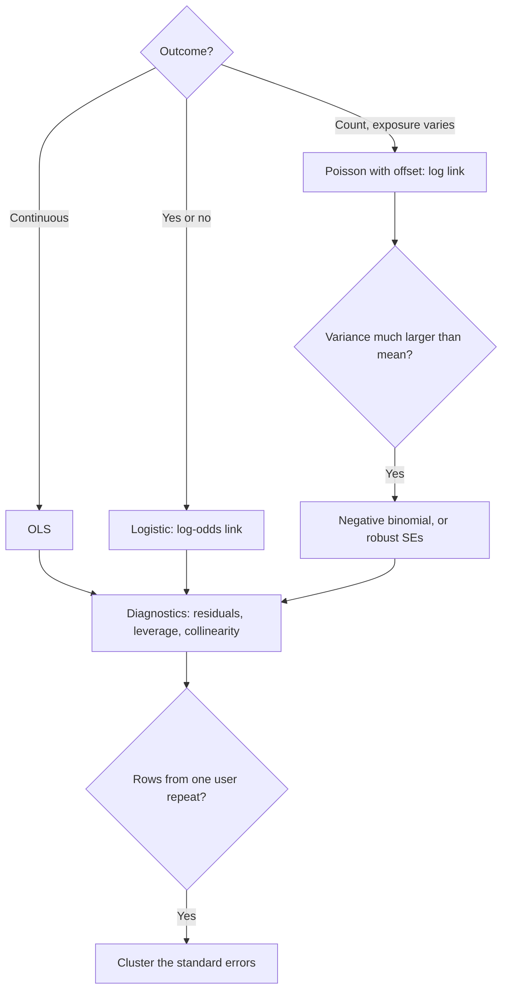

# 6 — Regression and GLMs

Larkspur's A/B test has 20,000 users and an effect that a t-test finds at p = 0.0001. Add one line to the analysis, the amount each user spent the month before, and the standard error falls by about 16% with no extra traffic. That line turns the t-test into a regression, and regression is what makes it possible. It holds other things fixed, it reports what a covariate is worth, and with a small change it handles conversions and counts as well. This chapter treats regression as the analyst uses it, an estimate with a standard error, whereas [data science](../../../data-science/README.md) treats it as a predictor. The two uses need different checks.

## Why this chapter

A t-test ([chapter 5](05-hypothesis-testing.md)) is a regression with one binary regressor. Seeing it that way lets you add covariates, and that is what [CUPED](../../03-experimentation-and-causality/notes/03-experimentation-at-scale.md) and every adjustment in [causal inference](../../03-experimentation-and-causality/notes/04-correlation-and-causation.md) do. Here is the map of the chapter, in the form of the decision you make first.



## OLS in `statsmodels`

Ordinary least squares picks the coefficients that minimise the sum of squared residuals (*An Introduction to Statistical Learning*, §3.1-3.2; Bruce & Bruce, 2017, ch. 4). Here is a Larkspur experiment: spend in the month after a new checkout was randomised, alongside pre-period spend and device. The true effect is 1.5.

```python
import numpy as np, pandas as pd
import statsmodels.formula.api as smf
import statsmodels.api as sm

rng = np.random.default_rng(42)
n = 20_000
pre = rng.gamma(2.0, 15.0, n)                    # spend in the 30 days before
new_checkout = rng.integers(0, 2, n)
device = rng.choice(["mobile", "desktop", "tablet"], n, p=[.62, .31, .07])
noise = rng.normal(0, 8 + 0.35 * pre)            # louder for heavy spenders
spend = 6 + 1.5 * new_checkout + 0.6 * pre + 3.0 * (device == "desktop") + noise
df = pd.DataFrame(dict(spend=spend, new_checkout=new_checkout, pre=pre, device=device))
print(df.head(3).round(2).to_string())
```

```text
   spend  new_checkout    pre  device
0  37.16             0  31.38  mobile
1  48.40             0  42.53  mobile
2  19.03             0  27.56  mobile
```

### The t-test is a regression

```python
from scipy import stats

m0 = smf.ols("spend ~ new_checkout", df).fit()
a, b = df.spend[df.new_checkout == 0], df.spend[df.new_checkout == 1]
t = stats.ttest_ind(b, a)
print(f"difference in means {b.mean() - a.mean():.3f}   t-test t={t.statistic:.3f} p={t.pvalue:.4f}")
print(f"OLS coefficient     {m0.params['new_checkout']:.3f}   OLS    t={m0.tvalues['new_checkout']:.3f} p={m0.pvalues['new_checkout']:.4f}")
```

```text
difference in means 1.350   t-test t=3.942 p=0.0001
OLS coefficient     1.350   OLS    t=3.942 p=0.0001
```

The coefficient on a 0/1 variable is the difference in group means, and its t-statistic is the pooled t-test's. Nothing here is a coincidence. The one-way ANOVA in chapter 5 matched `smf.ols` exactly for the same reason.

### Reading the summary

```python
m1 = smf.ols("spend ~ new_checkout + pre + C(device)", df).fit()
print(m1.summary(slim=True))
```

```text
                            OLS Regression Results
==============================================================================
Dep. Variable:                  spend   R-squared:                       0.299
Model:                            OLS   Adj. R-squared:                  0.299
No. Observations:               20000   F-statistic:                     2137.
Covariance Type:            nonrobust   Prob (F-statistic):               0.00
=======================================================================================
                          coef    std err          t      P>|t|      [0.025      0.975]
---------------------------------------------------------------------------------------
Intercept               8.5986      0.357     24.055      0.000       7.898       9.299
C(device)[T.mobile]    -2.9948      0.315     -9.519      0.000      -3.611      -2.378
C(device)[T.tablet]    -3.1347      0.602     -5.211      0.000      -4.314      -1.956
new_checkout            1.4392      0.287      5.017      0.000       0.877       2.002
pre                     0.6118      0.007     91.701      0.000       0.599       0.625
=======================================================================================

Notes:
[1] Standard Errors assume that the covariance matrix of the errors is correctly specified.
```

Read it from the left. Each `coef` is a *conditional* difference: `new_checkout` at 1.44 means, comparing users with the same pre-period spend and device, the new checkout's group spends 1.44 more. `Intercept` is the prediction when all regressors are zero: a desktop user (the baseline level of the dummy coding) with no prior spend, on the old checkout. `C(device)[T.mobile]` at −2.99 is mobile compared with desktop, and it is *not* a statement about mobile in general. `pre` at 0.61 says one extra unit of spend before goes with 0.61 more after.

`std err` is the coefficient's sampling standard deviation, and `t` is the ratio of the two. `[0.025, 0.975]` is the 95% confidence interval, which is what you should report. R² at 0.30 tells you the share of variance explained. It is low, and that is fine for inference. Whether the effect estimate is unbiased depends on the randomisation and has nothing to do with R².

### Why add pre-period covariates

```python
for name, m in [("no covariate", m0), ("with pre-period", m1)]:
    print(f"{name:<16} effect {m.params['new_checkout']:.3f}  SE {m.bse['new_checkout']:.3f}  R2 {m.rsquared:.3f}")
print(f"variance removed: {1 - (m1.bse['new_checkout'] / m0.bse['new_checkout'])**2:.0%}")
```

```text
no covariate     effect 1.350  SE 0.343  R2 0.001
with pre-period  effect 1.439  SE 0.287  R2 0.299
variance removed: 30%
```

Randomisation guarantees the effect estimate is unbiased either way. What the covariate buys is precision: pre-period spend explains 30% of the outcome variance, so that share of the noise vanishes from the error term, and the standard error falls from 0.343 to 0.287. The relation is direct: variance removed is about the R² gained. That equals running the experiment with about 30% fewer users for the same precision, and it is exactly what [CUPED](../../03-experimentation-and-causality/notes/03-experimentation-at-scale.md) does. Only adjust for variables measured *before* assignment. A post-treatment covariate can absorb the treatment effect, or manufacture one.

### Conditional differences only help if you measured the cause

Outside randomised data, the coefficient is causal only if you have adjusted for what matters.

```python
rng2 = np.random.default_rng(1)
loyal = rng2.normal(0, 1, n)
email = (loyal + rng2.normal(0, 1, n) > 0).astype(int)     # loyal users open the email
y = 10 + 0.0 * email + 5 * loyal + rng2.normal(0, 3, n)
d2 = pd.DataFrame(dict(y=y, email=email, loyal=loyal))
print(f"y ~ email          coef {smf.ols('y ~ email', d2).fit().params['email']:.2f}")
print(f"y ~ email + loyal  coef {smf.ols('y ~ email + loyal', d2).fit().params['email']:.2f}   (truth 0)")
```

```text
y ~ email          coef 5.69
y ~ email + loyal  coef 0.08   (truth 0)
```

Here the email has no effect, but loyal users are the ones who open it, so a regression without loyalty finds 5.69. Add loyalty and the coefficient falls to about zero. In observational work you rarely have the `loyal` column. [Correlation and causation](../../03-experimentation-and-causality/notes/04-correlation-and-causation.md) picks up from here.

### Interactions

Interactions ask if an effect differs across groups. `new_checkout * C(device)` fits a separate effect per device.

```python
m2 = smf.ols("spend ~ new_checkout * C(device) + pre", df).fit()
print(m2.params.filter(like="new_checkout").round(3).to_string())
print(f"joint p for the interactions: {m2.f_test('new_checkout:C(device)[T.mobile] = 0, new_checkout:C(device)[T.tablet] = 0').pvalue:.3f}")
```

```text
new_checkout                        0.873
new_checkout:C(device)[T.mobile]    0.793
new_checkout:C(device)[T.tablet]    1.108
joint p for the interactions: 0.396
```

The effect on desktop (the baseline) is 0.87, on mobile 0.87 + 0.79 and on tablet 0.87 + 1.11. They look different, yet the joint test gives p = 0.40, so the data do not distinguish them. Test the interaction, as opposed to noticing that one segment is significant and another is not. Interaction estimates also have larger standard errors than main effects, so experiments rarely have the power to detect them.

## Diagnostics

Regression's assumptions, in the order they usually matter for an analyst: the sample represents what you claim; errors are independent; the relationship is additive and linear in what you modelled; error variance is constant; errors are Normal (rarely important with large n). ISLP §3.3.3 lists the practical problems as non-linearity, correlated errors, non-constant variance, outliers, high-leverage points and collinearity. The next few sections work through the ones that bite.

### Residuals and heteroskedasticity

A residual plot shows residuals against fitted values. You want a shapeless band. A funnel means the noise grows with the prediction, which is *heteroskedasticity*, and it is the rule for money. Spend residuals in Larkspur's data get louder as predicted spend increases.

```text
residual
   ^                      :
   |                  : . : .
   |            . : . : . : :
   |  . . : . : : : : : : : :     funnel: spread grows with fitted value
   |            ' : ' : ' : :
   |                  : ' : '
   |                      :
   +-----------------------------> fitted
```

```python
resid, fitted = m1.resid, m1.fittedvalues
q = pd.qcut(fitted, 5, labels=False)
print("residual sd by fitted quintile:", resid.groupby(q).std().round(1).tolist())
bp = sm.stats.diagnostic.het_breuschpagan(resid, m1.model.exog)
print(f"Breusch-Pagan p = {bp[1]:.1e}")
```

```text
residual sd by fitted quintile: [11.0, 13.9, 16.8, 21.1, 31.8]
Breusch-Pagan p = 0.0e+00
```

The p-value underflows to zero because n is large and the funnel is plain. The sd by quintile, 11 rising to 32, is the more useful reading. The coefficients are still unbiased under heteroskedasticity. It is the standard errors that go wrong, since the textbook formula assumes one variance for everyone.

### Robust standard errors

Robust (Huber-White, or HC) standard errors estimate the variance without that assumption. In `statsmodels` you ask for `cov_type="HC3"`.

```python
hc = smf.ols("spend ~ new_checkout + pre + C(device)", df).fit(cov_type="HC3")
print(f"pre coefficient {m1.params['pre']:.3f}  classical SE {m1.bse['pre']:.4f}  HC3 SE {hc.bse['pre']:.4f}")
print(f"new_checkout    {m1.params['new_checkout']:.3f}  classical SE {m1.bse['new_checkout']:.4f}  HC3 SE {hc.bse['new_checkout']:.4f}")
```

```text
pre coefficient 0.612  classical SE 0.0067  HC3 SE 0.0112
new_checkout    1.439  classical SE 0.2869  HC3 SE 0.2871
```

The coefficient does not change at all, and that is the point: only the uncertainty does. For `pre`, whose values line up with the noise, the classical SE is 40% too small. For the randomised `new_checkout`, which is unrelated to who is noisy, the two agree. Robust SEs cost little, so with large samples and skewed outcomes, report them by default.

### Leverage and influence

A point matters when it is both far out in x (high *leverage*) and off the line (large residual). Cook's distance combines the two into an estimate of how much the fit changes if the point is removed.

```python
rng3 = np.random.default_rng(2)
x = rng3.normal(0, 1, 200); y3 = 2 * x + rng3.normal(0, 1, 200)
x_bad, y_bad = np.r_[x, 15.0], np.r_[y3, -30.0]
fit_good = sm.OLS(y3, sm.add_constant(x)).fit()
fit_bad = sm.OLS(y_bad, sm.add_constant(x_bad)).fit()
infl = fit_bad.get_influence()
print(f"slope without point {fit_good.params[1]:.2f}, with one high-leverage point {fit_bad.params[1]:.2f}")
print(f"leverage of that point {infl.hat_matrix_diag[-1]:.2f} (average {2 / 201:.3f}), "
      f"Cook's D {infl.cooks_distance[0][-1]:.1f}")
```

```text
slope without point 2.02, with one high-leverage point -0.18
leverage of that point 0.55 (average 0.010), Cook's D 107.0
```

One row of 201 changed a slope of 2.02 to −0.18. It has 55 times the average leverage. Always look at the top few rows by Cook's distance, and go back to the question from chapter 1: what is this row? Then decide.

### Multicollinearity

When predictors move together, the model cannot tell them apart.

```python
from statsmodels.stats.outliers_influence import variance_inflation_factor as vif

rng4 = np.random.default_rng(3)
x1 = rng4.normal(0, 1, 500)
x2 = x1 + rng4.normal(0, 0.05, 500)
y4 = 1 + x1 + x2 + rng4.normal(0, 1, 500)
X = sm.add_constant(np.c_[x1, x2])
fit = sm.OLS(y4, X).fit()
solo = sm.OLS(y4, sm.add_constant(x1)).fit()
print(f"VIF {vif(X, 1):.0f}")
print(f"both in: coefs {fit.params[1:].round(2)}, SEs {fit.bse[1:].round(2)}")
print(f"x1 alone: coef {solo.params[1]:.2f}, SE {solo.bse[1]:.3f}")
print(f"prediction RMSE both {np.sqrt(fit.mse_resid):.3f}, x1 alone {np.sqrt(solo.mse_resid):.3f}")
```

```text
VIF 391
both in: coefs [1.51 0.54], SEs [0.81 0.82]
x1 alone: coef 2.05, SE 0.041
prediction RMSE both 0.920, x1 alone 0.920
```

The variance inflation factor (VIF) is how much a coefficient's variance is inflated by correlation with the other predictors. The two coefficients sum to the right total but their split is arbitrary: their standard errors are 20 times larger than the solo fit's. The predictions, however, are just as good. So collinearity is a problem for *explanation* and mostly not for prediction. It biases nothing, but it inflates the SEs. Drop or combine predictors if you need to interpret them. For a randomised treatment, collinearity with covariates is not a concern, because assignment is independent of them by construction.

### Clustered standard errors

Rows from the same user are correlated, as you saw in [chapter 2](02-probability-foundations.md). ISLP §3.3.3 gives the extreme version: double your data by duplicating every row and the intervals narrow by √2, despite no new information. In this example, treatment is assigned per user, with 6 sessions each, and the true effect is zero.

```python
rng5 = np.random.default_rng(4)
users = 800
per_user = 6
uid = np.repeat(np.arange(users), per_user)
treat_u = rng5.integers(0, 2, users)
y5 = 1.0 + 0.0 * treat_u[uid] + rng5.normal(0, 1, users)[uid] + rng5.normal(0, 1, users * per_user)
d5 = pd.DataFrame(dict(y=y5, treat=treat_u[uid], uid=uid))
naive = smf.ols("y ~ treat", d5).fit()
clus = smf.ols("y ~ treat", d5).fit(cov_type="cluster", cov_kwds={"groups": d5.uid})
print(f"coef {naive.params['treat']:.3f}, naive SE {naive.bse['treat']:.4f}, clustered SE {clus.bse['treat']:.4f}")
```

```text
coef 0.033, naive SE 0.0411, clustered SE 0.0781
```

```python
def fp(reps=400):
    r = np.random.default_rng(5); naive = clustered = 0
    for _ in range(reps):
        tu = r.integers(0, 2, users)
        yy = r.normal(0, 1, users)[uid] + r.normal(0, 1, users * per_user)
        d = pd.DataFrame(dict(y=yy, treat=tu[uid], uid=uid))
        f = sm.OLS(d.y, sm.add_constant(d.treat)).fit()
        naive += f.pvalues["treat"] < .05
        clustered += f.get_robustcov_results("cluster", groups=d.uid).pvalues[1] < .05
    return naive / reps, clustered / reps

print("false positive rate at nominal .05 (naive, clustered): %.3f, %.3f" % fp())
```

```text
false positive rate at nominal .05 (naive, clustered): 0.278, 0.035
```

The naive analysis calls a null experiment significant more than a quarter of the time at a nominal 5%. Clustering on the user brings it back to about the nominal rate. Reinhart's pseudoreplication chapter is this exact problem (*Statistics Done Wrong*, ch. 3). The rule: cluster at the level of randomisation. An experiment randomised by user and analysed by session must cluster on user. Randomised by city, cluster on city, and note that with few cities even this is not enough.

## Logistic regression

For a yes/no outcome, a straight line can predict probabilities outside 0 and 1. Logistic regression models the log-odds as linear, then squashes the prediction with the logistic function (ISLP §4.3; Bruce & Bruce, 2017, ch. 5). It is fitted by the [maximum likelihood of chapter 4](04-estimation.md).

```text
log( p / (1 - p) ) = b0 + b1 x1 + b2 x2 + ...
p = 1 / (1 + exp(-(b0 + b1 x1 + b2 x2 + ...)))
```

```python
rng6 = np.random.default_rng(6)
n6 = 20_000
d6 = pd.DataFrame(dict(desktop=rng6.integers(0, 2, n6), sessions=1 + rng6.poisson(1.4, n6)))
d6["new_checkout"] = rng6.integers(0, 2, n6)
eta = -3.6 + 0.7 * d6.desktop + 0.25 * d6.sessions + 0.15 * d6.new_checkout
d6["buy"] = (rng6.random(n6) < 1 / (1 + np.exp(-eta))).astype(int)
lg = smf.logit("buy ~ new_checkout + desktop + sessions", d6).fit(disp=0)
print(lg.summary().tables[1])
print("odds ratios:", np.exp(lg.params).round(3).to_dict())
```

```text
================================================================================
                   coef    std err          z      P>|z|      [0.025      0.975]
--------------------------------------------------------------------------------
Intercept       -3.5541      0.078    -45.594      0.000      -3.707      -3.401
new_checkout     0.1244      0.054      2.309      0.021       0.019       0.230
desktop          0.6999      0.056     12.475      0.000       0.590       0.810
sessions         0.2327      0.021     11.141      0.000       0.192       0.274
================================================================================
odds ratios: {'Intercept': 0.029, 'new_checkout': 1.132, 'desktop': 2.013, 'sessions': 1.262}
```

### Reading the coefficients

Coefficients are on the log-odds scale, so nobody but a statistician can read them directly. Exponentiating gives the *odds ratio*. The 0.1244 on `new_checkout` means odds of buying 1.13 times higher, holding device and sessions fixed. Stakeholders want percentage points, and the *average marginal effect* gives them: predict everyone under both conditions and average the difference.

```python
print(lg.get_margeff().summary_frame().iloc[:, :2].round(4).to_string())
base = d6.assign(new_checkout=0); treat = d6.assign(new_checkout=1)
print(f"average lift by prediction: {(lg.predict(treat) - lg.predict(base)).mean():.4f}")
print(f"conversion rate overall: {d6.buy.mean():.4f}")
```

```text
               dy/dx  Std. Err.
new_checkout  0.0086     0.0037
desktop       0.0483     0.0040
sessions      0.0161     0.0015
average lift by prediction: 0.0086
conversion rate overall: 0.0759
```

So: about 0.86 percentage points on a baseline near 7.6%. Odds ratios do not translate into a single change in probability, because the same coefficient moves probability by different amounts depending on where you start:

```python
for p in [0.02, 0.2, 0.5, 0.8]:
    o = p / (1 - p) * np.exp(0.4)
    print(f"baseline {p:.2f}: coef 0.4 moves it to {o / (1 + o):.3f} (+{o / (1 + o) - p:.3f})")
```

```text
baseline 0.02: coef 0.4 moves it to 0.030 (+0.010)
baseline 0.20: coef 0.4 moves it to 0.272 (+0.072)
baseline 0.50: coef 0.4 moves it to 0.599 (+0.099)
baseline 0.80: coef 0.4 moves it to 0.856 (+0.056)
```

A coefficient of 0.4 multiplies the odds by e^0.4 = 1.49 at every baseline, but adds one percentage point at a 2% base and ten at a 50% base. "Divide by 4" is the rule of thumb for the maximum effect (0.4/4 = 0.10, reached at p = 0.5). When p is small, the odds ratio approximates the relative risk, and the two drift apart as p grows.

### Separation

If a predictor perfectly splits the outcome, the likelihood keeps improving as its coefficient grows, so the MLE does not exist and the fit diverges. Here every user with x = 1 bought.

```python
sep = pd.DataFrame(dict(x=[0]*30 + [1]*30, y=[0]*22 + [1]*8 + [1]*30))
try:
    r = sm.Logit(sep.y, sm.add_constant(sep.x)).fit(disp=0, maxiter=200)
    print("coef", r.params.round(2).to_dict(), "SE", r.bse.round(1).to_dict())
except Exception as e:
    print(type(e).__name__, str(e)[:60])
rr = sm.Logit(sep.y, sm.add_constant(sep.x)).fit_regularized(alpha=0.5, L1_wt=0, disp=0)
print("ridge-penalised coef", rr.params.round(2).to_dict())
```

```text
coef {'const': -1.01, 'x': 28.52} SE {'const': 0.4, 'x': 171432.8}
ridge-penalised coef {'const': -0.85, 'x': 4.92}
```

The tell is an enormous coefficient with an absurd standard error: 28.52 with SE 171,433. `statsmodels` emits a convergence warning, but some software will return this without complaint. Regularisation fixes it by penalising extreme coefficients. Gelman, Jakulin, Pittau and Su make the Bayesian form of the argument in [A weakly informative default prior distribution for logistic and other regression models](https://arxiv.org/abs/0901.4011) (*Annals of Applied Statistics*, 2008): a change of one typical input is unlikely to shift the logit by more than about 5, so an independent Cauchy prior with scale 2.5 on standardised inputs gives stable answers even under separation. [Priors and bandits](../../04-bayesian-analysis/notes/03-priors-and-bandits.md) picks this up, and it reads the ridge penalty as a prior.

## Poisson and other GLMs

OLS, logistic and Poisson are one family. A *generalised linear model* has a linear predictor, a distribution for the outcome and a *link* function connecting them (ISLP §4.6; Efron & Hastie, ch. 8).

| Model | Outcome | Distribution | Link | Coefficient reads as |
|---|---|---|---|---|
| Linear | continuous | Normal | identity | difference in mean |
| Logistic | yes/no | Binomial | logit | log odds ratio |
| Poisson | count | Poisson | log | log rate ratio |
| Negative binomial | overdispersed count | Negative binomial | log | log rate ratio |

### Rates need an offset

Orders per user depend on how long the user has been observed. A log-link model with log(exposure) as an *offset*, a term with its coefficient fixed at 1, makes the model about the rate per day.

```python
rng7 = np.random.default_rng(7)
n7 = 5_000
d7 = pd.DataFrame(dict(days=rng7.integers(1, 31, n7), new_app=rng7.integers(0, 2, n7)))
rate = 0.2 * np.exp(0.10 * d7.new_app)
d7["orders"] = rng7.poisson(rate * d7.days)
po = smf.glm("orders ~ new_app", d7, family=sm.families.Poisson(),
             offset=np.log(d7.days)).fit()
print(f"rate ratio {np.exp(po.params['new_app']):.3f} (truth {np.exp(.1):.3f}), "
      f"SE {po.bse['new_app']:.4f}, dispersion {po.pearson_chi2 / po.df_resid:.2f}")
```

```text
rate ratio 1.092 (truth 1.105), SE 0.0155, dispersion 1.00
```

Exponentiating the coefficient gives a rate ratio: the new app multiplies the order rate by 1.09, against a true 1.105. The dispersion, Pearson χ² over the residual degrees of freedom, is 1.00 here, because the data really are Poisson.

### Overdispersion

Poisson forces the variance to equal the mean. Real counts rarely comply, since a few users order all the time and most hardly ever. When variance exceeds the mean, the standard errors from a Poisson fit are too small, and the Z-values too large (ISLP §4.6). Here is the same experiment with users who vary.

```python
lam = rate * d7.days * rng7.gamma(0.5, 2.0, n7)    # mean-1 gamma frailty
d7["orders_od"] = rng7.poisson(lam)
po2 = smf.glm("orders_od ~ new_app", d7, family=sm.families.Poisson(), offset=np.log(d7.days)).fit()
nb = smf.glm("orders_od ~ new_app", d7, family=sm.families.NegativeBinomial(alpha=2.0), offset=np.log(d7.days)).fit()
rob = smf.glm("orders_od ~ new_app", d7, family=sm.families.Poisson(), offset=np.log(d7.days)).fit(cov_type="HC1")
print(f"dispersion {po2.pearson_chi2 / po2.df_resid:.1f}")
print(f"Poisson coef {po2.params['new_app']:.3f}, SE {po2.bse['new_app']:.4f}")
print(f"Poisson with robust SE {rob.bse['new_app']:.4f}")
print(f"NegBin  coef {nb.params['new_app']:.3f}, SE {nb.bse['new_app']:.4f}")
```

```text
dispersion 8.3
Poisson coef 0.067, SE 0.0155
Poisson with robust SE 0.0509
NegBin  coef 0.079, SE 0.0444
```

With dispersion 8.3, the Poisson SE (0.0155) understates the uncertainty by more than a factor of 3 against the robust SE (0.0509), and a test using it would call this effect highly significant when the robust test does not. Two fixes are close to each other: keep Poisson but use robust SEs, which is valid for the mean model, or fit a negative binomial, which models the extra variance directly. Check dispersion each time you fit a Poisson.

## Prediction vs explanation

This chapter judged every model by its coefficients and their standard errors. [Data science](../../../data-science/01-classical-ml/README.md) judges models by error on data they have not seen, and that can lead to opposite conclusions.

```python
idx = np.arange(n) < n // 2
tr, te = df[idx], df[~idx]
for f in ["spend ~ new_checkout", "spend ~ pre + C(device)"]:
    fit = smf.ols(f, tr).fit()
    print(f"{f:<26} held-out RMSE {np.sqrt(((te.spend - fit.predict(te))**2).mean()):.2f}")
```

```text
spend ~ new_checkout       held-out RMSE 24.17
spend ~ pre + C(device)    held-out RMSE 20.16
```

The first model is the *right* one for the question "did the checkout work?", and it predicts poorly. The second has no checkout term and predicts better. A model with low R² can estimate an effect precisely, and a model with excellent held-out error can have uninterpretable coefficients, as in the collinearity example. Decide which question you are answering, and judge by the matching test.

---

## Pitfalls

- **Reading a coefficient as causal.** It is a conditional association unless randomisation or a defensible design says otherwise. The email example made 5.69 out of nothing.
- **Adjusting for post-treatment variables.** They can absorb the effect or create a false one. Use variables measured before assignment.
- **Using the wrong unit of analysis.** Sessions within users without clustering gave a 28% false-positive rate at a nominal 5%.
- **Quoting odds ratios as probabilities.** An odds ratio of 1.49 is one percentage point or ten, depending on the base. Report marginal effects.
- **Ignoring a giant coefficient with a giant SE.** That is separation. It is not a strong effect you can report.
- **Fitting Poisson and not checking dispersion.** The standard errors can be wrong by a factor of 3.
- **Judging an explanatory model by R².** A low R² does not bias a randomised effect. Equally, a high R² does not make a coefficient causal.
- **Dropping a collinear predictor without thinking.** Doing so can change what the remaining coefficient means, because it now absorbs part of what you removed.

---

## Try it

1. In the `gen` data, regress `spend` on `new_checkout` with `C(device)` only. How much does the standard error shrink, compared with using `pre`? Why the difference?
2. Refit the `logit` model with `device` interacted with `new_checkout`. Report the average marginal effect of `new_checkout` for desktop and non-desktop users separately.
3. In the `cluster_fp` block, set `per_user = 20`, and predict what happens to the two false-positive rates before you run it.
4. Remove `offset` from the `poisson` model, then make users in the `new_app` arm observed longer: `d7["days"] = d7.days + 10 * d7.new_app`. What does the coefficient do? Generate `orders` again first so the rate stays honest.

<details>
<summary>Answers</summary>

1. `smf.ols("spend ~ new_checkout + C(device)", df).fit().bse["new_checkout"]` is about 0.342, barely below the unadjusted 0.343, against 0.287 with `pre`. Device explains about 0.5% of the outcome variance, so adjusting for it removes almost nothing. A covariate helps only in proportion to what it explains.
2. Use `smf.logit("buy ~ new_checkout * desktop + sessions", d6).fit(disp=0)`, then compare `predict` under `new_checkout=1` and `0` within each of `d6[d6.desktop == 1]` and `d6[d6.desktop == 0]`. Desktop users show a larger percentage-point lift even with an equal log-odds effect because their base rate is higher.
3. The naive rate climbs, to about 0.54 in a 200-repeat run, because the formula sees 16,000 rows with only 800 independent users. The clustered rate stays near the nominal level, about 0.055 in the same run. More rows per user make the naive analysis more wrong.
4. Without the offset the rate ratio is about 1.82, against a true 1.105, because the longer-observed arm has more time to order. With `offset=np.log(d7.days)` it returns to about 1.12. Without an offset you are measuring exposure as well as behaviour.

</details>

---

## Interview checklist

| Prompt | Answer |
|---|---|
| Interpret a logistic coefficient of 0.4. | Odds multiply by e^0.4 = 1.49, holding other variables fixed. The probability change depends on the base: about 1 point at 2%, 10 points at 50%. |
| Why add pre-period covariates to an A/B regression? | They do not change the expected effect under randomisation. They explain outcome variance, so the standard error shrinks and power rises. |
| When do you need robust or clustered SEs? | Robust when variance is non-constant, typical of money. Clustered when rows repeat within a unit or the randomisation unit is coarser than the row. |
| Show that a t-test is a regression. | Regress the outcome on a 0/1 group. The coefficient is the difference in means, and its t matches the pooled t-test. |
| What does multicollinearity do? | Inflates coefficient SEs and makes individual coefficients unstable. It does not bias them and rarely hurts prediction. |
| What is a link function? | It connects the mean of the outcome to the linear predictor: identity for linear, logit for logistic, log for Poisson. |
| Your logistic coefficient is 28 with SE in the thousands. What now? | Separation. Check for a predictor that splits the outcome perfectly, then regularise or use a weakly informative prior. |
| What is overdispersion? | Count variance above the mean. A Poisson fit then has SEs too small, so use robust SEs or a negative binomial. |

---

## Next

That closes the pillar. [Pillar 03 starts with A/B testing](../../03-experimentation-and-causality/notes/01-ab-testing.md), where hypothesis testing meets product experiments: power, sample size, the two-proportion z-test and peeking.
