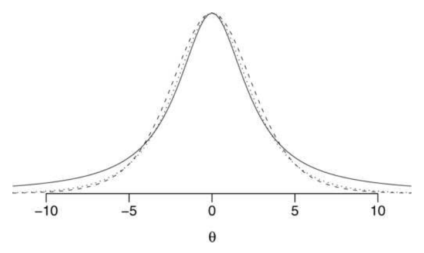
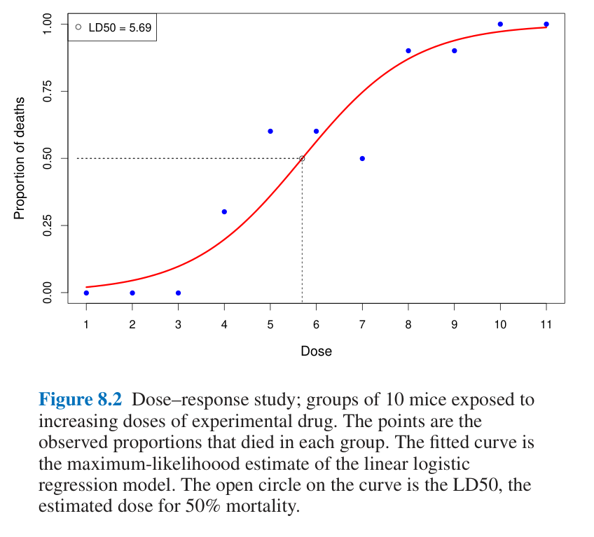

# 6b — Logistic regression and Poisson GLMs

[Chapter 6](06-regression-and-glms.md) fitted a line and checked it. Larkspur's outcomes are mostly not continuous: a user buys or does not, and orders arrive as counts over windows of different length. This half covers the same linear predictor with a different outcome distribution and link: logistic regression, the Poisson family with its offset, deviance, overdispersion and ordered ratings.

> The second half of regression and GLMs. [06](06-regression-and-glms.md) covered OLS, diagnostics, clustered errors, variable choice, and prediction against explanation. The blocks here are self-contained apart from these imports.

```python
import numpy as np, pandas as pd
import statsmodels.formula.api as smf
import statsmodels.api as sm
from scipy import stats
```

---

## Logistic regression

For a yes/no outcome, a straight line can predict probabilities outside 0 and 1. Logistic regression models the log-odds as linear, then squashes the prediction with the logistic function (ISLP §4.3; Bruce & Bruce, 2017, ch. 5). It is fitted by the [maximum likelihood of chapter 4](04-estimation.md). The log-odds here is the quantity machine-learning texts call the "logit" in the binary case: the raw score before the sigmoid squashes it into a probability, as in [softmax and temperature for language models](../../../generative-ai/01-llm-fundamentals/notes/04-decoding-and-inference-behaviour.md#decoding).

```text
log( p / (1 - p) ) = b0 + b1 x1 + b2 x2 + ...
p = 1 / (1 + exp(-(b0 + b1 x1 + b2 x2 + ...)))
```

```python
rng6 = np.random.default_rng(6)
n6 = 20_000
d6 = pd.DataFrame(dict(desktop=rng6.integers(0, 2, n6), sessions=1 + rng6.poisson(1.4, n6)))
d6["new_checkout"] = rng6.integers(0, 2, n6)
eta = -3.6 + 0.7 * d6.desktop + 0.25 * d6.sessions + 0.15 * d6.new_checkout
d6["buy"] = (rng6.random(n6) < 1 / (1 + np.exp(-eta))).astype(int)
lg = smf.logit("buy ~ new_checkout + desktop + sessions", d6).fit(disp=0)
print(lg.summary().tables[1])
print("odds ratios:", np.exp(lg.params).round(3).to_dict())
```

```text
================================================================================
                   coef    std err          z      P>|z|      [0.025      0.975]
--------------------------------------------------------------------------------
Intercept       -3.5541      0.078    -45.594      0.000      -3.707      -3.401
new_checkout     0.1244      0.054      2.309      0.021       0.019       0.230
desktop          0.6999      0.056     12.475      0.000       0.590       0.810
sessions         0.2327      0.021     11.141      0.000       0.192       0.274
================================================================================
odds ratios: {'Intercept': 0.029, 'new_checkout': 1.132, 'desktop': 2.013, 'sessions': 1.262}
```

### Reading the coefficients

Coefficients are on the log-odds scale, so nobody but a statistician can read them directly. Exponentiating gives the *odds ratio*. The 0.1244 on `new_checkout` means odds of buying 1.13 times higher, holding device and sessions fixed. Stakeholders want percentage points, and the *average marginal effect* gives them: predict everyone under both conditions and average the difference.

```python
print(lg.get_margeff().summary_frame().iloc[:, :2].round(4).to_string())
base = d6.assign(new_checkout=0); treat = d6.assign(new_checkout=1)
print(f"average lift by prediction: {(lg.predict(treat) - lg.predict(base)).mean():.4f}")
print(f"conversion rate overall: {d6.buy.mean():.4f}")
```

```text
               dy/dx  Std. Err.
new_checkout  0.0086     0.0037
desktop       0.0483     0.0040
sessions      0.0161     0.0015
average lift by prediction: 0.0086
conversion rate overall: 0.0759
```

So: about 0.86 percentage points on a baseline near 7.6%. Odds ratios do not translate into a single change in probability, because the same coefficient moves probability by different amounts depending on where you start:

```python
for p in [0.02, 0.2, 0.5, 0.8]:
    o = p / (1 - p) * np.exp(0.4)
    print(f"baseline {p:.2f}: coef 0.4 moves it to {o / (1 + o):.3f} (+{o / (1 + o) - p:.3f})")
```

```text
baseline 0.02: coef 0.4 moves it to 0.030 (+0.010)
baseline 0.20: coef 0.4 moves it to 0.272 (+0.072)
baseline 0.50: coef 0.4 moves it to 0.599 (+0.099)
baseline 0.80: coef 0.4 moves it to 0.856 (+0.056)
```

A coefficient of 0.4 multiplies the odds by e^0.4 = 1.49 at every baseline, but adds one percentage point at a 2% base and ten at a 50% base. "Divide by 4" is the rule of thumb for the maximum effect (0.4/4 = 0.10, reached at p = 0.5). When p is small, the odds ratio approximates the relative risk, and the two drift apart as p grows.

### Rare outcomes

With 5% defaults, a logistic model fitted to the raw data predicts a default for only 0.39% of loans, less than a twelfth of the expected share, because rarely crossing 0.5 is what minimises error. Weighting each default by 1/p (about 20) lifts the mean predicted default to 43%, and the same effect comes from undersampling the non-defaults. The weighted model is not better calibrated, so predicted probabilities must be rescaled before they are quoted as risk. Do not judge such a model on accuracy: always predicting "no purchase" at a 0.1% purchase rate is 99.9% accurate. Use ROC and AUC (the book's loan model has AUC about 0.59, a weak ranker) or lift (*Practical Statistics*, ch. 5).

### Separation

If a predictor perfectly splits the outcome, the likelihood keeps improving as its coefficient grows, so the MLE does not exist and the fit diverges. Here every user with x = 1 bought.

```python
sep = pd.DataFrame(dict(x=[0]*30 + [1]*30, y=[0]*22 + [1]*8 + [1]*30))
try:
    r = sm.Logit(sep.y, sm.add_constant(sep.x)).fit(disp=0, maxiter=200)
    print("coef", r.params.round(2).to_dict(), "SE", r.bse.round(1).to_dict())
except Exception as e:
    print(type(e).__name__, str(e)[:60])
rr = sm.Logit(sep.y, sm.add_constant(sep.x)).fit_regularized(alpha=0.5, L1_wt=0, disp=0)
print("ridge-penalised coef", rr.params.round(2).to_dict())
```

```text
coef {'const': -1.01, 'x': 28.52} SE {'const': 0.4, 'x': 171432.8}
ridge-penalised coef {'const': -0.85, 'x': 4.92}
```

The tell is an enormous coefficient with an absurd standard error: 28.52 with SE 171,433. `statsmodels` emits a convergence warning, but some software will return this without complaint. McElreath's near-separated case has 20 points, y ten zeros then ten ones, x equal to −1 for nine and +1 for eleven: R's `glm` with its implicit flat priors returns an intercept of −9.13 and a slope of 11.43, each with an SD of 2,955 and no warning. A Normal(0, 10) prior gives −1.73 and 4.02 with SD 2.78 each, though the true posterior is lopsided and the quadratic approximation understates that (*Statistical Rethinking*, ch. 10). Regularisation fixes it by penalising extreme coefficients. Gelman, Jakulin, Pittau and Su make the Bayesian form of the argument in [A weakly informative default prior distribution for logistic and other regression models](https://arxiv.org/abs/0901.4011) (*Annals of Applied Statistics*, 2008): a change of one typical input is unlikely to shift the logit by more than about 5, so an independent Cauchy prior with scale 2.5 on standardised inputs gives stable answers even under separation. [Priors and bandits](../../04-bayesian-analysis/notes/03-priors-and-bandits.md) picks this up, and it reads the ridge penalty as a prior. "Standardised" has a specific meaning in the paper: binary inputs are centred, and other inputs are centred and scaled to standard deviation 0.5, so a continuous input sits on the scale of a ±0.5 binary one, with Cauchy(0, 10) on the intercept. Two results from the paper show what the prior does. On a 20-animal bioassay (four doses, five animals each) it shrinks the coefficient on standardised dose from 10.2 ± 6.4 under `glm` to 5.4 ± 2.2. And in fivefold cross-validation on 45 UCI datasets with binary-discretised predictors, a Cauchy scale of 0.75 scored best on average by log score and Brier score, while plain maximum likelihood and the Jeffreys-prior `brglm` did badly; the authors still recommend 2.5 as the more conservative default.


*Image Source: Gelman et al., [A weakly informative default prior distribution for logistic and other regression models](https://arxiv.org/abs/0901.4011) (2008), Fig. 1. Solid: Cauchy, scale 2.5; dashed: t7, scale 2.5; dotted: likelihood from half a success and half a failure.*

[Survival and event history](../../06-applied-analyses/notes/07-survival-and-event-history.md#a-survival-model-is-a-logistic-regression-on-person-periods) puts this model to work on time to an event: give each person one row per period, and a logistic regression becomes a discrete-time hazard model.

## Poisson and other GLMs

OLS, logistic and Poisson are one family. A *generalised linear model* has a linear predictor, a distribution for the outcome and a *link* function connecting them (ISLP §4.6; Efron & Hastie, ch. 8). What makes the family tidy is that each outcome distribution is an *exponential family*, whose density has the form e^(αy − ψ(α)) times a base density, where ψ's first derivative is the mean and its second the variance. The log-odds, log-mean and identity links are the natural parameters α of the binomial, Poisson and normal, and for them the fit reduces to a sufficient statistic of fixed size, whatever n is (*Computer Age*, ch. 5). In the GLM, the maximum-likelihood condition is X′(y − μ̂(α̂)) = 0, so a Poisson regression with an intercept matches the observed total, and a logistic one matches the observed count of events (ch. 8).

| Model | Outcome | Distribution | Link | Coefficient reads as |
|---|---|---|---|---|
| Linear | continuous | Normal | identity | difference in mean |
| Logistic | yes/no | Binomial | logit | log odds ratio |
| Poisson | count | Poisson | log | log rate ratio |
| Negative binomial | overdispersed count | Negative binomial | log | log rate ratio |

McElreath's recipe for filling the table is to pick the likelihood from the constraints on the outcome, then attach the link that keeps each parameter in range: a logit for a probability, a log for any positive parameter such as a standard deviation. Two cautions follow. No coefficient is a constant change on the outcome scale, so a big β need not be a big effect: on the chimpanzee data, a log-odds coefficient of 0.61 multiplies the odds by 1.84, an 84% rise, yet from an intercept of 4 it moves the probability from 0.982 to 0.990, under one point. And information criteria (AIC, WAIC) are comparable only between models with the same outcome distribution, because the deviance contains a normalising constant that differs across families (*Statistical Rethinking*, ch. 9 and 10).

### Rates need an offset

Orders per user depend on how long the user has been observed. A log-link model with log(exposure) as an *offset*, a term with its coefficient fixed at 1, makes the model about the rate per day.

```python
rng7 = np.random.default_rng(7)
n7 = 5_000
d7 = pd.DataFrame(dict(days=rng7.integers(1, 31, n7), new_app=rng7.integers(0, 2, n7)))
rate = 0.2 * np.exp(0.10 * d7.new_app)
d7["orders"] = rng7.poisson(rate * d7.days)
po = smf.glm("orders ~ new_app", d7, family=sm.families.Poisson(),
             offset=np.log(d7.days)).fit()
print(f"rate ratio {np.exp(po.params['new_app']):.3f} (truth {np.exp(.1):.3f}), "
      f"SE {po.bse['new_app']:.4f}, dispersion {po.pearson_chi2 / po.df_resid:.2f}")
```

```text
rate ratio 1.092 (truth 1.105), SE 0.0155, dispersion 1.00
```

Exponentiating the coefficient gives a rate ratio: the new app multiplies the order rate by 1.09, against a true 1.105. The dispersion, Pearson χ² over the residual degrees of freedom, is 1.00 here, because the data really are Poisson.

The offset also lets one fit mix observation windows. McElreath simulates one monastery's output as 30 daily counts at 1.5 manuscripts a day and a second's as 4 weekly counts at 0.5 a day (mean 3.5 a week), stacks them with `log(days)` as the offset, and recovers 1.61 (SD 0.23) and 0.59 (SD 0.14) a day. Both estimates are on the daily scale, so predictions drop the offset (*Statistical Rethinking*, ch. 10, one simulated draw, quadratic-approximation fit).

Efron and Hastie's dose-response data show what the logistic structure buys. Ten mice at each of 11 doses; fit logit(π) = α₀ + α₁·dose by maximum likelihood, and the estimated dose for 50% mortality (LD50) is 5.69. At dose 6, the standard deviation of the fitted mortality probability is 0.072, against 0.157 for the raw proportion at that dose (0.015 against 0.045 at dose 1). Pooling across doses cut the error by better than half, and the price is bias if the straight-line-in-logit assumption is wrong (*Computer Age*, ch. 8, Table 8.1).



*Image Source: Efron & Hastie, *Computer Age Statistical Inference* (Cambridge University Press, 2016), Fig. 8.2.*

### Deviance

GLMs have no residual sum of squares to report, so they report **deviance** instead: twice the gap in log likelihood between the fitted model and a *saturated* model, one with a free parameter for every row, which fits each row exactly. Fitting a GLM by maximum likelihood is "least total deviance" in the same way that OLS is least sum of squares (Efron & Hastie, §8.2). For Poisson, with fitted means μ̂ᵢ:

```text
D = 2 × Σ [ yᵢ log(yᵢ / μ̂ᵢ) - (yᵢ - μ̂ᵢ) ]        (a row with yᵢ = 0 contributes 2μ̂ᵢ)
```

Two values matter. The **null deviance** is the deviance of a model with only an intercept (plus any offset). The **residual deviance** is that of your model. The drop between them plays the role that the explained sum of squares plays in OLS, and for nested models it is the likelihood-ratio statistic, approximately χ² with one degree of freedom per added term.

```python
from scipy.special import xlogy

y, mu = d7.orders, po.fittedvalues
by_hand = 2 * np.sum(xlogy(y, y / mu) - (y - mu))    # xlogy treats 0 log 0 as 0
gap = po.null_deviance - po.deviance
print(f"null deviance {po.null_deviance:.1f} on {int(po.df_resid + po.df_model)} df, "
      f"residual deviance {po.deviance:.1f} on {int(po.df_resid)} df")
print(f"by hand {by_hand:.1f}; drop {gap:.1f}, p {stats.chi2.sf(gap, po.df_model):.1e}; "
      f"z-test on new_app p {po.pvalues['new_app']:.1e}; deviance/df {po.deviance / po.df_resid:.2f}")
```

```text
null deviance 5482.5 on 4999 df, residual deviance 5450.1 on 4998 df
by hand 5450.1; drop 32.4, p 1.2e-08; z-test on new_app p 1.2e-08; deviance/df 1.09
```

Adding `new_app` removes 32.4 of deviance for one degree of freedom, and that test agrees with the z-test on its coefficient. Only about 0.6% of the null deviance goes, because a randomised app says little about any one user's orders. A small drop can still be a clear effect, as with a low R² in OLS. Residual deviance per degree of freedom comes out at 1.09 where the Pearson dispersion above is 1.00, on data that really are Poisson, because with small counts deviance is an unreliable check on the variance. Use the Pearson version for the check below, and deviance for comparing models. On held-out rows, the same quantity averaged per row is `mean_poisson_deviance`, the count row in [choosing a metric](../../../data-science/01-classical-ml/notes/11-choosing-a-metric.md#counts).

Deviance is also a lack-of-fit check when the cells are many. Efron and Hastie fit a Poisson regression to 487 galaxies binned into 18 x 15 = 270 cells, with a quadratic in the two coordinates for the log-mean. If the model held, the sum of squared deviance residuals would be near 270, the number of cells; it came out at 610, a poor fit, and adding the cross terms near the table's edges was the suggested repair (*Computer Age*, ch. 8). The same chapter shows the case for shrinkage in a GLM: a 57-predictor logistic regression on 4,601 emails (40% spam) is fitted by plain maximum likelihood with unstable coefficients (one coefficient has a z of about 5.6 in size and a neighbour has a standard error of 9.6 on a coefficient of −16), the problem [ridge and the lasso](../../../data-science/01-classical-ml/README.md) address.

### Overdispersion

Poisson forces the variance to equal the mean. Real counts rarely comply, since a few users order all the time and most hardly ever. When variance exceeds the mean, the standard errors from a Poisson fit are too small, and the Z-values too large (ISLP §4.6). Here is the same experiment with users who vary.

```python
lam = rate * d7.days * rng7.gamma(0.5, 2.0, n7)    # mean-1 gamma frailty
d7["orders_od"] = rng7.poisson(lam)
po2 = smf.glm("orders_od ~ new_app", d7, family=sm.families.Poisson(), offset=np.log(d7.days)).fit()
nb = smf.glm("orders_od ~ new_app", d7, family=sm.families.NegativeBinomial(alpha=2.0), offset=np.log(d7.days)).fit()
rob = smf.glm("orders_od ~ new_app", d7, family=sm.families.Poisson(), offset=np.log(d7.days)).fit(cov_type="HC1")
print(f"dispersion {po2.pearson_chi2 / po2.df_resid:.1f}")
print(f"Poisson coef {po2.params['new_app']:.3f}, SE {po2.bse['new_app']:.4f}")
print(f"Poisson with robust SE {rob.bse['new_app']:.4f}")
print(f"NegBin  coef {nb.params['new_app']:.3f}, SE {nb.bse['new_app']:.4f}")
```

```text
dispersion 8.3
Poisson coef 0.067, SE 0.0155
Poisson with robust SE 0.0509
NegBin  coef 0.079, SE 0.0444
```

With dispersion 8.3, the Poisson SE (0.0155) understates the uncertainty by more than a factor of 3 against the robust SE (0.0509), and a test using it would call this effect highly significant when the robust test does not. Two fixes are close to each other: keep Poisson but use robust SEs, which is valid for the mean model, or fit a negative binomial, which models the extra variance directly. Check dispersion each time you fit a Poisson.

### Ordered outcomes: the cutpoints

A 1-to-7 rating is ordered but not a count, and its steps are not equal. The cumulative-logit model gives each response level k its own cutpoint αₖ and a shared linear predictor φ:

```text
log( Pr(y ≤ k) / (1 − Pr(y ≤ k)) ) = αₖ − φ        Pr(y = k) = Pr(y ≤ k) − Pr(y ≤ k−1)
```

Seven levels need only six cutpoints, since Pr(y ≤ 7) = 1 has an infinite logit. Each cutpoint is the log-cumulative-odds of a rating at or below k, so the inverse logit of αₖ is the share of responses up to k, and a level's probability comes by subtraction. McElreath fits the intercept-only model to 9,930 permissibility ratings from 331 people (trolley data, quadratic approximation, Normal(0, 10) priors) and gets cutpoints −1.92, −1.27, −0.72, 0.25, 0.89, 1.77, SDs 0.02 to 0.03. Their inverse logits, 0.128, 0.220, 0.328, 0.562, 0.709, 0.854, are the empirical cumulative proportions. Only the order of the starting values matters to the optimiser (*Statistical Rethinking*, ch. 11).

φ is subtracted so that a positive coefficient raises the rating. Shifting every cutpoint down by 0.5 stands in for a predictor with φ = 0.5:

```python
from scipy.special import expit

cut = np.array([-1.92, -1.27, -0.72, 0.25, 0.89, 1.77])
for shift in (0, 0.5):
    cum = np.r_[expit(cut - shift), 1.0]
    p = np.diff(np.r_[0, cum])
    print(shift, p.round(3), round((p * np.arange(1, 8)).sum(), 2))
```

```text
0   [0.128 0.091 0.108 0.235 0.147 0.146 0.146] 4.2
0.5 [0.082 0.064 0.082 0.21  0.158 0.184 0.219] 4.73
```

Mass leaves the low ratings and lands on the high ones, and the mean rises from 4.20 to 4.73, the same as the book's 4.199 and 4.730 from unrounded cutpoints. `statsmodels` fits this with `OrderedModel(..., distr="logit")`.

---

## Pitfalls

- **Quoting odds ratios as probabilities.** An odds ratio of 1.49 is one percentage point or ten, depending on the base. Report marginal effects.
- **Ignoring a giant coefficient with a giant SE.** That is separation. It is not a strong effect you can report.
- **Fitting Poisson and not checking dispersion.** The standard errors can be wrong by a factor of 3.

---

## Try it

1. Refit the `logit` model with `device` interacted with `new_checkout`. Report the average marginal effect of `new_checkout` for desktop and non-desktop users separately.
2. Remove `offset` from the `poisson` model, then make users in the `new_app` arm observed longer: `d7["days"] = d7.days + 10 * d7.new_app`. What does the coefficient do? Generate `orders` again first so the rate stays honest.

<details>
<summary>Answers</summary>

1. Use `smf.logit("buy ~ new_checkout * desktop + sessions", d6).fit(disp=0)`, then compare `predict` under `new_checkout=1` and `0` within each of `d6[d6.desktop == 1]` and `d6[d6.desktop == 0]`. Desktop users show a larger percentage-point lift even with an equal log-odds effect because their base rate is higher.
2. Without the offset the rate ratio is about 1.82, against a true 1.105, because the longer-observed arm has more time to order. With `offset=np.log(d7.days)` it returns to about 1.12. Without an offset you are measuring exposure as well as behaviour.

</details>

---

## Interview checklist

| Prompt | Answer |
|---|---|
| Interpret a logistic coefficient of 0.4. | Odds multiply by e^0.4 = 1.49, holding other variables fixed. The probability change depends on the base: about 1 point at 2%, 10 points at 50%. |
| What is a link function? | It connects the mean of the outcome to the linear predictor: identity for linear, logit for logistic, log for Poisson. |
| Your logistic coefficient is 28 with SE in the thousands. What now? | Separation. Check for a predictor that splits the outcome perfectly, then regularise or use a weakly informative prior. |
| What is deviance? | Twice the log-likelihood gap from a model that fits every row exactly: a GLM's version of the residual sum of squares. The drop from null to residual deviance is a likelihood-ratio test. |
| What is overdispersion? | Count variance above the mean. A Poisson fit then has SEs too small, so use robust SEs or a negative binomial. |

---

## Next

[Chapter 7 steps back from fitting](07-data-generating-process.md) to ask what a model is a claim about: the data generating process, how to choose a specification, whether the goal is to explain or to predict, and how the rows got in.
