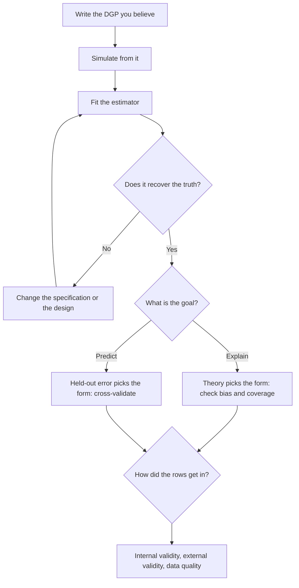
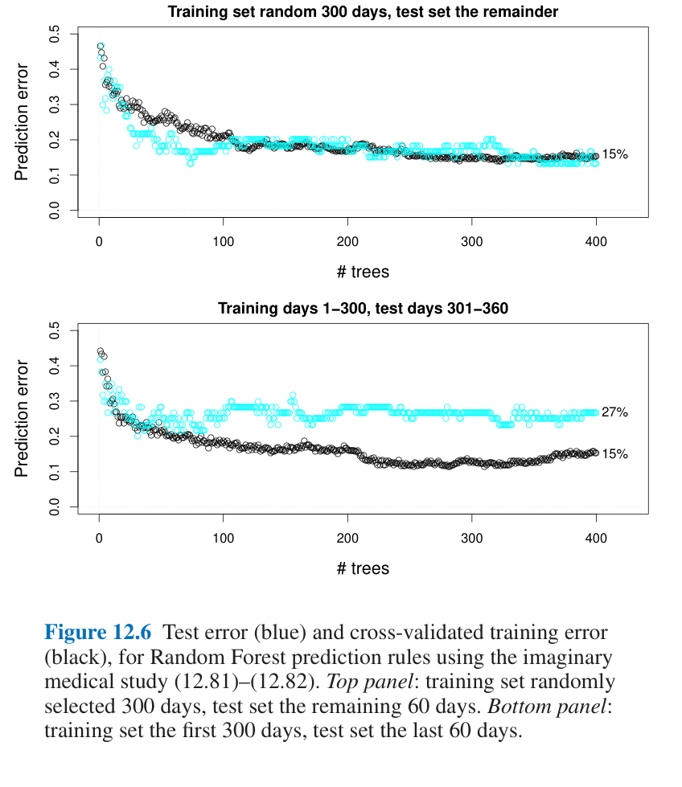
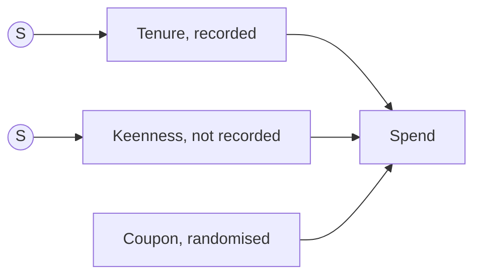
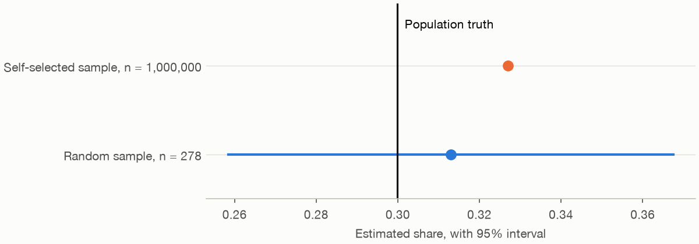

# 7 — The data generating process: fit, specification and generalisation

Larkspur sends a coupon that we know lifts spend by 22%, because we wrote the simulation that says so. A regression with tenure as a straight line reports a lift of about 95%, and across a thousand datasets its 95% interval never once contains the truth. Add one squared term and the answer is right. Then a second surprise: a self-selected sample of a million customers, off by barely a tilt in who answers, estimates a share no better than a random sample of 278. Both failures have the same source. Nobody asked how the rows came to exist.

## Why this chapter

[Chapter 6](06-regression-and-glms.md) showed how to fit a model and read its output. This chapter asks what the model is a claim about. A **data generating process** (DGP) is the mechanism that produced your rows: who got into the data, what they were exposed to, how the outcome responded, and how much noise there was. A model is a guess at that mechanism, and it is useful to the extent that the guess is good enough for the question.

The working method is the same throughout. Write the DGP as code, so that the truth is known. Simulate from it. Fit your estimator. See whether it gets the truth back. Real data never tells you the truth, so this is the one place you can check an estimator against it. Then Shmueli's question organises the rest: are you trying to explain or to predict? The answer decides which model you should prefer and how you should judge it.



The code blocks in this chapter are sections of `practice/ch07_data_generating_process.py`, in order, with some sections described rather than shown. Every dataset is simulated and seeded. Run it with `uv run ch07_data_generating_process.py` from the practice folder; it takes about a minute and a half. The chart code stays in the script.

---

## A model is a claim about how the rows were generated

Here is the claim, as code. Coupons go mostly to mid-tenure customers, and mid-tenure customers also spend the most.

```python
# A model is a claim about how the rows were generated. Here is the claim, as code.
TRUE_COUPON = 0.20  # coupon multiplies spend by exp(0.20)


def simulate(n, rng):
    """One Larkspur customer per row: tenure, a targeted coupon, annual spend."""
    tenure = rng.uniform(1, 60, n)
    # Marketing aims coupons at mid-tenure customers, who also spend the most.
    p_coupon = 0.15 + 0.60 * np.exp(-(((tenure - 30) / 15) ** 2))
    coupon = rng.binomial(1, p_coupon)
    log_spend = 2.6 + TRUE_COUPON * coupon + 0.14 * tenure - 0.0024 * tenure**2 + rng.normal(0, 0.5, n)
    return pd.DataFrame({"tenure": tenure, "coupon": coupon, "spend": np.exp(log_spend), "log_spend": log_spend})


rng = np.random.default_rng(7)
df = simulate(800, rng)
print(df.head(3).round(2).to_string(index=False))
print(f"true effect on log spend {TRUE_COUPON}, so a lift of {np.exp(TRUE_COUPON) - 1:.1%}")
```

```text
 tenure  coupon  spend  log_spend
  37.88       0  88.63       4.48
  53.94       0  22.45       3.11
  46.77       1  44.75       3.80
true effect on log spend 0.2, so a lift of 22.1%
```

### Estimand, estimator, estimate

Three words that are easy to blur:

| Term | Meaning | Here |
|---|---|---|
| **Estimand** | The quantity you want, stated without mentioning a method | The coupon's effect on log spend |
| **Estimator** | The recipe applied to data | OLS with a quadratic in tenure |
| **Estimate** | The number the recipe gave on these rows | 0.195 |

The estimand comes first, and it needs care, because the same coupon has several. Its effect on log spend is one fixed number, 0.20. Its effect in pounds is not, because a multiplicative lift is worth more to a bigger spender. We can get those by brute force from two million simulated customers:

```python
big = simulate(2_000_000, np.random.default_rng(1))
no_coupon = np.exp(big.log_spend - TRUE_COUPON * big.coupon)
true_gbp = ((np.exp(TRUE_COUPON) - 1) * no_coupon).mean()
true_gbp_att = ((np.exp(TRUE_COUPON) - 1) * no_coupon)[big.coupon == 1].mean()
print(f"true average effect in pounds: all customers {true_gbp:.2f}, customers who got a coupon {true_gbp_att:.2f}")
```

```text
true average effect in pounds: all customers 15.29, customers who got a coupon 18.98
```

So "what did the coupon do in pounds?" has two right answers, depending on whether you mean all customers or the customers who received it. The second is larger because coupons went to customers who spend more. Neither is wrong. They answer different questions, and a report should say which one it is answering.

### One dataset, four estimators

```python
FORMULAS = {
    "difference in means": "log_spend ~ coupon",
    "linear tenure": "log_spend ~ coupon + tenure",
    "quadratic tenure (true form)": "log_spend ~ coupon + tenure + I(tenure**2)",
    "spline tenure, df=5": "log_spend ~ coupon + bs(tenure, df=5)",
}
for name, f in FORMULAS.items():
    m = smf.ols(f, df).fit()
    print(f"{name:30s} coupon {m.params['coupon']:6.3f}  se {m.bse['coupon']:.3f}  R2 {m.rsquared:.3f}")
```

```text
difference in means            coupon  0.663  se 0.054  R2 0.157
linear tenure                  coupon  0.666  se 0.054  R2 0.160
quadratic tenure (true form)   coupon  0.195  se 0.038  R2 0.639
spline tenure, df=5            coupon  0.196  se 0.039  R2 0.639
```

The first two estimators are nearly identical and both about three times too high, and R² is low enough to warn you. A straight line cannot absorb a hump-shaped confounder: tenure and coupon are related through a curve, and a linear term has almost no correlation with a curve that rises and falls over the range. [Chapter 6's point about conditioning](06-regression-and-glms.md#conditional-differences-only-help-if-you-measured-the-cause) was that adding a variable helps only if you measured the cause. Here we did measure it, and it still fails, because the form we wrote down is wrong.

One dataset could be luck. A simulation lets us ask about the estimator itself. Three numbers describe it: **bias**, the average error over many datasets; **SD**, how far the estimate moves between datasets; and **coverage**, how often the 95% interval contains the truth.

```python
def recovery(reps=1000, n=800, seed=11):
    r = np.random.default_rng(seed)
    rows = {k: [] for k in [*FORMULAS, "pounds, quadratic in levels"]}
    for _ in range(reps):
        d = simulate(n, r)
        for name, f in FORMULAS.items():
            m = smf.ols(f, d).fit()
            lo, hi = m.conf_int().loc["coupon"]
            rows[name].append((m.params["coupon"], lo <= TRUE_COUPON <= hi))
        m = smf.ols("spend ~ coupon + tenure + I(tenure**2)", d).fit(cov_type="HC3")
        lo, hi = m.conf_int().loc["coupon"]
        rows["pounds, quadratic in levels"].append((m.params["coupon"], lo <= true_gbp <= hi))
    out = []
    for name, v in rows.items():
        est, hit = map(np.array, zip(*v))
        truth = true_gbp if name.startswith("pounds") else TRUE_COUPON
        out.append(dict(estimator=name, truth=truth, mean=est.mean(), bias=est.mean() - truth,
                        sd=est.std(ddof=1), coverage=hit.mean()))
    return pd.DataFrame(out).round(3)


print(recovery().to_string(index=False))
```

```text
                   estimator  truth   mean   bias    sd  coverage
         difference in means  0.200  0.688  0.488 0.054     0.000
               linear tenure  0.200  0.685  0.485 0.054     0.000
quadratic tenure (true form)  0.200  0.200 -0.000 0.040     0.941
         spline tenure, df=5  0.200  0.200 -0.000 0.040     0.943
 pounds, quadratic in levels 15.287 20.180  4.894 3.866     0.745
```

The two estimators that know the shape of tenure's effect are unbiased with coverage close to 95%. The two that do not have coverage of zero: their intervals are tight and always miss. The spline, which did not know the form was a quadratic, does as well as the true form at this sample size.

The last row went worse than the tidy story predicts, and it is worth showing. Regressing pounds on the coupon with a quadratic in tenure gives a mean of 20.18, above both the all-customer truth (15.29) and the coupon-customer truth (18.98), and coverage of the all-customer truth is 74.5%. Spend in levels is not quadratic in tenure, because the quadratic is on the log scale, so the same control does not do the same job once the outcome changes. Specification is a property of the whole model, not a set of terms you can carry from one outcome to another.

---

## Specification: the shape you write down

### Logs for multiplicative effects

Take logs when you believe causes multiply: a coupon that adds 22% to whatever a customer would have spent, a price change that moves demand by a percentage. On the log scale those effects become constant and additive, which is what a linear model can represent, and the coefficient reads as a proportional change, `exp(b) - 1`. Here `exp(0.20) - 1` is the 22.1% printed above. Logs also pull in a long right tail, but that is a side benefit. The reason to take them is your belief about the mechanism, and the price is that the estimand is now a ratio, so the pounds figure needs a separate step, as [chapter 6](06-regression-and-glms.md) showed for marginal effects.

### Polynomials and splines

A **polynomial** adds powers of the regressor: `tenure`, `tenure²`, and so on. It is compact and each term has a global effect, so a point at one end of the range can bend the curve at the other. A **spline** cuts the range at points called knots and fits a low-degree polynomial in each piece, joined smoothly, so that its shape is local. In a formula, `bs(tenure, df=5)` from patsy asks for a spline with five degrees of freedom. Use a spline when you want the data to show the shape and have no theory of it. Use a polynomial when the shape itself is the claim.

### When a quadratic is a story, and when it is overfitting

A negative squared term is often written up as a turning point: "spend rises with tenure until about month 30, then falls". Sometimes that is right. The trouble is that a quadratic must turn, so the coefficient cannot tell you whether the curve does. Here are two truths, fitted the same way.

```text
Truth rises then falls: t^2 coef -0.00249 (p 1.6e-168); quadratic peak at 29.2 [28.7, 29.6]; quadratic says peak-to-60 change -2.37, truth -2.28; R2 quad 0.629, spline 0.631
Truth rises then flattens: t^2 coef -0.00062 (p 3.6e-19); quadratic peak at 50.1 [46.3, 55.4]; quadratic says peak-to-60 change -0.06, truth 0.03; R2 quad 0.442, spline 0.448
```


*Image Source: generated by `practice/ch07_data_generating_process.py`. The dotted line is the quadratic's turning point.*

In the right-hand panel the truth never falls, but the squared term has p of about 10⁻¹⁹ and the bootstrap interval for the peak is a comfortable 46.3 to 55.4. Everything in the table says turning point, and it is an artefact of the form. In fairness, the size of the false decline is small: the quadratic claims a fall of 0.06 on the log scale after the peak, against a true rise of 0.03. A careful reader would not quote that as a story. A less careful one would quote the turning point and its p-value.

So a quadratic earns its story when three things agree: theory gives a reason the curve should turn, the data extend well past the turn on both sides, and a flexible fit such as a spline turns in the same place. Overfitting is the other direction, adding terms that follow this sample's noise, and the tools below are how you catch it.

---

## Comparing models

Fit improves when you add terms, whether or not the terms mean anything. Each tool here corrects for that in a different way.

| Tool | What it does | Needs nested models? | Best for |
|---|---|---|---|
| **R²** | Share of variance explained in this sample. Never falls when you add a term | No | Describing, not choosing |
| **Adjusted R²** | `1 - (1 - R²)(n - 1)/(n - k)` for k parameters. Rises only if the new term's F statistic exceeds 1 | No | A light correction in sample |
| **AIC** | `-2 log L + 2k`. Lower is better. Built to estimate predictive accuracy | No | Prediction without a held-out set |
| **BIC** | `-2 log L + k log n`. Lower is better. Harder penalty as n grows | No | Choosing among candidate true forms |
| **LR test** | Is the larger model's likelihood higher than chance would give? | Yes | A specific question about specific terms |
| **Cross-validation** | Fit on part of the data, score on the rest, repeat | No | Prediction, directly |

Two models are **nested** when one is the other with some terms removed. Cross-validation, in `sklearn.model_selection`, is the one tool here that scores on rows the model did not see.

```python
DEGREES = {"linear": 1, "quadratic": 2, "cubic": 3, "degree 6": 6, "degree 10": 10}
d300 = simulate(300, np.random.default_rng(21))
d300["z"] = (d300.tenure - 30) / 30  # rescale so high powers stay well conditioned


def poly(k):
    return " + ".join(f"I(z**{j})" for j in range(1, k + 1))


specs = {name: f"log_spend ~ coupon + {poly(k)}" for name, k in DEGREES.items()}
specs |= {"spline df=5": "log_spend ~ coupon + bs(z, df=5)", "spline df=15": "log_spend ~ coupon + bs(z, df=15)"}


def cv_rmse(formula, data, seed=0):
    X = np.asarray(dmatrix(formula.split("~")[1], data))
    scores = cross_val_score(LinearRegression(fit_intercept=False), X, data.log_spend,
                             cv=KFold(10, shuffle=True, random_state=seed),
                             scoring="neg_root_mean_squared_error")
    return -scores.mean()


fits = {name: smf.ols(f, d300).fit() for name, f in specs.items()}
table = pd.DataFrame([dict(model=n, params=int(m.df_model) + 1, R2=m.rsquared, adj_R2=m.rsquared_adj, AIC=m.aic,
                           BIC=m.bic, cv_rmse=cv_rmse(specs[n], d300), coupon=m.params["coupon"])
                      for n, m in fits.items()])
print(table.round(3).to_string(index=False))
```

```text
       model  params    R2  adj_R2     AIC     BIC  cv_rmse  coupon
      linear       3 0.169   0.164 701.433 712.545    0.776   0.678
   quadratic       4 0.661   0.658 434.551 449.366    0.496   0.179
       cubic       5 0.661   0.656 436.547 455.066    0.498   0.179
    degree 6       8 0.665   0.657 439.145 468.775    0.505   0.197
   degree 10      12 0.672   0.659 441.036 485.482    0.510   0.200
 spline df=5       7 0.664   0.657 437.778 463.704    0.501   0.199
spline df=15      17 0.672   0.653 451.018 513.982    0.525   0.194
```

R² goes up down the table, as it must. AIC, BIC and cross-validated RMSE all prefer the true quadratic. Adjusted R² does not: by 0.659 to 0.658 it prefers degree 10. The margin is meaningless, and that is the lesson, because this is the tool most often reported as if it had settled the matter. Note also that every flexible form gives a coupon estimate between 0.179 and 0.200, and only the linear one is far off at 0.678. Choosing among the good forms hardly moved the number we care about. Getting away from the bad one moved it a lot.

For nested models, the F test (`anova_lm`) and the likelihood-ratio test (`compare_lr_test`) ask whether the extra terms are worth keeping.

```python
print(anova_lm(fits["linear"], fits["quadratic"], fits["cubic"], fits["degree 6"]).round(4).to_string())
for small, large in [("linear", "quadratic"), ("quadratic", "cubic"), ("quadratic", "degree 6")]:
    lr, p, df_diff = fits[large].compare_lr_test(fits[small])
    print(f"LR test {small} vs {large}: chi2 {lr:.2f}, df {df_diff:.0f}, p {p:.4f}")
```

```text
   df_resid       ssr  df_diff   ss_diff         F  Pr(>F)
0     297.0  178.3979      0.0       NaN       NaN     NaN
1     296.0   72.8019      1.0  105.5959  428.3689  0.0000
2     295.0   72.8008      1.0    0.0011    0.0045  0.9467
3     292.0   71.9800      3.0    0.8208    1.1099  0.3453
LR test linear vs quadratic: chi2 268.88, df 1, p 0.0000
LR test quadratic vs cubic: chi2 0.00, df 1, p 0.9462
LR test quadratic vs degree 6: chi2 3.41, df 4, p 0.4923
```

The squared term is overwhelmingly needed. The cubic and the jump to degree 6 are not.

One dataset, again, could be luck, so each rule was run on 300 datasets at two sample sizes, counting what it chose. The candidates were polynomials of degree 1, 2, 3, 6 and 10, and the true form, the quadratic, was among them.

```text
share of 300 datasets picking each form, n=100
        linear  quadratic  cubic  degree 6  degree 10
R2         0.0       0.00   0.00      0.00       1.00
adj_R2     0.0       0.39   0.14      0.18       0.29
AIC        0.0       0.78   0.15      0.05       0.03
BIC        0.0       0.95   0.05      0.00       0.00
CV         0.0       0.73   0.19      0.05       0.02
share of 300 datasets picking each form, n=800
        linear  quadratic  cubic  degree 6  degree 10
R2         0.0       0.00   0.00      0.00       1.00
adj_R2     0.0       0.39   0.14      0.19       0.28
AIC        0.0       0.77   0.15      0.05       0.04
BIC        0.0       0.98   0.02      0.00       0.00
CV         0.0       0.70   0.18      0.08       0.04
```

You might expect more data to improve every rule. It did not. BIC starts high and rises from 95% to 98%. The others stay where they were: AIC near 78%, cross-validation near 70%, adjusted R² at 39%. The reason is in their penalties. An unneeded term improves fit by a chance amount whose distribution does not depend on n, and AIC's penalty of 2 per term also does not, so AIC keeps adding a surplus term at a fixed rate. BIC's penalty of `log n` grows, so it stops. Adjusted R² has the lightest penalty, which is why it is the worst here.

This is less alarming than it looks. AIC and cross-validation aim to predict well rather than to name the true form, and the surplus terms cost little: 0.510 against 0.496 of held-out RMSE in the table above. And real life rarely puts the true form among the candidates, which is the case BIC's guarantee depends on.

The penalties also disagree with the p-value as n grows. For one extra covariate, Efron and Hastie's table of the BIC Bayes factor holds a z of 3.29 (p = 0.001) fixed and lets n grow: at n = 10,000 the Bayes factor is only 2.24, "barely worthwhile" on Jeffreys' scale, while Fisher's scale calls p = 0.001 overwhelming evidence. The same chapter puts numbers on the penalty size for one extra parameter: with AIC the larger model wins a null comparison with probability 0.157, with BIC at n = 10,000 only 0.0024, and a penalty of 1.92 per parameter (the cn in the paper's notation) would reproduce the 5% test (*Computer Age*, ch. 13).

### What cross-validation estimates, and where it breaks

Cross-validation corrects the optimism of the apparent error, and the correction can be large. Efron and Hastie's supernova example has N = 39 stars and 10 predictors, with a lasso whose penalty is chosen by Cp. Its apparent mean squared error is 0.72 and its cross-validated error 1.17, 62% higher, so R² falls from 0.816 to 0.701 (13 random groups of 3). Two cautions follow from their simulations. First, cross-validation estimates the average error of the *recipe*, not of the rule you ended up with: over 500 bootstrap datasets from those 39 pairs the mean cross-validated error is 1.07 against a true error of 1.02 (apparent 0.57), yet across datasets the two are negatively correlated (about −0.175, sign confirmed on the figure), so a lucky split does not mean a lucky fit (*Computer Age*, ch. 12). Second, random splits assume that future rows look like past ones. In a simulated study of 360 subjects and 100 genes where each gene's signal is a transient episode of about 30 days, a random forest scores 15% error both in cross-validation and on a random held-out 60 days, and 27% when the same 60 held-out days come after the training days.



*Image Source: Efron & Hastie, *Computer Age Statistical Inference* (Cambridge University Press, 2016), Fig. 12.6. Blue is test error, black is cross-validated training error; simulated study of 360 subjects, training on 300 days.*

When a believable parametric model exists, the Cp-style covariance penalty is preferable to cross-validation (*Computer Age*, ch. 12). Where the data are ordered in time, split by time, as in [forecasting](../../06-applied-analyses/notes/01-forecasting.md).

---

## Explain or predict

Shmueli's paper ([To Explain or to Predict?](https://arxiv.org/abs/1101.0891), *Statistical Science*, 2010) separates two activities that use the same tools. **Explanatory modelling** is "the use of statistical models for testing causal explanations". **Predictive modelling** applies a model or algorithm "for the purpose of predicting new or future observations". She names four ways they differ: causation against association, theory against data, looking back against looking forward, and bias against variance. [Chapter 6 introduced the distinction](06-regression-and-glms.md#prediction-vs-explanation), and this section shows why it changes which model is best.

The last difference is the surprising one. Expected prediction error splits into irreducible noise, squared bias and variance. An explanatory analyst wants low bias, since the coefficient is the point. A predictive analyst wants low total error, and will accept some bias if it buys a larger fall in variance. So a model known to be wrong can predict better than the true one. Shmueli's appendix gives the conditions: very noisy data, a small left-out coefficient, highly correlated predictors, and a small sample or narrow range. She quotes Hagerty and Srinivasan: "a parsimonious but less true model can have a higher predictive validity than a truer but less parsimonious model."

Here is that claim tested directly, using a true form with two correlated predictors, where the short model drops the second.

```python
def explain_vs_predict(n, reps=2000, b1=1.0, b2=0.2, rho=0.9, sigma=2.0, seed=51):
    r = np.random.default_rng(seed)
    cov = [[1, rho], [rho, 1]]
    est_full, est_short, mse_full, mse_short = [], [], [], []
    for _ in range(reps):
        X = r.multivariate_normal([0, 0], cov, n)
        y = b1 * X[:, 0] + b2 * X[:, 1] + r.normal(0, sigma, n)
        full = np.linalg.lstsq(sm.add_constant(X), y, rcond=None)[0]
        short = np.linalg.lstsq(sm.add_constant(X[:, 0]), y, rcond=None)[0]
        Xt = r.multivariate_normal([0, 0], cov, 2000)
        yt = b1 * Xt[:, 0] + b2 * Xt[:, 1] + r.normal(0, sigma, 2000)
        mse_full.append(np.mean((yt - sm.add_constant(Xt) @ full) ** 2))
        mse_short.append(np.mean((yt - sm.add_constant(Xt[:, 0]) @ short) ** 2))
        est_full.append(full[1])
        est_short.append(short[1])
    return dict(n=n, b1_true_form=np.mean(est_full), sd_true_form=np.std(est_full), b1_short=np.mean(est_short),
                sd_short=np.std(est_short), test_rmse_true_form=np.sqrt(np.mean(mse_full)),
                test_rmse_short=np.sqrt(np.mean(mse_short)), short_wins=np.mean(np.array(mse_short) < np.array(mse_full)))


print(pd.DataFrame([explain_vs_predict(n) for n in (30, 300, 3000)]).round(3).to_string(index=False))
```

```text
   n  b1_true_form  sd_true_form  b1_short  sd_short  test_rmse_true_form  test_rmse_short  short_wins
  30         1.004         0.900     1.184     0.374                2.107            2.070       0.782
 300         1.006         0.269     1.184     0.118                2.011            2.009       0.512
3000         0.999         0.084     1.179     0.037                2.001            2.003       0.190
```

At n = 30 the short, wrong model wins on held-out error in 78% of datasets, even though its `b1` is biased (1.184 against a true 1.0). At n = 3,000 the true form wins in 81%. Her claim holds, with an honest size: the gain in RMSE at n = 30 is 2.107 to 2.070, so about 2%. It is real, and it is not large. An explanatory analyst should keep the true form at every n here, and a predictive one should switch at around n = 300, where the two tie.

Consequences for practice, all from Shmueli unless noted:

- **Explanatory power is not predictive power.** R² is measured in sample and held-out error is measured out of it. Inferring one from the other is the common error she singles out.
- **Selection differs.** For explanation, theory constrains the model, so an insignificant covariate may stay in because the theory says it belongs. For prediction, the held-out score decides.
- **AIC is a predictive tool.** It estimates predictive accuracy, and repeated use on the same data leaves what she quotes Berk as calling "unjustified optimism".
- **Report both, and say which goal came first.** The goal should be stated before modelling, not chosen after seeing which score looks best.

Breiman ([Statistical Modeling: The Two Cultures](https://doi.org/10.1214/ss/1009213726), *Statistical Science*, 2001) is the other half of the argument. He criticises the habit of assuming a data model and then drawing conclusions from it: "The conclusions are about the model's mechanism, and not about nature's mechanism." He also names the **Rashomon** problem: many models can fit about equally well and tell different stories, as the near-identical AIC scores above do. His remedy is to judge a model by predictive accuracy on held-out data, and he is not against data models outright ("I am not against data models per se"). The simulations in this chapter take the point seriously from the other side. Explanation is allowed to be its goal, but a DGP you can simulate from is what lets you test a claim about mechanism rather than assume it.

---

## Internal and external validity

**Internal validity** asks whether the estimate is right for the people in this study. **External validity** asks whether it holds for anyone else. A randomised experiment buys the first and promises nothing about the second.

So here is a clean experiment, run three times, on three samples. The coupon works better on new customers and on keen gardeners, and keenness is not recorded.

```text
population average effect 0.157
              sample     n  share_new  share_keen  sample_truth  estimate    se  reweighted_on_new
              random 20000      0.186       0.302         0.157     0.158 0.007              0.158
  selected on tenure 49871      0.015       0.298         0.113     0.117 0.005              0.169
selected on keenness 34067      0.189       0.879         0.273     0.265 0.006              0.264
```

All three experiments are internally valid, each within about one or two standard errors of its own sample's truth (the `sample_truth` column). Two of them are wrong about the population's 0.157. Selecting on tenure gives 0.117, because new customers, who respond most, make up 1.5% of the panel rather than 18.6%. We recorded tenure, so we can reweight the effect within each group by the population's shares, and that takes us from 0.117 to 0.169, closer to 0.157 though noisy, since so few new customers remain. Selecting on keenness gives 0.265, and reweighting on tenure does nothing, giving 0.264, because the thing that differs was never measured. A larger sample would not help either: the volunteers would just report 0.265 more precisely. [Matching and weighting](../../03-experimentation-and-causality/notes/05-matching-and-weighting.md) is the fuller treatment of reweighting on recorded covariates, and of what it can't fix.

Pearl and Bareinboim ([External Validity: From Do-Calculus to Transportability](https://arxiv.org/abs/1503.01603), *Statistical Science*, 2014) give this a name. **Transportability** is "a license to transfer causal effects learned in experimental studies to a new population", and their finding is that it "is a causal, not statistical notion": the data alone cannot tell you which formula applies, because you need to know where the populations differ. They draw that with a **selection diagram**, a causal diagram with extra nodes, each marking a mechanism that differs between populations. In one DAG:



Read the S nodes as "the study and the target differ here". An S pointing at tenure is fine: measure tenure in both places, estimate the effect within each level, and reweight by the target's shares, which is their transport formula. An S pointing at something unmeasured that shifts the effect is not fine, and no statistic computed from the study will reveal it. An S pointing straight at Y would mean the effect itself differs in ways nothing here explains. A DAG does not draw the interaction, so the arrows into Y here stand for "changes how the coupon works" as well as "changes spend". One caveat on the borrowing: their paper studies populations that differ by nature and, in a footnote, sets aside samples drawn differently by design, which is the case in this table. The diagram reads the same way, but this section does not rest on their formal results.

---

## Big is not the same as representative

[Chapter 3 showed the problem](03-distributions-and-sampling.md#big-is-not-the-same-as-representative) with 57,152 responders against 5,000 random users. Meng ([Statistical Paradises and Paradoxes in Big Data (I)](https://projecteuclid.org/euclid.aoas/1532743473), *Annals of Applied Statistics*, 2018) gives it an exact form. Let R be 1 if a person is in your data and G be the thing you are averaging. Let f be the sampling fraction n/N. Then, as an identity:

```text
sample mean - population mean = rho(R, G)  x  sqrt((1 - f) / f)  x  sd(G)
                                data quality    data quantity       problem difficulty
```

The correlation between being recorded and the value, `rho(R, G)`, is the **data defect correlation**. This is algebra, with no probability model behind it, and Meng notes it needs only that recorded values can be trusted. It should therefore hold to rounding error, so I checked.

```python
def population(N, seed=71, prevalence=0.30):
    return np.random.default_rng(seed).binomial(1, prevalence, N).astype(float)


def self_select(G, f, rho, rng):
    """Recording indicator R with target response rate f and target correlation rho with G."""
    p = G.mean()
    gap = rho * np.sqrt(f * (1 - f) / (p * (1 - p)))
    p0 = f - p * gap
    return rng.random(G.size) < np.where(G == 1, p0 + gap, p0)


N = 10_000_000
G = population(N)
R = self_select(G, 0.10, 0.02, np.random.default_rng(72))
n = R.sum()
f = n / N
rho_hat = np.corrcoef(R, G)[0, 1]
lhs = G[R].mean() - G.mean()
rhs = rho_hat * np.sqrt((1 - f) / f) * G.std()
print(f"N {N:,}, n {n:,}, f {f:.4f}, rho {rho_hat:.5f}, population mean {G.mean():.5f}, sample mean {G[R].mean():.5f}")
print(f"response rate with the trait {R[G == 1].mean():.4f}, without it {R[G == 0].mean():.4f}")
print(f"actual error {lhs:.10f}; rho x sqrt((1-f)/f) x sigma {rhs:.10f}; difference {lhs - rhs:.1e}")
```

```text
N 10,000,000, n 1,000,453, f 0.1000, rho 0.02020, population mean 0.29990, sample mean 0.32767
response rate with the trait 0.1093, without it 0.0961
actual error 0.0277672652; rho x sqrt((1-f)/f) x sigma 0.0277672652; difference -3.5e-14
```

It does. Look at how small this defect is: people with the trait respond at 10.9% and people without it at 9.6%. Now ask what the sample is worth. Under simple random sampling, rho is about `1/sqrt(N)`, tiny. Setting the two errors equal gives an **effective sample size**, the random sample with the same error, of roughly `f/(1-f) × 1/rho²`.

```text
    f   rho       n  error  naive_se    z   n_eff
0.001 0.005    9889 0.0737   0.00487 15.2    40.0
0.001 0.020    9856 0.2882   0.00496 58.1     3.0
0.010 0.005   99945 0.0206   0.00148 14.0   404.0
0.010 0.020   99932 0.0887   0.00154 57.5    25.0
0.100 0.005 1000166 0.0061   0.00046 13.3  4442.0
0.100 0.020 1000176 0.0265   0.00047 56.5   278.0
0.500 0.005 4999475 0.0022   0.00021 10.5 39841.0
0.500 0.020 4999707 0.0090   0.00021 43.7  2499.0
```

The row to remember is f = 0.1, rho = 0.02: a million rows worth 278. Compare that with a real random sample of 278, over repeated draws:

```text
random sample of 278: RMSE 0.0276, 95% interval covers truth 95.3%
self-selected ~1,000,000: RMSE 0.0275, naive SE 0.00046, interval covers truth 0.0% of 50 draws
```

The errors match, 0.0276 against 0.0275. But the random sample's interval covers the truth 95.3% of the time and the million-row interval covers it in none of 50 draws, because its reported standard error is 0.00046 when its real error is about 0.027. That is what the figure shows.


*Image Source: generated by `practice/ch07_data_generating_process.py`, using one draw of each.*

Meng calls this the Big Data Paradox: "The bigger the data, the surer we fool ourselves." And it gets worse as the population grows, which he calls the Law of Large Populations. Hold f and rho fixed and scale N:

```python
rows = []
for N_ in (100_000, 1_000_000, 10_000_000):
    Gx = population(N_, seed=75)
    Rx = self_select(Gx, 0.10, 0.02, np.random.default_rng(76))
    err = Gx[Rx].mean() - Gx.mean()
    se = np.sqrt(Gx[Rx].var(ddof=1) / Rx.sum())
    rows.append(dict(N=N_, n=int(Rx.sum()), error=err, naive_se=se, error_in_ses=err / se, n_eff=n_eff(0.10, 0.02, N_)))
print(pd.DataFrame(rows).round({"error": 4, "naive_se": 5, "error_in_ses": 1, "n_eff": 0}).to_string(index=False))
```

```text
       N       n  error  naive_se  error_in_ses  n_eff
  100000    9849 0.0179   0.00469           3.8  277.0
 1000000   99976 0.0259   0.00148          17.5  278.0
10000000 1001428 0.0271   0.00047          57.8  278.0
```

The effective sample size stays at about 278 whether you hold ten thousand rows or a million. The error stays near 0.027 and the reported standard error shrinks, so the error measured in standard errors climbs from 3.8 to 57.8. More data makes the claim more confident and no more correct.

Meng's own numbers are larger still. With a sampling fraction of 1% of about 231.6 million US eligible voters and rho = 0.005, 2.3 million responses carry the information of about 404 random ones, and a naive z-score is 75.8. Rho of about −0.005 is around where his state-level estimates for the Trump vote in the 2016 CCES centre, though he stresses that these are raw unweighted data and the 1% is a rough figure.

Three limits on what this shows:

- **You usually cannot estimate rho from your sample**, because everyone in the sample has R = 1. You need outside information about the population or a benchmark.
- **It is about population means and totals.** Meng's identity concerns a sample average. It does not say every estimate from big data is useless, as the next section shows.
- **Weighting helps but is no escape.** He finds it often reduces the error a lot, but it does not remove the penalty for large N when the weights are imperfect. [Surveys and sampling design](../../06-applied-analyses/notes/12b-weighting-the-margin-and-the-question.md#weighting-post-stratification-raking-and-their-limit) runs the repair.

---

## A better fit is not better generalisation

Self-selection also changes how good a model looks. The claim to test is that a better fit in this sample is not a better answer for the population. Here it is on three ways into the sample, and the answer depends on how the rows got in. This DGP was built to show the mechanism, so read it for the mechanism and not as a typical size: 20% of customers are keen and predictable, and the rest barely respond.

```text
best linear fit on the whole population: slope 0.560, R2 0.074, RMSE 1.984
                   sample      n  share_keen  slope  sample_R2  sample_rmse  population_rmse
            random, n=500    500       0.168  0.366      0.031        2.060            1.994
      opt-in on x, n~100k 100188       0.201  0.554      0.025        2.095            1.984
opt-in on segment, n~100k  99510       0.904  1.833      0.774        0.990            2.461
```

The third sample looks the best by far, with R² of 0.774 and an RMSE of 0.990, and it is the worst on the population (2.461). It has mostly learned about keen customers. The population's best possible line has an R² of only 0.074, so the sample with the excellent fit has the least true picture of the task.

Not all selection does this. The second row selects on x and gets almost the population slope, 0.554 against 0.560, on a model whose fit looks as poor as the random sample's. Selecting on a regressor does little harm to a line that holds across it, while selecting on something tied to the outcome does a lot. Hence the rule: before admiring R², ask how the rows got in.

---

## Pitfalls

- **Starting from the data rather than the estimand.** "The coupon effect" had three values in this chapter. Say which one you mean before you fit.
- **Reading a significant coefficient as a right specification.** Linear tenure gave p far below 0.001 and a bias of 0.485. Significance tests a term inside a form you already assumed.
- **Telling a turning-point story from a squared term.** A quadratic has to turn. Check with a spline, and check the data run past the turn.
- **Reporting adjusted R² as if it selected the model.** It chose degree 10 by 0.001, and over many datasets it chose the true form 39% of the time.
- **Using in-sample fit to claim predictive power.** That needs held-out rows. [DS 01/04](../../../data-science/01-classical-ml/notes/04-model-evaluation.md) covers how to hold them out.
- **Using a predictive selection rule for an explanatory question.** Held-out error can prefer a model whose coefficient is biased. At n = 30 here it usually does.
- **Treating randomisation as generalisation.** All three experiments were internally valid, and two were wrong about the population.
- **Reweighting and calling it fixed.** Reweighting fixes only the differences you measured.
- **Reading a small standard error from a self-selected sample as precision.** The standard error describes sampling variation, not selection. A million rows at rho = 0.02 reported 0.00046 and missed by 0.027.

---

## Try it

1. Take the coupon's true effect away, leaving it targeted as before, and fit the linear and quadratic forms on 300 datasets. How often is the coupon significant at 5%? What should it be?
2. Compute Meng's two figures from `n_eff`: half of 230 million eligible voters at rho = 0.05, and 1% of 231,557,000 at rho = 0.005. For the second, also compute his z-score.
3. In `explain_vs_predict`, set `rho=0.0`. What happens to the bias in `b1_short`, and to the size of the short model's win at n = 30?
4. A vendor sells you a panel of 2 million opted-in customers who "match the population on age and gender" after weighting. They report a 95% interval of ±0.1 percentage points. Write the two questions you ask before using it.

<details>
<summary>Answers</summary>

1.

```text
log_spend ~ coupon + tenure: mean coupon 0.480, significant at 5% in 100.0% of datasets
log_spend ~ coupon + tenure + I(tenure**2): mean coupon -0.001, significant at 5% in 6.0% of datasets
```

The correct rate for a true null is about 5%, and the quadratic's 6.0% is close given 300 datasets. The linear form finds a coupon "effect" of 0.48 in every dataset, where the true effect is zero. A placebo test like this is worth running on any specification you plan to report.

2.

```text
f=0.5, rho=0.05, N=230m: n_eff 400
f=0.01, rho=0.005, N=231,557,000: n_eff 404, Z 75.80
```

These match the paper's 400 and 404, and its z-score of 75.80 from its equation (3.10). Half of an electorate, 115 million responses, is worth 400 random ones at rho = 0.05.

3.

```text
  n  b1_true_form  sd_true_form  b1_short  sd_short  test_rmse_true_form  test_rmse_short  short_wins
 30         0.972         0.374     0.979     0.374                2.108            2.080       0.587
300         0.993         0.119     0.993     0.119                2.013            2.019       0.135
```

With uncorrelated predictors the bias disappears (`b1_short` 0.979 and 0.993, against true 1.0), and the two models' `b1` have the same spread. The short model's wins fall to 59% at n = 30 and 14% at n = 300. Its advantage came largely from the variance saved by not separating two correlated predictors, as Shmueli's conditions say.

4. What drives opting in, and what is it correlated with among people of the same age and gender? Weighting reaches only the variables you weighted on, so a difference in keenness or politics stays, which is what the keenness row showed. And what is rho or the error on an outcome where the population value is known? A benchmark is the way to estimate rho at all. The quoted ±0.1 points describes sampling noise under random selection and says nothing about either.

</details>

---

## Interview checklist

| Prompt | Answer |
|---|---|
| What is a data generating process? | The mechanism that produced the rows: selection, exposure, response and noise. A model is a claim about it |
| Estimand, estimator, estimate? | The quantity you want, the recipe, and the number it gave on these rows |
| How would you test an estimator? | Simulate from a known DGP many times, then report bias, SD and coverage |
| When do you log the outcome? | When you believe causes multiply. The coefficient is then a proportional change, and a pounds figure needs another step |
| Polynomial or spline? | A spline to let the data show a shape, a polynomial when the shape is the claim |
| Does a significant squared term mean a turning point? | No. A quadratic has to turn. In this chapter one found a peak at p ≈ 10⁻¹⁹ in a curve that never falls |
| AIC or BIC? | AIC targets predictive accuracy and keeps a fixed rate of surplus terms. BIC's penalty grows with n, so it tends to settle on the true form when that form is among the candidates |
| Is adjusted R² enough? | No. It keeps any term with F above 1, so it is a light penalty and overfits |
| Explain or predict? | Explaining wants unbiased coefficients and theory-led forms. Predicting wants low held-out error, and can prefer a less true model |
| Internal vs external validity? | Right for this sample, against right elsewhere. Randomisation buys only the first |
| What is transportability? | A licence to carry an effect to a new population, justified by causal knowledge of where the two differ |
| State Meng's identity | Error = data defect correlation × sqrt((1-f)/f) × sd of the variable |
| Why does a large biased sample mislead? | The error stays while the standard error shrinks, so the interval tightens around the wrong value. A million rows at rho = 0.02 are worth 278 random ones |

---

## Next

[Chapter 8 takes this to data with repeated measures](08-panel-data-and-fixed-effects.md): the same stores followed over time, an unobserved quality that the regression cannot see, and what fixed effects can and cannot do about it.
