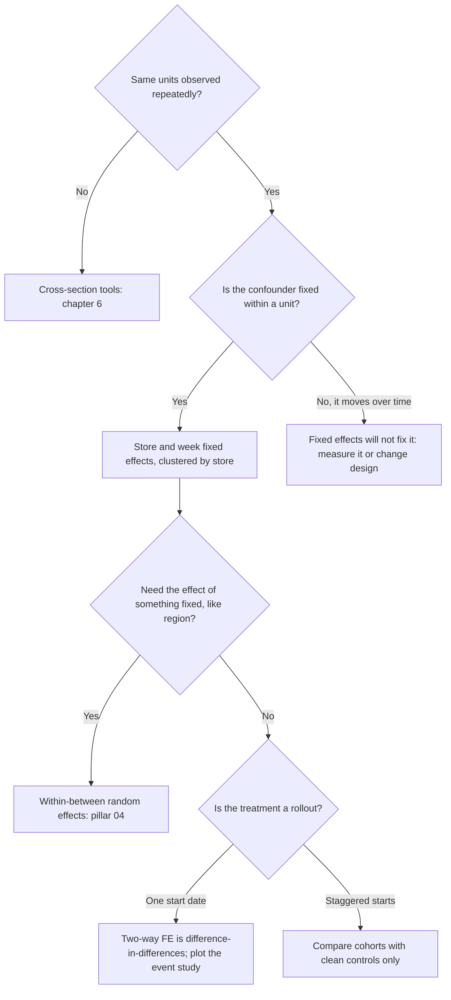
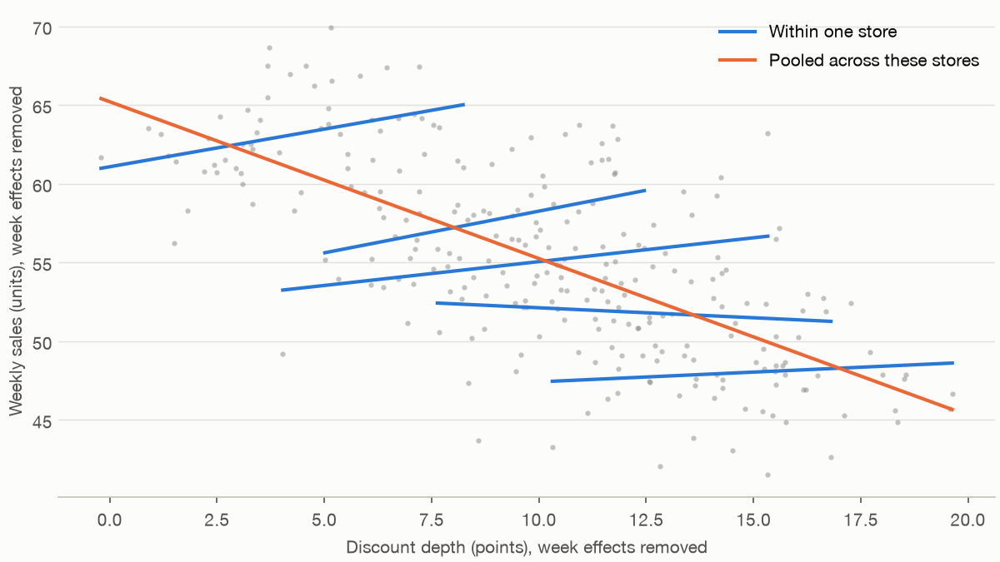

# 8 — Panel data and fixed effects

Larkspur sells through 100 garden-centre concessions, and head office wants to know whether deeper discounts sell more. A regression on a year of store-weeks says each extra point of discount loses a full unit a week, with a standard error of 0.017. We wrote the simulation, so we know one extra point adds 0.5 units in every store. Clustering the standard errors widens the interval and leaves it around the wrong sign. Comparing each store with itself, and each week with itself, gives 0.472. Nothing was added to the data, but the question changed.

## Why this chapter

[Chapter 7](07-data-generating-process.md) asked how the rows were generated. When the same units appear repeatedly, part of the answer is that each unit brings something of its own: a store's location, a manager's habits, a customer's tastes. Often we cannot measure it, and often it drives both the treatment and the outcome. Weak stores discount harder and also sell less, so across stores, discounts and sales look like enemies.

**Panel data** follows the same units over time, one row per unit per period. That lets us use each unit as its own control, which removes everything about a unit that does not change, measured or not. The chapter builds up that idea, then spends as long on what it cannot do, because the second half is where the mistakes are. It ends by showing that difference-in-differences is this same regression, and handing the fixed-or-random decision to [multilevel models and partial pooling](../../04-bayesian-analysis/notes/07-multilevel-models-and-partial-pooling.md#which-tool-the-decision-table).



The code blocks are sections of `practice/ch08_panel_data.py`, in order, with some simulations described rather than shown. Everything is simulated and seeded. Run it with `uv run ch08_panel_data.py` from the practice folder; it takes a few minutes because of the repeated panels. The chart code stays in the script.

---

## A panel with a known answer

A store's sales in a week depend on its own quality, the season, the discount and some noise that persists from week to week:

```text
sales(i,t) = 50 + quality(i) + season(t) + 0.5 × discount(i,t) + noise(i,t)
```

We never observe quality. Discounts depend on it: weak stores discount more, and everyone discounts more in the slack season.

```python
TRUE_BETA = 0.5  # one extra point of discount adds 0.5 units a week, in every store


def simulate(stores=100, weeks=52, seed=0, beta=TRUE_BETA, within_sd=2.0, confound=0.5):
    r = np.random.default_rng(seed)
    alpha = r.normal(0, 6, stores)  # store quality: fixed, and we never observe it
    season = 3 * np.sin(2 * np.pi * np.arange(weeks) / 52)  # week effects that everyone shares
    e = np.zeros((stores, weeks))  # errors that persist from week to week
    shocks = r.normal(0, 3, (stores, weeks))
    e[:, 0] = shocks[:, 0]
    for t in range(1, weeks):
        e[:, t] = 0.5 * e[:, t - 1] + shocks[:, t]
    # Weak stores discount harder, and everyone discounts harder in the slack season.
    x = 10 - confound * alpha[:, None] - 0.6 * season + r.normal(0, within_sd, (stores, weeks))
    y = 50 + alpha[:, None] + season + beta * x + e
    return pd.DataFrame({"store": np.repeat(np.arange(stores), weeks), "week": np.tile(np.arange(weeks), stores),
                         "discount": x.ravel(), "sales": y.ravel(), "quality": np.repeat(alpha, weeks)})


df = simulate(seed=8)
print(df.head(3).round(2).to_string(index=False))
print(f"rows {len(df):,}, stores {df.store.nunique()}, weeks {df.week.nunique()}, true effect {TRUE_BETA}")
print(f"corr(store quality, store's mean discount) {df.groupby('store').quality.first().corr(df.groupby('store').discount.mean()):.3f}")
```

```text
 store  week  discount  sales  quality
     0     0     15.17  49.98   -10.43
     0     1     17.29  45.38   -10.43
     0     2     15.23  45.40   -10.43
rows 5,200, stores 100, weeks 52, true effect 0.5
corr(store quality, store's mean discount) -0.996
```

The correlation of −0.996 is deliberately extreme, and it means quality and a store's average discount are almost the same thing here. That is the hard case for pooled regression, and it is not a typical size for real data.

### Two kinds of variation

A panel's variation splits into two parts. **Between** variation is how store averages differ from one another. **Within** variation is how a store moves around its own average.

```python
between = df.groupby("store").discount.transform("mean")
print(f"variance of discount {df.discount.var():.2f}: between stores {between.var():.2f}, within stores {(df.discount - between).var():.2f}")
means = df.groupby("store")[["sales", "discount"]].mean()
print(f"regression on store means (between only): slope {smf.ols('sales ~ discount', means).fit().params['discount']:.3f}")
```

```text
variance of discount 15.79: between stores 10.51, within stores 5.28
regression on store means (between only): slope -1.488
```

Two-thirds of the discount's variance is between stores. A regression on store means, which uses only that part, gives −1.488. We can see where that comes from: average discount is about `10 - 0.5 × quality`, so quality is about `-2 × (discount - 10)`, and −2 from quality plus 0.5 from the discount gives −1.5. Between stores, we are mostly measuring quality.

---

## Pooled OLS, with clustered errors

**Pooled OLS** stacks all the rows and ignores which store each came from. [Chapter 6](06-regression-and-glms.md#clustered-standard-errors) explained that repeated rows from one user are not independent, and that clustering repairs the standard error. The same holds for stores.

```python
naive = smf.ols("sales ~ discount", df).fit()
clus = smf.ols("sales ~ discount", df).fit(cov_type="cluster", cov_kwds={"groups": df.store})
print(f"pooled OLS {naive.params['discount']:.3f}, naive SE {naive.bse['discount']:.3f}, clustered SE {clus.bse['discount']:.3f}")
```

```text
pooled OLS -1.005, naive SE 0.017, clustered SE 0.044
```

The pooled slope is close to a variance-weighted average of the between slope and the within slope below: (10.51 × −1.488 + 5.28 × −0.041) / 15.79 = −1.004. Clustering raises the standard error from 0.017 to 0.044, which is the honest figure for how much this estimate moves. It does nothing to the estimate. Clustering repairs the uncertainty around the number, and the number is the problem.

---

## Fixed effects

A **fixed effect** is a separate intercept for each unit. Adding one for every store absorbs everything constant about that store, including anything we never measured. Mechanically, this is the same as subtracting each store's mean from its own rows, and either way the coefficient is estimated from within-store variation only (*The Effect*, ch. 16). **Two-way fixed effects** adds a separate intercept for each week as well, removing anything that hits all stores alike. `linearmodels` does this with `PanelOLS`.

```python
panel = df.set_index(["store", "week"])


def fe(data, entity=True, time=True, formula="sales ~ discount"):
    term = formula + (" + EntityEffects" if entity else "") + (" + TimeEffects" if time else "")
    return PanelOLS.from_formula(term, data).fit(cov_type="clustered", cluster_entity=True)


m_e = fe(panel, time=False)
m_et = fe(panel)
print(f"store effects only   {m_e.params['discount']:.3f}, clustered SE {m_e.std_errors['discount']:.3f}")
print(f"store + week effects {m_et.params['discount']:.3f}, clustered SE {m_et.std_errors['discount']:.3f}")
```

```text
store effects only   -0.041, clustered SE 0.026
store + week effects 0.472, clustered SE 0.026
```

Store effects alone are not enough here: they give −0.041, because within a store, discounts rise in the slack season when sales fall anyway. The season is the second confounder, and removing it with week effects gives 0.472. Fixed effects remove what you tell them to remove, so you need to think about both dimensions.

There is nothing mysterious in the two-way version. On a balanced panel, it is OLS after subtracting store means and week means and adding back the grand mean:

```python
def two_way_demean(s, data):
    return s - s.groupby(data.store).transform("mean") - s.groupby(data.week).transform("mean") + s.mean()


yy, xx = two_way_demean(df.sales, df), two_way_demean(df.discount, df)
print(f"two-way demeaned by hand: {(xx @ yy) / (xx @ xx):.6f}; PanelOLS: {m_et.params['discount']:.6f}")
```

```text
two-way demeaned by hand: 0.472220; PanelOLS: 0.472220
```

The chart shows why the sign flips. Five stores from across the quality range, with week effects removed from both axes: most of the blue within-store lines slope up, and the orange line across stores slopes down. With 52 noisy weeks per store, one of the five slopes down a little by chance.


*Image Source: generated by `practice/ch08_panel_data.py`.*

Over 300 panels, with the truth at 0.5:

```text
                                      mean     sd  mean_se  coverage
estimator
pooled, naive SE                    -0.906  0.055    0.018     0.000
pooled, clustered SE                -0.906  0.055    0.054     0.000
store effects, clustered             0.013  0.026    0.027     0.000
store + week effects, clustered      0.502  0.023    0.024     0.947
store + week effects, unadjusted SE  0.502  0.023    0.024     0.953
```

Look at the second row. The clustered standard error of 0.054 matches the estimate's real SD of 0.055, so it is doing its job, and coverage is still zero. A correct standard error around a biased estimate gives you an interval that is the right width in the wrong place. The fourth row is the one to use, with bias of 0.002 and coverage of 94.7%.

### Clustering: when it earns its keep

The last two rows of that table have the same mean, SD and standard error to three decimals, which is not what the usual advice leads you to expect. Noise here persists from week to week, and clustering made no real difference to coverage (94.7% against 95.3%). The reason is that this DGP's discount moves independently week to week within a store, and clustering matters when the regressor persists as well as the errors. So here is a second panel where discounts are sticky, with a week's discount at 0.9 of the last.

```text
             mean     sd  mean_se  coverage
se_type
unadjusted  0.503  0.065    0.033     0.697
clustered   0.503  0.065    0.066     0.940
```

Now the unadjusted standard error is half what it should be, and its 95% interval covers 69.7% of the time. Clustering brings that to 94.0%. Real discounts and treatments usually persist, so clustering at the store is the sensible default for two-way fixed effects, and if a treatment is assigned by store there is a design reason too. *The Effect* notes that clustering is not automatic: it cites Abadie et al. (2023) for the view that the case for it rests on treatment-effect heterogeneity with sampling of groups, or on clustered assignment.

---

## What fixed effects cannot do

Fixed effects remove what is constant within a unit. Four things are left.

### Anything that never changes

A store's region, or whether it is urban, has no within-store variation, so its effect cannot be estimated. `PanelOLS` refuses, and with `drop_absorbed=True` it drops the variable.

```python
panel2 = panel.assign(urban=(panel.quality > 0).astype(float))
try:
    fe(panel2, formula="sales ~ discount + urban")
except Exception as err:
    print(type(err).__name__, "-", " ".join(str(err).split())[:70])
m = PanelOLS.from_formula("sales ~ discount + urban + EntityEffects + TimeEffects", panel2, drop_absorbed=True).fit()
print("with drop_absorbed=True, coefficients kept:", list(m.params.index))
```

```text
AbsorbingEffectError - The model cannot be estimated. The included effects have fully absorbe
with drop_absorbed=True, coefficients kept: ['discount']
```

### Confounders that move over time

Fixed effects assume the unobserved thing stays fixed. Say a competitor opens near 40% of stores part-way through the year, sales fall by 6 and those stores discount 4 points deeper in response. And say managers discount after a bad week, so the discount reacts to last week's shock, which persists into this week. This last is **reverse causality**: the outcome moving the treatment. The first row below leaves the competitor out, the second measures it, and the third is the reacting manager. Each row averages 100 panels, with the truth at 0.5.

```text
                                       mean    std
scenario
competitor unmeasured                 0.199  0.038
competitor controlled                 0.502  0.028
discount reacts to last week's shock  0.133  0.020
```

Both failures lie in the part of the data fixed effects trust. Measuring the competitor repairs the first (0.502). Nothing in this regression repairs the second. Facure makes the same two points in his account of when panel data won't help you. Before reporting a fixed-effects estimate, ask what changed in these units at the same time as the treatment, and whether the treatment responded to the outcome.

### Variation that hardly exists

All the information comes from within-unit movement. If stores rarely change their discounts, there is little to learn from, however many rows you have. Here is the same panel of 5,200 rows with the within-store noise in discounts turned down.

```text
 within_sd  estimate  clustered_se
       2.0     0.472         0.026
       0.5     0.389         0.102
       0.1    -0.056         0.510
```

The standard error goes up about twentyfold, and at the lowest setting the estimate is −0.056. That is about one standard error from the truth, so the interval still tells the truth, but it no longer tells you the sign. Row count is not information here.

### Everyone's effect

If stores respond differently, the coefficient is not the plain average of their effects. It weights a store by how much its discount varies (*The Effect*, §16.2.1, citing Gibbons, Suárez and Urbancic 2019). So half the stores below respond at 1.0 and half not at all, an average of 0.5, and the responsive half also move their discounts three times as much, which gives nine times the variance.

```text
average effect across stores 0.500; two-way FE 0.901 (variance-weighted expectation 0.900)
```

The estimate is 0.901, right where the weighted calculation says it should be. That is a clean causal effect of some kind, on the stores that move most, and it is not the average store's effect. The size depends on how strongly variation and response go together, which we built to be strong here.

---

## Difference-in-differences is two-way fixed effects

[Pillar 03's section on difference-in-differences](../../03-experimentation-and-causality/notes/04-correlation-and-causation.md#difference-in-differences) compares a treated group's before-and-after change with an untreated group's. Its regression form is two-way fixed effects, with one treatment dummy. In this simulation, stronger stores tend to get a new display from week 26, so treatment is not random, and the effect builds to 4 units a week.

```text
post        0       1
group
0      48.669  45.071
1      55.186  55.083
difference of differences 3.493822; two-way FE 3.493822, clustered SE 0.168
true average effect over treated weeks 3.596
raw gap in post period, ignoring the pre-period 10.012
```

The hand-calculated difference of differences and the two-way fixed-effects coefficient are identical to six decimals, as *The Effect* (ch. 18) says they should be when treatment starts at one date for everyone. The raw gap after the change, 10.012, is mostly the stores' prior advantage. The target is the average effect on the treated stores over treated weeks, 3.596, and the estimate is 3.494 with a standard error of 0.168. The identifying assumption is **parallel trends**: without the change, both groups would have moved together. It concerns a world we did not observe, so it cannot be proved.

### The event study

An **event study** replaces the single dummy with one for each week relative to the start, leaving out week −1 as the reference. Every coefficient is then the treated-minus-control gap relative to that week. It does two jobs: it shows how the effect builds, and it shows whether the groups were already diverging.

```python
def event_study(d, lo=-8, hi=12, omit=-1):
    d = d.copy()
    names = {}
    for k in range(lo, hi + 1):
        if k == omit:
            continue
        col = f"k_m{-k}" if k < 0 else f"k_p{k}"
        names[col] = k
        ends = (d.k <= k) if k == lo else (d.k >= k) if k == hi else (d.k == k)  # bin the far tails
        d[col] = (d.group * ends).astype(float)
    m = fe(d.set_index(["store", "week"]), formula="sales ~ " + " + ".join(names))
    return pd.DataFrame({"k": list(names.values()), "est": m.params[list(names)].to_numpy(),
                         "se": m.std_errors[list(names)].to_numpy()})


es_good = event_study(did)
tilted, _ = did_panel(tilt=0.15)
es_bad = event_study(tilted)
print(es_good[es_good.k.between(-4, 8)].round(2).to_string(index=False))
for name, es in [("parallel", es_good), ("tilted", es_bad)]:
    pre = es[es.k < -1]
    print(f"{name}: pre-period coefficients range {pre.est.min():.2f} to {pre.est.max():.2f}; "
          f"{(abs(pre.est) > 1.96 * pre.se).sum()} of {len(pre)} outside their 95% interval")
tilted["post"] = (tilted.k >= 0).astype(int)
tilted["treated_now"] = tilted.group * tilted.post
print(f"tilted panel: two-way FE {fe(tilted.set_index(['store', 'week']), formula='sales ~ treated_now').params['treated_now']:.3f} against a true {path[26:].mean():.3f}")
```

```text
 k   est   se
-4 -0.97 0.80
-3 -0.09 0.91
-2 -0.14 0.80
 0  0.74 0.88
 1  1.09 1.01
 2  1.78 0.79
 3  2.64 0.87
 4  2.72 0.82
 5  4.10 0.85
 6  3.97 0.80
 7  3.27 0.79
 8  3.91 0.91
parallel: pre-period coefficients range -0.97 to 0.22; 0 of 7 outside their 95% interval
tilted: pre-period coefficients range -2.18 to -0.29; 1 of 7 outside their 95% interval
tilted panel: two-way FE 7.394 against a true 3.596
```

The regression has seven coefficients before the change, from week −8 (with earlier weeks binned into it) to week −2. The table prints weeks −4 to 8; the two summary lines cover all seven.

On the left of the figure, the path matches the truth and the earlier weeks sit around zero. On the right, the treated stores were already pulling ahead by 0.15 a week. Two-way fixed effects gives 7.394 against a true 3.596, more than double.


*Image Source: generated by `practice/ch08_panel_data.py`. Weeks at the far ends are binned, so the first and last points include all earlier and later weeks.*

Note how weak the formal signal is. In the tilted panel only 1 of the 7 earlier coefficients is outside its interval, and the case rests on the pattern, the steady climb, which you see only if you plot it. Try it 2 measures this over many panels. *The Effect* warns that these tests have low power and that passing one does not prove parallel trends, and the simulation agrees.

### Staggered rollouts: where the one coefficient breaks

Rollouts rarely start on one date. If stores adopt in cohorts, two-way fixed effects also uses stores that were treated earlier as comparisons for stores treated later, because "treated last week and treated this week" counts as no change. If the effect grows over time, that comparison group is itself moving, and parallel trends fails by construction (*The Effect*, §18.2.6, citing Goodman-Bacon 2021). Here three cohorts adopt at weeks 15, 30 and 45 of 60. The effect is either flat at 4.5 or grows by 0.25 a week since adoption, and the final column compares each cohort only with never-treated stores. Each row averages 100 panels.

```text
effect  never_treated  true_att  twfe_mean  twfe_sd  clean_2x2
  flat            0.0     4.500      4.486    0.151        NaN
 grows            0.0     4.531      0.096    0.151        NaN
 grows            0.5     4.561      3.010    0.143      4.572
```

With a flat effect, two-way fixed effects is fine (4.486 against 4.500). With a growing effect and no untreated stores, it reports 0.096 when the truth is 4.531, an estimate near zero on a treatment that helps every store. Having half the stores never treated helps but still gives 3.010 against 4.561. The clean comparison gets 4.572. Straight-line growth with no untreated stores is close to the worst case, so read 0.096 as showing the mechanism and not as a typical error. The practical rule: with staggered starts, do not rely on the single coefficient. *The Effect* points to Callaway and Sant'Anna (2021), Wooldridge (2021) and Borusyak et al. (2024) for estimators built for this. These papers are cited through the book and have not been read for this chapter. The hand-built version here is the idea behind them, and it works only because never-treated stores exist.

---

## Fixed or random: a pointer

The alternative to a separate intercept per store is a **random effect**: treat the store intercepts as draws from a distribution. It can estimate things that never change, and it shrinks estimates for stores with little data. Its standard form assumes the store effect is unrelated to the regressors, and here that fails badly.

Bell and Jones ([Explaining Fixed Effects](https://eprints.whiterose.ac.uk/89757), *Political Science Research and Methods*, 2015) argue the choice is badly framed, going as far as saying "there are few, if any, occasions in which FE modeling is preferable to RE modeling". Their **within-between** model splits each regressor into a store's mean and its deviation from that mean, and enters both in a random-effects model. The within coefficient should then match fixed effects, and you also get the between effect. Their claim is easy to check:

```python
d = df.copy()
for c in ("sales", "discount"):  # take out week means, because this model has no week effects of its own
    d[c] = d[c] - d.groupby("week")[c].transform("mean")
d["x_mean"] = d.groupby("store").discount.transform("mean")
d["x_within"] = d.discount - d.x_mean
rewb = smf.mixedlm("sales ~ x_within + x_mean", d, groups=d.store).fit()
print(f"within effect {rewb.params['x_within']:.4f} (se {rewb.bse['x_within']:.4f}); between effect {rewb.params['x_mean']:.4f} (se {rewb.bse['x_mean']:.4f})")
print(f"two-way FE {m_et.params['discount']:.4f}; between-store variance {float(rewb.cov_re.iloc[0, 0]):.2f}; within-store variance {rewb.scale:.2f}")
```

```text
within effect 0.4722 (se 0.0244); between effect -1.4884 (se 0.0316)
two-way FE 0.4722; between-store variance 0.83; within-store variance 11.31
```

The within effect is 0.4722, matching two-way fixed effects to four decimals, as they say. The model also returns the between effect, −1.4884, which fixed effects throws away. Be careful with it. It matches the store-means regression above, and it is confounded by quality, as we built it to be. Bell and Jones note that omitted variables still bias higher-level effects, so "you can estimate it" is not "it is causal".

The decision itself belongs to [multilevel models and partial pooling](../../04-bayesian-analysis/notes/07-multilevel-models-and-partial-pooling.md#which-tool-the-decision-table). Its table asks what you want from the groups: clustered standard errors when they are a nuisance, fixed effects or within-between when the group effect may be correlated with the predictor, and a multilevel model when the group-level estimates are the question. It also runs plain random intercepts against fixed effects over 400 datasets, and tests what happens with few groups.

---

## Pitfalls

- **Trusting clustered errors to fix bias.** They changed the SE from 0.017 to 0.044 and left the slope at −1.005. Coverage was 0%.
- **Leaving out the time effects.** Store effects alone gave about zero, because shared seasons were confounding within stores.
- **Treating fixed effects as "controls for everything".** They control for what is constant within the unit. A competitor opening gave 0.199, and a reacting manager gave 0.133, against a true 0.5.
- **Trying to estimate a fixed attribute.** `PanelOLS` raises `AbsorbingEffectError`. If you need that effect, use a within-between model.
- **Counting rows instead of movement.** 5,200 rows with little within-store variation gave a standard error twenty times larger.
- **Reading the coefficient as the average unit's effect.** It weights units by within variance: 0.901 here on an average of 0.5.
- **Calling a flat pre-period a proof.** Individual pre-period tests rarely fire on a gentle trend, and sometimes fire on none. Plot them, and treat them as a check that can fail, not one that certifies.
- **Using one coefficient on a staggered rollout.** It gave 0.096 on a true 4.531 when effects grew and no store stayed untreated.
- **Reading a p-value on the between coefficient as causal.** Within-between models report one, and it is still confounded by whatever stores differ on.

---

## Try it

1. Remove the store confounding by setting `confound=0.0`, and leave the season as it is. Over 200 panels, what do pooled OLS, pooled OLS with week dummies, and two-way fixed effects give, and what does this say about the value of store effects when stores are not confounded?
2. Over 100 panels each, at tilts of 0, 0.05 and 0.15 per week, how often is at least one of the seven pre-period coefficients outside its interval, and how large is the bias? What do you conclude from a clean-looking pre-period?
3. A colleague wants the effect of a store being in a city, using store and week fixed effects. What happens, and what would you do instead?
4. Your discount and sales panel gives 0.5 under two-way fixed effects, and you learn regional managers review stores' sales each month and adjust discounts for the next. Which assumption is at risk, which way would you expect the bias to go, and what would you ask for?

<details>
<summary>Answers</summary>

1.

```text
no store confounding: {'pooled': 0.018, 'pooled_with_week_effects': 0.497, 'its_se': 0.048, 'store_and_week_fe': 0.502, 'fe_se': 0.024}
```

Pooled OLS is still badly off at 0.018, because the season still confounds it. With week dummies it recovers 0.497 even without store effects, so when store effects are unneeded for bias they are not doing anything for the estimate's centre. They do help precision: the standard error is 0.024 against 0.048, because store differences that are left out add to the noise.

2.

```text
tilt 0.05: any pre-period coefficient outside its interval in 36% of panels; mean bias 1.29
tilt 0.15: any pre-period coefficient outside its interval in 99% of panels; mean bias 3.89
tilt 0.0: any pre-period coefficient outside its interval in 24% of panels
```

At a tilt of 0.05, the check flags 36% of panels against a 24% false-alarm rate with no tilt at all, while the bias is 1.29 on a true effect of 3.596, about a third. So a clean pre-period is weak evidence against a gentle trend, and a single flagged coefficient is weak evidence for one: with seven coefficients all measured against the one noisy reference week, 24% of perfectly parallel panels flag something. At 0.15 the check works (99%), and by then you can see the trend by eye. *The Effect* reports the same low power.

3. The variable is constant within a store, so it is absorbed: `PanelOLS` raises `AbsorbingEffectError`, or drops it with `drop_absorbed=True`. Fit a within-between model, or a store-level regression of store means, and keep in mind that the coefficient is a between effect and open to confounding.

4. Strict exogeneity: the discount must not respond to past shocks in sales. Managers who discount after weak months push it down, as in the 0.133 row, assuming weak months tend to continue. Ask for how the review works and when, and whether some discount changes were set centrally on a timetable that does not depend on a store's results. Those give you variation that the shock did not cause.

</details>

---

## Interview checklist

| Prompt | Answer |
|---|---|
| What is panel data? | The same units observed over time, one row per unit per period |
| What is a fixed effect? | A separate intercept per unit. It absorbs everything constant about that unit, measured or not |
| Between against within variation? | Between is how unit averages differ. Within is how a unit moves around its own average. Fixed effects use only within |
| Why add time effects? | To remove shocks shared by all units in a period, such as seasons |
| Do clustered errors fix confounding? | No. They correct the standard error around the same estimate |
| When does clustering matter most? | When both the errors and the regressor persist over time. There, unadjusted intervals covered 69.7% and clustered ones 94.0% |
| What can fixed effects not handle? | Time-varying confounders, reverse causality, and the effects of anything constant within the unit |
| What does the coefficient weight? | Units with more within variation count for more |
| How is DiD related? | With one start date, two-way fixed effects and a treatment dummy gives exactly the difference of differences |
| What is an event study for? | Showing how an effect builds, and checking earlier divergence |
| Does a flat pre-period prove parallel trends? | No. It cannot be proved, and these checks have low power |
| What goes wrong with staggered adoption? | Already-treated units act as controls. If effects grow, the coefficient can be far off, even near zero |
| Fixed or random? | Plain random effects assume the group effect is unrelated to the regressors. A within-between model drops that assumption, and its within coefficient matches fixed effects. Pillar 04 has the decision table |

---

## Next

That closes the pillar. [Pillar 03](../../03-experimentation-and-causality/README.md) starts with [A/B testing](../../03-experimentation-and-causality/notes/01-ab-testing.md), where hypothesis testing meets product experiments: power, sample size, the two-proportion z-test and peeking. When you cannot randomise, its [causal chapter](../../03-experimentation-and-causality/notes/04-correlation-and-causation.md#when-you-cannot-randomise) returns to difference-in-differences. The fixed-or-random decision continues in [multilevel models and partial pooling](../../04-bayesian-analysis/notes/07-multilevel-models-and-partial-pooling.md). With one observation per unit you lose this tool, and [matching and weighting](../../03-experimentation-and-causality/notes/05-matching-and-weighting.md) can adjust only for what you measured.
