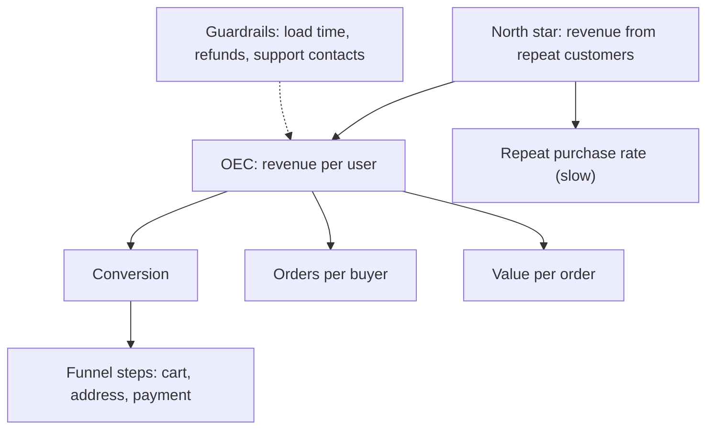

# 2 — Metrics and KPI Design

Microsoft once moved a page module higher up, and its click-through rate per user fell by 40%. The obvious reading is that the change failed. In fact clicks rose 74%, impressions rose 200%, page-level click-through stayed flat, and revenue went up: the metric had fallen because its denominator had grown faster than its numerator ([Dmitriev et al., KDD 2017](https://doi.org/10.1145/3097983.3098024)). A correct test on the wrong metric gives a confident wrong answer, and no amount of statistics downstream can repair it. This chapter is about choosing what to measure before the experiment, and reading it correctly after.

The checkout test in [the previous chapter](01-ab-testing.md) used conversion because it was convenient. Larkspur's actual goal is a healthy business next year, which no experiment can measure in three weeks. Everything hard in metric design comes from that gap: what you want is slow, noisy and hard to attribute to one change, and what you can measure is quick, sensitive and only a proxy.

## Four kinds of metric

Dmitriev and colleagues, writing from Microsoft's experimentation team, sort metrics into four groups according to what the metric is for. The grouping matters because each kind is read with a different rule. These are business metrics, read to decide a launch. A model's metric answers a different question, and its target and costs set it: see [choosing a metric](../../../data-science/01-classical-ml/notes/11-choosing-a-metric.md) in data science.

| Kind | Question | Larkspur example | How you read it |
|---|---|---|---|
| Data quality | Can I trust this experiment at all? | sample ratio, event loss, share of bot traffic | any failure invalidates the rest |
| Overall evaluation criterion (OEC) | Did the change succeed? | revenue per user, with repeat purchase | ideally one number, decided in advance, drives the launch decision |
| Guardrail | Did it break something we promised not to break? | page load time, refunds, support contacts | must not get worse beyond a margin |
| Local or diagnostic | Why did the result come out this way? | coupon-box clicks, step-by-step funnel | explains the result, and does not decide it |

A *north star* is the single company-level number a team steers by across quarters, such as Larkspur's revenue from repeat customers. Few experiments can move it detectably. An OEC is the experiment-sized stand-in, and Kohavi and colleagues set out what it should be: one metric or a weighted combination, not focused on the short term, and predictive of long-term value such as lifetime revenue and repeat visits ([Kohavi et al., DMKD, 2009](https://doi.org/10.1007/s10618-008-0114-1)). Dmitriev and colleagues add that it should be leading, which means it moves within the experiment window.

The metric tree below connects the two. It is the first thing to draw for a new product area, because it shows which levers each team really holds and where a proxy might drift away from its parent.



### What makes a good metric

Five properties, and they pull against one another:

- **Sensitive.** It moves when the product really changes. Revenue per user can be right in concept and too noisy to use.
- **Directional.** Up clearly means good. "Time on site" fails, because people may be engaged or lost.
- **Attributable.** The change plausibly moves it, within the window.
- **Hard to game.** A team rewarded on clicks will find a way to get clicks, whether or not anyone benefits. When a measure becomes a target it stops being a good measure, the observation usually called Goodhart's law.
- **Predictive of what you really care about.** This needs checking, because it is an empirical claim. Compare past experiments' short-term metric movement with their later long-term results. Long-run studies do find that the short-term view can mislead: Google ran [long-term experiments on how ad load changes behaviour](https://doi.org/10.1145/2783258.2788583) for this reason. Treat that paper as an example of the method. It is not held here, so no numbers are quoted from it.

## Break the metric apart

Here is the checkout test again, this time with the reminder email the marketing team added to the treatment. Revenue per user is a product of three parts, and the table adds session-based versions, because those are what the dashboard shows:

```python
import numpy as np
import pandas as pd
from scipy import stats
from statsmodels.stats.multitest import multipletests

rng = np.random.default_rng(302)
n = 40_000
arm = rng.random(n) < 0.5
u_intent = rng.gamma(0.6, 1 / 0.6, n)                  # people differ in how much they shop
sessions = 1 + rng.poisson(1.6 * u_intent)
# B: the redesign plus a reminder email that brings people back for low-intent visits
sessions = sessions + np.where(arm, rng.poisson(0.5, n), 0)
buys = rng.binomial(1 + rng.poisson(0.2, n), np.minimum(0.04 * u_intent * np.where(arm, 1.10, 1.0), 1))
value = np.array([rng.lognormal(3.6, 0.9, b).sum() for b in buys])
df = pd.DataFrame({"arm": np.where(arm, "B", "A"), "sessions": sessions, "orders": buys, "revenue": value})
tree = df.groupby("arm").agg(users=("revenue", "size"), buyers=("orders", lambda s: (s > 0).sum()),
                             orders=("orders", "sum"), revenue=("revenue", "sum"), sessions=("sessions", "sum"))
out = pd.DataFrame({
    "conversion": tree.buyers / tree.users,
    "orders/buyer": tree.orders / tree.buyers,
    "value/order": tree.revenue / tree.orders,
    "revenue/user": tree.revenue / tree.users,
    "sessions/user": tree.sessions / tree.users,
    "conv/session": tree.buyers / tree.sessions,
    "revenue/session": tree.revenue / tree.sessions,
}).T
out["B vs A"] = out["B"] / out["A"] - 1
print(out.round(3).to_string(formatters={"B vs A": "{:+.1%}".format}))
```

```text
arm                   A       B B vs A
conversion        0.045   0.052 +13.9%
orders/buyer      1.026   1.016  -1.0%
value/order      55.997  54.763  -2.2%
revenue/user      2.612   2.882 +10.3%
sessions/user     2.590   3.113 +20.2%
conv/session      0.018   0.017  -5.2%
revenue/session   1.008   0.926  -8.2%
```

The factorisation is an identity, which makes it a handy test of your pipeline: if the parts do not multiply back to the total, your definitions disagree.

```python
a = out["A"]
print(f"{a['conversion']:.4f} x {a['orders/buyer']:.3f} x {a['value/order']:.2f} = "
      f"{a['conversion'] * a['orders/buyer'] * a['value/order']:.3f}, revenue/user {a['revenue/user']:.3f}")
```

```text
0.0454 x 1.026 x 56.00 = 2.612, revenue/user 2.612
```

Read the table top to bottom. Conversion rose. Revenue per user rose. Yet revenue per session fell by 8% and conversion per session fell by 5%, because the email brought people back for extra low-intent visits. Someone reading the session columns would call this a failure, and someone reading the user columns would call it a win. Both are arithmetically right. This is the same behaviour as the module in the hook, and it leads to the rule that matters most in this chapter.

## Ratio metrics

**When the denominator can change with the treatment, a ratio metric can move for reasons that have nothing to do with its numerator.** Dmitriev and colleagues call this metric sample ratio mismatch. A new-tab feature at MSN seemed to slow the homepage by 8.32%. In fact, it reduced homepage loads by 7.8%, and the loads that vanished were fast back-button reloads from the cache, so the remaining average got slower while nobody's page did. Their remedy is simple and worth making a house rule: *never report a ratio without its numerator and denominator*.

There are two ways to compute a ratio per user, and they answer different questions:

- **Ratio of averages:** total revenue divided by total sessions. It weights heavy users more, and it equals the "site-wide" number on a dashboard.
- **Average of ratios:** compute revenue per session for each user, then average. Each user counts once.

Dmitriev and colleagues prefer the second for experiment analysis, because it tends to be more sensitive and more resistant to outliers, suffers less from metric SRM, and has a simple variance. The first is usually what the business thinks it is measuring, so pick deliberately and write the choice in the metric's definition.

Their standard errors differ as well. The ratio of averages is one ratio of two sums, so the observations are not independent sessions. The users are the independent unit, and the delta method linearises the ratio to get the variance. For r = ȳ/x̄, the variance is that of (y − r·x)/x̄ over users, divided by the number of users ([Deng, Knoblich and Lu, KDD 2018](https://doi.org/10.1145/3219819.3219919)). Chapter 4 of the statistics pillar [derives this](../../02-probability-and-statistics/notes/04-estimation.md). Check it against a user-level bootstrap, and against the wrong answer that a dashboard produces if it treats sessions as independent:

```python
def ratio(g):
    return g["revenue"].sum() / g["sessions"].sum()

def delta_se(g):
    """Delta method SE of sum(y)/sum(x), with the user as the independent unit."""
    y, x = g["revenue"].to_numpy(), g["sessions"].to_numpy()
    m = len(g)
    r = y.mean() / x.mean()
    resid = y - r * x
    return np.sqrt(resid.var(ddof=1) / m) / x.mean()

a_df, b_df = df[df.arm == "A"], df[df.arm == "B"]
rng2 = np.random.default_rng(3)
boot = []
for _ in range(1_000):
    i = rng2.integers(0, len(a_df), len(a_df))
    boot.append(a_df["revenue"].to_numpy()[i].sum() / a_df["sessions"].to_numpy()[i].sum())
# the naive formula treats every session as an independent draw of revenue/session
s = a_df["sessions"].to_numpy()
per_session = np.repeat(a_df["revenue"].to_numpy() / s, s)
print(f"revenue/session in A: {ratio(a_df):.3f}")
print(f"delta method SE      {delta_se(a_df):.4f}")
print(f"user bootstrap SE    {np.std(boot, ddof=1):.4f}")
print(f"naive per-session SE {per_session.std(ddof=1) / np.sqrt(len(per_session)):.4f}")
```

```text
revenue/session in A: 1.008
delta method SE      0.0490
user bootstrap SE    0.0491
naive per-session SE 0.0282
```

The formula and the bootstrap agree, and the naive version is about 40% too small. Now the full comparison:

```python
ra, rb = ratio(a_df), ratio(b_df)
se_diff = np.hypot(delta_se(a_df), delta_se(b_df))
z = (rb - ra) / se_diff
print(f"ratio of averages: A {ra:.3f} B {rb:.3f}, diff {rb - ra:+.3f}, z {z:.2f}, p {2 * stats.norm.sf(abs(z)):.4f}")
ua = a_df["revenue"] / a_df["sessions"]
ub = b_df["revenue"] / b_df["sessions"]
w = stats.ttest_ind(ub, ua, equal_var=False)
print(f"average of ratios: A {ua.mean():.3f} B {ub.mean():.3f}, diff {ub.mean() - ua.mean():+.3f}, t {w.statistic:.2f}, p {w.pvalue:.4f}")
ru = stats.ttest_ind(b_df["revenue"], a_df["revenue"], equal_var=False)
print(f"revenue per user:  A {a_df['revenue'].mean():.3f} B {b_df['revenue'].mean():.3f}, "
      f"diff {b_df['revenue'].mean() - a_df['revenue'].mean():+.3f}, t {ru.statistic:.2f}, p {ru.pvalue:.4f}")
cv = stats.ttest_ind((b_df["orders"] > 0).astype(float), (a_df["orders"] > 0).astype(float), equal_var=False)
print(f"conversion:        A {(a_df['orders'] > 0).mean():.4f} B {(b_df['orders'] > 0).mean():.4f}, t {cv.statistic:.2f}, p {cv.pvalue:.4f}")
se_n = stats.ttest_ind(b_df["sessions"], a_df["sessions"], equal_var=False)
print(f"sessions per user: A {a_df['sessions'].mean():.3f} B {b_df['sessions'].mean():.3f}, t {se_n.statistic:.2f}")
```

```text
ratio of averages: A 1.008 B 0.926, diff -0.083, z -1.28, p 0.2010
average of ratios: A 0.862 B 0.786, diff -0.076, t -1.09, p 0.2743
revenue per user:  A 2.612 B 2.882, diff +0.270, t 1.46, p 0.1450
conversion:        A 0.0454 B 0.0518, t 2.94, p 0.0033
sessions per user: A 2.590 B 3.113, t 21.12
```

Conversion is clearly up. Revenue per user has the right sign but the test cannot resolve it, because revenue is so noisy. Both revenue-per-session versions point down, and neither is significant. If you had chosen revenue per session as the OEC you would be arguing about a decline. The largest test statistic belongs to sessions per user, which is just the email working. The decision here rests on the metric definitions, not on a p-value.

## Sensitivity: revenue and its alternatives

The reason teams keep reaching for proxies is variance. The number of users you need scales with the variance of the metric relative to its mean, so the same 5% change costs very different amounts:

```python
rev = df["revenue"]
cap = rev.quantile(0.999)
def n_for_5pct(x):
    return 16 * x.var(ddof=1) / (0.05 * x.mean()) ** 2
binary = (df["orders"] > 0).astype(float)
rows = {
    "revenue/user": rev,
    f"revenue/user capped at {cap:,.0f}": rev.clip(upper=cap),
    "conversion": binary,
}
for name, x in rows.items():
    print(f"{name:<32} mean {x.mean():7.3f}  sd {x.std(ddof=1):7.3f}  n per arm for 5% {n_for_5pct(x):>9,.0f}")
print(f"users above the cap: {(rev > cap).sum()}, their share of revenue {rev[rev > cap].sum() / rev.sum():.1%}")
```

```text
revenue/user                     mean   2.746  sd  18.493  n per arm for 5%   290,154
revenue/user capped at 252       mean   2.645  sd  16.444  n per arm for 5%   247,386
conversion                       mean   0.049  sd   0.215  n per arm for 5%   125,290
users above the cap: 40, their share of revenue 12.9%
```

The pattern matches Kohavi and colleagues' worked example, where a 5% change requires more than 409,000 users per arm on revenue per user and under 122,000 on conversion. Capping is the cheap improvement. Forty users hold 13% of the revenue here, and clipping at the 99.9th percentile reduces the required sample by about 15%, at the cost of ignoring what happens above the cap. The same test gets a little sharper on this data:

```python
capped_test = stats.ttest_ind(b_df["revenue"].clip(upper=cap), a_df["revenue"].clip(upper=cap), equal_var=False)
print(f"uncapped p = {ru.pvalue:.4f}, capped p = {capped_test.pvalue:.4f}")
```

```text
uncapped p = 0.1450, capped p = 0.1141
```

Capped metrics are standard, and Dmitriev and colleagues list trimming, capping and winsorising as outlier treatments. There is a warning in their infopane case, though. Its slides went from 12 to 16, and a bot filter tuned on page counts started removing engaged real users from the treatment, causing an SRM. Count how many values each treatment changes, and track it as a data quality metric. Then decide whether the cap could hide the very effect you hoped for, since a change that only helps big spenders would vanish beneath it.

The other route is to change the metric's construction. Kohavi and colleagues show that filtering to users who could be affected shrinks the problem. If only 10% of users start checkout and half of them finish, a test of a checkout change needs about 6,400 users through the checkout, versus 64,000 users in total when you include everyone. Report the filtered metric alongside the unconditional one, because a change can alter who reaches the filter. That is the funnel pitfall below.

## Guardrails need a test of their own

A guardrail answers "did this get worse by more than we can tolerate?", and that is a different question from an OEC's. Failing to find a significant change does not pass the guardrail, for the same reason that "not significant" is not "no effect" [in the last chapter](01-ab-testing.md). The right tool is a non-inferiority test: fix a margin, and require the one-sided upper bound of the change to fall below it. Larkspur's rule is that the redesign may not add more than 50 ms to page load:

```python
def noninferior(mean_a, mean_b, sd_a, sd_b, n_a, n_b, margin):
    """H0: B is worse than A by at least margin (higher is worse). One-sided."""
    diff = mean_b - mean_a
    se = np.sqrt(sd_a ** 2 / n_a + sd_b ** 2 / n_b)
    return diff, diff + 1.645 * se, stats.norm.sf((margin - diff) / se)

print("page load guardrail, margin +50 ms, sd 900 ms")
for arm_n, delta in [(400, 8), (20_000, 8), (20_000, 45), (20_000, 70)]:
    d, upper, p = noninferior(1800, 1800 + delta, 900, 900, arm_n, arm_n, 50)
    verdict = "pass" if p < 0.05 else "cannot pass"
    print(f"n={arm_n:>6,}  observed +{delta:>2} ms  one-sided upper {upper:6.1f}  p={p:.3f}  {verdict}")
```

```text
page load guardrail, margin +50 ms, sd 900 ms
n=   400  observed + 8 ms  one-sided upper  112.7  p=0.255  cannot pass
n=20,000  observed + 8 ms  one-sided upper   22.8  p=0.000  pass
n=20,000  observed +45 ms  one-sided upper   59.8  p=0.289  cannot pass
n=20,000  observed +70 ms  one-sided upper   84.8  p=0.987  cannot pass
```

The first row is the important one. Eight extra milliseconds on 400 users per arm "isn't significant", and a naive check would pass it, yet the data allow a slowdown of more than 100 ms. Note that the guardrail's power is part of your design. Kohavi and colleagues report why load time earns this status at Live Search, where slowing results by one second reduced queries per user by 1% and ad clicks by 1.5%, and two seconds reduced them by 2.5% and 4.4%.

A guardrail margin is a business judgement, and it needs to be set in advance. Dmitriev and colleagues' example of an underpowered metric gives the size of the risk: MSN page views were measured at +0.5% with a confidence interval of about ±5%, and only changes of at least 7.8% were detectable at 80% power. If that metric were a guardrail, an apparent pass would mean almost nothing.

## Many metrics, one decision

A platform shows sixty metrics for each test. Among them you will see noise:

```python
rng = np.random.default_rng(9)
m = 60
true_mover = np.zeros(m, bool); true_mover[:4] = True
z_stats = rng.normal(0, 1, m) + np.where(true_mover, 4.0, 0)
pvals = 2 * stats.norm.sf(np.abs(z_stats))
raw = pvals < 0.05
bh = multipletests(pvals, alpha=0.05, method="fdr_bh")[0]
print(f"raw: {raw.sum()} flagged, {(raw & ~true_mover).sum()} false")
print(f"BH:  {bh.sum()} flagged, {(bh & ~true_mover).sum()} false")
```

```text
raw: 7 flagged, 3 false
BH:  3 flagged, 0 false
```

Without correction, nearly half the flags here are false. Benjamini-Hochberg removes them at the cost of one real mover, as [hypothesis testing](../../02-probability-and-statistics/notes/05-hypothesis-testing.md) explains. The practical arrangement is to have one OEC tested at the normal threshold, guardrails with explicit margins, and diagnostics under FDR control and read only as hints for *why*. Dmitriev and colleagues also apply a Bonferroni correction when scanning segments.

When metrics conflict, you need a trade-off stated before the test. A weighted combination forces this conversation, and Kohavi and colleagues' OEC can be exactly such a composite. Larkspur could agree these weights in advance:

```python
tradeoff = pd.DataFrame({
    "rev/user": [0.030, 0.012, 0.040],
    "repeat rate": [-0.020, 0.015, 0.000],
    "support contacts": [0.000, -0.010, 0.060],
}, index=["layout X", "layout Y", "layout Z"])
weights = pd.Series({"rev/user": 0.5, "repeat rate": 1.0, "support contacts": -0.3})
tradeoff["OEC"] = tradeoff.mul(weights).sum(axis=1)
print(tradeoff.round(3))
```

```text
          rev/user  repeat rate  support contacts    OEC
layout X     0.030       -0.020              0.00 -0.005
layout Y     0.012        0.015             -0.01  0.024
layout Z     0.040        0.000              0.06  0.002
```

Layout Z has the biggest revenue gain and pays for it in support contacts. Layout X gains revenue and loses repeat buyers, and comes last. Layout Y has the smallest revenue gain and wins. The weights themselves are a judgement call, and someone should say out loud that a point of repeat rate is worth two points of revenue, which is exactly the point of the exercise. Those weights should come from data if possible, such as a regression of long-term value on short-term metrics, and be revisited as that relationship drifts.

## The dozen, mapped to checks

Dmitriev and colleagues catalogued twelve pitfalls from real experiments at Microsoft. It is worth reading the paper in full. Each one maps to a check you can automate.

| # | Pitfall | Their example | The check |
|---|---|---|---|
| 1 | Metric sample ratio mismatch | MSN homepage load time +8.32%, loads −7.8% | Compare denominator counts across arms |
| 2 | Misinterpreting ratio metrics | Module moved up: CTR per user −40%, clicks +74% | Show numerator and denominator |
| 3 | Telemetry loss bias | Skype push notifications | Measure loss with server events or sequence numbers |
| 4 | Assuming underpowered metrics had no change | MSN page views +0.5%, CI about ±5% | Report the MDE for each metric |
| 5 | Claiming success with a borderline p-value | Bing OEC p = 0.029; a rerun at double traffic was not significant | Rerun a certification flight; combine with Fisher's method |
| 6 | Continuous monitoring and early stopping | Bing ranker and Xbox tips | Predefine the end, or use sequential methods |
| 7 | Assuming the metric moved uniformly | Bing ads: duplicate pages −2.3%, others +0.3% | Compute per-segment and heterogeneity |
| 8 | Misinterpreting segment results | Deeplink: both segments up, total flat | SRM test per segment; correct for multiplicity |
| 9 | Impact of outliers | Infopane: bot filter removed real users | Cap or winsorise, and count affected values |
| 10 | Novelty and primacy effects | Edge coach mark: +2.07% clicks, gone after first visit | Lift by days since exposure |
| 11 | Incomplete funnel metrics | Xbox promos: clicks up, revenue flat | Conditional and unconditional rates |
| 12 | Failure to apply Twyman's law | MSN mail button: +28% clicks, no retention change | Distrust results that look too good |

Number 8 deserves a demonstration because the arithmetic seems impossible. Both segments improve and the total does not:

```python
seg = pd.DataFrame({
    "users_A": [4_000, 36_000], "buyers_A": [800, 720],
    "users_B": [2_000, 38_000], "buyers_B": [480, 1_041],
}, index=["reached deep page", "stayed shallow"])
seg["conv_A"] = seg.buyers_A / seg.users_A
seg["conv_B"] = seg.buyers_B / seg.users_B
print(seg[["users_A", "conv_A", "users_B", "conv_B"]].round(4))
print(f"total: A {seg.buyers_A.sum() / seg.users_A.sum():.4f}, B {seg.buyers_B.sum() / seg.users_B.sum():.4f}")
```

```text
                   users_A  conv_A  users_B  conv_B
reached deep page     4000    0.20     2000  0.2400
stayed shallow       36000    0.02    38000  0.0274
total: A 0.0380, B 0.0380
```

The segment is defined by something that happens *after* assignment. The treatment moved people out of the "deep" group, and those who remain are stronger, while the people who dropped down raise the shallow group's average. This is [Simpson's paradox](04-correlation-and-causation.md) in experimental form. A segment is only safe if it is fixed before treatment, such as device or country. To check, run the SRM test within each segment: here the 4,000 vs 2,000 split fails immediately.

Twyman's law, that any figure that looks interesting or different is usually wrong, is the most useful habit of all. MSN's mail button change showed +28% clicks on the button, +27% on the one next to it and no change in retention. Clicks fell daily, and the likely explanation was confusion. A Windows Store change reported +10% page views, which turned out to be empty pages.

## Writing a metric down

A metric that lives in a dashboard filter is not defined. Larkspur requires this block for anything used in a decision:

```text
name:         revenue_per_user_28d
owner:        checkout-analytics
kind:         OEC
unit:         user (the unit of randomisation)
numerator:    sum of net order value in the 28 days after first exposure, capped at P99.9
denominator:  users exposed, including those with no order
direction:    up is good
filters:      excludes staff accounts and known bots; share removed tracked as data quality
variance:     delta not needed, user-level mean; Welch
window:       14 to 28 days, whole weeks
guardrails:   p95 page load (+50 ms), refund rate (+0.2 pp), support contacts (+1%)
```

"Including those with no order" settles the denominator. "Unit" prevents the pageview bug. And "filters" records what was removed, because a filter that interacts with the treatment is a common cause of the mismatches in this chapter.

---

## Pitfalls

- **Reading a ratio without its parts.** A −40% CTR can accompany +74% clicks and more revenue.
- **Conditioning on a post-treatment segment.** "Buyers spent less" may just mean the treatment created new, smaller buyers. Fix segments before assignment or use unconditional rates.
- **Treating "not significant" as a guardrail pass.** Use a margin and a one-sided bound, and check power.
- **Picking the metric after the result.** Whichever metric moved will seem to be the one that always mattered. Agree it in advance.
- **Using short-term click metrics as the OEC.** Clickbait wins. Validate proxies against long-term outcomes.
- **Promoting every diagnostic to a decision metric.** Sixty metrics yield three false movers on an average day.
- **A cap that hides the effect.** If the treatment targets big spenders, a low cap removes what you care about.
- **Believing a surprising result.** Apply Twyman's law. Look for the bug first.

---

## Try it

1. In the `tree` block, make the email bring back 1.5 extra sessions on average instead of 0.5. What happens to revenue per session? Does revenue per user change?
2. An experiment reports revenue per click up 6%, with clicks down 5%. Is that good? What do you ask for?
3. Rerun `guardrail` with n = 400 and observed +8 ms, and find the n at which it passes. Use `noninferior`.
4. A PM proposes "time on site" as the OEC for a new search feature. Reply in two sentences.

<details>
<summary>Answers</summary>

1. Revenue per session falls much further because the denominator grows, while revenue per user stays put apart from simulation noise, because buying does not depend on the extra sessions in this simulation. That is the whole lesson in one parameter.
2. Revenue per click × clicks = revenue, so the total is about 1.06 × 0.95 = 1.007, close to flat. Ask for the numerator and denominator with their intervals, and for revenue per user.
3. With sd 900 and margin 50, the p-value depends on (50 − 8)/(900√(2/n)). It must exceed 1.645, which needs n ≥ 2 × (1.645 × 900 / 42)², about 2,490 users per arm.
4. It is not directional, because a better search should get people to their answer faster, so time on site could fall when the feature succeeds. Use a success measure such as successful searches per user or purchases after search, with time as a diagnostic.

</details>

---

## Interview checklist

| Prompt | Answer |
|---|---|
| OEC vs guardrail vs north star? | North star: the company number over quarters. OEC: the experiment-sized metric that decides the launch. Guardrail: must not get worse by more than a margin. |
| What makes a good OEC? | Sensitive, directional, attributable, hard to game, predictive of long-term value, decided in advance. |
| CTR fell 40%. Is the change bad? | Unknown. Look at clicks and impressions separately. The denominator may have grown. |
| Ratio of averages or average of ratios? | The first weights heavy users and matches the site-wide number. The second weights users equally and is usually more sensitive. Choose deliberately. |
| Standard error of a ratio metric? | Delta method or user-level bootstrap. The user, and not the session, is the independent unit. |
| How do you test a guardrail? | Non-inferiority: a pre-set margin and a one-sided bound, with enough power. |
| Revenue per user never reaches significance. What now? | Cap it, use CUPED, find a sensitive proxy validated against revenue, filter to affected users, or accept a larger MDE. |
| Both segments rose but the total was flat. How? | Users moved between segments. The segment is post-treatment, or the mix changed. Check SRM per segment. |
| What is Twyman's law? | Any figure that looks interesting or different is usually wrong. Check for a bug first. |
| How do you handle 60 metrics? | One OEC, guardrails with margins, FDR control on diagnostics. |

---

## Further reading

Dmitriev et al.'s [Dirty Dozen](https://doi.org/10.1145/3097983.3098024) is the paper to read after this chapter. Kohavi et al.'s [survey](https://doi.org/10.1007/s10618-008-0114-1) covers OEC design. Everything is listed in [references](../references.md).

---

## Next

[Chapter 3: Experimentation at Scale](03-experimentation-at-scale.md) moves from one test to a platform: variance reduction with CUPED, safe ways to look early, what to do when an SRM fires, and overlapping tests.
