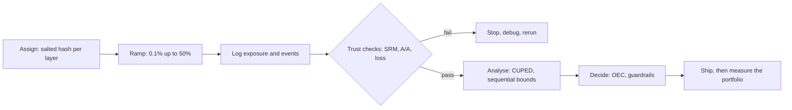

# 3 — Experimentation at Scale

Larkspur now runs fifty experiments at once, and the same three messages arrive every week. A product manager wants to check results daily. A dashboard reports a 50.4/49.6 split on two million users and asks whether that matters. A team that could detect a 10% lift has been told its feature will move revenue by 1%. None of these is covered by the single well-run test of [chapter 1](01-ab-testing.md), and at this size the hard problems stop being about one analysis: effects are too small for the noise, people look at the numbers constantly, and the assignment pipeline itself breaks. This chapter is the platform's answer to each.

The order follows how a team runs into them. First, make each test more sensitive so that small effects are affordable. Next, make looking early safe, since people will look. Then build the trust checks that catch a broken test before anyone believes it. And finally, deal with what makes individual tests add up to less than they promise: interference between users, overlap between tests, and winner's curse across the portfolio.



## Variance reduction: CUPED

The cheapest way to get more power is to remove noise that has nothing to do with the treatment. Most of the variation in a user's activity this month comes from the kind of user they were already. Last month's activity predicts that, and because it happened before assignment, it cannot be affected by the treatment. That is the whole idea of CUPED, Controlled-experiment Using Pre-Experiment Data, from Microsoft's Bing team ([Deng, Xu, Kohavi and Walker, WSDM 2013](https://doi.org/10.1145/2433396.2433413)). Its abstract reports about a 50% variance reduction on real Bing metrics.

Simulate 40,000 users whose activity depends on a stable taste, with a true effect of 0.12:

```python
import hashlib
import numpy as np
import pandas as pd
from scipy import stats
import statsmodels.formula.api as smf

rng = np.random.default_rng(303)
n = 40_000
taste = rng.gamma(0.6, 1 / 0.6, n)                       # stable differences between users
pre = rng.poisson(3.0 * taste) + rng.normal(0, 1, n)     # last month's activity
arm = (rng.random(n) < 0.5).astype(int)
post = 3.0 * taste + rng.normal(0, 3.0, n) + 0.12 * arm  # this month, true effect 0.12
print(f"corr(pre, post) = {np.corrcoef(pre, post)[0, 1]:.3f}")
```

```text
corr(pre, post) = 0.702
```

For a covariate X, CUPED replaces each outcome Y with Y − θ(X − X̄), where θ = cov(X, Y)/var(X) is the slope of the regression of Y on X. This is the linear control variate from Monte Carlo:

```python
theta = np.cov(pre, post)[0, 1] / pre.var(ddof=1)
adj = post - theta * (pre - pre.mean())
def effect(y):
    d = y[arm == 1].mean() - y[arm == 0].mean()
    se = np.sqrt(y[arm == 1].var(ddof=1) / (arm == 1).sum() + y[arm == 0].var(ddof=1) / (arm == 0).sum())
    return d, se
for name, y in [("raw", post), ("CUPED", adj)]:
    d, se = effect(y)
    print(f"{name:<6} effect {d:.3f}  SE {se:.4f}  z {d / se:5.2f}  var {y.var():.2f}")
rho = np.corrcoef(pre, post)[0, 1]
print(f"variance ratio {adj.var() / post.var():.3f}, 1 - rho^2 = {1 - rho ** 2:.3f}")
print(f"users needed for the same power: {adj.var() / post.var():.0%} of the original")
```

```text
raw    effect 0.101  SE 0.0488  z  2.08  var 23.83
CUPED  effect 0.123  SE 0.0348  z  3.53  var 12.10
variance ratio 0.508, 1 - rho^2 = 0.508
users needed for the same power: 51% of the original
```

The variance falls by exactly ρ², the squared correlation between X and Y. At ρ = 0.7 that halves the variance, which halves the users you need, and it is free: no new traffic and no change to the product. A z of 2.08 becomes 3.53. Read the formula's two consequences:

- **The mean stays the same in expectation.** Randomisation makes X̄ the same across arms in expectation, so subtracting θ(X − X̄) cannot shift the difference. A single run's estimate moves, from 0.101 to 0.123 here, because it corrects the chance imbalance in pre-period activity between arms.
- **It only works with a good predictor.** With ρ = 0.3 variance falls by only 9%. A new-user product has no pre-period, and a rare outcome is often hard to predict.

The same estimate comes from a regression with the centred pre-period value as a control, so CUPED is what an analyst would have called ANCOVA:

```python
d = pd.DataFrame({"y": post, "arm": arm, "pre_c": pre - pre.mean()})
fit = smf.ols("y ~ arm + pre_c", data=d).fit()
print(f"regression: effect {fit.params['arm']:.3f}, SE {fit.bse['arm']:.4f}")
```

```text
regression: effect 0.123, SE 0.0348
```

Is it really unbiased, though? A run of repeated simulations settles that:

```python
rng = np.random.default_rng(1)
ests_raw, ests_adj = [], []
for _ in range(1_500):
    m = 2_000
    t = rng.gamma(0.6, 1 / 0.6, m)
    x = rng.poisson(3.0 * t) + rng.normal(0, 1, m)
    w = (rng.random(m) < 0.5).astype(int)
    y = 3.0 * t + rng.normal(0, 3.0, m) + 0.12 * w
    th = np.cov(x, y)[0, 1] / x.var(ddof=1)
    z = y - th * (x - x.mean())
    ests_raw.append(y[w == 1].mean() - y[w == 0].mean())
    ests_adj.append(z[w == 1].mean() - z[w == 0].mean())
print(f"raw   mean {np.mean(ests_raw):.3f}  sd {np.std(ests_raw):.3f}")
print(f"CUPED mean {np.mean(ests_adj):.3f}  sd {np.std(ests_adj):.3f}  (true effect 0.120)")
```

```text
raw   mean 0.116  sd 0.216
CUPED mean 0.123  sd 0.153  (true effect 0.120)
```

The averages are both close to 0.12, and the spread falls by about 30%, which is the square root of the halved variance. Users with no history can keep their raw value, or be adjusted within their own group. You lose some of the gain and none of the validity:

```python
has_pre = rng.random(n) < 0.7     # 30% of users have no history
# a separate adjustment for the group with history; no adjustment for the rest
th = np.cov(pre[has_pre], post[has_pre])[0, 1] / pre[has_pre].var(ddof=1)
adj2 = post.copy()
adj2[has_pre] = post[has_pre] - th * (pre[has_pre] - pre[has_pre].mean())
d2, se2 = effect(adj2)
d0, se0 = effect(post)
print(f"70% with history: SE {se2:.4f} against raw {se0:.4f}, full history {effect(adj)[1]:.4f}")
```

```text
70% with history: SE 0.0393 against raw 0.0488, full history 0.0348
```

Three rules apply. Use a covariate measured strictly **before exposure**, because anything the treatment can touch brings bias back. Prefer the same metric from the pre-period, as it is usually the strongest predictor. And check that the arms' pre-period means agree: a gap there is itself evidence of an assignment problem, and it gives you a free A/A test.

## Looking early, safely

[Chapter 1](01-ab-testing.md) showed that checking twenty times and stopping at the first p below 0.05 gives a false positive rate around 25%. Here is the shape of that curve under the null:

```python
def fpr_with_looks(k, reps=4_000, n_max=10_000, seed=0, boundary=None):
    rng = np.random.default_rng(seed)
    looks = np.linspace(n_max / k, n_max, k)
    # the z statistic at each look is a scaled random walk
    incr = rng.normal(0, 1, (reps, k)) * np.sqrt(np.diff(np.r_[0, looks]))
    z = incr.cumsum(axis=1) / np.sqrt(looks)
    c = 1.96 if boundary is None else boundary(looks / n_max)
    return np.mean((np.abs(z) > c).any(axis=1))

for k in (1, 2, 5, 10, 20, 50, 100, 1000):
    print(f"{k:>5} looks: false positive rate {fpr_with_looks(k):.3f}")
```

```text
    1 looks: false positive rate 0.048
    2 looks: false positive rate 0.085
    5 looks: false positive rate 0.141
   10 looks: false positive rate 0.196
   20 looks: false positive rate 0.245
   50 looks: false positive rate 0.315
  100 looks: false positive rate 0.390
 1000 looks: false positive rate 0.524
```

Forbidding peeking does not work as a platform policy. Dashboards exist, and a bad launch must be stoppable, and Dmitriev and colleagues describe continuous monitoring as a live problem in Bing and Xbox experiments ([KDD 2017](https://doi.org/10.1145/3097983.3098024)). There are two honest alternatives, and both pay for looks with a stricter threshold.

**Group-sequential boundaries** fix a number of looks in advance and set a threshold for each. Pocock uses one constant threshold ([Biometrika, 1977](https://doi.org/10.1093/biomet/64.2.191)). O'Brien and Fleming make early looks very demanding, and later ones close to the fixed-horizon value ([Biometrics, 1979](https://doi.org/10.2307/2530245)). Calibrate both to a 5% overall rate over five looks:

```python
def calibrate(shape, k):
    lo, hi = 1.5, 6.0
    for _ in range(40):
        c = (lo + hi) / 2
        if fpr_with_looks(k, reps=40_000, seed=7, boundary=lambda t: c * shape(t)) > 0.05:
            lo = c
        else:
            hi = c
    return c

pocock = lambda t: np.ones_like(t)
obf = lambda t: 1 / np.sqrt(t)
k = 5
t = np.arange(1, k + 1) / k
for name, shape in [("Pocock", pocock), ("O'Brien-Fleming", obf)]:
    c = calibrate(shape, k)
    print(f"{name:<16} z boundary at each of 5 looks: {np.round(c * shape(t), 2)}, "
          f"FPR {fpr_with_looks(k, reps=40_000, seed=99, boundary=lambda s: c * shape(s)):.3f}")
```

```text
Pocock           z boundary at each of 5 looks: [2.42 2.42 2.42 2.42 2.42], FPR 0.049
O'Brien-Fleming  z boundary at each of 5 looks: [4.53 3.2  2.61 2.26 2.03], FPR 0.052
```

O'Brien-Fleming is the usual choice. It stops early only on enormous effects, which is exactly what you want to catch, and the final threshold of 2.03 costs little compared with 1.96. Pocock stops earlier on moderate effects and pays with a final threshold of 2.42. Published designs use numerical tables or alpha-spending functions, which also allow the looks to land on unplanned dates.

**Always-valid p-values** let you look at any moment, as often as you like. Johari and colleagues, whose method was deployed on a commercial testing platform, use a mixture sequential probability ratio test ([Johari, Pekelis and Walsh, 2015](https://arxiv.org/abs/1512.04922); [KDD 2017](https://doi.org/10.1145/3097983.3097992)). The test statistic Λₙ compares the data's likelihood under "some effect, drawn from a normal with variance τ²" to its likelihood under "no effect". Under the null, Λₙ is a martingale with mean 1, so the probability that it ever reaches 1/α is at most α. Therefore p = min(1/Λ) stays valid at any stopping time, a guarantee that a fixed-horizon test cannot make.

```python
def msprt_p_path(diffs, sigma2, tau2):
    """Always-valid p-values for a stream of paired differences (Gaussian mixture SPRT)."""
    m = np.arange(1, len(diffs) + 1)
    mean = np.cumsum(diffs) / m
    v = 2 * sigma2
    lam = np.sqrt(v / (v + m * tau2)) * np.exp(m ** 2 * tau2 * mean ** 2 / (2 * v * (v + m * tau2)))
    return np.minimum.accumulate(np.minimum(1, 1 / lam))

rng = np.random.default_rng(31)
n_max, reps = 20_000, 1_000
hit_null, stop_times = 0, []
for _ in range(reps):
    p = msprt_p_path(rng.normal(0, np.sqrt(2), n_max), 1.0, 0.01)
    hit_null += p[-1] < 0.05
for _ in range(reps):
    p = msprt_p_path(rng.normal(0.05, np.sqrt(2), n_max), 1.0, 0.01)
    below = np.nonzero(p < 0.05)[0]
    stop_times.append(below[0] + 1 if len(below) else np.nan)
stop_times = np.array(stop_times)
fixed_n = 2 * (1.96 + 0.84) ** 2 / 0.05 ** 2
print(f"checked after every pair of users, H0 true: FPR {hit_null / reps:.3f}")
print(f"true effect 0.05 sd: found by {n_max:,} pairs in {np.mean(~np.isnan(stop_times)):.1%} of runs")
print(f"median stop {np.nanmedian(stop_times):,.0f} pairs; 90th percentile {np.nanquantile(stop_times, .9):,.0f}")
print(f"fixed-horizon test for 80% power: {fixed_n:,.0f} pairs")
```

```text
checked after every pair of users, H0 true: FPR 0.041
true effect 0.05 sd: found by 20,000 pairs in 98.2% of runs
median stop 5,897 pairs; 90th percentile 12,932
fixed-horizon test for 80% power: 6,272 pairs
```

The false positive rate stays below 5% with a check after every pair. The price is visible in the tail. Half the runs stop sooner than the fixed test's 6,272 pairs, but a tenth take more than twice that, and the mixing variance τ² sets where the method is sharpest. Choose τ² from the effect sizes your past experiments really show.

Which to use? If a test is planned for three weeks and reviewed weekly, group-sequential is simple and efficient. If a self-serve platform shows p-values to people who will look whenever they like, always-valid is the only safe option. Either way, keep whole weeks in the analysis. Kohavi and colleagues advise running for at least one to two whole weeks, because weekday and weekend users differ, and a sequential stop on a Tuesday does not change that ([DMKD, 2009](https://doi.org/10.1007/s10618-008-0114-1)).

## Trust checks

### Sample ratio mismatch

**The split is 50.4/49.6 on two million users. Is that a problem?** Yes. [Chapter 1](01-ab-testing.md) computed the p-value, about 10⁻²⁹. The percentage looks harmless, but with two million users the check has the power to see that something is removing users from one arm or adding them to the other, and whatever does that is probably not random with respect to the outcome. The danger shows up in a simulation with **no treatment effect at all**, where a logging bug loses 4% of B's users, all of them low value:

```python
rng = np.random.default_rng(8)
n = 60_000
arm = rng.random(n) < 0.5
value = rng.gamma(0.6, 1 / 0.6, n)
y = value + rng.normal(0, 1, n)                 # no treatment effect at all
# a bug in B's logging loses 4% of B's users, all of them low value
dropped = arm & (value < np.quantile(value, 0.25)) & (rng.random(n) < 0.16)
kept = ~dropped
count_a, count_b = (~arm & kept).sum(), (arm & kept).sum()
t = stats.ttest_ind(y[arm & kept], y[~arm & kept], equal_var=False)
print(f"users A {count_a:,}, B {count_b:,}, SRM p = {stats.chisquare([count_a, count_b]).pvalue:.1e}")
print(f"effect {y[arm & kept].mean() - y[~arm & kept].mean():+.3f} on a mean of {y.mean():.2f}, p = {t.pvalue:.1e}, true effect 0")
```

```text
users A 30,113, B 28,722, SRM p = 9.8e-09
effect +0.036 on a mean of 1.00, p = 7.9e-03, true effect 0
```

A significant "win" appears from nothing. A team that looked only at the outcome would ship it. Treat an SRM as a stopped test, not a caveat, because you do not know the bias and you cannot correct it by reweighting without knowing who was lost.

When it fires, slice the counts by dimension until the problem localises:

```python
log = pd.DataFrame({"browser": ["chrome", "chrome", "safari", "safari", "firefox", "firefox"],
                    "arm": ["A", "B"] * 3,
                    "users": [20_080, 19_950, 15_020, 13_800, 4_990, 5_010]})
wide = log.pivot(index="browser", columns="arm", values="users")
wide["srm_p"] = [stats.chisquare(r).pvalue for r in wide[["A", "B"]].to_numpy()]
print(wide.round(4))
```

```text
arm          A      B   srm_p
browser
chrome   20080  19950  0.5158
firefox   4990   5010  0.8415
safari   15020  13800  0.0000
```

Only Safari is short. The likely causes are now a redirect that drops a cookie on that browser, a crash, or a load-time difference that loses people before their exposure is logged. Fabijan and colleagues give a taxonomy of causes and a diagnosis method drawn from production platforms ([KDD 2019](https://doi.org/10.1145/3292500.3330722)). A workable search follows the pipeline in order:

| Stage | What goes wrong | Where to look |
|---|---|---|
| Assignment | Hash correlated with another test; a salt reused | Counts by experiment overlap |
| Execution | Redirect or new code loses users before logging | Counts by browser and platform |
| Logging | Bot filter or loss differs by arm | Counts of raw vs processed events |
| Analysis | Filter that depends on treatment; wrong start date | Counts by day, and before and after each filter |

Because this runs on every experiment, a platform usually alerts at a p-value far below 0.05 to avoid constant false alarms. Set the threshold based on how many tests you run and what an investigation costs.

### A/A tests

Run the whole pipeline with no change. Kohavi and colleagues recommend running A/A tests continuously, alongside the live ones: about 5% should be significant at 0.05, and p-values should be uniform. Results that don't match point to a broken variance estimate, usually because the analysis unit doesn't match the randomisation unit, and that was the pageview bug in chapter 1. Their §5.1.2 reports a harder failure. They ran five simulated experiments over a million sequential user IDs, and only MD5 generated no correlations between experiments, with SHA256 coming close. The non-cryptographic hashes failed, which is why an assignment hash deserves its own test.

Kohavi and colleagues also use an A/A's variance estimate to set the sample size, and warn that some metrics have power that actually degrades as a test runs longer, so what counts for them is getting enough users per day. Dmitriev and colleagues make the related point that many count metrics' confidence intervals do not shrink with time.

### Novelty and primacy

Experienced users may try something new because it is new, or resist it because it is unfamiliar. Either way, the first week's lift is not the steady state:

```python
rng = np.random.default_rng(14)
days = np.arange(1, 29)
true_daily = 0.002 + 0.012 * np.exp(-days / 5)
users_daily = 6_000
ctrl = rng.binomial(users_daily, 0.05, 28) / users_daily
trt = rng.binomial(users_daily, 0.05 + true_daily) / users_daily
lift = pd.Series(trt - ctrl, index=days)
weekly = lift.groupby((days - 1) // 7 + 1).mean()
print("lift in points by week:", (weekly * 100).round(2).to_dict())
print(f"stop at week 1: {weekly.iloc[0] * 100:.2f}; steady state truth: {0.2:.2f}")
```

```text
lift in points by week: {1: 0.83, 2: 0.33, 3: 0.27, 4: 0.28}
stop at week 1: 0.83; steady state truth: 0.20
```

Stopping at week 1 would claim four times the lasting effect. In Dmitriev and colleagues' Edge example, a coach mark raised page clicks by 0.96% and top-site clicks by 2.07%, all of which disappeared after the first visit. Plot lift by days since first exposure, and compute it separately for new users, as Kohavi and colleagues advise, since they cannot have any novelty or primacy about a change they never saw before. For effects that matter long-term, some teams hold out a group for months, an approach also used to [study long-term user learning at Google](https://doi.org/10.1145/2783258.2788583), though that paper isn't held here.

## When users affect each other

Randomised tests assume that one user's arm doesn't change another's outcome, which statisticians call SUTVA. Marketplaces and networks break this. Take a seller with a fixed stock. If the treatment makes people want to buy more, some of the extra sales come directly out of what the control group would have bought:

```python
rng = np.random.default_rng(21)
def market(treated_share, reps=3_000, buyers=1_000, stock=120, base=0.1, lift=0.3):
    """Fixed stock. Treated buyers want to buy more often; sales cannot exceed stock."""
    a, b, total = [], [], []
    for _ in range(reps):
        tr = rng.random(buyers) < treated_share
        want = rng.random(buyers) < np.where(tr, base * (1 + lift), base)
        wanting = np.nonzero(want)[0]
        rng.shuffle(wanting)
        sold = np.zeros(buyers, bool)
        sold[wanting[:stock]] = True
        if treated_share not in (0, 1):
            a.append(sold[~tr].mean()); b.append(sold[tr].mean())
        total.append(sold.sum())
    return np.mean(a) if a else None, np.mean(b) if b else None, np.mean(total)

ctrl_rate, trt_rate, _ = market(0.5)
_, _, none = market(0.0)
_, _, every = market(1.0)
print(f"A/B inside one market: control {ctrl_rate:.4f}, treatment {trt_rate:.4f}, lift {trt_rate / ctrl_rate - 1:+.1%}")
print(f"nobody treated: {none:.1f} sales; everybody treated: {every:.1f}; real lift {every / none - 1:+.1%}")
```

```text
A/B inside one market: control 0.0981, treatment 0.1277, lift +30.1%
nobody treated: 100.0 sales; everybody treated: 119.0; real lift +19.0%
```

The test claims +30% and the real gain is +19%, because the treatment takes units from control. Kohavi and colleagues raise eBay auctions as a case of the same problem: a first-bidder discount given to some users affects every item, since control users bid on the same items, and their fix is to randomise the items in the auction and not the users.

The fix is to randomise at a higher level so that spillover happens within a unit. Choose a design for the interference you expect:

| Design | How it randomises | Good for | Cost |
|---|---|---|---|
| Cluster | city, seller or network community | spatial and social spillover | fewer units, more variance |
| Switchback | market by time window | ride-sharing and delivery | carryover between windows |
| Two-sided | buyers and sellers crossed | marketplaces | a lot of traffic |
| Holdout | small group kept away from the launch | total long-run effect | delay, some users left behind |

Cluster randomisation pays through the design effect, 1 + (m − 1)ρ, with m the cluster size and ρ the intra-cluster correlation:

```python
for m_, icc in [(100, 0.01), (1000, 0.01), (1000, 0.001)]:
    print(f"cluster size {m_:>4}, intra-cluster corr {icc}: variance x {1 + (m_ - 1) * icc:.1f}")
```

```text
cluster size  100, intra-cluster corr 0.01: variance x 2.0
cluster size 1000, intra-cluster corr 0.01: variance x 11.0
cluster size 1000, intra-cluster corr 0.001: variance x 2.0
```

Even a small ρ is expensive for large clusters. With a design effect of 11, a million users carry the information of about 91,000. Analyse at the cluster level or with cluster-robust errors, for the same reason that chapter 1 refused to analyse pageviews when it randomised users. [Multilevel models](../../04-bayesian-analysis/notes/07-multilevel-models-and-partial-pooling.md#intraclass-correlation-is-the-design-effects-input) estimate ρ as a parameter, and they [read each segment or market's effect](../../04-bayesian-analysis/notes/07-multilevel-models-and-partial-pooling.md#the-ab-application-reading-many-segments) with partial pooling.

## Many tests at once

Tests must overlap, because otherwise a platform runs out of traffic quickly. Google's layered design lets every user be in one test per layer, with independent salted hashes between layers, and tests on the same parameters kept in the same layer so that they cannot collide ([Tang et al., KDD 2010](https://doi.org/10.1145/1835804.1835810)). Salting makes the splits independent:

```python
def assign(uid, salt):
    return int(hashlib.sha256(f"{salt}:{uid}".encode()).hexdigest(), 16) % 2

ids = range(60_000)
a = np.array([assign(u, "checkout-v1") for u in ids])
b = np.array([assign(u, "search-v3") for u in ids])
tab = pd.crosstab(a, b)
print(tab)
print("independent splits, chi-square p:", round(stats.chi2_contingency(tab).pvalue, 3))

rng = np.random.default_rng(4)
y = 5 + 0.3 * a + 0.2 * b + rng.normal(0, 6, len(a))
inter = smf.ols("y ~ a * b", data=pd.DataFrame({"y": y, "a": a, "b": b})).fit()
print(f"main effect a {inter.params['a']:.3f}, b {inter.params['b']:.3f}, "
      f"interaction {inter.params['a:b']:.3f} (p = {inter.pvalues['a:b']:.2f})")
```

```text
col_0      0      1
row_0
0      15105  15025
1      14996  14874
independent splits, chi-square p: 0.867
main effect a 0.348, b 0.191, interaction -0.052 (p = 0.59)
```

Large interactions between tests are possible but are rarer than people fear, so the better policy is to monitor for them rather than to pre-emptively queue. An interaction's standard error is twice that of a main effect in this balanced design, so only big ones are visible, and this simulation has none to find. Keep known collisions, such as two redesigns of one page, in a single layer.

**Ramps** handle risk. Start small and check for disasters, and then expand to full power. Kohavi and colleagues use 0.1%, 0.5%, 2.5%, 10% and 50%, then point out why this works. Sample size falls with the square of the effect, so a catastrophe needs far less data than the planned effect does:

```python
base, sigma = 0.05, np.sqrt(0.05 * 0.95)
daily = 4_000
for name, delta in [("catastrophe, -20%", 0.01), ("planned effect, +10%", 0.005)]:
    need = 16 * sigma ** 2 / delta ** 2
    days_50 = need / (daily * 0.5)
    print(f"{name:<22} {need:>7,.0f} per arm: {days_50:5.1f} days at 50/50, "
          f"{need / (daily * 0.1):5.1f} days at a 10% arm (10/10)")
```

```text
catastrophe, -20%        7,600 per arm:   3.8 days at 50/50,  19.0 days at a 10% arm (10/10)
planned effect, +10%    30,400 per arm:  15.2 days at 50/50,  76.0 days at a 10% arm (10/10)
```

In their example, a bug causing a 20% drop can be seen in 1/400 of the time needed to detect a planned 1% change. Their platform can also abort automatically when a metric falls past a threshold. The same reasoning gives the 50/50 advice at the end of the ramp: Kohavi and colleagues calculate that a 99/1 split needs about 25 times the running time of 50/50.

**The portfolio** is where a platform finds out whether its results are real. Across many tests, the winners' measured lifts overstate what they actually delivered:

```python
rng = np.random.default_rng(100)
k = 200
true = np.where(rng.random(k) < 0.3, rng.normal(0.5, 0.4, k), 0.0)     # about 30% of ideas do something
se = 0.35
obs = true + rng.normal(0, se, k)
ship = obs / se > 1.96
print(f"experiments {k}, shipped {ship.sum()}")
print(f"sum of measured lifts of what shipped  {obs[ship].sum():.1f}")
print(f"sum of true lifts of what shipped      {true[ship].sum():.1f}")
print(f"share of shipped with true effect 0    {np.mean(true[ship] == 0):.0%}")
```

```text
experiments 200, shipped 19
sum of measured lifts of what shipped  18.6
sum of true lifts of what shipped      9.2
share of shipped with true effect 0    37%
```

Selection on significance inflates each winner, as Dmitriev and colleagues note under underpowered metrics. In this simulation, the measured total is double the true total, and over a third of shipped changes do nothing. So when finance adds up every team's reported lift, the sum exceeds the actual growth. Mature platforms handle this with a long-running holdout, shrinkage (the [Bayesian pillar](../../04-bayesian-analysis/notes/03-priors-and-bandits.md) explains how a prior does this), FDR control and a second certification run. In Dmitriev and colleagues' Bing example, an OEC with p = 0.029 did not reproduce on a rerun at double the traffic.

## The same machinery for LLM features

Online evaluation of LLM features is this chapter over again. A prompt change is an experiment, and the unit is a user or a conversation. The OEC may be task success or retention, with cost per task and latency as guardrails, and offline graders act as the sensitive proxy. The platform machinery carries over unchanged, including the trap of trusting a proxy you have not validated. [The Eval pillar in generative-ai](../../../generative-ai/08-eval/README.md) continues from here.

---

## Pitfalls

- **Using a post-exposure covariate in CUPED.** The treatment can move it, and then the estimate is biased.
- **Calling an SRM a small caveat.** You can't estimate or fix the bias without knowing who was lost.
- **Peeking with fixed-horizon p-values.** Twenty looks gives about 25% false positives. Use boundaries or always-valid p-values.
- **Adding up reported lifts.** The winner's curse makes the sum far exceed reality.
- **Stopping at the first good week.** Novelty looks like a win. Plot by days since exposure.
- **Testing a marketplace change with user-level randomisation.** Interference inflates the lift. Cluster or switch back.
- **Analysing clusters as if they were users.** The confidence intervals will be far too narrow.
- **Believing a 1% split is a safe way to run a full test.** It's fine as a ramp, but it costs about 25 times as long as 50/50.
- **Queuing all tests to avoid interactions.** You lose far more in throughput than interactions usually cost.

---

## Try it

1. A metric's correlation with its own pre-period value is 0.5. What fraction of the variance does CUPED remove, and what fraction of users do you still need?
2. Call `fpr_with_looks(5, boundary=lambda t: 1.96 / np.sqrt(t))`. Is the rate near 5%? Why isn't it exactly 5%? Then compare with the calibrated boundary from the `boundaries` block.
3. A test's split is 10,000 vs 10,500. Compute the SRM p-value with `stats.chisquare`. Would you trust the result?
4. You randomise 200,000 users by 1,000 equal clusters, with an intra-cluster correlation of 0.02. What is the effective sample size?

<details>
<summary>Answers</summary>

1. ρ² = 0.25 is removed, so you need 75% of the users.
2. It returns about 0.058, so a little too high. The boundary starts high but ends at 1.96, and the early looks still add some chance to cross, so the rate is above 5%. The calibrated constant scales the whole shape up a little to compensate.
3. χ² ≈ 12.2 and p ≈ 0.0005. Don't trust it. Stop and investigate, starting by slicing the counts.
4. Cluster size is 200, so the design effect is 1 + 199 × 0.02 = 4.98, and the effective sample is about 40,000.

</details>

---

## Interview checklist

| Prompt | Answer |
|---|---|
| How does CUPED reduce variance? | Subtract θ(X − X̄) using a pre-experiment covariate. Variance falls by ρ². The covariate is independent of treatment, so the effect stays unbiased. |
| The split is 50.4/49.6 on 2 million users. Problem? | Yes. p is about 10⁻²⁹. Something is losing users in one arm, and that biases the result. Stop and slice the counts. |
| The PM wants to check results daily. What do you do? | Show always-valid p-values or group-sequential boundaries, set the end date in advance, and allow early stops for guardrail failures. |
| Pocock or O'Brien-Fleming? | O'Brien-Fleming is strict early and near 1.96 at the end. Pocock is constant and stops moderate effects earlier, but pays at the end. |
| What is an always-valid p-value? | A p-value valid at every stopping time, based on a mixture likelihood ratio that is a martingale under the null. |
| What does an A/A test catch? | Broken variance estimates, unit mismatches, assignment bias and a false positive rate other than 5%. |
| How do you spot novelty effects? | Plot the lift by days since exposure, and compute it for new users. |
| What is interference, and what do you do about it? | One user's arm affects another's outcome. Randomise by cluster or switchback and accept the design effect. |
| Do overlapping tests ruin each other? | Rarely. Independent salted hashes keep assignment balanced. Monitor interactions and keep known conflicts in one layer. |
| Why doesn't the sum of lifts match growth? | The winner's curse: selection on significance inflates each measured lift. Use holdouts and shrinkage. |

---

## Further reading

Kohavi, Tang and Xu's [book](https://experimentguide.com/) is the standard text, though it isn't held here. The original [CUPED paper](https://doi.org/10.1145/2433396.2433413) and [Always Valid Inference](https://arxiv.org/abs/1512.04922) are the two to read first. Everything is listed in [references](../references.md).

---

## Next

[Chapter 4: Correlation and Causation](04-correlation-and-causation.md) covers what to do when you cannot randomise at all: confounding, Simpson's paradox, and the quasi-experimental toolkit.
